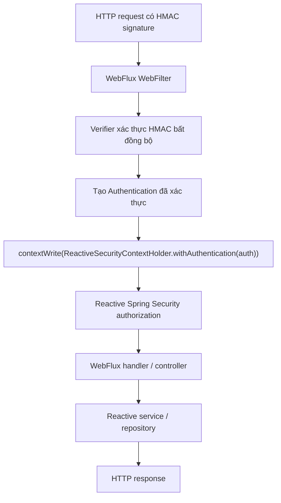
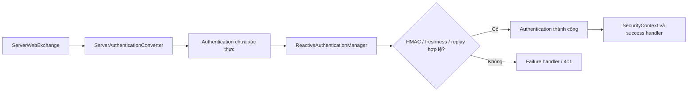

# Reactive SecurityContext trong Spring WebFlux: truyền danh tính HMAC an toàn qua Reactor Context

## 1. Bối cảnh và mục tiêu

Trong module `SECURITY_AUTHENTICATION_HMAC_REQUEST_AUTHENTICATION`, client ký một HTTP request bằng HMAC với **shared secret**. Client và server phải cùng thực hiện một hợp đồng **canonical request**, xác định chính xác method, URI/query, các header và/hoặc body được ký. Server kiểm tra signature, timestamp, nonce chống replay, trạng thái key trong thời gian rotation, và đảm bảo gateway/proxy không làm hai phía hiểu request khác nhau. Sau xác thực, server vẫn phải kiểm tra **authorization** theo quyền của client.

Với Spring MVC truyền thống, một custom servlet filter thường đặt `Authentication` vào `SecurityContextHolder`, nơi mặc định dùng `ThreadLocal`. Cách làm ấy không chuyển nguyên vẹn sang **Spring WebFlux**: trong xử lý reactive, cùng một request có thể tiếp tục trên nhiều thread, và một thread có thể phục vụ nhiều request khác nhau. Nơi thích hợp để mang danh tính qua reactive pipeline là **Reactor Context** và API **`ReactiveSecurityContextHolder`** của Spring Security.

Bài thuộc chương **Spring WebFlux integration**, tập trung vào **Reactive SecurityContext**. Kết thúc bài, người học có thể:

- Giải thích sự khác nhau giữa `SecurityContextHolder` kiểu Servlet và `ReactiveSecurityContextHolder` trong WebFlux.
- Đưa một `Authentication` đã được HMAC verifier xác nhận vào Reactor Context để authorization, service và controller nhận đúng danh tính.
- Hiểu vai trò của `SecurityWebFilterChain`, `WebFilter`, `ServerWebExchange` và `ServerSecurityContextRepository`.
- Đọc và xác thực request body bằng reactive API mà không chặn event loop hoặc làm mất body trước `@RequestBody`.
- Cấu hình đường đi stateless cho machine-to-machine HMAC, tránh lưu một lần ký thành trạng thái đăng nhập cho request kế tiếp.
- Kiểm thử 401/403, context propagation, key rotation, replay, canonicalization và request qua proxy/gateway.

> Ví dụ hướng tới Spring Security 6.x, Spring Framework 6.x, Spring Boot 3.x và Reactor. Tên API/overload có thể khác ở phiên bản dự án cụ thể. Các đoạn mã minh họa ranh giới tích hợp; một hệ thống thật còn cần HMAC verifier, key registry và nonce store hoàn chỉnh.

## 2. Vì sao ThreadLocal không đủ cho Reactive SecurityContext?

Một xử lý WebFlux có thể bắt đầu ở Netty event loop, chuyển sang một scheduler khác, chờ truy vấn không đồng bộ, rồi trả về trên thread tiếp theo. Sự thay đổi thread là hành vi bình thường của reactive pipeline.



`ThreadLocal` gắn với **một thread**; Reactor Context gắn với **subscriber/subscription** của một reactive sequence. Khi chuỗi operator thay đổi thread trong quá trình xử lý, những operator downstream vẫn có thể truy cập thông tin từ Reactor Context theo quy tắc truyền context.

So sánh:

| Cơ chế | Servlet/MVC điển hình | Spring WebFlux |
| --- | --- | --- |
| Nơi thường lưu SecurityContext | `SecurityContextHolder` với `ThreadLocal` | Reactor Context |
| API lấy context | `SecurityContextHolder.getContext()` | `ReactiveSecurityContextHolder.getContext()` |
| API đưa Authentication vào phạm vi xử lý | `SecurityContextHolder.setContext(context)` | `publisher.contextWrite(ReactiveSecurityContextHolder.withAuthentication(auth))` |
| Mối liên hệ với thread | Context của thread hiện tại | Context theo subscription, không phụ thuộc thread cố định |
| Mô hình API | Lấy dữ liệu đồng bộ | Trả `Mono<SecurityContext>` |
| Cleanup | Cơ chế clear context theo request/thread | Kết thúc phạm vi subscription; không tự ghi vào biến toàn cục |

Sai lầm thường gặp là viết `SecurityContextHolder.getContext().setAuthentication(auth)` trong một `WebFilter` rồi tin rằng tất cả operator/reactive service sẽ thấy danh tính. Trên WebFlux, đoạn đó có thể chỉ ảnh hưởng thread hiện tại và không đáng tin khi có bất đồng bộ hoặc thread hopping.

## 3. Ba thành phần: Authentication, SecurityContext và ReactiveSecurityContextHolder

### 3.1. Authentication chỉ được xác nhận khi HMAC đã hợp lệ

`Authentication` biểu diễn principal và authorities của client đã xác thực. Với HMAC, client có thể gửi `X-Key-Id` để tìm một key candidate, nhưng **key ID hay client ID do request khai báo chưa phải danh tính đã được xác minh**.

Một verifier chỉ được tạo `Authentication` được đánh dấu xác thực sau khi đã:

1. Chọn key đúng và kiểm tra trạng thái (active, revoked, expired, giai đoạn key rotation).
2. Xây canonical bytes theo hợp đồng ký và xác minh signature HMAC.
3. Kiểm tra timestamp trong khoảng clock skew cho phép.
4. Kiểm tra và ghi nhận nonce với thao tác nguyên tử theo key/client để chống replay, kể cả khi có nhiều instance.
5. Tra principal và `GrantedAuthority` từ registry/policy **phía server**; ràng buộc scope/tenant đã được cấp với request.

Ví dụ tạo đối tượng kết quả trong verifier sau tất cả bước trên:

```java
import java.util.List;
import org.springframework.security.authentication.UsernamePasswordAuthenticationToken;
import org.springframework.security.core.Authentication;
import org.springframework.security.core.authority.SimpleGrantedAuthority;

record ServicePrincipal(String clientId, String tenantId) {}

// Chỉ thực hiện SAU khi key, HMAC, timestamp và nonce đều hợp lệ.
ServicePrincipal principal =
    new ServicePrincipal("billing-worker", "tenant-a");

Authentication authenticated =
    UsernamePasswordAuthenticationToken.authenticated(
        principal,
        null, // Không đưa shared secret vào Authentication.credentials
        List.of(new SimpleGrantedAuthority("ORDER_CREATE"))
    );
```

Trong triển khai thật, `clientId`, `tenantId` và authorities phải đến từ dữ liệu tin cậy đã xác minh. Không lấy giá trị `X-Role: ADMIN`, `X-Tenant` hay quyền từ body rồi coi đó là authority vì request có chữ ký hợp lệ: quyền được quyết định theo chính sách server và ràng buộc key/tenant.

### 3.2. SecurityContext là nơi chứa Authentication

Spring Security dùng `SecurityContext` làm đối tượng mang `Authentication`. Trong reactive pipeline, Spring Security cung cấp API để đặt danh tính vào Reactor Context mà không phải tự quản lý một `ThreadLocal`.

```java
import org.springframework.security.core.Authentication;
import org.springframework.security.core.context.ReactiveSecurityContextHolder;
import reactor.core.publisher.Mono;

Mono<String> currentClientId =
    ReactiveSecurityContextHolder.getContext()
        .map(context -> context.getAuthentication())
        .map(Authentication::getName);
```

`ReactiveSecurityContextHolder.getContext()` trả về `Mono<SecurityContext>`. Nếu không có context, publisher có thể hoàn tất rỗng; nếu context có nhưng Authentication chưa được xác thực, còn phải áp dụng đúng chính sách bảo mật. Không nên gọi `.block()` để biến nó thành kết quả đồng bộ trong WebFlux handler.

### 3.3. contextWrite: đặt context vào phạm vi reactive

Ví dụ tối thiểu:

```java
Mono<String> protectedOperation =
    ReactiveSecurityContextHolder.getContext()
        .map(ctx -> ctx.getAuthentication().getName());

Mono<String> result = protectedOperation
    .contextWrite(
        ReactiveSecurityContextHolder.withAuthentication(authenticated)
    );
```

Khi có subscriber với `result`, `protectedOperation` có thể đọc đúng `Authentication` từ Reactor Context. Cú pháp `contextWrite(...)` gắn context cho **phần upstream nhìn từ vị trí operator trong pipeline**; khi bao `chain.filter(exchange)` theo cách trên, những filter/handler được chain gọi sẽ đọc được context.

Không nhầm:

```java
// Sai ngữ cảnh khi dùng kiểu imperative trong WebFlux:
SecurityContextHolder.getContext().setAuthentication(authenticated);

// Sai: tạo một publisher độc lập nhưng không gắn context
// cho pipeline thực sự xử lý HTTP request:
Mono.just("ok")
    .contextWrite(ReactiveSecurityContextHolder.withAuthentication(
        authenticated
    ));
// Sau đó gọi một publisher khác sẽ không tự mang Authentication này.
```

Reactor Context **không phải session** và không tự tồn tại qua các HTTP request độc lập. HMAC machine-to-machine nên yêu cầu mỗi request tự mang chữ ký hợp lệ.

## 4. Spring Security WebFlux xử lý context ở vị trí nào?

Spring Security WebFlux dùng `SecurityWebFilterChain` để định nghĩa các reactive security filters và `WebFilterChainProxy` để chọn chain phù hợp. Những thành phần quan trọng:

| Thành phần | Trách nhiệm |
| --- | --- |
| `ServerWebExchange` | Đại diện request, response và thông tin exchange của WebFlux |
| `WebFilter` | Chặn, điều phối hoặc chuyển exchange trong reactive pipeline |
| `SecurityWebFilterChain` | Danh sách filter và matcher cho một nhóm HTTP exchange |
| `ServerWebExchangeMatcher` | Quyết định security chain/policy nào áp dụng |
| `ReactorContextWebFilter` | Kết nối `ServerSecurityContextRepository` vào Reactor Context trong chuỗi Spring Security |
| `ReactiveSecurityContextHolder` | Giao diện đọc/ghi SecurityContext qua Reactor Context |
| `AuthenticationWebFilter` | Filter xác thực có sẵn của Spring Security cho reactive authentication |
| `AuthorizationWebFilter` và authorization manager | Quyết định request có được phép tiếp tục dựa trên context/quy tắc |
| `ServerSecurityContextRepository` | Chính sách nạp/lưu SecurityContext qua request, ví dụ web session hoặc không lưu |

Với HMAC stateless, một cấu hình phù hợp dùng `NoOpServerSecurityContextRepository` để không coi session là nguồn danh tính cho request tiếp theo. Verifier vẫn được gọi mỗi lần client truy cập endpoint cần ký.

`SecurityWebFilterChain` phải chọn route bằng **method/path**. Không dùng sự tồn tại của `X-Signature` làm điều kiện duy nhất để khớp chain: client không gửi header vẫn phải đi vào policy yêu cầu HMAC và nhận lỗi xác thực. Các route chưa khai báo cần fallback rõ ràng.

## 5. Viết custom reactive WebFilter đặt Authentication từ HMAC

Để hiểu chính xác phạm vi Reactor Context, trước hết xét một `WebFilter` tự viết. Khi cần quy trình xác thực chuẩn hóa hơn, có thể dùng `AuthenticationWebFilter` với `ServerAuthenticationConverter` và `ReactiveAuthenticationManager`; phần 7 phân tích lựa chọn đó.

### 5.1. Hợp đồng verifier phải reactive

```java
import org.springframework.security.core.Authentication;
import org.springframework.security.core.AuthenticationException;
import org.springframework.web.server.ServerWebExchange;
import reactor.core.publisher.Mono;

public interface ReactiveHmacVerifier {
    // Mono phát ra Authentication đã xác thực nếu mọi kiểm tra thành công;
    // phát AuthenticationException nếu thất bại.
    Mono<Authentication> authenticate(
        ServerWebExchange exchange,
        byte[] requestBody
    );
}
```

Verifier nhận `byte[]` body đã được buffer có giới hạn để không phải subscribe lại body stream. Bên trong verifier, tra key/nonce store qua **reactive client** khi có thể. Tránh gọi JDBC/blocking SDK, `Thread.sleep`, `Mono.block()` hoặc network I/O đồng bộ trực tiếp trên Netty event-loop thread. Nếu một legacy API bắt buộc blocking, cô lập nó bằng `Mono.fromCallable(...).subscribeOn(Schedulers.boundedElastic())` với giới hạn tài nguyên và cân nhắc thay bằng driver reactive.

Việc tính `Mac.doFinal(...)` trên payload đã được giới hạn thường là công việc CPU đồng bộ ngắn; cần đo lường kích thước payload và tải thực tế, tránh biến quá trình verify thành thao tác CPU nặng trên event loop. Thuật toán HMAC phải dùng encoding/canonicalization và so sánh chữ ký theo hợp đồng.

### 5.2. Đọc raw body mà không làm mất dữ liệu cho handler

`ServerHttpRequest.getBody()` trả về `Flux<DataBuffer>`. Đây không phải `InputStream` có thể tùy ý đọc lại; body stream thường chỉ nên được tiêu thụ một lần.

Ví dụ sai:

```java
exchange.getRequest().getBody().subscribe(buffer -> {
    // Đọc ở đây để kiểm HMAC rồi mong controller vẫn đọc được body.
});
return chain.filter(exchange);
```

`subscribe()` thủ công tạo một subscription khác, làm mất trình tự xác thực và xử lý HTTP; code có thể gọi handler trước khi xác minh xong hoặc tiêu thụ body không đúng cách. Cần **kết hợp publisher** trong cùng pipeline và truyền body mới cho downstream.

Trong ví dụ bên dưới:

- `DataBufferUtils.join(..., MAX_BODY_BYTES)` ghép các data buffer có giới hạn; nếu vượt giới hạn, phát `DataBufferLimitException`.
- Bytes được copy ra mảng, sau đó giải phóng `DataBuffer` đã ghép bằng `DataBufferUtils.release(...)`.
- `ServerHttpRequestDecorator` tái phát body cho handler từ một bản copy, mỗi subscription dùng buffer riêng.
- `ServerWebExchange.mutate().request(decoratedRequest).build()` truyền request đã được bọc xuống chain.

Đây là lựa chọn dành cho **body JSON nhỏ, đồng bộ theo ý nghĩa payload, nhưng được đọc bằng reactive I/O**. Không áp dụng nguyên mẫu cho upload khổng lồ, streaming hoặc multipart cần xử lý theo luồng; phải thiết kế protocol ký và cơ chế xác minh phù hợp.

### 5.3. Một WebFilter minh họa hoàn chỉnh

```java
import org.springframework.core.io.buffer.DataBuffer;
import org.springframework.core.io.buffer.DataBufferLimitException;
import org.springframework.core.io.buffer.DataBufferUtils;
import org.springframework.http.HttpStatus;
import org.springframework.http.server.reactive.ServerHttpRequest;
import org.springframework.http.server.reactive.ServerHttpRequestDecorator;
import org.springframework.security.authentication.BadCredentialsException;
import org.springframework.security.core.Authentication;
import org.springframework.security.core.AuthenticationException;
import org.springframework.security.core.context.ReactiveSecurityContextHolder;
import org.springframework.web.server.ServerWebExchange;
import org.springframework.web.server.WebFilter;
import org.springframework.web.server.WebFilterChain;
import reactor.core.publisher.Flux;
import reactor.core.publisher.Mono;

public final class HmacReactiveAuthenticationFilter implements WebFilter {

    private static final int MAX_BODY_BYTES = 1024 * 1024; // 1 MiB
    private final ReactiveHmacVerifier verifier;

    public HmacReactiveAuthenticationFilter(ReactiveHmacVerifier verifier) {
        this.verifier = verifier;
    }

    @Override
    public Mono<Void> filter(
        ServerWebExchange exchange,
        WebFilterChain chain
    ) {
        Mono<byte[]> bodyMono = DataBufferUtils
            .join(exchange.getRequest().getBody(), MAX_BODY_BYTES)
            .map(buffer -> {
                try {
                    byte[] bytes = new byte[buffer.readableByteCount()];
                    buffer.read(bytes);
                    return bytes;
                } finally {
                    DataBufferUtils.release(buffer);
                }
            })
            .defaultIfEmpty(new byte[0])
            .onErrorResume(DataBufferLimitException.class, ex ->
                reject(exchange, HttpStatus.PAYLOAD_TOO_LARGE)
                    .then(Mono.empty())
            );

        return bodyMono.flatMap(body -> {
            // Chỉ lỗi của verifier được chuyển thành 401.
            Mono<Authentication> verified = verifier
                .authenticate(exchange, body.clone())
                .switchIfEmpty(Mono.error(
                    new BadCredentialsException("Missing HMAC identity")
                ))
                .flatMap(auth -> auth.isAuthenticated()
                    ? Mono.just(auth)
                    : Mono.error(new BadCredentialsException(
                        "HMAC not authenticated"
                    ))
                )
                .onErrorResume(AuthenticationException.class, ex ->
                    reject(exchange, HttpStatus.UNAUTHORIZED)
                        .then(Mono.empty())
                );

            return verified.flatMap(authentication -> {
                ServerHttpRequest replayable =
                    new ServerHttpRequestDecorator(exchange.getRequest()) {
                        @Override
                        public Flux<DataBuffer> getBody() {
                            return Flux.defer(() -> Flux.just(
                                exchange.getResponse().bufferFactory()
                                    .wrap(body.clone())
                            ));
                        }
                    };

                ServerWebExchange downstream = exchange.mutate()
                    .request(replayable)
                    .build();

                return chain.filter(downstream)
                    .contextWrite(
                        ReactiveSecurityContextHolder
                            .withAuthentication(authentication)
                    );
            });
        });
    }

    private static Mono<Void> reject(
        ServerWebExchange exchange,
        HttpStatus status
    ) {
        exchange.getResponse().setStatusCode(status);
        return exchange.getResponse().setComplete();
    }
}
```

Đọc ví dụ theo thứ tự thực thi:

1. Body được ghép có giới hạn. Request vượt 1 MiB nhận **413 Payload Too Large** (giới hạn áp dụng cho body đã được WebFlux nhận, có thể đã chịu biến đổi của hạ tầng).
2. Verifier nhận một bản copy của body và trả `Mono<Authentication>`. Khi key, signature, timestamp hoặc nonce không hợp lệ, nó phát `AuthenticationException` và filter trả **401 Unauthorized**.
3. Khi verifier phát ra `Authentication` đã xác thực, filter tạo request decorator để controller vẫn đọc đúng body bytes.
4. `chain.filter(downstream).contextWrite(ReactiveSecurityContextHolder.withAuthentication(authentication))` gắn danh tính vào reactive pipeline **đang đi tiếp**, nhờ đó authorization và handler đọc đúng `SecurityContext`.
5. Không có `SecurityContextHolder.setContext(...)` hay `ThreadLocal` tự viết, không có `block()` và không có `subscribe()` tách rời.

Hai loại lỗi được xử lý ở phạm vi hẹp: `DataBufferLimitException` trong bước đọc body trả 413, `AuthenticationException` từ verifier trả 401. Không bắt mọi exception của controller thành “HMAC failed”: controller có thể trả lỗi validation 400, lỗi domain hoặc lỗi hệ thống dù HMAC đã hợp lệ.

`DataBufferUtils.join` quản lý cleanup của các buffer nguồn khi có lỗi/cancellation; khi đã nhận buffer ghép, ví dụ dùng `finally` để release sau khi copy. Request decorator tạo một `DataBuffer` **mới** mỗi lần downstream subscribe, tránh chia sẻ cùng buffer đã bị consume/release. Vẫn cần test với actual Netty runtime, content type và giới hạn tài nguyên của ứng dụng.

**Giới hạn của ví dụ:** Buffer toàn bộ body làm tiêu tốn bộ nhớ theo số request đồng thời; ví dụ chỉ dành cho JSON nhỏ và hợp đồng ký body thô. Streaming, multipart, nén payload hoặc body rất lớn cần chiến lược xác thực trên stream/digest được định nghĩa riêng. Bên cạnh max body, cần giới hạn header, timeout, concurrency và kích thước request tại gateway/Netty. Verifier cũng cần giới hạn độ dài, format và số lượng header bảo mật.

## 6. Cấu hình SecurityWebFilterChain cho API HMAC stateless

Ta bảo vệ duy nhất endpoint `POST /internal/orders`, cần authority `ORDER_CREATE`. Một chain riêng xử lý HMAC, chain sau từ chối những route khác trong ví dụ API kín.

```java
import org.springframework.context.annotation.Bean;
import org.springframework.context.annotation.Configuration;
import org.springframework.core.annotation.Order;
import org.springframework.http.HttpMethod;
import org.springframework.security.config.web.server.ServerHttpSecurity;
import org.springframework.security.web.server.SecurityWebFilterChain;
import org.springframework.security.web.server.SecurityWebFiltersOrder;
import org.springframework.security.web.server.context.NoOpServerSecurityContextRepository;
import org.springframework.security.web.server.util.matcher.PathPatternParserServerWebExchangeMatcher;

@Configuration
class HmacWebFluxSecurityConfig {

    @Bean
    @Order(1)
    SecurityWebFilterChain hmacChain(
        ServerHttpSecurity http,
        ReactiveHmacVerifier verifier
    ) {
        var signedRoute = new PathPatternParserServerWebExchangeMatcher(
            "/internal/orders", HttpMethod.POST
        );

        return http
            .securityMatcher(signedRoute)
            .securityContextRepository(
                NoOpServerSecurityContextRepository.getInstance())
            .csrf(ServerHttpSecurity.CsrfSpec::disable)
            .httpBasic(ServerHttpSecurity.HttpBasicSpec::disable)
            .formLogin(ServerHttpSecurity.FormLoginSpec::disable)
            .authorizeExchange(exchanges -> exchanges
                .anyExchange().hasAuthority("ORDER_CREATE"))
            .addFilterAt(
                new HmacReactiveAuthenticationFilter(verifier),
                SecurityWebFiltersOrder.AUTHENTICATION)
            .build();
    }

    @Bean
    @Order(2)
    SecurityWebFilterChain fallbackChain(ServerHttpSecurity http) {
        return http
            .csrf(ServerHttpSecurity.CsrfSpec::disable)
            .httpBasic(ServerHttpSecurity.HttpBasicSpec::disable)
            .formLogin(ServerHttpSecurity.FormLoginSpec::disable)
            .authorizeExchange(exchanges -> exchanges
                .anyExchange().denyAll())
            .build();
    }
}
```

Giải thích những điểm chính:

- `PathPatternParserServerWebExchangeMatcher` kiểm **method và path**, nên request thiếu signature vẫn vào HMAC chain và được trả 401. Không xây matcher chỉ dựa trên `X-Signature`.
- `@Order(1)` và `@Order(2)` định thứ tự chain; chain phù hợp đầu tiên xử lý exchange. Fallback từ chối request không thuộc endpoint công bố. Ứng dụng có public endpoint, actuator hoặc browser login cần các chain riêng được khai báo có chủ đích.
- `SecurityWebFiltersOrder.AUTHENTICATION` đưa custom `WebFilter` vào vùng xác thực trước authorization. `ReactorContextWebFilter` và các filter Spring Security phối hợp truyền context qua Reactor.
- `NoOpServerSecurityContextRepository` tránh lưu SecurityContext vào session. Mỗi HTTP request phải được ký và xác thực độc lập; `contextWrite` vẫn đủ cho request đang xử lý.
- `hasAuthority("ORDER_CREATE")` là **authorization**: HMAC hợp lệ nhưng client không có quyền vẫn bị chặn (**403 Forbidden** trong trường hợp đã authenticated và access-denied handling thông thường).
- `csrf.disable()` chỉ hợp lý cho chain machine-to-machine stateless không sử dụng cookie/session làm credential. Nếu ứng dụng phục vụ browser, phải cấu hình CSRF và CORS riêng cho những route phù hợp.

Trong WebFlux, `WebFilter` có thể được tự động đăng ký như bean toàn ứng dụng. Nếu tạo một filter `@Component` rồi thêm cùng đối tượng bằng `addFilterAt(...)`, nó có thể chạy hai lần hoặc áp vào cả endpoint không thuộc HMAC chain. Ví dụ tạo đối tượng trong cấu hình chain nhằm giới hạn phạm vi. Nếu dự án cần filter bean để inject, phải kiểm soát registration để nó chỉ nằm tại vị trí mong muốn.

Không gọi `chain.filter(...)` trước khi verification hoàn tất. Nếu bước xác thực dùng bất đồng bộ để lấy key/nonce, phải **compose** publisher của verifier vào pipeline như trên; không tự `subscribe()` rồi trả response trước.

## 7. AuthenticationWebFilter và ReactiveAuthenticationManager: phương án có sẵn

Spring Security đã có `AuthenticationWebFilter` để triển khai quy trình xác thực nhất quán:



Một cách tổ chức phổ biến:

1. `ServerAuthenticationConverter` đọc metadata request, chọn thông tin cần xác thực và tạo `Authentication` **chưa xác thực**.
2. `ReactiveAuthenticationManager` xác minh HMAC và trả `Mono<Authentication>` đã xác thực hoặc phát lỗi tương ứng.
3. `AuthenticationWebFilter` xử lý thành công/thất bại và truyền context, kết hợp `ServerSecurityContextRepository` theo chính sách đã cấu hình.

Ví dụ khởi tạo ở mức khái niệm:

```java
AuthenticationWebFilter filter =
    new AuthenticationWebFilter(reactiveAuthenticationManager);

filter.setServerAuthenticationConverter(hmacAuthenticationConverter);
filter.setRequiresAuthenticationMatcher(signedRoute);
filter.setSecurityContextRepository(
    NoOpServerSecurityContextRepository.getInstance()
);

http.addFilterAt(filter, SecurityWebFiltersOrder.AUTHENTICATION);
```

Ở đây các đối tượng `reactiveAuthenticationManager`, `hmacAuthenticationConverter` và `signedRoute` là dependency của ứng dụng cần được định nghĩa riêng. `AuthenticationWebFilter` là lựa chọn phù hợp khi muốn tận dụng flow xác thực, failure/success handler và khả năng mở rộng của Spring Security.

**Đặc biệt với body ký HMAC:** Converter có thể consume `Flux<DataBuffer>`. Việc đọc request body ở converter **không tự làm cho controller đọc lại được**. Cần một WebFilter/body decorator chạy ở vị trí thích hợp để buffer có giới hạn, bảo toàn bytes và truyền exchange đã decorator cho downstream, rồi mới để converter/manager sử dụng cùng dữ liệu. Tránh hai subscription độc lập vào body nguồn.

Nếu HMAC chỉ ký method, URI và header, không cần đọc body để xác thực. Nhưng khi body có ảnh hưởng đến hành động mà không nằm trong chữ ký hoặc không được kiểm soát bằng ràng buộc khác, hợp đồng có thể không bảo vệ được integrity như mong muốn.

## 8. Lấy Authentication trong reactive handler và service

### 8.1. Ở controller

Spring Security WebFlux có thể hỗ trợ tham số `@AuthenticationPrincipal` đã được lấy từ Reactive SecurityContext:

```java
import java.util.Map;
import org.springframework.security.core.annotation.AuthenticationPrincipal;
import org.springframework.web.bind.annotation.PostMapping;
import org.springframework.web.bind.annotation.RequestBody;
import org.springframework.web.bind.annotation.RestController;
import reactor.core.publisher.Mono;

record OrderCommand(String orderId) {}

@RestController
class InternalOrderController {

    @PostMapping("/internal/orders")
    Mono<Map<String, String>> create(
        @AuthenticationPrincipal ServicePrincipal principal,
        @RequestBody Mono<OrderCommand> body
    ) {
        return body.map(order -> Map.of(
            "clientId", principal.clientId(),
            "orderId", order.orderId()
        ));
    }
}
```

Đây chỉ là minh họa cách lấy principal và body. Trong code nghiệp vụ thực tế, controller phải gọi service để kiểm tra client có quyền tạo đơn hàng trong `tenantId` tương ứng; việc có authority `ORDER_CREATE` chưa bảo đảm được phép truy cập mọi tài nguyên trong mọi tenant.

### 8.2. Ở reactive service

Một service có thể đọc context trực tiếp qua publisher:

```java
import org.springframework.security.core.Authentication;
import org.springframework.security.core.context.ReactiveSecurityContextHolder;
import reactor.core.publisher.Mono;

public Mono<String> currentClientName() {
    return ReactiveSecurityContextHolder.getContext()
        .map(ctx -> ctx.getAuthentication())
        .filter(Authentication::isAuthenticated)
        .map(Authentication::getName);
}
```

Nếu nghiệp vụ yêu cầu chắc chắn có context, xử lý trường hợp `Mono.empty()` bằng lỗi rõ ràng; không giả định luôn có Authentication. Với luồng xử lý phức tạp, truyền principal đã được xác thực như tham số service có thể dễ kiểm thử và giúp phạm vi quyền minh bạch hơn.

### 8.3. Truyền context qua publishOn, subscribeOn và async boundary

Trong cùng một Reactor chain, `contextWrite` vẫn cung cấp dữ liệu context cho operator upstream theo quy tắc Reactor, kể cả khi pipeline sử dụng `publishOn` hoặc `subscribeOn`. Tuy nhiên, khi tách việc thực thi thành **một subscription khác**, dùng callback của thư viện không hỗ trợ Reactor, gửi message vào queue, hoặc khởi chạy một task nền bằng `subscribe()` độc lập, context không tự động trở thành một credential vĩnh viễn.

Nếu cần tác vụ nền, hãy truyền dữ liệu đã xác thực tối thiểu (ví dụ client ID và tenant được phép) dưới dạng thông điệp có kiểm soát, và xác định quyền thực thi tại consumer. Không sao chép raw HMAC key, signature hoặc toàn bộ Reactor Context sang hệ thống khác.

Không lưu `Authentication` trong mutable field của singleton `WebFilter` hay `@Service`: nhiều request đồng thời sẽ ghi đè lẫn nhau. Không cố dùng `InheritableThreadLocal` để giải quyết context cho WebFlux.

## 9. Reactor Context, session persistence và lifecycle

Ba cơ chế có phạm vi khác nhau:

| Cơ chế | Phạm vi | Có nên dùng để giữ HMAC auth qua request? |
| --- | --- | --- |
| `ReactiveSecurityContextHolder.withAuthentication(auth)` | Reactive subscription được bọc | Có, chỉ cho request hiện tại |
| `NoOpServerSecurityContextRepository` | Không lưu SecurityContext vào repository | Phù hợp stateless HMAC |
| `WebSessionServerSecurityContextRepository` | Nạp/lưu SecurityContext liên quan WebSession | Không nên dùng như bằng chứng HMAC cho request mới nếu mỗi request phải ký |

Đối với request HMAC, client có thể gửi nhiều request liên tiếp trên cùng TCP connection hoặc cùng session cookie; mỗi request **vẫn phải** có timestamp, nonce và chữ ký mới. Thành công của request trước không làm request sau tự được authenticated.

Hàm `ReactiveSecurityContextHolder.clearContext()` trả về một thao tác điều chỉnh Reactor Context, không tương đương gọi `SecurityContextHolder.clearContext()` kiểu imperative. Nếu cần tạo một nhánh reactive không mang context, hãy thiết kế phạm vi publisher và dùng phép biến đổi context đúng vị trí. Ví dụ HMAC ở mục 5 dựa vào phạm vi `contextWrite` của `chain.filter(...)`, nên không cần tự clear một ThreadLocal khi response hoàn thành.

Không đặt `contextWrite` ở cuối một publisher chẳng liên quan rồi mong filter/handler khác kế thừa. Vị trí bọc publisher và thời điểm subscribe quyết định phần code nào nhìn thấy context.

## 10. Canonical request và proxy/gateway trong WebFlux

`ServerWebExchange` cung cấp `ServerHttpRequest`; từ đó có thể đọc:

| WebFlux API | Giá trị | Lưu ý khi ký |
| --- | --- | --- |
| `getRequest().getMethod()` | HTTP method | Phải là trường có hợp đồng canonicalization |
| `getRequest().getURI().getRawPath()` | Path dạng raw của URI ứng dụng nhận được | Không mặc nhiên là wire path gốc trước proxy |
| `getRequest().getURI().getRawQuery()` | Raw query từ URI mà server thấy | Khác các cặp đã decode trong `getQueryParams()` |
| `getRequest().getHeaders()` | HTTP headers mà WebFlux nhận được | Chống duplicate/ambiguous headers và normalize theo hợp đồng |
| `getRequest().getBody()` | `Flux<DataBuffer>` cho body | Phải xử lý stream và resource lifecycle |
| `getRequest().getPath()` | Parsed request path dùng trong routing | Không tự động tương đương canonical raw URI |
| `getRequest().getRemoteAddress()` | Peer address | Qua proxy thường là gateway, không chứng minh client ID |

Những ví dụ cần có test vector:

```text
POST /internal/orders?tag=a%20b&mode=fast
POST /internal/orders?mode=fast&tag=a+b
POST /internal/orders?tag=a%20b&tag=c
```

Các request có thể khác raw bytes, thứ tự query hoặc số lượng tham số. Hãy định nghĩa cụ thể có sắp xếp query không, xử lý key trùng thế nào, có decode percent encoding không và có giữ nguyên phân biệt giữa `+` với `%20` không. Đừng dựa hoàn toàn vào `getQueryParams()` để khôi phục representation ban đầu.

Với signed headers, cần thống nhất tên header (case-insensitive), thứ tự, whitespace, quy tắc xử lý nhiều giá trị, các header có thể bị gateway sửa và encoding. Không nên dùng riêng `getFirst("X-Key-Id")` mà không có chính sách xử lý nhiều header định danh hoặc header đã bị proxy gộp.

Với body, ký raw bytes nghĩa là hai JSON có field/thứ tự/whitespace khác nhau sẽ tạo digest khác nhau dù có thể diễn tả dữ liệu nghiệp vụ tương tự. Nếu chọn canonical JSON, hai phía phải thống nhất một tiêu chuẩn canonicalization cụ thể; không parse thành object rồi serialize tùy tiện.

### 10.1. Các rủi ro từ gateway

- **Rewrite path:** client ký `/public/v1/orders` trong khi WebFlux nhận `/internal/orders`; cần quyết định bên nào verify, hoặc có thông tin trusted mapping đã được định nghĩa.
- **Forwarded headers:** chỉ tin `Forwarded`/`X-Forwarded-*` từ proxy tin cậy. Header do client internet tự cung cấp không phải bằng chứng về host/scheme/path.
- **Header transformation:** gateway thêm/bớt/gộp header có thể làm canonical bytes đổi; ký đúng tập header có hợp đồng ổn định.
- **Body transformation:** decompress, normalize line ending hoặc reserialize JSON trước verifier có thể thay body đã ký.
- **Multi-instance:** nonce chỉ lưu trong memory của một node không chặn replay sang node khác. Dùng kho nonce với thao tác atomic check-and-insert và TTL phù hợp.

HMAC xác thực **tính chân thực/toàn vẹn của nội dung được ký** theo key chia sẻ; nó không tự thay thế TLS, kiểm soát gateway, authorization hoặc giới hạn tài nguyên.

## 11. Kiểm thử Reactive SecurityContext và HMAC từ đầu đến cuối

### 11.1. Unit test: Reactor Context không phụ thuộc ThreadLocal

Ví dụ dùng Reactor Test và một Authentication đã được test fixture tạo:

```java
import java.util.List;
import org.junit.jupiter.api.Test;
import org.springframework.security.authentication.UsernamePasswordAuthenticationToken;
import org.springframework.security.core.Authentication;
import org.springframework.security.core.context.ReactiveSecurityContextHolder;
import org.springframework.security.core.authority.SimpleGrantedAuthority;
import reactor.core.publisher.Mono;
import reactor.test.StepVerifier;

class ReactiveSecurityContextExampleTest {

    @Test
    void downstreamPublisherReadsAuthenticationFromReactorContext() {
        Authentication auth =
            UsernamePasswordAuthenticationToken.authenticated(
                "billing-worker",
                null,
                List.of(new SimpleGrantedAuthority("ORDER_CREATE"))
            );

        Mono<String> readPrincipal =
            ReactiveSecurityContextHolder.getContext()
                .map(ctx -> ctx.getAuthentication().getName());

        StepVerifier.create(readPrincipal.contextWrite(
                ReactiveSecurityContextHolder.withAuthentication(auth)
            ))
            .expectNext("billing-worker")
            .verifyComplete();
    }
}
```

Test này chứng minh **context propagation** cơ bản, không chứng minh verifier đã kiểm chữ ký. Khi test authentication HTTP, cần nạp đúng `SecurityWebFilterChain` và dùng test vector chữ ký thật hoặc fake verifier được điều khiển rõ ràng.

### 11.2. Integration test với WebTestClient

`WebTestClient` phù hợp kiểm tra WebFlux route, response và security filters. Với test nạp đủ Spring Boot/WebFlux Security configuration:

```java
import org.junit.jupiter.api.Test;
import org.springframework.beans.factory.annotation.Autowired;
import org.springframework.boot.test.autoconfigure.web.reactive.AutoConfigureWebTestClient;
import org.springframework.boot.test.context.SpringBootTest;
import org.springframework.http.MediaType;
import org.springframework.test.web.reactive.server.WebTestClient;

@SpringBootTest(webEnvironment = SpringBootTest.WebEnvironment.RANDOM_PORT)
@AutoConfigureWebTestClient
class HmacWebFluxSecurityIntegrationTest {

    @Autowired
    WebTestClient webTestClient;

    @Test
    void missingSignatureIsRejected() {
        webTestClient.post()
            .uri("/internal/orders")
            .contentType(MediaType.APPLICATION_JSON)
            .bodyValue("{\"orderId\":\"ORD-1001\"}")
            .exchange()
            .expectStatus().isUnauthorized();
    }
}
```

Không chỉ dùng `@WithMockUser` hoặc mock controller rồi kết luận HMAC đã đúng: những cách đó có thể tạo authentication mà không chạy HMAC verifier. Cần gửi signature từ client fixture tới HTTP endpoint, so sánh kết quả ở cả authorization và controller.

### 11.3. Ma trận trường hợp bắt buộc

| Tình huống | Kết quả kỳ vọng | Điều được xác minh |
| --- | --- | --- |
| HMAC hợp lệ, client có `ORDER_CREATE` | Request thành công theo nghiệp vụ | Context/authority đến được handler |
| Thiếu `X-Signature` | 401 | Matcher bảo vệ endpoint dù không có header ký |
| Signature sai hoặc body đổi một byte | 401 | Verifier thực sự kiểm nội dung ký |
| Key ID không tồn tại, đã thu hồi hoặc hết hiệu lực | 401 | Key lifecycle và key rotation |
| Timestamp quá hạn/đi trước clock quá xa | 401 | Giới hạn freshness |
| Gửi lại key/nonce đã được chấp nhận | 401 hoặc mã replay đã quy ước | Replay store nguyên tử |
| Hai request replay qua hai instance | Chỉ một request được chấp nhận | Nonce state chia sẻ, không race |
| Signature hợp lệ nhưng thiếu `ORDER_CREATE` | 403 | Authentication tách khỏi authorization |
| Client ký request với tenant khác quyền được cấp | Bị từ chối | Ràng buộc tenant/resource |
| JSON ký đúng nhưng cú pháp sai | Lỗi parse/validation, thường 400 | Lỗi MVC/WebFlux handler không bị xem là HMAC lỗi |
| JSON body bị filter đọc rồi controller đọc `@RequestBody` | Controller vẫn nhận đủ bytes | Request decorator hoạt động |
| Body vượt `MAX_BODY_BYTES` | 413 | Giới hạn buffer và memory |
| Method/path khác route được ký | Fallback/chính sách khác từ chối | Không bypass bằng đổi route |
| Header ký trùng hoặc giá trị mơ hồ | Bị xử lý nhất quán theo giao thức | Không có khác biệt gateway/app |
| Gateway rewrite URI hoặc reserialize body | Khớp hợp đồng đã quy định hoặc từ chối | Canonicalization ở biên thực |
| Có `publishOn` giữa filter và service | Service vẫn thấy đúng principal | Reactor Context propagation |
| Hai request đồng thời có hai client | Không lẫn context giữa hai subscription | Không dựa vào shared mutable state |
| Verifier lỗi do mạng/nonce store không sẵn sàng | Từ chối an toàn; mã lỗi theo chính sách | Không mặc nhiên cho phép vì thiếu kiểm chứng |

Khi kiểm lỗi, log request ID, mã nguyên nhân, key ID đã che, canonicalization version và thông tin latency ở mức cần thiết; không log secret, raw body nhạy cảm hoặc expected signature. Test proxy nên chạy qua chính cấu hình rewrite/forwarded headers sản xuất khi khả thi.

## 12. Lỗi phổ biến và cách khắc phục

### 12.1. Dùng SecurityContextHolder của Servlet

```java
// Sai cho reactive WebFlux:
SecurityContextHolder.getContext().setAuthentication(auth);
```

Thay bằng `chain.filter(exchange).contextWrite(ReactiveSecurityContextHolder.withAuthentication(auth))` ở phạm vi xử lý đã xác thực. Không kỳ vọng ThreadLocal đi theo một reactive subscription.

### 12.2. subscribe thủ công hoặc block ngay trong WebFilter

```java
// Sai: subscribe tách luồng, không chờ xác thực trước khi cho đi tiếp.
verifier.authenticate(exchange, body).subscribe(...);
return chain.filter(exchange);
```

Kết hợp `Mono` của verifier và `chain.filter(...)` bằng `flatMap`, `then` và các operator thích hợp để thứ tự kiểm tra HMAC luôn rõ ràng. Không dùng `block()` trên event loop; blocking I/O phải được cô lập có kiểm soát.

### 12.3. Đọc body hai lần từ request nguồn

`getBody()` là publisher của request body, không phải bản sao có thể phát lại vô hạn. Đọc trong filter rồi để controller subscribe trực tiếp body cũ có thể khiến request mất dữ liệu. Dùng buffering có giới hạn và `ServerHttpRequestDecorator` với buffer mới cho downstream, hoặc thiết kế verifier streaming phù hợp.

### 12.4. Đặt context cho publisher không liên quan

`contextWrite` chỉ có hiệu lực theo phạm vi subscription của chuỗi publisher được bọc. Nếu tạo `Mono<Void> unused = ...contextWrite(...)` mà HTTP pipeline trả về một `Mono` khác, context của `unused` không được truyền sang pipeline thực.

### 12.5. Chữ ký đúng nhưng cấp mọi quyền

HMAC chỉ chứng minh client biết secret hợp lệ và những thành phần đã ký không bị sửa theo hợp đồng. Authorities phải được lấy từ server, và service vẫn cần kiểm tra quyền theo tenant hoặc tài nguyên. Đừng xem `isAuthenticated()` là tương đương `hasAuthority("ORDER_CREATE")`.

### 12.6. Lưu context HMAC vào WebSession

Lưu SecurityContext của một request ký vào session và tái dùng ở request sau có thể bỏ qua yêu cầu signature/nonce theo từng request. Dùng `NoOpServerSecurityContextRepository` với API HMAC stateless nếu không có lý do khác được thiết kế rõ.

### 12.7. Nhầm request routing với canonicalization

`PathPatternParserServerWebExchangeMatcher` chọn endpoint để áp chính sách. Nó không chuẩn hóa signature hoặc chống replay. Client và verifier phải có định nghĩa canonical URI/query/header/body riêng; gateway cũng phải tuân thủ.

## 13. Các bước triển khai trong dự án

1. **Lập hợp đồng ký:** định nghĩa phiên bản canonical request, method, URI/query, signed headers, raw body digest, signature encoding, timestamp và nonce.
2. **Định nghĩa phạm vi route:** viết `ServerWebExchangeMatcher` theo method/path cho HMAC, chain fallback và quy tắc `authorizeExchange` theo authority cụ thể.
3. **Tách verifier reactive:** tra key, kiểm key rotation, canonical signature, timestamp/nonce phân tán và trả `Mono<Authentication>` từ dữ liệu quyền tin cậy.
4. **Xử lý body có giới hạn:** chỉ buffer khi thật sự cần; bảo toàn bytes cho WebFlux handler, giải phóng `DataBuffer` và xử lý cancel/error.
5. **Gắn Reactive SecurityContext đúng phạm vi:** bọc publisher `chain.filter(...)` bằng `contextWrite(ReactiveSecurityContextHolder.withAuthentication(auth))` sau khi xác thực.
6. **Không tái dùng danh tính qua session:** cấu hình `NoOpServerSecurityContextRepository` cho machine-to-machine stateless; mỗi HTTP request tự ký.
7. **Kiểm authorization tách biệt:** `hasAuthority(...)` ở security chain và kiểm tenant/resource tại service.
8. **Kiểm thử từ HTTP đến handler:** dùng `WebTestClient`, `StepVerifier`, test vectors và test gateway/replay nhiều instance để xác nhận cả chữ ký lẫn context propagation.

**Điểm cần nhớ:** Trong Spring WebFlux, danh tính đã xác thực đi cùng **Reactor Context của reactive subscription**. HMAC verifier chứng minh request hợp lệ; `ReactiveSecurityContextHolder` chuyển `Authentication` đến authorization và handler; `SecurityWebFilterChain` quyết định request nào phải ký; authorization quyết định client được làm gì. Thiết kế đúng cả bốn mắt xích giúp bảo vệ API HMAC mà không phụ thuộc ThreadLocal hoặc vô tình lưu phiên đăng nhập giữa các request.
