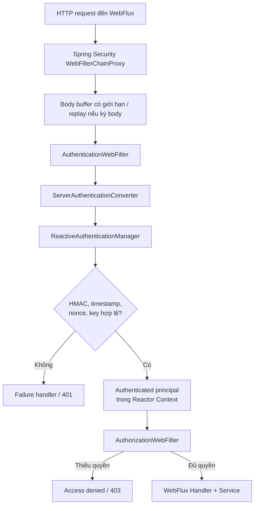

# Reactive authentication trong Spring WebFlux khi xác thực HTTP request bằng HMAC

## 1. Reactive authentication là gì và giải quyết vấn đề nào?

Trong hệ thống Spring WebFlux, HTTP request được xử lý bằng các chuỗi `Publisher` bất đồng bộ, phổ biến là `Mono` và `Flux` của Project Reactor. Xác thực không chỉ là một hàm trả về `true` hoặc `false`: ứng dụng phải có thể truy xuất khóa, tính và so sánh chữ ký, kiểm tra timestamp/nonce, nhận diện client, thiết lập security context và tiếp tục authorization mà không làm nghẽn event-loop.

Với module `SECURITY_AUTHENTICATION_HMAC_REQUEST_AUTHENTICATION`, client tạo HMAC từ **shared secret** và **canonical request** theo hợp đồng ký. Dữ liệu được ký có thể bao gồm HTTP method, URI, header đã chọn và hash body. Server phải xác minh chữ ký, chống replay bằng timestamp và nonce, hỗ trợ key rotation, kiểm thử hành vi sau proxy/gateway và phân biệt **authentication** với **authorization**.

Trong Spring WebFlux:

- **Authentication**: xác minh request đến từ client sở hữu shared secret hợp lệ và tạo principal đáng tin cậy.
- **Authorization**: kiểm tra principal đã xác thực có authority hoặc quyền trên tài nguyên/tenant cụ thể.
- **Reactive authentication**: thực hiện các bước xác thực thông qua các toán tử Reactor; mọi thao tác I/O chờ kho khóa hoặc kho nonce nên dùng API không chặn.
- **Security context**: tồn tại trong **Reactor Context** của chuỗi xử lý, không dựa vào một `ThreadLocal` cố định xuyên suốt request như cách thường thấy trong servlet blocking.

Ví dụ: client ký `POST /api/orders` với body JSON. Chữ ký đúng nhưng client chỉ có `orders:read`: request **đã được xác thực** nhưng sẽ nhận `403 Forbidden` khi authorization yêu cầu `orders:create`. Chữ ký sai: request chưa được xác thực và thường nhận `401 Unauthorized`.

Mục tiêu của bài là triển khai được một đường đi request có cấu trúc, bảo toàn chính xác bytes đã ký và trả lỗi nhất quán **trước khi handler có side effect**.

## 2. Luồng bảo mật WebFlux so với Spring MVC

Spring MVC Servlet thường dùng `SecurityFilterChain`, `OncePerRequestFilter` và `HttpServletRequest`. Spring WebFlux sử dụng những API khác:

| Servlet / Spring MVC | Reactive / Spring WebFlux | Vai trò |
| --- | --- | --- |
| `SecurityFilterChain` | `SecurityWebFilterChain` | Định nghĩa filter và policy cho HTTP request |
| `FilterChainProxy` | `WebFilterChainProxy` | Chọn/điều phối security web filters |
| `OncePerRequestFilter` | `WebFilter` | Chặn, chuyển tiếp hoặc biến đổi request/response |
| `HttpServletRequest` | `ServerWebExchange` / `ServerHttpRequest` | Truy cập HTTP request và exchange |
| `AuthenticationManager` | `ReactiveAuthenticationManager` | Xác thực credential |
| `AuthenticationFilter` hoặc filter tự viết | `AuthenticationWebFilter` | Chuyển credential thành authenticated principal |
| `AuthenticationConverter` (Servlet) | `ServerAuthenticationConverter` | Trích xuất credential từ request |
| `SecurityContextHolder` | `ReactiveSecurityContextHolder` | Đọc security context tương thích Reactor |
| `AuthenticationEntryPoint` | `ServerAuthenticationEntryPoint` | Phản hồi khi cần xác thực, thường 401 |
| `AccessDeniedHandler` | `ServerAccessDeniedHandler` | Phản hồi khi đã xác thực nhưng thiếu quyền, thường 403 |
| `MockMvc` | `WebTestClient` | Kiểm thử HTTP/filter chain |



Sơ đồ cho thấy quan hệ logic; thứ tự các filter khác (CORS, security context, headers...) phụ thuộc cấu hình. Với request body được ký, phần buffer phải diễn ra trước bước converter/verifier đọc body. Nếu không ký body, có thể không cần buffer.

**Không chuyển nguyên mã Servlet sang WebFlux**: `HttpServletRequestWrapper`, `OncePerRequestFilter` và việc gọi `SecurityContextHolder.getContext()` không tương đương với `ServerHttpRequestDecorator`, `WebFilter` và Reactor Context.

## 3. Các thành phần lõi của reactive authentication

### 3.1. `ServerAuthenticationConverter`

`ServerAuthenticationConverter` nhận một `ServerWebExchange` và trả về `Mono<Authentication>`. Nhiệm vụ của nó là **trích xuất credential**, ví dụ key ID, timestamp, nonce, signature và thông tin canonical request.

- `Mono.just(authentication)`: đã trích xuất credential và muốn thử xác thực.
- `Mono.empty()`: không có attempt xác thực cho đường đi được phép bỏ qua; chỉ phù hợp khi policy đã cho phép request đi theo hướng đó.
- `Mono.error(new BadCredentialsException(...))`: credential sai hoặc thiếu ở endpoint buộc phải có HMAC.

Converter **không được** tự coi một header `X-Signature` hiện diện là chứng cứ xác thực thành công. Nó chỉ tạo token chưa xác thực để manager kiểm chứng.

### 3.2. `ReactiveAuthenticationManager`

`ReactiveAuthenticationManager.authenticate(Authentication)` trả về `Mono<Authentication>`. Manager phải gọi verifier, tra credential/key hợp lệ, kiểm tra signature, timestamp, nonce và ánh xạ authorities từ nguồn tin cậy. Khi thành công, nó tạo một `Authentication` đã xác thực.

Các cuộc gọi I/O tới key store hoặc nonce store phải duy trì pipeline reactive. Tránh `block()`, `toFuture().get()`, `Thread.sleep()` và tự gọi `subscribe()` bên trong converter, manager hoặc filter. `subscribe()` ngoài chuỗi chính dễ làm mất propagation của error, cancellation và security context.

### 3.3. `AuthenticationWebFilter`

`AuthenticationWebFilter` kết nối converter, manager và các handler của authentication. Khi xác thực thành công, nó tạo security context và chuyển tiếp filter chain. Khi thất bại, nó gọi `ServerAuthenticationFailureHandler`, có thể sử dụng `ServerAuthenticationEntryPointFailureHandler` để trả `401`.

Dành cho API stateless, thường cấu hình `NoOpServerSecurityContextRepository` để không duy trì identity trong web session. Danh tính vẫn được truyền tới phần xử lý downstream trong Reactor Context của request hiện tại.

### 3.4. `SecurityWebFilterChain` và authorization

`ServerHttpSecurity.authorizeExchange(...)` xác định policy cho route. Ví dụ `POST /api/orders` cần `orders:create`. Sau khi manager xác thực, filter authorization kiểm tra principal và authorities. Một client HMAC hợp lệ vẫn có thể nhận `403`.

Authorization theo tenant/ownership còn phải được thực hiện ở service hoặc trong chính sách bảo vệ tài nguyên; authority tổng quát như `orders:read` không cho phép đọc đơn hàng của tenant bất kỳ.

## 4. Vì sao Reactor Context quan trọng?

Trong ứng dụng reactive, một chuỗi xử lý có thể chuyển từ thread này sang thread khác. `ThreadLocal` không phải nơi đáng tin cậy để lưu principal xuyên suốt các toán tử và scheduler.

Ví dụ service truy cập danh tính hiện tại:

```java
public Mono<String> currentClientId() {
    return ReactiveSecurityContextHolder.getContext()
            .map(SecurityContext::getAuthentication)
            .map(Authentication::getPrincipal)
            .cast(HmacClientPrincipal.class)
            .map(HmacClientPrincipal::clientId);
}
```

Giả định manager đã tạo `HmacClientPrincipal` đúng kiểu. Khi xử lý WebFlux controller, cũng có thể dùng `@AuthenticationPrincipal`:

```java
@RestController
@RequestMapping("/api/orders")
public class OrderController {

    private final OrderService service;

    public OrderController(OrderService service) {
        this.service = service;
    }

    @PostMapping
    public Mono<ResponseEntity<OrderResponse>> create(
            @AuthenticationPrincipal HmacClientPrincipal principal,
            @RequestBody Mono<CreateOrderRequest> body) {

        return body.flatMap(input ->
                service.create(principal.clientId(), input))
                .map(order -> ResponseEntity.status(HttpStatus.CREATED)
                        .body(order));
    }
}
```

`OrderService`, `CreateOrderRequest` và `OrderResponse` là kiểu ứng dụng. Service cần xử lý I/O theo cách reactive khi dùng stack này. Không sử dụng `SecurityContextHolder.getContext()` của imperative flow làm nguồn mặc định cho identity trong WebFlux.

Quan trọng: khi tự phát sinh một chain mới bằng `subscribe()` thủ công, ngữ cảnh và lỗi không tự nhiên đi theo chuỗi request. Để Spring Security quản lý authentication, hãy trả về `Mono`/`Flux` và compose chúng bằng `map`, `flatMap`, `then`, `onErrorResume` theo mục đích.

## 5. Vấn đề đặc biệt: request body WebFlux là Flux<DataBuffer>

`ServerHttpRequest.getBody()` trả về `Flux<DataBuffer>`. Mỗi `DataBuffer` có thể tham chiếu bộ nhớ được quản lý theo cơ chế pooled/reference-counted (chẳng hạn Netty). Không nên giả định luồng body có thể được subscribe vô hạn lần; nhiều HTTP request thực tế cung cấp body chỉ dùng một lần.

Nếu HMAC ký hash body, verifier cần có **chính những byte mà handler sẽ nhận**. Nếu authentication converter đọc body rồi phần xử lý sau đọc lại request gốc, downstream có thể thấy stream rỗng hoặc gặp lỗi subscription. Nếu đợi handler đọc xong mới xác minh, side effect có thể đã xảy ra trước khi từ chối request.

Giải pháp dành cho API JSON nhỏ:

1. Đặt giới hạn body cụ thể tại gateway/container và trong ứng dụng.
2. Gom body thành byte array **có giới hạn** trước bước xác thực.
3. Giải phóng `DataBuffer` theo hợp đồng của Spring WebFlux.
4. Tái tạo request bằng `ServerHttpRequestDecorator`, `getBody()` phát lại chính các byte đã được kiểm tra.
5. Đưa body bytes đã gom vào dữ liệu đầu vào của HMAC verifier.
6. Chỉ cho request chạy tới controller sau khi verify HMAC, timestamp/nonce và key thành công.

`DataBufferUtils.join(publisher, maxByteCount)` hỗ trợ gom các buffer với giới hạn số byte. Không gọi `collectList()` hoặc `join()` không giới hạn cho body nhận từ Internet. Dùng `DataBufferUtils.release(...)` sau khi đã đọc xong returned buffer; nếu pipeline bị cancel hoặc quá giới hạn, phải dựa vào hợp đồng cleanup đúng của `DataBufferUtils` và kiểm thử với container thực.

### Vì sao không dùng cách đọc blocking?

```java
// Sai trong WebFlux handler/filter:
byte[] body = request.getBody()
        .map(this::bytes)
        .collectList()
        .block() // Chặn event-loop và phá cách compose reactive.
        .get(0);
```

Ngoài việc blocking, ví dụ này còn không giới hạn body và không đảm bảo release buffer. Reactive authentication cần trả publisher để phần xử lý sau tiếp tục khi dữ liệu và kết quả xác thực sẵn sàng.

## 6. Mẫu WebFilter gom body có giới hạn và phát lại cho downstream

Một cách rõ ràng để giữ các trách nhiệm độc lập là dùng **WebFilter gom body** chạy trước `AuthenticationWebFilter`. HMAC converter sau đó lấy body đã gom từ thuộc tính nội bộ của exchange và không đọc lại body stream.

Đoạn code sau minh họa API JSON blocking-free với body tối đa 1 MiB; **không áp dụng nguyên xi cho streaming upload, multipart hay nội dung rất lớn**.

```java
public final class SignedBodyBufferingWebFilter implements WebFilter {

    public static final String ATTR_BODY =
            SignedBodyBufferingWebFilter.class.getName() + ".body";
    private static final int MAX_BODY_BYTES = 1024 * 1024;

    @Override
    public Mono<Void> filter(
            ServerWebExchange exchange, WebFilterChain chain) {

        String path = exchange.getRequest()
                .getPath().pathWithinApplication().value();

        // Endpoint được định nghĩa public, không cần đọc body để HMAC.
        if ("/api/health".equals(path)) {
            return chain.filter(exchange);
        }

        return DataBufferUtils.join(
                        exchange.getRequest().getBody(), MAX_BODY_BYTES)
                .map(buffer -> {
                    try {
                        byte[] bytes = new byte[buffer.readableByteCount()];
                        buffer.read(bytes);
                        return bytes;
                    } finally {
                        DataBufferUtils.release(buffer);
                    }
                })
                .defaultIfEmpty(new byte[0])
                .flatMap(bytes -> {
                    // Byte[] thuộc exchange hiện tại, tránh giữ qua requests.
                    exchange.getAttributes().put(ATTR_BODY, bytes.clone());

                    ServerHttpRequest replayable =
                            new ServerHttpRequestDecorator(
                                    exchange.getRequest()) {
                        @Override
                        public Flux<DataBuffer> getBody() {
                            return Flux.defer(() ->
                                    Flux.just(exchange.getResponse()
                                            .bufferFactory()
                                            .wrap(bytes.clone())));
                        }
                    };

                    return chain.filter(exchange.mutate()
                            .request(replayable).build());
                })
                .onErrorResume(DataBufferLimitException.class, error -> {
                    exchange.getResponse()
                            .setStatusCode(HttpStatus.PAYLOAD_TOO_LARGE);
                    return exchange.getResponse().setComplete();
                });
    }
}
```

Ví dụ sử dụng các kiểu từ `org.springframework.web.server`, `org.springframework.http.server.reactive`, `org.springframework.core.io.buffer` và Reactor; các import được lược cho dễ theo dõi.

Các chi tiết cần nắm:

- `join(..., MAX_BODY_BYTES)` hạn chế tổng bytes được gom. Trường hợp body rỗng được chuyển thành `byte[0]`.
- `DataBufferUtils.release(buffer)` nằm trong `finally` vì buffer được join có thể cần release.
- `Flux.defer(...)` tạo một publisher mới trên mỗi subscription; `bytes.clone()` bảo toàn dữ liệu của request khỏi việc sửa mảng trong quá trình đọc của downstream.
- Filter lưu bản sao bytes vào exchange attribute cho converter. Không dùng attribute chứa body làm cache toàn cục; không đưa raw body vào log.
- Vượt kích thước nhận `413 Content Too Large` và dừng pipeline trước authentication/handler.
- Ví dụ chỉ xử lý body trong phạm vi filter áp dụng. Với nhiều chain/route, cần đồng bộ matcher để tránh gom body không cần thiết.
- Cơ chế `Content-Length` là metadata; vẫn phải đo **bytes thực nhận** vì header có thể thiếu hoặc sai.

Chi phí memory xấp xỉ kích thước body nhân với số request đồng thời và các bản sao. Nếu giới hạn 1 MiB nhưng có nhiều nghìn request cùng lúc, áp lực heap vẫn có thể lớn. Cần limit tại gateway, timeout đọc, connection/rate limits và backpressure phù hợp. Với payload lớn, chọn thiết kế xác thực stream hoặc tách tuyến tiếp nhận upload.

**Điểm cần sửa cho production:** Khi có CORS preflight hoặc endpoint public khác, bổ sung matcher skip chính xác. Không cho một preflight thiếu signature bị đối xử như API business, đồng thời không mở lỗ hổng bằng cách skip mọi method `OPTIONS` vô điều kiện trên endpoint bảo vệ.

## 7. Converter: tạo token chưa xác thực từ request

Converter lấy header HMAC, phương thức HTTP, URI/query và bytes body. Nó không tự truy cập shared secret hoặc tự gắn authority.

Giả sử hợp đồng dùng bốn header `X-Key-Id`, `X-Request-Timestamp`, `X-Request-Nonce` và `X-Signature`; ví dụ chỉ đưa `Content-Type` vào nhóm header ký. Thực tế phải thống nhất danh sách và cách canonicalize header với client.

```java
public record HmacEvidence(
        String keyId,
        String timestamp,
        String nonce,
        String signature,
        HttpMethod method,
        String rawPath,
        String rawQuery,
        String contentType,
        byte[] body) {

    public HmacEvidence {
        body = body.clone();
    }

    @Override
    public byte[] body() {
        return body.clone();
    }
}

public final class HmacServerAuthenticationConverter
        implements ServerAuthenticationConverter {

    @Override
    public Mono<Authentication> convert(ServerWebExchange exchange) {
        String path = exchange.getRequest()
                .getPath().pathWithinApplication().value();

        if ("/api/health".equals(path)) {
            return Mono.empty();
        }

        byte[] body = exchange.getAttribute(
                SignedBodyBufferingWebFilter.ATTR_BODY);
        if (body == null) {
            // Lỗi cấu hình/order filter, không giả thành credential hợp lệ.
            return Mono.error(new IllegalStateException(
                    "HMAC body buffer is missing"));
        }

        HttpHeaders h = exchange.getRequest().getHeaders();
        String keyId = h.getFirst("X-Key-Id");
        String timestamp = h.getFirst("X-Request-Timestamp");
        String nonce = h.getFirst("X-Request-Nonce");
        String signature = h.getFirst("X-Signature");

        if (isBlank(keyId) || isBlank(timestamp)
                || isBlank(nonce) || isBlank(signature)) {
            return Mono.error(new BadCredentialsException(
                    "Invalid HMAC credentials"));
        }

        URI uri = exchange.getRequest().getURI();
        HmacEvidence evidence = new HmacEvidence(
                keyId, timestamp, nonce, signature,
                exchange.getRequest().getMethod(),
                uri.getRawPath(), uri.getRawQuery(),
                h.getFirst(HttpHeaders.CONTENT_TYPE), body);

        Authentication candidate =
                UsernamePasswordAuthenticationToken.unauthenticated(
                        evidence, null);

        return Mono.just(candidate);
    }

    private static boolean isBlank(String value) {
        return value == null || value.isBlank();
    }
}
```

`HmacEvidence` là đối tượng credential **chưa xác thực**. Không được sử dụng `UsernamePasswordAuthenticationToken.authenticated(...)` ở converter vì nó chưa so sánh chữ ký.

Phần parse cần đặt giới hạn độ dài từng header, từ chối header trùng lặp/mơ hồ theo hợp đồng, validate định dạng timestamp, nonce và signature. Việc gọi `getFirst(...)` chỉ phù hợp nếu hợp đồng **cấm** duplicate authentication headers và ứng dụng đã kiểm tra chúng, tránh bên ký và server hiểu các giá trị khác nhau.

`getRawPath()` và `getRawQuery()` là biểu diễn mà server quan sát được tại thời điểm đó. Khi có gateway rewrite path hay normalize query, phải xác định rõ biểu diễn canonical cần ký và chỉ tin forwarding headers từ proxy đã được kiểm soát. Không lấy `@PathVariable` hay object JSON đã parse để tự suy ra raw URI/body.

## 8. ReactiveAuthenticationManager: xác minh HMAC và tạo principal

Xét một verifier do ứng dụng cung cấp:

```java
public record HmacClientPrincipal(String clientId, String tenantId) {
}

public record VerifiedHmacClient(
        HmacClientPrincipal principal,
        Collection<? extends GrantedAuthority> authorities) {
}

@FunctionalInterface
public interface ReactiveHmacVerifier {
    Mono<VerifiedHmacClient> verify(HmacEvidence evidence);
}
```

Verifier chịu trách nhiệm:

1. Tra credential từ `keyId` trong store tin cậy và kiểm tra phiên bản key còn active. Nếu có rotation overlap, chỉ dùng những key version đang được phép.
2. Tái tạo canonical request theo hợp đồng: method, path/query, các header đã chọn, hash raw body, timestamp/nonce.
3. Tính HMAC bằng shared secret (ví dụ thuật toán `HmacSHA256`) và so sánh chữ ký **trên bytes** với thao tác phù hợp chống rò rỉ thời gian; từ chối signature sai.
4. Kiểm tra timestamp trong cửa sổ chấp nhận theo UTC/clock skew đã định nghĩa.
5. Chống replay bằng nonce theo phạm vi client/key thích hợp, dùng thao tác atomic trong store dùng chung giữa các instance.
6. Trả principal và authorities ánh xạ từ server policy, **không tin role/tenant do client tự khai**.

Manager có thể nhỏ gọn:

```java
public final class HmacReactiveAuthenticationManager
        implements ReactiveAuthenticationManager {

    private final ReactiveHmacVerifier verifier;

    public HmacReactiveAuthenticationManager(
            ReactiveHmacVerifier verifier) {
        this.verifier = verifier;
    }

    @Override
    public Mono<Authentication> authenticate(
            Authentication candidate) {

        if (!(candidate.getPrincipal() instanceof HmacEvidence evidence)) {
            return Mono.error(new BadCredentialsException(
                    "Unsupported authentication credential"));
        }

        return verifier.verify(evidence)
                .switchIfEmpty(Mono.error(new BadCredentialsException(
                        "Invalid HMAC credentials")))
                .map(verified ->
                        UsernamePasswordAuthenticationToken.authenticated(
                                verified.principal(),
                                null, // Không lưu secret vào Authentication.
                                verified.authorities()));
    }
}
```

Ví dụ sử dụng `UsernamePasswordAuthenticationToken` vì nó phù hợp cho việc minh họa trạng thái authenticated/unauthenticated; production có thể tạo `AbstractAuthenticationToken` riêng cho HMAC để biểu diễn type, metadata và chính sách xóa credential rõ ràng.

Một contract hợp lý cho `ReactiveHmacVerifier`: lỗi xác thực thông thường ném `BadCredentialsException` hoặc lớp con `AuthenticationException`; lỗi dịch vụ key/nonce store không hoạt động là lỗi hệ thống, không âm thầm chuyển thành “chữ ký sai”. Tránh `onErrorReturn(validPrincipal)` hoặc fail-open khi thiếu store chống replay.

### 8.1. Quy tắc anti-replay phản ứng với concurrency

Sau khi chữ ký và timestamp hợp lệ, verifier cần đánh dấu nonce đã được dùng bằng thao tác **atomic**. Ví dụ với Redis, một phương án là `SET key value NX EX ttl` hoặc primitive transaction/unique constraint tương đương. API repository có thể:

```java
public interface ReactiveNonceStore {
    // true nếu reserve thành công; false nếu nonce đã tồn tại.
    Mono<Boolean> reserveOnce(
            String credentialId, String nonce, Duration ttl);
}
```

Phạm vi key nên dùng identity/credential đã xác minh, không dùng nonce toàn cục. TTL ít nhất phải phù hợp với cửa sổ chấp nhận replay và độ lệch đồng hồ; cần có chiến lược key rotation để nonce cũ không mở ra cửa sổ chấp nhận ngoài dự kiến.

Không dùng quy trình tách rời `exists()` rồi `put()` vì hai request song song có thể cùng thấy “chưa tồn tại”. Nếu store trả lỗi, verifier phải fail closed và phản hồi lỗi dịch vụ phù hợp (ví dụ `503`), tránh xử lý request khi anti-replay không đảm bảo.

### 8.2. Tách lỗi authentication với lỗi vận hành

| Tình huống | Phân loại | Phản hồi HTTP khuyến nghị |
| --- | --- | --- |
| Thiếu signature hoặc header bắt buộc trên route có HMAC | Không xác thực | `401` |
| `keyId` không tồn tại, key bị revoke hoặc signature mismatch | Xác thực thất bại | `401` với thông báo chung |
| Timestamp ngoài cửa sổ hoặc nonce đã dùng | Freshness/replay không hợp lệ | Thường `401` theo hợp đồng |
| Đã xác thực nhưng thiếu `orders:create` | Thiếu quyền | `403` |
| Body vượt giới hạn đã công bố | Kích thước request không hợp lệ | `413` |
| Media type/JSON sai sau xác thực | Lỗi input tại WebFlux handler | `415` / `400` |
| Key store hoặc nonce store mất kết nối | Lỗi vận hành | `503` hoặc `5xx` thích hợp |
| Lỗi lập trình trong converter/filter | Lỗi nội bộ | `5xx`, không tạo authenticated principal |

Mã lỗi và nội dung chi tiết là một phần của hợp đồng API; không có quy tắc phổ dụng buộc mọi API phải cùng mã với nonce/timestamp. Không lộ trạng thái key hoặc chữ ký kỳ vọng ra response công khai.

## 9. Cấu hình SecurityWebFilterChain tích hợp

Ví dụ hoàn chỉnh ở mức wiring kết nối các thành phần đã định nghĩa:

```java
@Configuration
public class ReactiveApiSecurityConfiguration {

    @Bean
    SecurityWebFilterChain apiChain(
            ServerHttpSecurity http,
            ReactiveHmacVerifier verifier) {

        ServerAuthenticationEntryPoint entryPoint = (exchange, ex) ->
                writeProblem(exchange, HttpStatus.UNAUTHORIZED,
                        "Unauthorized", true);

        ServerAccessDeniedHandler deniedHandler = (exchange, ex) ->
                writeProblem(exchange, HttpStatus.FORBIDDEN,
                        "Forbidden", false);

        AuthenticationWebFilter hmacFilter =
                new AuthenticationWebFilter(
                        new HmacReactiveAuthenticationManager(verifier));

        hmacFilter.setServerAuthenticationConverter(
                new HmacServerAuthenticationConverter());
        hmacFilter.setSecurityContextRepository(
                NoOpServerSecurityContextRepository.getInstance());
        hmacFilter.setAuthenticationFailureHandler(
                new ServerAuthenticationEntryPointFailureHandler(entryPoint));

        return http
                .securityMatcher(
                        ServerWebExchangeMatchers.pathMatchers("/api/**"))
                .securityContextRepository(
                        NoOpServerSecurityContextRepository.getInstance())
                .csrf(ServerHttpSecurity.CsrfSpec::disable)
                .httpBasic(ServerHttpSecurity.HttpBasicSpec::disable)
                .formLogin(ServerHttpSecurity.FormLoginSpec::disable)
                .exceptionHandling(errors -> errors
                        .authenticationEntryPoint(entryPoint)
                        .accessDeniedHandler(deniedHandler))
                .authorizeExchange(authz -> authz
                        .pathMatchers("/api/health").permitAll()
                        .pathMatchers(HttpMethod.POST, "/api/orders")
                            .hasAuthority("orders:create")
                        .pathMatchers(HttpMethod.GET, "/api/orders/**")
                            .hasAuthority("orders:read")
                        .anyExchange().authenticated())
                .addFilterAt(
                        new SignedBodyBufferingWebFilter(),
                        SecurityWebFiltersOrder.FIRST)
                .addFilterAt(
                        hmacFilter, SecurityWebFiltersOrder.AUTHENTICATION)
                .build();
    }

    private static Mono<Void> writeProblem(
            ServerWebExchange exchange, HttpStatus status,
            String title, boolean challenge) {

        ServerHttpResponse response = exchange.getResponse();
        response.setStatusCode(status);
        response.getHeaders().setContentType(
                MediaType.APPLICATION_PROBLEM_JSON);

        if (challenge) {
            // HMAC là scheme do chính hợp đồng API này định nghĩa.
            response.getHeaders().set(
                    HttpHeaders.WWW_AUTHENTICATE,
                    "HMAC realm=\"service-api\"");
        }

        byte[] json = ("{\"type\":\"about:blank\","
                + "\"title\":\"" + title + "\","
                + "\"status\":" + status.value() + "}")
                .getBytes(StandardCharsets.UTF_8);

        return response.writeWith(Mono.just(
                response.bufferFactory().wrap(json)));
    }
}
```

Đoạn cấu hình sử dụng API Spring Security WebFlux trên Spring Security 6, Spring Framework 6, Java 17+. Import được lược. Các class `HmacServerAuthenticationConverter`, `SignedBodyBufferingWebFilter`, `HmacReactiveAuthenticationManager` và interface verifier là thành phần minh họa được định nghĩa ở những mục trên.

Chú ý các điểm ảnh hưởng đến thiết kế:

- `SecurityWebFiltersOrder.FIRST` làm bộ gom body chạy trước `AUTHENTICATION`. Thứ tự này phục vụ luồng đọc body; khi dùng nhiều filter/chain cần kiểm thử thứ tự cụ thể.
- Khi xác thực thành công, `AuthenticationWebFilter` dùng success flow để tiếp tục chain, security context được truyền trong Reactor Context. Không cần tự `contextWrite` hoặc gọi `subscribe()` trong ứng dụng thông thường.
- `NoOpServerSecurityContextRepository` tránh lưu security context vào WebSession. Mỗi request HMAC phải tự chứng minh credential.
- Public `/api/health` được bộ gom body bỏ qua và converter trả `Mono.empty()`; rule `permitAll` cho phép route đó tiếp tục. Mỗi route public khác phải được xét riêng.
- `csrf(...disable)` chỉ phù hợp với API stateless sử dụng header credentials, không dựa vào cookie phiên tự động do browser gửi. Hệ thống có browser login cần chain/CSRF riêng.
- `ServerAuthenticationEntryPointFailureHandler` chuyển `AuthenticationException` từ manager/converter sang phản hồi xác thực. Các lỗi khác vẫn cần cơ chế xử lý vận hành phù hợp.
- `WWW-Authenticate: HMAC ...` chỉ là ví dụ scheme theo hợp đồng riêng; không mặc nhiên có một challenge HMAC chuẩn chung cho mọi nhà cung cấp.
- Đừng đăng ký cùng một authentication filter lần hai như một `WebFilter` toàn cục nếu đã đưa vào security chain.

**Giới hạn cấu hình minh họa:** Không cấu hình CORS browser hoặc endpoint streaming. Nếu bật CORS, preflight phải được xử lý trước yêu cầu chữ ký và bộ gom body cần skip route/method phù hợp; preflight không được trở thành lối đi cho request nghiệp vụ chưa xác thực.

## 10. Canonical request trong môi trường reactive

HMAC đúng phụ thuộc **đúng cùng một chuỗi byte được ký** ở client và server. Việc dùng reactive publisher không thay đổi yêu cầu mật mã.

Một hợp đồng minh họa:

```text
UPPERCASE_METHOD + "\n" +
CANONICAL_PATH_AND_QUERY + "\n" +
CANONICAL_SIGNED_HEADERS + "\n" +
BASE64(SHA256(EXACT_BODY_BYTES)) + "\n" +
TIMESTAMP + "\n" +
NONCE
```

Đây là ví dụ do ứng dụng quy định, không phải định dạng universal. Cần thống nhất:

| Thành phần | Những quyết định phải nêu trong hợp đồng |
| --- | --- |
| Method | Chuẩn hóa `GET`/`POST` ra sao? |
| URI | Raw path, context path, percent encoding, query order, duplicate keys |
| Header | Các tên nào được ký, case folding, trim whitespace, duplicate values |
| Body | Raw bytes hay biểu diễn sau content decoding, body rỗng, checksum encoding |
| Timestamp | Epoch seconds hay ISO-8601, clock skew, vùng UTC |
| Nonce | Entropy, độ dài, thời gian sống, phạm vi client/key |
| Key ID | Key version, trạng thái, overlap và revoke khi rotation |
| Proxy | Public URL hay upstream URL được dùng để verify |

Hai JSON tương đương về mặt ứng dụng không nhất thiết tương đương về raw bytes:

```json
{"amount":1000,"currency":"VND"}
```

```json
{ "currency": "VND", "amount": 1000 }
```

Nếu hợp đồng ký hash raw body, hai body sẽ có digest khác nhau. Không thể lấy object đã qua `@RequestBody`, serialize lại rồi cho rằng digest phải giống dữ liệu client gửi.

### 10.1. Proxy/gateway thay đổi gì?

Client có thể ký `/v1/orders?id=7`, nhưng gateway rewrite thành `/internal/orders?id=7`. Nếu verifier dùng `exchange.getRequest().getURI()` sau rewrite còn client ký đường dẫn trước rewrite, chữ ký không khớp.

Các header `Forwarded`, `X-Forwarded-Host`, `X-Forwarded-Proto`, `X-Original-URI` có thể giúp xây một URL public, **nhưng chỉ được tin khi do proxy đáng tin cậy đặt sau khi loại bỏ header do client tự khai**. Cần xác minh trust boundary ở ingress, không ghép tùy ý header của request Internet vào canonical string.

Các test vectors nên gồm:

- URI percent encoded (ví dụ `%2F`), dấu `+` và `%20`, query lặp thứ tự khác nhau.
- Header tên viết hoa/thường, nhiều giá trị, whitespace và header do gateway thêm/bớt.
- Body Unicode, body rỗng, JSON whitespace và body có Content-Encoding.
- Server ở sau TLS termination, path prefix rewrite và multi-proxy.
- Key rotation đang overlap, key revoke, client/key không tồn tại.

Nếu gateway thay đổi body, phải xác định nơi ký và nơi xác minh đủ rõ để không có bước biến đổi bất ngờ giữa hai điểm đó.

## 11. Error handling, cancellation và an toàn vận hành

Reactive authentication có thêm những failure mode liên quan tới publisher lifecycle:

### 11.1. Không phát ra authenticated principal khi lỗi

Verifier trả `Mono.error(...)` khi không thể chứng minh yêu cầu an toàn. Không biến lỗi I/O thành `Mono.empty()` rồi để một route protected đi tiếp dưới identity cũ; không trả lại một `Authentication` đã xác thực chỉ vì signature header hiện diện.

`Mono.empty()` của converter có nghĩa “không có attempt xác thực”; ở route đòi HMAC, nên coi credential thiếu là lỗi rõ ràng hoặc đảm bảo authorization yêu cầu authenticated principal và trả `401`.

### 11.2. Không dùng blocking I/O trên event-loop

Khi kho key/nonce chỉ có driver blocking, lựa chọn tốt nhất thường là dùng client/database driver reactive. Nếu bắt buộc phải gọi API blocking, phải cô lập trên scheduler được quản lý thích hợp (chẳng hạn `Schedulers.boundedElastic()`) với timeout, hạn mức concurrency và giám sát rõ ràng:

```java
Mono<KeyRecord> loadKey(String keyId) {
    return Mono.fromCallable(() -> blockingKeyRepository.load(keyId))
            .subscribeOn(Schedulers.boundedElastic());
}
```

Đây là biện pháp chuyển tiếp cho I/O blocking, không biến repository thành nonblocking thật. Không offload tùy tiện toàn bộ request hoặc dùng `parallel()` để giải quyết vấn đề có thể xử lý bằng I/O reactive.

### 11.3. DataBuffer và cancel

Reactive pipeline có thể bị cancel khi client ngắt kết nối hoặc timeout. Đảm bảo buffer đã cấp phát được release đúng theo hợp đồng Spring WebFlux. Sau `DataBufferUtils.join`, dữ liệu được đọc thành byte array, rồi release composite buffer trong `finally` như ví dụ.

Đừng giữ `DataBuffer` có pooled memory trong cache toàn cục hoặc trong principal. Nếu lưu body bytes để kiểm thử/debug, chỉ lưu theo phạm vi request và tuân thủ retention/PII policy.

### 11.4. Bảo vệ log và response

Response `401` nên dùng thông điệp chung như “Unauthorized”, không tiết lộ sự tồn tại của key ID, key version nào đã khớp, expected signature, shared secret hoặc canonical string chứa body nhạy cảm. Log nội bộ có thể ghi request ID, client identifier đã giảm nhạy cảm và mã lý do như `signature_mismatch`, `replay_detected`, `key_store_unavailable`.

Security metrics nên phân biệt sai credential, replay bị chặn, thiếu quyền và outage vận hành. Không log body thô hoặc chữ ký đầy đủ như một phương án mặc định.

### 11.5. Retry và idempotency

Nonce chống replay cho một credential trong một khoảng thời gian; nó không phải idempotency key. Với request tạo đơn hàng, retry sau timeout bằng cùng nonce có thể bị chặn dù request đầu đã thành công. Retry dùng nonce mới có thể tạo đơn hàng thứ hai nếu không có idempotency ở service. Hai hợp đồng phải được thiết kế song song.

## 12. Kiểm thử reactive authentication bằng WebTestClient

Dùng `WebTestClient` với ứng dụng thực chạy qua `SecurityWebFilterChain` và routing WebFlux. Ví dụ Spring Boot:

```java
@SpringBootTest(webEnvironment = SpringBootTest.WebEnvironment.RANDOM_PORT)
@AutoConfigureWebTestClient
class HmacReactiveAuthenticationIT {

    @Autowired
    WebTestClient client;

    @Test
    void rejectsMissingCredential() {
        client.post().uri("/api/orders")
                .contentType(MediaType.APPLICATION_JSON)
                .bodyValue("{\"sku\":\"A1\",\"quantity\":1}")
                .exchange()
                .expectStatus().isUnauthorized();
    }

    @Test
    void acceptsSignedBody() {
        byte[] body = """
                {"sku":"A1","quantity":1}
                """.getBytes(StandardCharsets.UTF_8);

        // signedHeaders phải tính chữ ký đúng trên body byte[],
        // theo key, timestamp, nonce mới và canonical URI của fixture.
        HttpHeaders headers = signedHeaders(
                "POST", "/api/orders", body, "client-with-orders-create");

        client.post().uri("/api/orders")
                .contentType(MediaType.APPLICATION_JSON)
                .headers(h -> h.addAll(headers))
                .bodyValue(body)
                .exchange()
                .expectStatus().isCreated();
    }
}
```

`signedHeaders` là helper do test fixture cung cấp, không phải API Spring. Test cần tạo nonce duy nhất hoặc cô lập replay store giữa các lần chạy; ký **cùng một mảng byte** thực sự gửi lên.

Ma trận test tối thiểu:

| Trường hợp | Kết quả mong đợi |
| --- | --- |
| Thiếu signature trên route protected | `401`; handler/service không chạy |
| Key không biết đến, revoked hoặc signature sai | `401` không lộ trạng thái khóa |
| HMAC hợp lệ, đủ authority | `2xx` theo endpoint; handler nhận đúng body |
| HMAC hợp lệ, thiếu authority | `403`; không tạo side effect |
| HMAC hợp lệ, tenant/ownership sai | Từ chối theo policy, không rò dữ liệu tenant |
| Body bị đổi một byte sau khi ký | `401`, không vào handler |
| Timestamp ngoài cửa sổ | Từ chối trước handler |
| Nonce phát lại trên một hoặc nhiều instance | Request lặp bị chặn; race đồng thời tối đa một request vượt qua |
| Key rotation overlap và revoke | Chỉ phiên bản key được phép xác thực |
| Body rỗng, Unicode, query lặp, header trùng | Kết quả khớp canonical test vectors |
| Body vượt `MAX_BODY_BYTES` | `413`; không cấp principal |
| Publisher bị cancel giữa lúc đọc body | Không còn buffer pooled bị giữ lại bất thường |
| Kho key hoặc nonce ngừng hoạt động | Fail closed và phản hồi lỗi dịch vụ phù hợp |
| Gateway rewrite path/body/header | HMAC xác minh theo representation đã công bố |
| `/api/health` public | Không cần HMAC và vẫn vào handler |
| Nhiều security chain | Route bảo vệ khớp chain HMAC đúng thứ tự |
| Handler/blocking dependency | Không chặn event-loop một cách không kiểm soát |

Nên kiểm tra **handler/service không được gọi** khi signature sai, replay, body quá lớn hoặc thiếu quyền. Status code đơn lẻ không chứng minh rằng request đã bị chặn trước khi tạo side effect.

### Unit test của verifier và manager

Tách kiểm thử canonicalization/HMAC thành unit test với test vectors xác định, bao gồm:

- Chữ ký hợp lệ theo HMAC-SHA256, chữ ký thay đổi một byte, signature encoding không hợp lệ.
- Timestamp sát ranh giới cửa sổ, đồng hồ lệch, nonce lặp sau khi request đầu reserve thành công.
- Hai request song song vào `reserveOnce` và lỗi dependency.
- Client từ tenant khác có đúng HMAC nhưng không được gán authority/ownership không hợp lệ.

Có thể dùng `StepVerifier` để kiểm tra kết quả `Mono` hoặc `Flux` và chứng minh đường lỗi phát `onError` tương ứng, không bị chuyển sang success/empty ngoài dự kiến. Không dùng `block()` trong production chỉ để tiện đọc kết quả của publisher.

## 13. Sai lầm phổ biến

1. **Dùng filter Servlet trong WebFlux.** `OncePerRequestFilter`/`HttpServletRequestWrapper` không phải API xử lý HTTP native của WebFlux.
2. **Xem `Mono.empty()` từ converter là “xác thực thành công”.** Empty chỉ nghĩa là không có attempt; protected route vẫn cần identity.
3. **Đặt principal vào `ThreadLocal`.** Reactive chain có thể đổi thread; cần Reactor Context do Spring Security quản lý.
4. **Gọi `block()` hoặc `subscribe()` thủ công trong verifier.** Dễ nghẽn event-loop, mất error propagation và tạo side effect tách khỏi request lifecycle.
5. **Đọc `Flux<DataBuffer>` rồi không phát lại body.** Handler có thể nhận body rỗng hoặc publisher không còn đọc được.
6. **Gom body không giới hạn hoặc quên release DataBuffer.** Gây rủi ro memory và leak trong API bị gọi nhiều.
7. **Dùng body hash do client gửi mà không tính lại.** Kẻ tấn công có thể đổi body mà signature không bảo vệ dữ liệu thực.
8. **Cho request đi tiếp khi nonce store lỗi.** Không còn bảo đảm replay protection; phải fail closed.
9. **Nhầm HMAC hợp lệ với đủ quyền.** Authority và tenant vẫn cần kiểm tra bằng chính sách phía server.
10. **Chỉ test qua loopback, bỏ gateway.** URI rewriting, forwarding headers và body transformation có thể phá canonical request.
11. **Trả nguyên lỗi khóa/chữ ký cho client.** Lộ thông tin nhạy cảm; dùng response tổng quát và log nội bộ phù hợp.
12. **Bỏ qua CORS preflight hoặc public route trong filter.** Cần matcher cụ thể, không mặc nhiên buộc mọi request HTTP phải có HMAC.

## 14. Bài thực hành: reactive HMAC API từ đầu đến cuối

Xây một API `POST /api/orders` với WebFlux và Spring Security. Hợp đồng ký gồm method, raw path/query, `Content-Type`, SHA-256 raw body, timestamp và nonce; header `X-Key-Id` chọn khóa theo phiên bản hợp lệ. API yêu cầu authority `orders:create`, và tenant của order phải khớp principal phía server.

Thực hiện theo thứ tự:

1. Viết canonicalizer có test vectors cho URI, header, raw JSON bytes và encoding.
2. Viết `ReactiveHmacVerifier` dùng key store + nonce store reactive, xác minh HMAC và reserve nonce atomic.
3. Viết body buffering `WebFilter` có `DataBufferUtils.join(..., maxByteCount)`, release và `ServerHttpRequestDecorator` phát lại body.
4. Tạo `ServerAuthenticationConverter` để lấy credential và `ReactiveAuthenticationManager` để tạo `Authentication` đã xác thực.
5. Cấu hình `AuthenticationWebFilter`, `SecurityWebFilterChain`, `401` entry point, `403` denied handler và route public.
6. Xây controller nhận `Mono<@Valid ...>` hoặc DTO phù hợp, xử lý nghiệp vụ bằng reactive service, kiểm tra tenant và idempotency.
7. Dùng `WebTestClient` kiểm thử success/failure, replay, key rotation, body bytes, proxy path rewrite và lỗi dependency; xác nhận request bị từ chối không chạy handler.
8. Quan sát metrics và đánh giá memory khi nhiều request đồng thời, tránh log secret/body và kiểm tra cancellation.

**Tiêu chí hoàn thành:** Mọi request protected chỉ được vào WebFlux handler sau khi HMAC/canonical request, timestamp, nonce và khóa đã được xác minh; body downstream nhận đúng bytes đã ký; danh tính được lan truyền qua Reactor Context; authorization vẫn có thể trả `403`; luồng xác thực không chặn event-loop hoặc bỏ qua kiểm tra khi phụ thuộc gặp lỗi. Đây là nền tảng cho reactive authentication an toàn trong Spring WebFlux.
