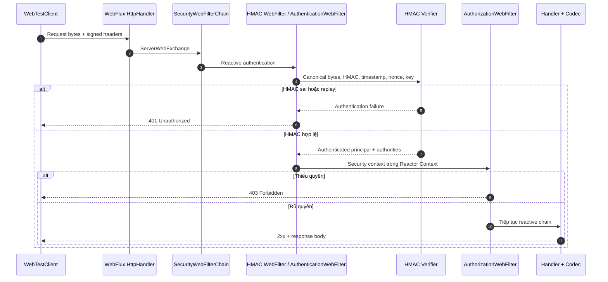
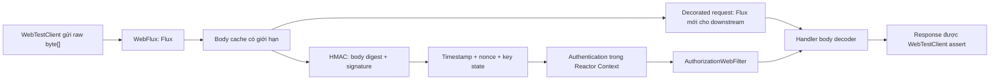

# WebTestClient: kiểm thử xác thực HMAC trong Spring WebFlux

## 1. Bối cảnh và mục tiêu bài học

Trong chương **Spring WebFlux integration**, `WebTestClient` là công cụ dùng để gửi request và kiểm tra response trong ứng dụng Spring WebFlux. Nó hỗ trợ kiểm thử HTTP bằng API khai báo, có thể chạy trực tiếp trên application context mà không mở cổng mạng hoặc kết nối tới một server thực. Khi kiểm thử xác thực request bằng HMAC, công cụ này đặc biệt hữu ích để chứng minh một request **thực sự đi qua WebFlux và Spring Security**, được xác thực đúng, bị chặn khi bị sửa đổi hoặc phát lại, và chỉ tới handler khi đủ quyền.

Bài thuộc mô-đun `SECURITY_AUTHENTICATION_HMAC_REQUEST_AUTHENTICATION`, thiết kế xác thực HTTP request bằng **HMAC với shared secret**. Client và server thống nhất **canonical request** gồm phương thức, URI, header và/hoặc body; server kiểm chữ ký, timestamp và nonce để chống replay, quản lý key rotation, kiểm thử tương tác với proxy/gateway và phân biệt **authentication** với **authorization**.

Sau bài, người học có thể:

- Lựa chọn đúng chế độ `WebTestClient`: bind vào controller, bind vào application context hoặc gửi HTTP tới server thực.
- Dựng fixture ký HMAC trên **đúng byte request** và kiểm thử xuyên qua `SecurityWebFilterChain`.
- Kiểm tra HTTP status, response body, header và việc handler **không chạy** khi xác thực/phân quyền thất bại.
- Viết test cho chữ ký sai, body bị sửa, timestamp hết hạn, nonce replay, nhiều client/tenant, key rotation và proxy/gateway.
- Tránh các test “xanh giả” do mock authentication, test chỉ controller hoặc bỏ qua việc request body reactive bị tiêu thụ.
- Biết giới hạn của WebTestClient và cách kết hợp unit test, slice test, integration test, concurrency test và môi trường có reverse proxy.

**Phạm vi:** ví dụ dùng Spring WebFlux reactive stack với `ServerWebExchange`, `WebFilter` và `SecurityWebFilterChain`. Cơ chế `WebFilter` khác Servlet `Filter` / `OncePerRequestFilter` của Spring MVC; không sao chép cấu hình filter của MVC sang WebFlux.

## 2. WebTestClient có thể kiểm thử ở những tầng nào?

`WebTestClient` dùng một API kiểm thử gần giống `WebClient`, nhưng có những chế độ kết nối khác nhau. Chọn sai chế độ có thể khiến bạn kết luận “HMAC hoạt động” dù verifier hoặc security chain chưa từng được gọi.

| Cách tạo `WebTestClient` | Thành phần chạy qua | Mục tiêu chính | Lưu ý đối với HMAC |
| --- | --- | --- | --- |
| `WebTestClient.bindToController(controller).build()` | Controller được chỉ định cùng hạ tầng WebFlux test tối thiểu | Test request mapping, codec, response của controller | **Không mặc nhiên nạp `SecurityWebFilterChain`**. Không đủ để khẳng định endpoint được bảo vệ bằng HMAC. |
| `WebTestClient.bindToApplicationContext(context).apply(springSecurity()).build()` | WebFlux context và chain được tích hợp trong mock server | Test đầy đủ luồng WebFlux/Spring Security không cần mở cổng | Phù hợp kiểm thử xác thực, phân quyền, WebFilter và chuyển đổi body. |
| `@SpringBootTest` + `@AutoConfigureWebTestClient` | Tùy cấu hình test web environment, nạp Spring application và cung cấp client | Integration test ở mức ứng dụng | Cần kiểm tra security chain, credential/replay beans và môi trường test thực sự được nạp. |
| `WebTestClient.bindToServer().baseUrl("http://localhost:...").build()` | HTTP thật qua server đang chạy | Test hành vi gần triển khai thực tế | Quan sát hành vi HTTP stack, codec và proxy nếu baseUrl trỏ qua gateway. |

Mẫu cấu hình khi đã có `ApplicationContext` của WebFlux test và Spring Security Test:

```java
WebTestClient client = WebTestClient
    .bindToApplicationContext(context)
    .apply(SecurityMockServerConfigurers.springSecurity())
    .configureClient()
    .build();
```

`SecurityMockServerConfigurers.springSecurity()` giúp gắn cơ chế kiểm thử của Spring Security vào mock-server setup. Chỉ khai báo `bindToController(...)` rồi gửi request thành công không chứng minh filter HMAC đã chạy.

Một cách dễ sử dụng với Spring Boot WebFlux và embedded server:

```java
@SpringBootTest(
    webEnvironment = SpringBootTest.WebEnvironment.RANDOM_PORT)
@AutoConfigureWebTestClient
class HmacWebFluxIntegrationTest {

    @Autowired WebTestClient webTestClient;

    // Các test gửi request qua HTTP thực đến embedded server.
}
```

Đây là ví dụ theo kiểu Spring Boot 3.x; import hoặc thiết lập auto-configuration có thể thay đổi theo phiên bản. Test server phải nạp đúng `SecurityWebFilterChain`, verifier và replay store được cấu hình cho bài test. Có thể tạo trực tiếp WebTestClient với `bindToServer()` khi cần kiểm thử host/proxy cụ thể.

## 3. Luồng WebFlux HMAC mà một integration test phải đi qua

Luồng điển hình:



Đây là sơ đồ logic, không phải danh sách tất cả `WebFilter` có sẵn trong mọi cấu hình. Trong reactive stack, `AuthenticationWebFilter` có thể dùng `ServerAuthenticationConverter` để tạo authentication request và `ReactiveAuthenticationManager` để xác minh credential, hoặc bạn có thể viết custom `WebFilter` theo kiến trúc được chọn. Hai cách cần thống nhất về authentication failure handler, thứ tự filter, việc bảo tồn body và security context.

Với Spring Security WebFlux, danh tính xác thực được truyền qua **Reactor Context** và `ReactiveSecurityContextHolder`. Không dùng `SecurityContextHolder` dựa trên ThreadLocal như một giải pháp thay thế: một pipeline reactive có thể chuyển thread giữa các bước.

Phản hồi thường dùng trong bài:

| Trạng thái | Điều kiện | HTTP status |
| --- | --- | --- |
| Chưa xác thực | Thiếu chữ ký, chữ ký sai, timestamp/nonce không hợp lệ, key bị từ chối | `401 Unauthorized` |
| Đã xác thực, thiếu quyền | HMAC đúng nhưng principal thiếu authority endpoint yêu cầu | `403 Forbidden` |
| Xác thực và phân quyền đạt | Handler xử lý nghiệp vụ | `2xx`, ví dụ `201 Created` |
| Body quá giới hạn | Tầng body limit | `413 Content Too Large` |
| Nội dung JSON không hợp lệ | Codec/validation sau security | Thường `400 Bad Request` |

Lỗi kho chống replay là lỗi hạ tầng; khi chống replay bắt buộc, phải **fail closed** và ánh xạ lỗi có chủ đích, có thể `503 Service Unavailable`. Không gộp mọi lỗi hạ tầng thành “chữ ký sai” để rồi nhận `401` không chính xác.

## 4. Định nghĩa hợp đồng ký trước khi viết test

WebTestClient không tự biết cách tạo chữ ký HMAC. Test phải đóng vai client thật: tạo body bytes, tạo timestamp/nonce, dựng canonical request theo hợp đồng rồi gửi **đúng các bytes và headers đã ký**.

Giả sử ứng dụng định nghĩa phiên bản `HMAC-V1` với format sau:

```text
HMAC-V1
POST
/api/hmac/orders?source=partner
content-type:application/json
x-client-id:service-a
x-key-id:key-a-2026-11
x-timestamp:2026-11-28T03:00:00Z
x-nonce:8f247364-7d4b-479e-8c36-b640f1ad39a0
body-sha256:<hex SHA-256 của body bytes>
```

Đây chỉ là **hợp đồng ký minh họa**, không phải chuẩn tự động của WebFlux. Hai bên phải thống nhất:

1. `method` có viết hoa, path/query có percent-encoding như thế nào, query giữ thứ tự hay được chuẩn hóa theo quy tắc riêng.
2. Danh sách header ký; cách chuẩn hóa tên/chữ hoa-thường/khoảng trắng/header nhiều giá trị, và Content-Type có tham số charset hay không.
3. Body dùng **byte nguyên vẹn** hoặc hash của byte đó theo hợp đồng. Nếu body không có, quy định rõ hash của 0 byte và ý nghĩa “body thiếu”.
4. `clientId`, `keyId`, timestamp và nonce nằm trong dữ liệu được MAC bảo vệ; `X-Signature` không tự nằm trong canonical string.
5. Thuật toán, charset và cách encode MAC (`Base64` hay `hex`) được định nghĩa nhất quán.
6. Hợp đồng quyết định canonical URI nào được dùng khi gateway rewrite path/query; test trực tiếp backend không thể tự chứng minh hành vi qua proxy.

Nếu body JSON sau deserialize có cùng nội dung nhưng khác whitespace, các byte khác nhau và SHA-256 cũng khác. Ví dụ:

```json
{"sku":"P100","quantity":2}
```

```json
{ "quantity": 2, "sku": "P100" }
```

Với hợp đồng ký raw bytes như ví dụ, hai payload cần **hai chữ ký khác nhau**. Không dùng `ObjectMapper.writeValueAsString(dto)` sau khi đã gửi payload khác định dạng để tính chữ ký trong test: việc đó vô tình tạo một test fixture khác thực tế.

## 5. Tạo signer độc lập phục vụ test

Một test đáng tin cần giữ đủ khoảng cách giữa **client signer** và **server verifier**. Hai phần có thể dùng chung **tài liệu đặc tả canonicalization** nhưng nên có test vectors cố định và phép tính độc lập. Nếu test chỉ gọi lại chính lớp canonicalizer/verifier của production để tạo chữ ký, cùng một lỗi trong hai phía có thể khiến test vẫn xanh.

Ví dụ một helper đặt trong mã kiểm thử, minh họa HMAC-SHA256 bằng JDK:

```java
final class TestHmacSigner {

    private TestHmacSigner() {}

    static HttpHeaders sign(
            String method,
            String rawTarget,
            byte[] exactBody,
            String clientId,
            String keyId,
            byte[] testSecret,
            Instant timestamp,
            String nonce) throws GeneralSecurityException {

        String contentType = "application/json";
        String time = timestamp.toString();

        String bodyHash = HexFormat.of().formatHex(
            MessageDigest.getInstance("SHA-256")
                .digest(exactBody));

        String canonical = String.join("\n",
            "HMAC-V1",
            method.toUpperCase(Locale.ROOT),
            rawTarget,
            "content-type:" + contentType,
            "x-client-id:" + clientId,
            "x-key-id:" + keyId,
            "x-timestamp:" + time,
            "x-nonce:" + nonce,
            "body-sha256:" + bodyHash
        );

        Mac mac = Mac.getInstance("HmacSHA256");
        mac.init(new SecretKeySpec(testSecret, "HmacSHA256"));
        byte[] tag = mac.doFinal(
            canonical.getBytes(StandardCharsets.UTF_8));

        HttpHeaders headers = new HttpHeaders();
        headers.setContentType(MediaType.APPLICATION_JSON);
        headers.set("X-Client-Id", clientId);
        headers.set("X-Key-Id", keyId);
        headers.set("X-Timestamp", time);
        headers.set("X-Nonce", nonce);
        headers.set("X-Signature",
            Base64.getEncoder().encodeToString(tag));

        return headers;
    }
}
```

Các import chính: `HttpHeaders`, `MediaType`, `Instant`, `HexFormat`, `Locale`, `Base64`, `GeneralSecurityException`, `MessageDigest`, `Mac`, `SecretKeySpec` và `StandardCharsets`.

Lưu ý quan trọng về helper này:

- Mã minh họa định nghĩa **chính xác** một phiên bản canonical request. Production verifier phải có cùng hợp đồng ký trước khi hai bên có thể tương tác.
- `rawTarget` ở đây có cả path và query và được đưa vào MAC **nguyên chuỗi**. Nếu URI client library encode hoặc reorder tham số query, byte thực tế có thể khác dữ liệu đã ký; test phải quan sát điều đó.
- Shared secret trong fixture chỉ là **khóa giả riêng cho môi trường test**. Không lấy credential thật hoặc ghi secret từ production vào log.
- Sinh nonce mới cho từng request bình thường; khi test replay thì **cố ý tái sử dụng** toàn bộ request đã ký.
- Timestamp phải dựa vào `Clock` có thể điều khiển trong test; không để test phụ thuộc vào thời điểm chạy hoặc dùng `Thread.sleep(...)` để chờ hết hạn.
- Test nên bổ sung vector dự kiến cho MAC và body SHA-256 để phát hiện khi format canonical bị thay đổi ngoài ý muốn.

## 6. Gửi byte body chính xác bằng WebTestClient

Đối với kiểm thử byte-level, hãy tạo `byte[]` **trước** khi ký rồi dùng chính mảng byte đó làm body của WebTestClient. Tránh tình huống test ký chuỗi A nhưng dùng `bodyValue(dto)` khiến codec serialize thành chuỗi B.

Ví dụ này giả định server test đã có credential `service-a / key-a-2026-11` với cùng `TEST_SECRET`, có quyền `orders:write`, dùng `Clock` tương ứng và endpoint `POST /api/hmac/orders` trả `201` cùng JSON chứa `createdBy`. Đây là **fixture hợp đồng** cần dựng trong test application, không phải thành phần có sẵn của Spring Security.

```java
@SpringBootTest(
    webEnvironment = SpringBootTest.WebEnvironment.RANDOM_PORT)
@AutoConfigureWebTestClient
class SignedOrderWebTestClientTest {

    private static final String TARGET =
        "/api/hmac/orders?source=partner";

    private static final byte[] TEST_SECRET =
        "only-for-test-fixtures-32-byte-secret"
            .getBytes(StandardCharsets.UTF_8);

    @Autowired WebTestClient client;
    @Autowired Clock clock;

    private HttpHeaders signedHeaders(byte[] body, String nonce)
            throws GeneralSecurityException {

        return TestHmacSigner.sign(
            "POST", TARGET, body,
            "service-a", "key-a-2026-11",
            TEST_SECRET,
            clock.instant(), nonce);
    }

    private WebTestClient.ResponseSpec send(
            byte[] body, HttpHeaders signed) {

        return client.post()
            .uri(URI.create(TARGET))
            .headers(headers -> headers.addAll(signed))
            .bodyValue(body)
            .exchange();
    }

    @Test
    void validHmacReachesHandlerWithOriginalBody()
            throws Exception {

        byte[] body =
            "{\"sku\":\"P100\",\"quantity\":2}"
                .getBytes(StandardCharsets.UTF_8);

        HttpHeaders headers = signedHeaders(
            body, UUID.randomUUID().toString());

        send(body, headers)
            .expectStatus().isCreated()
            .expectBody()
            .jsonPath("$.createdBy").isEqualTo("service-a");
    }
}
```

Để dùng ví dụ, ứng dụng test cần cung cấp `Clock` bean cho cả signer và verifier (có thể dùng `@TestConfiguration` với `Clock.fixed(...)`) và đưa credential giả vào repository test. Dùng `URI.create(TARGET)` giúp test xác định rõ target đã ký; với các trường hợp percent-encoding phức tạp, cần thêm test xác minh raw target server thực sự thấy.

**Vì sao gửi `byte[]`?** Khi `bodyValue(dto)` được dùng, codec có thể quyết định thứ tự field hoặc cách format JSON. Kiểm thử HMAC theo raw body nên gửi đúng bytes đã dùng để tính `body-sha256`. Sau khi chữ ký hợp lệ, server vẫn dùng codec để deserialize body ở handler.

## 7. Những test âm tính bắt buộc

### 7.1. Chữ ký đúng nhưng body bị sửa

```java
@Test
void changedBodyIsRejectedBeforeBusinessLogic()
        throws Exception {

    byte[] original =
        "{\"sku\":\"P100\",\"quantity\":2}"
            .getBytes(StandardCharsets.UTF_8);
    byte[] tampered =
        "{\"sku\":\"P100\",\"quantity\":9}"
            .getBytes(StandardCharsets.UTF_8);

    HttpHeaders signed = signedHeaders(
        original, UUID.randomUUID().toString());

    send(tampered, signed)
        .expectStatus().isUnauthorized();
}
```

Test ký `original` nhưng gửi `tampered`. Nếu server chỉ ký method/URI mà bỏ body digest, test này có thể vô tình thành công; đó chính là lỗi test muốn phát hiện. Nên kết hợp spy trên service nghiệp vụ hoặc kiểm tra database để xác nhận handler không tạo đơn hàng.

### 7.2. Replay cùng một nonce

```java
@Test
void secondUseOfSameSignedRequestIsRejected()
        throws Exception {

    byte[] body =
        "{\"sku\":\"P100\",\"quantity\":2}"
            .getBytes(StandardCharsets.UTF_8);
    String nonce = UUID.randomUUID().toString();
    HttpHeaders signed = signedHeaders(body, nonce);

    send(body, signed)
        .expectStatus().isCreated();

    // Cùng body, timestamp, nonce và signature:
    send(body, signed)
        .expectStatus().isUnauthorized();
}
```

Test này yêu cầu server thực sự có replay store; nếu verifier chỉ kiểm timestamp thì cả hai request vẫn có chữ ký hợp lệ và lần thứ hai có thể được cho qua. Khi chạy test song song, phải tránh dùng nonce cố định cho tất cả test trừ những case chủ ý kiểm replay.

### 7.3. Timestamp ngoài cửa sổ

Ví dụ test cấu hình verifier chấp nhận lệch thời gian tối đa 5 phút, test gửi timestamp cách hiện tại 10 phút:

```java
@Test
void expiredTimestampIsRejected() throws Exception {
    byte[] body =
        "{\"sku\":\"P100\",\"quantity\":2}"
            .getBytes(StandardCharsets.UTF_8);

    HttpHeaders signed = TestHmacSigner.sign(
        "POST", TARGET, body,
        "service-a", "key-a-2026-11", TEST_SECRET,
        clock.instant().minus(Duration.ofMinutes(10)),
        UUID.randomUUID().toString());

    send(body, signed)
        .expectStatus().isUnauthorized();
}
```

Cũng cần test timestamp trong tương lai vượt cửa sổ, sát biên và đúng định dạng. Tránh đổi đồng hồ hệ điều hành: inject một `Clock` kiểm soát được vào server verifier và test signer.

### 7.4. Thay method, URI, header đã ký

Với cùng `X-Signature`:

- Đổi `POST` thành `PUT` trên route có handler tương ứng: yêu cầu chữ ký thất bại. Nếu route không tồn tại, kết quả `404/405` không chứng minh HMAC đúng hay sai.
- Đổi `?source=partner` thành `?source=attacker`: nếu query được ký, verifier phải từ chối.
- Đổi `X-Client-Id`, `X-Key-Id`, `Content-Type` hoặc nonce đã ký: verifier phải từ chối; kết quả có thể tùy rule tra key và format.
- Đổi body từ một JSON sang JSON khác cùng ý nghĩa nhưng khác whitespace: chữ ký trên **raw bytes** phải không còn đúng.
- Thêm header **không nằm trong hợp đồng ký**: test cần mô tả rõ header đó có được phép không; đừng mặc định mọi header đều được ký.

Riêng percent-encoding cần dựa vào raw URI thực sự truyền tới server để test có giá trị: `/a%2Fb`, `/a/b` và dấu `+` trong query có thể bị các thành phần client/proxy hiểu khác nhau.

## 8. Test ranh giới authentication và authorization

HMAC hợp lệ chỉ chứng minh request đến từ bên biết shared secret và các dữ liệu được ký không bị sửa; **quyền** phải được lấy từ thông tin server-side gắn với credential đã xác minh.

Fixture nên có ít nhất hai client:

| Client fixture | Credential | Authorities | Kết quả `POST /api/hmac/orders` |
| --- | --- | --- | --- |
| `service-a` | Key hiện hành, secret hợp lệ | `orders:write` | Thành công khi các kiểm tra HMAC/replay đạt. |
| `service-b` | Key hiện hành, secret hợp lệ | `orders:read` | `403 Forbidden`, dù chữ ký HMAC đúng. |

Một test kiểm chứng `403` nên ký request bằng **key của service-b**, gửi đúng timestamp/nonce/body rồi mong đợi:

```java
send(body, headersSignedAsServiceB)
    .expectStatus().isForbidden();
```

`headersSignedAsServiceB` là fixture test tự tạo bằng signer như trên với credential của service-b. Test không nên gắn một header “role: orders:read” rồi tin đó là authority thật; server phải tạo authorities từ kho thông tin đã xác minh.

### Không dùng mock authentication để thay thế kiểm thử HMAC

Spring Security Test có các helper cho reactive test như `mockUser()`, `mockAuthentication(...)` hoặc cấu hình context giả. Chúng hữu ích khi chỉ muốn test **authorization** hoặc logic handler theo một principal cho sẵn. Tuy nhiên, chúng **không chứng minh** HMAC verifier đã kiểm chữ ký.

Ví dụ ý đồ “chỉ test authorization”:

```java
WebTestClient client = WebTestClient
    .bindToApplicationContext(context)
    .apply(SecurityMockServerConfigurers.springSecurity())
    .build();

client.mutateWith(
        SecurityMockServerConfigurers.mockUser("test")
            .authorities(
                new SimpleGrantedAuthority("orders:read")))
    .post().uri("/api/hmac/orders")
    .bodyValue("{\"sku\":\"P100\",\"quantity\":2}")
    .exchange()
    .expectStatus().isForbidden();
```

Đây chỉ là ví dụ về kỹ thuật mock security context; trong chain HMAC thật, custom verifier có thể vẫn yêu cầu header chữ ký hoặc ghi đè authentication giả. Muốn **cô lập authorization**, hãy cấu hình một test chain/fixture phù hợp hoặc kiểm thử policy riêng. Không được lấy việc test dùng `mockUser` thành công làm bằng chứng endpoint thật buộc phải có HMAC.

## 9. Kiểm thử key rotation, multi-client và multi-tenant

Để kiểm thử vòng đời key, tạo fixtures có trạng thái rõ ràng:

| Key | Trạng thái trong fixture | Kỳ vọng |
| --- | --- | --- |
| `key-a-current` | `ACTIVE`, còn hiệu lực | Request ký hợp lệ được xác thực. |
| `key-a-previous` | `VERIFY_ONLY`, còn trong cửa sổ xác minh | Có thể được xác thực theo chính sách rotation. |
| `key-a-revoked` | `REVOKED` | `401` hoặc lỗi xác thực theo hợp đồng, kể cả MAC đúng. |
| `key-b-active` | Thuộc client/tenant B | Không thể dùng để mạo danh client/tenant A. |
| `unknown-key` | Không có trong repository | Bị từ chối; không tiết lộ key tồn tại hay không. |

Key ID phải được ràng buộc với đúng client/tenant ở phía server. Test cần xác minh:

1. Client A dùng key B và khai client ID A không được cấp principal A.
2. Header tenant khác với tenant gắn với credential phải bị từ chối nếu tenant nằm trong hợp đồng ký.
3. Key cũ chỉ hợp lệ trong thời gian cho phép; key bị revoke bị chặn ngay theo trạng thái đã cập nhật.
4. Không có fallback thử “mọi secret” qua mọi tenant nếu key lookup thất bại.
5. Authorities của client A và B không bị dùng lẫn khi có hai request chạy song song.

Nên làm fixture credential và thời gian bằng repository/clock test cô lập để mọi test có thể lặp lại. Nếu dùng Redis chung giữa test, sử dụng namespace replay riêng cho suite hoặc dọn dữ liệu bằng phạm vi test được phép; không can thiệp dữ liệu sản xuất.

## 10. Body reactive: điều gì WebTestClient phải phát hiện?

Trong WebFlux, request body là `Flux<DataBuffer>`. Khác với mảng byte có thể đọc lại, chuỗi dữ liệu từ HTTP input thường không tự hỗ trợ nhiều subscriber đọc cùng body. Nếu HMAC `WebFilter` đã subscribe/tiêu thụ body trước handler và không tạo luồng phát lại, handler có thể nhận body rỗng hoặc pipeline gặp lỗi.

Luồng đúng về mặt ý tưởng:



Khi triển khai body caching, cần kiểm soát:

- Chỉ đọc `DataBuffer` một lần ở nơi được thiết kế; dùng `DataBufferUtils.join(..., maxByteCount)` hoặc kỹ thuật giới hạn tương đương để chặn body quá lớn. `join` không tự làm bộ nhớ vô hạn an toàn nếu không có giới hạn.
- Giải phóng dữ liệu pooled buffer theo hợp đồng `DataBufferUtils.release(...)` khi không còn dùng; rò rỉ pooled buffer có thể làm cạn bộ nhớ trực tiếp.
- Sau khi có byte body, tạo `ServerHttpRequestDecorator` với `getBody()` trả các `DataBuffer` **mới cho mỗi subscription** từ dữ liệu đã kiểm tra. Không dùng lại cùng một pooled `DataBuffer` đã được release.
- Truyền **exchange đã decorate** xuống toàn bộ phần chain tiếp theo. Chỉ mutate một biến `ServerWebExchange` bên trong `ServerAuthenticationConverter` không bảo đảm handler sẽ thấy request được decorate, nếu converter không kiểm soát exchange dùng ở downstream.
- Đảm bảo payload và bộ đệm có hạn mức, có cách xử lý empty body, lỗi decode, cancel, timeout và backpressure. Với stream lớn, file upload hoặc multipart, thiết kế stream/hash và lưu tạm có giới hạn cần được xem xét riêng.
- Không dùng `block()` trong pipeline xác thực reactive. Truy cập Redis/secret repository cần adapter reactive hoặc thực hiện công việc blocking có kiểm soát ngoài event loop theo thiết kế.

Một test đúng phải chứng minh được **cả hai điều kiện**: HMAC được xác minh trên raw bytes **và** handler vẫn deserialize thành công đúng payload. Test chỉ assert `401` khi đổi body không đủ để chứng minh body đã được phát lại đúng cách.

### Tình huống cần test body

| Tình huống | Điều cần thấy |
| --- | --- |
| JSON body hợp lệ, chữ ký hợp lệ | Handler nhận đủ DTO, không mất body sau WebFilter. |
| Body 0 byte, chữ ký hợp lệ | Verifier xử lý digest của body rỗng, sau đó handler áp dụng quy tắc body bắt buộc/tùy chọn. |
| Byte UTF-8 đa byte | SHA-256 chính xác trên byte, không tính trên độ dài ký tự. |
| JSON sai nhưng MAC đúng | Qua bước xác thực, lỗi decode/validation được xử lý ở WebFlux. |
| Body bị sửa sau ký | Bị từ chối trước khi handler xử lý nghiệp vụ. |
| Vượt giới hạn byte | Bị chặn theo chính sách `413`, không làm cạn bộ nhớ. |
| Request body bị client hủy giữa chừng | Không ghi nhận authentication thành công; không rò rỉ `DataBuffer`. |
| Handler đọc body trong pipeline reactive | Không phát hiện block hoặc subscribe lần thứ hai ngoài thiết kế. |

## 11. Concurrent replay: cần test tranh chấp thật

Test gửi hai request nối tiếp xác minh được trường hợp đơn giản. Nhưng hai request mang cùng `(tenant, client, keyId, nonce)` đến **đồng thời** trên hai node vẫn có thể cùng được chấp nhận nếu kiểm tra nonce được tách thành “đã có chưa?” rồi “ghi nonce”.

Bài test concurrency cần:

- Tạo **một signed request** có timestamp/nonce/body cố định cho hai lời gọi.
- Phát lệnh gần đồng thời bằng hai client/worker và đưa cùng replay store dùng chung vào đường đi.
- Assert **nhiều nhất một request** được xác thực thành công; các request còn lại bị từ chối theo hợp đồng.
- Không chấp nhận test chỉ chạy hai request tuần tự rồi kết luận cơ chế lưu nonce là nguyên tử.
- Dùng cơ chế `SET ... NX` với TTL trong Redis hoặc thao tác atomic insert-if-absent tương đương, cùng namespace theo client/tenant. Kho replay ngừng hoạt động phải fail closed với endpoint cần chống replay.

`WebTestClient.exchange()` trong ví dụ truyền thống là API đồng bộ chờ response; có thể gọi từ nhiều task bên ngoài để tạo concurrency. Nếu muốn kiểm chứng tính nguyên tử qua nhiều instance và load balancer, cần chạy test với nhiều node backend chia sẻ Redis hoặc một môi trường integration tương đương. Một mock store chỉ chạy trong một application context không chứng minh được hành vi giữa các node.

Ngoài ra, **nonce chống replay không phải idempotency key**: client vẫn có thể gửi hai request hợp lệ với hai nonce khác nhau. Endpoint tạo đơn hàng/thanh toán cần chính sách idempotency nghiệp vụ riêng.

## 12. Test lỗi HTTP và bảo vệ thông tin

`WebTestClient` có thể assert status, response JSON, response headers và thời gian hoàn tất. Với failure response, nên dùng một error schema chung, nhưng đừng làm lộ trạng thái credential:

```java
client.post()
    .uri(URI.create(TARGET))
    .headers(headers -> headers.addAll(invalidSignatureHeaders))
    .bodyValue(body)
    .exchange()
    .expectStatus().isUnauthorized()
    .expectHeader().contentTypeCompatibleWith(
        MediaType.APPLICATION_JSON)
    .expectBody()
    .jsonPath("$.code").isEqualTo("AUTHENTICATION_FAILED");
```

`invalidSignatureHeaders` là fixture đã ký rồi sửa signature; JSON lỗi `AUTHENTICATION_FAILED` chỉ là ví dụ nếu API của bạn có schema như vậy. Một server có thể trả body rỗng cho 401, khi đó không assert JSON theo ví dụ.

Điều quan trọng là phân biệt:

| Vấn đề | Đích assertion |
| --- | --- |
| Authentication không đạt | `401`; không vào handler. |
| Authentication đạt nhưng thiếu authority | `403`; không vào handler. |
| Hệ thống replay store unavailable | Fail closed; response theo chính sách lỗi hạ tầng. |
| JSON sai nhưng HMAC đúng | Handler/codec lỗi `400` sau authentication. |
| Request body quá lớn | `413` hoặc mã đã định nghĩa rõ, trước khi nghiệp vụ chạy. |
| Exception không mong muốn | Test phải fail thay vì vô tình coi mọi 5xx là “bảo mật hoạt động”. |

Không log toàn bộ `X-Signature`, shared secret, body nhạy cảm hoặc giá trị nonce chi tiết. Nếu test cần quan sát nội bộ, dùng request correlation ID, kết quả xác thực, mã nguyên nhân và assertion rằng service không bị gọi.

## 13. Kiểm thử proxy/gateway và hợp đồng canonicalization

`WebTestClient.bindToApplicationContext(...)` chạy trong môi trường mock server nên **không đi qua Nginx, Envoy, ingress hay API gateway thật**. Nó không chứng minh path/query/header/body không bị thay đổi trên mạng.

Khi cần xác minh hành vi proxy, chạy ứng dụng và gateway tương tự môi trường triển khai, dùng:

```java
WebTestClient throughGateway = WebTestClient
    .bindToServer()
    .baseUrl("http://localhost:18080")
    .build();
```

Địa chỉ `localhost:18080` ở đây chỉ là **ví dụ cổng test gateway**, không phải một dịch vụ có sẵn. Test cần xác định target được client ký trước khi request bị rewrite, đồng thời bảo đảm backend tính đúng canonical target theo hợp đồng.

Các kịch bản đáng kiểm tra:

- Gateway chuyển prefix từ `/public/api/hmac/orders` thành `/api/hmac/orders`.
- Percent-encoding, query order, query có `+` và `%20`, duplicate query parameter.
- Header case, header trùng tên/nhiều giá trị, khoảng trắng, header hop-by-hop hoặc `Content-Type` bị sửa.
- Proxy nén/giải nén body hoặc thay đổi `Transfer-Encoding`/`Content-Length`.
- Client tự thêm `Forwarded`/`X-Forwarded-*` để giả mạo URI/host.
- Gateway xác minh HMAC rồi truyền danh tính tới backend: chỉ chấp nhận kết quả đó qua **trust boundary** được bảo vệ; backend không được tin header “đã xác thực” do client bất kỳ gửi.

Để giữ nguyên tính bảo mật, hoặc backend xác minh HMAC trên canonical input mà hai bên thực sự đã thỏa thuận, hoặc gateway là điểm xác minh đáng tin cậy và backend có cơ chế xác thực gateway riêng. Không “sửa” chữ ký thất bại bằng cách tự bỏ những trường khó kiểm soát khỏi hợp đồng ký.

## 14. Test strategy từ unit đến production-like

Không phải mọi test đều cần chạy server và Redis thật. Phân lớp giúp phản hồi nhanh và phát hiện lỗi đúng nơi:

| Lớp test | Nội dung | Công cụ gợi ý |
| --- | --- | --- |
| Unit | Golden vectors HMAC, canonical request, key lookup, timestamp window, authority mapping | JUnit, fixture bytes cố định, `Clock.fixed` |
| Reactive component | `ServerAuthenticationConverter` / verifier / body decorator, empty/cancel/error path | Reactor `StepVerifier`, mocked exchange khi phù hợp |
| WebFlux integration | Security chain, HMAC filter, body decoder, status 401/403, handler không chạy | `WebTestClient.bindToApplicationContext(...)` hoặc Boot test |
| HTTP integration | Codec/Netty stack và request thực trên port | `WebTestClient.bindToServer(...)` hoặc Boot `RANDOM_PORT` |
| Distributed integration | Nonce race, Redis TTL, nhiều node/client/tenant | WebTestClient qua nhiều backend + replay store dùng chung |
| Gateway/edge | URI rewrite, headers, compression, trust boundary | WebTestClient đi qua reverse proxy có cấu hình giống production |

Các test quan trọng cần được chạy thường xuyên gồm: request hợp lệ, request đổi từng trường được ký, body raw bytes, nonce replay, timestamp cũ/tương lai, key revoked/rotation, tenant isolation, thiếu authority, lỗi Redis, và body quá hạn mức.

### Checklist để nhận diện test xanh giả

- [ ] Test dùng WebFlux context/HTTP server và thực sự nạp `SecurityWebFilterChain`.
- [ ] Không dùng `mockUser` hay `mockAuthentication` trong test nhằm chứng minh HMAC verifier.
- [ ] Signer test tạo MAC độc lập theo hợp đồng, có golden test vectors.
- [ ] Bytes được ký chính là bytes truyền bằng `WebTestClient.bodyValue(byte[])`.
- [ ] `Content-Type`, raw URI, query và các header được ký được gửi đúng giá trị.
- [ ] Test assert thất bại trước handler và không phát sinh thay đổi nghiệp vụ.
- [ ] Replay test dùng cùng nonce/chữ ký; concurrency test kiểm atomicity trong kho dùng chung.
- [ ] Clock, key state và TTL được kiểm soát để test có thể chạy lặp lại.
- [ ] Authentication 401 và authorization 403 được kiểm riêng.
- [ ] Có test chứng minh body reactive được đọc lại đúng sau khi xác minh chữ ký.
- [ ] Hành vi proxy/gateway được test ở tầng HTTP thực khi nằm trong phạm vi tính toàn vẹn cần bảo vệ.

## 15. Câu hỏi tự kiểm tra

1. Vì sao `bindToController(...)` không đủ để khẳng định API HMAC của ứng dụng an toàn?
2. Khi nào nên dùng `bindToApplicationContext(...).apply(springSecurity())` và khi nào dùng `bindToServer()`?
3. Nếu test ký DTO bằng Jackson rồi gửi một mảng byte JSON đã được format khác, test đang kiểm tra điều gì?
4. Vì sao test dùng `mockUser()` có thể xanh dù production verifier HMAC đang lỗi?
5. Request ký đúng nhưng bị phát lại với cùng nonce nên cho status nào theo hợp đồng ví dụ?
6. Vì sao thay đổi JSON whitespace có thể làm MAC sai dù dữ liệu nghiệp vụ không đổi?
7. Cần làm gì để chắc chắn `Flux<DataBuffer>` không bị tiêu thụ trước khi handler deserialize body?
8. Vì sao hai request cùng nonce chạy tuần tự chưa đủ kiểm chứng atomic replay protection?
9. Nếu client B có chữ ký hợp lệ nhưng thiếu quyền `orders:write` thì phản hồi nên là 401 hay 403?
10. Tại sao WebTestClient kết nối trực tiếp application context không thể thay thế kiểm thử URI rewrite của gateway?

**Ghi nhớ:** `WebTestClient` giúp kiểm thử hành vi của WebFlux API, nhưng giá trị bảo mật phụ thuộc vào **chế độ binding và fixtures**. Để chứng minh xác thực HMAC hoạt động, test phải gửi **đúng byte đã ký** qua security chain thật, kiểm tra body còn đến handler, chặn replay và credential không hợp lệ, xác nhận 401/403 đúng nguyên nhân, đồng thời kiểm tra gateway bằng HTTP thật khi có rewrite.
