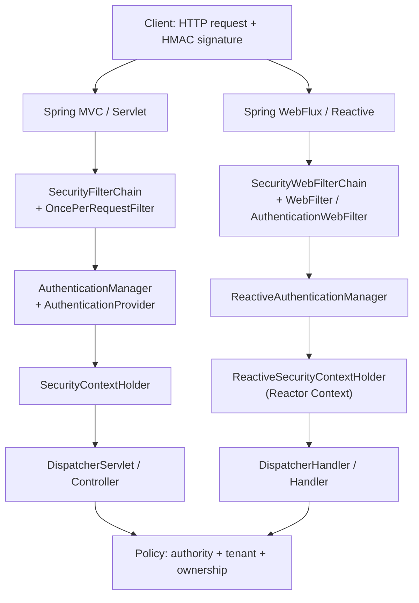

# MVC và WebFlux khác nhau như thế nào khi xác thực HTTP request bằng HMAC?

## 1. Vì sao cần phân biệt hai mô hình?

Trong module `SECURITY_AUTHENTICATION_HMAC_REQUEST_AUTHENTICATION`, một client gửi HTTP request được ký bằng HMAC với shared secret. Server dựng lại **canonical request** theo hợp đồng ký, có thể gồm HTTP method, URI/query, một số header, body hoặc body digest; sau đó đối chiếu chữ ký, kiểm tra timestamp/nonce để chống replay, tra key đang có hiệu lực khi rotation và quyết định quyền truy cập của client.

Các yêu cầu bảo mật này **không thay đổi** khi ứng dụng chuyển từ Spring MVC sang Spring WebFlux. Tuy nhiên, đường đi HTTP request, cách đọc body, cách quản lý `SecurityContext` và cách xử lý tác vụ I/O khác nhau đáng kể. Mang nguyên một `OncePerRequestFilter` hoặc thói quen sử dụng `ThreadLocal` từ MVC sang WebFlux thường dẫn tới lỗi chạy sai filter, mất body, rò rỉ tài nguyên hoặc chặn event-loop.

Bài thuộc chương **Spring WebFlux integration**, chủ đề **MVC và WebFlux khác nhau**. Sau khi học, bạn có thể:

- Phân biệt mô hình xử lý request của Spring MVC và WebFlux mà không đồng nhất “MVC = đồng bộ” hay “WebFlux = tự động nhanh hơn”.
- Chọn đúng filter chain, authentication component, security context và công cụ test cho từng stack.
- Thiết kế bước xác thực HMAC xử lý body an toàn trên cả Servlet và Reactive.
- Xác định nơi triển khai việc tra secret, so chữ ký, chống replay bằng nonce, key rotation và authorization theo client/tenant.
- Nhận biết các rủi ro thực tế khi tích hợp proxy/gateway hoặc dùng thư viện blocking trong reactive pipeline.

## 2. So sánh tổng quan

| Tiêu chí | Spring MVC | Spring WebFlux |
| --- | --- | --- |
| Nền tảng HTTP chính | Servlet API (`HttpServletRequest`, `HttpServletResponse`) | Reactive HTTP API (`ServerWebExchange`, `ServerHttpRequest`) |
| Controller thông dụng | `@RestController` trả object, `ResponseEntity`; có hỗ trợ async | `@RestController` trả object hoặc `Mono`/`Flux`; chức năng reactive xuyên suốt |
| Xử lý I/O | Servlet thường có thread phục vụ request; có cơ chế async | Reactor Publisher, non-blocking I/O khi các thành phần liên quan hỗ trợ |
| Filter tùy chỉnh | Servlet `Filter`, `OncePerRequestFilter` | `WebFilter`, `AuthenticationWebFilter` |
| Security chain | `HttpSecurity` → `SecurityFilterChain` | `ServerHttpSecurity` → `SecurityWebFilterChain` |
| Authentication manager | `AuthenticationManager`, `AuthenticationProvider` | `ReactiveAuthenticationManager` |
| Security context | `SecurityContextHolder`, thường dựa vào thread-local trong chế độ mặc định | `ReactiveSecurityContextHolder` dựa trên Reactor `Context` |
| Principal trong handler | `Principal`/`Authentication`; có thể inject qua argument | Có thể inject principal qua argument hoặc lấy reactive context |
| Truy cập request body | Servlet `InputStream`/`Reader`; thường tiêu thụ một lần | `Flux<DataBuffer>`; nội dung stream có vòng đời buffer |
| Chống replay HMAC | Nonce store nguyên tử, có thể dùng thư viện đồng bộ | Nonce store nguyên tử, nên có API reactive/non-blocking |
| Kiểm thử HTTP/security | `MockMvc` | `WebTestClient` |
| Lỗi dễ gặp khi viết HMAC | Filter đọc mất body, đăng ký trùng, thứ tự filter | Subscribe thủ công, chặn event-loop, quên release `DataBuffer`, mất reactive context |

**Hai lưu ý quan trọng:**

1. MVC cũng hỗ trợ lập trình bất đồng bộ, còn WebFlux không bảo đảm mọi thứ đều không blocking. Nếu gọi JDBC, REST client blocking hoặc `Thread.sleep()` trong reactive chain, event-loop vẫn có thể bị chặn.
2. WebFlux có thể chạy trên Reactor Netty hoặc một Servlet container hỗ trợ reactive. Khác biệt cốt lõi là **mô hình lập trình và contract xử lý I/O**, không phải chỉ ở tên web server.

## 3. Cùng một yêu cầu HMAC, hai đường đi request



Trong cả hai nhánh, **thành phần xác thực** cần trả lời: key nào ký request, HMAC có khớp canonical bytes hay không, timestamp hợp lệ không, nonce đã bị dùng chưa và key version còn hiệu lực không. Sau đó thành phần **phân quyền** mới quyết định client có `ORDER_READ`, `ORDER_CREATE` và được thao tác trên tenant nào.

Ví dụ `partner-reporting` ký đúng `POST /integrations/orders` nhưng chỉ được cấp `ORDER_READ`: request đã **xác thực thành công** mà vẫn phải trả `403 Forbidden`. Trường hợp chữ ký sai hoặc nonce bị replay thì lỗi phát sinh **trước khi** cấp principal và thường được trả `401 Unauthorized`.

## 4. MVC: Servlet filter và security context gắn với request

Một thiết kế HMAC phổ biến trên Spring MVC:

1. `OncePerRequestFilter` đọc các header ký và request-target; nếu hợp đồng ký cả body, dùng wrapper có thể phát lại body cho controller.
2. Tạo một token `Authentication` chưa xác thực mang bằng chứng request.
3. Gọi `AuthenticationManager.authenticate(...)` để provider xác minh HMAC, timestamp, nonce, key và tải policy của client.
4. Provider trả token đã xác thực chứa principal và `GrantedAuthority` từ server.
5. Filter đặt token vào `SecurityContextHolder` trước khi chuyển vào security authorization/`DispatcherServlet`.

Ví dụ phần lõi của filter MVC:

```java
// Trích từ một OncePerRequestFilter; các dependency là của ứng dụng.
@Override
protected void doFilterInternal(
        HttpServletRequest request,
        HttpServletResponse response,
        FilterChain chain) throws ServletException, IOException {

    HttpServletRequest replayable = bodyWrapperFactory.wrap(request);
    Authentication verified;

    try {
        HmacSignedRequest signed = parser.parse(replayable);
        Authentication candidate =
                HmacAuthenticationToken.unauthenticated(signed);
        verified = authenticationManager.authenticate(candidate);
    } catch (AuthenticationException ex) {
        SecurityContextHolder.clearContext();
        authenticationEntryPoint.commence(request, response, ex);
        return;
    }

    SecurityContext context = SecurityContextHolder.createEmptyContext();
    context.setAuthentication(verified);
    SecurityContextHolder.setContext(context);
    try {
        chain.doFilter(replayable, response);
    } finally {
        SecurityContextHolder.clearContext();
    }
}
```

Đây là ví dụ **minh họa**, giả định `HmacSignedRequest`, `HmacAuthenticationToken`, parser và các dependency đã được triển khai. Wrapper phải giới hạn kích thước body, trả đúng raw bytes cho verifier và cho `@RequestBody` đọc lại. Bước tạo `Authentication` đã xác thực chỉ được thực hiện sau khi provider xác minh đầy đủ; đoạn code filter không tự gán quyền.

Spring Security ở MVC thường dùng `SecurityContextHolder` trong thread đang xử lý request. Cơ chế quản lý context thực tế còn phụ thuộc các security filters và async dispatch; không được suy luận rằng `ThreadLocal` tự động được truyền qua mọi thread trong `@Async` hoặc thread pool.

Đặc biệt, `OncePerRequestFilter` chỉ hạn chế chạy lặp **trong phạm vi servlet dispatch** theo thiết kế; hai HTTP request cùng nonce vẫn là hai request riêng biệt. Chống replay thực sự phải nằm trong HMAC verifier/nonce store.

## 5. WebFlux: reactive WebFilter và authentication theo Reactor Context

WebFlux dùng `WebFilter`, nhận `ServerWebExchange` và trả `Mono<Void>`:

```java
public interface WebFilter {
    Mono<Void> filter(
            ServerWebExchange exchange,
            WebFilterChain chain);
}
```

Trong bảo mật reactive, có hai hướng phổ biến:

- **Ưu tiên thành phần sẵn có:** `AuthenticationWebFilter` kết hợp `ServerAuthenticationConverter` và `ReactiveAuthenticationManager`. Converter trích xuất evidence HMAC từ HTTP; manager xác minh và tạo `Authentication`.
- **Custom `WebFilter` khi cần điều phối đặc biệt:** ví dụ cần giới hạn, đọc và phát lại body trước khi tính digest. Filter tự điều phối manager/verifier, phản hồi `401` và đưa `Authentication` vào Reactor context.

Nếu ứng dụng yêu cầu ký body, không thể lấy `InputStream` rồi đọc đồng bộ như Servlet. Body WebFlux là một `Flux<DataBuffer>`, thường chỉ nên **tiêu thụ một lần** ở điểm kiểm tra và sau đó phát lại từ bytes đã cache với giới hạn kích thước. Không gọi `subscribe()` thủ công trong filter, vì nó tạo một subscription ngoài vòng đời publisher mà filter trả về.

Mô hình an toàn với `AuthenticationWebFilter`:

```java
AuthenticationWebFilter filter =
        new AuthenticationWebFilter(reactiveAuthenticationManager);

filter.setServerAuthenticationConverter(
        signedRequestConverter);
filter.setSecurityContextRepository(
        NoOpServerSecurityContextRepository.getInstance());
filter.setRequiresAuthenticationMatcher(
        new PathPatternParserServerWebExchangeMatcher(
                "/integrations/**"));
```

Ví dụ giả định `signedRequestConverter` cài `ServerAuthenticationConverter`, trả `Mono<Authentication>` của **token chưa xác thực**, còn `reactiveAuthenticationManager` trả `Mono<Authentication>` chứa kết quả đã xác thực. Nếu signed body được đọc trong converter, nó phải bảo đảm body tiếp tục khả dụng cho handler; phần 7 trình bày cách xử lý bytes này.

`AuthenticationWebFilter` có thể cấu hình handler xử lý xác thực thành công/thất bại và security context repository. Với HMAC máy gọi máy theo từng request, thường chọn stateless và không lưu authentication vào web session.

## 6. Khác biệt quan trọng nhất: nơi lưu `SecurityContext`

### 6.1. MVC thường đọc từ `SecurityContextHolder`

```java
Authentication current = SecurityContextHolder
        .getContext().getAuthentication();
String clientId =
        ((HmacPrincipal) current.getPrincipal()).clientId();
```

Trong request MVC thông thường, Spring Security quản lý context theo lifecycle của servlet filters. Khi dùng async, vẫn phải tuân theo cơ chế truyền context của Spring Security.

### 6.2. WebFlux cần Reactor `Context`

Trong WebFlux, các đoạn xử lý có thể đổi thread khi publisher được subscribe hoặc đổi scheduler. Lưu authentication vào thread-local qua `SecurityContextHolder.setContext(...)` trong một `WebFilter` **không bảo đảm** downstream sẽ nhìn thấy authentication đó.

```java
Authentication verified = /* kết quả đã xác thực */;

return chain.filter(exchange)
        .contextWrite(
                ReactiveSecurityContextHolder.withAuthentication(verified));
```

Ở service reactive, đọc principal từ context:

```java
public Mono<OrderDto> findOrder(String orderId) {
    return ReactiveSecurityContextHolder.getContext()
            .map(SecurityContext::getAuthentication)
            .map(auth -> (HmacPrincipal) auth.getPrincipal())
            .flatMap(principal ->
                    orderRepository.findByIdAndTenantId(
                            orderId, principal.tenantId()))
            .map(OrderDto::from);
}
```

Các kiểu `OrderDto`, `HmacPrincipal`, repository là ví dụ nghiệp vụ. Truy vấn cần dùng tenant từ **principal đã xác minh**. Nếu không có authentication/context phù hợp, luồng phải bị từ chối theo chính sách; không tự thay bằng tenant do client gửi.

**Reactor Context không phải một biến toàn cục**; giá trị được gắn với subscription. Việc đổi thread bằng các operator reactive bình thường vẫn có thể duy trì Reactor Context, nhưng gọi API bên ngoài reactive chain hoặc tự tạo subscription mới mà không mang context sẽ làm mất liên kết.

## 7. Đọc body và tạo lại request: Servlet khác Reactive ra sao?

### 7.1. MVC: cache bytes bằng Servlet wrapper

Nếu filter MVC đọc hết `request.getInputStream()`, `@RequestBody` có thể không còn dữ liệu. Cần một `HttpServletRequestWrapper` giữ bản sao body và cung cấp `ServletInputStream`/`getReader()` từ bản sao đó. `ContentCachingRequestWrapper` chỉ cache bytes đã được đọc; bản thân nó **không tự bảo đảm** phát lại stream sau khi filter đã tiêu thụ hết body.

### 7.2. WebFlux: `DataBuffer` cần vòng đời rõ ràng

Trong WebFlux, body là `Flux<DataBuffer>`. Muốn hash toàn bộ body nhỏ, có thể gom các buffer đến một giới hạn bằng `DataBufferUtils.join(...)`, trích bytes rồi giải phóng buffer gốc. Sau khi xác minh, dùng `ServerHttpRequestDecorator` để cung cấp body mới cho downstream.

Ví dụ helper đọc body có giới hạn:

```java
static Mono<byte[]> readBody(ServerHttpRequest request, int maxBytes) {
    return DataBufferUtils.join(request.getBody(), maxBytes)
            .map(buffer -> {
                try {
                    byte[] bytes = new byte[buffer.readableByteCount()];
                    buffer.read(bytes);
                    return bytes;
                } finally {
                    DataBufferUtils.release(buffer);
                }
            })
            .defaultIfEmpty(new byte[0]);
}
```

`DataBufferUtils.join(publisher, maxBytes)` sẽ không cho phép tổng dữ liệu vượt quá giới hạn cấu hình, tránh cache body không giới hạn trong RAM. Khi gặp `DataBufferLimitException`, endpoint nên trả `413 Payload Too Large` hoặc phản hồi được định nghĩa rõ. Không nén mọi lỗi I/O hoặc lỗi hệ thống thành `401`.

Tạo decorator phát lại body từ bytes đã cache:

```java
static ServerHttpRequest replayableRequest(
        ServerWebExchange exchange, byte[] body) {

    return new ServerHttpRequestDecorator(exchange.getRequest()) {
        @Override
        public Flux<DataBuffer> getBody() {
            return Flux.defer(() -> Flux.just(
                    exchange.getResponse().bufferFactory()
                            .wrap(body.clone())));
        }
    };
}
```

`Flux.defer(...)` tạo một `DataBuffer` mới khi có subscription và tránh tái sử dụng cùng một buffer đã bị tiêu thụ/giải phóng. Sau đó:

```java
ServerHttpRequest replay = replayableRequest(exchange, cachedBody);
ServerWebExchange downstream =
        exchange.mutate().request(replay).build();

// Sau xác minh: chuyển downstream vào chain.
return chain.filter(downstream)
        .contextWrite(
                ReactiveSecurityContextHolder.withAuthentication(verified));
```

Các snippet này là **các bước minh họa được ghép trong một WebFilter**, không phải ba filter chạy độc lập. Phải đảm bảo **cùng mảng bytes** được dùng để tính body digest và được đưa xuống controller; nếu dữ liệu controller xử lý khác dữ liệu đã ký, tính toàn vẹn HMAC mất ý nghĩa.

Giới hạn cache toàn body có chủ đích: với upload lớn, streaming, multipart hoặc luồng vô hạn, gom toàn bộ bytes là lựa chọn tốn RAM và có thể phá backpressure. Khi đó cần thiết kế giao thức ký theo chunk hoặc streaming digest có contract rõ ràng; không tùy tiện dùng `join` cho mọi request.

## 8. Ví dụ custom WebFilter xác thực HMAC có ký body

Ví dụ sau kết nối các bước reactive. Giả định ứng dụng định nghĩa:

```java
record HmacPrincipal(String clientId, String tenantId) {}
record VerifiedHmacClient(String clientId, String tenantId) {}
record ClientPolicy(Set<String> authorities) {}

// Reader dựng evidence HMAC theo hợp đồng byte-level.
interface HmacEvidenceReader {
    HmacEvidence read(ServerWebExchange exchange, byte[] body);
}

// Verifier phải kiểm tra key, chữ ký, timestamp, nonce trước khi phát danh tính.
interface ReactiveHmacVerifier {
    Mono<VerifiedHmacClient> verify(HmacEvidence evidence);
}

interface ReactiveClientPolicyStore {
    Mono<ClientPolicy> findActive(String clientId, String tenantId);
}
```

`HmacEvidence` là kiểu dữ liệu ứng dụng chứa key ID, signature bytes, timestamp, nonce và canonical bytes; **chưa đáng tin cậy** khi vừa parse. Reader không tự cấp quyền. Verifier chỉ trả `VerifiedHmacClient` nếu xác thực đã thành công, nếu sai phải trả `Mono.error(new BadCredentialsException(...))` hoặc một `AuthenticationException` thích hợp; không trả `Mono.empty()` để biểu diễn thành công.

Lõi triển khai:

```java
public final class HmacWebFilter implements WebFilter {
    private static final int MAX_BODY_BYTES = 1024 * 1024;

    private final HmacEvidenceReader reader;
    private final ReactiveHmacVerifier verifier;
    private final ReactiveClientPolicyStore policies;

    public HmacWebFilter(
            HmacEvidenceReader reader,
            ReactiveHmacVerifier verifier,
            ReactiveClientPolicyStore policies) {
        this.reader = reader;
        this.verifier = verifier;
        this.policies = policies;
    }

    @Override
    public Mono<Void> filter(
            ServerWebExchange exchange, WebFilterChain chain) {

        return readBody(exchange.getRequest(), MAX_BODY_BYTES)
                .flatMap(body -> {
                    ServerHttpRequest replay =
                            replayableRequest(exchange, body);
                    ServerWebExchange downstream =
                            exchange.mutate().request(replay).build();

                    Mono<Authentication> authenticate = Mono.defer(() -> {
                        HmacEvidence evidence =
                                reader.read(downstream, body);

                        return verifier.verify(evidence)
                                .switchIfEmpty(Mono.error(
                                        new BadCredentialsException(
                                                "Invalid HMAC request")))
                                .flatMap(client ->
                                        policies.findActive(
                                                client.clientId(),
                                                client.tenantId())
                                                .switchIfEmpty(Mono.error(
                                                        new BadCredentialsException(
                                                                "Invalid client")))
                                                .map(policy -> (Authentication)
                                                        UsernamePasswordAuthenticationToken
                                                                .authenticated(
                                                                        new HmacPrincipal(
                                                                                client.clientId(),
                                                                                client.tenantId()),
                                                                        null,
                                                                        policy.authorities()
                                                                                .stream()
                                                                                .map(SimpleGrantedAuthority::new)
                                                                                .toList())));
                    });

                    return authenticate
                            .onErrorResume(AuthenticationException.class,
                                    error -> unauthorized(exchange)
                                            .then(Mono.<Authentication>empty()))
                            .flatMap(auth -> chain.filter(downstream)
                                    .contextWrite(
                                            ReactiveSecurityContextHolder
                                                    .withAuthentication(auth)));
                })
                .onErrorResume(DataBufferLimitException.class, error -> {
                    exchange.getResponse().setStatusCode(
                            HttpStatus.PAYLOAD_TOO_LARGE);
                    return exchange.getResponse().setComplete();
                });
    }

    private Mono<Void> unauthorized(ServerWebExchange exchange) {
        exchange.getResponse().setStatusCode(HttpStatus.UNAUTHORIZED);
        return exchange.getResponse().setComplete();
    }

    // readBody(...) và replayableRequest(...) ở phần 7.
}
```

Các `import` Java/Spring/Reactor đã được lược bớt cho dễ đọc. `MAX_BODY_BYTES` là một giá trị ví dụ, phải xác định từ giới hạn API và tài nguyên thực tế. Filter minh họa chặn lỗi `AuthenticationException` trong **publisher xác thực**, để không vô tình biến lỗi từ controller downstream thành lỗi chứng thực HMAC. Với ứng dụng production cần bổ sung observability, error mapping, timeout, cancellation và kiểm thử lượng body theo giới hạn cho phép.

Đây là một **cách tự viết WebFilter**, không phải bắt buộc phải tự làm khi dùng WebFlux. Nếu không cần can thiệp body đặc biệt, nên cân nhắc `AuthenticationWebFilter` cùng `ServerAuthenticationConverter` và `ReactiveAuthenticationManager` vì các hook thành công/thất bại và quản lý context đã có sẵn.

## 9. Đăng ký security chain cho từng stack

### 9.1. Spring MVC: `HttpSecurity`

```java
@Bean
SecurityFilterChain mvcHmacSecurity(
        HttpSecurity http,
        HmacOncePerRequestFilter hmacFilter) throws Exception {
    return http
            .securityMatcher("/integrations/**")
            .csrf(csrf -> csrf.disable())
            .sessionManagement(session -> session
                    .sessionCreationPolicy(SessionCreationPolicy.STATELESS))
            .authorizeHttpRequests(auth -> auth
                    .requestMatchers(HttpMethod.GET, "/integrations/orders/**")
                        .hasAuthority("ORDER_READ")
                    .requestMatchers(HttpMethod.POST, "/integrations/orders")
                        .hasAuthority("ORDER_CREATE")
                    .anyRequest().denyAll())
            .addFilterBefore(
                    hmacFilter, UsernamePasswordAuthenticationFilter.class)
            .build();
}
```

### 9.2. Spring WebFlux: `ServerHttpSecurity`

```java
@Bean
SecurityWebFilterChain webFluxHmacSecurity(
        ServerHttpSecurity http,
        HmacEvidenceReader reader,
        ReactiveHmacVerifier verifier,
        ReactiveClientPolicyStore policies) {

    // Tạo trực tiếp trong chain để tránh tự đăng ký thêm thành WebFilter toàn cục.
    HmacWebFilter hmacFilter =
            new HmacWebFilter(reader, verifier, policies);

    return http
            .securityMatcher(
                    new PathPatternParserServerWebExchangeMatcher(
                            "/integrations/**"))
            .csrf(ServerHttpSecurity.CsrfSpec::disable)
            .securityContextRepository(
                    NoOpServerSecurityContextRepository.getInstance())
            .authorizeExchange(exchanges -> exchanges
                    .pathMatchers(HttpMethod.GET, "/integrations/orders/**")
                        .hasAuthority("ORDER_READ")
                    .pathMatchers(HttpMethod.POST, "/integrations/orders")
                        .hasAuthority("ORDER_CREATE")
                    .anyExchange().denyAll())
            .addFilterAt(
                    hmacFilter, SecurityWebFiltersOrder.AUTHENTICATION)
            .build();
}
```

Với `AuthenticationWebFilter`, thay custom `HmacWebFilter` trong `addFilterAt(...)` bằng authentication filter đã cấu hình converter/manager. **Không thêm cả hai cho cùng một request** nếu cả hai đều xác thực HMAC, tránh đọc body, kiểm tra nonce hoặc tạo authentication hai lần.

Cả hai cấu hình đều giới hạn đường dẫn `/integrations/**`, áp quy tắc authority và không cho phép endpoint không được khai báo. Các endpoint khác cần một security chain phù hợp. Nếu ứng dụng có nhiều chain, chú ý độ bao phủ và thứ tự matcher.

Việc tắt CSRF chỉ phù hợp nếu API máy gọi máy không dựa vào cookie/session trình duyệt để xác thực. Với ứng dụng web sử dụng cookie, cần đánh giá CSRF riêng. Chọn stateless không có nghĩa bỏ qua nonce: nonce của HMAC vẫn phải được lưu đủ lâu để chống replay.

**Lỗi cấu hình khác nhau:** MVC `Filter` là bean có thể bị Spring Boot đăng ký thêm ở servlet container ngoài `SecurityFilterChain`. Trong WebFlux, `WebFilter` bean cũng có thể tham gia global WebFlux filter chain ngoài `SecurityWebFilterChain`. Cần gắn filter HMAC đúng **một lần** ở lớp security phù hợp, tránh double authentication/replay.

## 10. Blocking I/O: điểm quyết định khi chọn WebFlux

HMAC-SHA-256 trên payload nhỏ chủ yếu là tính toán CPU, nhưng xác thực thực tế thường cần I/O:

- Tra secret và trạng thái key trong secret registry.
- Tra mapping key → client → tenant và authorities.
- Ghi nonce vào kho chia sẻ theo thao tác nguyên tử để chống replay.
- Truy vấn dữ liệu tenant và thực hiện thao tác nghiệp vụ.

Trong Spring MVC, gọi thư viện blocking (ví dụ JDBC) là mô hình quen thuộc, dù vẫn phải quản lý thread pool, timeout và kết nối để không cạn tài nguyên.

Trong WebFlux, các thành phần `ReactiveHmacVerifier` và repository nên sử dụng client I/O non-blocking (chẳng hạn reactive Redis hoặc R2DBC khi phù hợp). Tránh:

```java
// SAI trong event-loop: block() chặn thread phục vụ reactive pipeline.
ClientPolicy policy = policyMono.block();
Thread.sleep(100);
```

Nếu bắt buộc tích hợp thư viện blocking cũ, phải cô lập vào scheduler chuyên xử lý blocking và giới hạn tài nguyên:

```java
Mono<ClientPolicy> policy = Mono.fromCallable(
        () -> legacyBlockingPolicyStore.load(clientId))
        .subscribeOn(Schedulers.boundedElastic());
```

`boundedElastic()` là biện pháp tương thích khi chưa thể chuyển toàn bộ I/O sang reactive; không làm thao tác blocking trở thành non-blocking. Phải có timeout, kiểm soát pool/queue và kế hoạch xử lý quá tải.

Không quyết định chọn WebFlux chỉ vì “cần nhiều request HMAC”. Nếu toàn bộ storage, auth provider và nghiệp vụ đều blocking, MVC có thể đơn giản và dễ dự đoán hơn. WebFlux phát huy lợi thế rõ hơn khi có nhiều I/O concurrent được triển khai non-blocking xuyên suốt và team hiểu Reactor.

## 11. Timestamp, nonce và key rotation: điểm giống nhau về an toàn

| Biện pháp HMAC | MVC | WebFlux |
| --- | --- | --- |
| So chữ ký | Xây canonical bytes và HMAC-SHA-256, so sánh bytes an toàn | Cùng hợp đồng và thuật toán |
| Timestamp | Inject `Clock`, từ chối request ngoài khoảng thời gian | Inject `Clock`; không đọc thời gian ở nhiều nơi không nhất quán |
| Nonce | Ghi duy nhất nguyên tử theo client/key, TTL đủ dài | Cùng logic, ưu tiên reactive driver để không block |
| Key rotation | Tìm `keyId`/version đang hiệu lực; thu hồi key cũ | Giống MVC; cần invalidation cache reactive |
| Authorization | `GrantedAuthority` + kiểm tra tenant/ownership | Giống chính sách; context theo Reactor |
| Response | `401` sai HMAC, `403` thiếu quyền | Cùng ý nghĩa, handler phản hồi khác |

Một nonce store an toàn cần làm thao tác **insert-if-absent nguyên tử**, tránh kiểu “read rồi insert” khi có hai request đồng thời. Phạm vi nonce và TTL phải gắn với chính sách khóa/client và cửa sổ timestamp. Nếu triển khai nhiều node, cache cục bộ trên từng instance không đủ chống replay toàn cụm.

Đối với key rotation, có thể chấp nhận hai phiên bản key trong giai đoạn overlap. Mỗi key phải ánh xạ tới chính sách client/tenant đúng, có thời hạn và cơ chế thu hồi. Đổi key không có nghĩa được tăng quyền; thu hồi key hoặc đổi authorities phải có chính sách cache hợp lệ để request sau đó không tiếp tục sử dụng quyền cũ.

## 12. Proxy/gateway và hợp đồng canonical request

Một request có thể được ký ở client theo:

```text
POST /public-api/orders?region=vn
Host: partner.example.test
X-Timestamp: ...
X-Nonce: ...
SHA256(raw-body): ...
```

Nhưng API backend nhận:

```text
POST /integrations/orders?region=vn
Host: internal-order-service
```

Nếu method, URI, Host hoặc các header nằm trong hợp đồng ký bị thay đổi bởi gateway, client và backend có thể dựng hai canonical requests khác nhau. Sự khác biệt này xảy ra **ở cả MVC lẫn WebFlux**.

Giải pháp là định nghĩa rõ:

1. Chữ ký bảo vệ request-target trước gateway hay sau gateway, và component nào kiểm tra.
2. Ai có quyền chuẩn hóa path/query/Host/signed headers; thứ tự, percent-encoding và các giá trị lặp được xử lý thế nào.
3. Header `Forwarded`/`X-Forwarded-*` nào được backend tin cậy; gateway phải xóa header do client tự cung cấp trước khi thiết lập lại theo chính sách.
4. Body được ký trên raw bytes trước/sau content decoding, compression hoặc transform; nếu transform sau ký, bên nào chịu trách nhiệm kiểm chứng lại.
5. Có test qua gateway thật, không chỉ dùng `MockMvc` hay `WebTestClient` mô phỏng URL.

Đừng dựa vào đường dẫn trong controller hoặc chuỗi `request.toString()` để dựng canonical bytes. Cần một hợp đồng độc lập, có test vector client/server và xác định rõ trust boundary.

## 13. Kiểm thử: `MockMvc` hay `WebTestClient`?

### 13.1. MVC với `MockMvc`

```java
@SpringBootTest
@AutoConfigureMockMvc(addFilters = true)
class HmacMvcTest {
    @Autowired MockMvc mockMvc;

    @Test
    void unsignedRequestIsRejected() throws Exception {
        mockMvc.perform(get("/integrations/orders/O-1"))
                .andExpect(status().isUnauthorized());
    }
}
```

MockMvc kiểm tra Servlet filters, Spring Security và MVC controller trong cùng process khi security chain được gắn đầy đủ. Không dùng `addFilters=false` cho test xác thực HMAC. Tránh `@WithMockUser` cho test chữ ký: annotation có thể cung cấp authentication giả, che lấp lỗi verifier/filter.

### 13.2. WebFlux với `WebTestClient`

```java
@SpringBootTest(webEnvironment = SpringBootTest.WebEnvironment.RANDOM_PORT)
@AutoConfigureWebTestClient
class HmacWebFluxTest {
    @Autowired WebTestClient webTestClient;

    @Test
    void unsignedRequestIsRejected() {
        webTestClient.get()
                .uri("/integrations/orders/O-1")
                .exchange()
                .expectStatus().isUnauthorized();
    }
}
```

Với `RANDOM_PORT`, test gửi HTTP tới server test đang chạy, giúp kiểm tra reactive HTTP stack cùng security chain. Trong test slice `@WebFluxTest`, phải import cấu hình security, verifier/manager và bean phụ thuộc cần thiết nếu muốn kiểm tra HMAC thật.

### 13.3. Ma trận kiểm thử chung

| Trường hợp | Kỳ vọng MVC và WebFlux |
| --- | --- |
| Signature hợp lệ, nonce mới, key còn hiệu lực, đủ quyền | Thành công, đúng dữ liệu và tenant |
| Thiếu signature hoặc sai HMAC | `401`, không tới nghiệp vụ |
| Timestamp ngoài cửa sổ | `401` |
| Gửi lại cùng nonce | Request thứ hai bị `401`, không có side effect lần hai |
| Hai request đồng thời cùng nonce | Tối đa một request được chấp nhận theo replay policy |
| Client ký đúng nhưng thiếu authority | `403`, không chạy thao tác bị cấm |
| Client A có `ORDER_READ` đọc order thuộc tenant B | `403` hoặc `404` theo chính sách, không lộ dữ liệu |
| Body/header/path nằm trong phạm vi ký bị sửa | `401` |
| Key cũ còn hiệu lực khi rotation | Xác thực theo client policy đang có hiệu lực |
| Key bị thu hồi | `401` theo thời điểm thu hồi và cache policy |
| Body lớn hơn giới hạn cache | `413` hoặc phản hồi quy định |
| Proxy thay đổi request-target/signed header | Xác minh đúng theo hợp đồng hoặc từ chối an toàn |

Ngoài status, test phải khẳng định service **không thực hiện side effect** khi authentication/authorization thất bại. Đối với WebFlux, bổ sung test body được phát lại chính xác sau khi verifier đọc và không còn leak `DataBuffer`; đối với MVC, kiểm tra `@RequestBody` vẫn đọc đúng body sau servlet filter.

## 14. Những lỗi thường gặp khi chuyển từ MVC sang WebFlux

| Thói quen từ MVC | Vấn đề trong WebFlux | Hướng xử lý |
| --- | --- | --- |
| Copy `OncePerRequestFilter` | Servlet filter không thuộc WebFlux filter contract | Dùng `WebFilter` hoặc `AuthenticationWebFilter` |
| Gọi `SecurityContextHolder.getContext()` trong reactive service | Thread hiện tại không đại diện cho toàn bộ subscription | Dùng `ReactiveSecurityContextHolder` |
| Gọi `Mono.block()` để lấy key/policy/nonce | Chặn event-loop, giảm throughput | Dùng reactive client hoặc cô lập blocking sang scheduler |
| Đọc `Flux<DataBuffer>` rồi bỏ qua release | Leak pooled buffer, tăng memory pressure | Release đúng vòng đời, dùng `DataBufferUtils` |
| Gọi `subscribe()` trong filter để xác thực | Tạo luồng độc lập, request có thể đi tiếp trước khi xác minh | Compose publisher bằng `flatMap`, trả `Mono<Void>` |
| Đọc body rồi tiếp tục bằng request gốc | Controller không còn body để đọc | Dùng `ServerHttpRequestDecorator` phát lại bytes đã kiểm tra |
| Dùng nonce cache cục bộ | Không chặn replay khi cân bằng tải nhiều instance | Kho chung, atomic insert-if-absent |
| Cấp role từ header client | Client có thể tự nâng quyền | Authorities lấy từ registry server sau khi xác thực |
| Trả `403` cho mọi lỗi | Trộn lỗi xác thực và thiếu quyền | `401` cho invalid credentials; `403` cho thiếu quyền |
| Chỉ test bằng WebTestClient với URI backend | Bỏ sót biến đổi của gateway | E2E qua proxy và test vector canonical |

**Một chi tiết dễ nhầm:** `AuthenticationWebFilter` không tự tính chữ ký HMAC. Nó chỉ cung cấp framework nhận request chứng thực, gọi `ReactiveAuthenticationManager`, xử lý thành công/thất bại và thiết lập context. HMAC verifier, nonce store, key rotation và policy vẫn là các thành phần ứng dụng phải xây dựng.

## 15. Bài thực hành: cùng một hợp đồng ký trên hai stack

Giả sử API có hai endpoint:

- `GET /integrations/orders/{id}` cần authority `ORDER_READ`.
- `POST /integrations/orders` cần authority `ORDER_CREATE`.

Hai client:

- `reporting-client` thuộc `tenant-a`, có `ORDER_READ`.
- `fulfillment-client` thuộc `tenant-b`, có `ORDER_READ` và `ORDER_CREATE`.

Yêu cầu:

1. Viết **một hợp đồng ký độc lập với framework**, nêu rõ method, raw path/query, signed headers, timestamp, nonce, body digest và encoding.
2. Tạo test vector HMAC gồm ít nhất GET body rỗng và POST JSON có body; dùng cùng bộ vector cho verifier MVC và WebFlux.
3. Trong MVC, dùng `OncePerRequestFilter`, `AuthenticationManager` và `SecurityContextHolder`. Trong WebFlux, dùng `WebFilter`/`AuthenticationWebFilter`, reactive manager và Reactor Context.
4. Dùng nonce store có thao tác ghi nguyên tử và TTL. Với WebFlux, bảo đảm client truy cập store không chặn event-loop.
5. Kiểm tra body được controller đọc lại nguyên vẹn sau khi tính digest ở cả hai mô hình.
6. Kiểm thử chữ ký sai (`401`), thiếu `ORDER_CREATE` (`403`), replay nonce (`401`), đọc chéo tenant (`403/404`), key rotation và thu hồi key.
7. Gửi request thực qua gateway có rewrite path hoặc signed header; xác minh contract hoặc điều chỉnh điểm kiểm tra chữ ký theo boundary đã thiết kế.

### Câu hỏi phân tích

**Câu 1:** Nếu mọi thư viện secret registry và dữ liệu đều là JDBC blocking, bạn có nên chọn WebFlux chỉ vì throughput lý thuyết cao hơn không? Hãy chỉ ra nơi có thể chặn event-loop và chi phí đổi thư viện.

**Câu 2:** Vì sao dùng `SecurityContextHolder` ở reactive service có thể sai dù code hoạt động trong test đơn giản? Giải thích liên hệ giữa thread, subscription và Reactor Context.

**Câu 3:** Vì sao `DataBufferUtils.join(...)` phải có giới hạn khi dùng để tính HMAC của request body? Nêu rủi ro khi nhiều client cùng upload body lớn.

**Câu 4:** Vì sao cả MVC `OncePerRequestFilter` lẫn WebFlux `WebFilter` đều không tự chặn replay? Cho một cơ chế nonce store đúng khi có nhiều instance.

**Câu 5:** Request ký thành công nhưng client bị từ chối tạo đơn, server nên trả `401` hay `403`? Giải thích ranh giới giữa authentication và authorization.

## 16. Ghi nhớ

Spring MVC và Spring WebFlux có thể thực hiện **cùng một hợp đồng xác thực HMAC** nhưng dùng hai cách tích hợp khác nhau: MVC dựa trên Servlet filter/`SecurityFilterChain` và context thường gắn với thread; WebFlux dựa trên reactive `WebFilter`/`SecurityWebFilterChain`, publisher và Reactor Context. Khi dùng WebFlux, đặc biệt chú ý đọc/phát lại body bằng `DataBuffer`, không block event-loop và giữ đúng context theo subscription.

Bất kể stack, tính an toàn vẫn dựa trên **canonical request nhất quán, so HMAC chính xác, timestamp/nonce chống replay, lifecycle của key, policy authorities từ server và kiểm tra tenant/ownership**. Chọn MVC hay WebFlux nên dựa vào mô hình I/O thực tế, các dependency và khả năng vận hành; framework không thay thế cho thiết kế xác thực và phân quyền đúng.
