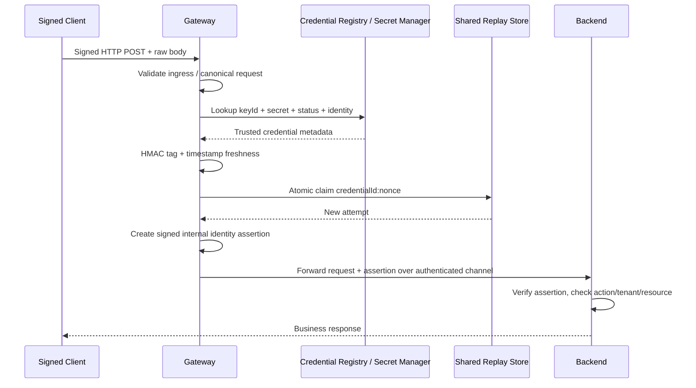
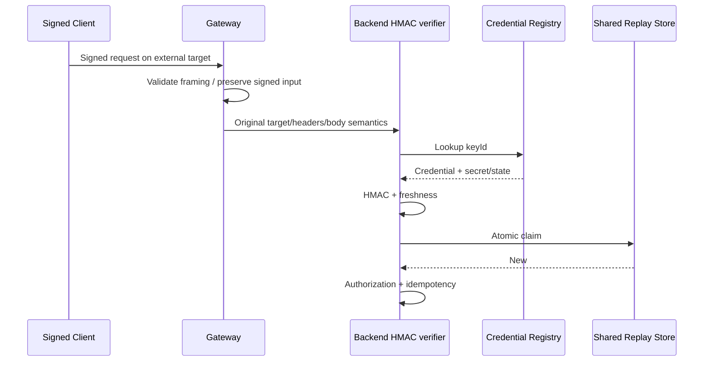
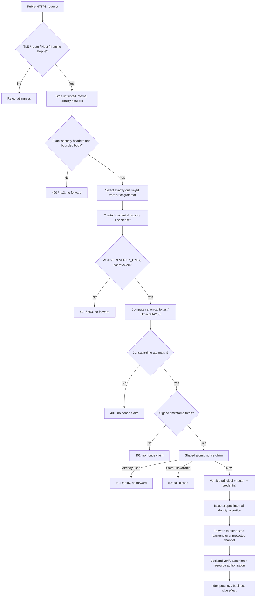

# HMAC tại API gateway: xác minh chữ ký ở ranh giới proxy mà không làm sai HTTP request

> **Chương:** Gateway và proxy  
> **Bài học:** HMAC tại API gateway  
> **Module:** `SECURITY_AUTHENTICATION_HMAC_REQUEST_AUTHENTICATION` — xác thực HTTP request bằng HMAC với shared secret và canonical request chứa method, URI, headers và/hoặc body theo hợp đồng ký; chống replay bằng timestamp/nonce, quản lý key rotation, kiểm thử gateway/proxy và phân biệt authentication với authorization.

Bài giải thích **cách đặt HTTP HMAC authentication tại API gateway** và truyền kết quả đáng tin tới các dịch vụ phía sau. Các ví dụ tập trung Java 17+, một verifier Java thuần để đọc/test được, và **Spring Cloud Gateway trên WebFlux** để minh họa ranh giới reactive gateway; không mặc định mọi sản phẩm gateway đều có tính năng HMAC hoàn chỉnh. Spring MVC/Servlet ở backend là một mô hình tích hợp khác, không được dùng `SecurityFilterChain` của Servlet thay cho WebFlux `SecurityWebFilterChain`.

## 1. Tình huống: ký đúng ở client, nhưng qua gateway lại nhận 401

Một đối tác thanh toán gọi:

```http
POST /v1/tenants/merchant-a/payments?orderId=42 HTTP/1.1
Host: api.example.test
Content-Type: application/json
Idempotency-Key: payment-order-42
X-Key-Id: merchant-a-k2
X-Timestamp: 1767225600
X-Nonce: 87a3d56ea72d40af89f5b68cb3e831d4
X-Signature: v1=<BASE64URL_HMAC_SHA256_TAG>

{"amount":100000,"currency":"VND"}
```

Giữa client và payment service có gateway:

```text
Client
  POST https://api.example.test/v1/tenants/merchant-a/payments?orderId=42
     Host: api.example.test
     X-Signature: v1=...
            |
            v
   TLS / API Gateway / WAF
     * Terminate TLS
     * Rewrite path /v1/... -> /internal/payments
     * Change Host to payments.svc.cluster.local
     * Normalize/forward headers
     * Maybe decompress/re-serialize body
            |
            v
   Payment service
     POST /internal/payments?orderId=42
     Host: payments.svc.cluster.local
```

Nếu verifier backend dựng signing input từ `/internal/payments` và `payments.svc.cluster.local` trong khi client ký `/v1/tenants/merchant-a/payments` và `api.example.test`, chữ ký **đúng về toán học ở client** nhưng **không khớp ở backend**.

Giải pháp **không phải** bỏ path/Host/body ra khỏi HMAC để cho hết 401. Làm vậy có thể khiến một chữ ký dùng được trên host, resource hoặc operation khác. Cần xác định **trust boundary và chính xác representation được ký** trước khi gateway rewrite.

### Mục tiêu học tập

Sau bài này, người học có thể:

1. Chọn nơi xác thực HMAC: **gateway** hay **backend**, và đánh đổi về an toàn/vận hành.
2. Thiết kế canonical HTTP request có method, authority, URI path/query, headers, body digest và ký bằng HmacSHA256.
3. Hiểu các biến đổi HTTP/1.1↔HTTP/2, TLS termination, URL rewrite, forwarded headers, header coalescing và body buffering.
4. Cấu hình thứ tự gateway filters và routing để mọi endpoint nhạy cảm phải qua HMAC.
5. Tra credential bằng key ID trong registry đáng tin, kiểm state/revocation và key rotation.
6. Kiểm timestamp freshness và **claim nonce atomically** trong store chia sẻ trước khi forward request.
7. Truyền verified principal/tenant sang backend qua mTLS hoặc assertion đã ký có audience/expiry; không tin raw client headers.
8. Phân biệt HMAC authentication với **authorization theo action/tenant/resource**.
9. Xử lý request body streaming/buffering, content length, backpressure và lỗi hạ tầng theo **fail closed**.
10. Viết kiểm thử đa ngôn ngữ, qua gateway thực tế và multi-instance/failover.

## 2. Gateway trong mô hình đe dọa

### 2.1. Các thực thể và mức độ đáng tin

| Thành phần | Có thể tin điều gì? | Không nên tin điều gì? |
| --- | --- | --- |
| Internet client | Có thể sở hữu shared secret của **chính credential** được cấp. | Claimed tenant, quyền admin, raw `X-Verified-Principal`, arbitrary path. |
| TLS termination gateway | Kết nối nó tự chấm dứt và canonical request nó thực sự tiếp nhận. | Headers `Forwarded` / `X-Forwarded-*` do public caller gửi trước sanitize. |
| Credential registry | Mapping `keyId → credentialId/principal/tenant/secretRef/state`. | Key ID như tự thân là principal hoặc quyền nghiệp vụ. |
| Replay store | Atomic first-claim quyết định nonce của một credential còn mới. | Local cache giữa nhiều pods không có consistency. |
| API gateway → backend | Identity assertion do gateway phát hành qua trust channel đã xác thực. | Chỉ một plain header với tên `X-Verified-Principal` là đủ. |
| Backend service | Resource owner, tenant policy, business permissions và idempotency. | “Gateway đã verify HMAC” suy ra mọi payment đều được phép. |

Gateway có thể **được tin cậy cho bước authentication**, nhưng backend vẫn là nơi quyết định quyền nghiệp vụ, tenant ownership và side effects; một service không được cấp quyền chỉ vì `X-Key-Id` có prefix tên tenant.

### 2.2. Attacker có thể làm gì?

- Biết key thật của **tenant A** và chủ động tạo chữ ký HMAC hợp lệ cho một request nhắm tenant B; nếu backend chỉ nhìn “signature valid” mà không kiểm owner/grants sẽ vượt quyền.
- Thêm hai `X-Key-Id` hoặc `X-Timestamp` khác nhau; gateway chọn first còn backend chọn last.
- Gửi `X-Forwarded-Host: admin.example.test` để đánh lừa việc xác định signed authority.
- Replay một HTTP request đúng chữ ký tới **hai gateway instances** trước khi store có thể đồng bộ.
- Chọn Host, path hoặc query forms khiến gateway và backend parse khác nhau.
- Sửa body/Content-Encoding nếu một thành phần được ký nhưng biến đổi sau verify trước business.
- Gửi `X-Verified-Principal: administrator` giả; nếu gateway không strip, backend tin nhầm.
- Dùng credential cũ vừa REVOKED nhưng một vùng khác chưa nhận revocation event.
- Lợi dụng upload lớn/slow client để giữ toàn bộ body trong RAM và gây DoS.
- Lợi dụng `OPTIONS`, health route, encoded slash, wildcard hoặc default route để vượt qua HMAC filter.

**Trust-boundary invariant:** Chỉ sau khi kiểm key state, exact signed request, timestamp, nonce và policy cần thiết, gateway mới được tạo identity assertion. Nếu không thể kiểm chứng một điều kiện bắt buộc, gateway **không forward request tới business**.

## 3. Hai kiến trúc đặt HMAC: gateway verify hoặc backend verify

### 3.1. Phương án A — Gateway là authoritative HMAC verifier



Ưu điểm:

- Một điểm kiểm HMAC chung cho nhiều services, thuận tiện key distribution và key rotation.
- Có thể reject request sai chữ ký **trước khi** tải tới backend.
- Có thể áp rate limits, request size policy, telemetry và anti-replay ở edge.
- Backend không cần giữ shared secret của mọi external clients.

Rủi ro phải xử lý:

- Gateway là một **authentication authority** quyền lực; compromise gateway/issuance key có blast radius lớn.
- Phải tránh route bypass, default allow và chain/filter ordering sai.
- Backend chỉ tin **assertion có chứng minh nguồn phát, audience, thời hạn và integrity**; không được tin raw header.
- Gateway cần đọc body (nếu hợp đồng ký body), gây memory/latency/backpressure; streaming cần thiết kế riêng.
- Shared credential/nonce stores phải có latency, capacity và fail-closed policy.

### 3.2. Phương án B — Gateway chỉ chuyển tiếp, backend tự verify



Ưu điểm: Backend nắm trực tiếp trust boundary cho signed business semantics, gateway ít phải xử lý secrets/crypto. Nhược điểm: mỗi backend phải có verifier đáng tin, phân phối secrets phức tạp hơn, khó giữ đồng nhất contract và latency.

**Điều kiện bắt buộc:** Gateway không được âm thầm rewrite covered components trước khi backend xác minh, trừ khi original signed target được chuyển qua **metadata đáng tin** và backend dùng đúng cùng byte-level contract.

### 3.3. Bảng quyết định

| Khía cạnh | Gateway verify | Backend verify |
| --- | --- | --- |
| Điểm có shared client secrets | Gateway/credential authority | Backend/verifier service |
| Gateway có phải buffer body để ký? | Có nếu covered body được verify tại edge. | Không nhất thiết; nhưng phải preserve body. |
| Nơi atomic nonce claim | Gateway, **một lần**. | Backend, **một lần**. |
| Backend dựa vào gì để biết principal | Internal authenticated assertion / mTLS peer. | Kết quả local verifier/SecurityContext. |
| Proxy path rewrite sau verification | Được nếu backend dựa vào **verified original target/context** cho quyền và không nhầm target. | Chỉ được khi backend có original target bảo đảm chính xác. |
| Mức độ tập trung key management | Cao | Phân tán hơn |
| Lỗi thiếu secret/nonce store | Edge fail closed | Backend fail closed |
| Business authorization/idempotency | **Vẫn ở backend** | **Vẫn ở backend** |

**Không chọn** “Gateway verify rồi backend verify và cả hai claim nonce” như cách tăng an toàn mặc định: nonce được claim ở bước đầu và bị xem là replay ở bước hai. Nếu hai lớp cần kiểm chứng nhau, hãy phân biệt **gateway HMAC claim** với **backend trust assertion verification**, hoặc định nghĩa giao thức một-authority rõ.

## 4. HTTP semantic components và các biến đổi do proxy

### 4.1. Method, scheme, authority, path và query

Một request ngoài Internet có thể là:

```text
POST https://api.example.test/v1/tenants/merchant-a/payments?orderId=42
```

Backend lại thấy:

```text
POST http://payments.internal:8080/internal/payments?orderId=42
```

Với HTTPS termination ở gateway:

- **External scheme** là `https` nhưng internal connection có thể là `http` hoặc mTLS.
- **External authority** từ Host/`:authority` khác internal Host.
- **External path** có thể bị strip prefix hoặc map route mới.
- **Query** có thể bị reorder, decode/re-encode hoặc coalesce duplicate params.
- **HTTP/2** dùng pseudo-header fields `:method`, `:scheme`, `:authority`, `:path`; HTTP/1.1 dùng request-line/Host. Ta ký **semantic components đã chốt**, không raw wire framing.

### 4.2. Header canonicalization phải chốt tên và giá trị

| Tình huống | Nguy cơ | Chính sách gợi ý |
| --- | --- | --- |
| `X-Key-Id` và `x-key-id` | Header names không phân biệt chữ hoa/thường. | Lowercase **tên** khi canonicalize; reject duplicate occurrences. |
| Một value có leading/trailing OWS | SDK và gateway xử lý khác. | Hợp đồng rõ trim/collapse; fixture của bài reject OWS ngoài quy định. |
| `Content-Type` được framework thêm sau signing | Value bị đổi. | Sign sau khi mọi headers/body đã finalized. |
| Duplicate `X-Nonce`/`X-Timestamp` | Gateway verify first, backend dùng last. | Reject tại ingress trước coalescing. |
| `Forwarded`/`X-Forwarded-Host` từ Internet | Caller định nghĩa original authority. | Strip input, chỉ nhận metadata từ trusted proxy. |
| Header hop-by-hop | Biến đổi theo proxy; signed policy không thống nhất. | Tránh ký tùy ý hop-by-hop fields; chỉ ký covered end-to-end semantics. |
| Multi-value headers | Ordering/merging khác giữa HTTP stacks. | Định nghĩa exact combine rule hoặc reject cho security-critical fields. |

### 4.3. Body có thể bị biến đổi dù JSON “giống nhau”

```json
{"amount":100000,"currency":"VND"}
```

và:

```json
{ "currency": "VND", "amount": 100000 }
```

có thể tương đương trong một domain object, nhưng **khác raw bytes**, do đó SHA-256 body digest khác. Nếu ký `SHA256(rawBodyBytes)`, gateway không được JSON parse/serialize lại trước verifier hoặc trước business mà không có rõ representation contract.

Các biến đổi khác: gzip/decompress, chunked transfer decoding, charset, Unicode normalization, line-ending conversions, multipart parsing và body stream middleware.

### 4.4. Bảng các vị trí kiểm với body và đường đi

| Vị trí verify | Signing body representation | Nguy cơ nếu không kiểm |
| --- | --- | --- |
| Gateway trước decompress | Wire message body bytes theo contract (không tính transfer framing). | Backend nhận decompressed content khác signed bytes; phải ràng buộc semantics và decoding. |
| Gateway sau decompress | Decoded bytes theo contract đã thống nhất. | Client ký compressed bytes sẽ mismatch; content-encoding confusion. |
| Backend sau gateway rewrite | Bytes sau proxy. | Client ký original body khác backend nhận. |
| Gateway verify raw bytes rồi backend parse | Raw bytes đáng tin đã được kiểm integrity. | Parser ambiguity (duplicate JSON keys / type coercion) vẫn phải reject theo schema. |

Đối với một HMAC payment API đơn giản, **chọn một content representation ổn định, giới hạn kích thước body, không hỗ trợ content encoding ngoài contract và ký exact body bytes** là cách dễ triển khai/kiểm thử hơn.

## 5. Hợp đồng ký HMAC mẫu ở API gateway

Ví dụ minh họa tên `GATEWAY-HMAC-V1`, **không phải** một chuẩn HTTP signing chung hay yêu cầu có sẵn của mọi gateway.

### 5.1. HTTP request fixture

```http
POST /v1/tenants/merchant-a/payments?orderId=42 HTTP/1.1
Host: api.example.test
Content-Type: application/json
Idempotency-Key: payment-order-42
X-Key-Id: merchant-a-k2
X-Timestamp: 1767225600
X-Nonce: 87a3d56ea72d40af89f5b68cb3e831d4
X-Signature: v1=<43_BASE64URL_CHARACTERS>

{"amount":100000,"currency":"VND"}
```

Hợp đồng này yêu cầu:

- Method `POST`.
- External authority `api.example.test`, lấy từ **trusted ingress request target**; không tin raw forwarded headers từ Internet.
- Path `/v1/tenants/{tenant}/payments` với tenant slug ASCII lowercase.
- Query **đúng** `orderId=42` trong fixture; production phải xây canonical query thật hoặc reject forms không hỗ trợ.
- `Content-Type: application/json`, không chấp nhận Content-Encoding ngoài policy.
- `Idempotency-Key`, `X-Key-Id`, `X-Timestamp` và `X-Nonce` đúng một value mỗi header.
- Body 0–64 KiB theo demo; hash SHA-256 trên đúng byte array nhận tại gateway.
- Signature `v1=` + HMAC-SHA256 raw tag 32 bytes encode Base64URL **không padding** (43 ký tự sau prefix).
- Một key ID global-unique → đúng một credential; registry chứa `principalId`, `tenantId`, `secretRef`, state và revision.
- Nonce 128-bit ngẫu nhiên bằng CSPRNG ở client, encode 32 lowercase hex; fresh signed timestamp Unix epoch seconds.

### 5.2. Canonical bytes

```text
POST
api.example.test
/v1/tenants/merchant-a/payments
orderId=42
content-type:application/json
idempotency-key:payment-order-42
x-key-id:merchant-a-k2
x-nonce:87a3d56ea72d40af89f5b68cb3e831d4
x-timestamp:1767225600
content-type;idempotency-key;x-key-id;x-nonce;x-timestamp
<SHA256_HEX_OF_EXACT_RAW_BODY>
```

Các dòng nối bằng LF `\n`, **không newline ở cuối toàn chuỗi**:

```text
signingBytes = UTF8("HMAC-SHA256/GATEWAY-HMAC-V1\n" + canonicalRequest)
rawTag       = HMAC-SHA256(K_of_selectedKeyId, signingBytes)
X-Signature  = "v1=" + Base64URLNoPadding(rawTag)
```

**Vì sao có prefix?** Domain separation/phân biệt phiên bản của hợp đồng, tránh cùng bytes được dùng nhầm cho một scheme khác. Đây là thiết kế custom, không phải `RFC 9421`; nếu cần interoperability chuẩn, cân nhắc chuẩn HTTP Message Signatures thay vì phát minh nhiều variants.

### 5.3. Những trường tuyệt đối không được bỏ ký khi đổi gateway

- **Method/URI/authority** nếu chúng ảnh hưởng operation, tenant hoặc đích.
- **Key ID** để không đổi selector mà giữ nguyên tag.
- **Timestamp và nonce** để không thay metadata freshness/replay sau ký.
- **Idempotency-Key** nếu nó quyết định grouping của business operation.
- **Body digest** khi body chứa amount, account, recipient hoặc các tham số nghiệp vụ có tác động.
- **Selected headers** như Content-Type nếu parser/backend diễn giải theo đó.

Nếu proxy làm thay đổi một trong các trường này, phải sửa cách truyền/verify theo contract thay vì “bỏ bớt dữ liệu khỏi signing input cho dễ”.

## 6. Lưu trữ khóa và vòng đời credential tại gateway

Một khóa HMAC không được biến thành “shared global secret của tất cả clients”. Thiết kế registry:

```text
external key ID (client supplies)        trusted directory              secret manager
merchant-a-k1                  -> cred-A-1, principal A, tenant A -> secretRef A1
merchant-a-k2                  -> cred-A-2, principal A, tenant A -> secretRef A2
merchant-b-k1                  -> cred-B-1, principal B, tenant B -> secretRef B1
```

| State | Gateway được verify? | Client nên ký mới? |
| --- | --- | --- |
| `PREPARED` | Không, ngoại trừ canary scope được thiết kế riêng. | Không. |
| `ACTIVE` | Có nếu tag/freshness/replay đúng. | Có. |
| `VERIFY_ONLY` | Có tới `verifyUntil`, nếu chưa compromised/revoked. | Không; dùng cho in-flight overlap. |
| `REVOKED` | **Không**, dù client có secret và tag đúng. | Không. |

**Quản lý khóa an toàn:**

- Sinh mỗi shared secret đủ entropy bằng CSPRNG; ví dụ 32 random bytes cho HmacSHA256.
- Provision secrets qua Vault/KMS/secret manager với workload identity, ACL least privilege, audit và retention.
- Key ID **không** trực tiếp ghép thành Vault path (`"kv/" + rawKeyId`).
- Key rotation dùng **K1/K2 key IDs khác nhau** và secret refs không mutable-overwrite để tránh confusion.
- Emergency revoke cần propagation/fencing trên tất cả gateways; chỉ cache một bản registry rồi tin vô thời hạn có thể làm sống lại key cũ.
- Không thử mọi secret versions khi chữ ký không khớp; một key ID chọn một credential policy.
- Một tenant A có thể tự ký request tới tenant B; gateway có thể kiểm coarse tenant binding nhưng backend vẫn cần resource-level authorization.
- Không log raw secrets, Vault tokens, full signature hoặc key bytes; audit theo credential identity/revision và outcome category.

### 6.1. Revocation và cache

Nếu region A nhận `k1 REVOKED` nhưng region B còn cache `k1 ACTIVE`, một request k1 có thể được xác thực ở B dù control plane đã revoke. Với security-sensitive revocation:

1. Thiết kế registry **monotonic revision/epoch**.
2. Phát trạng thái deny/revoke qua tất cả gateways với bounded freshness hoặc admission fencing.
3. Có cách cô lập nodes/regions chưa đạt safety coverage.
4. Không cho cache expired tạo authenticated principal nếu backend authority không đáng tin.
5. Khi không thể chứng minh key được phép, **fail closed**, trừ trường hợp bounded cache được chính sách định nghĩa rõ và vẫn bảo đảm revoke semantics.

**Vấn đề này không thể giải chỉ bằng cách đọc registry hai lần trong cùng một request:** revoke có thể chen giữa lần đọc cuối và downstream admission. SLA cho revoke phải tính cả các requests đang bay và các gateways unreachable.

---

## 7. Timestamp và nonce ở gateway: chống replay giữa nhiều nodes

Một HTTP HMAC signature **không tự cấm gửi lại** cùng request. Nếu attacker ghi được request có tag hợp lệ và gửi lại trong một khoảng thời gian, verifier có thể vẫn tính đúng HMAC.

### 7.1. Freshness window

Ký thời gian `T` dưới dạng **Unix epoch seconds** (UTC instant), phía gateway đọc clock hiện tại `N`. Chọn past window `P` và future allowance `F`:

\[
N-P\le T\le N+F
\]

Tương đương signed timestamp `T` được xem là hợp lệ khi:

\[
T-F\le N\le T+P
\]

Ví dụ `P=F=300` giây và `T=2026-01-01T00:00:00Z`:

| Server time | Kết quả |
| --- | --- |
| `T - 301s` | Chưa tới future allowance; reject. |
| `T - 300s` | Biên đầu, freshness pass. |
| `T` | Freshness pass. |
| `T + 300s` | Biên cuối, freshness pass. |
| `T + 301s` | Quá hạn; reject. |

P/F và `NONCE_MARGIN` chỉ là policy fixture; production cần cân đối clock skew, network latency, liveness, recovery và replay risk.

**Timestamp phải được ký**. Không lấy giá trị `X-Timestamp` mới do proxy thêm vào rồi bỏ qua signature; clock synchronization giữa client/gateway là vấn đề vận hành riêng.

### 7.2. Replay store và TTL đúng

Nếu request được claim khi `N=T-F` (tới sớm nhất), nonce vẫn cần bảo vệ tới ít nhất `T+P` (hạn cuối). Do đó:

```text
replayNamespace = (stableCredentialIdentity, nonce)
replayExpiresAt = T + P + safetyMargin
remainingTtl    = replayExpiresAt - currentTrustedServerTime
```

**Đừng đặt TTL=300 giây kể từ lần claim sớm nhất**: request có thể còn fresh sau khi nonce record biến mất. Không reset/xóa replay records khi rotate key hoặc rollback client signer.

Ví dụ operation của shared atomic store:

```text
SET replay:cred-A2:<nonce>
    "<opaque marker>"
    NX
    PX <computedRemainingTtlMs>
```

Đây là **pseudocode Redis command shape**, không phải một lệnh production hoàn chỉnh. Khi đổi `expiresAt - now` sang milliseconds phải chống overflow, bảo đảm TTL dương, có retention margin và xác định policy khi network reply mất. `NX` phải thực sự atomic tại authoritative store; nếu hai regions có stores eventual và cả hai accept cùng nonce, giải pháp không chống replay toàn hệ thống.

### 7.3. Một nonce claim point, không hai

```text
BAD:
  Gateway verifies HMAC and SETNX(credA:N) => success.
  Backend verifies again and SETNX(credA:N) => duplicate => rejects.

GOOD:
  Gateway verifies HMAC and claims nonce exactly once.
  Backend verifies gateway assertion & business authorization.
```

Nếu hệ thống chọn backend verifier, **đừng** để gateway claim nonce trước. Không dùng chỉ local `ConcurrentHashMap` trên mỗi gateway instance; concurrent replay từ các gateways sẽ pass.

### 7.4. Retry hợp lệ khác replay

```text
POST #1:
  X-Key-Id: merchant-a-k1
  X-Timestamp: T1
  X-Nonce: N1
  Idempotency-Key: payment-order-42
  Outcome: payment P42 committed, HTTP response lost.

POST #2 after retry/rotation:
  X-Key-Id: merchant-a-k2
  X-Timestamp: T2 (NEW)
  X-Nonce: N2 (NEW)
  Idempotency-Key: payment-order-42 (SAME)
  Outcome: HMAC valid, replay valid, business returns existing P42.
```

**Replay store** chặn cùng signing attempt; **idempotency store** chặn cùng business intent tạo side effects lặp lại. Idempotency scope nên dựa vào **stable authenticated principal + authorized tenant + operation + key**, không chỉ HMAC key ID; rotation k1→k2 không được tạo namespace giao dịch mới.

## 8. Admission pipeline: từ HTTP ingress tới verified identity

Một gateway HMAC hợp lý thực hiện các bước với thứ tự có chủ ý:



### 8.1. Chống denial of service trước khi lookup secret

Trước khi HMAC được xác minh, caller có thể gửi key IDs tùy ý, bodies khổng lồ hoặc chậm. Cần:

- Giới hạn TCP/TLS connections, HTTP header size, request body size và request timeouts tại ingress.
- Reject malformed URI/Host, duplicate security fields và quá nhiều headers trước khi secret lookup.
- Rate limit trước authentication dựa trên IP, network/routing identity hoặc anonymous buckets có anti-abuse; **không dùng raw tenant header để trừ quota tenant B**.
- Sau authentication mới áp tenant/principal quotas từ verified identity.
- Bounded concurrency/backpressure cho blocking credential store và nonce store; không block Reactor event-loop bằng JDBC/Vault blocking client.
- Không làm “unknown key lookup” gọi Vault path từ input tùy ý; đọc trusted registry keyed by validated opaque key ID.

### 8.2. Fail closed và các mã lỗi

| Tình huống | Gateway outcome | HTTP gợi ý |
| --- | --- | --- |
| Method/URI/header không đúng contract | Malformed | 400 hoặc 4xx theo contract. |
| Body vượt giới hạn | Payload too large | 413. |
| Không có keyId/signature | Unauthenticated | 401 theo API contract. |
| Key unknown, REVOKED, tag không khớp | Unauthenticated | 401 generic; không tiết lộ trạng thái key. |
| Timestamp ngoài cửa sổ hoặc nonce đã dùng | Stale / replay | 401/4xx theo contract; không forward. |
| Credential directory / Vault / nonce store timeout | Cannot verify | 503, **fail closed**. |
| Đã được xác thực nhưng không có quyền tenant/action | Forbidden | 403 hoặc 404 masking tại backend. |
| Idempotency fingerprint conflict | Business conflict | 409 theo API contract. |
| Backend unreachable nhưng gateway đã claim nonce | Upstream failure | 502/503; retry với nonce mới + same idem key. |

**Không trả “expected HMAC tag”, secretRef hoặc key state** ra Internet. Logs nội bộ có reason codes tách `unknown_key`, `invalid_tag`, `stale`, `replay`, `revoked`, nhưng client response nên generic đủ tránh enumeration.

### 8.3. Khi nonce claim thành công nhưng gateway chưa kịp forward

Có thể xảy ra:

```text
Gateway verify HMAC → nonce claimed
Gateway crash / network partition trước khi backend nhận request
Client retry nguyên HTTP request => replay rejected
```

Đó là hành vi anti-replay đúng: nonce đại diện cho **một signing attempt**, không bảo đảm request đã tạo business effect. Client phải tạo **attempt mới** (timestamp/nonce/signature mới), giữ Idempotency-Key. Không “undo nonce” khi upstream timeout, vì không biết request đã được forward/commit hay chưa. Idempotency ở backend quyết định trả lại prior result.

## 9. Chuyển danh tính từ gateway đến backend: không chỉ gắn một header

Sau verify, gateway biết:

```text
Verified principalId  = partner-service-42
Verified tenantId     = merchant-a
Verified credentialId = cred-A2
Verified authMethod   = HMAC-SHA256/GATEWAY-HMAC-V1
Verified original path= /v1/tenants/merchant-a/payments
Verified method       = POST
Verified body digest  = SHA256(rawBody)
Verified timestamp    = 1767225600
```

**Bài toán kế tiếp:** Backend có thể tin các thông tin này bằng chứng nào, khi client hoàn toàn có thể tự gửi headers giống tên?

### 9.1. Cách sai — raw trusted-looking headers

```http
X-Verified-Principal: admin
X-Verified-Tenant: merchant-b
X-Verified-Auth: HMAC
```

Nếu Internet client tự gửi ba fields này và gateway forward nguyên, backend đọc chúng có thể cấp quyền sai, **dù không có HMAC**. Chỉ đổi tên header thành `X-Internal-*` hoặc `X-Authenticated-*` không tự tạo trust boundary.

### 9.2. Cách đúng — sanitize + internal attestation + authenticated transport

Các điều kiện bắt buộc:

1. **Xóa** mọi inbound headers trông giống internal identity/verified attributes ở gateway trước khi routing.
2. Chỉ gateway trusted, sau khi HMAC pass, mới phát assertion bằng một **issuer key riêng** (không lấy client shared HMAC secret để backend tin).
3. Kênh gateway→backend được bảo vệ bằng mTLS/service identity hoặc network isolation mạnh; backend xác thực **source workload** và cryptographic assertion đúng trust model.
4. Assertion có **issuer, audience, subject, tenant, credential, authentication method, issued-at, expiry ngắn, unique ID**, và optional signed-target/body digest binding nếu backend dùng chúng để quyết định quyền.
5. Backend **verify signature/algorithm allowlist/issuer/audience/expiry, không chấp nhận `alg=none`**, không chỉ decode Base64 JWT.
6. Backend kiểm action/grants/tenant/resource trên authoritative data, không tin `payments:create` chỉ vì client tự khai.
7. Backend không có đường truy cập direct-to-service có thể bỏ qua identity verification.
8. Nếu assertion bị thiếu/hỏng/hết hạn hoặc issuer key store unavailable, **fail closed**.

Mẫu claims minh họa (không phải JWT ký thực):

```json
{
  "iss": "https://gateway-issuer.internal.example.test",
  "aud": "payments-backend",
  "sub": "partner-service-42",
  "tenant_id": "merchant-a",
  "credential_id": "cred-A2",
  "auth_method": "HMAC-SHA256/GATEWAY-HMAC-V1",
  "auth_time": 1767225600,
  "iat": 1767225601,
  "exp": 1767225631,
  "jti": "gateway-assertion-unique-id",
  "method": "POST",
  "original_target": "/v1/tenants/merchant-a/payments?orderId=42",
  "body_sha256": "<LOWERCASE_HEX_OF_SIGNED_RAW_BODY>"
}
```

**Các claims chỉ minh họa**, `exp`/`iat` và domain giả không phải production config. Không gửi raw shared secret hoặc full HMAC signature trong assertion. Issuer keys cần rotation/revocation policy riêng, independent from per-client HMAC credentials.

### 9.3. Phải ràng buộc assertion với backend request khi cần

Một verified identity assertion dùng được cho **mọi request** nếu nó chỉ chứa `sub/tenant` nhưng không binding tới method/target/body. Nếu token bị replay sang operation khác trong thời hạn ngắn, hậu quả có thể nghiêm trọng. Tuỳ threat model:

- Gắn audience riêng từng service, thời hạn ngắn, `jti`/replay defense khi cần.
- Gắn method + original target + body digest hoặc canonical request digest vào assertion.
- Backend kiểm những fields dùng trong authorization còn khớp đúng request **sau routing**, có mapping original-target đáng tin nếu path được rewrite.
- Không reuse assertion cho retry không cùng request; không cho gateway gửi assertion của tenant A sang route/service B.
- Chỉ accept issuer identity từ allowlisted workload/mTLS peer và pinned signing algorithms.

**Cảnh báo:** Nếu gateway rewrite body sau khi đã tạo assertion dựa trên original bytes, backend phải hiểu binding giữa original body và body nhận được. Thiết kế đơn giản nhất là **không biến đổi body đã ký**, tránh vừa xác thực payload A vừa xử lý payload B.

### 9.4. Gateway authn không thay backend authz

```text
Gateway says:
  HMAC valid for credential cred-A2
  principal=service-A, tenant=merchant-a
  method=POST, path=/v1/tenants/merchant-b/payments

Backend asks:
  Does service-A have payments:create on merchant-b?
  Does orderId=42 belong to merchant-b?
  Does amount/beneficiary comply with merchant-b policy?
  Has Idempotency-Key already committed?
```

**Nếu principal chỉ có quyền merchant-a, backend phải deny request tới merchant-b** dù client A chủ động ký HMAC hợp lệ cho merchant-b. Gateway có thể deny coarse tenant mismatch sớm để giảm tải, nhưng resource authorization ở backend vẫn bắt buộc.

## 10. Route matching và filter ordering: không có đường tắt bỏ HMAC

Một gateway thường có nhiều routes:

```text
/public/health             -> health-backend      (no client HMAC, narrow)
/v1/tenants/{t}/payments   -> payment-backend     (HMAC mandatory)
/internal/admin/**         -> admin-backend       (NOT public)
/v1/partners/**            -> partner-backend     (separate auth policy)
unmatched                  -> explicit 404/403
```

**Các mối nguy:**

- Route predicate quá hẹp, ví dụ chỉ `/v1/payments` nhưng controller còn `/v1/payments/`.
- Gateway filter chỉ chạy với một route, trong khi một catch-all route forward cùng backend mà không xác thực.
- Một allowlisted health/admin path vô tình match prefix của payment path.
- Route rewrite xảy ra **trước** HMAC canonicalizer nhưng client ký external target.
- Thứ tự filters tạo authenticated identity từ raw header trước HMAC.
- Một custom `GlobalFilter` tự `return chain.filter(exchange)` cho request không match đơn giản, trong khi route đó vẫn là payment route dưới alternate path.
- Requests đi trực tiếp tới backend bypass gateway.

### 10.1. Invariant route coverage

Với tập endpoints cần HMAC `H`, cần bảo đảm:

\[
\forall r\in H,\quad
\operatorname{routeToBusiness}(r)
\Rightarrow \operatorname{hmacAuthenticated}(r)
\]

Không chỉ rely vào “route `/v1/tenants/**` có HMAC filter”. Thử thêm: encoded slash, trailing slash, duplicate slash, alternate host, forward/rewrite, URL normalization và HTTP/2 path mapping.

### 10.2. Gateway filters không giống Spring Security Servlet filters

Spring Cloud Gateway dùng WebFlux/Gateway `GlobalFilter` / `GatewayFilter` và routing filters; Spring Security WebFlux dùng `SecurityWebFilterChain`. Chúng có vòng đời/order khác Servlet `OncePerRequestFilter`.

- `GlobalFilter` chạy trong gateway filter chain **sau khi route đã được matched** theo kiến trúc Spring Cloud Gateway Server WebFlux; nó không tự thay HTTP security enforcement cho requests không route vào gateway.
- `GatewayFilter` có thể gắn vào một route, nhưng phải bảo đảm **mọi route tới cùng backend** đều được bảo vệ.
- Spring Security WebFlux `SecurityWebFilterChain` có thể bảo vệ authentication/authorization ở WebFilter level, nhưng custom HMAC request-body handling cần thiết kế phù hợp reactive streams.
- Không copy `SecurityContextHolder` ThreadLocal từ Servlet vào Reactor/WebFlux rồi cho rằng principal tự propagate.
- Với blocking Redis/Vault/JDBC clients, không block Netty event loop; dùng async/reactive APIs hoặc bounded scheduler phù hợp.

**Phạm vi ví dụ Java ở phần sau:** dùng WebFlux `GlobalFilter` đơn giản để minh họa buffer raw body/verify/forward, nhưng nó không thay toàn bộ ingress WAF, trusted assertion issuance, routing policy và distributed consistency.

## 11. Multi-tenant, scopes và business idempotency qua gateway

### 11.1. Tenant trong URI chỉ là requested target

Ví dụ:

```text
Request path:       /v1/tenants/merchant-b/payments
X-Key-Id:           merchant-a-k2
Credential owner:   principal service-A, tenant merchant-a
Signature:          HMAC(K_A2, request to merchant-b) -> VALID
```

HMAC đúng vì người giữ K_A2 có thể ký bất kỳ request bytes nào. Không có nghĩa K_A2 được dùng để tác động merchant-b.

Gateway có thể kiểm `requestedTenant == credential.tenantId` đối với **per-tenant credential**; nếu principal được cấp grants nhiều tenants thì authorization phải tra grants đúng action/scope thay vì so equals. Backend luôn kiểm resource owner thật với tenant đã được cho phép.

### 11.2. Idempotency namespace

```text
idempotencyKey =
  (authenticatedPrincipal, verifiedTenant, operation, Idempotency-Key)
```

Không dùng `(X-Key-Id, Idempotency-Key)` vì rotation k1→k2 có thể tạo payment trùng. Không dùng `(raw X-Tenant-Id, Idempotency-Key)` vì client có thể đổi tenant input để ảnh hưởng cache namespace. Không lookup business idempotency trước khi xác thực và authorize vì có thể rò prior response.

### 11.3. Quota/rate limits

Trước HMAC: IP/connection/anonymous allowlist controls để chống abuse. Sau HMAC: principal/verified tenant quotas. Nếu lấy `X-Tenant-Id=merchant-b` từ attacker A trước authentication để trừ quota, A có thể làm B hết quota dù không có quyền B.

### 11.4. Khóa HMAC không phải backend JWT token

Key HMAC dùng giữa client và gateway là secret shared để ký request. Assertion/JWT giữa gateway và backend là **một trust domain khác**, với audience, issuer, short expiry và independent key management. Không reuse client K_A để ký internal identity token, vì như vậy client A có thể tự giả mạo gateway.

## 12. Giám sát và vận hành tại gateway

| Metric / log category | Mục tiêu |
| --- | --- |
| `hmac_gateway_auth_success_total` | Số requests qua verification theo route/client class. |
| `hmac_gateway_invalid_tag_total` | Mismatch giữa client và gateway signing input. |
| `hmac_gateway_malformed_total` | Duplicate headers, missing fields, malformed URI/signature. |
| `hmac_gateway_stale_timestamp_total` | Clock skew, delayed deliveries hoặc replay attempt. |
| `hmac_gateway_nonce_replay_total` | Signed attempt bị gửi lại/claim đồng thời. |
| `hmac_gateway_key_rejected_total` | Credential revoked/unknown/prepared/expired. |
| `hmac_gateway_credential_lookup_error_total` | Vault/registry outage hoặc ACL lỗi. |
| `hmac_gateway_replay_store_error_total` | Redis/SQL claim bị lỗi, phải fail closed. |
| `hmac_gateway_body_buffer_rejected_total` | Body lớn, slow client, rate abuse. |
| `gateway_route_auth_coverage_gap_total` | Route tới backend nhạy cảm mà thiếu HMAC. |
| `gateway_assertion_issue_failed_total` | Internal issuer/token service unavailable. |
| `backend_assertion_invalid_total` | Token issuer/audience/signature/binding không hợp lệ. |
| `backend_resource_forbidden_total` | HMAC pass nhưng permission/tenant/resource deny. |
| `gateway_credential_revision_lag_seconds` | Các regions/cache chưa áp revocation state. |
| `gateway_hmac_latency_seconds` | Độ trễ canonicalization, HMAC, registry và nonce store. |

**Không log** raw secret, Vault token, expected tag, full `X-Signature`, full sensitive body, authorization tokens hoặc nội dung header internal assertion. Key ID/tenant có thể được mask hoặc đưa vào audit phân quyền, tránh high-cardinality metrics và enumeration.

### 12.1. Runbook nhanh khi 401 tăng sau gateway release

1. Xác định lỗi xảy ra ở **gateway verification** hay **backend assertion/authorization**; không gom tất cả thành 401.
2. So signing input bytes ở client và gateway trên **public test fixtures**, gồm method/authority/path/query/header/body SHA-256.
3. So raw external target với target sau rewrite; kiểm Host/`:authority`/`X-Forwarded-*` provenance.
4. Kiểm duplicate security headers và header merge ở WAF/edge.
5. Kiểm gateway có transform Content-Type, gzip hoặc JSON body không.
6. Kiểm key ID registry binding, environment, key state và cache revision.
7. Kiểm server time/clock skew và nonce replay store; tìm double-claim do filter registration.
8. Rollback gateway code/config nếu root cause là rewrite regression; **không tắt HMAC hay ký bớt fields**.
9. Nếu compromise secret, revoke/roll-forward theo incident process; **không** bật lại key REVOKED để hết 401.
10. Sau fix, canary với HMAC-valid và HMAC-invalid fixtures; negative tests phải tiếp tục reject.

---

## 13. Java 17+: mô phỏng HMAC verifier ở gateway (chạy offline, không cần framework)

Trước khi viết một WebFlux filter thực tế, nên tách phần crypto/freshness/replay/credential policy thành một **Java core** độc lập, test được bằng `Clock.fixed`. Việc tách này tránh để logic crypto phụ thuộc vào một phiên bản framework hoặc những biến đổi body/headers mà framework có thể làm sẵn.

Ví dụ sau minh họa:

- Credential registry dùng key ID **global-unique**, trả trusted principal/tenant/secret/state.
- Full HmacSHA256 32 bytes, signature prefix `v1=` + Base64URL no padding.
- Canonical method, authority, path, query, signed headers và raw body digest.
- Strict signed metadata grammar, exact target fixture và body size.
- Timestamp freshness ±300 giây, nonce TTL `T+P+margin`.
- Replay store atomic trong một JVM (chỉ dùng demo).
- Gateway trả **VerifiedIdentity**; backend cần kiểm tenant/action/resource riêng.
- Một request do client A ký hợp lệ cho tenant B vẫn HMAC-valid, nhưng **backend authorization deny**.
- Credential `REVOKED` bị từ chối dù HMAC về toán học đúng.
- Hai attempts cùng nonce nhưng qua hai threads: chỉ một pass trong một JVM.
- Lỗi credential registry/replay store là `UNAVAILABLE`, không tạo identity.

### 13.1. `GatewayHmacVerifierDemo.java`

```java
import java.nio.charset.StandardCharsets;
import java.security.GeneralSecurityException;
import java.security.MessageDigest;
import java.time.Clock;
import java.time.Instant;
import java.time.ZoneOffset;
import java.util.Arrays;
import java.util.Base64;
import java.util.HexFormat;
import java.util.Map;
import java.util.Objects;
import java.util.Set;
import java.util.concurrent.Callable;
import java.util.concurrent.ConcurrentHashMap;
import java.util.concurrent.CountDownLatch;
import java.util.concurrent.ExecutorService;
import java.util.concurrent.Executors;
import java.util.concurrent.Future;
import java.util.concurrent.TimeUnit;
import java.util.concurrent.atomic.AtomicBoolean;
import java.util.regex.Matcher;
import java.util.regex.Pattern;
import javax.crypto.Mac;
import javax.crypto.spec.SecretKeySpec;

public final class GatewayHmacVerifierDemo {
    private static final HexFormat HEX = HexFormat.of();
    private static final long PAST = 300;
    private static final long FUTURE = 300;
    private static final long NONCE_MARGIN = 60;
    private static final String PREFIX =
        "HMAC-SHA256/GATEWAY-HMAC-V1\n";
    private static final String SIGNED_NAMES =
        "content-type;idempotency-key;x-key-id;"
        + "x-nonce;x-timestamp";
    private static final String TENANT_SLUG =
        "[a-z0-9](?:[a-z0-9-]{0,30}[a-z0-9])?";
    private static final Pattern PATH =
        Pattern.compile(
            "^/v1/tenants/(" + TENANT_SLUG + ")/payments$");

    private GatewayHmacVerifierDemo() {}

    enum KeyState {
        PREPARED, ACTIVE, VERIFY_ONLY, REVOKED
    }

    enum Decision {
        ACCEPT, MALFORMED, UNAUTHENTICATED,
        STALE, REPLAY, UNAVAILABLE
    }

    record Credential(
            String keyId,
            String credentialId,
            String principalId,
            String tenantId,
            KeyState state,
            long verifyUntil,
            byte[] secret,
            Set<String> authorities) {
        Credential {
            Objects.requireNonNull(keyId);
            Objects.requireNonNull(credentialId);
            Objects.requireNonNull(principalId);
            Objects.requireNonNull(tenantId);
            Objects.requireNonNull(state);
            Objects.requireNonNull(secret);
            Objects.requireNonNull(authorities);
            secret = secret.clone();
            authorities = Set.copyOf(authorities);
        }

        @Override
        public byte[] secret() {
            return secret.clone();
        }
    }

    interface CredentialDirectory {
        Credential lookup(String keyId);
    }

    static final class LocalDirectory implements CredentialDirectory {
        private final ConcurrentHashMap<String, Credential> keys =
            new ConcurrentHashMap<>();
        volatile boolean unavailable;

        void put(Credential c) {
            keys.put(c.keyId(), c);
        }

        @Override
        public Credential lookup(String keyId) {
            if (unavailable) {
                throw new IllegalStateException(
                    "Credential registry unavailable");
            }
            return keys.get(keyId);
        }
    }

    interface ReplayStore {
        boolean claim(String scopedNonce, long expiry, long now);
    }

    // Not distributed; only for demonstrating atomicity in a JVM.
    static final class LocalReplayStore implements ReplayStore {
        private final ConcurrentHashMap<String, Long> seen =
            new ConcurrentHashMap<>();
        volatile boolean unavailable;

        @Override
        public boolean claim(
                String scopedNonce, long expiry, long now) {
            if (unavailable) {
                throw new IllegalStateException("Nonce store down");
            }
            if (expiry <= now) {
                throw new IllegalStateException(
                    "Replay expiry already passed");
            }
            AtomicBoolean claimed = new AtomicBoolean(false);
            seen.compute(scopedNonce, (k, previousExpiry) -> {
                if (previousExpiry == null
                        || previousExpiry <= now) {
                    claimed.set(true);
                    return expiry;
                }
                return previousExpiry;
            });
            return claimed.get();
        }
    }

    record SignedRequest(
            String method,
            String authority,
            String rawPath,
            String rawQuery,
            String contentType,
            String idempotencyKey,
            String keyId,
            String timestamp,
            String nonce,
            byte[] rawBody,
            String signature) {
        SignedRequest {
            Objects.requireNonNull(method);
            Objects.requireNonNull(authority);
            Objects.requireNonNull(rawPath);
            Objects.requireNonNull(rawQuery);
            Objects.requireNonNull(contentType);
            Objects.requireNonNull(idempotencyKey);
            Objects.requireNonNull(keyId);
            Objects.requireNonNull(timestamp);
            Objects.requireNonNull(nonce);
            Objects.requireNonNull(rawBody);
            Objects.requireNonNull(signature);
            rawBody = rawBody.clone();
        }
        @Override
        public byte[] rawBody() {
            return rawBody.clone();
        }
    }

    record VerifiedIdentity(
            String credentialId,
            String principalId,
            String tenantId,
            String targetTenant,
            Set<String> authorities) {
        VerifiedIdentity {
            authorities = Set.copyOf(authorities);
        }
    }

    record Result(Decision decision, VerifiedIdentity identity) {}

    static String targetTenant(SignedRequest request) {
        Matcher m = PATH.matcher(request.rawPath());
        if (!m.matches()) {
            throw new IllegalArgumentException(
                "Invalid signed route");
        }
        return m.group(1);
    }

    static void validate(SignedRequest r) {
        if (!"POST".equals(r.method())
                || !"api.example.test".equals(r.authority())
                || !"orderId=42".equals(r.rawQuery())
                || !"application/json".equals(r.contentType())
                || !r.idempotencyKey()
                    .matches("[A-Za-z0-9._-]{1,64}")
                || !r.keyId().matches("[A-Za-z0-9._-]{1,64}")
                || !r.timestamp().matches("[1-9][0-9]{9,10}")
                || !r.nonce().matches("[0-9a-f]{32}")
                || r.rawBody().length > 64 * 1024) {
            throw new IllegalArgumentException(
                "Noncanonical request grammar");
        }
        targetTenant(r);
    }

    static String canonical(SignedRequest r)
            throws GeneralSecurityException {
        validate(r);
        byte[] bodyHash = MessageDigest.getInstance("SHA-256")
            .digest(r.rawBody());

        return String.join("\n",
            r.method(),
            r.authority(),
            r.rawPath(),
            r.rawQuery(),
            "content-type:" + r.contentType(),
            "idempotency-key:" + r.idempotencyKey(),
            "x-key-id:" + r.keyId(),
            "x-nonce:" + r.nonce(),
            "x-timestamp:" + r.timestamp(),
            SIGNED_NAMES,
            HEX.formatHex(bodyHash));
    }

    static byte[] hmac(SignedRequest r, byte[] secret)
            throws GeneralSecurityException {
        if (secret.length != 32) {
            throw new IllegalStateException(
                "Test credential has incorrect key size");
        }
        Mac mac = Mac.getInstance("HmacSHA256");
        mac.init(new SecretKeySpec(secret, "HmacSHA256"));
        return mac.doFinal((PREFIX + canonical(r))
            .getBytes(StandardCharsets.UTF_8));
    }

    static String encodeTag(byte[] tag) {
        if (tag.length != 32) {
            throw new IllegalArgumentException(
                "Expected full HMAC-SHA256 tag");
        }
        return "v1=" + Base64.getUrlEncoder()
            .withoutPadding().encodeToString(tag);
    }

    static byte[] decodeTag(String text) {
        if (!text.matches("v1=[A-Za-z0-9_-]{43}")) {
            throw new IllegalArgumentException(
                "Invalid signature grammar");
        }
        String b64 = text.substring(3);
        byte[] tag = Base64.getUrlDecoder().decode(b64);
        if (tag.length != 32
                || !b64.equals(Base64.getUrlEncoder()
                    .withoutPadding().encodeToString(tag))) {
            throw new IllegalArgumentException(
                "Noncanonical Base64URL signature");
        }
        return tag;
    }

    // The client has its own provisioned secret; only demo shares
    // test bytes in the same JVM to generate signed fixtures.
    static SignedRequest sign(
            String tenant,
            String keyId,
            String timestamp,
            String nonce,
            String idempotencyKey,
            String json,
            byte[] clientSecret)
            throws GeneralSecurityException {
        SignedRequest unsigned = new SignedRequest(
            "POST", "api.example.test",
            "/v1/tenants/" + tenant + "/payments",
            "orderId=42",
            "application/json",
            idempotencyKey,
            keyId, timestamp, nonce,
            json.getBytes(StandardCharsets.UTF_8),
            "");
        return new SignedRequest(
            unsigned.method(), unsigned.authority(),
            unsigned.rawPath(), unsigned.rawQuery(),
            unsigned.contentType(), unsigned.idempotencyKey(),
            unsigned.keyId(), unsigned.timestamp(),
            unsigned.nonce(), unsigned.rawBody(),
            encodeTag(hmac(unsigned, clientSecret)));
    }

    static Result reject(Decision decision) {
        return new Result(decision, null);
    }

    static Result verify(
            SignedRequest r,
            CredentialDirectory directory,
            ReplayStore replay,
            Clock clock) {

        byte[] supplied;
        try {
            validate(r);
            supplied = decodeTag(r.signature());
        } catch (IllegalArgumentException malformed) {
            return reject(Decision.MALFORMED);
        }

        Credential credential;
        try {
            credential = directory.lookup(r.keyId());
        } catch (RuntimeException unavailable) {
            return reject(Decision.UNAVAILABLE);
        }

        if (credential == null
                || !credential.keyId().equals(r.keyId())) {
            return reject(Decision.UNAUTHENTICATED);
        }

        long now = clock.instant().getEpochSecond();
        if ((credential.state() != KeyState.ACTIVE
                && credential.state() != KeyState.VERIFY_ONLY)
                || (credential.state() == KeyState.VERIFY_ONLY
                    && now > credential.verifyUntil())) {
            return reject(Decision.UNAUTHENTICATED);
        }

        byte[] secret = credential.secret();
        byte[] expected;
        try {
            expected = hmac(r, secret);
        } catch (GeneralSecurityException
                | IllegalStateException error) {
            return reject(Decision.UNAVAILABLE);
        } finally {
            // Best effort. JCA may make other internal copies.
            Arrays.fill(secret, (byte) 0);
        }

        if (!MessageDigest.isEqual(expected, supplied)) {
            return reject(Decision.UNAUTHENTICATED);
        }

        long t;
        try {
            t = Long.parseLong(r.timestamp());
        } catch (NumberFormatException invalid) {
            return reject(Decision.MALFORMED);
        }
        if (t < now - PAST || t > now + FUTURE) {
            return reject(Decision.STALE);
        }

        long expiry;
        try {
            expiry = Math.addExact(
                Math.addExact(t, PAST), NONCE_MARGIN);
        } catch (ArithmeticException overflow) {
            return reject(Decision.MALFORMED);
        }

        String nonceKey = credential.credentialId()
            + ":" + r.nonce();
        boolean claimed;
        try {
            claimed = replay.claim(nonceKey, expiry, now);
        } catch (RuntimeException unavailable) {
            return reject(Decision.UNAVAILABLE);
        }
        if (!claimed) {
            return reject(Decision.REPLAY);
        }

        return new Result(
            Decision.ACCEPT,
            new VerifiedIdentity(
                credential.credentialId(),
                credential.principalId(),
                credential.tenantId(),
                targetTenant(r),
                credential.authorities()));
    }

    // This belongs to a backend authorization policy, not HMAC.
    static boolean mayCreatePayment(VerifiedIdentity identity) {
        return identity != null
            && identity.authorities().contains("payments:create")
            && identity.tenantId().equals(identity.targetTenant());
    }

    private static void assertDecision(
            Result r, Decision expected) {
        if (r.decision() != expected) {
            throw new AssertionError(
                "Expected " + expected + " but saw " + r.decision());
        }
        if (expected != Decision.ACCEPT && r.identity() != null) {
            throw new AssertionError(
                "Rejected request leaked a verified identity");
        }
    }

    private static void check(boolean condition, String reason) {
        if (!condition) throw new AssertionError(reason);
    }

    public static void main(String[] args) throws Exception {
        // PUBLIC FIXTURE SECRETS. NEVER deploy to a real gateway.
        byte[] kA1 = HEX.parseHex(
            "000102030405060708090a0b0c0d0e0f"
            + "101112131415161718191a1b1c1d1e1f");
        byte[] kA2 = HEX.parseHex(
            "f0e0d0c0b0a090807060504030201000"
            + "ffeeddccbbaa99887766554433221100");
        byte[] kB1 = HEX.parseHex(
            "101112131415161718191a1b1c1d1e1f"
            + "202122232425262728292a2b2c2d2e2f");
        byte[] kRevoked = HEX.parseHex(
            "ffeeddbbccaa99887766554433221100"
            + "00112233445566778899aabbccddeeff");

        LocalDirectory directory = new LocalDirectory();
        directory.put(new Credential(
            "merchant-a-k1", "cred-A1",
            "service-A", "merchant-a",
            KeyState.VERIFY_ONLY, 1767226200L,
            kA1, Set.of("payments:create")));
        directory.put(new Credential(
            "merchant-a-k2", "cred-A2",
            "service-A", "merchant-a",
            KeyState.ACTIVE, Long.MAX_VALUE,
            kA2, Set.of("payments:create")));
        directory.put(new Credential(
            "merchant-b-k1", "cred-B1",
            "service-B", "merchant-b",
            KeyState.ACTIVE, Long.MAX_VALUE,
            kB1, Set.of("payments:create")));
        directory.put(new Credential(
            "merchant-a-revoked", "cred-R",
            "service-A", "merchant-a",
            KeyState.REVOKED, 0,
            kRevoked, Set.of("payments:create")));

        Clock fixed = Clock.fixed(
            Instant.ofEpochSecond(1767225600L),
            ZoneOffset.UTC);
        String json =
            "{\"amount\":100000,\"currency\":\"VND\"}";
        String t = "1767225600";
        LocalReplayStore store = new LocalReplayStore();

        SignedRequest a = sign(
            "merchant-a", "merchant-a-k1", t,
            "aaaaaaaaaaaaaaaaaaaaaaaaaaaaaaaa",
            "payment-order-42", json, kA1);
        Result first = verify(a, directory, store, fixed);
        assertDecision(first, Decision.ACCEPT);
        check(mayCreatePayment(first.identity()),
            "Tenant A should be allowed");
        assertDecision(
            verify(a, directory, store, fixed),
            Decision.REPLAY);

        // Same textual nonce in another credential namespace is fine.
        SignedRequest b = sign(
            "merchant-b", "merchant-b-k1", t,
            "aaaaaaaaaaaaaaaaaaaaaaaaaaaaaaaa",
            "payment-order-42", json, kB1);
        Result otherTenant = verify(b, directory, store, fixed);
        assertDecision(otherTenant, Decision.ACCEPT);
        check(mayCreatePayment(otherTenant.identity()),
            "Tenant B should be allowed");

        // CRITICAL: Client A signs tenant B with its real K_A.
        // HMAC can be valid; backend authorization MUST deny.
        SignedRequest aTargetsB = sign(
            "merchant-b", "merchant-a-k2", t,
            "bbbbbbbbbbbbbbbbbbbbbbbbbbbbbbbb",
            "payment-order-43", json, kA2);
        Result crossTenant =
            verify(aTargetsB, directory, store, fixed);
        assertDecision(crossTenant, Decision.ACCEPT);
        check(!mayCreatePayment(crossTenant.identity()),
            "Cross-tenant authorization bypass");

        // Tamper path AFTER signing, retaining old tag.
        SignedRequest signedA = sign(
            "merchant-a", "merchant-a-k2", t,
            "cccccccccccccccccccccccccccccccc",
            "payment-order-44", json, kA2);
        SignedRequest tamperedPath = new SignedRequest(
            signedA.method(), signedA.authority(),
            "/v1/tenants/merchant-b/payments",
            signedA.rawQuery(), signedA.contentType(),
            signedA.idempotencyKey(), signedA.keyId(),
            signedA.timestamp(), signedA.nonce(),
            signedA.rawBody(), signedA.signature());
        assertDecision(
            verify(tamperedPath, directory, store, fixed),
            Decision.UNAUTHENTICATED);

        // Wrong secret for declared keyId.
        SignedRequest wrongKey = sign(
            "merchant-a", "merchant-a-k2", t,
            "dddddddddddddddddddddddddddddddd",
            "payment-order-45", json, kB1);
        assertDecision(
            verify(wrongKey, directory, store, fixed),
            Decision.UNAUTHENTICATED);

        // Revoked credential must never authenticate.
        SignedRequest revoked = sign(
            "merchant-a", "merchant-a-revoked", t,
            "eeeeeeeeeeeeeeeeeeeeeeeeeeeeeeee",
            "payment-order-46", json, kRevoked);
        assertDecision(
            verify(revoked, directory, store, fixed),
            Decision.UNAUTHENTICATED);

        // Past-window boundary: t-301 is rejected.
        SignedRequest stale = sign(
            "merchant-a", "merchant-a-k2", "1767225299",
            "ffffffffffffffffffffffffffffffff",
            "payment-order-47", json, kA2);
        assertDecision(
            verify(stale, directory, store, fixed),
            Decision.STALE);

        // A retry uses a NEW nonce and keeps idem key.
        SignedRequest rotatedRetry = sign(
            "merchant-a", "merchant-a-k2", t,
            "11111111111111111111111111111111",
            "payment-order-42", json, kA2);
        Result retry = verify(rotatedRetry, directory, store, fixed);
        assertDecision(retry, Decision.ACCEPT);
        String idem1 = first.identity().principalId() + ":"
            + first.identity().tenantId() + ":payments:create:"
            + a.idempotencyKey();
        String idem2 = retry.identity().principalId() + ":"
            + retry.identity().tenantId() + ":payments:create:"
            + rotatedRetry.idempotencyKey();
        check(idem1.equals(idem2),
            "Rotation must not reset business idempotency");

        // Credential registry outage: fail closed.
        directory.unavailable = true;
        assertDecision(
            verify(signedA, directory, new LocalReplayStore(), fixed),
            Decision.UNAVAILABLE);
        directory.unavailable = false;

        // Nonce store outage: fail closed.
        LocalReplayStore offlineReplay = new LocalReplayStore();
        offlineReplay.unavailable = true;
        assertDecision(
            verify(signedA, directory, offlineReplay, fixed),
            Decision.UNAVAILABLE);

        // Concurrent copies of one signed attempt:
        // one ACCEPT and one REPLAY, within THIS JVM only.
        SignedRequest concurrent = sign(
            "merchant-a", "merchant-a-k2", t,
            "22222222222222222222222222222222",
            "payment-order-race", json, kA2);
        LocalReplayStore racingStore = new LocalReplayStore();
        ExecutorService pool = Executors.newFixedThreadPool(2);
        CountDownLatch ready = new CountDownLatch(2);
        CountDownLatch go = new CountDownLatch(1);
        Callable<Decision> work = () -> {
            ready.countDown();
            go.await();
            return verify(concurrent, directory, racingStore, fixed)
                .decision();
        };
        try {
            Future<Decision> left = pool.submit(work);
            Future<Decision> right = pool.submit(work);
            check(ready.await(5, TimeUnit.SECONDS),
                "Racing workers did not start");
            go.countDown();
            Decision d1 = left.get(5, TimeUnit.SECONDS);
            Decision d2 = right.get(5, TimeUnit.SECONDS);
            check(
                (d1 == Decision.ACCEPT && d2 == Decision.REPLAY)
                || (d2 == Decision.ACCEPT && d1 == Decision.REPLAY),
                "Nonce claim was not atomic");
        } finally {
            go.countDown();
            pool.shutdownNow();
        }

        System.out.println(
            "PASS: gateway HMAC, replay, identity and tenant isolation");
    }
}
```

### 13.2. Cách chạy bài thực hành

Lưu file tên `GatewayHmacVerifierDemo.java` và dùng JDK 17+:

```bash
javac GatewayHmacVerifierDemo.java
java GatewayHmacVerifierDemo
```

Kết quả mong đợi **nếu thực sự biên dịch và chạy thành công**:

```text
PASS: gateway HMAC, replay, identity and tenant isolation
```

**Không khẳng định đoạn mã đã được thực thi trong STEP 4.** Đây là bài viết, không phải vòng build/test. Các literal secrets là **public test keys**, tuyệt đối không provision cho khách hàng.

### 13.3. Những giới hạn của chương trình mẫu

1. Không có HTTP ingress thực: `SignedRequest` giả lập một tập trường đã được parse và strict validated từ HTTP; không test header coalescing/HTTP smuggling.
2. Không có reverse proxy thực: `authority` và `rawPath` được code fixture truyền vào, không chứng minh provenance của Host hay forwarded metadata.
3. `LocalReplayStore` atomic chỉ **một JVM**; production cần shared claim trên tất cả gateways có thể xử lý cùng key.
4. `CredentialDirectory` chỉ in-memory, không có Vault ACL/revocation epoch/distributed cache invalidation.
5. `mayCreatePayment` là coarse tenant/action check đơn giản; production backend phải kiểm resource owner và grants động.
6. `sign(...)` và `verify(...)` dùng cùng canonical helper, nên phải thêm **golden vectors độc lập** để phát hiện bug chung giữa signer và verifier.
7. Không có gateway issuer/assertion signing; đó là trust domain riêng, trình bày tại mục 9 và adapter tiếp theo.
8. Code dùng timestamp fixture và `Clock.fixed`; production dùng UTC clock được đồng bộ và giám sát skew.
9. Không có persistence idempotency/payment; `idem1==idem2` chỉ minh họa namespace.
10. `Credential.secret()` clone và wipe local copy best-effort; JCA/JVM có thể giữ các bản sao không xóa được, nên secret manager và process isolation vẫn quan trọng.

### 13.4. Vì sao `mayCreatePayment` không được gọi thay verifier?

Đặt authorization sau verified identity giúp thấy rõ request `aTargetsB` **đã vượt qua HMAC** nhưng vẫn **không được tạo payment tenant B**. Trong production có thể đưa coarse tenant binding vào gateway để chặn sớm, nhưng backend authorization (resource owner/operation/tenant grants) vẫn là nguồn quyết định cuối.

### 13.5. Khi nào so HMAC trước khi kiểm timestamp?

Mẫu này kiểm grammar và key policy rồi HMAC **trước** khi đọc freshness/claim nonce. Điều đó tránh request sai tag làm “đốt” nonce hợp lệ. Một hệ thống có thể reject timestamp ngoài khoảng sớm hơn để tiết kiệm compute nếu đảm bảo attacker không tạo oracle đáng lo và không ghi replay state trước proof; phải document rõ order và kiểm cả negative cases.

---

## 14. Spring Cloud Gateway WebFlux: gateway filter xác thực HMAC trên raw body

Trong Spring Cloud Gateway **Server WebFlux**, code thường dùng `GlobalFilter` hoặc `GatewayFilter`, `ServerWebExchange`, Reactor `Mono`/`Flux` và `DataBuffer`. Không dùng trực tiếp Servlet `OncePerRequestFilter` hoặc `SecurityContextHolder` ThreadLocal của Spring MVC trong reactive gateway.

Đoạn sau là **integration sketch** theo Spring Cloud Gateway Server WebFlux, không phải một project production copy-paste. Chọn Spring Cloud BOM tương thích với Spring Boot của dự án, kiểm lại package/API/filter order ở phiên bản sử dụng. Bản demo chỉ xử lý JSON body tối đa 64 KiB, chưa hỗ trợ streaming file uploads, WebSocket, gRPC hay nonblocking downstream custom body parsers.

### 14.1. Route coverage cần được cấu hình trước

```text
payment-hmac
  path /v1/tenants/{tenant}/payments
  -> payments-backend
  -> must pass HMAC, nonce and identity assertion

public-health
  path /health
  -> readiness handler
  -> narrowly allowed without HMAC

any-other-route
  -> forbidden until separately reviewed
```

Tên `payment-hmac` và `public-health` là các **route IDs do ứng dụng định nghĩa**, không phải tính năng built-in. Khi gateway route definitions được viết bằng YAML/Java DSL, phải đảm bảo **không có alternate route** hoặc URL rewrite khiến backend payment có đường đi bỏ qua HMAC.

### 14.2. Contract cho các adapter backend

```java
package com.example.gatewayhmac;

import reactor.core.publisher.Mono;

record CapturedHmacRequest(
        String method, String authority, String path,
        String query, String contentType, String idempotencyKey,
        String keyId, String timestamp, String nonce,
        String signature, byte[] rawBody) {
    CapturedHmacRequest {
        rawBody = rawBody.clone();
    }
    @Override public byte[] rawBody() {
        return rawBody.clone();
    }
}

record VerifiedGatewayIdentity(
        String credentialId,
        String principalId,
        String tenantId,
        long registryRevision) {}

// Must verify trusted credential/state, full HMAC, freshness,
// shared atomic nonce claim. Must be nonblocking on event loop.
interface GatewayAuthenticator {
    Mono<VerifiedGatewayIdentity> authenticate(
        CapturedHmacRequest request);
}

// Creates a SIGNED internal assertion with issuer/audience/expiry
// and signed request binding, using a distinct issuer key.
interface GatewayAssertionIssuer {
    Mono<String> issue(
        VerifiedGatewayIdentity verified,
        CapturedHmacRequest originalRequest);
}
```

Trong production, `GatewayAuthenticator` gọi credential directory có revocation policy, HmacSHA256 byte-level verification, synchronized clock và shared atomic nonce store. `GatewayAssertionIssuer` không đơn thuần nối `"principal="+id` thành một string: phải ký assertion bằng key riêng, chỉ cấp sau HMAC pass và backend phải verify nó.

### 14.3. `HmacAtGatewayFilter.java`

```java
package com.example.gatewayhmac;

import java.net.InetSocketAddress;
import java.nio.charset.StandardCharsets;
import java.util.List;
import java.util.Objects;
import java.util.regex.Pattern;
import org.springframework.cloud.gateway.filter.GatewayFilterChain;
import org.springframework.cloud.gateway.filter.GlobalFilter;
import org.springframework.cloud.gateway.route.Route;
import org.springframework.core.Ordered;
import org.springframework.core.io.buffer.DataBuffer;
import org.springframework.core.io.buffer.DataBufferLimitException;
import org.springframework.core.io.buffer.DataBufferUtils;
import org.springframework.http.HttpHeaders;
import org.springframework.http.HttpMethod;
import org.springframework.http.HttpStatus;
import org.springframework.http.MediaType;
import org.springframework.http.server.reactive.ServerHttpRequest;
import org.springframework.http.server.reactive.ServerHttpRequestDecorator;
import org.springframework.stereotype.Component;
import org.springframework.web.server.ServerWebExchange;
import reactor.core.publisher.Flux;
import reactor.core.publisher.Mono;

import static org.springframework.cloud.gateway.support.ServerWebExchangeUtils
    .GATEWAY_ROUTE_ATTR;

@Component
public final class HmacAtGatewayFilter
        implements GlobalFilter, Ordered {
    private static final int MAX_BODY = 64 * 1024;
    private static final Pattern TARGET = Pattern.compile(
        "^/v1/tenants/[a-z0-9](?:[a-z0-9-]{0,30}[a-z0-9])?"
        + "/payments$");

    private final GatewayAuthenticator authenticator;
    private final GatewayAssertionIssuer issuer;

    public HmacAtGatewayFilter(
            GatewayAuthenticator authenticator,
            GatewayAssertionIssuer issuer) {
        this.authenticator = Objects.requireNonNull(authenticator);
        this.issuer = Objects.requireNonNull(issuer);
    }

    @Override public int getOrder() {
        // EXAMPLE only. Inspect actual global/route filter order.
        return -10000;
    }

    @Override
    public Mono<Void> filter(
            ServerWebExchange exchange,
            GatewayFilterChain chain) {

        // Untrusted identity headers may be supplied by Internet.
        // Remove them even when the request is for a public route.
        ServerHttpRequest clean =
            exchange.getRequest().mutate().headers(h -> {
                h.remove("X-Gateway-Assertion");
                h.remove("X-Verified-Principal");
                h.remove("X-Verified-Tenant");
                // HMAC-only route must not fall back to a client
                // Bearer token or cookie-based backend session.
                h.remove(HttpHeaders.AUTHORIZATION);
                h.remove(HttpHeaders.COOKIE);
            }).build();

        ServerWebExchange cleanedExchange =
            exchange.mutate().request(clean).build();

        Route route = exchange.getAttribute(GATEWAY_ROUTE_ATTR);
        if (route == null) {
            return reject(exchange, HttpStatus.NOT_FOUND,
                "route_not_found");
        }
        if ("public-health".equals(route.getId())) {
            return chain.filter(cleanedExchange);
        }
        if (!"payment-hmac".equals(route.getId())) {
            return reject(exchange, HttpStatus.FORBIDDEN,
                "route_not_authorized");
        }

        SignedFields fields;
        try {
            fields = validateFields(clean);
        } catch (GatewayAuthFailure bad) {
            return reject(exchange, bad.status, bad.publicCode);
        }

        if (clean.getHeaders().getContentLength() > MAX_BODY) {
            return reject(exchange, HttpStatus.PAYLOAD_TOO_LARGE,
                "payload_too_large");
        }

        // PREPARATION PHASE only: buffer -> verify -> issue.
        Mono<AuthResult> prepared =
            DataBufferUtils.join(clean.getBody(), MAX_BODY)
                .map(buffer -> {
                    try {
                        byte[] bytes =
                            new byte[buffer.readableByteCount()];
                        buffer.read(bytes);
                        return bytes;
                    } finally {
                        DataBufferUtils.release(buffer);
                    }
                })
                .defaultIfEmpty(new byte[0])
                .flatMap(body -> {
                    CapturedHmacRequest proof =
                        new CapturedHmacRequest(
                            "POST", fields.authority(),
                            fields.path(), fields.query(),
                            fields.contentType(),
                            fields.idempotencyKey(),
                            fields.keyId(), fields.timestamp(),
                            fields.nonce(), fields.signature(), body);

                    return authenticator.authenticate(proof)
                        .flatMap(identity ->
                            issuer.issue(identity, proof)
                                .map(token ->
                                    AuthResult.success(body, token)));
                })
                .switchIfEmpty(Mono.just(AuthResult.failure(
                    HttpStatus.SERVICE_UNAVAILABLE,
                    "verification_unavailable")))
                .onErrorResume(DataBufferLimitException.class,
                    err -> Mono.just(AuthResult.failure(
                        HttpStatus.PAYLOAD_TOO_LARGE,
                        "payload_too_large")))
                .onErrorResume(GatewayAuthFailure.class,
                    err -> Mono.just(AuthResult.failure(
                        err.status, err.publicCode)))
                .onErrorResume(Exception.class,
                    err -> Mono.just(AuthResult.failure(
                        HttpStatus.SERVICE_UNAVAILABLE,
                        "verification_unavailable")));

        return prepared.flatMap(outcome -> {
            if (outcome.status() != null) {
                return reject(exchange,
                    outcome.status(), outcome.publicCode());
            }

            ServerHttpRequest withAssertion =
                clean.mutate().headers(h -> h.set(
                    "X-Gateway-Assertion", outcome.assertion()))
                .build();

            byte[] verifiedBody = outcome.body();
            ServerHttpRequest replayBody =
                new ServerHttpRequestDecorator(withAssertion) {
                    @Override
                    public Flux<DataBuffer> getBody() {
                        // New DataBuffer per subscription.
                        return Flux.defer(() -> Flux.just(
                            exchange.getResponse()
                                .bufferFactory().wrap(
                                    verifiedBody.clone())));
                    }

                    @Override
                    public HttpHeaders getHeaders() {
                        HttpHeaders copy = new HttpHeaders();
                        copy.putAll(super.getHeaders());
                        copy.remove(HttpHeaders.TRANSFER_ENCODING);
                        copy.setContentLength(verifiedBody.length);
                        return copy;
                    }
                };

            // Downstream errors are NOT caught as HMAC failures.
            return chain.filter(
                cleanedExchange.mutate()
                    .request(replayBody).build());
        });
    }

    private static SignedFields validateFields(ServerHttpRequest req) {
        if (req.getMethod() != HttpMethod.POST
                || !TARGET.matcher(
                    req.getURI().getRawPath()).matches()
                || !"orderId=42".equals(
                    req.getURI().getRawQuery())) {
            throw new GatewayAuthFailure(
                HttpStatus.BAD_REQUEST, "malformed_request");
        }

        // Host alone is NOT a trusted source if the edge has not
        // validated TLS/SNI and stripped untrusted Forwarded headers.
        InetSocketAddress host = req.getHeaders().getHost();
        if (host == null
                || !"api.example.test".equalsIgnoreCase(
                    host.getHostString())) {
            throw new GatewayAuthFailure(
                HttpStatus.BAD_REQUEST, "malformed_request");
        }
        int port = host.getPort();
        if (port != 0 && port != -1 && port != 443) {
            throw new GatewayAuthFailure(
                HttpStatus.BAD_REQUEST, "malformed_request");
        }

        HttpHeaders headers = req.getHeaders();
        String type = one(headers, "Content-Type", false);
        if (!"application/json".equals(type)
                || headers.containsKey("Content-Encoding")) {
            throw new GatewayAuthFailure(
                HttpStatus.BAD_REQUEST, "malformed_request");
        }

        String id = one(headers, "X-Key-Id", true);
        String tag = one(headers, "X-Signature", true);
        String t = one(headers, "X-Timestamp", false);
        String nonce = one(headers, "X-Nonce", false);
        String idem = one(headers, "Idempotency-Key", false);

        if (t == null || nonce == null || idem == null
                || !id.matches("[A-Za-z0-9._-]{1,64}")
                || !tag.matches("v1=[A-Za-z0-9_-]{43}")
                || !t.matches("[1-9][0-9]{9,10}")
                || !nonce.matches("[0-9a-f]{32}")
                || !idem.matches("[A-Za-z0-9._-]{1,64}")) {
            throw new GatewayAuthFailure(
                HttpStatus.BAD_REQUEST, "malformed_request");
        }

        return new SignedFields(
            "api.example.test",
            req.getURI().getRawPath(),
            req.getURI().getRawQuery(),
            type, idem, id, t, nonce, tag);
    }

    private static String one(
            HttpHeaders headers, String name, boolean credential) {
        List<String> values = headers.get(name);
        if (values == null || values.isEmpty()) {
            if (credential) {
                throw new GatewayAuthFailure(
                    HttpStatus.UNAUTHORIZED, "unauthenticated");
            }
            return null;
        }
        if (values.size() != 1) {
            throw new GatewayAuthFailure(
                HttpStatus.BAD_REQUEST, "malformed_request");
        }
        String value = values.get(0);
        if (value == null || value.isEmpty()
                || value.length() > 1024
                || !value.equals(value.strip())) {
            throw new GatewayAuthFailure(
                HttpStatus.BAD_REQUEST, "malformed_request");
        }
        for (int i = 0; i < value.length(); i++) {
            char c = value.charAt(i);
            if (c < 0x20 || c > 0x7e) {
                throw new GatewayAuthFailure(
                    HttpStatus.BAD_REQUEST, "malformed_request");
            }
        }
        return value;
    }

    private static Mono<Void> reject(
            ServerWebExchange exchange,
            HttpStatus status, String safeCode) {
        var response = exchange.getResponse();
        response.setStatusCode(status);
        response.getHeaders().setContentType(
            MediaType.APPLICATION_JSON);
        response.getHeaders().setCacheControl("no-store");

        byte[] json =
            ("{\"error\":\"" + safeCode + "\"}")
                .getBytes(StandardCharsets.UTF_8);
        return response.writeWith(Mono.just(
            response.bufferFactory().wrap(json)));
    }

    private record SignedFields(
        String authority, String path, String query,
        String contentType, String idempotencyKey,
        String keyId, String timestamp, String nonce,
        String signature) {}

    private record AuthResult(
        byte[] body, String assertion,
        HttpStatus status, String publicCode) {
        static AuthResult success(byte[] body, String assertion) {
            return new AuthResult(
                body.clone(), assertion, null, null);
        }
        static AuthResult failure(
                HttpStatus status, String code) {
            return new AuthResult(null, null, status, code);
        }
        @Override public byte[] body() {
            return body == null ? null : body.clone();
        }
    }
}

final class GatewayAuthFailure extends RuntimeException {
    final HttpStatus status;
    final String publicCode;

    GatewayAuthFailure(HttpStatus status, String code) {
        this.status = status;
        this.publicCode = code;
    }
}
```

### 14.4. Vì sao chia **preparation** và **downstream forwarding**?

Pha `prepared` gồm body buffering, HMAC+nonce verification và assertion issuance. Nó **bắt lỗi của chính authentication** trước khi forward request. `chain.filter(...)` chỉ được gọi khi `AuthResult` thành công, và **không** bị bọc bởi `onErrorResume(Throwable)` của verifier; nếu không, một lỗi backend sau khi response đã commit có thể bị chuyển thành 503 “verification unavailable”.

### 14.5. Body buffering trong WebFlux không miễn phí

- `DataBufferUtils.join(body, MAX_BODY)` dùng bounded aggregation và phát lỗi khi body vượt giới hạn. `DataBufferUtils.release` trong `finally` giúp trả pooled buffer sau khi đã copy.
- `ServerHttpRequestDecorator.getBody()` trả **DataBuffer mới mỗi subscription**, tránh reuse một reference-counted buffer đã release.
- Header `Content-Length` sau replay được cập nhật theo byte count thực; loại `Transfer-Encoding` để tránh conflict. Cần test với Netty, HTTP/1.1↔HTTP/2 và gateway routing filters thật.
- 64 KiB × 5.000 concurrent requests đã khoảng **320 MiB** raw bytes, chưa tính copy/pooled buffers/overhead. Cần rate limiting, concurrency caps, timeouts và backpressure.
- Không áp nguyên mã này cho file upload gigabytes, streaming bodies, gRPC hoặc WebSocket; phải thiết kế incremental verification/spooling/side-effect admission phù hợp.

### 14.6. Ba ràng buộc chưa được giải chỉ bằng class filter

1. `getOrder()=-10000` chỉ là giá trị minh họa. **Phải inspect actual ordered gateway filters** để HMAC thấy external target/body trước rewrite. `GlobalFilter` không tự bảo vệ requests chưa match route.
2. `GatewayAuthenticator` và `GatewayAssertionIssuer` chưa có implementation production. Cần key registry, revocation, shared nonce store, signed audience-bound assertion và audit, không viết một stub luôn trả principal.
3. Backend vẫn phải verify `X-Gateway-Assertion` và trust gateway workload; không accept raw header trực tiếp. Route/backend network exposure phải chặn bypass.

---

## 15. Backend Spring MVC kiểm chứng identity assertion từ gateway

Khi gateway là verifier duy nhất của external HMAC, backend **không nên đọc `X-Key-Id` rồi tự tạo principal**, cũng không nên thấy một `X-Gateway-Assertion` và tin nội dung mà chưa verify. Backend cần một **internal authentication scheme** riêng, ví dụ signed JWT của gateway issuer qua authenticated mTLS connection.

### 15.1. Trust contract

Giả sử gateway có issuer `https://gateway-issuer.internal.example.test`. Assertion:

```json
{
  "iss": "https://gateway-issuer.internal.example.test",
  "aud": ["payments-backend"],
  "sub": "service-merchant-a",
  "credential_id": "cred-A2",
  "tenant_id": "merchant-a",
  "auth_method": "HMAC-SHA256/GATEWAY-HMAC-V1",
  "iat": 1767225601,
  "exp": 1767225631,
  "jti": "assertion-unique-123",
  "method": "POST",
  "original_target": "/v1/tenants/merchant-a/payments?orderId=42",
  "body_sha256": "<SHA256_HEX_OF_RAW_REQUEST_BODY>"
}
```

Đây là **claims mẫu chưa ký**. Backend phải:

1. Verify JWT cryptographic signature bằng issuer key tin cậy, **pin allowed JWS algorithms** và kiểm key rotation của issuer.
2. Kiểm `iss`, `aud`, `exp`, `nbf/iat` với clock skew được giới hạn và thời gian sống ngắn.
3. Kiểm workload peer là gateway được phép (mTLS/network identity), không accept assertion từ một Internet caller qua đường backend trực tiếp.
4. Kiểm `method`, signed original target và body digest **khớp operation được backend thực thi**, nhất là sau route rewrite.
5. Kiểm `jti`/replay hoặc sender binding khi risk model yêu cầu, không accept assertion bị dùng trên requests khác.
6. Lấy principal/tenant từ **JWT đã verify**, không từ raw `X-Verified-Principal` hoặc client-supplied `X-Tenant-Id`.
7. Áp authorization theo **action, current grants, tenant và resource owner**; không vì JWT được gateway ký mà miễn kiểm ownership.
8. Fail closed khi token invalid, issuer key unavailable hoặc trust boundary không được chứng minh.

### 15.2. Cấu hình Spring Security Resource Server minh họa

Nếu dùng JWT để làm identity assertion, backend Servlet stack có thể khai báo một `SecurityFilterChain` riêng với bearer token lấy từ **internal header** `X-Gateway-Assertion`. Đây là một hướng tiếp cận; production vẫn cần mTLS/source restrictions và request binding.

```java
package com.example.payments;

import java.util.List;
import org.springframework.context.annotation.Bean;
import org.springframework.context.annotation.Configuration;
import org.springframework.core.annotation.Order;
import org.springframework.security.config.Customizer;
import org.springframework.security.config.annotation.web.builders.HttpSecurity;
import org.springframework.security.config.http.SessionCreationPolicy;
import org.springframework.security.oauth2.core.OAuth2Error;
import org.springframework.security.oauth2.core.DelegatingOAuth2TokenValidator;
import org.springframework.security.oauth2.core.OAuth2TokenValidator;
import org.springframework.security.oauth2.core.OAuth2TokenValidatorResult;
import org.springframework.security.oauth2.jose.jws.SignatureAlgorithm;
import org.springframework.security.oauth2.jwt.Jwt;
import org.springframework.security.oauth2.jwt.JwtDecoder;
import org.springframework.security.oauth2.jwt.JwtValidators;
import org.springframework.security.oauth2.jwt.NimbusJwtDecoder;
import org.springframework.security.oauth2.server.resource.web
    .HeaderBearerTokenResolver;
import org.springframework.security.web.SecurityFilterChain;

@Configuration
public class GatewayAssertionSecurityConfig {
    private static final String ISSUER =
        "https://gateway-issuer.internal.example.test";
    private static final String JWKS =
        "https://gateway-issuer.internal.example.test/jwks";

    @Bean
    JwtDecoder internalGatewayJwtDecoder() {
        NimbusJwtDecoder decoder =
            NimbusJwtDecoder.withJwkSetUri(JWKS)
                .jwsAlgorithm(SignatureAlgorithm.RS256)
                .build();

        OAuth2TokenValidator<Jwt> audience = jwt -> {
            if (jwt.getAudience().contains("payments-backend")) {
                return OAuth2TokenValidatorResult.success();
            }
            return OAuth2TokenValidatorResult.failure(
                new OAuth2Error(
                    "invalid_token", "Wrong audience", null));
        };

        decoder.setJwtValidator(
            new DelegatingOAuth2TokenValidator<>(
                JwtValidators.createDefaultWithIssuer(ISSUER),
                audience));
        return decoder;
    }

    @Bean
    @Order(1)
    SecurityFilterChain gatewayAssertedApis(
            HttpSecurity http) throws Exception {
        http
            .securityMatcher("/internal/payments/**")
            .csrf(csrf -> csrf.disable())
            .sessionManagement(session -> session
                .sessionCreationPolicy(SessionCreationPolicy.STATELESS))
            .oauth2ResourceServer(oauth -> oauth
                .bearerTokenResolver(
                    new HeaderBearerTokenResolver(
                        "X-Gateway-Assertion"))
                .jwt(Customizer.withDefaults()))
            .authorizeHttpRequests(auth -> auth
                .anyRequest().authenticated());
        return http.build();
    }

    @Bean
    @Order(99)
    SecurityFilterChain denyUnknownRoutes(HttpSecurity http)
            throws Exception {
        return http
            .authorizeHttpRequests(auth -> auth
                .anyRequest().denyAll())
            .build();
    }
}
```

**Để biên dịch đoạn này:** Dự án cần Spring Boot/Spring Security Web MVC, OAuth2 Resource Server + JOSE dependencies của đúng BOM, và trust configuration tương ứng. Mẫu này **chưa hoàn chỉnh cho production**: nó verify JWT signature/issuer/audience/time theo resource-server config nhưng **chưa kiểm** peer mTLS, `jti` replay, signed method/original-target/body binding, hoặc business grants. Các bước đó phải được triển khai/kiểm thử riêng trước khi có side effects. Không hard-code private issuer signing key, không dùng `JwtDecoder` với `alg=none` hay bỏ validation vì “chỉ internal”.

### 15.3. Nhận verified JWT claims trong controller

Sau Resource Server authentication, có thể nhận `Jwt` đã được giải mã/verify từ security context:

```java
@PostMapping("/internal/payments/create")
public ResponseEntity<?> create(
        @AuthenticationPrincipal Jwt jwt,
        @RequestBody byte[] rawBody) {

    String principal = jwt.getSubject();
    String tenant = jwt.getClaimAsString("tenant_id");

    // Illustrative only: before business, validate:
    // - authenticated gateway peer identity;
    // - method / original-target / body digest binding;
    // - current principal grants, tenant and resource owner;
    // - idempotency reservation / payment transaction.
    throw new UnsupportedOperationException(
        "Implement trusted assertion binding + business policy");
}
```

**Không đưa controller sketch này vào production như một payment handler.** Nó nhấn mạnh JWT `sub/tenant` chỉ là **verified claims**, còn authorization/resource ownership là bước riêng. Với byte-level binding, adapter phải hash **raw body bytes mà business thật đọc** và đối chiếu claim `body_sha256`; nếu gateway rewrite request body, phải giải quyết mismatch thay vì bỏ check.

### 15.4. Nếu backend là WebFlux thay vì Spring MVC?

Dùng `SecurityWebFilterChain` và Reactive Resource Server, principal trong Reactor context; không dùng Servlet `SecurityFilterChain` trong Netty WebFlux app. Trust invariants cho issuer/audience/request binding/tenant/resource vẫn như nhau.

## 16. Test strategy qua nhiều lớp: một kết quả 200 không đủ

### 16.1. Golden vectors tách biệt client signer và gateway verifier

Một test kiểu:

```text
tag = gatewayVerifier.sign(request)
assert gatewayVerifier.verify(request, tag)
```

có thể pass dù cả signer và verifier cùng bug canonicalization. Tạo fixture độc lập có:

```yaml
contract: GATEWAY-HMAC-V1
method: POST
authority: api.example.test
rawPath: /v1/tenants/merchant-a/payments
rawQuery: orderId=42
contentType: application/json
idempotencyKey: payment-order-42
keyId: merchant-a-k2
timestamp: "1767225600"
nonce: 87a3d56ea72d40af89f5b68cb3e831d4
bodyUtf8: '{"amount":100000,"currency":"VND"}'
testKeyHex: '<PUBLIC_TEST_KEY_ONLY>'
expectedBodySha256Hex: '<TO_BE_CALCULATED_INDEPENDENTLY>'
expectedCanonicalUtf8Hex: '<TO_BE_CALCULATED_INDEPENDENTLY>'
expectedStringToSignUtf8Hex: '<TO_BE_CALCULATED_INDEPENDENTLY>'
expectedFullHmacHex: '<TO_BE_CALCULATED_INDEPENDENTLY>'
expectedWireSignature: '<TO_BE_CALCULATED_INDEPENDENTLY>'
```

Đây là **golden fixture template**, chưa phải test vector đã điền. Khi phát hành SDK, phải tính thật bằng implementation độc lập (Java + Go/Python/etc) và lưu expected byte arrays; không dùng `<...>` placeholders như kết quả đã xác minh.

### 16.2. Bốn tầng kiểm thử

| Tầng | Test gì | Không chứng minh |
| --- | --- | --- |
| **Core Java** | Canonical bytes, HmacSHA256, key state, nonce TTL, tenant policy. | HTTP parser/proxy routing và network concurrency. |
| **Gateway WebFlux** | Global/route filter ordering, body bounded join/replay, header sanitize, error handling, assertion issuance. | TLS/HTTP2/Envoy/NGINX thực nếu dùng mocked exchange. |
| **Staging end-to-end** | Client → TLS proxy/WAF → gateway → backend; raw original target, path/Host rewrites, different HTTP versions. | Failover/multi-region theo production topology nếu test một node. |
| **Chaos/multi-region** | Concurrent replay claims, store partitions/timeouts, revoke propagation, region cache stale, upstream retries. | Toàn bộ operational security nếu chưa đo policy thật. |

### 16.3. Những test “làm lộ” route bypass

- Route payment với trailing slash và encoded slash/percent-encoding.
- Alternate hostname trỏ cùng payment backend.
- Request `HEAD`/`OPTIONS`/`GET` với cùng path.
- Route rewrite trước HMAC filter vs sau HMAC filter.
- Route thứ hai vô tình forward tới payment-backend mà không qua `payment-hmac`.
- Backend direct internet/internal bypass gateway qua service/NodePort/load balancer phụ.
- Caller gửi `X-Gateway-Assertion` hợp lệ về hình thức nhưng **không được gateway ký**.
- Caller gửi Bearer/Cookie để thử cơ chế auth khác ở HMAC-only backend.
- Một signed request đã claim nonce ở region A được gửi lại đồng thời region B.
- Issuer assertion cho payments-backend được replay sang admin-backend (audience mismatch).
- Gateway exception sau claim nonce nhưng trước forward; legitimate retry dùng nonce mới và same Idempotency-Key.

### 16.4. Body consistency test

Hash raw bytes tại **điểm signer freeze** và **điểm gateway verify** bằng public fixtures. Sau đó, trong backend, xác minh handler thấy đúng body theo assertion binding. Phải kiểm:

- UTF-8 Unicode (không normalize ngoài contract).
- Whitespace, line endings, duplicate JSON keys.
- JSON field order và numbers.
- Empty body, zero content-length, chunked vs content-length.
- Gzip/content-encoding rejected or handled explicitly.
- 64 KiB exactly và 64 KiB + 1.
- Request body publisher subscribed một hoặc nhiều lần.
- DataBuffer release sau successful/failed verification.
- Slow client/timeouts, partial body, connection reset giữa chừng.
- HTTP/1.1 và HTTP/2 gateway/decorator behavior.

## 17. Sự cố thường gặp: triệu chứng, nguyên nhân và cách xử lý

| Triệu chứng | Nguyên nhân khả dĩ | Cách xác minh/khắc phục |
| --- | --- | --- |
| Chỉ gateway release mới làm 401 tăng. | Rewrite authority/path/query hoặc body sau signing. | So golden canonical bytes trước/sau proxy; rollback code/config, không nới signature. |
| 401 chỉ HTTP/2. | `:authority`/`:path` mapping khác HTTP/1.1, duplicate headers handling. | Test cả hai protocols trên cùng fixtures. |
| 401 chỉ ở một region. | Credential cache stale, clock skew hoặc key rotation chưa rollout. | So registry epoch, UTC clock và secretRef. |
| HMAC pass nhưng backend trả 401. | Invalid/missing internal assertion, audience/issuer mismatch, mTLS peer check. | Tách authn metrics gateway và resource server backend. |
| Backend nhận principal từ attacker. | Gateway không strip incoming trusted headers hoặc backend direct exposure. | Strip, mTLS/network isolation, verify issuer, negative tests. |
| Backend nhận body rỗng. | Gateway filter consume reactive body không replay correctly. | `DataBufferUtils.join` + decorated body publisher tests. |
| OOM/latency spike với body uploads. | Unlimited buffering hoặc concurrency, blocking Vault/Redis trên event loop. | Limit bytes/concurrency, rate limit, async clients/backpressure. |
| First request bị replay. | Gateway/backend double-claim hoặc filter chạy hai lần. | Trace single authoritative nonce claim point. |
| Replay qua hai gateways vẫn pass. | Per-instance map hoặc eventual replication không đảm bảo atomicity. | Shared atomic store và cross-node concurrency tests. |
| Credential bị revoke vẫn được accept. | Cache stale/region partition/restore backup. | Revision/fencing/deny propagation, fail closed. |
| Retry POST tạo duplicate payment. | Idempotency key đổi theo keyId, record không durable, PSP timeout ambiguity. | Stable principal+tenant scope, unique store, reconciliation. |
| 503 khi Redis/Vault down. | Không thể xác thực an toàn. | Đây có thể là fail-closed đúng; phục hồi dependencies, không bypass. |
| 403 dù HMAC đúng. | Principal thiếu quyền tenant/resource. | Business authorization logs, không yêu cầu caller sửa signature để vượt quyền. |
| `OPTIONS` CORS preflight bị chặn. | Route/filter authn không phân biệt preflight. | Chốt CORS policy ở đúng boundary; HMAC POST vẫn bắt buộc. |
| Gateway phát assertion nhưng backend không khớp body digest. | Body rewrite sau verify hoặc binding design sai. | Preserve raw body hoặc thiết kế representation contract có kiểm chứng. |
| `X-Gateway-Assertion` bị tái dùng sang route khác. | Thiếu audience/method/path binding và jti policy. | Short-lived audience-bound assertion + request binding/replay controls. |

### 17.1. Quy trình xử lý sự cố theo thứ tự

1. **Khoanh vùng trust boundary**: HMAC thất bại tại gateway hay assertion/authorization thất bại ở backend?
2. So request target và signed byte arrays từ client/gateway bằng **public fixtures**, không log payment body/secret production.
3. Kiểm original `Host`/`:authority`, TLS/SNI, `Forwarded` provenance, proxy stripping và rewrite rules.
4. Kiểm duplicate security headers, query ambiguity và content encoding.
5. Kiểm key ID mapping, state, secret manager ACL, rotation overlap và revocation epoch.
6. Kiểm signed timestamp, clock skew, nonce TTL và replay store availability/consistency.
7. Kiểm filter ordering/route coverage, các đường bypass và direct backend access.
8. Kiểm assertion issuer key, audience, expiry, body binding và backend JWT validation.
9. Kiểm business resource authorization và idempotency, đừng đánh đồng với gateway HMAC.
10. Khắc phục từng lớp, canary positive/negative tests, ghi incident timeline và tránh fail-open.

---

## 18. Ma trận kiểm thử HMAC tại API gateway: 90 tình huống

Ma trận này không chỉ kiểm `status code`. Phải đo xem request đã được **forward tới backend chưa**, backend có **trusted authenticated principal** không, replay store có claim đúng không, và có **business side effect** nào xuất hiện sau failure hay không.

| # | Tình huống | Kết quả mong đợi |
| --- | --- | --- |
| 1 | POST đúng route `payment-hmac`, HMAC đúng, nonce mới. | Gateway verify pass, claim nonce một lần, backend nhận assertion hợp lệ. |
| 2 | POST thiếu `X-Key-Id`. | 401; không forward. |
| 3 | POST thiếu `X-Signature`. | 401; không forward. |
| 4 | `X-Signature` sai prefix/version. | Reject grammar; không thử scheme khác ngoài allowlist. |
| 5 | `X-Signature` dài khác 43 Base64URL chars sau `v1=`. | Reject; không accept truncated tag. |
| 6 | `X-Signature` dùng Base64 `+`/`/` hoặc padding `=`. | Reject noncanonical encoding theo contract. |
| 7 | Tag 32 bytes khác một byte dù đúng grammar. | Constant-time raw tag comparison reject. |
| 8 | Caller thay `X-Key-Id` sau khi ký, giữ tag. | Reject HMAC/credential mapping. |
| 9 | Caller ký bằng K_A nhưng khai keyId của K_B. | Reject; không thử K_A fallback. |
| 10 | Key ID lạ nhưng có định dạng hợp lệ. | Reject authn generic; không tự xây Vault path. |
| 11 | Key ID lạ chứa `../`, slash, Unicode/control. | Reject strict grammar trước lookup. |
| 12 | HTTP method đổi `POST→PUT` sau ký. | Reject/route deny; không reuse signature. |
| 13 | External authority đổi `api.example.test→admin.example.test`. | Reject authority binding. |
| 14 | Proxy nội bộ đổi Host nhưng gateway verify ở external boundary. | Verified external authority đúng, backend assertion vẫn bind target. |
| 15 | Gateway đổi external Host **trước** verify ngoài contract. | HMAC mismatch / explicit policy reject. |
| 16 | Client tự gửi `X-Forwarded-Host` giả. | Strip/ignore untrusted forwarded metadata. |
| 17 | Proxy tin raw `Forwarded` từ Internet. | Security negative test phát hiện bypass; sửa ingress trust policy. |
| 18 | Route path đổi `/tenants/A→/tenants/B` sau signing. | Reject HMAC hoặc verify tại original target boundary. |
| 19 | Trailing slash `/payments/`. | Không tạo alternate route bypass HMAC. |
| 20 | Percent-encoded slash/`..` trong path. | Reject ambiguity hoặc canonicalize theo contract nhất quán. |
| 21 | Encoded Unicode/homoglyph tenant slug. | Strict ASCII slug reject, không nhầm tenant. |
| 22 | Query `orderId=42→orderId=43`. | Signature mismatch nếu thay sau ký. |
| 23 | Duplicate query `orderId=42&orderId=43`. | Reject ambiguity, không chọn first/last khác nhau. |
| 24 | Reorder/percent-encode query khác contract. | Mismatch hoặc policy-defined canonicalization. |
| 25 | Header name `X-Key-Id` → `x-key-id`, một occurrence. | Case-insensitive HTTP name, semantics giữ nguyên. |
| 26 | Hai `X-Key-Id` occurrences khác case. | Reject ở ingress trước coalescing. |
| 27 | Hai `X-Signature` occurrences. | Reject, không chọn signature bất kỳ. |
| 28 | Hai `X-Timestamp`/`X-Nonce` occurrences. | Reject duplicate security fields. |
| 29 | Hai `Idempotency-Key`/`Content-Type` occurrences. | Reject theo 1-value contract. |
| 30 | Header value có CRLF/control/OWS ngoài grammar. | Reject; không header injection. |
| 31 | Content-Type bị framework thêm/sửa sau signing. | Reject/mismatch signed header. |
| 32 | Content-Encoding gzip nhưng contract chỉ plain JSON. | Reject before verify/forward. |
| 33 | JSON whitespace/field order bị đổi sau signing. | Raw-body hash mismatch. |
| 34 | Sửa amount/recipient trong JSON, giữ tag. | HMAC mismatch; không business. |
| 35 | UTF-8 Unicode text bị normalize khác trước verifier. | Reject/mismatch, không silently canonicalize body. |
| 36 | Body 0 bytes (nếu route semantics cho phép). | Đúng SHA-256 empty body; schema/business policy kiểm tiếp. |
| 37 | Body đúng 64 KiB. | Buffer đúng limit, HMAC/schema checks vẫn áp dụng. |
| 38 | Body 64 KiB+1 có Content-Length. | 413, không đọc/forward quá hạn. |
| 39 | Body quá limit nhưng Content-Length thiếu/sai. | `DataBufferUtils.join(max)` chặn, 413. |
| 40 | Chunked transfer decoding/HTTP2 DATA frames. | Ký đúng message body representation, không ký transfer framing. |
| 41 | Gateway verifier consume body rồi downstream nhận rỗng. | Regression test fail; decorator phải replay bytes đã ký. |
| 42 | Replay `DataBuffer` đã release giữa nhiều subscriptions. | Test phát hiện buffer lifecycle lỗi; tạo buffer mới mỗi lần. |
| 43 | Body buffering đồng thời 5.000 requests. | Enforce memory/concurrency quotas, không OOM. |
| 44 | Slow client giữ body stream/chậm gửi bytes. | Request timeout/backpressure/rate limit hoạt động. |
| 45 | Request disconnect giữa body buffering. | Không issue assertion, release resources. |
| 46 | Credential `PREPARED` có HMAC toán học đúng. | Không authenticate production traffic. |
| 47 | Credential `ACTIVE`, đúng secret và HMAC. | Có thể authenticate nếu freshness/replay đúng. |
| 48 | `VERIFY_ONLY` còn deadline. | Verify in-flight traffic theo overlap. |
| 49 | `VERIFY_ONLY` hết deadline. | Reject dù tag đúng. |
| 50 | `REVOKED` nhưng Vault cache còn secret bytes. | Reject authn; không dùng secret possession làm quyền. |
| 51 | K1 bị compromise, rotation controller đề nghị rollback K1. | Reject rollback; dùng K3/roll-forward hoặc fail closed. |
| 52 | Rotate k1→k2, cả hai cùng principal và tenant. | Stable identity/grants đúng; idem scope không reset. |
| 53 | Key ID trùng giữa hai tenants. | Global-unique constraint chặn; không lookup ambiguous. |
| 54 | Gateway secret manager/Vault unavailable. | 503/fail closed; không default key. |
| 55 | Registry trả secret material sai độ dài/hỏng. | Reject/unavailable; không thử old Vault KV versions. |
| 56 | Region A biết k1 REVOKED, region B giữ cache ACTIVE. | Test phát hiện stale acceptance; fencing/deny policy. |
| 57 | Signed timestamp bằng milliseconds thay seconds. | Reject grammar/freshness. |
| 58 | Timestamp `T-301s` so với server now T. | Reject stale. |
| 59 | Timestamp `T-300s`. | Biên freshness chấp nhận nếu HMAC/nonce hợp lệ. |
| 60 | Timestamp `T+300s`. | Biên future allowance chấp nhận nếu HMAC/nonce hợp lệ. |
| 61 | Timestamp `T+301s`. | Reject future. |
| 62 | Timestamp bị sửa sau signing. | HMAC mismatch. |
| 63 | Nonce bị sửa sau signing. | HMAC mismatch. |
| 64 | Nonce lặp nguyên signed attempt. | Atomic replay store reject trước forward. |
| 65 | Nonce text trùng giữa hai independent credential IDs. | Không false replay nếu namespace per credential. |
| 66 | Hai gateways claim cùng credential+nonce đồng thời. | Chỉ một accept trên shared atomic store. |
| 67 | Hai regions chỉ eventual replicate nonce claims. | Test phát hiện double accept; sửa consistency/routing. |
| 68 | Nonce TTL tính `now+P` khi request tới sớm. | Replay window mở lại; test fail, sửa `T+P+margin`. |
| 69 | Replay store timeout/partition. | 503/fail closed, không forward. |
| 70 | Gateway đã claim nonce rồi crash trước forward. | Retry nguyên attempt bị reject; retry mới nonce+same idem key. |
| 71 | Gateway và backend cùng claim cùng nonce. | Detect false replay, chọn một authoritative point. |
| 72 | Internet caller gửi `X-Verified-Principal=admin`. | Gateway strip, backend không tin input đó. |
| 73 | Internet caller gửi `X-Gateway-Assertion` giả. | Gateway strip; backend reject unsigned/invalid token. |
| 74 | Caller gửi `Authorization: Bearer ...` để bypass HMAC-only route. | Không được fallback cơ chế khác; sanitized/deny. |
| 75 | Gateway tạo signed assertion hợp lệ cho payment backend. | Backend kiểm crypto/iss/aud/expiry/peer/binding. |
| 76 | Assertion ký bằng `alg=none` hoặc alg ngoài allowlist. | Backend reject. |
| 77 | JWT issuer đúng nhưng audience=admin-backend. | Payments backend reject. |
| 78 | JWT hết hạn hoặc future/iat sai policy. | Backend reject. |
| 79 | JWT `method=POST` được reuse trên GET/DELETE. | Request binding check reject. |
| 80 | JWT bound body hash A, downstream body B. | Backend reject, không side effect. |
| 81 | Gateway assertion được gửi lại qua direct-to-backend port từ Internet. | mTLS/network policy và token validation reject. |
| 82 | Gateway signing/issuer key bị rotate, backend JWKS cache stale. | Bounded key overlap, valid issuer key refresh/fail closed. |
| 83 | K_A ký request nhắm tenant B một cách hợp lệ. | HMAC pass nhưng tenant/resource authorization deny. |
| 84 | Principal không có `payments:create`. | 403/404 policy, không payment. |
| 85 | Business order thuộc tenant khác route tenant. | Backend DB owner check deny. |
| 86 | Retry payment bằng k2, nonce mới, same Idempotency-Key. | Prior result, không duplicate payment. |
| 87 | Retry cùng Idempotency-Key nhưng amount khác. | Fingerprint conflict, 409 theo contract. |
| 88 | Route payment được thêm dưới alternate host/path không có HMAC. | Route coverage test fail; không public forward. |
| 89 | Public health route match nhầm admin/payment URL. | Test fail, sửa exact matcher/deny fallback. |
| 90 | Upgrade Spring Cloud Gateway/HTTP library/netty/proxy version. | Full signing, filter order, body, assertion, replay and authz regression tests pass. |

### 18.1. Assert **không forward**, không chỉ assert status code

Trong negative tests, ghi vào fake backend một counter hoặc correlation IDs. Kết quả mong đợi:

```text
bad HMAC         -> forwarded_to_payment_backend = 0
stale timestamp  -> forwarded_to_payment_backend = 0
replay           -> forwarded_to_payment_backend = 0
revoked key      -> forwarded_to_payment_backend = 0
nonce store down -> forwarded_to_payment_backend = 0
valid HMAC       -> forwarded_to_payment_backend = 1
valid HMAC but unauthorized tenant
                 -> authenticated at gateway,
                    authorization rejects at backend,
                    business_effects = 0
```

Cũng assert không có `X-Gateway-Assertion` được phát hành cho request HMAC-invalid, và mọi requests được forward có assertion signer **độc lập với client HMAC keys**.

### 18.2. So sánh “HMAC correctly signed” với “authorized”

Một regression test đặc biệt quan trọng:

```text
keyId = merchant-a-k2
K     = K_A2 (owned by merchant A)
path  = /v1/tenants/merchant-b/payments
tag   = HMAC(K_A2, signed request for tenant B)

HMAC verification: PASS (proves A's key signed those bytes)
Tenant authorization: DENY (A has no rights to B)
Business effects: ZERO
```

Nếu một test chỉ assert “HMAC pass” rồi controller tạo payment tenant B, hệ thống có lỗi cross-tenant authorization, không phải lỗi crypto.

## 19. Checklist triển khai gateway HMAC

### Ingress, routing và canonicalization

- [ ] Định nghĩa exact external signing target (scheme/authority/path/query) và trust boundary.
- [ ] TLS, Host/`:authority`/SNI policy ở ingress; không tin raw `Forwarded` từ Internet.
- [ ] Route coverage: không có alternate path/host/default route tới protected backend bỏ HMAC.
- [ ] HMAC filter thực thi trước URL/body rewrites liên quan signing input, hoặc verify tại boundary khác có proof of original target.
- [ ] Strict one-value security headers, reject duplicate occurrences trước coalescing.
- [ ] Contract quy định newline LF, UTF-8, query canonicalization, header names/values và body representation.
- [ ] HMAC body digest dựa trên exact bytes, controller/backend không diễn giải payload khác sau verify.
- [ ] Bounded request body, concurrency, connection timeout, rate limits/backpressure.
- [ ] CORS preflight/health/management endpoints được allowlist chặt, không mở payment POST ngoài policy.

### Credentials, freshness và anti-replay

- [ ] Key ID lookup global-unique → trusted immutable credential identity/principal/tenant/status/secretRef.
- [ ] Shared secret không lấy từ raw headers/path; secret manager workload identity và least privilege.
- [ ] Full HmacSHA256 raw 32-byte tag, strict unpadded Base64URL + version prefix.
- [ ] So tag raw bytes bằng `MessageDigest.isEqual`, không log computed tag.
- [ ] Timestamp/nonce/keyId được ký; epoch seconds và clock skew policy.
- [ ] Replay nonce claim sau HMAC/freshness, atomic trên **mọi serving gateways**.
- [ ] Nonce TTL ≥ `signedTimestamp+pastWindow+margin`, không reset theo key rotation.
- [ ] PREPARED/REVOKED từ chối; VERIFY_ONLY có deadline; emergency revocation có propagation/fencing.
- [ ] Key rotation K1/K2 dùng credential/key IDs riêng; không thử mọi secrets khi tag sai.
- [ ] Lỗi registry/nonce store/issuer phải **fail closed**, không forward.

### Internal assertion và business

- [ ] Gateway strip client-supplied `X-Gateway-Assertion`, `X-Verified-*` và cơ chế auth khác không được phép.
- [ ] Gateway phát signed assertion bằng **issuer key riêng**, audience/issuer/expiry/method/target/body binding.
- [ ] Backend verify JWT signature/alg/iss/aud/exp/request binding, và kiểm authenticated gateway peer/mTLS.
- [ ] Backend không có direct public ingress bỏ qua assertion; network policies/test routes.
- [ ] Backend không tự claim lại nonce của cùng external attempt.
- [ ] Backend kiểm quyền action, tenant membership, business resource owner và DB predicates.
- [ ] Idempotency scope dùng authenticated principal/tenant/operation, không dùng keyId làm identity.
- [ ] Retry sau timeout có timestamp/nonce/signature mới nhưng Idempotency-Key ổn định.
- [ ] Business idempotency durable, có unique reservation/outbox/PSP reconciliation.

### QA, vận hành và ứng cứu

- [ ] Golden vectors independent implementation cho method/authority/URI/header/body, SHA-256 và HMAC.
- [ ] Unit tests verifier, WebFlux gateway tests, staging HTTPS/HTTP2 tests và multi-region chaos tests.
- [ ] Test DataBuffer release, body replay, 64KiB boundary và slow client controls.
- [ ] Test invalid/REVOKED/stale/replay gửi **0 request** tới business.
- [ ] Giám sát riêng HMAC-authn, assertion-authn, business authz, idempotency và store health.
- [ ] Audit principal/credential/revision/route nhưng không có secrets, full signatures, sensitive bodies.
- [ ] Runbook rollback gateway code/config và emergency key revoke/roll-forward có approval.
- [ ] Mỗi thay đổi gateway/filter order/path rewrite/Spring Cloud version đều chạy security regression.

---

## 20. Bài tập thực hành

### Bài tập A — Chọn điểm verify và trust boundary

Một SaaS có hai backend `payments` và `reports` sau gateway. Gateway terminate TLS, rewrite `/v1/payments` thành `/internal/payments` và đổi external Host.

**Yêu cầu:** Vẽ hai sơ đồ A (gateway verify) và B (backend verify). Xác định ai giữ HMAC secret, ai tính canonical bytes, ai claim nonce, ai phát/kiểm internal identity và nơi kiểm resource authorization.

**Tiêu chí đạt:** Có đúng **một authoritative nonce claim**, không có path bypass, không bỏ ký method/target/body chỉ vì rewrite, backend không tin raw `X-Verified-*`.

### Bài tập B — Canonical request qua HTTP/1.1 và HTTP/2

Tạo client gửi:

```http
POST /v1/tenants/merchant-a/payments?orderId=42
Host: api.example.test
Content-Type: application/json
X-Key-Id: merchant-a-k2
X-Timestamp: 1767225600
X-Nonce: 87a3d56ea72d40af89f5b68cb3e831d4
Idempotency-Key: payment-order-42
```

Tính SHA-256 raw body, canonical LF bytes và HMAC-SHA256 bằng K2 fixture; đối chiếu signer Java với một implementation độc lập qua HTTP/1.1 và HTTP/2.

**Tiêu chí đạt:** Thay signed host/path/query/header/body làm tag sai; header **name** case-insensitive không gây mismatch vô lý; duplicate security field bị reject.

### Bài tập C — Chống replay giữa hai gateway instances

Thiết kế một shared atomic replay store sử dụng Redis/SQL. Gửi cùng signed attempt đến instance A và B **đồng thời**. Với `P=F=300s`, request sớm nhất tới tại `N=T-300s`, tính đúng expiry.

**Tiêu chí đạt:** Một claim success, một replay rejected; TTL còn đến `T+300s+margin`; khi Redis/SQL outage thì fail closed, không dùng local per-pod fallback.

### Bài tập D — HMAC valid nhưng tenant unauthorized

Client merchant A biết K_A, tự ký request tới `/v1/tenants/merchant-b/payments`. Gateway xác minh HMAC và phát identity assertion principal A.

**Yêu cầu:** Backend kiểm `payments:create`, tenant grants và ownership của order. Tạo positive/negative tests khi A có và không có grant B.

**Tiêu chí đạt:** HMAC pass **không** tự cấp quyền; một request không đủ quyền không có DB/PSP side effect.

### Bài tập E — WebFlux raw-body replay

Viết `GlobalFilter` có `DataBufferUtils.join(body, 64*1024)`, hash exact bytes, release pooled buffer và dùng `ServerHttpRequestDecorator` để backend đọc cùng body. Thử JSON có Unicode/whitespace, 64 KiB và 64 KiB+1, slow body publisher, multiple subscriptions.

**Tiêu chí đạt:** Không memory leak, không OOM không giới hạn, không forward trước authn; downstream body bytes khớp bytes đã ký; không block Netty event loop bằng DB calls.

### Bài tập F — Internal JWT assertion bảo vệ backend

Dựng signer assertion có issuer key độc lập với external HMAC client keys; phát JWT có `iss, aud, sub, tenant, iat, exp, jti, method, original_target, body_sha256`. Backend cấu hình Resource Server và mTLS/peer restrictions.

**Tiêu chí đạt:** Reject invalid signature/alg, wrong audience, expired token, wrong body/target, spoofed header và direct backend bypass. Không dùng external K_A để ký internal JWT.

### Bài tập G — Key rotation/revoke và incident runbook

Mô phỏng cutover K1→K2, K1 VERIFY_ONLY 15 phút, sau đó revoke K1 do nghi lộ. Một gateway region còn cache K1 ACTIVE.

**Tiêu chí đạt:** Không “rollback” về K1 khi compromised; region stale bị isolate/fence, K2/K3 an toàn vẫn hoạt động theo policy; rõ trách nhiệm incident owner/approvals.

### Bài tập H — Retry payment sau gateway timeout

Attempt #1 HMAC pass/nonce claimed, backend commit payment, response mất. Attempt #2 ký lại với nonce mới, timestamp mới, có thể dùng key mới sau rotation, giữ `Idempotency-Key`.

**Tiêu chí đạt:** Replay attempt #1 bị reject; attempt #2 HMAC valid và trả prior payment outcome; không double charge; có recovery cho external PSP commit/response ambiguity.

### Bài tập I — Route coverage và upgraded gateway

Tạo các routes `payment-hmac`, `public-health` và một intentionally misconfigured catch-all tới payment backend. Viết tests gửi encoded path, alternate authority, HTTP method khác, CORS preflight và bypass direct backend.

**Tiêu chí đạt:** Catch-all misconfiguration bị phát hiện; payment backend không thể xử lý request thiếu gateway-authenticated assertion; test fail khi order/route filter thay đổi.

## 21. Câu hỏi tự kiểm tra

**Câu 1.** Tại sao HMAC tính ở client có thể đúng nhưng backend sau gateway vẫn trả 401?

*Đáp án:* Gateway có thể thay Host/authority, path/query, signed headers hoặc body representation. Verifier tính bytes khác client signing input. Cần chốt representation/trust boundary, không bỏ các trường quan trọng khỏi chữ ký.

**Câu 2.** “Gateway verify HMAC” có nghĩa backend không cần security nữa không?

*Đáp án:* Không. Backend phải xác thực assertion từ gateway và source transport, rồi kiểm tenant/action/resource authorization và business idempotency.

**Câu 3.** Có được tin `X-Verified-Principal` nếu header có tên “Verified” không?

*Đáp án:* Không. Internet caller có thể tự gửi. Gateway phải strip/overwrite và backend phải kiểm signed assertion hoặc kênh internal authentication.

**Câu 4.** Gateway và backend cùng claim nonce có tốt hơn không?

*Đáp án:* Không mặc định. Bước đầu claim thành công, bước sau có thể xem request hợp lệ là replay. Chọn một authoritative replay claim point.

**Câu 5.** Khi gateway verify, backend có phải giữ secret K_A2 của client không?

*Đáp án:* Không nhất thiết. Backend tin một signed internal assertion do gateway phát hành bằng issuer key độc lập; vẫn phải kiểm nguồn assertion và quyền nghiệp vụ.

**Câu 6.** Vì sao assertion issuer key không được dùng lại client HMAC shared key?

*Đáp án:* Client sở hữu K_A2 có thể tự ký dữ liệu bằng nó. Nếu backend dùng cùng K_A2 làm trust key cho gateway assertions, client có thể giả danh gateway. Hai trust domains phải tách.

**Câu 7.** Key ID có phải principal không?

*Đáp án:* Không. Key ID là selector do client đưa; registry đáng tin sau HMAC phải trả credential identity/principal/tenant/status/secretRef.

**Câu 8.** Vì sao ký `X-Key-Id` trong canonical request?

*Đáp án:* Ràng buộc selector với signature; không cho đổi key ID mà giữ tag cũ rồi ép verifier thử secret khác.

**Câu 9.** Vì sao ký URI/path/query/authority?

*Đáp án:* Chống việc thay endpoint, tenant/resource hoặc destination mà vẫn dùng lại tag. Proxy rewrite phải được giải quyết bằng trust boundary, không bằng bỏ các trường này.

**Câu 10.** Raw body khác gì JSON object đã parse?

*Đáp án:* Byte representation gồm whitespace, thứ tự fields, encoding, numeric notation. HMAC ký exact bytes theo contract; cùng JSON semantics không có nghĩa cùng bytes.

**Câu 11.** Tại sao duplicate security headers phải reject trước coalescing?

*Đáp án:* Proxy và backend có thể chọn first/last hoặc merge khác nhau, tạo parser differential và signature confusion. Sau coalescing có thể không khôi phục được raw occurrences.

**Câu 12.** `Forwarded`/`X-Forwarded-Host` có thể là nguồn authority đáng tin không?

*Đáp án:* Chỉ khi đến từ một trusted proxy được xác thực, gateway đã strip input từ Internet và bảo đảm path provenance. Không được tin raw forwarding header của client.

**Câu 13.** Công thức freshness cho signed timestamp `T` là gì?

*Đáp án:* Với server now `N`, past `P`, future `F`: `N-P ≤ T ≤ N+F`. Timestamp phải nằm trong signature.

**Câu 14.** Nonce record nên sống tới thời điểm nào?

*Đáp án:* Ít nhất `T+P+margin`, không đơn giản `now+P` khi claim sớm. Nó cần chặn replay tới hết khoảng signed timestamp có thể được chấp nhận.

**Câu 15.** Request ký đúng bị retry y hệt, server có nên nhận không?

*Đáp án:* Nếu nonce đã claim thì reject replay. Retry nghiệp vụ hợp lệ cần timestamp/nonce/signature mới nhưng giữ Idempotency-Key và business intent.

**Câu 16.** Hai gateways dùng local `ConcurrentHashMap` có chống replay across nodes không?

*Đáp án:* Không. Cần một shared atomic store/consistency model hoặc thiết kế routing bảo đảm single-use trên toàn serving path.

**Câu 17.** Key `REVOKED` có được verify nếu HMAC toán học đúng không?

*Đáp án:* Không. Credential state là điều kiện authentication bắt buộc; không được hồi sinh secret compromised qua cache/rollback.

**Câu 18.** Tại sao `GlobalFilter` trong Spring Cloud Gateway chưa bảo đảm mọi endpoint đều qua HMAC?

*Đáp án:* Nó gắn với gateway filter chain cho các matched routes, còn route definitions/ordering/catch-all có thể tạo đường bypass. Phải kiểm full route coverage và backend direct access.

**Câu 19.** Vì sao WebFlux phải quan tâm `DataBufferUtils.release`?

*Đáp án:* Pooled buffers có thể cần release khi sau khi đọc/copy; leak hoặc reuse buffer sai có thể gây memory pressure/corruption. Decorator phải phát body bytes nhất quán cho downstream.

**Câu 20.** Vì sao không thực hiện JDBC/Vault blocking call trên Netty event loop?

*Đáp án:* Blocking giữ event-loop thread, gây head-of-line blocking/latency/DoS under load. Dùng reactive/nonblocking clients hoặc bounded scheduler có backpressure và capacity control.

**Câu 21.** Nếu gateway đã claim nonce rồi upstream timeout, có nên xóa nonce để client gửi lại nguyên request không?

*Đáp án:* Không. Gateway không biết upstream đã commit hay chưa. Giữ nonce đã claim, client retry bằng nonce mới và stable Idempotency-Key; backend idempotency reconcile kết quả.

**Câu 22.** JWT assertion có chữ ký đúng, nhưng `aud` là admin service, payment backend có chấp nhận không?

*Đáp án:* Không. Audience phải match chính service đích, kèm issuer/expiry/algorithm allowlist và request binding cần thiết.

**Câu 23.** HMAC valid do merchant A ký target merchant B có được tạo payment B không?

*Đáp án:* Không nếu A không có grant B. Authentication chứng minh possession của K_A; authorization vẫn quyết định tenant/resource permission.

**Câu 24.** Gateway đổi HTTP/1.1 sang HTTP/2 có buộc HMAC phải ký raw HTTP frames không?

*Đáp án:* Không. Ký các semantic request components đã thỏa thuận, mapping chính xác method/authority/path/headers/body giữa transports; test byte-level canonical input độc lập.

**Câu 25.** Vì sao `STATELESS` hoặc không có session không làm replay store biến mất?

*Đáp án:* HTTP security context/session persistence là một chuyện; anti-replay và business idempotency vẫn là state server-side để chống gửi lại/nhân đôi giao dịch.

**Câu 26.** Vì sao không thể dùng `MockMvc` hoặc pure Java test một mình để bảo đảm gateway an toàn?

*Đáp án:* Mock/unit tests không mô phỏng đầy đủ TLS, HTTP2, WAF, path rewrite, duplicated wire headers, load balancer, multi-region outages. Cần staging/chaos tests.

**Câu 27.** Khi secrets registry/Vault unavailable, có nên cho request qua gateway rồi backend “tự kiểm sau” không?

*Đáp án:* Không nếu gateway là authoritative verifier. Không thể xác thực thì phải fail closed; chuyển trách nhiệm verification chỉ khi có một kiến trúc backend-verifier được thiết kế và bảo vệ riêng, không phải fallback runtime ngầm.

**Câu 28.** Lỗi 403 sau khi gateway HMAC pass có nghĩa signature sai không?

*Đáp án:* Không. 403 thường là authorization/tenant/resource policy deny. Không khắc phục bằng cách ký lại ngẫu nhiên hoặc cấp quyền rộng hơn.

**Câu 29.** Key rotation k1→k2 có được reset idempotency namespace của payment không?

*Đáp án:* Không. Scope business intent nên theo stable principal+tenant+operation+idempotency key; keyId chỉ là phương tiện authentication.

**Câu 30.** Bất biến quan trọng nhất khi chuyển authentication lên API gateway?

*Đáp án:* Không có request nào đến business nếu chưa qua authentication đúng signing contract, freshness/replay và trusted identity delegation; backend vẫn phải kiểm authorization/idempotency, và mọi lỗi trust dependency phải fail closed.

---

## Tài liệu tham khảo

Các tài liệu sau giúp đối chiếu từng khía cạnh kỹ thuật. Đoạn `GATEWAY-HMAC-V1` là **custom teaching protocol**, không phải một chuẩn có sẵn của Spring Cloud Gateway/NGINX/Envoy/Kong.

- [RFC 2104 — HMAC: Keyed-Hashing for Message Authentication](https://www.rfc-editor.org/rfc/rfc2104): keyed message authentication.
- [RFC 4231 — HMAC-SHA-2 Test Vectors](https://www.rfc-editor.org/rfc/rfc4231): kiểm toán HMAC-SHA256 bằng known-answer fixtures.
- [RFC 3986 — Uniform Resource Identifier](https://www.rfc-editor.org/rfc/rfc3986): URI authority, path, query và percent-encoding.
- [RFC 9110 — HTTP Semantics](https://www.rfc-editor.org/rfc/rfc9110): request method, field semantics, status và HTTP authentication.
- [RFC 9112 — HTTP/1.1](https://www.rfc-editor.org/rfc/rfc9112): request-line, Host và message framing.
- [RFC 9113 — HTTP/2](https://www.rfc-editor.org/rfc/rfc9113): pseudo-headers, header fields và HTTP/2 mapping.
- [RFC 4648 — Base-N Encodings](https://www.rfc-editor.org/rfc/rfc4648): canonical Base64URL encoding.
- [RFC 9421 — HTTP Message Signatures](https://www.rfc-editor.org/rfc/rfc9421): tiêu chuẩn ký HTTP covered components; khác custom example.
- [RFC 7519 — JSON Web Token](https://www.rfc-editor.org/rfc/rfc7519): `iss`, `sub`, `aud`, `exp`, `iat`, `jti` semantics.
- [RFC 8725 — JSON Web Token Best Current Practices](https://www.rfc-editor.org/rfc/rfc8725): chống algorithm confusion và JWT trust boundary mistakes.
- [NIST SP 800-57 Part 1 Rev. 5](https://csrc.nist.gov/pubs/sp/800/57/pt1/r5/final): cryptographic key lifecycle, rotation/revocation.
- [Spring Cloud Gateway — Reference](https://docs.spring.io/spring-cloud-gateway/reference/): route predicates, global/route filters, Server WebFlux concepts.
- [Spring Framework — WebFlux](https://docs.spring.io/spring-framework/reference/web/webflux.html): reactive request body processing và HTTP stack.
- [Spring Framework — DataBufferUtils Javadoc](https://docs.spring.io/spring-framework/docs/current/javadoc-api/org/springframework/core/io/buffer/DataBufferUtils.html): body join, limit và release.
- [Spring Framework — ServerHttpRequestDecorator Javadoc](https://docs.spring.io/spring-framework/docs/current/javadoc-api/org/springframework/http/server/reactive/ServerHttpRequestDecorator.html): chuyển request có body publisher mới.
- [Spring Security — Reactive Architecture](https://docs.spring.io/spring-security/reference/reactive/architecture.html): `SecurityWebFilterChain` và WebFlux security context.
- [Spring Security — OAuth2 Resource Server JWT](https://docs.spring.io/spring-security/reference/servlet/oauth2/resource-server/jwt.html): issuer, audience, signature/alg và JWT decoder.
- [Spring Security — Servlet Architecture](https://docs.spring.io/spring-security/reference/servlet/architecture.html): backend `SecurityFilterChain` và `FilterChainProxy`.
- [OWASP — REST Security Cheat Sheet](https://cheatsheetseries.owasp.org/cheatsheets/REST_Security_Cheat_Sheet.html): API authentication, input protection và transport.
- [OWASP — Authorization Cheat Sheet](https://cheatsheetseries.owasp.org/cheatsheets/Authorization_Cheat_Sheet.html): least privilege, per-resource permission.
- [Oracle Java SE 17 — `javax.crypto.Mac`](https://docs.oracle.com/en/java/javase/17/docs/api/java.base/javax/crypto/Mac.html): HmacSHA256 primitive.
- [Oracle Java SE 17 — `MessageDigest`](https://docs.oracle.com/en/java/javase/17/docs/api/java.base/java/security/MessageDigest.html): SHA-256 và tag bytes comparison.
- [Oracle Java SE 17 — `Clock`](https://docs.oracle.com/en/java/javase/17/docs/api/java.base/java/time/Clock.html): UTC/controlled time source trong tests.
- [HashiCorp Vault — Concepts and Policies](https://developer.hashicorp.com/vault/docs/concepts/policies): least-privilege secret access và audit.

**Ghi nhớ:** **API gateway có thể là nơi xác thực HTTP HMAC**, nhưng điều đó chỉ an toàn khi xác định rõ **external signed target** trước mọi proxy rewrite, dùng đúng canonical method/authority/path/query/headers/**raw body**, tra **một credential** bằng key ID đáng tin, xác minh **HMAC + timestamp + nonce** với shared atomic replay store, và **không forward** khi bất kỳ bước bắt buộc nào thất bại. Gateway phải loại bỏ các headers identity giả từ Internet, phát **internal assertion có chữ ký bằng issuer key riêng** qua kênh được xác thực, để backend kiểm lại assertion, action/tenant/resource authorization và durable business idempotency. Đừng bỏ ký path/body để sửa lỗi proxy, đừng để gateway và backend cùng claim nonce, đừng phục hồi credential REVOKED, đừng tin direct-to-backend route và **luôn fail closed** khi không có bằng chứng xác thực an toàn.
