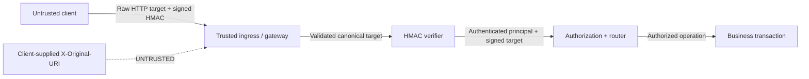

# Proxy giữ nguyên path khi xác thực HTTP request bằng HMAC

## 1. Vấn đề: client ký một path, server nhìn thấy path nào?

Giả sử đối tác thanh toán gửi một HTTP request:

```http
POST /api/payments HTTP/1.1
Host: api.example.test
Content-Type: application/json
X-Key-Id: kid_a1
X-Timestamp: 2026-11-28T10:00:00Z
X-Nonce: <nonce CSPRNG>
X-Signature: <HMAC-SHA256 của canonical request>

{"paymentId":"P-42","amount":90000}
```

Client ký các byte của canonical request, bao gồm phương thức `POST`, path `/api/payments`, header liên quan và body digest. Nhưng API thực tế có thể nằm sau CDN, reverse proxy, API gateway, ingress controller hoặc service mesh:

```text
Client signer
  POST /api/payments
       |
       v
CDN/WAF -- reverse proxy -- API Gateway
       |            |
       |     rewrite, decode, normalize,
       |     mount context path, route prefix
       v
Spring Security HMAC filter
  request.getRequestURI() = ?
       |
       v
AuthorizationFilter -> Controller -> Business
```

Nếu proxy chuyển `/api/payments` thành `/internal/payments` trước khi HMAC verifier tính MAC, **cùng một HTTP attempt** có thể có hai biểu diễn path:

```text
client canonical path: /api/payments
server canonical path: /internal/payments

HMAC(secret, clientCanonicalBytes) !=
HMAC(secret, serverCanonicalBytes)
```

Kết quả phổ biến là request hợp lệ bị `401`/signature mismatch. Nguy hiểm hơn, nếu triển khai “sửa” lỗi bằng cách **bỏ path khỏi chữ ký** hoặc tin một `X-Original-URI` do client tự khai, attacker có thể thay đích thực thi mà HMAC vẫn hợp lệ.

**Proxy giữ nguyên path** nghĩa là các thành phần trung gian **không tự ý thay đổi biểu diễn path đã được hợp đồng HMAC ràng buộc** trên đường tới verifier, hoặc sử dụng một cơ chế **trusted original-target** được xác thực riêng khi buộc phải rewrite. “Giữ nguyên” phải được định nghĩa **theo canonical contract**, không chỉ nói “hai URL điều hướng đến cùng controller”.

Bài **Proxy giữ nguyên path** thuộc chương **Gateway và proxy** của module `SECURITY_AUTHENTICATION_HMAC_REQUEST_AUTHENTICATION`. Phạm vi module: thiết kế xác thực HTTP request bằng **HMAC với shared secret**, ký canonical request gồm phương thức, URI, signed headers hoặc body; xác minh chữ ký; chống replay với timestamp/nonce; key rotation; kiểm thử proxy/gateway; và phân biệt authentication với authorization. Bài tập trung vào **đường đi, biểu diễn và trust boundary của path** trong chuỗi đó. Không có ghi chú đặc biệt bổ sung cho bài này.

### Mục tiêu học tập

Sau bài này, người học cần:

1. Phân biệt **path nhận ở client**, **request target trên wire**, **path tại proxy**, **URI tại Servlet container** và **route được business xử lý**.
2. Hiểu vì sao `/api/a`, `/api/%61`, `/api//a`, `/api/a/`, `/api/./a` có thể có semantics khác nhau trong hợp đồng chữ ký dù một router nào đó coi chúng tương đương.
3. Phân tích tác động của NGINX `proxy_pass`, prefix rewrite, context path, percent-encoding, HTTP/2 `:path` và `X-Forwarded-*` lên canonical HMAC.
4. Chọn giữa **verify trước rewrite**, **preserve exact target xuyên hops**, hoặc **verified original-target metadata** từ gateway.
5. Thiết kế kiểm tra bằng Java 17/Spring Security, golden fixtures, raw HTTP tests và log đã redact mà không vô tình tạo bypass.
6. Giữ đúng chống replay, key lifecycle, authorization và nghiệp vụ khi path bị biến đổi.

## 2. Trước tiên: “path” có nhiều dạng

Không có một hàm “normalize URL” mặc định bảo đảm an toàn với mọi contract HMAC. Cần đặt tên rõ từng biểu diễn:

| Biểu diễn | Ví dụ | Nguồn/vị trí |
| --- | --- | --- |
| **Public target** | `/api/payments?dryRun=false` | HTTP request target client gửi tới public origin. |
| **Raw path component** | `/api/payments` | Phần trước dấu `?` trong target dạng origin-form. |
| **Raw query component** | `dryRun=false` | Phần sau `?`, chưa parse/sort theo ngữ nghĩa ứng dụng. |
| **HTTP/2 `:path`** | `/api/payments?dryRun=false` | Pseudo-header biểu diễn path + query cho request dạng thông thường. |
| **Gateway downstream target** | `/internal/payments?dryRun=false` | Target sau rewrite khi proxy chuyển tới upstream. |
| **Servlet `getRequestURI()`** | Có thể là `/internal/payments` | URI path mà Servlet container cung cấp **sau các hop trước đó**. |
| **Servlet `getContextPath()`** | `/app` hoặc chuỗi rỗng | Context path nơi ứng dụng được mount. |
| **Spring handler mapping** | `POST /api/payments` | Route đã match sau xử lý URL/servlet mapping/framework. |
| **HMAC canonical target** | `/api/payments` hoặc `/api/payments?...` | Chuỗi được **contract ký** quy định; không đương nhiên bằng route ID. |

### 2.1 `request.getRequestURI()` không phải raw bytes của Internet

Trong Servlet, `getRequestURI()` thường trả một URI path biểu diễn bởi container, không gồm query. Tuy nhiên, nó là **giá trị sau khi proxy, load balancer và HTTP parser đã xử lý request**. Nó **không chứng minh** các byte gốc bên ngoài đã được giữ nguyên, và các container khác nhau có thể có chính sách từ chối/diễn giải URL encoded khác nhau.

Nếu muốn dùng `request.getRequestURI()` làm dữ liệu ký, phải có ít nhất các điều kiện:

- Endpoint nằm trong **signature profile đã công bố**.
- Toàn bộ các proxy trước đó giữ path tương thích profile.
- Container không tự silently decode/normalize thành một path khác rồi backend xử lý như thể giống nhau.
- Context path và gateway route prefix được kiểm soát.
- Có test thực tế qua **cùng topology triển khai**, không chỉ `MockHttpServletRequest`.

### 2.2 Đừng đánh đồng path và query

Origin-form HTTP request target có cấu trúc:

```text
/api/payments?merchant=b&region=vn
------------ --------------------
   path          query
```

Nếu profile ký raw target đầy đủ, phần query cũng là bytes được ký. Nếu profile ký path và canonicalized query riêng, phải có quy tắc chính xác về order/encoding/duplicate keys. **Không tự bỏ query** khỏi request khi HMAC contract yêu cầu ký cả URI; nếu query quyết định resource hoặc hành vi, bỏ nó có thể tạo tampering.

Trong ví dụ Java phía sau, profile `hmac-path-v1` **chỉ hỗ trợ path cố định `/api/payments` và từ chối mọi query**. Đây là giới hạn có chủ đích để dạy nguyên tắc preserve path, không phải khuyến nghị bỏ query cho toàn bộ API.

### 2.3 Logical route không phải raw canonical path

Nhiều URI có thể cùng match một Spring handler, ví dụ `/api/payments/` và `/api/payments` nếu router bật trailing-slash matching, hoặc `/api/%70ayments` và `/api/payments` nếu có decode:

```text
Same controller?       Có thể có.
Same canonical bytes?  Không nhất thiết.
Same HMAC signature?   Không nếu path bytes khác trong hợp đồng.
```

Nếu chữ ký ràng buộc **raw target**, hai URI khác bytes phải được ký riêng. Nếu chữ ký ràng buộc **normalized target**, contract phải định nghĩa normalization rõ và tất cả components phải đồng ý, đặc biệt router/authorization/business. Một normalization “tự nhiên” trong ứng dụng **không đủ** làm tiêu chuẩn bảo mật.

## 3. Vì sao proxy dễ vô tình đổi path?

| Biến đổi ở proxy/container | Trước | Sau | Tác động lên HMAC path-bound |
| --- | --- | --- | --- |
| Strip prefix | `/api/payments` | `/payments` | MAC mismatch nếu backend ký path downstream. |
| Thêm prefix | `/api/payments` | `/internal/api/payments` | MAC mismatch, có thể route khác. |
| Trailing slash redirect/rewrite | `/api/payments/` | `/api/payments` | Không được coi bytes đồng nhất khi ký raw path. |
| Collapse repeated slash | `/api//payments` | `/api/payments` | Có thể bypass path separation nếu hai hops xử lý khác nhau. |
| Decode percent-encoding | `/api/%70ayments` | `/api/payments` | Bytes khác dù chữ `p` có thể biểu diễn cùng ký tự. |
| Canonicalize percent hex case | `/%2f` | `/%2F` | Raw bytes khác; encoded slash còn có rủi ro routing. |
| Decode encoded slash | `/a%2Fb` | `/a/b` | Một segment thành hai segments; resource authorization có thể lệch. |
| Remove dot segments | `/a/../payments` | `/payments` | Path traversal/parser differential nếu các lớp khác nhau. |
| URL-decode hai lần | `/%252e%252e/` | `/../` | Có thể biến giá trị an toàn ở hop đầu thành traversal ở hop sau. |
| Chuyển service context path | `/api/payments` | `/service/api/payments` | `getRequestURI()` có thể thay đổi. |
| Rewrite route theo tenant | `/v1/payments` | `/tenant-a/payments` | Không thể lấy path downstream làm public canonical path nếu không có contract. |

**Có hai kiểu lỗi khác nhau:**

1. **False reject:** client hợp lệ ký đúng public path nhưng proxy biến đổi, khiến server tính HMAC trên chuỗi khác.
2. **False accept / authorization confusion:** server cố bình thường hóa quá mức, bỏ path khỏi MAC hoặc tin original-path header không đáng tin; attacker dùng cùng chữ ký cho request đến resource/route khác.

Mục tiêu an ninh không phải “mọi path gần giống nhau đều PASS”, mà là **cùng một signed logical target phải được hiểu nhất quán bởi HMAC verifier, authorization và business handler**. Nếu không chứng minh được sự nhất quán, **reject**.

## 4. Mô hình threat: ba ranh giới tin cậy



### Ranh giới 1: Internet → gateway

Client có thể tự đặt:

```http
X-Original-URI: /api/admin/refunds
X-Forwarded-Host: internal.example.test
X-Forwarded-Prefix: /admin
```

Các header này **không tự có độ tin cậy**. Nếu gateway/backend lấy `X-Original-URI` làm target để tính MAC nhưng route HTTP thực tế vẫn là một target khác, attacker có thể lợi dụng sự tách rời giữa **what was signed** và **what gets executed**. Cần reject/strip inbound untrusted path assertions trước khi gắn metadata nội bộ.

### Ranh giới 2: gateway → backend

Ngay cả gateway “đáng tin” vẫn có thể sai cấu hình rewrite. Phải xác định **canonical target ở hop nào**, ai được cấp quyền tạo original-target metadata, và nó được **bảo vệ xuyên hop** ra sao (mTLS/service identity, trusted mesh enforcement, hoặc một gateway-signed internal assertion có audience/expiry/request binding). Chỉ tin một header vì request tới từ mạng `10.0.0.0/8` mà backend cũng có thể bị truy cập trực tiếp là không đủ.

### Ranh giới 3: verifier → router → authorization

Nếu verifier xác thực MAC trên `/api/users/123` nhưng router thực thi `/api/users/456`, HMAC không còn ràng buộc tài nguyên được truy cập. Với API đa tenant, cần policy kiểm tra **verified principal ↔ actual resource/operation**, chứ không xem HMAC là tự động có quyền thao tác mọi path.

**Bất biến quan trọng:**

```text
The target interpreted by authorization/business
must be the same logical target covered by the valid HMAC,
or an explicitly verified and authorized transformation of it.
```

## 5. Ba chiến lược triển khai an toàn

### 5.1 Chiến lược A — Verify HMAC tại public ingress **trước khi rewrite**

```text
Client signed:   POST /api/payments
                         |
                         v
Gateway HMAC verifier validates signed public target
  - exact key ID + ACTIVE secret + audience/route
  - method + public target + signed headers/body
  - timestamp + atomic nonce claim
                         |
                         v
Gateway routing translates trusted operation:
  POST /api/payments --> POST /internal/payments
                         |
                         v
Backend receives authenticated gateway context
                         |
                         v
Backend authorization and business idempotency
```

**Ưu điểm:** Gateway thấy **public target** sớm, cho phép giữ nguyên giao thức ký của client trong khi internal routing có thể thay đổi. Việc rewrite diễn ra **sau** khi gateway đã biết chính xác client ký path nào.

**Điều kiện an ninh:**

- Gateway phải thực sự kiểm tra HMAC và trạng thái credential trước khi tạo verified context.
- Nonce store của gateway phải có atomicity/TTL đúng phạm vi, không chỉ map trong một instance.
- Gateway **không được đặt** `X-Verified-Principal` từ header inbound vào context đã xác thực.
- Backend chỉ nhận verified context từ **kênh nội bộ đã xác thực**; không cho client gọi backend trực tiếp bỏ qua gateway.
- Gateway phải ràng buộc public target và internal route tương ứng, không cho client tự chọn một `X-Upstream-Path` để thực thi sau verification.
- Backend vẫn kiểm tra **authorization theo resource** và business idempotency, không hiểu verified HMAC là phép làm mọi nghiệp vụ.

**Trade-off:** Gateway cần khả năng giữ key/secret hoặc kết nối trusted HMAC verification service; credential lifecycle và replay store phải đủ nhất quán giữa các edge regions. Bảo vệ secret và audit tại ingress có tầm quan trọng tương đương backend verifier.

### 5.2 Chiến lược B — Giữ nguyên public path xuyên các hop đến backend verifier

```text
Client:         POST /api/payments
Reverse proxy:  POST /api/payments
Ingress:        POST /api/payments
Servlet:        getRequestURI() == "/api/payments"
HMAC verifier:  canonical path == "/api/payments"
Controller:     handler matched operation POST /api/payments
```

**Ưu điểm:** Không cần transport một original-path assertion riêng; backend tự xác minh request trên chính path nó nhận, dễ tạo golden fixtures. Với API công khai ổn định, đây thường là mô hình ít phức tạp hơn.

**Điều kiện:**

- Reverse proxy **không strip/thêm prefix**, không rewrite, không normalize encoded path ngoài contract.
- Backend routing **thực sự chấp nhận** public path; không phải chỉ HMAC filter giả lập path đó trong khi handler chạy route khác.
- Servlet container và proxy có chính sách tương thích với repeated slash, dot segments, percent-encoded characters và context path.
- Ingress xử lý ambiguous URI **bằng reject**, không im lặng thay đổi bytes đến mức khó tái dựng.
- Có E2E test trên bản cấu hình proxy được dùng thật, nhất là khi đổi version gateway, chuyển ingress controller hoặc nâng Servlet container.

### 5.3 Chiến lược C — Trusted original-target metadata qua gateway

Khi bắt buộc rewrite trước backend HMAC verifier, có thể thiết kế một protocol nội bộ chứa **original public target được gateway chứng thực**:

```text
Internet request:
  POST /api/payments
  X-Original-URI: /api/admin/refunds   <-- caller can forge this

Ingress:
  1. Reject/strip inbound identity/original-target headers
  2. Validate raw public target and parse ambiguity
  3. Create trusted originalTarget=/api/payments
  4. Rewrite downstream path=/internal/payments
  5. Protect internal assertion (authenticated channel/binding)

Backend:
  1. Authenticate assertion issuer and request binding
  2. Verify HMAC against approved originalTarget=/api/payments
  3. Verify downstream route is an allowed mapping of originalTarget
  4. Apply credential lifecycle, nonce, principal/resource authorization
```

Metadata cần được ràng buộc với **request cụ thể**, ví dụ method, public audience, original target, signed body digest và target service, kèm identity của gateway và freshness chống replay của assertion nội bộ. Nếu dùng mTLS và identity headers trong trusted mesh, phải bảo đảm chỉ gateway được gửi các headers đó và backend không thể được truy cập từ nguồn khác. Một plain `X-Original-URI` tự khai **không phải bằng chứng**.

**Không ký lại bằng HMAC client trên internal path**: client không thể biết mọi thay đổi nội bộ của proxy, còn server không nên chấp nhận chữ ký cũ trên một message mới chỉ vì hai endpoint “gần giống nhau”. Original-path assertion chỉ giúp **khôi phục chính xác các byte đã được client ký** qua một hop có trách nhiệm đã xác thực.

### 5.4 Chọn chiến lược nào?

| Yêu cầu topology | Phương án ưu tiên | Nguy cơ lớn cần kiểm thử |
| --- | --- | --- |
| Backend có thể nhận nguyên `/api/payments`. | **B: Preserve public path.** | Implicit rewrite, context path, percent normalization. |
| Gateway có HMAC verifier và route mapping rõ. | **A: Verify trước rewrite.** | Authenticated context spoofing, gateway bypass, stale registry/nonce. |
| Gateway phải rewrite nhưng backend quản lý HMAC verification. | **C: Trusted original target.** | Forged/unsigned original URI, binding sai với actual upstream route/body. |
| Client SDK và gateway không thống nhất cách canonicalize URL. | **Không deploy thêm rule normalize vội.** | Chữ ký không xác định, parser differential và quyền truy cập lệch. |

Không chọn cách thứ tư là “bỏ path khỏi HMAC để mọi proxy đều qua được”. Nếu path thay đổi được mà chữ ký không đổi, kẻ có một signed request có thể tìm cách đưa nó đến một route khác trong thời hạn timestamp/nonce; đó là mở rộng bề mặt tấn công không cần thiết.

## 6. NGINX: `proxy_pass` có thể giữ nguyên hoặc làm mất prefix

Đây là một trường hợp thường làm HMAC path-bound “hoạt động local nhưng lỗi sau deploy”.

### 6.1 Hai cấu hình trông giống nhau nhưng behavior khác

Với NGINX reverse proxy và request public:

```http
POST /api/payments HTTP/1.1
```

**Ví dụ 1 — Proxy tới upstream không có URI suffix:**

```nginx
# Trích đoạn minh họa, KHÔNG phải TLS/security config đầy đủ.
location /api/ {
    proxy_pass http://hmac_backend;
}
```

Với request thông thường **chưa bị thay đổi URI bởi rewrite/processing đặc biệt**, dạng `proxy_pass` **không chỉ định URI** thường chuyển nguyên request URI đến upstream. Backend có cơ hội nhìn thấy `/api/payments`, phù hợp chiến lược preserve path.

**Ví dụ 2 — Proxy tới upstream với URI suffix `/`:**

```nginx
location /api/ {
    proxy_pass http://hmac_backend/;
}
```

Ở một `location /api/` dạng prefix thông thường, NGINX có thể thay phần URI khớp với location prefix bằng URI `/` của `proxy_pass`. Khi đó public `/api/payments` thành upstream `/payments`. **Nếu Spring backend tính HMAC trên `getRequestURI()="/payments"`**, MAC ký `/api/payments` sẽ mismatch.

| Cấu hình minh họa | Client target | Target upstream có thể thấy | Phù hợp profile ký path public? |
| --- | --- | --- | --- |
| `location /api/ { proxy_pass http://hmac_backend; }` | `/api/payments` | `/api/payments` khi không rewrite đặc biệt | Có, nhưng phải E2E verify. |
| `location /api/ { proxy_pass http://hmac_backend/; }` | `/api/payments` | `/payments` khi prefix được replace | Không, trừ khi verify trước rewrite hoặc có trusted metadata. |
| `rewrite ... break;` trước `proxy_pass` | `/api/payments` | Có thể là URI đã rewrite | Phải kiểm tra chính xác config thực. |

**Cảnh báo:** NGINX có các ngoại lệ liên quan **regex/named locations, `rewrite`, biến trong `proxy_pass`, query string và normalized URI**. Bảng chỉ diễn giải hai trường hợp minh họa, **không phải bảo đảm byte-preserving trong mọi tình huống**. Xác nhận bằng tài liệu của version đang chạy và test raw request xuyên proxy là bắt buộc.

### 6.2 `$request_uri` và `$uri` không đồng nhất

Trong NGINX, thường cần phân biệt:

- `$request_uri`: original full request URI mà proxy nhận, thường gồm path và query như được yêu cầu ban đầu.
- `$uri`: current normalized URI ở thời điểm xử lý, **có thể thay đổi do rewrite/internal redirect**, thường không gồm query.

Nếu logs cho thấy hai biến khác nhau, đó là bằng chứng cần điều tra path preservation. **Không phải** vì `$request_uri` tồn tại mà mọi forwarding setting tự dùng đúng giá trị đó hoặc Servlet có thể truy lại nguyên wire target. Ngoài ra, việc log `$request_uri` có thể tiết lộ query credentials/PII; chỉ log dưới điều kiện bảo mật phù hợp.

### 6.3 Cấu hình minh họa cho preserve-path

```nginx
# Phần location bên trong một server block HTTPS đã bảo vệ.
# Backend phải route public /api/payments và không rewrite path.
location /api/ {
    proxy_pass http://hmac_backend;

    # Chỉ chấp nhận authority public được trusted edge định nghĩa.
    # Header Host không được dùng thay thế canonical audience policy.
    proxy_set_header Host api.example.test;

    # Không forward original-path header tự khai dưới vai trò trusted data.
    proxy_set_header X-Original-URI "";
    proxy_set_header X-Verified-Principal "";
}
```

Đây là **đoạn cấu hình để thảo luận**, không phải NGINX production config hoàn chỉnh: còn cần TLS, HTTP framing policies, body/header size limits, upstream timeout, connection controls, network ACL và tests. `proxy_set_header ... ""` minh họa **loại bỏ** header không tin cậy trong upstream request; không dùng nó để bảo đảm toàn bộ hệ thống đã an toàn. Đặc biệt không vô tình reset/transform signed `Content-Type` hoặc các header ký.

### 6.4 Các thành phần khác cũng có rewrite rules

Kubernetes ingress controller, Envoy, Traefik, cloud API gateway và service mesh thường có **prefix strip/add, rewrite target, route matching và normalization policies**. Cùng một tên rule “preserve prefix” có thể khác khi tích hợp với virtual host, path prefix, `:path` HTTP/2 hoặc gRPC transcoding. Khi thay đổi gateway:

1. Xuất cấu hình **của môi trường triển khai thật** qua quy trình vận hành, không suy từ một manifest khác.
2. Xác định public path, upstream path và canonical target được verifier sử dụng.
3. Chạy bộ fixture path qua toàn bộ hops.
4. Chỉ chuyển rollout khi **HMAC, router và authorization** cùng thấy target được phép.

Không giả định local `curl localhost:8080` là đủ để chứng minh behavior của một ingress ngoài Internet.

## 7. Một signature profile có path được ký rõ ràng

Để có thể kiểm thử và giải thích, bài định nghĩa **`hmac-path-v1`** chỉ cho **`POST /api/payments`**, không query, audience `https://api.example.test`. Đây là hợp đồng **minh họa**, không phải HTTP HMAC standard tích hợp sẵn trong Spring Security.

### 7.1 Những gì client phải ký

```http
POST /api/payments HTTP/1.1
Host: api.example.test
Content-Type: application/json
Idempotency-Key: 550e8400-e29b-41d4-a716-446655440000
X-Key-Id: kid_AAAAAAAAAAAAAAAAAAAAAA
X-Signature-Version: hmac-path-v1
X-Timestamp: 2026-11-28T10:00:00Z
X-Nonce: AAAAAAAAAAAAAAAAAAAAAAAAAAAAAAAA
X-Signature: <64 lowercase hex characters>

{"paymentId":"P-42","amount":90000}
```

V1 quy định:

- Key ID là `kid_` + canonical Base64URL no-padding của **16 byte ngẫu nhiên**; public lookup hint nhưng **được ký**.
- Nonce là canonical Base64URL no-padding của **24 byte CSPRNG**, mỗi HTTP attempt mới một nonce.
- Timestamp UTC chính xác đến giây, không fractional seconds, cho phép **`serverNow - 300s <= timestamp <= serverNow + 30s`**.
- `Idempotency-Key` là UUID v4 lowercase; được ký để ràng buộc logical payment across retries.
- Signed headers `Content-Type`, `Idempotency-Key`, `X-Key-Id`, `X-Signature-Version`, `X-Timestamp`, `X-Nonce` phải có đúng **một** raw field line trên ingress; `X-Signature` là MAC carrier, không nằm trong chính canonical message.
- Body là **exact byte array** nhận qua ingress sau framing hợp lệ, chưa parse/serialize JSON; V1 không nhận `Content-Encoding`, tối đa 1 MiB.
- Audience là giá trị **trusted config**, không lấy `Host`/forwarded headers do Internet tự khai.
- Canonical strings encode UTF-8, nối bằng byte **LF `0A`**, không có LF ở cuối. Header names lower-case và theo thứ tự cố định.

Canonical message:

```text
HMAC-PATH-V1
POST
https://api.example.test
/api/payments
content-type:application/json
idempotency-key:550e8400-e29b-41d4-a716-446655440000
x-key-id:kid_AAAAAAAAAAAAAAAAAAAAAA
x-signature-version:hmac-path-v1
x-timestamp:2026-11-28T10:00:00Z
x-nonce:AAAAAAAAAAAAAAAAAAAAAAAAAAAAAAAA
<lowercaseHex(SHA-256(exactBodyBytes))>
```

Dòng cuối là **placeholder** và phải thay bằng đúng 64 hex chars của body digest. Các chuỗi toàn chữ `A` chỉ giúp thấy form; **không đủ entropy** để dùng thay secret/nonce production. `X-Signature` được tính:

```text
bodyHash      = SHA-256(bodyBytes)
canonical     = UTF8(joinWithLF(profile, method, audience, rawPath,
                                signedHeaders, lowercaseHex(bodyHash)))
expectedMac   = HMAC-SHA256(secretForExactKeyId, canonical)
signatureHex  = lowercaseHex(expectedMac)
```

Một request `POST /internal/payments` không phù hợp V1 ngay cả khi body, timestamp và Key ID giống hệt; backend không được đổi `rawPath` thành `/api/payments` để cho qua trừ khi có trusted transformation như chiến lược C.

### 7.2 Path binding không thay chống replay và phân quyền

Xác minh HMAC phải phối hợp:

```text
HTTP framing/size/duplicate header checks
    -> exact Key ID lookup in credential registry
    -> credential ACTIVE + notBefore/expiry + audience/route/profile
    -> HmacSHA256(expected canonical bytes), constant-time comparison
    -> timestamp freshness
    -> atomic nonce claim + TTL
    -> verified principal
    -> authorization + per-client rate policy + business idempotency
```

Nếu proxy làm mất `/api`, việc lưu nonce hoặc tạo signature mới ở backend **không sửa được path mismatch**. Ngược lại, một request đã verify path đúng nhưng có secret bị revoke vẫn phải **reject**. HMAC xác minh **ai nắm secret và signed request không bị thay đổi**; authorization quyết định principal có quyền trên payment/resource hay không.

## 8. Java 17: kiểm tra canonical path bằng một verifier rõ contract

Mã mẫu sau dùng **JCA `Mac`**, credential lookup, fixed-clock-friendly interface và nonce store, không phụ thuộc thư viện HMAC bên ngoài. Nó giúp thấy chính xác **raw path** nằm ở đâu trong chữ ký. `RequestView` là snapshot **đã được trusted HTTP adapter chuẩn hóa theo contract** (không phải object parse raw Internet tùy ý); adapter phải chặn duplicate signed field lines **trước khi merge**.

**Phạm vi mã mẫu:** API chỉ nhận `POST /api/payments` không query; path ASCII cố định; body tối đa 1 MiB; HMAC SHA-256, test/profile V1. Các kiểm tra về HTTP framing, Content-Encoding, body buffering và Spring Security filter chain được đặt tại ingress/Servlet adapter. Đây không phải một production gateway implementation.

```java
import java.nio.charset.StandardCharsets;
import java.security.GeneralSecurityException;
import java.security.MessageDigest;
import java.time.Clock;
import java.time.Duration;
import java.time.Instant;
import java.time.format.DateTimeParseException;
import java.util.Base64;
import java.util.HexFormat;
import java.util.Map;
import java.util.Objects;
import java.util.Optional;
import java.util.Set;
import javax.crypto.Mac;
import javax.crypto.spec.SecretKeySpec;

public final class HmacPathV1 {
    static final String PROFILE = "hmac-path-v1";
    static final String AUDIENCE = "https://api.example.test";
    static final String PATH = "/api/payments";
    static final String OPERATION = "POST /api/payments";
    static final Duration MAX_AGE = Duration.ofSeconds(300);
    static final Duration FUTURE_SKEW = Duration.ofSeconds(30);
    static final Duration NONCE_TTL = Duration.ofSeconds(360);
    static final HexFormat HEX = HexFormat.of();

    public record RequestView(
            String method, String path, String query,
            String trustedAudience, Map<String, String> signedHeaders,
            byte[] body) {
        public RequestView {
            signedHeaders = Map.copyOf(signedHeaders);
            body = body.clone();
        }
        @Override public byte[] body() { return body.clone(); }
    }

    // Chỉ metadata SERVER, không khởi tạo từ X-Client-Id tự khai.
    public record Credential(
            String keyId, String credentialId,
            String clientId, String principalId,
            byte[] secret, boolean active,
            Instant notBefore, Instant expiresAt,
            String audience, Set<String> operations,
            Set<String> profiles, Set<String> authorities) {
        public Credential {
            secret = secret.clone();
            operations = Set.copyOf(operations);
            profiles = Set.copyOf(profiles);
            authorities = Set.copyOf(authorities);
        }
        @Override public byte[] secret() { return secret.clone(); }
    }

    public record VerifiedClient(
            String clientId, String principalId, String credentialId,
            Set<String> authorities, String idempotencyKey) {}

    // Nhiều deployments: registry và nonce store phải chia sẻ một
    // consistency contract; không dùng local HashMap production.
    public interface CredentialRepository {
        Credential findExact(String keyId) throws DependencyUnavailable;
    }
    public interface NonceStore {
        boolean claim(
                String credentialId, String nonce,
                Instant now, Duration ttl) throws DependencyUnavailable;
    }
    public static final class DependencyUnavailable extends Exception {
        public DependencyUnavailable(String message) { super(message); }
    }

    private static boolean canonicalUrlBase64(String value, int byteCount) {
        if (value == null || !value.matches("[A-Za-z0-9_-]+")) {
            return false;
        }
        try {
            byte[] raw = Base64.getUrlDecoder().decode(value);
            return raw.length == byteCount
                    && value.equals(Base64.getUrlEncoder()
                            .withoutPadding().encodeToString(raw));
        } catch (IllegalArgumentException malformed) {
            return false;
        }
    }

    private static boolean validKeyId(String keyId) {
        return keyId != null
                && keyId.matches("kid_[A-Za-z0-9_-]{22}")
                && canonicalUrlBase64(keyId.substring(4), 16);
    }
    private static boolean validNonce(String nonce) {
        return nonce != null && nonce.matches("[A-Za-z0-9_-]{32}")
                && canonicalUrlBase64(nonce, 24);
    }
    private static Instant timestamp(String text) {
        if (text == null || !text.matches(
                "[0-9]{4}-[0-9]{2}-[0-9]{2}T"
                + "[0-9]{2}:[0-9]{2}:[0-9]{2}Z")) {
            throw new IllegalArgumentException("Noncanonical timestamp");
        }
        try {
            Instant t = Instant.parse(text);
            if (!t.toString().equals(text) || t.getNano() != 0) {
                throw new IllegalArgumentException("Fractional time");
            }
            return t;
        } catch (DateTimeParseException malformed) {
            throw new IllegalArgumentException(
                    "Invalid UTC timestamp", malformed);
        }
    }

    private static byte[] canonical(
            RequestView request, Map<String, String> h)
            throws GeneralSecurityException {
        String digest = HEX.formatHex(
                MessageDigest.getInstance("SHA-256")
                        .digest(request.body()));
        return String.join("\n",
                "HMAC-PATH-V1",
                request.method(),
                AUDIENCE,
                request.path(), // BẤT BIẾN: signed public path.
                "content-type:" + h.get("content-type"),
                "idempotency-key:" + h.get("idempotency-key"),
                "x-key-id:" + h.get("x-key-id"),
                "x-signature-version:" + h.get("x-signature-version"),
                "x-timestamp:" + h.get("x-timestamp"),
                "x-nonce:" + h.get("x-nonce"),
                digest).getBytes(StandardCharsets.UTF_8);
    }

    private static byte[] mac(byte[] secret, byte[] message)
            throws GeneralSecurityException {
        Mac mac = Mac.getInstance("HmacSHA256");
        mac.init(new SecretKeySpec(secret, "HmacSHA256"));
        return mac.doFinal(message);
    }

    private static String field(Map<String, String> h, String name) {
        String s = h.get(name);
        if (s == null || s.isEmpty()
                || s.length() > 512) {
            throw new IllegalArgumentException("Bad signed header");
        }
        for (int i = 0; i < s.length(); i++) {
            char ch = s.charAt(i);
            if (ch < 0x21 || ch > 0x7e) {
                throw new IllegalArgumentException(
                        "Invalid signed header character");
            }
        }
        return s;
    }

    public static Optional<VerifiedClient> verify(
            RequestView request, CredentialRepository registry,
            NonceStore replay, Clock clock)
            throws GeneralSecurityException, DependencyUnavailable {
        Objects.requireNonNull(request);
        Objects.requireNonNull(registry);
        Objects.requireNonNull(replay);
        Objects.requireNonNull(clock);

        // Không "sửa" path nhận được cho khớp public path.
        if (!"POST".equals(request.method())
                || !PATH.equals(request.path())
                || request.query() != null
                || !AUDIENCE.equals(request.trustedAudience())
                || request.body().length == 0
                || request.body().length > 1_048_576) {
            return Optional.empty();
        }

        Map<String, String> h = request.signedHeaders();
        if (!h.keySet().equals(Set.of(
                "content-type", "idempotency-key", "x-key-id",
                "x-signature-version", "x-timestamp",
                "x-nonce", "x-signature"))) {
            throw new IllegalArgumentException(
                    "Unexpected/missing signed headers");
        }
        String contentType = field(h, "content-type");
        String idempotencyKey = field(h, "idempotency-key");
        String keyId = field(h, "x-key-id");
        String version = field(h, "x-signature-version");
        String timestampText = field(h, "x-timestamp");
        String nonce = field(h, "x-nonce");
        String signature = field(h, "x-signature");

        if (!"application/json".equals(contentType)
                || !PROFILE.equals(version)
                || !validKeyId(keyId)
                || !validNonce(nonce)
                || !idempotencyKey.matches(
                    "[0-9a-f]{8}-[0-9a-f]{4}-4[0-9a-f]{3}-"
                    + "[89ab][0-9a-f]{3}-[0-9a-f]{12}")
                || !signature.matches("[0-9a-f]{64}")) {
            throw new IllegalArgumentException(
                    "Noncanonical signed field");
        }
        Instant issuedAt = timestamp(timestampText);
        Instant now = clock.instant();

        Credential c = registry.findExact(keyId);
        if (c == null || !c.active()
                || !keyId.equals(c.keyId())
                || c.credentialId() == null || c.clientId() == null
                || c.principalId() == null
                || c.notBefore() == null || c.expiresAt() == null
                || now.isBefore(c.notBefore())
                || !now.isBefore(c.expiresAt())
                || !AUDIENCE.equals(c.audience())
                || !c.operations().contains(OPERATION)
                || !c.profiles().contains(PROFILE)) {
            return Optional.empty();
        }
        byte[] secret = c.secret();
        if (secret.length < 32) return Optional.empty();
        byte[] expected = mac(secret, canonical(request, h));
        byte[] received = HEX.parseHex(signature);
        if (expected.length != 32 || received.length != 32
                || !MessageDigest.isEqual(expected, received)) {
            return Optional.empty();
        }
        // Thời gian của client phải đã được HMAC ký.
        if (issuedAt.isBefore(now.minus(MAX_AGE))
                || issuedAt.isAfter(now.plus(FUTURE_SKEW))) {
            return Optional.empty();
        }
        // Claim nonce sau policy/MAC/time; storage UNKNOWN -> throw.
        if (!replay.claim(
                c.credentialId(), nonce, now, NONCE_TTL)) {
            return Optional.empty();
        }
        return Optional.of(new VerifiedClient(
                c.clientId(), c.principalId(), c.credentialId(),
                c.authorities(), idempotencyKey));
    }
}
```

### 8.1 Đọc ví dụ dưới góc độ path

Phép so sánh:

```java
if (!PATH.equals(request.path())) {
    return Optional.empty();
}
```

không được thay bằng:

```java
// SAI: bỏ một prefix một cách âm thầm để "cứu" HMAC.
String pathToSign = request.path().replaceFirst("^/internal", "");

// SAI: URLDecoder có thể biến %2F thành "/" và đổi segment.
String pathToSign = URLDecoder.decode(
        request.path(), StandardCharsets.UTF_8);

// SAI: signed target do attacker có thể tự khai.
String pathToSign = requestHeader("X-Original-URI");
```

Trong V1, verifier chỉ chấp nhận **đúng một path**. Mọi biến thể ngoài contract phải bị reject. Với endpoint có path parameter hoặc query thực tế, vẫn giữ nguyên nguyên tắc: canonical target phải lấy từ **snapshot đáng tin có đúng encoding đã thỏa thuận**, được ký đầy đủ; không thay raw target bằng một route pattern như `/api/payments/{id}` trong HMAC nếu ID có ảnh hưởng tới resource.

### 8.2 Lưu ý nhỏ nhưng rất quan trọng về Java string escape

Để nối các dòng bằng LF, Java phải dùng:

```java
String canonical = String.join("\n", line1, line2);
```

Trong mã Java thực, literal trên biểu diễn đúng **ký tự xuống dòng** (0A), **không phải hai ký tự backslash + n**. Nếu implementation dùng `"\\n"` trong Java source, nó tạo backslash và chữ `n`, và HMAC sẽ khác mọi golden fixture ký LF. Tương tự, không dùng `System.lineSeparator()`: Windows CRLF sẽ làm chữ ký khác trên Linux.

### 8.3 Error mapping và bảo mật

Ví dụ verifier trả `Optional.empty()` cho credential invalid, path khác, MAC sai, stale timestamp hoặc replay. HTTP adapter có thể map các lỗi **signed request malformed** sang `400`, credential/MAC/replay thất bại sang `401`, storage/crypto unavailable sang `503` (fail closed). Không leak “Key ID có tồn tại hay không” ra public response. MAC comparison dùng `MessageDigest.isEqual` trên 32 bytes; nó không tự làm **toàn bộ pipeline constant-time**.

Khi verify PASS, trả **verified client/principal từ server-side registry**. Không tự nhận principal từ `X-Key-Id` như một role, và không suy `payments:write` từ HTTP caller. Filter/Spring Security tiếp tục phân quyền bằng authorities và kiểm tra quyền trên payment/tenant.

## 9. Spring MVC/Servlet: lấy path nào để đưa vào HMAC verifier?

Spring Boot 3 / Spring Security 6 Servlet stack dùng `HttpServletRequest`. Với profile V1, adapter nên có một **đường đi duy nhất** để đọc raw path container nhìn thấy và **không âm thầm rewrite**:

```java
String receivedPath = request.getRequestURI();
String receivedQuery = request.getQueryString();
String contextPath = request.getContextPath();

if (!contextPath.isEmpty()
        || !"/api/payments".equals(receivedPath)
        || receivedQuery != null) {
    // Không dùng X-Original-URI do client tự khai để chữa lỗi.
    rejectRequest();
}
```

**Đây là lựa chọn strict cho một profile đơn giản**, không phải mọi Servlet deployment đều phải có context path rỗng. Nếu ứng dụng được mount dưới `/payments-service`, hãy **thiết kế và test lại contract/gateway topology** thay vì cứ `substring(contextPath.length())` để sửa path.

### 9.1 Vì sao không dùng các API path khác thay thế một cách tùy ý?

| API/giá trị | Công dụng chính | Cảnh báo cho path-bound HMAC |
| --- | --- | --- |
| `getRequestURI()` | Path mà container nhận sau routing upstream. | Không gồm query và có thể khác public request target do proxy. |
| `getQueryString()` | Raw query representation theo container. | Phải được ký/kiểm tra theo contract; V1 này reject nếu không null. |
| `getContextPath()` | Servlet application mount prefix. | Có thể thay public path và route comparison khi deploy. |
| `getServletPath()` | Path dùng cho servlet mapping. | Không chắc trùng raw target; có thể đã tách/giải mã. |
| `getPathInfo()` | Phần path thêm sau servlet mapping. | Phụ thuộc mapping và không phải original full target. |
| Spring MVC `@PathVariable` | Giá trị đã qua route matching/binding. | Chỉ là resource parameter đã parse, không phải byte representation đã ký. |
| `getRequestURL()` | URL được container dựng từ scheme/host/port/path. | Có thể dựa trên Host/forwarded metadata, không nên thay trusted audience. |
| `getHeader("X-Original-URI")` | Một HTTP header. | Chưa được tin cậy, trừ khi **gateway tạo, bảo vệ và backend xác thực**. |

### 9.2 Mẫu custom filter nhỏ theo profile V1

Mã sau minh họa wiring với `HmacPathV1.verify` ở phần 8. Nó không tự động sửa path, đọc signed headers **một giá trị duy nhất** và tạo repeatable body wrapper có size cap. Đây là **ví dụ đồng bộ**; production cần cấu hình ingress reject ambiguous HTTP framing/headers trước Servlet và đánh giá async/body streaming riêng.

```java
import jakarta.servlet.FilterChain;
import jakarta.servlet.ReadListener;
import jakarta.servlet.ServletException;
import jakarta.servlet.ServletInputStream;
import jakarta.servlet.http.HttpServletRequest;
import jakarta.servlet.http.HttpServletRequestWrapper;
import jakarta.servlet.http.HttpServletResponse;
import org.springframework.security.authentication.BadCredentialsException;
import org.springframework.security.authentication.UsernamePasswordAuthenticationToken;
import org.springframework.security.core.Authentication;
import org.springframework.security.core.authority.SimpleGrantedAuthority;
import org.springframework.security.core.context.SecurityContext;
import org.springframework.security.core.context.SecurityContextHolder;
import org.springframework.security.web.AuthenticationEntryPoint;
import org.springframework.web.filter.OncePerRequestFilter;

import java.io.BufferedReader;
import java.io.ByteArrayInputStream;
import java.io.IOException;
import java.io.InputStreamReader;
import java.nio.charset.StandardCharsets;
import java.security.GeneralSecurityException;
import java.time.Clock;
import java.util.Enumeration;
import java.util.HashMap;
import java.util.List;
import java.util.Locale;
import java.util.Map;
import java.util.Optional;

public final class StrictPathHmacFilter extends OncePerRequestFilter {
    private final HmacPathV1.CredentialRepository registry;
    private final HmacPathV1.NonceStore nonceStore;
    private final Clock clock;
    private final AuthenticationEntryPoint entryPoint;
    private static final int MAX_BODY = 1_048_576;
    private static final List<String> REQUIRED = List.of(
            "Content-Type", "Idempotency-Key",
            "X-Key-Id", "X-Signature-Version",
            "X-Timestamp", "X-Nonce", "X-Signature");

    public StrictPathHmacFilter(
            HmacPathV1.CredentialRepository registry,
            HmacPathV1.NonceStore nonceStore,
            Clock clock,
            AuthenticationEntryPoint entryPoint) {
        this.registry = registry;
        this.nonceStore = nonceStore;
        this.clock = clock;
        this.entryPoint = entryPoint;
    }

    // Chỉ chấp nhận ASCII visible value sau khi loại OWS hai rìa.
    // Không tự trim CR/LF trước khi kiểm tra control characters.
    private static String oneSignedHeader(
            HttpServletRequest req, String name) {
        Enumeration<String> values = req.getHeaders(name);
        if (values == null || !values.hasMoreElements()) {
            throw new IllegalArgumentException("Missing signed header");
        }
        String raw = values.nextElement();
        if (raw == null || values.hasMoreElements()) {
            throw new IllegalArgumentException("Duplicate signed header");
        }
        for (int i = 0; i < raw.length(); i++) {
            char ch = raw.charAt(i);
            if ((ch < 0x20 && ch != '\t') || ch > 0x7e) {
                throw new IllegalArgumentException("Bad header byte");
            }
        }
        int start = 0, end = raw.length();
        while (start < end && (raw.charAt(start) == ' '
                || raw.charAt(start) == '\t')) start++;
        while (end > start && (raw.charAt(end - 1) == ' '
                || raw.charAt(end - 1) == '\t')) end--;
        String value = raw.substring(start, end);
        if (value.isEmpty() || value.length() > 512
                || value.indexOf(',') >= 0) {
            throw new IllegalArgumentException("Noncanonical header");
        }
        return value;
    }

    private static Map<String, String> signedHeaders(
            HttpServletRequest request) {
        Map<String, String> fields = new HashMap<>();
        for (String name : REQUIRED) {
            fields.put(name.toLowerCase(Locale.ROOT),
                    oneSignedHeader(request, name));
        }
        return Map.copyOf(fields);
    }

    // Giữ nguyên body bytes đã được HMAC verify cho downstream.
    private static final class CachedBody
            extends HttpServletRequestWrapper {
        final byte[] bytes;
        CachedBody(HttpServletRequest original) throws IOException {
            super(original);
            bytes = original.getInputStream().readNBytes(MAX_BODY + 1);
            if (bytes.length > MAX_BODY) throw new BodyTooLarge();
        }
        byte[] copyBody() { return bytes.clone(); }

        @Override public ServletInputStream getInputStream() {
            ByteArrayInputStream input = new ByteArrayInputStream(bytes);
            return new ServletInputStream() {
                @Override public int read() { return input.read(); }
                @Override public boolean isFinished() {
                    return input.available() == 0;
                }
                @Override public boolean isReady() { return true; }
                @Override public void setReadListener(
                        ReadListener listener) {
                    throw new UnsupportedOperationException(
                            "Synchronous Servlet demo");
                }
            };
        }
        @Override public BufferedReader getReader() {
            return new BufferedReader(new InputStreamReader(
                    getInputStream(), StandardCharsets.UTF_8));
        }
    }
    private static final class BodyTooLarge extends IOException {}

    @Override protected void doFilterInternal(
            HttpServletRequest req, HttpServletResponse resp,
            FilterChain chain) throws ServletException, IOException {
        // HMAC-only chain; không được thừa hưởng context cũ.
        SecurityContextHolder.clearContext();

        // Reject sớm; KHÔNG rewrite path thành public path.
        if (!req.getContextPath().isEmpty()
                || !"POST".equals(req.getMethod())
                || !HmacPathV1.PATH.equals(req.getRequestURI())
                || req.getQueryString() != null
                || req.getHeader("Content-Encoding") != null) {
            resp.sendError(HttpServletResponse.SC_BAD_REQUEST);
            return;
        }
        if (req.getContentLengthLong() > MAX_BODY) {
            resp.sendError(
                    HttpServletResponse.SC_REQUEST_ENTITY_TOO_LARGE);
            return;
        }
        final CachedBody wrapped;
        try {
            wrapped = new CachedBody(req);
        } catch (BodyTooLarge oversized) {
            resp.sendError(
                    HttpServletResponse.SC_REQUEST_ENTITY_TOO_LARGE);
            return;
        }
        if (wrapped.bytes.length == 0) {
            resp.sendError(HttpServletResponse.SC_BAD_REQUEST);
            return;
        }

        final Optional<HmacPathV1.VerifiedClient> verified;
        try {
            HmacPathV1.RequestView signedRequest =
                    new HmacPathV1.RequestView(
                            wrapped.getMethod(),
                            wrapped.getRequestURI(),
                            wrapped.getQueryString(),
                            HmacPathV1.AUDIENCE, // trusted config
                            signedHeaders(wrapped), wrapped.copyBody());
            verified = HmacPathV1.verify(
                    signedRequest, registry, nonceStore, clock);
        } catch (IllegalArgumentException malformed) {
            resp.sendError(HttpServletResponse.SC_BAD_REQUEST);
            return;
        } catch (HmacPathV1.DependencyUnavailable
                 | GeneralSecurityException unavailable) {
            // Không fallback sang default key/anonymous.
            resp.sendError(
                    HttpServletResponse.SC_SERVICE_UNAVAILABLE);
            return;
        }
        if (verified.isEmpty()) {
            entryPoint.commence(wrapped, resp,
                    new BadCredentialsException("HMAC rejected"));
            return;
        }
        HmacPathV1.VerifiedClient client = verified.get();
        List<SimpleGrantedAuthority> authorities =
                client.authorities().stream()
                        .map(SimpleGrantedAuthority::new).toList();
        Authentication auth =
                UsernamePasswordAuthenticationToken.authenticated(
                        client, null, authorities);
        SecurityContext context =
                SecurityContextHolder.createEmptyContext();
        context.setAuthentication(auth);
        SecurityContextHolder.setContext(context);
        try {
            chain.doFilter(wrapped, resp);
        } finally {
            SecurityContextHolder.clearContext();
        }
    }
}
```

### 9.3 Một điểm cực kỳ quan trọng: đừng để security matcher bỏ qua path sau rewrite

Nếu backend **chỉ** có một `SecurityFilterChain` áp dụng cho `/api/**`, nhưng gateway rewrite `/api/payments` thành `/internal/payments`, thì chain đó **có thể không được chọn**, tức custom HMAC filter không chạy. Một thiết kế `shouldNotFilter("/api/**")` quá hẹp cũng có nguy cơ tương tự.

Do đó, **ngay cả trước khi sửa MAC mismatch**, phải bảo đảm có **default-deny chain** bao trùm mọi internal routes và không có `permitAll` path vô tình cho phép request đã rewrite. Ví dụ cho một dịch vụ HMAC-only nhận đúng một protected endpoint:

```java
@Bean
SecurityFilterChain protectedApp(
        HttpSecurity http,
        HmacPathV1.CredentialRepository registry,
        HmacPathV1.NonceStore nonceStore,
        Clock clock,
        AuthenticationEntryPoint entryPoint) throws Exception {
    StrictPathHmacFilter filter =
            new StrictPathHmacFilter(registry, nonceStore, clock, entryPoint);
    return http
            .securityMatcher("/**") // toàn bộ service demo
            .csrf(AbstractHttpConfigurer::disable)
            .sessionManagement(s -> s.sessionCreationPolicy(
                    SessionCreationPolicy.STATELESS))
            .formLogin(AbstractHttpConfigurer::disable)
            .httpBasic(AbstractHttpConfigurer::disable)
            .authorizeHttpRequests(a -> a
                    .requestMatchers(HttpMethod.POST, "/api/payments")
                    .hasAuthority("payments:write")
                    .anyRequest().denyAll())
            .addFilterBefore(
                    filter, UsernamePasswordAuthenticationFilter.class)
            .build();
}
```

Đây là **một trích đoạn cấu hình**, import của `HttpSecurity`, `SecurityFilterChain`, `HttpMethod`, `SessionCreationPolicy` và `AbstractHttpConfigurer` dùng từ Spring Security 6/Spring Framework. Với deployment có nhiều chains, kiểm thử `@Order` và `securityMatcher` cho từng route. Tắt CSRF ở đây chỉ hợp lý nếu dịch vụ là **machine-to-machine HMAC stateless không dùng browser cookie credentials**, không phải lựa chọn mặc định cho mọi UI.

**Cảnh báo:** không annotate `StrictPathHmacFilter` là Servlet `@Component`/`@Bean` và vừa thêm vào security chain nếu điều đó khiến filter **auto-register hai lần**. Demo tạo filter trong `SecurityFilterChain`; nếu cần filter bean, disable servlet auto-registration bằng `FilterRegistrationBean#setEnabled(false)`. Filter xác thực chạy trước authorization và phải tự gọi `AuthenticationEntryPoint` ở vị trí chưa được `ExceptionTranslationFilter` phía sau bắt lỗi.

### 9.4 Verified principal không phải business authorization

Filter tạo `Authentication` chỉ khi HMAC, key policy, timestamp và nonce đạt. `payments:write` có thể cho phép gọi route, nhưng controller/service vẫn phải kiểm tra payment có thuộc principal/tenant này không, idempotency key có tương ứng cùng logical payment không, và các điều kiện nghiệp vụ.

**Không tin** một `X-Tenant-Id` hay `X-Authorized-Route` tự khai vì client có thể tự ký các chuỗi đó bằng secret của chính mình; signature chứng minh **client đã chọn giá trị**, không chứng minh client **được phép dùng giá trị đó**.

## 10. Unit tests: cùng chữ ký nhưng proxy đã đổi path

Đây là lớp kiểm thử quan trọng nhất của bài. Test cần chứng minh **request ký đúng path A, proxy chuyển tới path B → backend reject**, chứ không chỉ khẳng định HMAC-SHA256 tự sinh ra 32 bytes.

### 10.1 Java 17/JUnit 5: golden request, key test và fake nonce store

Đoạn test dưới tạo một **test-only shared secret 32 byte**, Key ID/nonce đúng Base64URL grammar, timestamp cố định và body UTF-8. Client test signer được triển khai **độc lập** bằng JCA; production secret không xuất hiện trong fixture.

```java
import static org.junit.jupiter.api.Assertions.*;

import java.nio.charset.StandardCharsets;
import java.security.MessageDigest;
import java.time.Clock;
import java.time.Instant;
import java.time.ZoneOffset;
import java.util.Arrays;
import java.util.HashMap;
import java.util.HexFormat;
import java.util.Map;
import java.util.Set;
import java.util.concurrent.ConcurrentHashMap;
import javax.crypto.Mac;
import javax.crypto.spec.SecretKeySpec;
import org.junit.jupiter.api.Test;
import org.junit.jupiter.params.ParameterizedTest;
import org.junit.jupiter.params.provider.ValueSource;

class HmacPathContractTest {
    static final Instant NOW =
            Instant.parse("2026-11-28T10:00:00Z");
    static final Clock CLOCK = Clock.fixed(NOW, ZoneOffset.UTC);
    static final String ID = "kid_AAAAAAAAAAAAAAAAAAAAAA";
    static final String NONCE = "AAAAAAAAAAAAAAAAAAAAAAAAAAAAAAAA";
    static final String IDEMPOTENCY =
            "550e8400-e29b-41d4-a716-446655440000";
    static final byte[] BODY = (
            "{\"paymentId\":\"P-42\",\"amount\":90000}")
            .getBytes(StandardCharsets.UTF_8);

    static byte[] testSecret() {
        byte[] bytes = new byte[32];
        Arrays.fill(bytes, (byte) 0x42);
        return bytes;
    }

    static HmacPathV1.Credential credential() {
        return new HmacPathV1.Credential(
                ID, "credential-test-1", "integration-a",
                "merchant-a", testSecret(), true,
                NOW.minusSeconds(3600), NOW.plusSeconds(3600),
                HmacPathV1.AUDIENCE,
                Set.of(HmacPathV1.OPERATION),
                Set.of(HmacPathV1.PROFILE),
                Set.of("payments:write"));
    }

    // Independent client signer: canonical target cố định ở bên client.
    static String testSignature(
            String signedPath, byte[] body,
            String nonce, String timestamp) throws Exception {
        String hash = HexFormat.of().formatHex(
                MessageDigest.getInstance("SHA-256").digest(body));
        String canonical = String.join("\n",
                "HMAC-PATH-V1", "POST", "https://api.example.test",
                signedPath, "content-type:application/json",
                "idempotency-key:" + IDEMPOTENCY,
                "x-key-id:" + ID,
                "x-signature-version:hmac-path-v1",
                "x-timestamp:" + timestamp,
                "x-nonce:" + nonce,
                hash);
        Mac mac = Mac.getInstance("HmacSHA256");
        mac.init(new SecretKeySpec(testSecret(), "HmacSHA256"));
        return HexFormat.of().formatHex(mac.doFinal(
                canonical.getBytes(StandardCharsets.UTF_8)));
    }

    static HmacPathV1.RequestView requestAsSeenByBackend(
            String downstreamPath, String signedPath)
            throws Exception {
        String timestamp = "2026-11-28T10:00:00Z";
        Map<String, String> headers = new HashMap<>();
        headers.put("content-type", "application/json");
        headers.put("idempotency-key", IDEMPOTENCY);
        headers.put("x-key-id", ID);
        headers.put("x-signature-version", "hmac-path-v1");
        headers.put("x-timestamp", timestamp);
        headers.put("x-nonce", NONCE);
        headers.put("x-signature",
                testSignature(signedPath, BODY, NONCE, timestamp));
        return new HmacPathV1.RequestView(
                "POST", downstreamPath, null,
                "https://api.example.test", headers, BODY);
    }

    static HmacPathV1.CredentialRepository registry() {
        return key -> ID.equals(key) ? credential() : null;
    }

    static HmacPathV1.NonceStore localTestNonceStore() {
        // Chỉ dùng trong unit test, không dùng production distributed.
        Set<String> used = ConcurrentHashMap.newKeySet();
        return (credentialId, nonce, now, ttl) ->
                used.add(credentialId + ":" + nonce);
    }

    @Test void pathPreservedAcrossProxyCanAuthenticate()
            throws Exception {
        var request = requestAsSeenByBackend(
                "/api/payments", "/api/payments");
        var verified = HmacPathV1.verify(
                request, registry(), localTestNonceStore(), CLOCK);
        assertTrue(verified.isPresent());
        assertEquals("merchant-a", verified.get().principalId());
        assertEquals("credential-test-1",
                verified.get().credentialId());
    }

    @Test void strippedPrefixCannotReusePublicSignature()
            throws Exception {
        // Client đã ký /api/payments.
        // Proxy strip /api trước khi backend thấy request.
        var request = requestAsSeenByBackend(
                "/payments", "/api/payments");
        var verdict = HmacPathV1.verify(
                request, registry(), localTestNonceStore(), CLOCK);
        assertTrue(verdict.isEmpty());
    }

    @ParameterizedTest
    @ValueSource(strings = {
            "/payments",
            "/internal/payments",
            "/api/payments/",
            "/api//payments",
            "/api/%70ayments",
            "/api/./payments",
            "/api/payments%2F"
    })
    void unexpectedPathIsNotSilentlyNormalized(
            String seenByBackend) throws Exception {
        var request = requestAsSeenByBackend(
                seenByBackend, "/api/payments");
        assertTrue(HmacPathV1.verify(
                request, registry(), localTestNonceStore(), CLOCK)
                .isEmpty());
    }

    @Test void hmacIsActuallyBoundToPathBytes() throws Exception {
        String publicPathSignature = testSignature(
                "/api/payments", BODY, NONCE, NOW.toString());
        String internalPathSignature = testSignature(
                "/internal/payments", BODY, NONCE, NOW.toString());
        assertNotEquals(publicPathSignature, internalPathSignature);
        // Không chỉ strict allowed-path guard:
        // canonical message thực sự chứa path bytes.
    }

    @Test void sameSignedAttemptIsRejectedAsReplay() throws Exception {
        var store = localTestNonceStore();
        var request = requestAsSeenByBackend(
                "/api/payments", "/api/payments");
        assertTrue(HmacPathV1.verify(
                request, registry(), store, CLOCK).isPresent());
        assertTrue(HmacPathV1.verify(
                request, registry(), store, CLOCK).isEmpty());
    }
}
```

**Giới hạn test:** `localTestNonceStore()` không có TTL để đơn giản hóa unit test, nhưng interface production yêu cầu atomic claim có TTL đủ bao phủ freshness window. Các ca `@ValueSource` kiểm tra **strict profile V1**; ở server/proxy thực, một số encoded path có thể đã bị container reject/normalize **trước khi** thành `RequestView`, do đó cần test wire-level riêng.

### 10.2 Đừng viết negative test khiến signer phá path test

Ví dụ test sai:

```text
Want to test: proxy changes public /api/payments -> /payments
But test signs: /payments
Then backend verifies: /payments
```

Nó **không còn kiểm tra request bị proxy sửa**; nó chỉ kiểm tra client đã ký path downstream. Cần giữ **canonical path của client** cố định `/api/payments`, rồi mô phỏng hop làm đổi `downstreamPath` **sau khi ký**. Ngoài ra, strict path reject `/payments` không đủ chứng minh canonicalizer thực sự đưa path vào MAC: phải có test hai signatures khác nhau cho hai signed paths, như `hmacIsActuallyBoundToPathBytes`.

### 10.3 Mock Servlet request cho path backend nhìn thấy

`MockHttpServletRequest` có thể mô phỏng:

```java
import org.springframework.mock.web.MockHttpServletRequest;
import static org.junit.jupiter.api.Assertions.*;

MockHttpServletRequest request =
        new MockHttpServletRequest("POST", "/internal/payments");
assertEquals("/internal/payments", request.getRequestURI());
assertNotEquals("/api/payments", request.getRequestURI());
```

Trong integration test Spring Security, request kiểu này phải **không bypass HMAC filter** bằng cách match một chain `permitAll` khác. Dùng `MockMvc` có **real `springSecurityFilterChain`**, không dùng standalone controller test thiếu security filters. Tuy nhiên MockMvc **không tự chứng minh NGINX có thật sự forward path ra sao**; đó là phần kiểm thử tiếp theo.

## 11. Golden fixtures cho path và HTTP wire-level test

### 11.1 Bộ fixture không được thiếu byte representation

Một bộ fixture test-only nên chứa:

```yaml
profile: hmac-path-v1
method: POST
trustedAudience: "https://api.example.test"
publicPath: "/api/payments"
rawQuery: null
expectedDownstreamPath: "/api/payments"
contentType: "application/json"
keyId: "kid_<test-only canonical Base64URL>"
credentialId: "cred-fixture-a"
secretBytesHex: "<test-only fixed bytes>"
timestamp: "2026-11-28T10:00:00Z"
nonce: "<test-only 24-byte canonical Base64URL>"
idempotencyKey: "550e8400-e29b-41d4-a716-446655440000"
bodyBytesHex: "<exact bytes actually transmitted>"
bodySha256Hex: "<computed SHA-256 test vector>"
canonicalBytesHex: "<expected exact UTF-8 LF-joined bytes>"
signatureHex: "<expected HMAC-SHA256 hex>"
expectedAuthVerdict: "PASS"
```

**Các góc nhọn là placeholders**, không phải vectors có thể ký/verify trực tiếp. Tạo fixture chuẩn độc lập với verifier, rồi lưu `canonicalBytesHex` đã biết đúng. Khi đổi NGINX/ingress, so sánh input public target ở edge với target mà backend nhìn thấy và với expected canonical bytes. Đừng chỉ so JSON đã parse hoặc handler name.

### 11.2 Phân biệt test “preserve” và test “rewrite”

```text
Fixture A:
  clientSignedPath     = /api/payments
  observedAtGateway    = /api/payments
  observedAtBackend    = /api/payments
  expected             = authentication may PASS

Fixture B:
  clientSignedPath     = /api/payments
  observedAtGateway    = /api/payments
  observedAtBackend    = /payments
  expected             = reject under strategy B

Fixture C:
  clientSignedPath     = /api/payments
  observedAtGateway    = /api/payments
  gatewayVerified      = yes
  observedAtBackend    = /internal/payments
  expected             = allowed ONLY with strategy A's
                         authenticated gateway context + route binding

Fixture D:
  clientSignedPath     = /api/payments
  observedAtGateway    = /api/payments
  observedAtBackend    = /internal/payments
  untrustedHeader      = X-Original-URI: /api/payments
  expected             = reject, not trusted original-target
```

**Fixture C là một protocol khác về điểm đặt verifier**, không có nghĩa backend `HmacPathV1.verify` trong strategy B tự accept `/internal/payments`. Khi thiết kế gateway-trusted metadata, test riêng issuer authentication, request binding, replay và unauthorized downstream route mapping.

### 11.3 Gửi raw path qua HTTP thật

Trên môi trường staging cô lập, dùng một HTTP client có thể bảo toàn target hoặc request generator hỗ trợ kiểm soát HTTP/1.1 request line/HTTP/2 `:path`. Với `curl`, tùy chọn `--path-as-is` hữu ích khi **không muốn curl tự xử lý một số dot segments** trước khi gửi:

```bash
# Minh họa kiểm tra HTTP routing; không phải request HMAC hợp lệ
# nếu chưa có timestamp/nonce/signature được ký đúng bytes.
curl --http1.1 --path-as-is \\
  --silent --show-error -D - \\
  'https://api.example.test/api/./payments'

curl --http1.1 --path-as-is \\
  --silent --show-error -D - \\
  'https://api.example.test/api//payments'
```

**Không dùng `-k` để bỏ xác minh TLS** khi đánh giá hệ thống thật. Với test end-to-end HMAC, helper signer phải ký **exact public request target** mà HTTP client gửi. Nếu HTTP client tự rewrite target trước khi gửi, test phải phát hiện lỗi ngay ở client stage; không quy mọi mismatch cho proxy.

Trong môi trường test có quyền truy cập gateway và backend, có thể dùng endpoint diagnostic **nội bộ, bảo vệ truy cập** trả một **opaque test marker** hoặc kết quả so khớp target (không trả raw headers/secrets). Một cấu hình log test-only ở gateway có thể ghi `$request_uri` và `$uri` đã redact, cùng một request correlation ID. Không bật công khai endpoint cho phép attacker xem mọi route/parser behavior.

### 11.4 Matched endpoints và upstream probes

Một bài test tốt ghi nhận độc lập:

```text
clientRequestTarget
ingressParsedTarget
upstreamForwardedTarget
servletRequestURI
servletQueryString
springMatchedRoute
canonicalTargetChosenByVerifier
authenticationVerdict
authorizationVerdict
businessHandlerCalled
```

Khi ký `/api/payments` nhưng backend thấy `/payments`, hãy xác định hop nào biến đổi **trước khi** đổi code verifier. Nếu tất cả path đều đúng nhưng MAC vẫn sai, tiếp tục so timestamp format, header values, body digest và secret byte representations; không bỏ kiểm tra path chỉ vì muốn “sửa nhanh” 401.

## 12. Ma trận kiểm thử preserve-path và HMAC qua proxy

### 12.1 Path normalization và routing

| ID | Public request target được ký | Backend thấy / tình huống | Kỳ vọng với V1 |
| --- | --- | --- | --- |
| P01 | `/api/payments` | `/api/payments` | Có thể PASS khi các lớp HMAC khác đều đúng. |
| P02 | `/api/payments` | `/payments` do strip prefix | FAIL; không tự thêm `/api` trong verifier. |
| P03 | `/api/payments` | `/internal/payments` do rewrite | FAIL dưới strategy B; cần A hoặc C có bảo vệ. |
| P04 | `/api/payments` | `/service/api/payments` do context path | FAIL nếu V1 chỉ nhận context path rỗng. |
| P05 | `/api/payments/` | Proxy tự bỏ slash cuối | Reject nếu path chưa được sign đúng/hợp đồng không cho. |
| P06 | `/api//payments` | Proxy merge slashes | Reject ambiguity; không cho “normalize đến đúng target” để bypass. |
| P07 | `/api/./payments` | Proxy remove dot segment | Reject ngoài V1; kiểm thử `--path-as-is`. |
| P08 | `/api/a/../payments` | Proxy resolve traversal | Reject ngoài V1; không ký resource khác sau normalization. |
| P09 | `/api/%70ayments` | Proxy decode percent-encoded `p` | Reject ngoài V1; dù handler có thể coi tương đương. |
| P10 | `/api/payments%2F` | Proxy decode encoded slash | Reject; không biến một segment thành hai. |
| P11 | `/api/%252e%252e/payments` | Double decoding qua hai hops | Reject; test parser differential/double decode. |
| P12 | `/api/payments?dryRun=1` | Proxy bỏ query | Reject; V1 không nhận query. |
| P13 | `/api/payments` | Proxy thêm `?debug=true` | Reject theo contract; request semantics thay đổi. |
| P14 | `/api/payments` | Upstream route `/api/payments`, nhưng Spring handler khác via internal dispatch | Không được thực thi operation khác signed/authorized. |
| P15 | `/api/payments` | Host header bị đổi nhưng trusted audience vẫn đúng | Signature không phụ thuộc Host tự khai; vhost/ingress vẫn phải validate audience routing. |
| P16 | `/api/payments` | HTTP/2 `:path=/api/payments` qua HTTP/1.1 upstream | Có thể PASS khi logical target/headers/body giữ nguyên. |
| P17 | `/api/payments` | `X-Original-URI` client tự khai trỏ sang route khác | Không đổi HMAC target hoặc authorization. |
| P18 | `/api/payments` | Gateway gắn trusted original target nhưng assertion bị sửa | Backend phải reject assertion tampered/issuer sai. |
| P19 | `/api/payments` | Gateway verify trước rewrite rồi mTLS tới `/internal/payments` | Chỉ có thể PASS theo strategy A với trusted context và route binding. |
| P20 | `/api/payments` | Gateway rewrite, backend nhận plain untrusted `X-Original-URI` | Reject, không tin caller-provided original target. |

### 12.2 HMAC và HTTP security kèm theo path

| ID | Tình huống | Kỳ vọng |
| --- | --- | --- |
| H01 | Key ID hợp lệ, MAC đúng, path đúng. | Verified principal sau timestamp/nonce và credential policy. |
| H02 | Đổi path sau khi ký, giữ MAC và các headers. | Reject trước khi handler chạy. |
| H03 | MAC ký với path khác nhưng proxy “sửa” path thành public target. | Không dựa vào sửa path để cho qua; test xác định nguồn canonical. |
| H04 | Key ID trong header đổi sang ID2 nhưng MAC ký bằng secret ID1. | Reject, không fallback sang key khác. |
| H05 | Credential SUSPENDED/REVOKED nhưng MAC/path đều đúng. | Reject credential policy, không cấp identity. |
| H06 | ID1/K1 và ID2/K2 trong key rotation cùng logical client. | Mỗi Key ID lookup exact, cùng principal nếu registry định nghĩa vậy. |
| H07 | Timestamp cũ quá 300s, path và MAC đúng. | Reject freshness, không claim nonce. |
| H08 | Timestamp tương lai hơn 30s, path và MAC đúng. | Reject freshness. |
| H09 | Gửi lại đúng signed request path hợp lệ. | Nonce duplicate reject. |
| H10 | Hai JVM cùng nhận một nonce nhưng dùng local replay cache riêng. | Test phải phát hiện thiếu global replay protection. |
| H11 | Nonce store timeout sau HMAC/path PASS. | Fail closed, không gọi controller. |
| H12 | Valid HMAC nhưng principal thiếu `payments:write`. | **403** authorization, không lẫn authentication. |
| H13 | Valid HMAC, đúng authority nhưng payment thuộc merchant khác. | Business resource authorization reject. |
| H14 | Valid HMAC nhưng request bị per-client rate limit sau nonce claim. | **429**; client retry ký attempt mới, giữ business idempotency key. |
| H15 | Body bị proxy reserialize JSON. | HMAC mismatch hoặc reject profile; không chuyển body khác xuống handler. |
| H16 | Duplicate `X-Key-Id` khác case ở ingress. | Reject trước merge; không chọn first/last. |
| H17 | `Content-Type` có charset không được V1 công bố. | Reject strict header contract. |
| H18 | Proxy gửi `X-Verified-Principal: admin` mà không có authenticated assertion. | Backend không tạo principal admin. |
| H19 | Filter chain chỉ match `/api/**`; proxy rewrite thành `/internal/**`. | Integration test phát hiện bypass và bảo đảm deny-all. |
| H20 | Filter/Servlet parser đọc body hai lần khác nhau. | Test phát hiện snapshot mismatch, request bị chặn. |

### 12.3 Deployment, rollout và rủi ro phân tán

| ID | Điều kiện triển khai | Kiểm thử và tiêu chí |
| --- | --- | --- |
| D01 | NGINX `proxy_pass http://upstream;` không suffix. | Real upstream nhận path mong đợi khi không rewrite đặc biệt. |
| D02 | NGINX `proxy_pass http://upstream/;` có suffix. | Test phát hiện prefix replacement; không deploy cùng profile B nếu mất path. |
| D03 | Thêm `rewrite` trong `location`. | So ingress `$request_uri`, current `$uri` và backend URI được bảo vệ. |
| D04 | Ingress controller upgrade. | Chạy lại golden path fixtures qua topology mới. |
| D05 | HTTP/1.1 → HTTP/2 → HTTP/1.1. | Header name case thay đổi được, signed values và logical target không đổi. |
| D06 | Hops xử lý encoded slash/dot segments khác nhau. | Reject ambiguous targets, không route tới resource khác. |
| D07 | Backend được expose public ngoài gateway. | Security test không thể bypass HMAC/gateway context. |
| D08 | Gateway trust forwarded-host từ Internet. | Test spoof Host/`X-Forwarded-Host` không đổi audience/tenant. |
| D09 | Key revoke đến region A trước B. | Xác nhận propagation SLA/policy revision hoặc fail closed nếu state stale. |
| D10 | Edge A/B claim cùng nonce. | Chỉ một winner trong consistency scope; không local-only replay cache. |
| D11 | Path mismatch flood xảy ra khi rollout. | Alerts và canary rollback, không tự tắt signed path. |
| D12 | Gateway cache phản hồi riêng tư theo URL chung. | Không trả phản hồi của client A cho client B trước authentication. |
| D13 | Header/request logging bật ở edge. | Không lộ shared secret, signature đầy đủ, body tài chính hoặc query nhạy cảm. |
| D14 | Backend handler bị chuyển từ `/api/payments` sang `/internal/payments`. | Review topology, strategy A/C hoặc giữ route public; không chỉ đổi `getRequestURI` normalization. |
| D15 | Proxy store/secret manager unavailable. | Không fail open sang bypass HMAC hoặc default secret. |

### Đừng chỉ assert HTTP status

Một negative test bảo mật cần xác nhận thêm:

```text
expectedAuthenticationVerdict
actualCanonicalTargetUsed
expectedCredentialId
replayClaimCount
springSecurityAuthenticatedPrincipal
authorizationDecision
controllerInvocationCount
businessSideEffectCount
```

Ví dụ test “proxy strip prefix bị reject” trả 404 từ router nhưng **không chạy HMAC filter** chưa chắc chứng minh được hệ thống an toàn: nếu một handler khác trên cùng path được phép `permitAll`, attacker có thể đạt được side effect. Hãy assert **không có route nào xử lý request chưa xác thực** và có default-deny coverage. Nếu lý do reject được giấu khỏi HTTP client, test có thể xem **mã nguyên nhân nội bộ qua spy/telemetry được ủy quyền**, không mở thêm endpoint công khai tiết lộ Key ID.

## 13. Chẩn đoán path mismatch mà không làm rò chữ ký hoặc dữ liệu

### 13.1 Điều tra theo thứ tự từ ngoài vào trong

Khi request ký hợp lệ ở môi trường local nhưng trả lỗi khi qua gateway, có thể thực hiện quy trình:

1. **Kiểm tra HTTP method và public target của client**: SDK ký path nào? Có tự thêm slash/query/percent encoding không? HTTP client có normalize URL trước khi gửi không?
2. **Kiểm tra hop ingress đầu tiên**: nó nhận request target nào từ HTTP/1.1 request line hay HTTP/2 `:path`? Có reject ambiguous path không?
3. **Kiểm tra route/rewrite config**: NGINX `proxy_pass` có slash suffix, `rewrite`, `location` regex, ingress annotation hoặc service mesh path rewrite nào không?
4. **Kiểm tra upstream target**: HTTP client ở proxy thực sự forward path/query gì tới Servlet? Đừng suy từ tên route template.
5. **Kiểm tra Spring Servlet**: `getRequestURI()`, `getContextPath()`, `getQueryString()` mà HMAC adapter nhận được là gì? Các `ForwardedHeaderFilter`/container settings có làm đổi cách suy scheme/audience không?
6. **Kiểm tra canonical bytes** bằng **test-only fixtures đã được phê duyệt**: dòng path, LF, signed headers và body hash có đúng không? Không gửi expected MAC hoặc raw secret vào production logs.
7. **Kiểm tra credential state, timestamp/nonce và authorization** nếu path khớp: không quy mọi `401` là do proxy.

### 13.2 Triệu chứng → nguyên nhân → biện pháp

| Triệu chứng | Giả thuyết | Kiểm chứng | Cách xử lý |
| --- | --- | --- | --- |
| Local `POST /api/payments` PASS, qua gateway luôn 401. | Proxy strip `/api`. | So public/upstream URI và NGINX `proxy_pass` suffix. | Preserve target hoặc verify trước rewrite. |
| Một số request với trailing slash fail, còn path không slash PASS. | Client SDK/router redirect hoặc slash normalization khác nhau. | Golden fixtures cho cả hai variants. | Chốt một canonical path, reject/redirect **trước khi ký** theo client contract. |
| Chỉ URL có `%2F`, `%2e` hoặc repeated slash fail. | Proxy và Servlet parse/normalize khác nhau. | Raw HTTP wire-level test từng hop. | Reject ambiguity hoặc version hóa normalization được kiểm chứng. |
| Chỉ staging có context path `/app` fail. | `getRequestURI` chứa thêm context prefix. | Inspect container/route topology. | Điều chỉnh deployed route hoặc profile/adapter có contract rõ. |
| HTTP/2 fail nhưng HTTP/1.1 PASS. | `:path`/header handling, gateway translation. | So logical target, headers, pseudo-headers và body across hops. | Cấu hình canonical semantics giống nhau và test lại. |
| Proxy bảo `$request_uri` đúng nhưng backend sai. | Rewrite xảy ra sau khi proxy nhận raw URI. | So `$request_uri`, `$uri` tại đúng phase và upstream target. | Sửa rewrite/forwarding hoặc chuyển điểm verify. |
| HMAC PASS sau khi bật `X-Original-URI` từ client. | Backend tin untrusted original-target. | Gửi header giả tới đường dẫn khác và kiểm tra handler. | Xóa bypass, chỉ dùng authenticated gateway-minted metadata. |
| Chỉ 403 sau khi HMAC đã PASS. | Không có authority/resource ownership. | Kiểm tra verified principal, Spring authorities, tenant policy. | Sửa authorization policy hợp lệ; không đổi canonical path để né 403. |
| Response 404 thay vì 401 sau gateway rewrite. | Security matcher/router không còn khớp route. | Xem chain được chọn và controller invocation. | Default deny, sửa path preservation và HMAC chain coverage. |
| Sau rotation mới có lỗi path lúc một số keys dùng SDK mới. | SDK đổi URI encoding hoặc signing version. | Golden fixtures theo SDK/credential version. | Điều chỉnh SDK contract, rollout compatibility với version rõ. |
| Request timeout và client retry gây nonce duplicate. | Proxy retry nguyên signed request hoặc filter chạy hai lần. | Đếm HTTP attempts, nonce claims, filter invocation. | Client phải ký lại attempts; tránh upstream auto-retry unsafe POST. |
| Body JSON bị gateway reformat, path vẫn đúng. | Body bytes khác. | So test-only body SHA-256 tại client và server. | Preserve signed bytes hoặc thiết kế signature profile khác. |

### 13.3 Logging an toàn khi cần xác nhận path

Trên môi trường test cô lập, có thể ghi `publicPath`, `upstreamPath`, `servletPath` đã được làm sạch **với fixtures không chứa dữ liệu nhạy cảm**. Trong production, raw URL/query có thể chứa personal data, secret hoặc access token; không nên ghi trực tiếp vào logs mặc định.

Telemetry tốt hơn có thể dùng:

```text
requestCorrelationId = opaque random ID
gatewayRouteId       = trusted normalized operation identifier
signatureProfile     = hmac-path-v1
gatewayConfigVersion = ingress-2026-11-28-canary
pathAgreement        = MATCH | MISMATCH | AMBIGUOUS
failureClass         = MALFORMED | AUTH_FAIL | STORE_UNAVAILABLE
authorizationResult  = ALLOW | DENY | NOT_EVALUATED
```

Nếu dùng digest/hashed path để correlate, phải xem path có tính dễ đoán và có lộ qua hash không; **hash không tự động là anonymization**. Dùng dimension/route IDs hạn chế cardinality; không gắn full path có random query vào label của Prometheus. Tuyệt đối không log raw shared secret, expected MAC, full signature, payment body hoặc Bearer tokens.

### 13.4 Metrics hữu ích cho rollout

| Metric / tín hiệu | Mục đích |
| --- | --- |
| `hmac_path_mismatch_total` | Phát hiện proxy rewrite/normalization không tương thích signature contract. |
| `hmac_auth_failure_by_profile` | Phân biệt V1 với phiên bản mới khi migration. |
| `ingress_rejected_ambiguous_target_total` | Số requests bị loại do encoded slash/dot segments/duplicate framing. |
| `gateway_route_binding_failure_total` | Gateway assertion không khớp downstream operation. |
| `hmac_replay_rejected_total` | Nonce reuse, double filter registration hoặc proxy retry. |
| `credential_policy_version_lag` | Stale ACTIVE/revoke/rotation state giữa các regions. |
| `security_chain_unmatched_protected_routes` | Protected endpoints có nguy cơ bypass do matcher/prefix mismatch. |
| `business_handler_invocations_after_auth_failure` | Bất biến phải bằng zero trong security integration tests. |

**Không giả định metric tên như trên được Spring cung cấp sẵn**. Đây là tên minh họa để đội triển khai instrument test/runbook, kiểm tra cardinality/permission và không lộ dữ liệu.

## 14. Những “cách sửa nhanh” nguy hiểm phải tránh

| Sửa nhanh | Vì sao nguy hiểm | Lựa chọn an toàn |
| --- | --- | --- |
| Bỏ path khỏi canonical request. | Chữ ký không còn ràng buộc route/resource; tăng nguy cơ reuse. | Preserve path hoặc authenticated original-target. |
| Chỉ dùng route template `/api/payments/{id}` thay raw target. | Hai resource IDs khác nhau có thể cùng canonical template. | Ký actual target bytes (hoặc normalized resource identity theo profile chặt chẽ). |
| Lấy `X-Original-URI` từ Internet làm signed path. | Caller điều khiển what-was-signed độc lập what-is-executed. | Strip, gateway mint và authenticate nội bộ. |
| `replace("/internal", "")` cho mọi request ở verifier. | Có thể rewrite nhiều chuỗi, mất segment boundary hoặc đổi route bất ngờ. | Trusted route mapping cố định với explicit authorization. |
| `URLDecoder.decode(path)` trước MAC. | Percent/plus/encoded slash/double decode khác nhau qua hops. | Strict canonicalization riêng phiên bản, reject ambiguity. |
| Lowercase toàn path. | HTTP path có thể case-sensitive; resource names đổi. | Bảo toàn case theo contract. |
| Tin `Host` hoặc `X-Forwarded-Host` để chọn HMAC audience/secret. | Virtual-host spoofing/tenant confusion. | Audience do ingress/service config quyết định, validate authority ở edge. |
| Chuyển filter sang `permitAll` để tránh 401. | Vô hiệu authentication, có thể bypass toàn service. | Sửa topology/contract, duy trì default-deny. |
| Tăng freshness window vô hạn cho proxy retries. | Tăng thời gian replay, không sửa path mismatch. | Giữ timestamp/nonce contract, retry phải ký attempt mới. |
| Cho phép alternate Key ID nếu MAC không khớp. | Credential lookup không còn exact, suy yếu rotation/identity. | Lookup một Key ID duy nhất, fail closed. |
| Tin URL handler đã normalize rồi cho qua HMAC. | Authn và authz có thể dùng resource identifiers khác nhau. | Ràng buộc signed target và actual route/resource. |
| Cài debug endpoint trả canonical message + expected MAC ra Internet. | Lộ dữ liệu hỗ trợ tấn công hoặc secret metadata. | Test-only fixtures và protected internal diagnostics. |

**Lưu ý về redirects:** Nếu public API muốn chuyển `/api/payments/` sang `/api/payments`, tốt nhất client SDK phải tạo/ký **final target** được công bố ngay từ đầu. Một HTTP redirect có thể thay method/body tùy status/client behavior và tự động gửi lại signed headers cho host/route khác; không mặc định HTTP client sẽ ký lại HMAC sau redirect. Với POST nhạy cảm, hãy định nghĩa chính sách rõ, ưu tiên reject path không canonical để tránh replay/cross-origin forwarding.

## 15. Bài tập thực hành

### Bài tập A — Tìm bug trong `proxy_pass`

Client ký `POST /api/payments`, backend HMAC filter nhận `getRequestURI()="/payments"`. NGINX đang cấu hình:

```nginx
location /api/ {
    proxy_pass http://payments_backend/;
}
```

Hãy:

1. Giải thích vì sao suffix `/` có thể làm NGINX **thay location prefix** `/api/`.
2. Sửa cấu hình để **không rewrite path** trong topology minh họa.
3. Chạy test qua **HTTP server/gateway thật** để xác nhận upstream target.
4. Chứng minh HMAC filter và handler cùng xử lý `/api/payments`.
5. Nêu vì sao chỉ đổi `String path = "/api/payments"` cố định trong verifier để “cho qua” là sai nếu handler vẫn nhận một route khác.

**Gợi ý:** bắt đầu từ chiến lược B và so `$request_uri`, `$uri`, actual upstream request target. Không mặc định cấu hình được minh họa bao trùm mọi trường hợp `rewrite`/regex location.

### Bài tập B — Percent-encoding và encoded slash

Cho ba URL:

```text
/api/payments
/api/%70ayments
/api/payments%2Fdetails
```

Hãy chỉ ra:

- Raw path bytes nào khác nhau?
- Khi proxy/router decode percent encoding, paths có thể trở thành gì?
- Vì sao `%2F` có thể đổi số lượng path segments?
- Nếu API chỉ hỗ trợ path fixed `/api/payments`, mỗi biến thể có nên được accept không?
- Test nào chỉ dùng MockMvc là đủ, test nào cần raw HTTP qua proxy?

**Đáp án định hướng:** dưới profile strict V1, chỉ exact `/api/payments` được phép. Việc một router nào đó coi các path tương đương **không cho phép verifier tự normalize ngoài contract**.

### Bài tập C — `X-Original-URI` bị attacker khai giả

Gateway strip prefix trước backend. Dev sửa code:

```java
String signedPath = request.getHeader("X-Original-URI");
```

Một attacker gửi:

```http
POST /internal/refunds HTTP/1.1
X-Original-URI: /api/payments
```

Giải thích sự khác nhau giữa target được HMAC ký và **route thực tế được xử lý**. Hãy thiết kế test chứng minh `X-Original-URI` từ caller **không thể quyết định signed path**, và đề xuất một authenticated gateway assertion với method, original target, body binding, downstream route, audience và expiry.

### Bài tập D — Migrate ứng dụng sang context path khác

Trước deploy:

```text
public:  /api/payments
servlet: /api/payments
```

Sau deploy:

```text
public:        /api/payments
servlet URI:   /service/api/payments
contextPath:   /service
```

Hãy xác định vị trí nên thay đổi để vừa giữ client signature contract vừa giữ resource authorization. So sánh lựa chọn (a) deployment giữ upstream public path và context rỗng, (b) gateway verify trước route rewrite, (c) authenticated original-target metadata. Không tự suy rằng `getServletPath()` luôn là exact public path.

### Bài tập E — HMAC PASS nhưng route authorization FAIL

Client A ký `POST /api/merchants/A/payments/42` bằng một profile hỗ trợ path parameter. Gateway rewrite đến `/internal/payments/42`; backend có quyền merchant A nhưng payment 42 thực ra thuộc merchant B.

Hãy phân biệt:

1. HMAC cần ký exact public target hay một normalized target được version hóa?
2. Gateway map public target sang trusted internal operation thế nào?
3. Business authorization phải kiểm tra principal/tenant và actual payment ownership thế nào?
4. Vì sao chỉ kiểm tra `hasAuthority("payments:write")` không đủ?

**Gợi ý:** chữ ký chứng minh người có secret đã chọn resource ID, **không** chứng minh resource thuộc người đó.

### Bài tập F — HTTP/2 và header normalization

Client gửi HTTP/2:

```text
:method = POST
:scheme = https
:authority = api.example.test
:path = /api/payments
x-key-id = kid_...
```

Gateway chuyển sang HTTP/1.1, backend nhận `POST /api/payments`. Hãy giải thích vì sao header **names** đổi case có thể hợp lệ, còn Key ID **value** không được lowercase. Nếu gateway làm `:path = /api/payments?x=1` trong khi V1 không hỗ trợ query, verdict là gì? Thiết kế test cả request target và virtual-host audience validation.

### Bài tập G — Proxy retry và nonce

Gateway tự retry `POST /api/payments` sau network timeout bằng cách gửi lại **nguyên signed HTTP attempt**. Giả sử lần đầu đã vượt HMAC và claim nonce, sau đó kết nối upstream đứt.

Hãy giải thích:

- Vì sao lần retry cùng nonce bị replay reject?
- Tại sao gateway không được tự sửa `X-Nonce` mà giữ MAC cũ?
- Nếu client retry, cần tạo timestamp/nonce/signature mới và giữ idempotency key nào?
- Nếu payment lần đầu đã commit nhưng response mất, cơ chế business nào ngăn tạo hai payments?
- Thay đổi path qua một redirect/rewrite trong lúc retry ảnh hưởng HMAC ra sao?

### Bài tập H — Thiết kế integration test tối thiểu

Một service có NGINX + Spring Boot + Redis nonce store, hai backend instances và một route `/api/payments`. Hãy lập test plan gồm:

1. Golden Java signer fixture chứa canonical bytes và expected MAC.
2. Preservation E2E cho exact public path.
3. Negative tests cho prefix strip, add prefix, trailing slash, `%2F`, dot segments và query.
4. HTTP/1.1/2, duplicate signed headers và spoofed `X-Original-URI`.
5. SecurityFilterChain coverage khi đường dẫn bị rewrite.
6. Hai instances claim cùng nonce và rotation key trạng thái khác nhau.
7. Phản hồi lỗi, absence of side effects và redaction trong logs.

Trình bày mỗi test bằng **input target, expected backend target, expected HMAC verdict, expected authorization verdict và evidence**. Không chỉ ghi “API nên trả 401”.

### Bài tập I — Đổi gateway strategy

Nhóm quyết định chuyển từ **B: preserve path** sang **A: verify tại gateway trước rewrite**. Viết threat model của migration:

- Gateway cần secrets/secret service và credential lifecycle data nào?
- Nonce được claim ở đâu, làm sao tránh hai tầng cùng claim một nonce?
- Verified identity/target được truyền nội bộ ra sao?
- Backend bị lộ public port sẽ tạo bypass nào?
- Nếu gateway assertion bị copy sang request khác hoặc service khác, có replay/cross-audience issue nào?
- Release gate nào bảo đảm route mapping public→internal khớp authorization?

**Tiêu chí:** không chấp nhận “gateway trusted” chỉ vì một header tên `X-Verified-Client`; phải chứng minh issuer, audience, request binding và network isolation.

### Bài tập J — Diễn giải ba HTTP status khác nhau

Trong một deploy vừa đổi proxy:

```text
Request #1: POST /api/payments, wrong HMAC        -> 401
Request #2: POST /payments, no HMAC filter route  -> 404
Request #3: POST /api/payments, valid HMAC
            but missing payments:write            -> 403
```

Hãy chỉ ra vì sao request #2 **không chứng minh đã có bảo vệ HMAC** chỉ vì trả 404. Viết test chứng minh nếu một handler sau này được thêm vào `/payments`, request không xác thực vẫn bị default-deny. Nêu lý do không nên sửa #3 bằng cách bypass authorization.

## 16. Checklist triển khai “Proxy giữ nguyên path”

### A. Hợp đồng HMAC

- [ ] Đã ghi chính xác **path representation được ký** (raw target, normalized target hoặc path+canonical query riêng), method, audience, signed headers, body digest, separators và encoding.
- [ ] Signature profile có **version**; không thay URI canonicalization giữa hai lần deploy mà vẫn gọi chung một version.
- [ ] Cùng một fixture cho client signer, gateway HMAC adapter, backend verifier và SDKs khác ngôn ngữ.
- [ ] Ký **actual resource path** hoặc normalized resource representation được công bố, không chỉ route template bỏ resource ID.
- [ ] Không bỏ path/method khỏi canonical message để né lỗi proxy rewrite.
- [ ] Với V1 strict, chỉ chấp nhận `POST /api/payments` không query; encoded/dot-segment/trailing-slash variants ngoài profile bị reject.
- [ ] Canonical byte encoding thống nhất UTF-8, LF `0A`, không LF cuối; body SHA-256 của exact bytes.
- [ ] HMAC-SHA256 dùng đúng shared-secret bytes, full 32-byte MAC, constant-time byte comparison; strict signature encoding.

### B. Reverse proxy và HTTP ingress

- [ ] Có sơ đồ **public path → từng hop → upstream path → Servlet path → business route** cho mọi protected endpoint.
- [ ] Đã xác định rõ strategy A, B hoặc C; không âm thầm pha trộn original-target header chưa xác thực với downstream URI.
- [ ] Nếu chọn **B**, proxy không thêm/bỏ prefix, slash, dot segments, percent encoding hoặc transform query/body ngoài contract.
- [ ] NGINX `proxy_pass` với/không URI suffix được test tại cấu hình **thực chạy**, có xem xét `rewrite`, regex locations, variables và normalized URI.
- [ ] Path normalization của WAF/CDN, ingress controller, service mesh và Servlet container được kiểm chứng tương thích.
- [ ] Ingress reject duplicate signed header lines, malformed HTTP framing và request smuggling trước khi backend mất raw evidence.
- [ ] Forwarded headers `X-Original-URI`, `X-Forwarded-Host`, `X-Forwarded-Proto`, `X-Verified-Client` do caller gửi bị strip/reject trước khi tạo internal trusted metadata.
- [ ] Audience/virtual host từ **trusted ingress/service configuration** và được kiểm tra trước routing, không từ forwarded headers tự khai.
- [ ] HTTP/1.1 request target và HTTP/2 `:path` được test qua gateway/protocol conversion; header names case insensitive, values đúng bytes đã ký.
- [ ] Không cho proxy tự retry POST signed attempt rồi assume nonce sẽ còn hợp lệ; retry policy được định nghĩa theo contract.

### C. Java Servlet/Spring Security

- [ ] `getRequestURI()`, `getQueryString()` và `getContextPath()` được dùng **có ý thức** theo deployment contract.
- [ ] Không tự `URLDecoder.decode`, lowercase toàn path, strip prefix bằng `replace` hoặc serialize lại body để “chữa” HMAC.
- [ ] Có bounded body buffering nếu filter phải đọc body; controller nhận đúng snapshot đã verified.
- [ ] Custom filter chạy trước authorization; có `SecurityFilterChain` phù hợp và **catch-all/default-deny** bảo vệ path sau rewrite.
- [ ] Không đăng ký custom filter hai lần ở servlet container và Spring Security chain; test số lần HMAC verify/nonce claim.
- [ ] Không cho `getRequestURL()` hoặc forwarded-header machinery vô tình thay trusted HMAC audience.
- [ ] Context path/mount prefix thay đổi phải có review signature protocol/gateway topology, không chỉ thay code router.
- [ ] Verified principal/authorities lấy từ server-side credential registry, **không** từ Key ID/tenant/role tự khai.
- [ ] `SecurityContextHolder` được clear đúng lifecycle và bảo vệ async/error dispatch theo contract.
- [ ] Handler/business authorization nhìn đúng resource/operation được ký hoặc một verified route transformation.

### D. Credential lifecycle, replay và lỗi

- [ ] Exact Key ID lookup và lifecycle ACTIVE/SUSPENDED/REVOKED, `notBefore`, `expiresAt`, allowed route/audience/profile được kiểm tra độc lập path.
- [ ] Rotation hai Key IDs không làm backend thử secret sai hoặc nhận lại revoked key.
- [ ] Timestamp UTC/freshness có bound hai phía; nonce mới mỗi attempt, atomic shared claim kèm TTL đủ cho cửa sổ replay.
- [ ] Bad MAC/path/stale timestamp không cấp authenticated identity; replay store không thể quyết định thì **fail closed**.
- [ ] HTTP 400/401/403/413/429/503 được map theo contract, không nhầm authn với authz hoặc global rate limit.
- [ ] Retry payment giữ idempotency key cho logical operation nhưng tạo timestamp/nonce/MAC mới; không thực thi business side effects trùng.
- [ ] Rate limiting trước crypto bảo vệ tài nguyên bằng tín hiệu pre-auth, nhưng không trừ per-client quota theo public Key ID chưa verified.
- [ ] Khi gateway verify trước rewrite, backend kiểm tra authenticated context và chặn direct access; trusted assertion có audience, request/route binding và freshness.

### E. Kiểm thử và vận hành

- [ ] Có golden fixture **client-signed-path vs backend-observed-path** và HMAC bytes độc lập implementation.
- [ ] Positive case preserve `/api/payments` có thể authenticate; negative cases strip/add prefix, trailing slash, doubled slash, percent-encoding, encoded slash, dot segments, unexpected query bị reject.
- [ ] Có test **HMAC signature thực sự thay đổi khi signed path thay đổi**, không chỉ test fixed-path allowlist.
- [ ] `MockMvc` kiểm tra HMAC filter, Spring Security Context, authorization và no-handler side effects; **không coi MockMvc là test raw proxy behavior**.
- [ ] Real HTTP tests qua NGINX/ingress và HTTP/1.1/2 xác nhận same target across hops.
- [ ] Test header spoofing, trusted original-path assertions, internal gateway issuer, backend bypass và route binding khi chọn strategy A/C.
- [ ] Multi-instance/multi-region replay, stale credential policy, gateway failover và outage được test theo consistency guarantee đã cam kết.
- [ ] Log/metrics đủ xác định **hop nào làm mismatch** nhưng không lộ query nhạy cảm, raw secret, expected MAC, signature đầy đủ hoặc body.
- [ ] Canary rollout dừng/rollback nếu path mismatch hoặc security chain bypass tăng; không tự vô hiệu signature path check để vượt release.

## 17. Kết luận

**Proxy giữ nguyên path** là một phần của **hợp đồng xác thực HMAC**, không chỉ là việc URL ở hai đầu cùng mở được một trang. Trong kiến trúc có gateway, một path có thể tồn tại ở dạng public request target, URI sau rewrite, Servlet `getRequestURI()` và Spring route. Nếu verifier tính HMAC trên **path khác với path client đã ký**, request hợp lệ sẽ thất bại; nếu cố bỏ path hoặc tin original-path header tự khai, hệ thống có thể tạo **authentication/authorization confusion** nghiêm trọng.

Có ba phương án đúng về mặt kiến trúc khi được triển khai và kiểm chứng đầy đủ: **verify tại gateway trước rewrite**, **preserve public path xuyên proxy đến verifier**, hoặc **truyền original target qua một authenticated internal assertion** được ràng buộc với actual request/route. Với phương án preserve path, phải test cả cấu hình `proxy_pass`, path prefixes, encoded characters, HTTP/2 `:path`, Servlet context path và **SecurityFilterChain matchers**.

**Điểm cần nhớ:** **HMAC phải ràng buộc đúng target mà authorization và business thực sự hiểu**, hoặc một transformation có tính xác thực và được cho phép rõ ràng. Không tự normalize/strip prefix, không tin `X-Original-URI` từ Internet, không tắt HMAC khi gateway rewrite. Giữ đồng thời credential lifecycle, timestamp/nonce chống replay, key rotation, default-deny Spring Security và kiểm thử end-to-end trên proxy thực tế.
