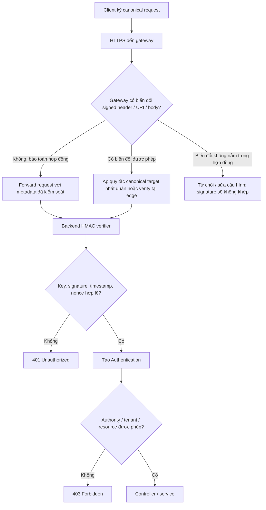

# Proxy giữ nguyên header: bảo toàn dữ liệu xác thực HMAC qua gateway và reverse proxy

## 1. Bối cảnh và mục tiêu

Trong module `SECURITY_AUTHENTICATION_HMAC_REQUEST_AUTHENTICATION`, một client gửi HTTP request kèm chữ ký **HMAC dựa trên shared secret**. Client và server thống nhất **canonical request**, có thể gồm HTTP method, URI/query, những header được ký và digest của body. Server phải xác minh chữ ký, chặn replay bằng timestamp/nonce, hỗ trợ key rotation và kiểm tra quyền sau khi xác thực.

Khi ứng dụng đứng sau **API gateway, load balancer, ingress hoặc reverse proxy**, request thường đi qua một hoặc nhiều thành phần có quyền thay đổi header. Nếu proxy làm mất `X-Hmac-Signature`, thay giá trị `X-Hmac-Timestamp`, gộp các header trùng, hoặc thay đổi một signed header mà client đã ký, việc xác thực có thể thất bại. Nguy hiểm hơn, nếu gateway và backend **hiểu khác nhau** về một header, kẻ tấn công có thể tạo request mà lớp trước cho qua nhưng lớp sau diễn giải theo cách khác.

Đây là bài Knowledge thuộc chương **Gateway và proxy** với chủ đề trực tiếp **“Proxy giữ nguyên header”**. Người học cần đạt được các năng lực:

1. Phân biệt giữ nguyên **ý nghĩa và giá trị được ký** với việc giữ nguyên mọi byte HTTP trên đường truyền.
2. Xác định danh sách header HMAC bắt buộc phải được forward, validate và canonicalize nhất quán.
3. Nhận diện biến đổi hợp lệ của giao thức HTTP và những biến đổi khiến chữ ký không khớp hoặc làm rỗng ranh giới tin cậy.
4. Cấu hình và kiểm tra gateway/NGINX theo hợp đồng của client và backend.
5. Đọc và xác minh header tại Java Servlet/Spring Security hoặc WebFlux mà không tin trực tiếp thông tin client tự khai báo.
6. Kiểm thử qua proxy thật: duplicate header, casing, whitespace, HTTP/2, forwarding, URI rewrite, body digest, replay và key rotation.

> **Phạm vi:** Bài giả định cơ chế ký HMAC của một API machine-to-machine. Tên header, format chữ ký, đơn vị timestamp và thuật toán là ví dụ; chúng chỉ trở thành hợp đồng chính thức khi **client, gateway và verifier** được cấu hình thống nhất.

## 2. “Giữ nguyên header” thực chất là giữ điều gì?

### 2.1. Không thể yêu cầu mọi hop giữ nguyên byte của header

HTTP header có phần **tên** và **giá trị**. Tên field là **case-insensitive**: `X-Hmac-Nonce` và `x-hmac-nonce` là cùng tên theo HTTP. Reverse proxy có thể:

- Chuyển request HTTP/2 sang HTTP/1.1, hoặc ngược lại.
- Đổi chữ hoa/chữ thường trong tên header.
- Sắp xếp lại thứ tự header.
- Biểu diễn nhiều giá trị header theo cách khác, tùy gateway và loại field.
- Xóa header hop-by-hop; tạo mới `Host`, `Forwarded` hoặc `X-Forwarded-*`.
- Chuẩn hóa request target, thay path prefix hoặc điều chỉnh body nếu được cấu hình.

Vì vậy, mục tiêu thiết kế HMAC thường là **giữ nguyên các giá trị có ý nghĩa với chữ ký theo một canonicalization contract**, không phải đòi hỏi proxy truyền lại từng byte của *wire-format header block* ban đầu. Nếu giao thức ký phụ thuộc vào cách viết hoa tên hoặc thứ tự header nguyên gốc, việc đổi protocol version có thể khiến chữ ký không xác minh được.

Ví dụ hai request sau phải được xử lý **tương đương ở phần tên header** nếu hợp đồng canonicalization viết thường tên:

```http
X-Hmac-Key-Id: client-key-17
X-Hmac-Timestamp: 2026-11-28T03:00:00Z
X-Hmac-Nonce: n-7c3e
```

```http
x-hmac-key-id: client-key-17
x-hmac-timestamp: 2026-11-28T03:00:00Z
x-hmac-nonce: n-7c3e
```

Ngược lại, không được mặc định coi các **giá trị** sau là tương đương:

```text
X-Hmac-Key-Id: client-key-17
X-Hmac-Key-Id: client-key-17<SPACE>
X-Hmac-Key-Id: client-key-17,client-key-18
```

Giá trị có khoảng trắng ở cuối hoặc có nhiều mục chỉ được normalize nếu chính sách header và hợp đồng ký quy định. Với các trường HMAC dạng token đơn trị, cách an toàn và dễ kiểm thử là **giới hạn format**, yêu cầu đúng một giá trị hợp lệ và từ chối input mơ hồ.

### 2.2. Giá trị cần bảo toàn và dữ liệu có thể được tái tạo

| Nhóm | Ví dụ | Quy tắc đề xuất |
| --- | --- | --- |
| Header mang thông tin xác thực | `X-Hmac-Key-Id`, `X-Hmac-Timestamp`, `X-Hmac-Nonce`, `X-Hmac-Signature` | Không xóa, sửa, sinh lại hoặc gộp tùy tiện; áp quy tắc đơn trị |
| Header nghiệp vụ nằm trong chữ ký | `Content-Type`, `X-Tenant-Id`, `X-Content-SHA256` | Được giữ/chuẩn hóa theo hợp đồng; backend phải kiểm giá trị ký |
| Header định tuyến/authority | `Host` hoặc `:authority`; header chứa external target đã được định nghĩa | Nếu ảnh hưởng quyền hoặc canonical target, phải bảo vệ bằng hợp đồng ký hoặc bằng trust boundary đáng tin |
| Header proxy bổ sung | `Forwarded`, `X-Forwarded-For`, `X-Forwarded-Proto`, `X-Forwarded-Prefix` | Chỉ tin dữ liệu do proxy đã xác thực thiết lập; loại dữ liệu client giả mạo trước khi bổ sung |
| Header quan sát | `traceparent`, `X-Request-Id` | Có thể thay theo policy observability; không sử dụng làm bằng chứng xác thực |
| Hop-by-hop và transport | `Connection`, `Keep-Alive`, `Transfer-Encoding`, `Upgrade`, một số trường theo `Connection` | Không cố “giữ nguyên” như end-to-end signed headers |

**Lưu ý:** `X-Hmac-Signature` thường là **kết quả** HMAC và không tự xuất hiện trong canonical request để tránh bài toán tự ký chính nó. Các header như key ID, timestamp, nonce và digest body nên nằm trong nội dung được ký nếu hợp đồng dựa vào chúng.

## 3. Luồng request qua gateway và điểm xác minh



Có hai mô hình phổ biến, mỗi mô hình yêu cầu hợp đồng khác nhau:

**Mô hình A — xác minh HMAC tại backend:** Gateway chuyển các trường được ký theo cách backend có thể tái dựng đúng canonical request. Nếu proxy rewrite `/public/orders` thành `/internal/orders`, client/backend phải thống nhất biểu diễn path ký nào được sử dụng và có cơ chế tin cậy để backend biết biểu diễn đó. Không suy ra public path từ header không đáng tin do internet client cung cấp.

**Mô hình B — xác minh HMAC tại gateway:** Gateway xác minh request trước khi thay đổi signed components. Backend chỉ tin kết quả đó nếu kết nối gateway → backend được bảo vệ, gateway loại bỏ các header “đã xác thực” do client tự tạo, và danh tính/quyền được truyền bằng một hợp đồng nội bộ không thể giả mạo từ internet. Nếu backend vẫn thực hiện HMAC độc lập thì cần giữ/định nghĩa lại canonical representation cho lần xác minh đó.

Hai mô hình đều phải xử lý replay, key lifecycle và authorization; đặt HMAC ở gateway không tự động giải quyết quyền chi tiết theo tenant/tài nguyên tại backend.

## 4. Thiết kế hợp đồng header HMAC để proxy bảo toàn

Giả sử một client gửi:

```http
POST /internal/payments?mode=fast HTTP/1.1
Host: api.example.test
Content-Type: application/json
X-Hmac-Key-Id: payments-key-2026-b
X-Hmac-Timestamp: 2026-11-28T03:00:00Z
X-Hmac-Nonce: aa670e90-7d83-4f1a-9f6e-c5ac7d8a6830
X-Content-SHA256: <base64-of-body-sha256>
X-Hmac-Signature: <base64-of-hmacsha256>

{"paymentId":"P-1001","amount":100000}
```

Để cả ba thành phần client, proxy và backend hiểu giống nhau, hãy lập **hợp đồng byte-level** cho message được ký, chẳng hạn:

```text
HMAC-REQUEST-V1
POST
/internal/payments?mode=fast
content-type:application/json
x-content-sha256:<base64-of-body-sha256>
x-hmac-key-id:payments-key-2026-b
x-hmac-nonce:aa670e90-7d83-4f1a-9f6e-c5ac7d8a6830
x-hmac-timestamp:2026-11-28T03:00:00Z
```

Đây chỉ là **ví dụ định dạng**, không phải tiêu chuẩn HMAC sẵn có. Một giao thức thật phải xác định: mã hóa UTF-8 hoặc raw bytes, thứ tự dòng, ký tự `\n`/`\r\n`, dấu xuống dòng cuối, cách encode từng field, chuẩn hóa query, tên header, khoảng trắng, header trùng, cách tính digest và signature encoding. Không tạo đặc tả bằng cách nhìn ví dụ rồi suy đoán phần còn thiếu.

### 4.1. Bất biến tối thiểu đối với proxy

1. **Không tự sửa giá trị header ký:** Proxy không được chuyển `X-Hmac-Nonce` thành một nonce mới hoặc sửa timestamp để bù clock skew. Nếu làm vậy, backend sẽ không thể xác minh những bytes mà client đã ký.
2. **Không mất header bắt buộc:** Các header `X-Hmac-Key-Id`, `X-Hmac-Signature`, `X-Hmac-Timestamp` và `X-Hmac-Nonce` phải đến verifier hoặc bị gateway chủ động từ chối theo policy.
3. **Không gộp dữ liệu mơ hồ:** Nếu giao thức quy định một giá trị, request có duplicate field name phải được từ chối tại biên có khả năng quan sát chúng; sau khi proxy gộp, backend có thể không còn phát hiện được duplicates ban đầu.
4. **Không đổi body representation được ký:** Nếu client ký hash raw body, việc decompress/normalize newline/serialize lại JSON sẽ làm hash đổi. Nếu hạ tầng cần biến đổi, hãy chuyển điểm verify hoặc định nghĩa giao thức khác có phiên bản rõ.
5. **Không để header không được ký quyết định danh tính/quyền:** Ví dụ `X-Tenant-Id` dùng để chọn tenant phải được ràng buộc với key đã xác minh và quyền trong policy; không dựa chỉ vào giá trị client gửi.
6. **Không làm mất ý nghĩa path/authority:** Header có thể giữ nguyên nhưng gateway rewrite URI hoặc `Host` khiến toàn bộ canonical request đổi. Đây là vấn đề của **giao thức ký request**, không thể giải quyết chỉ bằng giữ lại signature header.

### 4.2. Vì sao cần ràng buộc key ID, timestamp và nonce?

`X-Hmac-Key-Id` thường giúp server chọn đúng shared secret trong giai đoạn **key rotation**. Client có thể dùng key cũ trong khoảng chuyển tiếp được cấu hình; server chỉ chấp nhận key còn trong vùng hiệu lực và scope client tương ứng. Nếu proxy tự thay key ID, chữ ký sẽ không còn khớp và có thể chọn nhầm secret.

Timestamp chống request quá cũ hoặc quá xa tương lai theo ngưỡng clock skew. Nonce được dùng để chống phát lại trong cửa sổ thời gian cho phép. Hai trường này cần nằm trong phần **được ký**, nhưng chỉ giữ nguyên header là chưa đủ: verifier phải check timestamp và **check-and-record nonce nguyên tử** theo key/client trên kho dùng chung nếu dịch vụ có nhiều instance.

Đừng cho proxy “sửa timestamp cho đúng giờ hiện tại”. Cách vận hành đúng là đồng bộ đồng hồ, định nghĩa cửa sổ lệch thời gian hợp lý và từ chối request không phù hợp; thay timestamp phá tính toàn vẹn của thông điệp.

## 5. Các biến đổi header gây sai lệch hoặc rủi ro

### 5.1. Tên header, HTTP/2 và chuyển đổi protocol

HTTP/2 yêu cầu tên header field viết thường ở tầng wire, trong khi HTTP/1.1 không yêu cầu thứ tự hoặc cách viết hoa cố định. Vì vậy canonicalization nên chuyển **tên header được ký** về chữ thường theo quy tắc xác định và sắp xếp theo một thứ tự duy nhất.

Không ký trực tiếp một chuỗi `getHeaderNames()` nối theo thứ tự container trả về. Thứ tự header trên đường truyền không phải dữ liệu ổn định khi qua nhiều proxy.

HTTP/2 còn có pseudo-header như `:authority`. Khi chuyển đến HTTP/1.1 backend, proxy có thể tạo lại `Host`. Nếu host/authority ảnh hưởng hợp đồng định tuyến, hãy định nghĩa **public authority** nào được ký và cách truyền đáng tin đến verifier; không coi `Host` nội bộ luôn bằng `:authority` ngoài client.

### 5.2. Duplicate headers và header merging

Ví dụ request nhập vào edge:

```http
X-Hmac-Key-Id: billing-a
x-hmac-key-id: billing-b
```

Một thành phần có thể chọn giá trị đầu, một thành phần chọn giá trị cuối, hoặc gộp thành `billing-a, billing-b`. Đây là rủi ro vì verifier có thể xác minh theo key A trong khi một ứng dụng khác lại xử lý tenant/identity theo key B.

Với các security header thuộc loại **đơn trị**, chọn chính sách:

- Reject nếu thiếu, có nhiều giá trị, format không hợp lệ hoặc có dấu phân cách ngoài hợp đồng.
- Thực hiện kiểm tra tại gateway khi nó còn quan sát được raw header occurrences; lặp lại kiểm tra ở backend trên representation backend nhận.
- Không mặc định `getHeader(name)`, `HttpHeaders.getFirst(name)` hoặc biến NGINX `$http_...` giữ được thông tin duplicate ban đầu.

Nếu một intermediary đã gộp duplicates thành một field, backend không nhất thiết biết request gốc có bao nhiêu occurrences. Vì vậy chỉ validate tại backend **không thể thay thế** policy tại edge.

### 5.3. Whitespace, encoding và header validity

Một proxy có thể loại bỏ optional whitespace ở biên giá trị header, từ chối ký tự điều khiển, hoặc normalize một số field. HTTP parser có thể từ chối giá trị chứa CR/LF; không triển khai cơ chế ký dựa trên việc bảo toàn ký tự điều khiển.

Với HMAC header dạng token, có thể quy định regex/format **rõ ràng** (ví dụ key ID dùng ký tự ASCII cho phép, timestamp ISO-8601 UTC chuẩn, nonce UUID hoặc token ngẫu nhiên, signature base64 chuẩn không chứa khoảng trắng). Chỉ canonicalize các giá trị theo phép biến đổi đã đặc tả; nếu yêu cầu exact representation thì từ chối giá trị không chuẩn.

Không giải mã rồi encode lại giá trị arbitrary header mà chưa có yêu cầu; Unicode, khoảng trắng hoặc giá trị có dấu phẩy có thể thay đổi byte và ý nghĩa.

### 5.4. Header hop-by-hop không phải end-to-end

Các header phục vụ **một connection hop** có thể bị intermediary loại bỏ hoặc tái tạo. Ví dụ `Connection` có thể liệt kê những field không nên forward sang hop tiếp theo. `Transfer-Encoding`, `Keep-Alive`, `Upgrade` và các cơ chế HTTP/2/HTTP/1.1 có quy tắc protocol riêng.

Không thiết kế hợp đồng ký end-to-end đòi hỏi proxy phải giữ nguyên một hop-by-hop header. Các trường này cũng liên quan đến request smuggling nếu hai hop diễn giải framing khác nhau; phải dùng parser/gateway đã được cấu hình chặt chẽ và từ chối request mơ hồ.

### 5.5. Header bị thay bởi chính sách gateway

API management có thể chủ động thêm/xóa `Authorization`, thay `Host`, bổ sung trace ID, đổi `Content-Type` hoặc loại một nhóm header theo allowlist. Từng thay đổi phải được đánh giá theo tập **signed headers**.

Một header **không được ký** vẫn có thể nguy hiểm nếu nó quyết định phân quyền, tenant hoặc tài nguyên. Hãy bảo đảm trường có tác động bảo mật được ký, được kiểm soát bởi một proxy đáng tin, hoặc được server kiểm tra độc lập với giá trị không tin cậy.

## 6. Ví dụ cấu hình NGINX để forward header HMAC

NGINX reverse proxy thường chuyển tiếp request headers, nhưng hành vi thực tế phụ thuộc cấu hình location, `proxy_pass_request_headers`, `proxy_set_header`, chính sách cho tên header không hợp lệ, và những tầng gateway phía trước. Cấu hình mẫu dưới đây minh họa một backend xác minh HMAC **sau NGINX**:

```nginx
upstream internal_hmac_api {
    server hmac-api.internal:8080;
}

server {
    listen 443 ssl;
    server_name api.example.test;

    # TLS certificate/key và các hardening directive được cấu hình
    # theo hạ tầng thực tế; đoạn này tập trung vào forwarding.

    location /internal/ {
        proxy_pass http://internal_hmac_api;
        proxy_http_version 1.1;

        # Chuyển tiếp end-to-end headers (mặc định thường đã bật).
        proxy_pass_request_headers on;

        # Host nội bộ có thể khác public authority.
        # Giao thức HMAC của ví dụ không ký Host.
        proxy_set_header Host hmac-api.internal;

        # Không chuyển một Connection header do client quyết định.
        proxy_set_header Connection "";

        # Proxy tự đặt forwarding metadata ở ranh giới tin cậy.
        proxy_set_header X-Forwarded-Proto $scheme;

        # Không đặt lại X-Hmac-Key-Id, X-Hmac-Timestamp,
        # X-Hmac-Nonce, X-Content-SHA256, X-Hmac-Signature ở đây.
        # Chúng được chuyển qua cơ chế header forwarding,
        # với điều kiện edge đã validate request theo hợp đồng.
    }
}
```

Đây là **minh họa**, không phải tệp cấu hình production sẵn dùng. Đặc biệt:

1. Nếu dự án dùng **allowlist** hoặc biến thể cấu hình chỉ forward một số header, hãy khai báo đủ header HMAC và những signed headers khác. Kiểm chứng trên đường đi thực tế thay vì mặc định mọi lớp ingress cùng hành vi.
2. Các directive `proxy_set_header` có thể thay nội dung header; với header đã ký, không tự chép giá trị bằng biến `$http_...` mà chưa hiểu xử lý duplicate, casing và giá trị rỗng của NGINX. Với giá trị rỗng, NGINX có thể bỏ header; điều này phù hợp reject header thiếu, nhưng không nên để backend hiểu là ký hợp lệ.
3. `proxy_set_header Host hmac-api.internal` cố ý đổi Host để gọi backend. Vì vậy **ví dụ không ký Host**; nếu ứng dụng ký public host/authority, phải thiết kế cơ chế lấy authority được kiểm soát và thống nhất từ đầu, tuyệt đối không ký một Host rồi mong backend tự nhìn thấy Host ban đầu.
4. `proxy_pass` có/không kèm URI hoặc dấu slash cuối ảnh hưởng đường dẫn upstream trong một số cấu hình. Kết hợp rewrite prefix có thể làm request target khác nội dung client ký.
5. Đừng bật `underscores_in_headers` tùy tiện chỉ để “cứu” header có dấu `_`. Ví dụ dùng **dấu gạch nối** ở tên HMAC field. Với tên không chuẩn, một số server có thể bỏ header trước khi NGINX tạo upstream request.
6. Các biện pháp TLS, giới hạn header/body, timeout, allowlist method/path, chính sách xử lý duplicate và forwarding trust boundary phải được cấu hình phù hợp bên ngoài snippet này.

### 6.1. Khi cần explicit forwarding

Một đội vận hành có thể bật chính sách chỉ chuyển một tập header nhất định. Khi đó, bảng allowlist nên bao gồm:

```text
X-Hmac-Key-Id
X-Hmac-Timestamp
X-Hmac-Nonce
X-Hmac-Signature
X-Content-SHA256
Content-Type
```

Và tất cả header nghiệp vụ **nằm trong canonical request** theo hợp đồng của API. Cho phép qua gateway không đồng nghĩa header đã xác thực: backend vẫn phải kiểm chữ ký, freshness, nonce và quyền.

Đừng thêm `X-Verified-Client-Id` vào allowlist từ internet rồi để backend coi đó là danh tính đã xác thực. Nếu mô hình xác minh tại edge dùng header khẳng định danh tính nội bộ, gateway phải **xóa input cùng tên do client gửi**, chỉ tự tạo sau khi xác minh, và backend phải chỉ nhận header đó qua kênh gateway đáng tin (ví dụ network isolation kết hợp mTLS và policy phù hợp).

## 7. Đọc header trong Spring Security: phải kiểm cả giá trị lẫn phạm vi tin cậy

### 7.1. Servlet/MVC: lấy header đơn trị có kiểm tra

Một filter HMAC sử dụng `HttpServletRequest` có thể khai báo helper để từ chối header thiếu/trùng ở mức Servlet API nhìn thấy:

```java
import jakarta.servlet.http.HttpServletRequest;
import java.util.Collections;
import java.util.List;
import java.util.regex.Pattern;
import org.springframework.security.authentication.BadCredentialsException;

final class HmacHeaderReader {
    private static final Pattern KEY_ID =
        Pattern.compile("[A-Za-z0-9._-]{1,80}");

    static String singleKeyId(HttpServletRequest request) {
        List<String> values =
            Collections.list(request.getHeaders("X-Hmac-Key-Id"));

        if (values.size() != 1) {
            throw new BadCredentialsException(
                "Missing or ambiguous HMAC key ID"
            );
        }

        String keyId = values.get(0);
        if (keyId == null || !KEY_ID.matcher(keyId).matches()) {
            throw new BadCredentialsException(
                "Invalid HMAC key ID format"
            );
        }
        return keyId;
    }
}
```

Đây là ví dụ **validate một header** với format ứng dụng tự chọn. Thực tế cần cơ chế tương tự cho timestamp, nonce và signature (bao gồm độ dài tối đa, encoding, chuẩn thời gian và format nhất quán). Không dùng `request.getHeader("X-Hmac-Key-Id")` để âm thầm chọn một giá trị khi request có nhiều giá trị.

Lưu ý: một proxy có thể đã gộp nhiều giá trị thành một chuỗi; code phía backend sẽ không phát hiện được **số lần xuất hiện nguyên bản**. Chỉ tin định dạng nếu gateway ở biên có policy từ chối ambiguity, hoặc thiết kế field không cho phép separator gây nhầm lẫn như dấu phẩy rồi kiểm tra nghiêm ngặt.

### 7.2. WebFlux: đọc HttpHeaders nhưng không coi getFirst là validator

Trong Spring WebFlux:

```java
import java.util.List;
import org.springframework.http.HttpHeaders;
import org.springframework.security.authentication.BadCredentialsException;
import org.springframework.web.server.ServerWebExchange;

static String requiredHeader(
    ServerWebExchange exchange,
    String name
) {
    HttpHeaders headers = exchange.getRequest().getHeaders();
    List<String> values = headers.get(name);

    if (values == null || values.size() != 1 ||
        values.get(0) == null || values.get(0).isBlank()) {
        throw new BadCredentialsException(
            "Missing or ambiguous HMAC header"
        );
    }
    return values.get(0);
}
```

Đoạn trên chỉ kiểm số lượng/giá trị hiện thấy, chưa kiểm encoding, độ dài, tên field và duplicate bị upstream gộp. `getFirst(name)` thuận tiện với field thông thường nhưng **không tự xác nhận** một security header thực sự đơn trị.

### 7.3. Xác minh chữ ký bằng canonical header, không ký trực tiếp header map

Một verifier hoàn chỉnh có thể tuân theo thứ tự:

```text
1. Kiểm method/path thuộc endpoint bắt buộc HMAC.
2. Đọc và validate key ID, timestamp, nonce, signature;
   từ chối header thiếu, sai format, duplicate mơ hồ.
3. Lấy key theo key ID trong registry; kiểm owner, status, scope,
   key rotation window và thời điểm thu hồi.
4. Thu thập signed headers đúng danh sách/hợp đồng;
   normalize tên, whitespace và thứ tự theo phiên bản ký.
5. Dựng canonical method + path/query + headers + body digest.
6. Tính HmacSHA256 từ bytes đã xác định và so sánh signature
   theo cách phù hợp chống rò rỉ thời gian.
7. Kiểm timestamp trong cửa sổ cho phép; ghi nhận nonce nguyên tử
   theo key/client trong kho dùng chung để chặn replay.
8. Chỉ sau đó tạo Authentication; authorities lấy từ phía server.
9. Authorization kiểm quyền endpoint và tenant/resource cụ thể.
```

**Phân biệt lỗi:** Thiếu/sai signature, timestamp hoặc nonce thường trả **401 Unauthorized**; HMAC đã hợp lệ nhưng client thiếu quyền tương ứng trả **403 Forbidden**. Kiểm header ở gateway có thể trả 400 với request cú pháp không hợp lệ theo policy, nhưng không được biến lỗi hạ tầng thành trường hợp mặc nhiên cho phép qua.

## 8. Header có thể giữ nguyên nhưng chữ ký vẫn sai

Đây là phần thường bị bỏ sót khi debug HMAC.

### 8.1. Proxy rewrite URI

Client ký:

```text
POST /public/v1/payments?currency=VND
```

Gateway chuyển thành:

```text
POST /internal/payments?currency=VND
```

Toàn bộ header HMAC có thể được forward đúng, nhưng verifier ở backend lại dựng canonical request từ `/internal/payments` nên chữ ký khác. Không sửa bằng cách bảo client ký tùy ý dựa trên header `X-Forwarded-Prefix` do internet client đặt.

Các lựa chọn có chủ đích là:

- Ký URI mà backend thực sự xác minh, theo hợp đồng công khai từ đầu và chỉ cho phép mapping tương ứng.
- Xác minh HMAC tại edge **trước khi rewrite**, sau đó truyền danh tính đã xác minh an toàn cho backend.
- Truyền public target theo một metadata chỉ trusted gateway được phép đặt, bảo vệ đường truyền và ràng buộc canonicalization/route mapping; backend từ chối metadata client tự giả mạo.

### 8.2. Host, scheme và port

Client có thể ký `https://api.example.test` nhưng gateway terminate TLS và backend nhận `http://hmac-api.internal:8080`. Nếu canonicalization lấy scheme/host từ request backend đang thấy, chữ ký sẽ không khớp.

Nếu hợp đồng không ký absolute URL mà ký method + canonical path/query + các stable headers thì thường tránh được một số thay đổi transport. Tuy nhiên nếu host quyết định tenant hoặc đích dịch vụ, phải ràng buộc **authority** bằng một cơ chế an toàn; không bỏ nó khỏi chữ ký rồi để header `Host` không đáng tin quyết định quyền.

### 8.3. Content-Type và body

Một proxy có thể giữ nguyên `X-Hmac-Signature` và `X-Content-SHA256` nhưng thay body bằng việc decompress hoặc reserialize JSON. Khi verifier thực sự tính digest từ **raw body bytes nhận được**, digest không khớp. Đây là hành vi từ chối đúng.

Nếu ký `Content-Type: application/json`, việc thêm `; charset=UTF-8` ở gateway có thể thay canonical header. Hợp đồng phải quy định canonicalization giá trị hoặc cấm intermediary biến đổi header đó. Đừng cố bỏ mọi signed header cho dễ xác minh, vì bỏ một header có ảnh hưởng đến xử lý nghiệp vụ có thể làm tính toàn vẹn không đủ.

### 8.4. Query và percent encoding

Hai request:

```text
/internal/payments?name=red%20fox&amount=10
/internal/payments?amount=10&name=red+fox
```

Có thể tương tự sau khi ứng dụng parse query, nhưng khác raw target, thứ tự tham số và representation của dấu cách. Nếu client ký raw query còn backend lấy `getParameterMap()`/`getQueryParams()` để dựng lại, chữ ký có thể sai hoặc xuất hiện khác biệt cách hiểu. Cần hợp đồng encode và sắp xếp query độc lập với cách gateway/router xử lý.

## 9. Thiết lập ranh giới tin cậy đối với forwarded headers

Các header `Forwarded`, `X-Forwarded-For`, `X-Forwarded-Proto`, `X-Forwarded-Host` và `X-Forwarded-Prefix` rất hữu ích cho routing, absolute URL và log. Nhưng **chúng là HTTP headers**: client internet hoàn toàn có thể tự gửi giá trị trước khi đi vào gateway.

Một policy đáng tin cậy thường cần:

1. Gateway biên loại bỏ hoặc ghi đè những field forwarding mà client không được phép tự đặt.
2. Gateway chỉ ghi metadata dựa trên connection/configuration mà nó thực sự kiểm soát.
3. Backend chỉ chấp nhận traffic qua trusted proxy hoặc một cơ chế network/mTLS phù hợp; không mở đường truy cập backend trực tiếp từ internet.
4. Ứng dụng cấu hình rõ trust proxy để tránh `ForwardedHeaderFilter` hoặc framework sử dụng dữ liệu giả mạo như scheme/host/path thật.
5. Nếu metadata gateway quyết định canonical URI hoặc tenant, phải thêm ràng buộc integrity và authorization tương ứng.

Không dùng `X-Forwarded-For` làm bằng chứng danh tính HMAC. IP nguồn có thể hữu ích cho risk/rate limit, nhưng không thay thế shared secret, chữ ký và kiểm tra quyền.

Ví dụ nguy hiểm:

```http
X-Forwarded-Host: trusted.example.test
X-Verified-Client: admin-service
```

Nếu backend tin hai trường này dù chúng có thể do client gửi, kẻ tấn công có thể giả mạo public authority hoặc danh tính được gateway xác nhận. Những trường “verified” chỉ được chấp nhận sau khi gateway **xóa bản client gửi**, tự sinh bản mới khi kiểm chứng thành công và truyền qua kết nối tin cậy.

## 10. Kiểm thử proxy có giữ đúng header hay không?

### 10.1. Hai tầng kiểm thử bổ sung cho nhau

**Ở gateway/edge:** Kiểm behavior khi raw request xuất hiện duplicate, header quá dài, control characters, tên header không hợp lệ hoặc trường thuộc `Connection`. Đây là nơi có thể nhìn thấy dữ liệu trước khi intermediary gộp/normalize.

**Ở backend:** Kiểm dữ liệu ứng dụng thực sự nhận (`HttpServletRequest` hoặc `ServerWebExchange`), kết quả canonicalization và signature. Đặc biệt xác nhận body digest, route matcher, principal và authorities đúng sau khi request đi hết pipeline.

Đừng dựa duy nhất vào unit test gọi verifier trực tiếp, vì test đó không mô phỏng NGINX/load balancer, HTTP/2 hoặc ingress filter thực tế.

### 10.2. Ma trận kiểm thử bắt buộc

| Tình huống | Điều cần kiểm | Kết quả mong đợi |
| --- | --- | --- |
| Header HMAC hợp lệ, đi thẳng đến backend | Baseline signature, canonical bytes | Xác thực thành công với quyền phù hợp |
| Cùng request đi qua gateway | Signed headers và body/target được bảo toàn theo hợp đồng | Kết quả xác thực giống baseline |
| Đổi casing tên `X-Hmac-Nonce` | Header matching case-insensitive | Kết quả giống nhau nếu giá trị không đổi |
| Đổi thứ tự các header | Canonical header order không phụ thuộc wire order | Chữ ký hợp lệ theo hợp đồng |
| Thiếu `X-Hmac-Signature` | Gateway có forward và verifier có bắt buộc header | 401 |
| Thiếu hoặc sửa `X-Hmac-Timestamp` | Freshness và signed metadata | 401 |
| Thêm hai `X-Hmac-Key-Id` khác nhau | Edge phát hiện ambiguity; backend không chọn tùy tiện | Từ chối |
| Giá trị key ID có whitespace/dấu phẩy ngoài format | Validate strict encoding | Từ chối |
| Header bị gateway gộp | Chính sách duplicate/list field nhất quán | Từ chối trường mơ hồ |
| HTTP/2 client → HTTP/1.1 backend | Lowercase names/pseudoheaders được xử lý hợp đồng | Không lỗi giả khi chuyển protocol |
| Gateway đổi `Host` | Host có/không nằm trong signed contract | Hợp lệ khi contract cho phép; nếu ký sai thì từ chối |
| Gateway rewrite `/public` → `/internal` | Canonical path tại client/backend | Kết quả theo chính sách đã công bố |
| Query đổi thứ tự hoặc percent encoding | Canonicalization query | Không thay ý nghĩa ký ngoài hợp đồng |
| `Content-Type` bị proxy thêm charset | Signed header normalization | Hợp đồng quyết định chấp nhận hay từ chối |
| Body bị sửa một byte | Digest của raw body | 401 |
| Timestamp hết hạn hoặc đi trước quá xa | Clock-skew policy | 401 |
| Gửi lại cùng key/nonce qua hai backend instance | Nonce store phân tán, atomic check-and-record | Chỉ request đầu hợp lệ theo policy |
| Key cũ trong/ngoài thời gian rotate | Key lifecycle | Chấp nhận/từ chối đúng cửa sổ |
| Chữ ký hợp lệ nhưng thiếu authority | Tách authentication/authorization | 403 |
| Client tự gửi `X-Verified-Client` | Gateway strip/overwrite đúng | Không giả mạo principal |
| Client trực tiếp gọi backend, bỏ qua gateway | Network/mTLS boundary | Bị chặn theo kiến trúc |
| Client gửi header quá lớn hoặc malformed framing | Limit/parser của gateway | Từ chối sớm, không request smuggling |

### 10.3. Ví dụ phép thử thủ công

Gửi một request test **đã ký hợp lệ** cả qua public gateway và môi trường tích hợp backend trong phạm vi được phép. Chẳng hạn với HTTP/1.1:

```bash
curl --http1.1 -i \
  -X POST "https://api.example.test/internal/payments?mode=fast" \
  -H "Content-Type: application/json" \
  -H "X-Hmac-Key-Id: payments-key-test" \
  -H "X-Hmac-Timestamp: 2026-11-28T03:00:00Z" \
  -H "X-Hmac-Nonce: nonce-generated-by-test" \
  -H "X-Content-SHA256: BODY_DIGEST_FROM_TEST" \
  -H "X-Hmac-Signature: SIGNATURE_FROM_TEST" \
  --data-binary '{"paymentId":"P-1001","amount":100000}'
```

Các token `BODY_DIGEST_FROM_TEST` và `SIGNATURE_FROM_TEST` là **placeholder**; cần dùng test fixture tạo digest/signature từ **chính body bytes** và timestamp chưa hết hạn. Không reuse nonce giữa hai yêu cầu dùng để so kết quả nếu nonce store được chia sẻ: request thứ hai có thể bị từ chối **đúng** vì replay. Hãy tạo nonce/chữ ký mới cho từng request hoặc dùng môi trường test cách ly phù hợp.

Để kiểm duplicate headers, có thể gửi hai dòng `-H "X-Hmac-Key-Id: ..."` trong request test và quan sát xem proxy từ chối hay backend nhận gì. Đừng đưa secret production vào lệnh shell/log hoặc dịch vụ echo công khai.

### 10.4. Quan sát mà không làm lộ bí mật

Một endpoint diagnostic nội bộ có thể ghi **header name present/missing**, số lượng giá trị *mà backend quan sát*, độ dài, canonicalization version, request ID và mã kết quả HMAC. Khi so với gateway, có thể dùng fingerprint có khóa nội bộ trong môi trường kiểm thử nếu thật sự cần so giá trị; không log raw signature, shared secret, bearer token, body nhạy cảm hoặc danh sách header không kiểm soát.

Log backend chỉ nhìn thấy request **sau proxy**. Nếu cần biết header bị loại ở bước nào, phải có telemetry tại từng hop ở mức an toàn. Đừng suy đoán từ lỗi 401 rằng “proxy mất signature” khi nguyên nhân có thể là timestamp hết hạn, nonce replay, key hết hiệu lực hoặc canonical URI khác.

## 11. Checklist review trước khi đưa HMAC API qua gateway

1. **Liệt kê toàn bộ signed fields:** method, canonical URI/query, signed headers và body digest; định nghĩa version, encoding và quy tắc duplicate.
2. **Chọn điểm verify rõ ràng:** edge hay backend; nếu sau rewrite phải có hợp đồng canonical target đáng tin.
3. **Kiểm forwarding thực tế:** mọi proxy/ingress có chuyển `X-Hmac-Key-Id`, timestamp, nonce, signature và những signed headers khác đúng như policy không?
4. **Chặn ambiguity tại edge:** duplicate, header names bất thường, oversized header, whitespace/encoding trái hợp đồng, malformed framing.
5. **Bảo vệ forwarded metadata:** strip input không đáng tin, chỉ tin gateway đã xác thực; bảo vệ đường gateway → backend.
6. **Kiểm freshness và replay:** timestamp/nonce thuộc chữ ký, clock được đồng bộ, nonce store có thao tác atomic và TTL đủ.
7. **Quản lý key rotation:** key ID là dữ liệu đã được ràng buộc, registry biết key owner, thời gian chấp nhận, trạng thái revoke và scope.
8. **Tách xác thực và phân quyền:** 401 cho signature/freshness/replay không hợp lệ; 403 khi client đã xác thực nhưng thiếu authority/tenant access.
9. **Kiểm thử qua đường đi production-like:** HTTP/1.1/HTTP/2, gateway rewrite, header transformations, body raw bytes và nhiều backend instance.
10. **Giới hạn và giám sát:** TLS/mTLS theo kiến trúc, body/header limit, timeout, log redaction, metric cho nguyên nhân từ chối mà không lộ secret.

**Ghi nhớ:** “Proxy giữ nguyên header” trong hệ thống xác thực HMAC có nghĩa là proxy **không làm biến đổi các giá trị và ngữ nghĩa mà client đã ký**, đồng thời không tạo ra hai cách hiểu header khác nhau giữa edge và backend. Tên header có thể đổi casing, giao thức và thứ tự có thể thay, nhưng canonicalization phải thống nhất. Chỉ khi bảo toàn hợp đồng ký, xác minh chữ ký và nonce đúng, rồi phân quyền theo danh tính đã kiểm chứng, HMAC mới hoạt động an toàn qua gateway và nhiều proxy.
