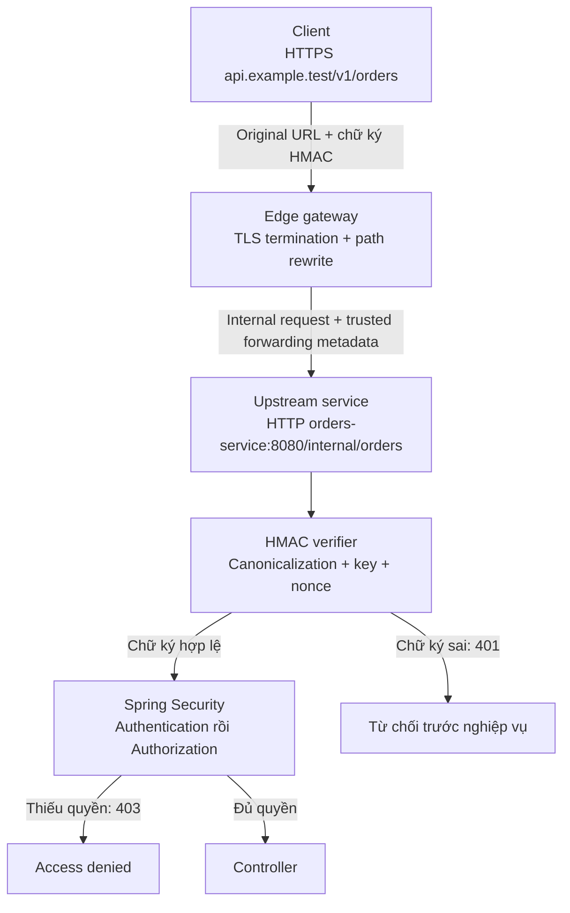

# Forwarded header trong gateway/proxy và xác thực HMAC request

## 1. Vì sao Forwarded header ảnh hưởng đến xác thực HMAC?

Trong hệ thống có API gateway, load balancer hoặc reverse proxy, HTTP request mà client **gửi ra Internet** thường khác request mà service Spring Boot **nhận ở phía trong**. Proxy có thể kết thúc HTTPS, chuyển host/port, đổi tiền tố đường dẫn, thêm header, sắp xếp lại header hoặc giải nén body.

Module `SECURITY_AUTHENTICATION_HMAC_REQUEST_AUTHENTICATION` xác thực HTTP request bằng HMAC và shared secret. Client tính chữ ký trên một **canonical request** theo hợp đồng: phương thức, URI và các header hoặc hash body đã chọn. Service phải tính lại **đúng biểu diễn đó** để xác minh chữ ký, kiểm tra timestamp/nonce chống replay, chọn key version khi rotation và sau đó mới phân quyền.

Ví dụ client gọi:

```http
POST https://api.example.test/v1/orders?item=7 HTTP/1.1
Host: api.example.test
Content-Type: application/json
X-Key-Id: client-42
X-Timestamp: 2026-11-28T03:00:00Z
X-Nonce: n-42-01
X-Signature: <hmac-hop-le-tren-public-request>

{"quantity":2}
```

Gateway chuyển request đến service bằng HTTP nội bộ:

```http
POST /internal/orders?item=7 HTTP/1.1
Host: orders-service:8080
Forwarded: for=192.0.2.17;proto=https;host=api.example.test
X-Original-URI: /v1/orders?item=7
Content-Type: application/json
X-Key-Id: client-42
X-Timestamp: 2026-11-28T03:00:00Z
X-Nonce: n-42-01
X-Signature: <cung-chu-ky-do>

{"quantity":2}
```

Ở hai phía, `Host` và path đã khác. Nếu service tạo canonical request bằng `orders-service:8080` và `/internal/orders` trong khi client ký `api.example.test` và `/v1/orders`, HMAC sẽ không khớp dù cả hai dùng đúng shared secret.

**Forwarded header** là metadata proxy chuyển tiếp nhằm mô tả thông tin ở phía trước như giao thức, host hoặc địa chỉ kết nối. Metadata này có thể hỗ trợ tái dựng thông tin request bên ngoài; tuy nhiên, **nó không tự chứng minh nguồn gốc và không phải chữ ký số**. Chỉ nên sử dụng khi có ranh giới tin cậy và hợp đồng canonicalization được kiểm soát rõ ràng.

Sau bài học, người học cần giải thích được:

1. Sự khác nhau giữa header chuẩn `Forwarded` và họ header thông dụng `X-Forwarded-*`.
2. Khi nào có thể dùng chúng để phục hồi thông tin public scheme/host/port.
3. Vì sao không thể mặc định lấy raw path gốc chỉ từ `Forwarded`.
4. Cách chống giả mạo forwarding headers và lỗi xác thực HMAC khi gateway rewrite.
5. Cách cấu hình Spring MVC/WebFlux, kiểm thử proxy nhiều hop, timestamp/nonce, key rotation và phân quyền.

## 2. Gateway chuyển đổi request như thế nào?



Một proxy có thể thay đổi các thành phần sau:

| Thành phần | Client nhìn thấy | Service có thể nhìn thấy | Rủi ro với HMAC |
| --- | --- | --- | --- |
| Scheme | `https` | `http` sau TLS termination | Canonical URL khác nếu scheme được ký |
| Host/port | `api.example.test:443` | `orders-service:8080` | Host ký bị thay |
| Path | `/v1/orders` | `/internal/orders` | URI khác sau rewrite |
| Query | `item=7&tag=a` | Có thể normalize/reorder | Canonical query khác |
| Header | `Host`, `Content-Type`, header chữ ký | Proxy thêm/bớt/ghép header | Dữ liệu signed headers khác |
| Body | JSON byte gốc | Có thể giải nén hoặc biến đổi | Body hash khác |
| Client IP | IP client hoặc NAT | IP proxy ở kết nối TCP | Log/rate limit nhầm nguồn |

Không phải mọi proxy đều biến đổi tất cả trường. Cần kiểm tra **chuỗi proxy thực tế** từ điểm client ký đến điểm server xác minh, thay vì suy đoán từ HTTP request của unit test.

## 3. Header chuẩn `Forwarded` theo RFC 7239

`Forwarded` là HTTP header chuẩn hóa ở RFC 7239. Một phần tử header thường gồm các tham số được ngăn bởi dấu chấm phẩy; nhiều phần tử đại diện các hop và được ngăn bởi dấu phẩy. Các tên tham số không phân biệt chữ hoa/chữ thường.

Ví dụ:

```http
Forwarded: for=192.0.2.17;by=198.51.100.10;proto=https;host=api.example.test
```

Các trường quan trọng:

| Tham số | Ý nghĩa | Giới hạn cần nhớ |
| --- | --- | --- |
| `for` | Bên gửi request tới proxy ở hop tương ứng | Có thể là IP, IPv6 dạng quoted, tên ẩn danh; không chứng minh danh tính |
| `by` | Proxy tiếp nhận request ở hop đó | Có thể là định danh ẩn hoặc không tồn tại |
| `host` | Giá trị host được proxy quan sát | Chỉ đáng tin khi proxy kiểm soát và validate |
| `proto` | Giao thức mà proxy quan sát, thường `http` hoặc `https` | Không tự chứng minh TLS đã được dùng ở phía client |

Ví dụ nhiều proxy:

```http
Forwarded: for=192.0.2.17;proto=https;host=api.example.test,
           for=198.51.100.10;proto=http;host=internal-gateway
```

Thứ tự và giá trị phải được diễn giải theo kiến trúc từng hop. **Không chọn phần tử đầu tiên hoặc cuối cùng một cách mù quáng** nếu chưa xác định proxy nào là tin cậy và liệu upstream đã loại bỏ dữ liệu do client gửi hay chưa.

Trong thực tế có giá trị cần quoted-string:

```http
Forwarded: for="[2001:db8::1234]";proto=https;host="api.example.test:443"
Forwarded: for=_hidden;proto=https;host=api.example.test
```

Do cú pháp có dấu phẩy, dấu chấm phẩy, dấu ngoặc kép và escape, không nên phân tích header bằng `split(",")` hoặc `split(";")` đơn giản. Dùng parser chuẩn/framework và một chính sách chọn hop đã được xác định.

**Điều rất quan trọng:** RFC 7239 `Forwarded` **không có tham số chuẩn để lưu original URI path/query**. `host` và `proto` không đủ để tái tạo `/v1/orders?item=7` sau khi proxy đã đổi thành `/internal/orders?item=7`.

## 4. Các header `X-Forwarded-*` thường gặp

Dù `Forwarded` là dạng chuẩn, nhiều gateway, proxy và nền tảng cloud dùng họ header không chuẩn hóa đồng nhất dưới tên `X-Forwarded-*`.

| Header | Nội dung điển hình | Điều cần kiểm tra |
| --- | --- | --- |
| `X-Forwarded-For` | Chuỗi các IP qua nhiều proxy | Nguồn tin cậy, danh sách hop, cách ghi nối/ghi đè |
| `X-Forwarded-Proto` | `https` hoặc `http` tại hop trước | Tin cậy ingress, tránh client spoof scheme |
| `X-Forwarded-Host` | Public hostname mà client gửi | Host allowlist, port và cú pháp hợp lệ |
| `X-Forwarded-Port` | Port bên ngoài, ví dụ `443` | Nhất quán với scheme/host |
| `X-Forwarded-Prefix` | Tiền tố path được proxy thêm/bỏ | Không có ngữ nghĩa chuẩn xuyên mọi proxy |
| `X-Original-URI` | URI gốc theo quy ước gateway | Không chuẩn; chỉ dùng khi ingress có hợp đồng cụ thể |
| `X-Real-IP` | IP mà một proxy suy ra | Không coi là bằng chứng xác thực |

Ví dụ:

```http
X-Forwarded-Proto: https
X-Forwarded-Host: api.example.test
X-Forwarded-Port: 443
X-Forwarded-For: 192.0.2.17
X-Forwarded-Prefix: /v1
X-Original-URI: /v1/orders?item=7
```

Không phải tất cả header đều được proxy phát ra; có môi trường vừa có `Forwarded` vừa có `X-Forwarded-*`. Nếu hai họ header mâu thuẫn, phải có **một chính sách ưu tiên** hoặc từ chối metadata không nhất quán. Không tùy tiện chọn header nào khiến signature trở thành hợp lệ.

Đặc biệt, `X-Forwarded-Prefix` không nhất thiết chứa chính xác original URI. Cách nối prefix với URI có thể sai nếu gateway đồng thời rewrite path, decode dấu `%2F` hoặc loại bỏ nhiều segment. Nếu hợp đồng HMAC yêu cầu raw path trước rewrite, cần một nguồn metadata có thể bảo toàn biểu diễn đó hoặc chọn điểm xác minh khác.

## 5. Trust boundary: header do client gửi cũng có thể tên là Forwarded

Một attacker có thể tự gửi:

```http
GET /api/orders/42 HTTP/1.1
Host: internal-service
Forwarded: proto=https;host=trusted.example.test
X-Forwarded-Host: tenant-admin.example.test
X-Original-URI: /tenant-admin/api/orders/42
```

Nếu ứng dụng tin các giá trị này mà không kiểm tra request có đến từ trusted proxy hay không, attacker có thể ảnh hưởng đến URL được tái dựng, host-based routing, redirect, audit, rate limiting hoặc dữ liệu mà verifier sử dụng để dựng canonical request.

### 5.1. Điều kiện để tin forwarding metadata

Một kiến trúc an toàn cần tất cả điểm sau:

1. **Ingress công khai nhận request từ client và loại bỏ các forwarding header do client tự khai** trong phạm vi mà nó sở hữu.
2. **Ingress ghi lại header đáng tin cậy** từ thông tin kết nối và request mà nó trực tiếp quan sát, theo hợp đồng đã cấu hình.
3. **Service chỉ nhận lưu lượng từ các proxy được phép** bằng network policy, firewall, service mesh hoặc mTLS thích hợp.
4. **Mỗi proxy trung gian có quy tắc rõ** về việc giữ nguyên, ghi nối hoặc thay thế forwarding metadata; service biết hop nào đại diện public origin.
5. **Ứng dụng có allowlist host/scheme/port và route mapping**, không dùng host tùy ý để chọn tenant hoặc URL có quyền đặc biệt.
6. **HMAC verifier kiểm tra dữ liệu canonical theo hợp đồng**, không coi forwarding header là một credential thứ hai thay cho HMAC.

Trust boundary không thể được tạo ra chỉ bằng cách bật một property trong Spring Boot. Nếu service vẫn có thể bị gọi trực tiếp từ Internet, hoặc proxy không loại bỏ forwarding header độc hại, metadata vẫn có thể bị giả mạo.

### 5.2. Ví dụ chính sách ingress một hop

Đây là **minh họa** cho một gateway Nginx dành riêng hostname `api.example.test`. Cần tích hợp vào cấu hình TLS, route, upstream và chính sách mạng thực tế:

```nginx
# Chỉ trong server/location được ràng buộc host hợp lệ.
location /v1/ {
    # Bỏ giá trị người dùng tự gửi; đặt lại theo thông tin tin cậy.
    proxy_set_header Forwarded "";
    proxy_set_header X-Forwarded-Proto "https";
    proxy_set_header X-Forwarded-Host "api.example.test";
    proxy_set_header X-Forwarded-Port "443";
    proxy_set_header X-Forwarded-For $remote_addr;

    # Quy ước riêng để bảo toàn path + query raw trước rewrite.
    proxy_set_header X-Original-URI $request_uri;

    # Upstream route/rewrite tùy deployment.
    proxy_pass http://orders_backend;
}
```

Phần ví dụ cố định hostname và scheme vì gateway phục vụ một public origin đã được allowlist. Với nhiều domain, cần cấu hình mapping rõ từng domain. `$request_uri` có thể giúp giữ URI theo dạng Nginx nhận, nhưng **điểm này không tự bảo đảm trùng bytes mà client đã ký** nếu có proxy khác ở phía trước. Cần test.

Một chuỗi nhiều proxy cần thiết kế riêng: ở một hop tin cậy, muốn bảo toàn chain IP có thể dùng cơ chế append thay vì ghi đè, nhưng chỉ sau khi đã phân định được giá trị nào do client gửi và hop nào đáng tin. Ví dụ trên thiên về một ingress làm sạch metadata.

**Không đưa secret HMAC vào cấu hình chuyển tiếp, log hoặc HTTP response.** Gateway không nhất thiết phải biết shared secret nếu chỉ làm nhiệm vụ truyền metadata; trong mô hình xác minh tại edge thì việc quản lý secret cần một thiết kế riêng.

## 6. Quyết định điểm xác minh HMAC: edge hay application?

Có hai mô hình chính.

### 6.1. Xác minh tại edge trước khi rewrite

```text
Client ký public request
  -> Gateway nhận raw public URI/body
  -> Gateway kiểm tra HMAC + timestamp/nonce + key state
  -> Gateway xác minh thành công, rewrite route
  -> Service nhận identity/claims đã được gateway chứng thực
  -> Service tiếp tục authorization theo trust contract
```

Ưu điểm: gateway còn quan sát được public scheme, host, path và query trước khi biến đổi. Ít cần phục hồi original URI ở service.

Trách nhiệm tăng lên: gateway phải có secret/key access, replay store atomic, xử lý key rotation và mapping identity tin cậy. Nếu truyền identity cho service, service phải kiểm chứng danh tính gateway (mTLS, mạng riêng, token/assertion đã ký hoặc cơ chế tương đương); **không tin `X-Authenticated-Client` do Internet gửi**. Gateway phải xóa header identity do client tự khai trước khi tạo assertion hợp lệ.

### 6.2. Xác minh tại service sau khi rewrite

```text
Client ký public request
  -> Gateway TLS termination + rewrite
  -> Gateway bảo toàn canonical metadata qua kênh tin cậy
  -> Service dựng lại request theo hợp đồng ký
  -> Service tự kiểm HMAC + timestamp/nonce + key version
  -> Spring Security xác lập principal rồi phân quyền
```

Ưu điểm: khóa và logic xác thực có thể nằm gần dịch vụ sở hữu API. Thách thức: service cần đủ dữ liệu tin cậy để dựng chính xác **canonical request của client**, đặc biệt raw path/query trước rewrite và body sau các phép biến đổi.

Không thể tái dựng mọi biến thể raw URI từ kết quả `@PathVariable`, `@RequestParam` hay một `Forwarded` chỉ chứa `host/proto`. Nếu gateway không bảo toàn được dữ liệu cần ký, hãy thay đổi hợp đồng ký hoặc chuyển xác minh tới điểm trước khi dữ liệu bị biến đổi.

### 6.3. Không chọn mô hình theo hướng “cứ thử cả hai path”

Một verifier **không nên** thử lần lượt HMAC trên public path, internal path rồi một số path “chuẩn hóa” cho đến khi khớp. Cách làm này mở rộng tập thông điệp được chấp nhận ngoài hợp đồng và gây khó xác định request nào đã được chứng thực.

Hãy xác định duy nhất input canonical ở từng phiên bản hợp đồng, ví dụ `HMAC-v1` ký public URI còn `HMAC-v2` ký một target cụ thể; phân biệt phiên bản rõ ràng và kiểm soát key/version/nonce tương ứng.

## 7. Hợp đồng canonical request có dùng Forwarded header thế nào?

Không có định dạng canonical HMAC phổ quát bắt buộc cho mọi API. Dưới đây là **ví dụ hợp đồng** có ký host và path public:

```text
HMAC-v1
POST
/v1/orders?item=7
host:api.example.test
content-type:application/json
base64(SHA256(exact_body_bytes))
2026-11-28T03:00:00Z
n-42-01
```

Dấu xuống dòng, ký tự phân cách, chuẩn hóa tên/giá trị header, quy tắc query, encoding và cách biểu diễn hash phải được công bố trong đặc tả và test vectors.

`Forwarded` không nhất thiết phải xuất hiện trong danh sách header **được ký**: nó có thể được **thêm sau khi client ký**. Thay vào đó, service có thể sử dụng metadata tin cậy để suy ra `host` hoặc external target đúng hợp đồng. Hai bên vẫn cần thống nhất:

| Quyết định | Ví dụ | Hậu quả nếu không thống nhất |
| --- | --- | --- |
| Ký hostname nào? | `api.example.test` thay vì upstream host | HMAC sai sau TLS termination |
| Ký scheme không? | `https` trong canonical origin | Sai nếu service chỉ thấy `http` |
| Ký port ra sao? | Bỏ port mặc định `443` hoặc giữ rõ | Hai chuỗi canonical khác |
| Ký raw path? | `/v1/orders` | Gateway rewrite thành `/internal/orders` |
| Canonical query? | Giữ raw order hay sort theo luật cố định | Query tương đương có chữ ký khác |
| Header trùng lặp? | Reject hoặc canonicalize theo luật cụ thể | Bên ký/server hiểu khác nhau |
| Body nào? | Exact bytes ở điểm xác minh | Chữ ký lệch khi gateway transform |
| Proxy metadata nào? | Chỉ từ ingress đã xác thực | Header spoofing, route confusion |

Nếu client ký `Host`, cần chú ý HTTP/2 có pseudo-header `:authority` trong khi HTTP/1.1 dùng `Host`. Proxy có thể chuyển đổi hai dạng; hợp đồng ký nên nói rõ canonical authority chứ không phụ thuộc một biểu diễn wire không tồn tại ở hop kia.

**Điểm kiểm soát:** request đã qua xác minh phải được thực thi ở **cùng logical target và tenant** mà canonical request đã chứng thực. Nếu metadata public path nói `/tenant-a/orders` nhưng gateway thực tế route đến handler tenant-b, cần từ chối hoặc đảm bảo route mapping đã được xác minh. Chữ ký hợp lệ không tự cấp quyền truy cập tenant khác.

## 8. Cấu hình Forwarded header trong Spring Boot MVC

Ở Spring Boot chạy Servlet/Spring MVC, thuộc tính:

```yaml
server:
  forward-headers-strategy: framework
```

có thể cho Spring Framework xử lý forwarding headers, thường qua `ForwardedHeaderFilter`, để các thành phần phía sau nhìn thấy thông tin như scheme/host/port gắn với proxy. Chiến lược còn có lựa chọn `native` (dùng hỗ trợ của server/container nếu thích hợp) và `none` (không kích hoạt xử lý forwarding theo cơ chế này).

**Chỉ bật khi deployment đã có trusted ingress và header sanitization.** Property không tự xác thực rằng `Forwarded` hoặc `X-Forwarded-Host` thực sự đến từ proxy đáng tin cậy.

### 8.1. `ForwardedHeaderFilter` làm gì?

`ForwardedHeaderFilter` bọc request/response để một số API Servlet nhìn thấy metadata chuyển tiếp khi tạo URL hoặc redirect; trong Spring Framework có tùy chọn `removeOnly` để loại bỏ forwarding headers mà không sử dụng chúng.

Ví dụ cấu hình minh họa **chỉ loại bỏ header không tin cậy** khi ứng dụng không muốn sử dụng forwarding metadata:

```java
@Bean
FilterRegistrationBean<ForwardedHeaderFilter> forwardedRemovalFilter() {
    ForwardedHeaderFilter filter = new ForwardedHeaderFilter();
    filter.setRemoveOnly(true);

    FilterRegistrationBean<ForwardedHeaderFilter> registration =
            new FilterRegistrationBean<>(filter);
    registration.setOrder(Ordered.HIGHEST_PRECEDENCE);
    return registration;
}
```

Đoạn mã này là **một lựa chọn thay thế** cho cấu hình forward processing tự động. Không bật đồng thời nhiều cách đăng ký filter mà chưa kiểm tra thứ tự và hành vi. `removeOnly` thích hợp khi service không có cơ sở tin metadata chuyển tiếp; nó không thể phục hồi public URI cần cho HMAC đã ký public URL.

Khi dùng chiến lược `framework`, hãy kiểm tra trong integration test những giá trị mà `getScheme()`, `getServerName()`, `getServerPort()` và `getRequestURL()` thực sự trả về. **Không giả định `getRequestURI()` được khôi phục thành raw public path** sau rewrite: header `Forwarded` không chứa dữ liệu đó.

### 8.2. Không dựa vào filter để tự xác minh nguồn gốc header

Nếu một attacker có thể gọi service trực tiếp và gửi:

```http
X-Forwarded-Proto: https
X-Forwarded-Host: api.example.test
```

thì `ForwardedHeaderFilter` không có bằng chứng mật mã để biết giá trị ấy có thật do gateway đặt ra hay không. Network trust boundary, stripping ở edge và allowlist mới là phần bảo vệ chính.

Thứ tự xử lý có ý nghĩa với HMAC filter tự viết. Nếu Spring Security tính canonical target sau một wrapper forwarding, giá trị nó thấy có thể khác request gốc. Cần quyết định liệu verifier dùng URL đã được framework tái dựng hay dữ liệu canonical riêng do ingress cung cấp, rồi kiểm thử **đúng thứ tự filter trong runtime**.

## 9. Cấu hình tương ứng trong Spring WebFlux

Spring WebFlux sử dụng `ServerWebExchange` và `ServerHttpRequest` thay vì Servlet API. Spring Framework cung cấp `ForwardedHeaderTransformer` để xem xét forwarding headers và cập nhật request trước khi request đi qua các bộ xử lý WebFlux.

Spring Boot cũng có thể dùng `server.forward-headers-strategy: framework` cho WebFlux, nhưng cơ chế thực tế khác Servlet. Khi tự cấu hình transformer, không đăng ký trùng với cơ chế do Boot quản lý.

Ví dụ hướng tiếp cận chỉ loại bỏ header:

```java
@Bean
ForwardedHeaderTransformer forwardedHeaderTransformer() {
    ForwardedHeaderTransformer transformer =
            new ForwardedHeaderTransformer();
    transformer.setRemoveOnly(true);
    return transformer;
}
```

Đây là lựa chọn khi không tin metadata, **không phải** cơ chế phục hồi public request. Khi cần sử dụng forwarding metadata, chỉ bật xử lý sau khi đã bảo đảm service chỉ nhận header được trusted proxy ghi lại.

Trong WebFlux, HMAC verifier có thể lấy URI từ:

```java
URI observed = exchange.getRequest().getURI();
String rawPath = observed.getRawPath();
String rawQuery = observed.getRawQuery();
```

Các giá trị này đại diện cho **request mà exchange nhìn thấy sau các phép biến đổi được cấu hình**, chưa chắc là public path trước gateway rewrite. Việc xác minh HMAC ký public URI đòi hỏi thông tin gốc chính xác hoặc một điểm xác minh ở edge.

Nếu HMAC ký body, cần duy trì cách đọc `Flux<DataBuffer>`, giới hạn kích thước và phát lại body cho downstream theo cơ chế WebFlux; Forwarded header processing **không giải quyết** vấn đề body stream. Không gọi `block()` trong security WebFilter.

## 10. Tổ hợp nguy hiểm: routing, host và tenant

Xét một hệ thống dùng hostname để xác định tenant:

```text
tenant-a.api.example.test -> tenant A
tenant-b.api.example.test -> tenant B
```

Nếu ứng dụng lấy tenant chỉ bằng `X-Forwarded-Host` do client tự gửi, attacker có thể yêu cầu host của tenant B dù request thực tế kết nối tới host khác. Tương tự, HMAC ký path A nhưng route nội bộ lại chạy handler hoặc tài nguyên B là một dạng **target confusion**.

Để tránh nhầm lẫn:

- Mapping external host/path sang tenant phải nằm trong cấu hình ingress/service đáng tin và được xác minh, không chỉ dựa vào một giá trị header bất kỳ.
- Verifier phải gắn credential đã xác thực với client/tenant/quyền phù hợp trong policy server. Header được ký chứng minh chủ sở hữu khóa đã ký giá trị ấy; nó **không tự cấp authority**.
- Authorization tiếp tục kiểm tra action và resource ownership; ví dụ HMAC hợp lệ của client A vẫn trả `403` nếu truy cập đơn hàng thuộc tenant B.
- Validation hostname và scheme cũng bảo vệ các tính năng tạo absolute link, redirect hoặc callback URL; tránh tạo link đến host do attacker tự chọn.

Đặc biệt cảnh giác nếu gateway có nhiều domain/route cùng trỏ về một service: việc đặt allowlist một domain trong dev có thể che lỗi khác biệt trong production.

## 11. Forwarded client IP chỉ là metadata mạng

`Forwarded: for=...` và `X-Forwarded-For` thường được dùng để đo nguồn gọi, audit hoặc rate limiting. Chúng không phải credential HMAC. Địa chỉ IP có thể là NAT, load balancer, proxy công cộng hoặc định danh ẩn; với nhiều hop, danh sách có thể chứa giá trị do client tự thêm.

Không sử dụng client IP từ header chưa tin cậy để bỏ qua HMAC, tự động cấp authority hoặc quyết định một request đã được xác thực. Nếu rate limiting cần client IP, hãy dùng kết quả từ **trust-aware proxy chain parser** và cấu hình rõ hop/địa chỉ trusted proxy, đồng thời có thêm giới hạn theo credential ID sau khi xác minh.

Một quy trình tốt là ghi request ID/trace ID, trusted ingress ID và authenticated client ID riêng biệt trong log. Không đánh đồng `remoteAddr` ở service (thường là proxy) với IP client cuối cùng.

## 12. Xử lý lỗi khi metadata chuyển tiếp không nhất quán

| Tình huống | Hành vi nên có | Ghi chú |
| --- | --- | --- |
| HMAC sai do canonical host/path khác | `401` theo hợp đồng xác thực | Kiểm tra cấu hình proxy bằng log nội bộ, không lộ canonical secret |
| Header forwarding trực tiếp từ nguồn không tin cậy | Bỏ qua hoặc từ chối tại ingress | Không dùng để tính signed target |
| `Forwarded` và `X-Forwarded-*` mâu thuẫn | Từ chối hoặc dùng một nguồn ưu tiên cố định đã công bố | Không thử mọi giá trị để tìm chữ ký khớp |
| Public host ngoài allowlist | Từ chối ở edge/application, thường `400` hoặc `421` theo policy | Không dùng host đó chọn tenant |
| Thiếu original URI bắt buộc do lỗi triển khai gateway | Fail closed; phân loại lỗi cấu hình/hạ tầng | Không ký nhầm bằng internal URI rồi cho qua |
| Signature hợp lệ nhưng client không đủ quyền | `403` | Authorization độc lập với HMAC |
| Nonce đã dùng / timestamp ngoài cửa sổ | Từ chối xác thực theo hợp đồng, thường `401` | Không cho request chạy đến controller |
| Nonce store/key store mất khả dụng | `5xx` phù hợp, ví dụ `503` | Fail closed, có alert và request ID |

Không trả về expected signature, raw shared secret, canonical string đầy đủ chứa dữ liệu nhạy cảm hay danh sách key ID hợp lệ. Log nên dùng mã nguyên nhân như `canonical_target_mismatch`, `untrusted_forwarded_header`, `signature_mismatch` và request ID, có giới hạn truy cập và thời gian lưu.

## 13. Kiểm thử proxy/gateway và forwarding headers

Một unit test có thể xác minh logic parser/canonicalizer, nhưng không chứng minh trusted proxy thực sự loại bỏ header từ Internet. Cần thêm kiểm thử end-to-end qua gateway đã cấu hình giống production.

### 13.1. Ma trận kiểm thử cốt lõi

| Ca thử | Kết quả cần chứng minh |
| --- | --- |
| Không có proxy, request hợp đồng trực tiếp | HMAC hợp lệ khi canonical target đúng |
| TLS terminate ở edge rồi HTTP nội bộ | Canonical scheme/host vẫn nhất quán |
| Gateway rewrite `/v1` thành `/internal` | Server xác minh đúng public path nếu hợp đồng ký public path |
| Client giả `Forwarded: host=attacker.test` | Edge loại bỏ/ghi đè; ứng dụng không tin header giả |
| Client giả `X-Original-URI` | Không thể đổi signed target hoặc chọn tenant không được phép |
| Có hai trusted proxy | Chọn đúng hop theo hợp đồng, không lấy nhầm IP/host |
| `Forwarded` và `X-Forwarded-Host` mâu thuẫn | Xử lý quyết định được, không phụ thuộc order tùy tiện |
| IPv6, quoted values, duplicate headers | Parser đúng cú pháp, từ chối input không hợp lệ |
| Query thứ tự khác, `+` vs `%20`, `%2F` | Canonicalization trùng test vectors |
| Host kèm port `443` / port mặc định | Ký và xác minh có cùng quy tắc |
| Body Unicode, body rỗng, proxy thay đổi Content-Encoding | Body digest phản ánh đúng bytes theo hợp đồng |
| Chữ ký sai, key bị revoke | `401`; controller không chạy |
| HMAC đúng nhưng sai authority/tenant | `403` hoặc chính sách tài nguyên tương ứng |
| Timestamp quá hạn, nonce gửi lặp | Chặn trước controller |
| Hai request cùng nonce song song qua các instance | Tối đa một request được chấp nhận |
| Store nonce lỗi, forwarding metadata bắt buộc bị mất | Fail closed, không xử lý nghiệp vụ |
| Key rotation có overlap | Chỉ key version còn được cho phép mới xác thực |
| Public health check | Không bị HMAC filter chặn nếu policy public rõ ràng |

### 13.2. Test canonicalization bằng vector xác định

Ví dụ cùng một logical request:

```text
Client view:
  scheme = https
  host   = api.example.test
  target = /v1/orders?item=7

Gateway internal view:
  scheme = http
  host   = orders-service:8080
  target = /internal/orders?item=7

Trusted metadata:
  public proto = https
  public host  = api.example.test
  original target = /v1/orders?item=7

Expected canonical target (HMAC-v1):
  https://api.example.test/v1/orders?item=7
```

Test cần khẳng định request ký trên canonical target mong đợi sẽ được xác thực, trong khi thay một byte ở path, query hoặc body đã ký sẽ bị từ chối. Sau đó gửi cùng request qua gateway thật để bảo đảm metadata server nhận khớp vector. Nếu hợp đồng không ký scheme, không nên tự thêm scheme vào canonical string trong bước triển khai.

Một test trực tiếp tới service với header `X-Original-URI` không chứng minh header đó đáng tin; đó chỉ là test logic xử lý. Phải kiểm tra thêm rằng chỉ gateway được phép gửi request đến service và mọi header tự khai từ client đã được làm sạch.

### 13.3. Kiểm tra phân quyền và replay

Khi signature hợp lệ và `keyId` được xác minh, Spring Security cần nhận principal cùng authority từ server policy. Test `403` bằng **HMAC thật sự hợp lệ** của client thiếu quyền, không bằng signature giả. Với anti-replay, sử dụng nonce mới cho lần request hợp lệ, và gửi lại cùng timestamp/nonce để chứng minh chỉ một request vượt qua.

Không trộn lẫn HTTP 401 do canonical mismatch với 403 do authorization; chúng có nguyên nhân và cách khắc phục khác nhau.

## 14. Thực hành: thiết kế một đường đi HMAC qua hai proxy

Cho kiến trúc:

```text
Mobile/Backend client
    -> HTTPS public edge gateway
    -> Internal reverse proxy
    -> Spring Boot service /api/orders
```

Yêu cầu client ký method, public path/query, `Host`, `Content-Type`, body digest, timestamp và nonce; `keyId` chọn khóa HMAC theo client/version. API `POST /api/orders` cần authority `orders:create`. Tất cả proxy đều nằm trong một chính sách trust xác định và service chỉ nhận traffic qua internal proxy.

Thực hiện:

1. Chọn điểm xác minh HMAC: tại edge trước rewrite, hoặc tại service với metadata canonical đã được trusted ingress bảo toàn.
2. Viết tài liệu hợp đồng `HMAC-v1`: thứ tự trường, newline, URI/encoding, header case/value, body hash, key ID, timestamp/nonce và canonical host/port.
3. Cấu hình ingress loại bỏ `Forwarded`/`X-Forwarded-*` do client khai và ghi lại các trường cần thiết theo nguồn mạng/route được phép.
4. Cấu hình mỗi proxy để bảo toàn hoặc append metadata có kiểm soát, xác định rõ hop được tin và đường đi raw public URI nếu phải xác minh tại service.
5. Trong Spring Boot chọn `none`, `native` hoặc `framework` một cách có chủ đích; kiểm tra request values mà HMAC verifier thực sự nhìn thấy.
6. Tạo HMAC verifier với secret/key version, canonicalization, timestamp, atomic nonce store và response từ chối an toàn; sau xác thực, ủy quyền theo authority/tenant.
7. Kiểm thử header spoofing, path rewrite, query encoding, body transform, IP chain, replay đồng thời, key revoke và lỗi proxy metadata.
8. Ghi nhận request ID và nguyên nhân nội bộ khi signature lệch để vận hành; không đưa secret/expected signature vào response hoặc log.

**Tiêu chí hoàn thành:** Service chỉ sử dụng metadata `Forwarded`/`X-Forwarded-*` từ các hop đã thiết lập tin cậy; canonical request được xác minh theo một hợp đồng duy nhất và tương ứng với tài nguyên thực sự được xử lý; HMAC lỗi hoặc replay không chạy business logic; HMAC đúng vẫn phải qua authorization; proxy/gateway không thể bị dùng để giả mạo host, path hay tenant. Khi đó forwarding metadata giúp service hiểu đúng public request mà không phá vỡ ranh giới bảo mật của xác thực HMAC.
