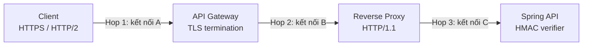
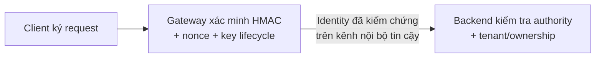
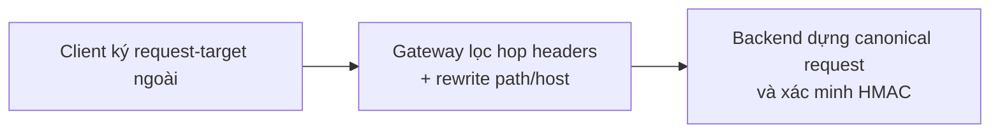

# Hop-by-hop header trong gateway/proxy và ảnh hưởng đến xác thực HMAC

## 1. Bối cảnh và mục tiêu bài học

Trong module `SECURITY_AUTHENTICATION_HMAC_REQUEST_AUTHENTICATION`, client gửi HTTP request được ký bằng **HMAC** với shared secret. Server xác minh chữ ký dựa trên **canonical request** theo hợp đồng ký, có thể bao gồm HTTP method, URI, header được chọn và hash của body. Server còn phải chống replay bằng timestamp/nonce, quản lý vòng đời key và chỉ cấp quyền khi biết chính xác client đã xác thực là ai.

Một request thường không đến thẳng ứng dụng: nó có thể qua CDN, load balancer, API gateway, reverse proxy rồi mới tới Spring MVC hoặc Spring WebFlux. Mỗi điểm trung gian có thể kết thúc kết nối HTTP hiện tại và tạo **một kết nối HTTP mới** tới hop tiếp theo. Tại đây, một số HTTP header chỉ có ý nghĩa trên kết nối cục bộ và **không được chuyển tiếp nguyên trạng**. Chúng được gọi là **hop-by-hop header**.

Chủ đề của chương **Gateway và proxy** này là **Hop-by-hop header**: chúng là gì, tại sao ảnh hưởng đến canonical request HMAC, cách đặt trust boundary khi gateway xác thực hoặc chuyển tiếp request, và cách kiểm thử một chuỗi proxy thật.

Sau bài học, người học có thể:

- Phân biệt hop-by-hop header với end-to-end header và giải thích quy tắc `Connection` trong HTTP/1.1.
- Nhận biết các thay đổi khi gateway chuyển từ HTTP/1.1 sang HTTP/2 hoặc HTTP/3.
- Chọn các trường ổn định để ký HMAC, tránh phụ thuộc framing hoặc header do proxy xóa/thêm.
- Xử lý an toàn trường hợp `Connection` yêu cầu loại bỏ header chứa bằng chứng xác thực.
- Thiết kế test xác minh chữ ký, chống replay và phân quyền qua gateway, thay vì chỉ kiểm thử controller.

## 2. Một HTTP request có thể gồm nhiều hop

Giả sử đường đi:



Mỗi mũi tên là một kết nối riêng, có thể dùng giao thức hoặc thuộc tính truyền tải khác nhau. Gateway có thể quản lý keep-alive ở phía client khác với keep-alive tới backend; proxy có thể chuyển body theo chunked ở một hop nhưng dùng `Content-Length` ở hop sau.

**Hop-by-hop header** điều khiển hoặc mô tả một kết nối/hop cụ thể. **End-to-end header** mang thông tin về message cho bên gửi và bên nhận cuối cùng, thường có thể được chuyển tiếp qua proxy, trừ khi hệ thống có hợp đồng chuyển đổi rõ ràng.

| Ví dụ | Phạm vi ý nghĩa | Hệ quả với HMAC |
| --- | --- | --- |
| `Connection: close` | Kết nối HTTP/1.1 hiện tại | Không đưa vào chữ ký xuyên gateway |
| `Transfer-Encoding: chunked` | Cơ chế framing/chuyển tải ở HTTP/1.1 | Không ký nguyên giá trị transfer framing |
| `Content-Type: application/json` | Loại representation của message | Có thể ký nếu hợp đồng bảo đảm ổn định |
| `X-Key-Id`, `X-Timestamp`, `X-Nonce` | Header ứng dụng dùng cho xác thực | Phải được bảo vệ bằng chữ ký và được chuyển tiếp đúng |
| `X-Signature` | Bằng chứng HMAC do client gửi | Phải đến đúng thành phần verifier, không được tự động tin |
| Hash của raw body | Tính toàn vẹn nội dung được ký | Phải khớp chính xác bytes mà backend xác minh/xử lý |

**Không đồng nhất “không được proxy chuyển tiếp” với “không quan trọng về bảo mật”.** Thông tin hop-by-hop ảnh hưởng tới parsing, framing, routing và việc header ứng dụng có đến được verifier hay không.

## 3. Quy tắc `Connection` trong HTTP/1.1

Với HTTP/1.1, `Connection` có thể liệt kê các **connection option**. Một intermediary chuyển tiếp message phải xử lý các option được nêu: loại bỏ những header mà `Connection` chỉ định là dành riêng cho hop hiện tại, đồng thời không chuyển tiếp chính header `Connection` sang hop kế tiếp.

Ví dụ request vào gateway:

```http
GET /integrations/orders/O-17 HTTP/1.1
Host: api.example.test
Connection: keep-alive, X-Hop-Debug
X-Hop-Debug: local-trace-123
X-Key-Id: reporting-v1
X-Timestamp: 2026-11-28T03:15:00Z
X-Nonce: n-001
X-Signature: <base64-hmac>
```

`X-Hop-Debug` được nêu trong `Connection` nên không được forward như một header end-to-end. Proxy cũng không forward nguyên giá trị `Connection: keep-alive, X-Hop-Debug`; nó quyết định chính sách kết nối **mới** với backend của nó.

Nếu backend được cung cấp một message HTTP/1.1 mới, nó có thể trông như sau:

```http
GET /integrations/orders/O-17 HTTP/1.1
Host: order.internal
X-Key-Id: reporting-v1
X-Timestamp: 2026-11-28T03:15:00Z
X-Nonce: n-001
X-Signature: <base64-hmac>
```

Đó là ví dụ minh họa: proxy thực tế có thể thêm header, thay `Host`, định tuyến lại path và quyết định framing theo cấu hình. Bản thân việc mất `X-Hop-Debug` là đúng; nhưng nếu client ký cả `Connection` hoặc `X-Hop-Debug` thì phép xác minh chữ ký ở backend rất dễ thất bại.

Quy tắc xử lý phải bao gồm **mọi giá trị** của `Connection` trong message, không chỉ token đầu tiên. Tên header HTTP so khớp **không phân biệt chữ hoa/thường**. Proxy cần xử lý token hợp lệ và loại bỏ các field được chỉ định trước khi forward; không dựa vào cùng một chuỗi nguyên văn ở tất cả các hop.

### 3.1. Trường hợp liên quan trực tiếp đến bảo mật: nêu header chữ ký trong `Connection`

Client có thể gửi:

```http
POST /integrations/orders HTTP/1.1
Host: api.example.test
Connection: X-Signature
X-Signature: <base64-hmac>
X-Key-Id: fulfillment-v1
X-Timestamp: 2026-11-28T03:15:00Z
X-Nonce: n-002
Content-Type: application/json
Content-Length: 18

{"orderId":"O-17"}
```

Ở hop tiếp theo, proxy tuân thủ `Connection` sẽ **loại bỏ `X-Signature`**. Backend không nhận đủ bằng chứng xác thực. Đối với API **bắt buộc HMAC**, backend phải **từ chối `401 Unauthorized`**, không chuyển sang xử lý request anonymous hay bypass kiểm tra chữ ký.

Tương tự, nếu `Connection` nêu `X-Key-Id`, `X-Timestamp` hoặc `X-Nonce`, request phải thất bại khi thiếu trường bắt buộc ở verifier. Chỉ dựa vào kiểm tra `Connection` ở backend là chưa đủ vì gateway có thể đã xóa cả `Connection` lẫn header được nêu; cần có **quy tắc ở gateway** cho security-critical headers khi kiểm soát được gateway.

## 4. Các header thường gặp và mức độ ổn định qua proxy

| Header | Ý nghĩa | Cách xử lý đối với chữ ký HMAC |
| --- | --- | --- |
| `Connection` | Liệt kê connection options của HTTP/1.1, bao gồm header cần xử lý trên hop hiện tại | Không đưa vào canonical request end-to-end |
| `Keep-Alive` | Tham số keep-alive kiểu cũ trên kết nối HTTP/1.x | Không ký |
| `Proxy-Connection` | Biến thể phi chuẩn từng được dùng với proxy | Không tin/không ký; lọc ở ranh giới |
| `Transfer-Encoding` | Transfer coding/framing của HTTP/1.1, ví dụ `chunked` | Không ký như một header end-to-end |
| `TE` | Khả năng nhận transfer codings/trailers của kết nối; HTTP/2/3 chỉ cho ngoại lệ giới hạn về `trailers` | Không chọn làm signed header ứng dụng |
| `Upgrade` | Đề nghị đổi giao thức trên kết nối hiện tại | Không ký xuyên proxy |
| `Trailer` | Khai báo thông tin có thể xuất hiện ở trailer section | Không coi là dữ liệu application ổn định để ký nếu chưa có hợp đồng trailer riêng |
| `Proxy-Authorization` | Credentials gửi cho proxy, thường không dành cho origin server | Không sử dụng làm danh tính client HMAC; xử lý theo chính sách proxy |
| `Proxy-Authenticate` | Challenge từ proxy | Không sử dụng làm quyền/chứng thực của origin |
| `Content-Length` | Độ dài content/message framing; có thể thay đổi khi chuyển framing hoặc protocol | Không nên ký nguyên text header; dùng digest bytes nội dung được bảo vệ |
| `Content-Encoding` | Mã hóa representation như `gzip`, không phải `Transfer-Encoding` | Nếu ký phải quy định bytes trước/sau giải nén |
| `Content-Type` | Kiểu media của nội dung | Có thể ký nếu client và verifier thống nhất canonicalization |
| `Host` / `:authority` | Authority của request-target; proxy có thể viết lại | Cần định nghĩa authority bên ngoài hay bên trong ở hợp đồng ký |
| `X-Key-Id`, `X-Timestamp`, `X-Nonce` | Trường giao thức HMAC của ứng dụng | Nên là trường bắt buộc, giữ nguyên semantics và được đưa vào phạm vi ký |
| `X-Signature` | Chữ ký client tạo | Bằng chứng cần xác minh, không tự động cấp quyền |

Danh sách này vừa chứa **header điều khiển kết nối**, vừa có **header liên quan framing/proxy** được nêu để thiết kế policy ký. Không phải mọi header trong bảng đều có cùng địa vị chuẩn tắc là “hop-by-hop” trong mọi phiên bản HTTP: chẳng hạn `Trailer` mô tả trường của trailer section, còn `Proxy-Authorization` có các quy tắc dùng trong chuỗi proxy. Kết luận thực hành là **không đặt bằng chứng HMAC dựa trên các trường phụ thuộc hop/framing** nếu giao thức ký hướng tới origin qua nhiều intermediary.

Không nhầm `Content-Encoding: gzip` (thuộc representation) với `Transfer-Encoding: chunked` (cách chuyển tải). Cả hai có thể làm việc đọc byte khác nhau nếu proxy chuyển đổi payload; hợp đồng phải nêu byte stream nào là đối tượng được ký.

## 5. Khi chuyển HTTP/1.1 sang HTTP/2 hoặc HTTP/3

HTTP/2 và HTTP/3 không cho phép dùng cơ chế connection-specific fields như HTTP/1.1. Các trường như `Connection`, `Keep-Alive`, `Proxy-Connection`, `Transfer-Encoding` và `Upgrade` không được xuất hiện như các header thông thường trong message HTTP/2/3; `TE` có ngoại lệ hạn chế cho giá trị `trailers` theo quy tắc giao thức.

Ví dụ:

```text
Client --HTTP/1.1--> Gateway --HTTP/2--> Backend
      Connection: keep-alive             (không có Connection)
      Transfer-Encoding: chunked         (DATA frames)
      Host: api.example.test             :authority (theo định tuyến)
      Body data = {"a":1}                Body data = {"a":1}
```

Với dữ liệu nội dung **không bị biến đổi**, HMAC ký digest của **raw content bytes được thống nhất** có thể vẫn kiểm tra đúng bất kể content được chở bằng chunked encoding hay HTTP/2 DATA frames. Ngược lại, ký literal `Transfer-Encoding: chunked` chắc chắn gây bất tương thích khi gateway đổi sang HTTP/2.

Một gateway xử lý HTTP/1.1 sang HTTP/2/3 cần bỏ các trường connection-specific theo quy tắc protocol đích; đừng cố tạo request HTTP/2 với `Connection` còn sót. Kiểm thử cũng phải xác nhận gateway không vô tình forward các trường bị cấm, không ghép hoặc tách header theo cách làm thay đổi **các trường ứng dụng đã ký**.

Hợp đồng HMAC cần ghi rõ chữ ký được tạo trên **HTTP request semantics** (method, request-target đã xác định, signed headers ổn định, digest nội dung) thay vì bytes thô của một lần framing trên mạng. Đồng thời phải quy định case, whitespace, URI encoding và thứ tự query để hai đầu tạo canonical bytes giống nhau.

## 6. Chọn signed headers thế nào khi API nằm sau gateway?

Một hợp đồng HMAC đơn giản, chỉ là **ví dụ của ứng dụng**, có thể quy định canonical request gồm sáu dòng ngăn cách bằng LF, UTF-8, không có newline cuối:

```text
UPPERCASE_HTTP_METHOD
EXTERNAL_REQUEST_TARGET
KEY_ID
TIMESTAMP
NONCE
LOWERCASE_HEX_SHA256_OF_CANONICAL_BODY_BYTES
```

Ví dụ:

```text
POST
/public-api/orders?source=partner
key-2026-11
2026-11-28T03:15:00Z
n-1024
7d80b6a6a8f73d80a7d1885b3cfed04d011be252c4a54f5606ba9ff3bbdeead7
```

Dòng digest trên chỉ có tính minh họa về format; khi triển khai phải tính SHA-256 thật từ bytes mà hợp đồng quy định và dùng test vector có kết quả xác nhận. Sau đó chữ ký được tính như sau:

```text
signature = Base64(
    HMAC-SHA-256(shared_secret, UTF8(canonical_request))
)
```

Trong hợp đồng này không có `Connection`, `Transfer-Encoding`, `Keep-Alive` hay `Content-Length`. Chúng là dữ liệu phụ thuộc hop/framing hoặc có thể bị intermediary thay đổi. Timestamp, nonce và key ID được đưa vào chuỗi ký, tránh tình trạng có thể sửa chúng độc lập với MAC.

Nếu nghiệp vụ cần bảo vệ `Content-Type`, tenant routing, một custom application header hoặc authority, hãy thêm **chỉ những trường có ngữ nghĩa và canonicalization ổn định**. Quy định đầy đủ:

1. **Tên header** được canonical thành lowercase; thứ tự trường cố định; tên và dấu cách được xác định chính xác.
2. **Giá trị header** dùng quy tắc chuẩn hóa được hai bên đồng ý; với nhiều giá trị trùng tên phải có luật rõ ràng hoặc từ chối request mơ hồ.
3. **Raw path/query** được lấy tại trust boundary nào; percent-encoding, dấu `+`, query trùng khóa và dấu `/` cuối được xử lý ra sao.
4. **Body bytes** là payload trước hay sau content decompression/transform, có ký trailer hoặc multipart không.
5. **Key ID/timestamp/nonce** được đưa vào chữ ký và không bị proxy cắt mất; client không được tự chọn bộ signed headers làm suy yếu policy.
6. Nếu có `Host`/authority hoặc forwarded header được ký, chỉ tin giá trị **được thiết lập tại gateway đáng tin** và được định nghĩa trong hợp đồng.

**Không cho client quyết định tùy ý những header nào là đủ để xác thực.** Nếu API dùng `X-Signed-Headers`, verifier phải so với allowlist/tập bắt buộc phía server; không được cho phép client bỏ `X-Timestamp`, `X-Nonce` hoặc body digest khỏi chữ ký để “cho tiện”.

## 7. Vị trí xác minh HMAC thay đổi điều kiện tin cậy

Có hai mô hình triển khai phổ biến.

### 7.1. Xác minh ngay tại gateway



Gateway có thể nhìn thấy request-target bên ngoài trước rewrite, đồng thời quyết định signature theo đúng canonical representation đã thỏa thuận. Sau khi xác minh, nó có thể chuyển thông tin `clientId`, `tenantId` và kết quả xác thực cho backend **chỉ thông qua một cơ chế đã được bảo vệ**: mTLS giữa các hop, signed internal assertion hoặc tích hợp danh tính tương đương; backend phải tin đúng gateway chứ không tin header tùy ý do Internet gửi.

Ví dụ, nếu dùng `X-Verified-Client` nội bộ, gateway phải **xóa mọi giá trị do client tự gửi**, rồi tạo giá trị mới sau xác thực. Backend phải chỉ cho phép nhận trường đó từ kênh/gateway tin cậy hoặc xác minh chứng cứ nội bộ, nếu không client có thể tự khai danh tính.

Backend vẫn phải kiểm tra **authorization** và tenant/ownership theo policy. Xác thực HMAC ở gateway không tự cấp `ROLE_ADMIN` hoặc quyền truy cập tất cả dữ liệu. Phải quy định rõ bên nào chịu trách nhiệm kiểm tra replay và key revocation.

### 7.2. Xác minh tại backend sau khi qua gateway



Đây là cách thường gặp trong ứng dụng Spring MVC hoặc WebFlux có custom authentication filter. Cần giải quyết **mismatch canonical request** nếu gateway đổi `/public-api/orders` thành `/integrations/orders` hoặc thay `Host`.

Hợp đồng phải chọn một trong các hướng rõ ràng:

- Ký request-target **mà backend thực sự nhận**, chỉ khi client có thể biết và gateway cam kết giữ semantics đó.
- Ký request-target **bên ngoài**, và gateway chuyển giá trị đã xác lập qua cơ chế tin cậy để backend dựng lại canonical request; không tự tin `X-Original-URI` hoặc `X-Forwarded-*` do client gửi.
- Chuyển bước xác minh chữ ký về gateway **trước** rewrite, sau đó chuyển danh tính nội bộ đã xác minh theo đường tin cậy.

Không được thử nhiều canonical variants rồi chấp nhận phiên bản nào khớp mà không có contract rõ; cách đó làm mở rộng bề mặt chấp nhận request và gây khó kiểm toán. Nếu contract yêu cầu dữ liệu không tồn tại sau rewrite, request phải thất bại an toàn thay vì bỏ trường đó khỏi chữ ký.

## 8. Kiểm soát header bị nêu trong `Connection`

Xét một request có:

```http
Connection: X-Timestamp, X-Signature
X-Timestamp: 2026-11-28T03:15:00Z
X-Signature: <signature>
```

Khi gateway loại bỏ các field nêu trong `Connection`, backend có thể chỉ nhìn thấy `X-Key-Id` và `X-Nonce`. Một verifier an toàn phải kiểm tra **đủ toàn bộ trường bắt buộc** và từ chối request; nó không được tiếp tục với timestamp mặc định hoặc chữ ký trống.

Để giảm ambiguity ở ranh giới tin cậy, gateway kiểm soát bởi tổ chức nên có policy:

- Reject hoặc xử lý nghiêm ngặt request HTTP/1.1 mà `Connection` nêu tên header bảo mật end-to-end như `Authorization`, `X-Key-Id`, `X-Timestamp`, `X-Nonce`, `X-Signature`, tenant routing header.
- Loại bỏ chính `Connection` và các header do connection options chỉ định trước khi chuyển tiếp; không forward các giá trị bị cấm sang HTTP/2/3.
- Từ chối tên header không hợp lệ, giá trị trùng/mơ hồ hoặc cú pháp `Connection` không đúng chuẩn; không cố đoán rồi tiếp tục.
- Chặn request bị thiếu bất kỳ security-critical field nào sau khi chuẩn hóa. Không xem “gateway xóa header” là lý do để bypass authentication.

**Đừng chỉ làm bước này tại backend:** sau khi proxy xử lý, backend thường không còn thấy `Connection` gốc để biết header nào đã bị nêu. Quy tắc kiểm soát request đầu vào cần được đặt tại **hop nhận HTTP/1.1 đầu tiên mà bạn kiểm soát**; verifier backend vẫn phải kiểm tra đủ credentials của bản request cuối cùng.

### 8.1. Ví dụ mã Java cho lớp kiểm soát header ký

Giả sử policy yêu cầu chính xác một tập header HMAC cố định. Đoạn Java sau minh họa cách từ chối việc signer cố gắn transport header vào danh sách header được ký; đây là **validation của hợp đồng ứng dụng**, không thay thế HTTP parser hoặc security policy của gateway.

```java
import java.util.Locale;
import java.util.Set;

public final class HmacSignedHeaderPolicy {
    private static final Set<String> REQUIRED = Set.of(
            "x-key-id", "x-timestamp", "x-nonce", "content-type");

    private static final Set<String> UNSUITABLE_FOR_END_TO_END_SIGNING = Set.of(
            "connection",
            "keep-alive",
            "proxy-connection",
            "te",
            "transfer-encoding",
            "upgrade",
            "trailer",
            "proxy-authorization",
            "proxy-authenticate",
            "content-length");

    private HmacSignedHeaderPolicy() {}

    public static void validate(Set<String> configuredSignedHeaders) {
        Set<String> normalized = configuredSignedHeaders.stream()
                .map(name -> name.toLowerCase(Locale.ROOT))
                .collect(java.util.stream.Collectors.toUnmodifiableSet());

        for (String header : normalized) {
            if (UNSUITABLE_FOR_END_TO_END_SIGNING.contains(header)) {
                throw new IllegalArgumentException(
                        "Unsupported signed header: " + header);
            }
        }
        if (!normalized.equals(REQUIRED)) {
            throw new IllegalArgumentException(
                    "Invalid signed headers contract");
        }
    }
}
```

Trong ví dụ, `Content-Type` được yêu cầu ký vì API dùng JSON body; có thể thay đổi tập `REQUIRED` cho endpoint hoặc phiên bản contract khác, nhưng **do server quyết định**. Nếu nhận danh sách header từ client, cần kiểm tra thêm giá trị thiếu, trùng, tên không hợp lệ và so với hợp đồng được cấu hình. `Set` trong ví dụ có mục đích validate configuration, không đủ để parse và kiểm chứng raw HTTP headers.

Việc đánh dấu `Trailer` và các proxy header là “không phù hợp để ký end-to-end” là **policy an toàn của ví dụ HMAC**, không phải tuyên bố tất cả đều bị protocol cấm trong mọi phiên bản HTTP. Các thiết kế ký trailer thật phải có hợp đồng riêng về trailer framing, thời điểm nhận và cách kiểm tra tính toàn vẹn.

## 9. Phân biệt message integrity với transfer framing

Giả sử client gửi `POST` với JSON:

```json
{"orderId":"O-17","amount":125000}
```

Ở một hop HTTP/1.1, proxy có thể dùng:

```http
Transfer-Encoding: chunked

22
{"orderId":"O-17","amount":125000}
0
```

Đoạn chunked ở trên minh họa một chunk chứa 34 byte ASCII (`22` ở hệ thập lục phân). Trong HTTP/2, cùng content bytes được truyền bằng DATA frames mà không có `Transfer-Encoding: chunked`. Nếu HMAC ký raw **content bytes sau khi giải mã transfer framing**, chữ ký vẫn có thể hợp lệ khi representation không đổi.

Nếu reverse proxy **giải nén** `Content-Encoding: gzip`, chuẩn hóa JSON hoặc thay đổi encoding của body, digest có thể thay đổi. Khi đó cần quyết định bên nào kiểm tra chữ ký trên bytes trước transform hoặc thiết kế hợp đồng ký trên representation được chuẩn hóa thật chặt chẽ; không âm thầm chấp nhận body hash bị lệch.

Không ký raw chunk sizes hay boundary của transfer framing như là nội dung ứng dụng. Cũng không dùng `Content-Length` làm bằng chứng toàn vẹn thay vì digest: độ dài giống nhau không chứng minh bytes giống nhau.

### 9.1. Request smuggling và khác biệt framing

Một hệ thống nhiều proxy có thể gặp lỗi khi các hop diễn giải khác nhau các trường framing như `Content-Length` và `Transfer-Encoding`, đặc biệt khi chuyển đổi HTTP/1.1 ↔ HTTP/2. Rủi ro này liên quan HTTP request smuggling/desynchronization.

Biện pháp phòng vệ cấp hệ thống:

1. Dùng HTTP parser/gateway được cập nhật và chuẩn hóa các tình huống framing không hợp lệ ngay tại edge.
2. Từ chối message có cấu trúc `Content-Length`/`Transfer-Encoding` mâu thuẫn hoặc không thể diễn giải nhất quán.
3. Đảm bảo gateway và backend thống nhất ranh giới message trước khi tính body digest hoặc quyết định authorization.
4. Kiểm thử những ca chuyển đổi protocol và malformed framing qua **đường mạng thật**; không suy luận an toàn từ một unit test HMAC thuần.

HMAC không tự sửa được lỗi lệch ranh giới request giữa các proxy. Xác minh chữ ký đúng trên **message mà một component nhìn thấy** chỉ có ý nghĩa khi toàn bộ pipeline nhất quán message nào đang được xử lý.

## 10. Timestamp, nonce và key rotation vẫn phải được giữ nguyên

### 10.1. Header bị loại bỏ có thể phá cơ chế chống replay

Nếu `Connection` làm biến mất `X-Timestamp` hoặc `X-Nonce`, server không còn đủ dữ liệu để kiểm tra replay. **Không thay giá trị mất bằng thời gian server hiện tại hoặc nonce mới.** Một verifier an toàn phải fail closed trước khi thực hiện nghiệp vụ.

Timestamp và nonce cần được **đưa vào HMAC canonical request** để kẻ tấn công không thể tự sửa giá trị mà vẫn giữ chữ ký hợp lệ. Server giới hạn clock skew và lưu nonce bằng thao tác nguyên tử có TTL trên kho chia sẻ nếu có nhiều instance.

### 10.2. Key rotation không phụ thuộc vào hop transport

`X-Key-Id` giúp verifier tra đúng version của secret. Trong thời kỳ rotation, có thể chấp nhận nhiều key có hiệu lực theo policy; khi thu hồi, key cũ phải bị từ chối sau khi trạng thái thu hồi có hiệu lực, kể cả khi MAC trước đó tính đúng.

Một gateway không được tự nâng quyền dựa vào việc request dùng key mới. Key phải ánh xạ tới client/tenant và authorities do server kiểm soát. Nếu gateway xác thực hộ backend, cần truyền kết quả đáng tin và có cơ chế làm mới/revoke policy; nếu backend tự xác thực, cần bảo đảm `X-Key-Id` không bị loại bỏ hoặc tự thay đổi trên đường đi.

### 10.3. Authentication khác authorization

Sau khi HMAC hợp lệ:

| Client | Quyền từ policy server | Thao tác | Kỳ vọng |
| --- | --- | --- | --- |
| `reporting-client` | `ORDER_READ` | GET đơn hàng cùng tenant | Được phép nếu tài nguyên tồn tại |
| `reporting-client` | `ORDER_READ` | POST tạo đơn hàng | `403 Forbidden` |
| `fulfillment-client` | `ORDER_READ`, `ORDER_CREATE` | POST đúng tenant | Có thể qua authorization |
| Client bị sửa/mất `X-Signature` | Không có authentication hợp lệ | Bất kỳ request được bảo vệ | `401 Unauthorized` |
| Client có `ORDER_READ` nhưng tìm đơn tenant khác | `ORDER_READ` | GET khác tenant | `403` hoặc `404` theo policy |

Đừng biến yêu cầu HMAC sai thành một principal “anonymous có quyền đọc” nếu endpoint đang yêu cầu HMAC. Trong Spring MVC và WebFlux, tầng phân quyền chỉ nên nhận các authority đã được xác thực từ policy server.

## 11. Kiểm thử hop-by-hop header qua gateway/proxy

### 11.1. MockMvc / WebTestClient kiểm được phần nào?

`MockMvc` có thể kiểm tra Spring MVC/Security filter rằng thiếu `X-Signature` trả `401`, hoặc một `Connection` do test tự đưa vào được app xử lý như thế nào. `WebTestClient` có thể kiểm tra pipeline WebFlux. Nhưng nếu không có một proxy thật ở trước, chúng **không chứng minh** proxy sẽ strip header hay chuyển HTTP/1.1 sang HTTP/2 đúng cách.

Vì vậy cần ít nhất hai tầng kiểm thử:

- **Integration test trong ứng dụng:** gửi request ký hợp lệ/sai, thiếu header, nonce trùng, key hết hạn, thiếu authority; xác nhận `401/403` và không có side effect.
- **End-to-end test trên cùng đường đi gateway/proxy:** gửi request qua protocol và routing thực, quan sát backend nhận được semantic fields nào, so sánh canonical request và kết quả xác thực sau transform.

### 11.2. Ma trận kiểm thử trọng tâm

| Ca thử | Kỳ vọng |
| --- | --- |
| HTTP/1.1 có `Connection: keep-alive` | Gateway điều khiển keep-alive từng hop; chữ ký ứng dụng vẫn hợp lệ |
| `Connection: X-Hop-Debug` và có `X-Hop-Debug` | Header được nêu không còn ở hop sau; HMAC không phụ thuộc vào nó |
| `Connection: X-Signature` trên endpoint yêu cầu HMAC | Gateway reject hoặc backend thấy thiếu signature và trả `401`; không tới nghiệp vụ |
| `Connection: X-Timestamp, X-Nonce` | Không mặc định lại giá trị; xác thực thất bại an toàn |
| `Connection` có nhiều token, tên khác chữ hoa/thường | Gateway xử lý đúng token, không forward các trường được chỉ định |
| HTTP/1.1 → HTTP/2/HTTP/3 | Không forward connection-specific fields bị cấm; signed application fields còn đúng |
| Chunked HTTP/1.1 → HTTP/2 DATA | Digest body vẫn khớp nếu bytes nội dung không đổi |
| Gateway thay `Host` hoặc rewrite path | HMAC xác minh theo trust-boundary contract hoặc trả `401` |
| Gateway thay `Content-Type` thuộc phạm vi ký | Signature không khớp nếu không có canonical transform được thỏa thuận |
| Header HMAC trùng tên với giá trị mâu thuẫn | Từ chối request mơ hồ; không tùy chọn một giá trị ngẫu nhiên |
| Framing không hợp lệ/mâu thuẫn | Edge reject trước khi xử lý nghiệp vụ |
| Nonce giống nhau trên hai request HTTP độc lập | Request thứ hai bị chặn theo replay policy |
| Key đang trong giai đoạn rotation | Key hợp lệ được chấp nhận đúng chính sách, key đã revoke bị từ chối |
| HMAC đúng nhưng thiếu quyền | `403`; không có side effect |
| Client tự gửi `X-Verified-Client` tới gateway | Gateway xóa giá trị tự khai; backend không tin dữ liệu chưa bảo vệ |

### 11.3. Một ví dụ test bảo đảm không bypass khi thiếu signature

Ví dụ trong ứng dụng Spring MVC với `MockMvc` đã gắn security filters:

```java
@SpringBootTest
@AutoConfigureMockMvc(addFilters = true)
class HmacGatewayBoundaryTest {
    @Autowired MockMvc mockMvc;

    @Test
    void missingSignatureMustNotReachBusinessLogic() throws Exception {
        mockMvc.perform(post("/integrations/orders")
                .header("X-Key-Id", "fulfillment-v1")
                .header("X-Timestamp", "2026-11-28T03:15:00Z")
                .header("X-Nonce", "nonce-001")
                .contentType(MediaType.APPLICATION_JSON)
                .content("{\"orderId\":\"O-17\"}"))
            .andExpect(status().isUnauthorized());
    }
}
```

Test này chỉ chứng minh **ứng dụng không chấp nhận request thiếu chữ ký**, chưa mô phỏng gateway strip `X-Signature`. Với môi trường thực, gửi thêm trường `Connection: X-Signature` tới **điểm vào HTTP/1.1** và xác nhận request không được phép gây side effect tại backend.

Khi debug, chỉ log metadata đã được làm sạch như request ID, tên trường ký, byte length, hash từng thành phần canonical nếu được phép; không log shared secret, raw signature, body nhạy cảm hoặc toàn bộ header chứa credentials.

## 12. Checklist thiết kế để tự áp dụng

1. **Chọn điểm xác minh:** gateway trước rewrite hay backend sau rewrite; có bằng chứng về request-target và representation nào được ký.
2. **Định nghĩa canonical request:** method, path/query, signed headers đã allowlist, digest body, timestamp/nonce, encoding, thứ tự và newline chính xác.
3. **Loại trường phụ thuộc hop:** không ký `Connection`, `Keep-Alive`, `Transfer-Encoding`, `TE` hay giá trị framing; nếu có trailer riêng thì cần protocol ký trailer riêng.
4. **Quản lý header bảo mật:** gateway xử lý connection options, không cho client tự loại bỏ security-critical header rồi bypass; backend bắt buộc đủ evidence trước khi xác thực.
5. **Ràng buộc nguồn tin:** forwarded/original URI và verified identity chỉ đến từ gateway tin cậy hoặc có chứng cứ mật mã độc lập.
6. **HMAC verifier fail closed:** signature sai, key bị thu hồi, timestamp ngoài cửa sổ hoặc nonce đã dùng không tới controller.
7. **Phân quyền:** sau xác thực mới tra authorities và tenant; request HMAC hợp lệ vẫn có thể bị `403`.
8. **Kiểm thử thực tế:** kiểm thử H1↔H2/H3, path rewrite, body/framing, duplicate/malformed headers, key rotation và replay bằng cả integration test lẫn E2E.

## 13. Câu hỏi tự kiểm tra

**1. Hop-by-hop header có được chuyển nguyên từ client đến backend không?** Không thể giả định như vậy. Mỗi intermediary quản lý kết nối riêng; HTTP/1.1 `Connection` chỉ định các option/field cho hop hiện tại và không được forward nguyên.

**2. `Connection: X-Signature` gây ra tình huống gì?** Gateway có thể loại bỏ `X-Signature` trước khi request tới backend. Endpoint bắt buộc HMAC phải từ chối request khi thiếu bằng chứng, không bỏ qua xác thực.

**3. Vì sao không nên ký `Transfer-Encoding: chunked`?** Đó là transfer framing của HTTP/1.1. Gateway có thể thay framing hoặc dùng HTTP/2 DATA mà content bytes không đổi; chữ ký sẽ không còn bền vững.

**4. `Content-Length` và SHA-256 body digest khác nhau thế nào?** Độ dài không chứng minh nội dung không đổi; digest được dùng để bảo vệ bytes nội dung theo hợp đồng ký. `Content-Length` còn có thể thay đổi khi chuyển protocol/framing.

**5. Có thể tin `X-Forwarded-Uri` từ client để dựng request-target gốc không?** Không. Chỉ dùng giá trị forwarding được một gateway tin cậy thiết lập sau khi đã làm sạch các header do client tự gửi, hoặc cơ chế có bảo vệ tương đương.

**6. HTTP/2 có được dùng `Connection: keep-alive` không?** Không. HTTP/2 không cho phép các connection-specific header fields như HTTP/1.1; `TE` chỉ có ngoại lệ hạn chế cho `trailers`.

**7. HMAC hợp lệ sau gateway có đồng nghĩa đã được quyền tạo đơn hàng không?** Không. Authentication xác minh danh tính và tính toàn vẹn theo hợp đồng, còn authorization kiểm tra authority và phạm vi tài nguyên.

**8. `MockMvc` có chứng minh gateway loại bỏ `X-Signature` theo `Connection` không?** Không nếu không có proxy thật. Phải có kiểm thử end-to-end đi qua gateway để xác minh stripping và protocol translation.

## 14. Ghi nhớ

**Hop-by-hop header là thông tin gắn với từng kết nối HTTP**, nên gateway/proxy có thể xử lý và loại bỏ chúng trước khi tạo request ở hop kế tiếp. HTTP/1.1 cho phép `Connection` nêu những header chỉ dành cho hop đó; HTTP/2/3 hạn chế các trường connection-specific. Vì vậy HMAC cho API qua gateway phải dựa trên **canonical request ổn định**, tránh ký transfer framing, và phải quy định rõ điểm xác minh trước/sau rewrite.

Quan trọng hơn, việc gateway loại bỏ một header chứa bằng chứng HMAC **không bao giờ được trở thành đường bypass**: thiếu signature, timestamp hoặc nonce bắt buộc phải dẫn đến lỗi xác thực. Kết hợp policy header tại edge, verifier fail closed, chống replay, key rotation và phân quyền server-side, rồi kiểm thử qua đường proxy thực tế, mới tạo được ranh giới tin cậy rõ ràng cho hệ thống.
