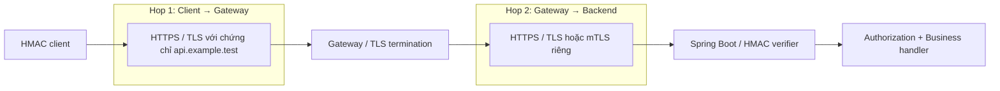
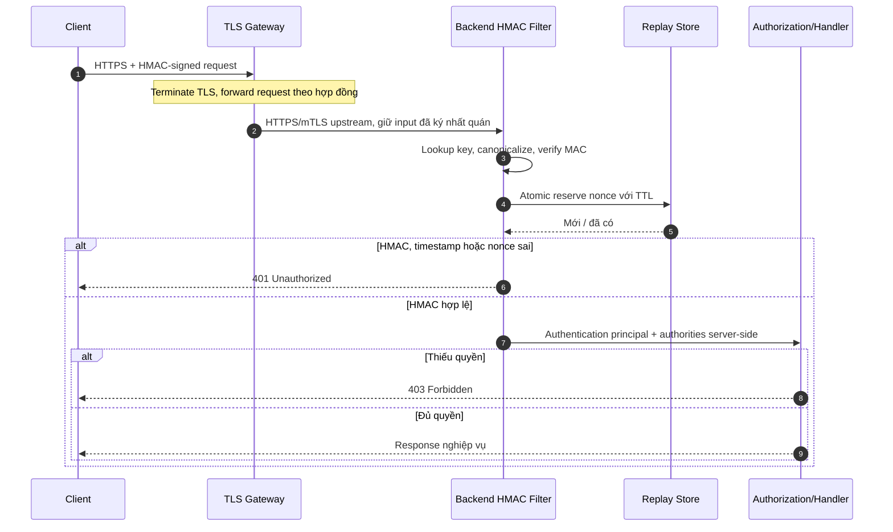
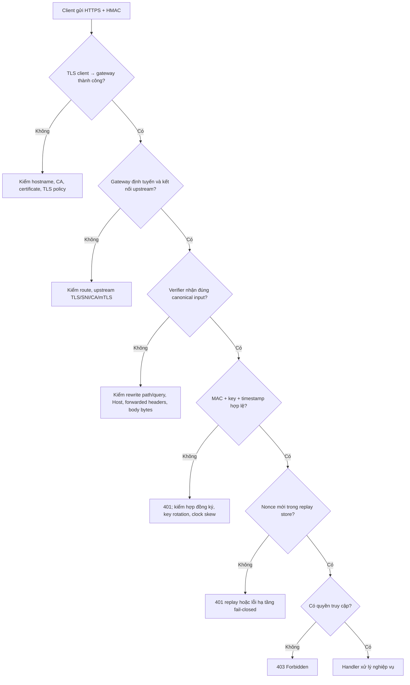

# TLS termination khi xác thực HTTP request bằng HMAC

## 1. Bối cảnh và mục tiêu

Trong chương **Gateway và proxy**, chủ đề **TLS termination** giải thích nơi một kết nối HTTPS được giải mã, nơi bắt đầu kết nối mới tới backend và ranh giới tin cậy thay đổi như thế nào. Chủ đề này rất quan trọng khi client ký HTTP request bằng **HMAC với shared secret**: gateway có thể đọc và chuyển tiếp request sau khi giải mã TLS, nhưng HMAC ở backend chỉ đúng nếu dữ liệu được dùng để tái tạo **canonical request** nhất quán với hợp đồng ký.

Bài học thuộc mô-đun `SECURITY_AUTHENTICATION_HMAC_REQUEST_AUTHENTICATION`. Mô-đun thiết kế xác thực HTTP request theo hợp đồng ký bao gồm phương thức, URI, header và/hoặc body; bên nhận kiểm tra chữ ký, timestamp/nonce để chống replay, quản lý key rotation, thử nghiệm với proxy/gateway và phân biệt xác thực với phân quyền. TLS termination là bối cảnh vận hành khiến những bước đó phải được thiết kế theo **từng hop** và **từng ranh giới tin cậy**.

Sau bài, người học cần:

- Giải thích TLS termination, TLS re-encryption và mutual TLS (mTLS) giữa gateway với backend.
- Phân biệt bảo vệ của TLS với bảo vệ của HMAC và xác định bên nào thực sự xác minh danh tính client.
- Nhận diện các thay đổi ở proxy có thể khiến phương thức, URI, query, header hoặc body lệch khỏi dữ liệu đã ký.
- Xử lý an toàn `Forwarded`, `X-Forwarded-*`, thông tin client certificate và quyền truy cập trực tiếp backend.
- Thiết kế nơi xác minh HMAC, chống replay, quản lý khóa và phân quyền khi có nhiều gateway/node.
- Kiểm thử TLS handshake, header spoofing, URI rewrite, body transformation, replay và lỗi đường truyền upstream.

**Phạm vi:** các ví dụ dùng HTTP(S), reverse proxy và ứng dụng Spring (Servlet/Spring MVC hoặc reactive WebFlux). Cấu hình proxy được trình bày như ví dụ nguyên tắc, cần điều chỉnh theo gateway, đường dẫn chứng chỉ và chính sách triển khai thực tế.

## 2. TLS termination thực chất xảy ra ở đâu?

TLS bảo vệ dữ liệu trao đổi **trên một kết nối TLS**. Khi client mở `https://api.example.test`, client thiết lập TLS với bên nhận đầu tiên có chứng chỉ cho tên miền đó. Trong mô hình phổ biến, bên nhận là load balancer, ingress controller hoặc API gateway, không nhất thiết là ứng dụng Java.

Sau khi TLS handshake hoàn tất, gateway có thể:

1. Giải mã các bản ghi TLS để có HTTP request ở dạng mà proxy xử lý.
2. Áp dụng routing, WAF, rate limiting, authentication và các chính sách ở tầng HTTP.
3. Tạo một request mới hoặc chuyển tiếp request qua kết nối upstream.
4. Nhận response backend và đóng gói lại vào kết nối TLS phía client.

Sơ đồ ranh giới:



Ở gateway, **TLS của client đã kết thúc**. Nếu gateway mở HTTPS khác tới backend, đó là **một TLS session khác**, có bộ khóa phiên, certificate validation và ranh giới xác thực peer riêng. Không có “đường TLS liên tục từ client đến ứng dụng” chỉ vì cả hai hop đều sử dụng HTTPS.

### Những mô hình triển khai thường gặp

| Mô hình | Hop client → gateway | Hop gateway → backend | Ý nghĩa bảo mật |
| --- | --- | --- | --- |
| TLS termination rồi HTTP nội bộ | TLS | HTTP plaintext | Gateway có thể đọc request; mạng nội bộ phải được bảo vệ theo risk model vì HTTP hop không có confidentiality/integrity riêng. |
| TLS termination rồi re-encryption | TLS | TLS có kiểm chứng chứng chỉ backend | Cả hai hop được mã hóa; backend xác thực được danh tính server upstream theo certificate. |
| TLS termination rồi mTLS upstream | TLS | TLS, hai phía xác thực chứng chỉ | Gateway và backend xác thực lẫn nhau ở tầng kết nối; phù hợp khi backend chỉ nhận request từ gateway được ủy quyền. |
| TLS passthrough | TLS đi xuyên proxy TCP/SNI tới backend | Không có HTTP hop tách riêng tại gateway | Backend trực tiếp kết thúc TLS, proxy passthrough không thể đọc/sửa HTTP request theo cách reverse proxy thông thường. |

TLS passthrough không phải TLS termination theo nghĩa gateway giải mã HTTP. Một hệ thống có thể kết hợp nhiều kiểu, ví dụ gateway công khai terminate TLS rồi dùng mTLS tới các service; đường đi thực tế phải được mô tả theo từng hop.

### Ai được TLS xác thực?

Trong TLS server authentication thông thường, **client xác minh certificate của gateway** theo hostname, chuỗi CA, thời hạn và chính sách của client. Gateway không tự động biết danh tính ứng dụng gọi API chỉ vì TLS hợp lệ; HMAC, OAuth2, mTLS client certificate hoặc cơ chế khác vẫn cần thiết nếu API yêu cầu xác thực client.

Nếu upstream dùng mTLS, **backend xác minh certificate client của gateway**. Điều đó chứng minh kết nối đi từ một gateway được cấp chứng chỉ phù hợp, **không chứng minh request ban đầu do client HMAC cụ thể nào gửi**. Danh tính client cuối cùng phải được xác minh HMAC ở gateway/backend rồi chuyển qua ranh giới tin cậy theo thiết kế.

## 3. TLS và HMAC bảo vệ các thuộc tính khác nhau

Cùng một request có thể dùng cả HTTPS và HMAC vì chúng giải quyết những vấn đề khác nhau:

| Thuộc tính | TLS | HMAC request |
| --- | --- | --- |
| Bảo mật nội dung trên đường truyền | Có, trong phạm vi từng kết nối TLS được thiết lập đúng. | Không; HMAC không mã hóa body hay header. |
| Toàn vẹn dữ liệu trong lúc truyền | Có, trong phạm vi từng hop TLS. | Có, đối với **chính xác các byte/trường** nằm trong hợp đồng ký. |
| Xác thực server/gateway | Thường dựa vào chứng chỉ TLS được client xác minh. | Không thay thế kiểm chứng chứng chỉ server. |
| Xác thực client ứng dụng | Chỉ khi có cơ chế client authentication như mTLS hoặc auth khác. | Có thể xác thực bên biết shared secret được gắn với client/key ID hợp lệ. |
| Chống replay của HTTP request | TLS không tự bảo đảm mỗi request ứng dụng chỉ được xử lý một lần. | Cần kết hợp timestamp/nonce và replay store nguyên tử; MAC đơn lẻ chưa đủ. |
| Phân quyền sử dụng tài nguyên | Không quyết định authority nghiệp vụ. | HMAC xác thực danh tính; phân quyền vẫn là bước riêng. |
| Bảo vệ qua nhiều proxy terminate/rewrite | TLS bảo vệ từng hop, cho phép proxy ở giữa đọc/sửa request. | MAC phát hiện thay đổi đối với thành phần đã ký, miễn server xác minh đúng hợp đồng. |

Một request được ký HMAC đúng **vẫn phải dùng HTTPS**. Nếu chạy qua plaintext, request và nhiều trường nhạy cảm bị lộ; attacker có thể sao chép request hợp lệ hoặc khai thác dữ liệu không được ký. Mặt khác, HTTPS giữa client và gateway không mặc nhiên bảo vệ hop gateway-backend nếu hop đó là HTTP hoặc backend cho phép truy cập trực tiếp trái phép.

## 4. Tác động tới canonical request

Giả sử client ký request công khai:

```http
POST /public/v1/orders?channel=partner HTTP/1.1
Host: api.example.test
Content-Type: application/json
X-Client-Id: service-a
X-Key-Id: key-2026-11
X-Timestamp: 2026-11-28T03:00:00Z
X-Nonce: 7b6360c3-46a2-40dc-a89c-934bcf638bde
X-Signature: <Base64 HMAC>

{"sku":"P100","quantity":2}
```

Gateway terminate TLS và định tuyến `/public/v1/orders` thành `/v1/orders` ở backend. Nếu backend xây canonical request từ `request.getRequestURI()` hoặc đường dẫn trao đổi nội bộ, server có thể tính MAC trên `/v1/orders`, trong khi client đã ký `/public/v1/orders`: hai chuỗi khác nhau, chữ ký thất bại.

Đây không phải lỗi của thuật toán HMAC hoặc chứng chỉ TLS. Đây là **khác biệt về dữ liệu đầu vào của hợp đồng ký**.

### Những thay đổi proxy thường tạo ra sai lệch

| Thành phần | Ví dụ thay đổi | Hậu quả nếu nằm trong dữ liệu ký |
| --- | --- | --- |
| HTTP method | Gateway đổi method trong tuyến đặc biệt hoặc override từ header | Canonical method sai, MAC không khớp. |
| Path | Loại `/public`, thêm prefix, normalize `/a/../b` hoặc decode `%2F` | Raw/normalized path giữa client và backend khác nhau. |
| Query | Sắp xếp tham số, đổi `+` thành `%20`, xử lý tham số trùng | Chữ ký không khớp nếu hợp đồng gắn với raw query hoặc quy tắc normalization khác. |
| Scheme | Client dùng `https`, backend nhìn thấy `http` ở upstream plaintext | Sai nếu canonical request có scheme hoặc backend dùng scheme để lập URL ký. |
| Host/port | `api.example.test:443` thành `orders.internal:8080` | Sai nếu `Host` hoặc authority được ký. |
| Header | Đổi chữ hoa/thường, whitespace, duplicate header, strip header, sửa `Content-Type` | Sai nếu hai phía canonicalize không cùng quy tắc. |
| Body | JSON được parse/serialize lại, gzip/decompress, chuẩn hóa newline | Digest body khác dù JSON có thể cùng ý nghĩa. |
| Transfer framing | HTTP/2 → HTTP/1.1, chunked → Content-Length | Không nên ký raw framing trừ khi đặc tả có lý do và cách chuẩn hóa ổn định. |

Không phải mọi thay đổi đều làm HMAC sai: chỉ các trường **được ký** hoặc làm ảnh hưởng đến quá trình tái tạo dữ liệu ký mới trực tiếp làm sai MAC. Tuy nhiên trường **không được ký** mà ảnh hưởng đến routing, danh tính, quyền hoặc ý nghĩa xử lý cũng có thể tạo lỗ hổng. Vì thế danh sách trường ký là quyết định của threat model, không đơn thuần là cách tránh lỗi proxy.

### Ví dụ canonical request

Một hợp đồng `HMAC-V1` có thể định nghĩa:

```text
HMAC-V1
POST
/public/v1/orders?channel=partner
host:api.example.test
content-type:application/json
x-client-id:service-a
x-key-id:key-2026-11
x-timestamp:2026-11-28T03:00:00Z
x-nonce:7b6360c3-46a2-40dc-a89c-934bcf638bde
body-sha256:<64 ký tự hex SHA-256 của byte body gốc>
```

Client tạo `mac = HMAC_SHA256(sharedSecret, UTF8(canonicalRequest))`, mã hóa Base64 rồi gửi trong `X-Signature`. Server phải tái tạo **cùng chuỗi byte**, xác minh chữ ký và kiểm freshness/replay. Trong ví dụ, scheme không được ký còn host/path/query được ký; hệ thống thực tế có thể chọn hợp đồng khác nhưng phải công bố và kiểm thử nhất quán.

Hai JSON có cùng dữ liệu vẫn có body digest khác nếu các byte khác:

```json
{"sku":"P100","quantity":2}
```

```json
{ "quantity": 2, "sku": "P100" }
```

Không parse JSON rồi serialize lại để “sửa” sai lệch, trừ khi chính hợp đồng ký dùng một chuẩn JSON canonicalization xác định rõ và cả hai bên thực thi giống nhau.

## 5. Chọn điểm xác minh HMAC so với điểm terminate TLS

Có hai hướng kiến trúc chính. Mỗi hướng có hệ quả rõ ràng cho việc xử lý path rewrite, identity forwarding và replay store.

### Phương án A — Backend xác minh HMAC



Ở hướng này, gateway thường không cần giữ shared secret HMAC. Backend phải bảo đảm có đủ dữ liệu để tái tạo canonical request mà client đã ký. Nếu gateway rewrite, hãy thiết kế cách giữ nguyên đường dẫn được ký hoặc truyền **metadata đã được xác thực** qua đường nội bộ tin cậy. Không để bất kỳ client nào trực tiếp khai một header “original URI” rồi buộc backend tin mà không kiểm soát nguồn.

Ưu điểm là danh tính và quyền được xác minh gần ứng dụng. Đổi lại, mỗi backend/service có thể phải có verifier và kết nối replay store; gateway phải giữ hợp đồng định tuyến nhất quán.

### Phương án B — Gateway xác minh HMAC trước khi rewrite

Gateway được cấu hình để xác minh chữ ký trên request công khai **trước** khi thay URI/header/body. Sau thành công, gateway có thể chuyển tiếp danh tính đã xác minh và các claims được kiểm soát tới backend:

```text
Client HTTPS + HMAC
        |
Gateway: verify MAC, timestamp, nonce, key
        |
Gateway: route /public/v1/orders -> /v1/orders
        |
Authenticated HTTPS/mTLS to backend
        |
Backend: authenticate gateway + trust validated assertion
        |
Backend: authorize service-a for orders:write
```

Phương án này gom xử lý canonicalization theo góc nhìn client ở gateway. Nhưng nếu backend chỉ nhìn `X-Authenticated-Client: service-a` mà không thể biết header do **gateway đáng tin cậy** tạo, kẻ tấn công truy cập trực tiếp backend có thể mạo danh client.

Do đó cần đồng thời:

- Chặn đường truy cập trực tiếp từ mạng không tin cậy tới backend; chỉ cho gateway hoặc những upstream được phép.
- Xác thực gateway ở kết nối backend, thường bằng mTLS hoặc cơ chế service identity tương đương.
- Xóa/ghi đè các assertion header từ client tại gateway và xác minh nguồn ở backend.
- Nếu dùng token/assertion ký nội bộ, ràng buộc issuer, audience, client identity, thời hạn, quyền, request context cần thiết; chống replay nếu các assertion có thể bị sao chép.
- Duy trì authorization tại backend. HMAC hợp lệ và gateway đáng tin không có nghĩa client được làm mọi nghiệp vụ.

**Không tự động coi “TLS kết thúc ở gateway” là “gateway đã xác thực HMAC”.** TLS termination và HMAC verification là hai bước cấu hình, có thể được đặt cùng chỗ hoặc khác chỗ.

### Chọn phương án nào?

| Tiêu chí | Backend verify | Gateway verify |
| --- | --- | --- |
| Chữ ký gắn với request công khai | Backend cần nhận đúng canonical input; rewrite dễ gây lệch. | Gateway thấy public request trước rewrite, thuận tiện xác minh. |
| Quản lý shared secret | Backend/service hoặc credential service tương ứng. | Gateway hoặc hệ thống xác thực ở edge. |
| Chống replay | Kho dùng chung giữa các backend có thể nhận request. | Kho dùng chung giữa các gateway/verifier edge. |
| Trust boundary | Gateway truyền request, backend tự xác minh client. | Backend phải xác thực gateway và assertion về client. |
| Phân quyền nghiệp vụ | Thường ngay tại backend. | Vẫn cần ngay tại backend, có thể thêm kiểm tra coarse-grained ở gateway. |
| Rủi ro chính | Canonicalization lệch khi proxy sửa request. | Spoofed identity header, bypass gateway, assertion sai phạm vi. |

Nếu hệ thống có nhiều lớp gateway, phải xác định **chính xác tầng nào** là verifier và tầng nào được phép sửa các trường đã ký trước bước đó. Không dùng hai verifier với hai hợp đồng canonicalization khác nhau mà không có phiên bản/hợp đồng chuyển đổi rõ ràng.

## 6. Forwarded headers: cần thiết nhưng không mặc nhiên đáng tin

Backend sau TLS termination có thể thấy kết nối upstream là `http://orders.internal:8080` hoặc `https://orders.internal:8443`, trong khi client đã gọi `https://api.example.test`. Proxy thường truyền thêm:

- `Forwarded` (chuẩn HTTP, ví dụ `proto=https;host=api.example.test`).
- `X-Forwarded-Proto` (scheme gốc), `X-Forwarded-Host`, `X-Forwarded-Port`.
- `X-Forwarded-For` hoặc `X-Real-IP` (chuỗi/địa chỉ client được proxy nhìn thấy).
- `X-Forwarded-Prefix` / `X-Original-URI` trong một số kiến trúc; đây không phải thông tin được Servlet API tự xác thực.

Các header đó **không có bằng chứng mật mã chỉ vì tên bắt đầu bằng `X-Forwarded-`**. Client có thể tự gửi chúng. Gateway phải chuẩn hóa/xóa và tạo giá trị tin cậy tại điểm nhận, còn backend chỉ dùng khi request tới từ danh tính proxy đã được kiểm chứng.

Một quy tắc vận hành an toàn:

1. Xác định tập proxy/ingress đáng tin và chặn backend khỏi truy cập trực tiếp không được phép.
2. Tại trust boundary đầu tiên, **loại bỏ** forwarding header không tin cậy do client gửi và đặt lại giá trị từ kết nối thực tế do gateway quan sát.
3. Nếu có nhiều proxy hợp lệ, thống nhất cách xây và phân tích danh sách `Forwarded` / `X-Forwarded-For`; không mặc nhiên tin phần tử do client tự thêm.
4. Cấu hình ứng dụng chỉ áp dụng forwarded header từ những hop đã xác thực; nếu không thể bảo đảm, không dùng các header này làm nguồn authority cho HMAC canonicalization.
5. Đừng nhầm “client IP” trong forwarded header với principal HMAC. NAT/load balancer khiến IP không phù hợp để thay thế credential.

### Spring Boot xử lý forwarded headers

Trong một số triển khai Spring Boot có thể cấu hình:

```yaml
server:
  forward-headers-strategy: framework
```

Cấu hình này yêu cầu framework hỗ trợ xử lý forwarding metadata (chẳng hạn `ForwardedHeaderFilter` trên Servlet hoặc `ForwardedHeaderTransformer` trên WebFlux theo stack). **Nó không tự xác thực rằng header đến từ proxy đáng tin.** Đường mạng/gateway vẫn cần chặn và ghi đè những header do client cung cấp.

Nếu hợp đồng HMAC ký raw URI, việc framework hoặc proxy biến đổi request URI trước filter xác minh có thể ảnh hưởng chữ ký. Cần xác định verifier đọc URI **trước hay sau** biến đổi, test cùng đường chạy thực tế và không phụ thuộc vào một header do người gọi tự khai.

Nếu chỉ cần bảo đảm thông tin không tin cậy bị loại bỏ, có thể cấu hình chế độ *remove-only* của bộ lọc/transformer phù hợp, thay vì sử dụng forwarded metadata vào việc dựng URL.

### Đặc biệt thận trọng với client certificate forwarding

Một số gateway gửi `X-SSL-Client-Cert` hoặc header tương tự sau khi kiểm mTLS của client. Backend tuyệt đối không được tin header này từ client công khai. Certificate do gateway kiểm cần gắn với một assertion có nguồn đáng tin, đi qua kênh upstream có xác thực và được backend kiểm soát. Dữ liệu certificate forwarding không tự thay thế việc kiểm HMAC nếu API yêu cầu cả hai.

## 7. Ví dụ NGINX: terminate TLS rồi mã hóa lại tới backend

Cấu hình minh họa cho một gateway có hostname cố định `api.example.test` và backend `backend.internal.example.test:8443`:

```nginx
server {
    listen 443 ssl;
    server_name api.example.test;

    ssl_certificate     /etc/nginx/tls/api.example.test.crt;
    ssl_certificate_key /etc/nginx/tls/api.example.test.key;
    ssl_protocols TLSv1.2 TLSv1.3;

    location /api/ {
        # Không gắn URI path vào proxy_pass: cấu hình đơn giản
        # này giữ nguyên request-target thay vì strip prefix.
        proxy_pass https://backend.internal.example.test:8443;

        # Xác thực server certificate ở upstream TLS.
        proxy_ssl_server_name on;
        proxy_ssl_name backend.internal.example.test;
        proxy_ssl_verify on;
        proxy_ssl_trusted_certificate /etc/nginx/tls/backend-ca.pem;
        proxy_ssl_verify_depth 2;

        # Nếu upstream yêu cầu mTLS, cấp certificate riêng:
        # proxy_ssl_certificate /etc/nginx/tls/gateway-client.crt;
        # proxy_ssl_certificate_key /etc/nginx/tls/gateway-client.key;

        # Không cho client tự quyết forwarding headers.
        proxy_set_header Host api.example.test;
        proxy_set_header X-Forwarded-Proto https;
        proxy_set_header X-Forwarded-Host api.example.test;
        proxy_set_header X-Forwarded-Port 443;
        proxy_set_header X-Forwarded-For $remote_addr;
        proxy_set_header Forwarded "";
        proxy_set_header X-Original-URI "";

        # Các header ký khác cần được bảo toàn đúng hợp đồng.
    }
}
```

Cấu hình trên chỉ minh họa một phần; nó giả định đã có chứng chỉ/CA và đường kết nối hợp lệ. Phải bổ sung logging, hạn mức body, timeout, routing khác, kiểm chứng hostname upstream và ingress policy theo hạ tầng. Nếu upstream cần **mTLS**, backend phải yêu cầu và xác minh đúng client certificate của gateway, đồng thời gateway cấu hình `proxy_ssl_certificate`/`proxy_ssl_certificate_key` phù hợp. Khóa riêng của gateway không được ghi vào repo hoặc log.

Những điểm cần kiểm chứng:

- `proxy_ssl_verify on` và `proxy_ssl_trusted_certificate` giúp xác minh chain của chứng chỉ backend. `proxy_ssl_name`/SNI phải trùng với identity mà chứng chỉ backend được cấp; không tắt verify để “chữa” lỗi handshake.
- `proxy_pass` không có phần URI đích trong ví dụ để tránh một số quy tắc thay path khi chuyển upstream. NGINX vẫn có hành vi xử lý URI theo cấu hình rewrite/location; hãy test raw path và encoding thực tế.
- `Host` được đặt giá trị cố định của public endpoint. Nếu HMAC ký host, hợp đồng phía backend cần dùng cùng giá trị. Với nhiều hostname/virtual host, cần validation và mapping tường minh; không tin mọi giá trị `Host` do client tự gửi.
- Header `X-Forwarded-Proto: https` chỉ là metadata được gateway đặt lại sau khi xác nhận TLS phía client. Backend phải giới hạn nguồn tin cậy thì giá trị này mới hữu ích.
- Gateway nên có chính sách xóa/ghi đè **toàn bộ các forwarding/assertion header liên quan**; ví dụ chỉ minh họa vài header. Không để một `X-Authenticated-Client` từ client lọt vào backend.
- Nếu TLS upstream thất bại do chứng chỉ hết hạn, hostname sai hoặc CA không tin, gateway phải từ chối upstream theo error path đã định (thường là `502 Bad Gateway`), thay vì chuyển sang HTTP không mã hóa.
- HTTP/2 ở client và HTTP/1.1 ở upstream có thể thay đổi header/framing; canonicalization cần độc lập với framing và quy định cách xử lý các trường đã ký.

**Đặc biệt:** proxy termination không bắt buộc phải dùng cấu hình này. Một số ingress/controller/LB dùng TLS policy và certificate manager riêng, nên phải kiểm tra thông số thực tế ở từng lớp chứ không sao chép cấu hình NGINX nguyên xi.

## 8. Điểm tích hợp HMAC trong Spring Security

Sau khi gateway chuyển tiếp HTTP request, ứng dụng Spring Security vẫn cần có vị trí kiểm tra HMAC trước khi thực thi nghiệp vụ.

Với **Spring MVC/Servlet**:

```text
Client TLS -> Gateway -> Servlet FilterChainProxy
                          -> SecurityFilterChain
                          -> HMAC authentication filter
                          -> AuthorizationFilter
                          -> DispatcherServlet/controller
```

Nếu filter HMAC tự ném `AuthenticationException` và cần `ExceptionTranslationFilter` chuyển thành `401`, cần đặt nó trong phần downstream của `ExceptionTranslationFilter` và trước `AuthorizationFilter`, hoặc tự xử lý failure qua `AuthenticationEntryPoint` đúng vị trí.

Với **Spring WebFlux**:

```text
Client TLS -> Gateway -> WebFlux SecurityWebFilterChain
                          -> authentication WebFilter / manager
                          -> authorization WebFilter
                          -> router/handler
```

Security context của WebFlux đi theo Reactor Context, không thể dựa vào `SecurityContextHolder` ThreadLocal như Servlet. Nếu HMAC có body, WebFlux verifier phải xử lý `Flux<DataBuffer>` đúng quy tắc và cấp lại body cho downstream, không tự subscribe rồi làm mất dữ liệu.

Ở cả hai stack, **authentication** chỉ thành công sau khi có MAC hợp lệ, timestamp/nonce đạt, key còn hiệu lực và principal được tạo từ dữ liệu tin cậy. **Authorization** đánh giá những quyền mà principal đó được cấp. Gateway termination không thay thế các bước này.

### Khi body nằm trong hợp đồng ký

Một request đi qua proxy có thể được đọc/đệm ở gateway, backend và security filter. Giữ nguyên byte body có ý nghĩa:

- SHA-256 phải tính trên byte đã định nghĩa trong hợp đồng, không trên JSON đã parse và serialize lại.
- Nếu `Content-Encoding` được dùng, thống nhất ký byte nén hay byte đã giải nén và vị trí của tầng biến đổi.
- Với Spring MVC, đọc hết `ServletInputStream` ở filter rồi chuyển request gốc có thể khiến `@RequestBody` nhận body rỗng; cần wrapper có thể phát lại và giới hạn body.
- Với WebFlux, không thể mặc định subscribe `Flux<DataBuffer>` hai lần; cần decorator/body cache có giới hạn và quản lý pooled buffers đúng cách.
- Với streaming hoặc file lớn, không buffer vô hạn; thiết kế riêng cách xác minh, hash và lưu tạm có giới hạn.

Việc gateway đọc body để WAF kiểm tra không nhất thiết làm thay đổi body; tuy vậy điều này phải được chứng minh bằng test ở đường truyền thực, đặc biệt khi có normalization hoặc module rewrite body.

## 9. TLS certificate rotation khác HMAC key rotation

Hai loại khóa có vòng đời, phạm vi và chính sách khác nhau:

| Hạng mục | TLS certificate/private key | Shared secret HMAC |
| --- | --- | --- |
| Sử dụng ở đâu | TLS endpoint: client ↔ gateway, gateway ↔ backend. | Signer và verifier của canonical HTTP request. |
| Vai trò | Xác thực endpoint TLS, thiết lập giao thức bảo mật trên từng kết nối. | Tính/xác minh MAC cho request ứng dụng. |
| Định danh | Certificate subject/SAN, issuer, CA trust, policy identity. | Client/tenant, key ID, secret version, trạng thái credential. |
| Rotation | Thay certificate/key, cập nhật trust và reload listener/connection khi cần. | Cấp key mới, giai đoạn `ACTIVE`/`VERIFY_ONLY`, thu hồi key cũ. |
| Lỗi thường gặp | Certificate hết hạn, hostname mismatch, CA không tin. | Key ID không hợp lệ, signature mismatch, key revoke/expire. |
| Quan sát | TLS handshake failure, cert expiry, negotiated version/cipher. | HMAC success/failure, replay, timestamp skew, key version. |

TLS certificate rotate thành công không làm HMAC key tự thay đổi; ngược lại HMAC key đổi không cần thay TLS certificate. Cần lưu cả hai loại secret trong hệ thống quản lý khóa riêng, kiểm soát quyền đọc và tránh đưa private key hoặc HMAC secret vào config công khai.

Với nhiều gateway/backend, triển khai rotation theo thứ tự không làm gián đoạn traffic: cập nhật trust và khả năng xác minh trước khi chuyển signer sang key mới, có cửa sổ chuyển tiếp hữu hạn, đo lường request dùng key cũ và thu hồi đúng hạn. Không bao giờ tự động bỏ qua kiểm chứng chứng chỉ TLS hoặc thử mọi HMAC secret của mọi tenant khi gặp sai key.

## 10. Chống replay khi TLS terminate ở nhiều nơi

Giả sử client gửi một request đã ký hợp lệ qua gateway A. Kẻ tấn công hoặc hệ thống retry có thể gửi lại đúng request đó qua gateway B trong cửa sổ timestamp hợp lệ. **TLS kết nối mới không làm HMAC của request cũ mất hiệu lực**.

Verifier phải kiểm soát replay ở **cấp ứng dụng**:

1. Bắt buộc timestamp và nonce nằm trong các trường được MAC bảo vệ.
2. Kiểm timestamp trong cửa sổ cho phép, có giới hạn lệch đồng hồ về quá khứ và tương lai.
3. Kiểm MAC trước khi ghi nonce để tránh request giả mạo chiếm replay store.
4. Dùng kho nonce **dùng chung giữa tất cả node thực sự xác minh**: nếu xác minh ở gateway thì chia sẻ giữa gateways; nếu xác minh ở backend thì chia sẻ giữa backends.
5. Sử dụng thao tác nguyên tử insert-if-absent như `SET key 1 NX PX ttl` trong Redis hoặc cơ chế tương đương.
6. Namespace replay key theo tenant/client, key ID và nonce phù hợp; TTL phải bao phủ cửa sổ chấp nhận timestamp.
7. Nếu kho replay không sẵn sàng và endpoint bắt buộc chống replay, **fail closed**, không cho request tự động vượt qua.

Nếu gateway tự động retry một request có side effect sau khi backend đã xử lý nhưng response bị mất, nonce có thể đã bị tiêu thụ. Phải có **idempotency key** nghiệp vụ và retry policy rõ ràng cho các thao tác tạo đơn hàng/thanh toán; nonce là cơ chế chống dùng lại thông điệp đã ký, không thay thế idempotency.

## 11. Kịch bản lỗi TLS termination và phản hồi phù hợp

Đừng gộp mọi lỗi tại gateway thành “HMAC không hợp lệ”:

| Kịch bản | Lớp phát hiện | Hành vi/phản hồi kỳ vọng |
| --- | --- | --- |
| Client không tin certificate của gateway | TLS client | TLS handshake/connection thất bại, thường chưa có HTTP response. |
| Gateway không tin upstream certificate hoặc hostname sai | TLS gateway → backend | Gateway từ chối upstream, thường trả `502` hoặc lỗi gateway được quy định. |
| mTLS upstream thiếu certificate gateway hợp lệ | Backend TLS listener | Handshake upstream thất bại; gateway chuyển thành lỗi upstream. |
| Client giả mạo `X-Forwarded-Proto` hoặc identity header | Gateway/backend trust policy | Gateway xóa/ghi đè; không ảnh hưởng canonical identity hoặc quyền. |
| Gateway rewrite path ngoài hợp đồng | HMAC verifier | Chữ ký không khớp; khắc phục canonicalization/routing, không bỏ xác minh. |
| HMAC không hợp lệ, timestamp cũ, nonce đã dùng | HMAC verifier | `401 Unauthorized` theo API contract. |
| HMAC hợp lệ nhưng thiếu authority | Authorization layer | `403 Forbidden`. |
| Body vượt ngưỡng | Gateway/app limit | `413 Content Too Large`. |
| Replay store không sẵn sàng | Verifier/hạ tầng | Fail closed; có thể trả `503` theo error contract. |

Có trường hợp client bị chặn ở WAF hoặc policy khác trước khi request tới HMAC verifier. Khi test, phải xác định rõ **lớp nào** phát sinh mã lỗi; chỉ thấy một response 4xx chưa đủ chứng minh HMAC đã được kiểm tra.

## 12. Kiểm thử TLS termination và canonicalization qua gateway

Một unit test HMAC không thể phát hiện tất cả sai lệch của load balancer hoặc proxy. Cần có integration test chạy qua ít nhất một đường HTTP thực tương tự môi trường triển khai.

### 12.1. Ma trận kiểm thử quan trọng

| Nhóm | Input hoặc biến đổi | Kỳ vọng |
| --- | --- | --- |
| TLS phía client | Hostname certificate sai, CA không tin, cert hết hạn | Client từ chối handshake; không có “bypass TLS verification”. |
| TLS upstream | CA không tin, SNI/hostname sai | Gateway không gửi request backend qua HTTP fallback. |
| mTLS upstream | Thiếu/sai gateway client certificate | Backend từ chối kết nối. |
| Path rewrite | `/public/v1/orders` → `/v1/orders` | Chữ ký được xác minh đúng theo hợp đồng tại tầng đã chỉ định; không chấp nhận đường chưa ký khác. |
| Query encoding | `a=1&b=2`, `b=2&a=1`, `+`, `%20`, tham số trùng | Kết quả nhất quán với quy tắc canonical query; không tự ý bỏ thành phần ký. |
| Host/scheme | Client `https://api.example.test`, upstream host nội bộ | Canonical host/scheme đúng đặc tả và đến từ nguồn tin cậy. |
| Spoofed headers | Client tự thêm `Forwarded`, `X-Forwarded-*`, `X-Authenticated-Client` | Không được chiếm identity, thay đổi chữ ký hợp lệ hoặc bỏ qua gateway policy. |
| Body transformation | Body UTF-8, whitespace JSON, nén/giải nén, chunked | Hash trên đúng byte đã ký; request bị sửa nội dung phải bị từ chối. |
| Freshness/replay | Cùng timestamp/nonce/HMAC gửi qua hai gateway | Tối đa một request được chấp nhận bởi nonce guard nguyên tử. |
| Key rotation | Key mới, key verify-only, key bị revoke | Chấp nhận/từ chối theo khoảng hiệu lực, không thử key bừa bãi. |
| Authorization | HMAC hợp lệ nhưng client chỉ có `orders:read` | `403`, không thực thi tạo đơn hàng. |
| Bypass | Gọi trực tiếp backend bằng header giả mạo | Không thể vượt trust boundary, dù có biết địa chỉ backend. |
| Failure mode | Gateway mất kết nối upstream, replay store timeout | Fail closed theo chính sách, log nguyên nhân đúng lớp. |

### 12.2. Ví dụ kiểm chứng bằng curl trên môi trường test

Câu lệnh sau là ví dụ với hostname và địa chỉ **giả lập** trong lab:

```bash
# Gửi request qua tên miền TLS công khai, định tuyến tới IP lab.
curl --verbose --resolve api.example.test:443:127.0.0.1 \
  https://api.example.test/api/health

# Thử spoof forwarded header tại edge.
curl --verbose --resolve api.example.test:443:127.0.0.1 \
  -H 'X-Forwarded-Proto: http' \
  -H 'X-Forwarded-Host: attacker.example.test' \
  https://api.example.test/api/health
```

Cần có chứng chỉ tin cậy hoặc CA test hợp lệ thì các lệnh mới kết nối thành công; không dùng `-k`/`--insecure` để xác nhận an toàn TLS. Endpoint `/api/health` chỉ minh họa để quan sát routing/header ở môi trường kiểm thử; nó có thể không tồn tại trong dự án.

Để test HMAC, signer test phải ký request **sau khi xác định body bytes và public request-target**, gửi đầy đủ header ký, đồng thời test trên cùng dữ liệu khi có/không có rewrite. Không in secret hay signature đầy đủ trong terminal CI.

### 12.3. Ví dụ integration test bằng WebTestClient

Với Spring WebFlux test, `WebTestClient.bindToApplicationContext(...)` giúp kiểm security chain nhưng **không chạy qua proxy thật**. Để thử HTTPS gateway, kết nối tới URL lab bằng `bindToServer()`:

```java
WebTestClient gatewayClient = WebTestClient
    .bindToServer()
    .baseUrl("https://api.example.test")
    .build();

// TestHmacSigner là helper tự viết theo hợp đồng HMAC-V1.
// Body byte[] phải khớp chính xác với dữ liệu được signer ký.
byte[] body =
    "{\"sku\":\"P100\",\"quantity\":2}"
        .getBytes(StandardCharsets.UTF_8);
HttpHeaders signed = testSigner.sign(
    "POST", "/public/v1/orders?channel=partner", body);

gatewayClient.post()
    .uri("/public/v1/orders?channel=partner")
    .headers(h -> h.addAll(signed))
    .bodyValue(body)
    .exchange()
    .expectStatus().isCreated();
```

`testSigner` và API `sign(...)` là tiện ích **do dự án tự triển khai**, ví dụ không tự chạy nếu thiếu fixture credential, endpoint, certificate và gateway đang hoạt động. Trong test HTTPS, client phải được cấu hình trust CA phù hợp; test gateway với path rewrite thật mới kết luận được backend xử lý canonical URI chính xác. Với Spring MVC có thể dùng HTTP client/`MockMvc` cho các lớp tương ứng, nhưng `MockMvc` đơn lẻ không đi qua proxy TLS thật.

### 12.4. Test nội dung được ký và việc handler thực sự chạy

Một bộ test bảo mật tốt không chỉ assert HTTP status; nó còn phải chứng minh:

- Request ký đúng và đủ authority đi tới handler với body nguyên vẹn.
- Request sửa path/query/host/header đã ký hoặc byte body bị từ chối **trước khi nghiệp vụ chạy**.
- Gateway không tạo principal từ header client tự gửi.
- Hai request có cùng nonce trên hai node không cùng vượt qua replay guard.
- HMAC đúng nhưng thiếu authority bị `403` và không tạo dữ liệu.
- TLS upstream thất bại không dẫn đến tự động chuyển sang HTTP không mã hóa.

Nên dùng correlation ID và audit event không nhạy cảm để theo dõi request qua các hop. Không dùng `X-Request-Id` do client tùy ý gửi như một credential; nếu nhận ID từ ngoài, cần giới hạn độ dài/định dạng và có thể sinh lại tại ingress.

## 13. Logging, observability và vận hành

Khi TLS terminate ở gateway, log từ gateway và backend mô tả hai góc nhìn khác nhau. Ghi nhận đủ để tìm lỗi mà không lộ dữ liệu:

- **Gateway:** TLS handshake error, certificate expiry, upstream TLS verify error, route đã chọn, số lượng 4xx/5xx, latency và request correlation ID.
- **Backend/verifier:** mã nguyên nhân `HMAC_SIGNATURE_INVALID`, `HMAC_TIMESTAMP_EXPIRED`, `HMAC_NONCE_REPLAY`, `HMAC_KEY_DISABLED`, độ trễ key lookup/replay store, lỗi policy.
- **Gateway + backend:** phân biệt lỗi client TLS, upstream TLS, HMAC authentication, authorization và nghiệp vụ. Tổng hợp theo lớp để không biến một lỗi chứng chỉ thành “đột biến login thất bại”.
- **Giữ bí mật:** không ghi shared secret, TLS private key, raw body chứa PII, chữ ký đầy đủ, bearer assertion nội bộ, client certificate raw hay nonce chi tiết vào log.
- **Giới hạn metadata:** các nhãn metric không nên chứa nonce, request ID hoặc hàng triệu client ID khác nhau gây cardinality quá cao.

Khi debug lỗi 401 ở backend, kiểm tra lần lượt canonical method/URI/header/body digest **dưới dạng giá trị đã che hoặc hash phục vụ chẩn đoán**, trạng thái key và replay. Nếu gateway phản hồi 502 trước khi backend nhận request, kiểm tra TLS upstream/routing thay vì sửa verifier HMAC. Không bật log chứa secret chỉ để giải quyết mismatch.

## 14. Quy trình phân tích một request HMAC thất bại sau TLS termination



Cần phân biệt trường hợp sai MAC với trường hợp replay nonce: cả hai có thể trả 401 cho client, nhưng phải có telemetry nội bộ giúp tìm nguyên nhân mà không tiết lộ credential. Với lỗi ở trước HMAC (TLS handshake), ứng dụng thường **chưa nhận request để tự trả 401**.

## 15. Checklist thiết kế và review

- [ ] Đã vẽ rõ tất cả hop TLS/HTTP và nơi terminate TLS, nơi xác minh HMAC.
- [ ] Client kiểm hostname và certificate của public gateway; gateway kiểm certificate của upstream khi tái mã hóa.
- [ ] Backend không mở đường truy cập trực tiếp trái phép; mTLS hoặc cơ chế service identity được áp dụng nếu backend tin assertion của gateway.
- [ ] Gateway loại bỏ/ghi đè `Forwarded`, `X-Forwarded-*` và identity assertion không tin cậy từ client.
- [ ] Canonical contract quy định method, raw/normalized URI, query, signed headers, body bytes, charset, encoding, algorithm và signature format.
- [ ] Khi có path/host/scheme rewrite, verifier vẫn nhận đúng dữ liệu đã ký hoặc gateway xác minh trước khi sửa.
- [ ] Không coi header forwarding tự động là nguồn dữ liệu đáng tin chỉ vì Spring xử lý nó.
- [ ] HMAC key lookup ràng buộc client/tenant, hỗ trợ rotation có giới hạn, từ chối key bị revoke.
- [ ] Timestamp/nonce được ký và chống replay bằng kho chung, thao tác nguyên tử, TTL thích hợp.
- [ ] Xác thực thành công mới tạo principal; phân quyền vẫn kiểm authority ở ứng dụng.
- [ ] Có test 401/403, body mutation, query encoding, certificate invalid, spoof header, direct-backend bypass và multi-node replay.
- [ ] Không log secret, key, toàn bộ chữ ký hoặc raw dữ liệu nhạy cảm.
- [ ] Phân biệt lỗi TLS ở edge/upstream, lỗi HMAC, replay store và lỗi nghiệp vụ để xử lý đúng.

## 16. Câu hỏi tự kiểm tra

1. TLS termination ở gateway nghĩa là client và backend có còn sử dụng cùng một TLS session không?
2. HTTPS client → gateway hợp lệ có chứng minh gateway → backend được mã hóa và xác thực không?
3. Nếu gateway rewrite `/public/v1/orders` thành `/v1/orders`, backend phải xử lý canonical path thế nào?
4. Vì sao `X-Forwarded-Proto` và `X-Forwarded-Host` có thể bị spoof nếu không kiểm soát trust boundary?
5. Vì sao cấu hình `server.forward-headers-strategy: framework` không thay thế việc xác thực proxy?
6. HMAC xác minh ở gateway cần cơ chế gì để backend tin danh tính client mà không chấp nhận header giả?
7. Nếu hai request giống hệt nhau đi qua hai gateway có hai TLS session khác nhau, cơ chế nào chặn replay?
8. Khi upstream certificate không hợp lệ, điều gì cần xảy ra và vì sao không nên tự động dùng HTTP plaintext?
9. TLS certificate rotation khác HMAC shared-secret rotation ở điểm nào?
10. HMAC hợp lệ nhưng client thiếu quyền tạo đơn hàng thì API nên trả 401 hay 403?
11. Vì sao test Spring Security chạy trực tiếp trong application context chưa đủ để kết luận proxy giữ nguyên request?
12. Khi body JSON bị gateway serialize lại nhưng có cùng ý nghĩa, tại sao signature vẫn có thể sai?

**Ghi nhớ:** TLS termination xác định ranh giới nơi kết nối TLS bị giải mã và nơi gateway có quyền đọc/chuyển tiếp HTTP. HMAC chỉ xác minh đúng khi signer và verifier thống nhất canonical bytes qua các bước forwarding/rewrite; timestamp/nonce kiểm soát replay và Spring Security tiếp tục quyết định quyền truy cập. Bảo vệ upstream TLS/mTLS, kiểm soát forwarding headers và kiểm thử xuyên gateway là những phần bắt buộc của thiết kế request authentication đáng tin cậy.
