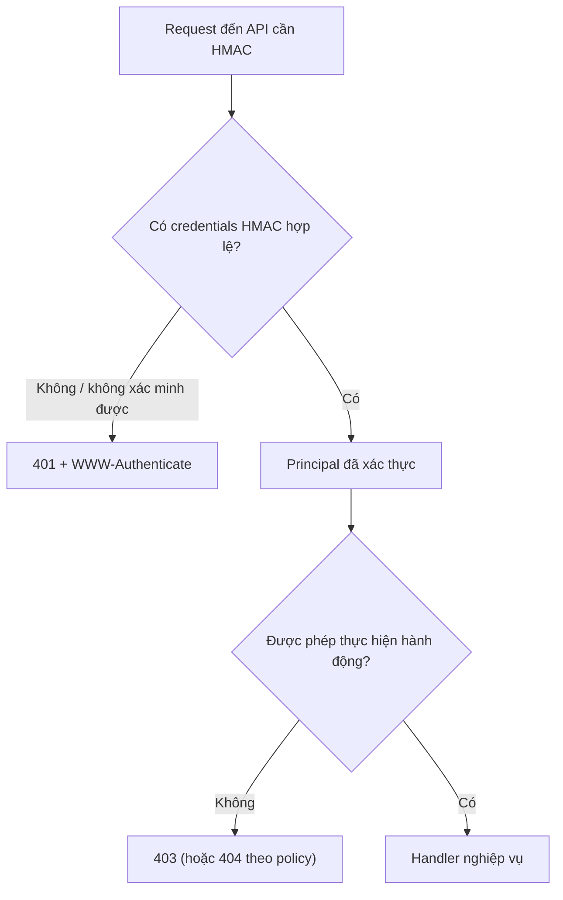

# 401 Unauthorized trong xác thực HTTP request bằng HMAC

## 1. Mục tiêu của bài học

Bài học thuộc chương **Error semantics**, trong module **SECURITY_AUTHENTICATION_HMAC_REQUEST_AUTHENTICATION**. Module này thiết kế xác thực HTTP request bằng **HMAC và shared secret**, dựa trên canonical request gồm phương thức, URI, header hoặc body theo hợp đồng ký; hệ thống còn phải chống replay bằng timestamp/nonce, quản lý key rotation, kiểm thử khi đi qua gateway/proxy và phân biệt **xác thực** với **phân quyền**.

Vấn đề của bài này là: **khi nào một HTTP request phải nhận `401 Unauthorized`, phản hồi đó được phép tiết lộ những gì, và làm thế nào để trả đúng 401 trong ứng dụng Java/Spring?**

Sau bài học, người học có thể:

- Giải thích đúng ý nghĩa của HTTP 401, kể cả yêu cầu `WWW-Authenticate`, thay vì suy luận từ tên lịch sử “Unauthorized”.
- Phân loại tình huống thiếu, sai, hết hạn hoặc bị phát lại thông tin xác thực HMAC; phân biệt với 400, 403, 413, 429 và 5xx.
- Thiết kế body lỗi nhất quán, có thể hỗ trợ client và vận hành nhưng không làm lộ sự tồn tại của key, lý do verify chi tiết hay dữ liệu nhạy cảm.
- Nối lỗi từ bộ xác minh HMAC vào `AuthenticationEntryPoint` hoặc `ServerAuthenticationEntryPoint` trong Spring Security, tránh nuốt lỗi hạ tầng và tránh gửi response hai lần.
- Viết kiểm thử cho cả HTTP status, header challenge, body lỗi, log/metrics và bảo đảm handler nghiệp vụ không chạy khi xác thực thất bại.

## 2. “401 Unauthorized” thực chất nói về xác thực

Tên reason phrase “Unauthorized” dễ gây nhầm với “không có quyền”. Theo HTTP semantics hiện hành, **401** có nghĩa là yêu cầu chưa được áp dụng vì **thiếu hoặc không có thông tin xác thực hợp lệ** cho tài nguyên đích. Người gửi có thể thử lại **với thông tin xác thực mới/hợp lệ**.

**403 Forbidden** được dùng khi server hiểu request và từ chối thực hiện hành động; trong API có xác thực, trường hợp điển hình là **đã xác thực client nhưng client không có quyền** đối với hành động/tài nguyên. HTTP không buộc server phải giải thích lý do cấm; hệ thống có thể dùng 404 để không tiết lộ sự tồn tại của một số tài nguyên, theo chính sách thống nhất.

Ví dụ:

- Client `partner-a` không gửi `X-Key-Id` và `X-Signature`, trong khi `POST /partner/orders` yêu cầu HMAC: **401**.
- Client gửi chữ ký HMAC không khớp canonical request: **401**.
- Client gửi chữ ký hợp lệ nhưng `partner-a` chỉ được đọc đơn hàng của tenant A và đang muốn sửa đơn của tenant B: **403** (hoặc 404 nếu chính sách che giấu sự tồn tại tài nguyên được áp dụng).
- Client gửi đúng HMAC nhưng body quá kích thước giới hạn của API: **413 Content Too Large**, không quy mọi lỗi thành 401.

Điểm phân biệt là quyết định tại **ranh giới authentication** và **ranh giới authorization**:



Sơ đồ trên minh họa luồng xác thực/phân quyền chính. Những lỗi độc lập với credential (request HTTP sai cấu trúc, quá tải, kho nonce không khả dụng...) có nhánh HTTP status khác, được phân loại ở phần tiếp theo.

### 2.1. `WWW-Authenticate` là thành phần của 401

HTTP yêu cầu response **401** phải có trường header `WWW-Authenticate` chứa **ít nhất một challenge áp dụng cho tài nguyên**. Challenge mô tả cơ chế xác thực mà server chấp nhận. Một ví dụ cho API có **hợp đồng HMAC riêng**:

```http
HTTP/1.1 401 Unauthorized
WWW-Authenticate: HMAC realm="partner-api"
Content-Type: application/problem+json
Cache-Control: no-store

{"type":"about:blank","title":"Unauthorized","status":401,"detail":"Authentication is required or invalid."}
```

Trong ví dụ trên, `HMAC` là **tên scheme do hệ thống tự định nghĩa**. Nó không mặc nhiên là một chuẩn chung cho mọi SDK HTTP: đội phát triển phải tài liệu hóa cách client tạo các header, canonical request và chữ ký, cũng như cách xử lý challenge. `realm="partner-api"` chỉ mô tả phạm vi bảo vệ, không tiết lộ secret hay thông tin về tài khoản. Nếu hệ thống có nhiều scheme, challenge phải phản ánh những scheme thực sự áp dụng; không tự đưa `Basic` hoặc `Bearer` chỉ vì thư viện có sẵn nếu endpoint chỉ hỗ trợ HMAC.

Nhiều hệ thống HMAC dùng các header `X-Key-Id`, `X-Timestamp`, `X-Nonce` và `X-Signature` thay vì `Authorization`. Điều đó **không làm mất nghĩa vụ thiết kế challenge phù hợp khi trả 401**. Không thể chỉ gửi JSON lỗi rồi xem như đầy đủ semantics của HTTP. Việc dùng tên scheme tự định nghĩa trong `WWW-Authenticate` cần được chuẩn hóa trong **hợp đồng API nội bộ/đối tác**, kể cả cách ứng xử với client trung gian.

Lưu ý: 401 **không phải** chỉ thị bảo client gửi lại **chính xác cùng một request đã ký**. Với hệ thống chống replay, lần thử lại hợp lệ cần timestamp/nonce mới và phải ký lại canonical request; không gửi lại secret trong response.

## 3. Nhận diện lỗi HMAC dẫn đến 401

Hệ thống xác minh HMAC thường phải kiểm tra đồng thời nhiều ràng buộc:

1. Endpoint yêu cầu HMAC và request cung cấp đủ các trường xác thực theo hợp đồng.
2. `keyId` có định dạng đúng; tra ra credential còn hiệu lực và đúng phạm vi client/tenant/hop.
3. Timestamp là giá trị hợp lệ và nằm trong khoảng clock skew được chấp nhận.
4. Nonce có định dạng đúng và chưa được sử dụng; chống replay cần **atomic claim** trên kho dùng chung nhiều instance.
5. Canonical request được dựng **đúng một định dạng** từ method, raw URI/query, các header được ký và SHA-256 của byte body nhận thực tế.
6. Chữ ký HMAC-SHA256 được giải mã đúng và so khớp với MAC tính bằng shared secret ứng với credential đó.
7. Chỉ khi các điều kiện xác thực thỏa mãn, hệ thống mới tạo `Authentication`/principal rồi chuyển sang authorization.

Với API HMAC, các trường hợp sau thường được nhóm vào **401** khi lỗi thuộc về thông tin xác thực hoặc tính hợp lệ của bằng chứng HMAC:

| Tình huống | Lý do xác thực thất bại | HTTP |
|---|---|---|
| Thiếu `X-Key-Id`, `X-Signature` hoặc các trường bắt buộc của giao thức ký | Không có bộ credential đầy đủ | 401 |
| `keyId` không tồn tại, bị vô hiệu hóa hoặc quá hạn | Không có credential có hiệu lực tương ứng | 401 |
| Chữ ký sai, sai thuật toán/phiên bản được chấp nhận, hoặc Base64 hỏng | Không chứng minh được quyền sở hữu shared secret theo hợp đồng | 401 |
| Body hash không khớp bytes server nhận | Bằng chứng toàn vẹn của request thất bại | 401 |
| Chênh lệch timestamp vượt cửa sổ | Request không đủ điều kiện xác thực theo chính sách thời gian | 401 |
| Nonce đã dùng với cùng namespace credential | Request bị phát lại theo cơ chế anti-replay | 401 |
| Canonical request khác nhau do raw path/query/header sau proxy rewrite | MAC không xác minh được trên request tại điểm verify | 401 |
| Header chữ ký trùng lặp, có giá trị không hợp lệ hoặc không theo chuẩn biểu diễn đã thống nhất | Không có một cách diễn giải credential đáng tin cậy | 401 nếu quy tắc thuộc hợp đồng xác thực |

Với trường hợp **malformed authentication field**, API phải quy định nhất quán giữa 400 và 401: nếu lỗi là **credential HMAC không hợp lệ**, sử dụng 401 giúp giữ semantics “chưa xác thực” và dễ có chung response an toàn. Nếu **toàn bộ HTTP request sai cú pháp**, không thể parse request-target hoặc vi phạm giao thức HTTP ở mức transport, có thể bị server HTTP/gateway từ chối bằng 400 trước khi filter HMAC được gọi. Không nên cố thay tất cả phản hồi của HTTP parser thành 401.

### 3.1. Đừng kiểm tra nonce trước khi xác minh chữ ký

Nếu dùng Redis, một cách chống replay phổ biến là claim nonce bằng lệnh có tính nguyên tử (ví dụ `SET key 1 NX EX ttl`). **Chỉ claim sau khi MAC hợp lệ**; làm quá sớm sẽ cho phép kẻ tấn công biết key ID/nonce rồi “đốt” nonce hợp lệ của client mà chưa hề sở hữu secret.

Quy trình tối thiểu:

```text
Parse header với giới hạn kích thước/số lượng
    ↓
Kiểm tra timestamp, định dạng nonce và key ID
    ↓
Tìm credential active
    ↓
Tính digest body, dựng canonical request
    ↓
Tính MAC bằng secret và so sánh an toàn
    ↓
Claim nonce nguyên tử, dùng chung mọi node
    ↓
Tạo principal → authorization
```

Trong một số kiến trúc, thứ tự cụ thể của kiểm tra định dạng, tra key và đọc body có thể tối ưu theo tài nguyên, miễn là không tạo side effect không an toàn hoặc đưa request tới handler khi chưa chứng thực. Lỗi Redis timeout/đứt kết nối **không đồng nghĩa nonce đã trùng**: đó là lỗi phụ thuộc hạ tầng, phải fail-closed và được xử lý riêng.

## 4. Bảng quyết định: 401 hay mã khác?

Không nên tạo một `catch (Exception) { return 401; }` vì sẽ làm mất dấu lỗi lập trình, lỗi mạng và sự cố của kho nonce.

| Điều kiện xảy ra | Phản hồi thường phù hợp | Gợi ý phân loại |
|---|---|---|
| Thiếu/không hợp lệ chứng cứ HMAC | **401 Unauthorized** | Authentication failure |
| HMAC hợp lệ, principal thiếu scope/quyền trên tenant hoặc tài nguyên | **403 Forbidden** | Authorization failure |
| Request HTTP sai định dạng độc lập với việc ký (ví dụ cú pháp request-target không parse được) | **400 Bad Request** | Malformed request |
| Body vượt giới hạn hạ tầng/API | **413 Content Too Large** | Payload/resource limit |
| Rate limit cho IP/client/route bị vượt | **429 Too Many Requests** | Throttling; có thể gửi `Retry-After` |
| Kho credential/nonce tạm thời không khả dụng | **503 Service Unavailable** hoặc 5xx phù hợp | Fail closed, không biến hạ tầng lỗi thành “secret sai” |
| Lỗi xử lý nội bộ không dự kiến (bug, lỗi serialization response...) | **500 Internal Server Error** | Lỗi server; phải có log/correlation |
| Proxy/gateway không nhận được response hợp lệ từ upstream | **502 Bad Gateway** ở gateway | Sự cố giao tiếp upstream; không quy cho client |
| Request đến endpoint không yêu cầu HMAC | Theo policy route (có thể public hoặc dùng scheme khác) | Không bắt ép 401 HMAC toàn ứng dụng |
| Chữ ký hợp lệ nhưng object/tài nguyên không tồn tại | **404 Not Found** | Không phải lỗi xác thực |

**Lưu ý về 503:** nếu request không thể xác minh do kho nonce/credential không sẵn sàng, không được tiếp tục với giả định “có lẽ hợp lệ”. Trạng thái client có thể là **503**, với `Retry-After` khi có dự đoán hợp lý; việc hiển thị lỗi hạ tầng tổng quát không bắt buộc phải tiết lộ nội bộ Redis/KMS/Vault. Một số hệ thống che thông tin ở edge theo chính sách riêng, nhưng vẫn phải đo lường và phân loại nguyên nhân thật trong telemetry.

**Lưu ý về 403:** xác thực thành công **không** trao quyền tự động. Nếu shared secret thuộc tenant A mà request cần quyền sửa dữ liệu tenant B, HMAC hợp lệ chỉ cho biết ai gửi request; tầng phân quyền vẫn phải từ chối.

**Lưu ý về 401 vs 404:** khi resource tồn tại nhưng không được lộ cho bên không có quyền, API có thể dùng 404 theo một policy cố định, đã kiểm thử, tránh tạo oracle tiết lộ object ID. Không đổi ngẫu nhiên giữa 401/403/404 theo giá trị key ID hoặc chữ ký vì dễ lộ thông tin.

## 5. Thiết kế error response an toàn

Phản hồi tốt có ba đặc tính: **nhất quán về hợp đồng**, **đủ để client biết cần xác thực lại** và **không mở oracle** cho kẻ đoán key/chữ ký.

### 5.1. Một response chung cho mọi lý do thất bại xác thực

Ví dụ dạng `application/problem+json`, tương thích cấu trúc HTTP Problem Details:

```http
HTTP/1.1 401 Unauthorized
WWW-Authenticate: HMAC realm="partner-api"
Content-Type: application/problem+json
Cache-Control: no-store
X-Request-Id: req-e0c7a1

{
  "type": "about:blank",
  "title": "Unauthorized",
  "status": 401,
  "detail": "Authentication is required or invalid.",
  "requestId": "req-e0c7a1"
}
```

`requestId` là extension field do API tự quy định để đối chiếu log nội bộ; nó **không** phải trường chuẩn bắt buộc của Problem Details. Có thể dùng một `type` URL riêng, nhưng chỉ khi URL đó mô tả một loại lỗi chung và thực sự được vận hành. `Cache-Control: no-store` giảm nguy cơ lưu response mang ngữ cảnh xác thực; vẫn không được đưa secret/signature vào response.

Giữ **cùng HTTP status, nội dung thông báo chung và shape body** cho các lỗi sau: key không tồn tại, key đã revoke, MAC sai, timestamp lỗi, nonce trùng. Client không cần biết nguyên nhân sâu bên trong để sử dụng an toàn: nó có thể đồng bộ giờ, làm mới nonce, ký lại và tra cứu tài liệu tích hợp. Nếu cần thông tin cho support, dùng request ID hoặc mã lỗi công khai **không phân biệt bí mật**.

### 5.2. Những thông tin không đưa vào response 401

Không trả về:

- `sharedSecret`, `expectedSignature`, key material, payload thô có dữ liệu nhạy cảm hoặc toàn bộ canonical string.
- “Key `partner-42` tồn tại nhưng đã hết hạn”, “nonce này đã được ghi”, “chữ ký chỉ sai ở body hash”, “tenant này không có key”.
- Cấu hình thời gian chính xác đến mức giúp tối ưu tấn công, danh sách key ID đang active, trạng thái rotation chi tiết.
- Full stack trace, đường dẫn file cấu hình, tên dịch vụ Redis/KMS/Vault hoặc chi tiết triển khai filter/gateway.

Cần nhận thức rằng **thời gian đáp ứng** và hành vi mạng cũng có thể tạo side channel. So sánh MAC dùng hàm so sánh an toàn như `MessageDigest.isEqual(byte[], byte[])` sau khi ràng buộc độ dài signature cố định; tránh phân nhánh trả về thông tin khác nhau theo key ID. Dù so sánh MAC an toàn, **toàn bộ pipeline HMAC không mặc nhiên constant-time** (ví dụ lookup key, đọc body). Áp dụng rate limit, giới hạn kích thước input, telemetry và chính sách xử lý key không tồn tại để giảm rủi ro.

### 5.3. Chia sẻ lý do nội bộ qua metrics/log, không qua HTTP

Hệ thống nên ghi sự kiện nội bộ có các trường như:

```json
{
  "event": "hmac_auth_failed",
  "reason": "invalid_mac",
  "requestId": "req-e0c7a1",
  "route": "/partner/orders",
  "hop": "ingress",
  "clientKeyRef": "redacted-or-hashed",
  "httpStatus": 401
}
```

`reason` có thể thuộc tập hữu hạn như `missing_credentials`, `malformed_credentials`, `unknown_or_revoked_key`, `invalid_mac`, `expired_timestamp`, `replayed_nonce`. Đừng dùng nonce/key ID/raw path tùy ý làm metrics label gây cardinality vô hạn; có thể log key ID đã băm/ẩn và kiểm soát quyền đọc log. Với mã lỗi nội bộ `invalid_mac`, không bao giờ in expected MAC để “debug”.

Nếu các request lỗi HMAC tăng đột biến sau thay đổi gateway, đối chiếu **raw request-target** và digest byte body tại những điểm được phép quan sát, trong môi trường chẩn đoán kiểm soát; không cần lộ secret.

## 6. Xử lý 401 trong Spring Security

Với Spring, nên nối lỗi từ bộ xác minh HMAC vào cơ chế **authentication failure** thay vì ghi HTTP 401 trong controller nghiệp vụ. Controller chỉ được chạy sau khi request qua kiểm tra xác thực và phân quyền. Việc chọn entry point và order filter khác nhau giữa Spring MVC và WebFlux.

### 6.1. Spring MVC (Servlet stack)

Trong Spring Security cho ứng dụng Servlet:

- Một `AuthenticationException` (ví dụ `BadCredentialsException`) đại diện cho lỗi authentication.
- `AuthenticationEntryPoint` tạo response yêu cầu xác thực; chính sách lỗi của security chain phải dùng entry point phù hợp với scheme HMAC.
- `AccessDeniedHandler` xử lý truy cập bị cấm khi đã xác thực (thường 403).
- `ExceptionTranslationFilter` có thể chuyển `AuthenticationException` và `AccessDeniedException` từ **các filter nằm phía sau nó trong chain** sang entry point/handler thích hợp.

Cần đặc biệt chú ý: **custom filter nằm trước `ExceptionTranslationFilter` không được giả định rằng exception tự động được filter đó bắt**. Filter phải được tích hợp vào đúng vị trí, hoặc dùng `AuthenticationFailureHandler`/entry point một cách có chủ đích. Không để một `RuntimeException` tùy ý tràn ra rồi mong framework luôn chuyển thành 401.

Ví dụ entry point tối thiểu (minh họa, không tự thêm logic verify vào đây):

```java
import jakarta.servlet.http.HttpServletRequest;
import jakarta.servlet.http.HttpServletResponse;
import java.io.IOException;
import org.springframework.http.MediaType;
import org.springframework.security.core.AuthenticationException;
import org.springframework.security.web.AuthenticationEntryPoint;

public final class HmacServletEntryPoint implements AuthenticationEntryPoint {
    private static final String PROBLEM = """
            {"type":"about:blank","title":"Unauthorized","status":401,
             "detail":"Authentication is required or invalid."}
            """;

    @Override
    public void commence(
            HttpServletRequest request,
            HttpServletResponse response,
            AuthenticationException exception) throws IOException {
        if (response.isCommitted()) {
            return; // Ghi nhận bất thường nội bộ; không thể đổi status/body.
        }

        response.setStatus(HttpServletResponse.SC_UNAUTHORIZED);
        response.setHeader("WWW-Authenticate", "HMAC realm=\"partner-api\"");
        response.setHeader("Cache-Control", "no-store");
        response.setContentType("application/problem+json");
        response.setCharacterEncoding("UTF-8");
        response.getWriter().write(PROBLEM);
    }
}
```

**Điểm nối:** cấu hình `http.exceptionHandling(ex -> ex.authenticationEntryPoint(new HmacServletEntryPoint()))` trong `SecurityFilterChain` có scope đúng route. Nếu custom HMAC filter dùng một `AuthenticationFailureHandler` riêng, hãy bảo đảm handler đó gọi cùng entry point để mọi đường thất bại authentication có contract thống nhất. Mã ví dụ sử dụng `jakarta.servlet` (Spring Framework 6 / Spring Security 6 trở lên); với phiên bản Servlet dùng `javax.servlet` cần import tương ứng.

Không trả 401 ở cuối handler nghiệp vụ chỉ vì `SecurityContext` trống: cấu hình xác thực của security chain mới phải quyết định request nào cần credentials, điểm verify nào cần được chạy và failure nào phải chặn request.

### 6.2. Spring WebFlux (reactive stack)

Spring Security WebFlux cung cấp `ServerAuthenticationEntryPoint` để tạo response khi cần xác thực. Nếu sử dụng `AuthenticationWebFilter`, lỗi xác thực do `ReactiveAuthenticationManager` tạo ra nên là `AuthenticationException`. Thiết lập `ServerAuthenticationEntryPointFailureHandler` để chuyển failure về một entry point thống nhất.

Ví dụ dùng Java 17+, Spring Security WebFlux:

```java
import java.nio.charset.StandardCharsets;

import org.springframework.http.HttpHeaders;
import org.springframework.http.HttpStatus;
import org.springframework.http.MediaType;
import org.springframework.http.server.reactive.ServerHttpResponse;
import org.springframework.security.core.AuthenticationException;
import org.springframework.security.web.server.ServerAuthenticationEntryPoint;
import org.springframework.web.server.ServerWebExchange;

import reactor.core.publisher.Mono;

public final class HmacReactiveEntryPoint
        implements ServerAuthenticationEntryPoint {

    private static final byte[] BODY = (
            "{\"type\":\"about:blank\","
          + "\"title\":\"Unauthorized\","
          + "\"status\":401,"
          + "\"detail\":\"Authentication is required or invalid.\"}"
    ).getBytes(StandardCharsets.UTF_8);

    @Override
    public Mono<Void> commence(
            ServerWebExchange exchange,
            AuthenticationException error) {

        ServerHttpResponse response = exchange.getResponse();
        if (response.isCommitted()) {
            // Không thể viết thêm 401 lên response đã bắt đầu truyền.
            return Mono.error(error);
        }

        response.setStatusCode(HttpStatus.UNAUTHORIZED);
        response.getHeaders().set(
                HttpHeaders.WWW_AUTHENTICATE,
                "HMAC realm=\"partner-api\"");
        response.getHeaders().setContentType(
                MediaType.parseMediaType("application/problem+json"));
        response.getHeaders().set(
                HttpHeaders.CACHE_CONTROL, "no-store");

        // Tạo DataBuffer mới khi publisher được subscribe.
        return response.writeWith(Mono.fromSupplier(() ->
                response.bufferFactory().wrap(BODY.clone())));
    }
}
```

Để tích hợp entry point với filter authentication chuyên trách:

```java
import org.springframework.context.annotation.Bean;
import org.springframework.context.annotation.Configuration;
import org.springframework.security.authentication.ReactiveAuthenticationManager;
import org.springframework.security.config.web.server.ServerHttpSecurity;
import org.springframework.security.web.server.SecurityWebFilterChain;
import org.springframework.security.web.server.SecurityWebFiltersOrder;
import org.springframework.security.web.server.authentication.AuthenticationWebFilter;
import org.springframework.security.web.server.authentication.ServerAuthenticationEntryPointFailureHandler;
import org.springframework.security.web.server.authentication.ServerAuthenticationConverter;
import org.springframework.security.web.server.util.matcher.PathPatternParserServerWebExchangeMatcher;

@Configuration
class PartnerHmacSecurityConfig {

    @Bean
    SecurityWebFilterChain partnerHmacChain(
            ServerHttpSecurity http,
            ReactiveAuthenticationManager hmacAuthenticationManager,
            ServerAuthenticationConverter hmacAuthenticationConverter) {

        HmacReactiveEntryPoint entryPoint = new HmacReactiveEntryPoint();

        AuthenticationWebFilter hmacFilter =
                new AuthenticationWebFilter(hmacAuthenticationManager);
        hmacFilter.setServerAuthenticationConverter(hmacAuthenticationConverter);
        hmacFilter.setAuthenticationFailureHandler(
                new ServerAuthenticationEntryPointFailureHandler(entryPoint));

        return http
                .securityMatcher(
                        new PathPatternParserServerWebExchangeMatcher("/partner/**"))
                .csrf(ServerHttpSecurity.CsrfSpec::disable)
                .httpBasic(ServerHttpSecurity.HttpBasicSpec::disable)
                .formLogin(ServerHttpSecurity.FormLoginSpec::disable)
                .exceptionHandling(ex ->
                        ex.authenticationEntryPoint(entryPoint))
                .addFilterAt(
                        hmacFilter, SecurityWebFiltersOrder.AUTHENTICATION)
                .authorizeExchange(ex -> ex.anyExchange().authenticated())
                .build();
    }
}
```

Trong ví dụ này, `hmacAuthenticationManager` và `hmacAuthenticationConverter` là **hai thành phần ứng dụng phải tự triển khai và đăng ký bean**:

- `ServerAuthenticationConverter` đọc các header theo hợp đồng ký, kiểm soát trùng lặp/độ dài, tạo authentication token **chưa được xác thực**. Nếu hoàn toàn không có credential, converter có thể trả `Mono.empty()` và route được bảo vệ sẽ nhận 401 ở bước authorization. Nếu dữ liệu xác thực đã hiện diện nhưng sai định dạng, phát `AuthenticationException` phù hợp.
- `ReactiveAuthenticationManager` xác minh key active, canonical request, MAC, timestamp và nonce; chỉ khi hợp lệ mới trả `Authentication` đã xác thực. Trong WebFlux, nếu chữ ký gắn với **body**, phải xử lý request body bất đồng bộ và cấp lại bytes cho downstream; việc chuyển body giữa converter/filter cần được thiết kế cẩn thận, có giới hạn bộ nhớ và giải phóng `DataBuffer` đúng cách.
- Lỗi “MAC không hợp lệ”, key unknown hoặc nonce replay được chuyển thành các subclass của `AuthenticationException` như `BadCredentialsException`; không đưa chi tiết đó vào response công khai.
- Lỗi hạ tầng như Redis timeout/KMS unavailable **không** được chuyển hết thành `BadCredentialsException`. Hãy để đường xử lý lỗi hệ thống trả 503/5xx tương ứng và ghi cảnh báo.
- Đưa authentication thành công vào **Reactor Context** theo cơ chế security filter; không tự dựa vào `ThreadLocal` hoặc gọi `block()`/`subscribe()` trong reactive chain.

Nếu không dùng `AuthenticationWebFilter` mà tự tạo `WebFilter`, custom filter phải chủ động gọi entry point khi xác minh trả `AuthenticationException` (và chỉ khi response chưa commit), đồng thời truyền authentication vào `ReactiveSecurityContextHolder` khi thành công. Filter phải được đăng ký **một lần** đúng order, tránh verify hai lần gây lỗi nonce replay.

**Vì sao không viết `response.setStatusCode(401)` ở nhiều nơi?** Khi filter, error handler và gateway cùng có thể ghi response, application dễ gặp “response already committed”, sai Content-Type, thiếu challenge hoặc gửi partial JSON. Một entry point tập trung giảm các trạng thái không nhất quán.

### 6.3. Ánh xạ exception có chủ đích

Có thể quy hoạch exception theo các loại lỗi nội bộ, giữ cùng public contract:

```text
InvalidHmacSignatureException
ExpiredHmacTimestampException
HmacNonceReplayException
UnknownOrRevokedKeyException
MalformedHmacCredentialsException
        └── AuthenticationException (hoặc được ánh xạ về đây)
                └── Authentication entry point → 401

AuthenticatedButForbiddenException
        └── AccessDeniedException → 403 (theo policy authorization)

PayloadTooLargeException
        └── Dedicated error handler → 413

CredentialStoreUnavailableException / ReplayStoreUnavailableException
        └── Infrastructure error handler → 503/5xx
```

Không dùng `onErrorResume(Throwable.class, error -> 401)` trong WebFlux hoặc `catch (Exception)` trong Servlet filter: chúng có thể làm các lỗi programming, tràn bộ nhớ, quá tải và timeout bị giả thành “client gửi sai chữ ký”. Với lỗi nội bộ khi response đã commit, cần log/correlation thay vì cố ghi thêm status/body mới.

## 7. Gateway/proxy và vị trí phát sinh 401

Trong kiến trúc có gateway, cần biết **ai xác minh chữ ký nào**:

- **Client → Gateway:** gateway kiểm tra HMAC của client trên canonical request ở ingress. Thiếu key, MAC sai, timestamp lỗi hoặc nonce replay → gateway có thể trả **401 ngay tại ingress**, không forward request tới backend.
- **Gateway → Backend (ký lại):** gateway xác minh client, áp dụng rewrite rồi ký request outbound bằng key nội bộ. Backend xác minh chữ ký gateway, audience, nonce và các claim được ký. Nếu không hợp lệ → backend trả **401 cho hop nội bộ**. Gateway cần quyết định cách ánh xạ response cho client mà vẫn giữ nguyên phân loại lỗi/trace nội bộ và không lộ thông tin credential gateway.
- **Proxy chỉ chuyển tiếp:** nếu backend trực tiếp xác minh chữ ký client, mọi thay đổi raw path/query, body hoặc header nằm trong hợp đồng ký có thể gây 401. Cần định nghĩa rõ điểm canonicalization và kiểm thử cả phía client lẫn backend.

Ví dụ giao thức:

```text
Client ký: POST /public/v1/orders?x=1
Gateway rewrite: POST /internal/orders?x=1
Backend thấy chữ ký HMAC của client gốc

→ Nếu backend xây canonical trên /internal/orders, MAC không khớp.
→ Trả 401 có thể đúng về mặt xác thực nhưng nguyên nhân gốc là
  cấu hình gateway và hợp đồng ký chưa khớp.
```

Không hướng dẫn client “thử secret khác” khi toàn bộ đối tác đồng loạt nhận 401 sau deploy gateway; nên kiểm tra rewrite, compression, encoding URI, proxy header và cách đọc body **trước** khi kết luận credential bị hỏng. Log nguồn lỗi và request ID giúp tách lỗi xác thực thực sự với lỗi cấu hình.

Với gateway ký lại, backend không nên đọc `X-Verified-Client-Id` từ request Internet rồi mặc nhiên cấp quyền. Claim client/tenant phải do gateway tạo ra và được bảo vệ bằng chữ ký của hop nội bộ hoặc cơ chế xác thực tương đương. Nếu gateway bị mất kết nối credential store, không được ký hộ một request chưa xác minh.

### 7.1. Không để gateway phá hỏng 401

Một số gateway có thể thay thế response body/headers hoặc ánh xạ mọi 401 thành 403/502. Cần kiểm thử rằng:

- `WWW-Authenticate` còn phù hợp ở ranh giới hướng tới **client**. Không forward nguyên challenge nội bộ của gateway–backend nếu nó mô tả một scheme/key mà client Internet không được dùng.
- `Cache-Control: no-store` và Content-Type được giữ đúng nếu response 401 đi qua proxy.
- Các lỗi backend 401 do **gateway key** sai được ghi nội bộ như sự cố tích hợp; phản hồi công khai nên theo hợp đồng error mapping của edge, không hướng client đổi secret cá nhân một cách sai lệch.
- Reverse proxy không tiêm thêm `Authorization` hoặc thay header HMAC trước điểm verify mà không tuân theo hợp đồng ký.

Một API có thể cần challenge riêng ở mỗi hop; không áp dụng máy móc `WWW-Authenticate: HMAC realm="partner-api"` cho mọi response nội bộ.

## 8. Client nên phản ứng thế nào với 401?

Khi nhận 401 từ API HMAC, client nên:

1. Kiểm tra bản thân đang gọi đúng endpoint, đúng version hợp đồng ký và còn có credential hợp lệ.
2. Đồng bộ clock theo cơ chế vận hành tin cậy; bảo đảm timestamp dùng **đơn vị giây** nếu hợp đồng định nghĩa Unix epoch seconds.
3. Sinh **nonce mới**, tính lại body digest và canonical request từ đúng byte/method/raw URI/header sẽ được gửi.
4. Nếu cần retry, **ký lại** với timestamp/nonce mới. Không retry vô hạn khi credential đã revoke hoặc sai secret.
5. Dùng request ID liên hệ vận hành nếu lỗi vẫn xảy ra; không đính kèm shared secret, chữ ký đầy đủ hay body nhạy cảm vào ticket công khai.

Client **không** được gửi secret lên URL, trong query string hoặc vào header debug để “kiểm tra”. Nếu nhận `401` sau khi request có thể đã tới backend, cần cân nhắc idempotency: một request có nonce mới có thể là request hợp lệ thứ hai. HMAC replay prevention và idempotency nghiệp vụ là hai vấn đề khác nhau; các thao tác như tạo đơn/thanh toán cần idempotency key và kiểm tra giao dịch riêng.

Với lỗi 429 hoặc 503, chiến lược retry/backoff theo `Retry-After` (nếu có) khác với xử lý 401. Việc tự động đổi credential hay spam ký lại mỗi giây khi nhận 401 thường khiến trạng thái lỗi nặng hơn.

## 9. Ma trận kiểm thử cho 401

Kiểm thử mức đơn vị với bộ signer/verifier độc lập và kiểm thử tích hợp bằng `MockMvc` (Servlet) hoặc `WebTestClient` (WebFlux). Các trường hợp lỗi xác thực phải xác minh **cả status, header challenge, Content-Type, body và việc handler nghiệp vụ không được chạy**.

| Tình huống | HTTP mong đợi | Assertion cần kiểm tra |
|---|---|---|
| Không có header HMAC tại route yêu cầu ký | 401 | Có `WWW-Authenticate`; response chung; handler không chạy |
| Thiếu một trường HMAC bắt buộc | 401 | Cùng public response với các credential sai khác |
| Key ID không tồn tại hoặc đã revoke | 401 | Không lộ key có tồn tại hay lý do revoke |
| Chữ ký sai, ký sai body hash hoặc body bị thay một byte | 401 | MAC/digest không hợp lệ; không có side effect nghiệp vụ |
| Timestamp nằm ngoài cửa sổ | 401 | Thông báo công khai không tiết lộ cơ chế chính xác |
| Cùng key/nonce đã được nhận, gửi lại request | 401 | Replay không thể chạy handler lần nữa |
| Hai request đồng thời cùng key/nonce trên hai node | Một request có thể qua auth, một request 401 | Kho nonce dùng thao tác atomic; không có hai claim thành công |
| HMAC hợp lệ, client không đủ quyền trên resource/tenant | 403 hoặc 404 theo policy | Không nhầm thành 401; không truy cập dữ liệu |
| HTTP request-target không parse được | 400 theo server/gateway | Không bị custom filter ép về 401 |
| Body vượt giới hạn được cấu hình | 413 | Không phải do MAC sai; không cấp authentication |
| Rate limit vượt ngưỡng | 429 | Không bị map thành HMAC failure |
| Redis/kho nonce tạm thời không khả dụng | 503/5xx | Không fail-open; error log là hạ tầng |
| Secret store timeout | 503/5xx | Không phát ra 401 giả, không gọi handler |
| Proxy rewrite thay raw path/query đã ký | 401 tại hop verify | Chẩn đoán được bằng trace/digest không nhạy cảm |
| Gateway ký lại đúng, backend verify key/audience/nonce hợp lệ | Không 401 vì HMAC | Authorization vẫn được áp dụng tiếp |
| Chữ ký đúng nhưng gateway–backend audience sai | 401 tại hop nội bộ | Không tiết lộ chi tiết gateway key cho client |
| Đăng ký filter HMAC hai lần | Test phải phát hiện cấu hình sai | Không bị 401 replay giả do verify hai lần |
| Nhiều kết quả lỗi auth khác nhau qua gateway | 401 theo hợp đồng public | Response body/challenge nhất quán, không lộ nguyên nhân |

Một cách viết assertion mức ý tưởng:

```java
// Với MockMvc (Servlet), kiểm tra request không có credential:
mockMvc.perform(post("/partner/orders")
        .contentType("application/json")
        .content("{\"sku\":\"A7\"}"))
    .andExpect(status().isUnauthorized())
    .andExpect(header().string("WWW-Authenticate", "HMAC realm=\"partner-api\""))
    .andExpect(content().contentTypeCompatibleWith("application/problem+json"))
    .andExpect(jsonPath("$.status").value(401))
    .andExpect(jsonPath("$.detail")
            .value("Authentication is required or invalid."));
```

Đây là ví dụ assertion, cần có cấu hình security và route mẫu tương ứng trong dự án test. Cần kiểm tra thêm đối tượng service/controller giả lập để bảo đảm **không gọi handler** nếu đã trả 401. Với kiểm thử nhiều node/Redis, mô phỏng hai request cùng nonce song song để xác minh atomic claim thay vì chỉ gửi tuần tự.

### 9.1. Kiểm thử về tính an toàn của phản hồi

Ngoài tình huống đúng/sai, cần cố tình thử:

- Một key ID tồn tại và một key ID không tồn tại: public error response phải không phân biệt được bởi thông điệp/lược đồ JSON.
- Signature sai một byte và signature sai hoàn toàn: không trả expected MAC hay raw canonical.
- Chữ ký hợp lệ nhưng timestamp cũ: không xuất hiện thông báo “nonce chưa từng tồn tại”/“key đã tồn tại”.
- Header bị trùng, tên header khác chữ hoa/thường, body rỗng, UTF-8, JSON thay thứ tự field và query chứa `%2F`: phân loại lỗi theo **hợp đồng ký**.
- Response đã commit do stream: không được chèn thêm body 401 vào giữa payload, không gây lỗi ghi response thứ hai.
- Sau khi rotate key: key cũ bị revoke dẫn đến 401; key mới active hợp lệ; không tiết lộ lịch sử rotation.

## 10. Thực hành: tự thiết kế hợp đồng 401 cho API đối tác

Giả sử có endpoint `POST /partner/payments`, client ký:

```text
HMAC-V1
POST
/partner/payments
<raw query>
<keyId>
<timestamp>
<nonce>
<SHA-256 của body bytes>
```

Hãy xây dựng luồng verify và error handling theo các yêu cầu:

1. Định nghĩa một **public 401 response** có `WWW-Authenticate`, body Problem Details chung, `Cache-Control: no-store` và request ID.
2. Viết bộ kiểm tra key active, timestamp, body digest, MAC và nonce; chỉ claim nonce sau khi MAC hợp lệ. Thiết kế lớp lỗi để phân biệt auth failure với infrastructure failure.
3. Khi chữ ký hợp lệ, gắn danh tính client/tenant vào security context và áp dụng quyền truy cập riêng: tenant A không thể sửa payment của tenant B.
4. Mô phỏng proxy đổi `/partner/payments` thành `/internal/payments` trước bước verify; giải thích vì sao backend trả 401 nếu canonical contract không khớp và đưa ra phương án khắc phục (không đổi status để che lỗi).
5. Tạo bảng test cho các tình huống: thiếu chữ ký, key revoke, nonce replay, body bị sửa, thiếu quyền, Redis ngừng hoạt động. Với mỗi ca, nêu HTTP status, challenge và handler có được chạy hay không.

**Câu hỏi tự đánh giá:**

- Tại sao 401 và 403 khác nhau dù reason phrase của 401 là “Unauthorized”?
- Khi client gửi chữ ký HMAC sai, tại sao trả chung một thông báo an toàn tốt hơn báo “key này có tồn tại”?
- Header `WWW-Authenticate` có vai trò gì, và phải định nghĩa thế nào khi dùng scheme HMAC tùy biến?
- Vì sao lỗi kho nonce tạm thời không khả dụng không thể được biến thành “nonce chưa dùng” hoặc “MAC sai”?
- Vì sao một request nhận 401 sau gateway rewrite có thể là lỗi cấu hình thay vì secret của client sai?
- Vì sao retry sau 401 cần nonce mới, nhưng nonce mới không giải quyết được vấn đề idempotency thanh toán?

**Kết quả cần đạt:** với một HTTP API yêu cầu HMAC, người học xác định được chính xác khi nào phải trả **401 Unauthorized**, bảo đảm challenge và body response nhất quán, không rò rỉ thông tin nhạy cảm, giữ tách biệt 401/403/400/429/5xx, và triển khai đúng đường lỗi xác thực trong Spring Security kể cả khi có proxy, nonce replay và key rotation.

