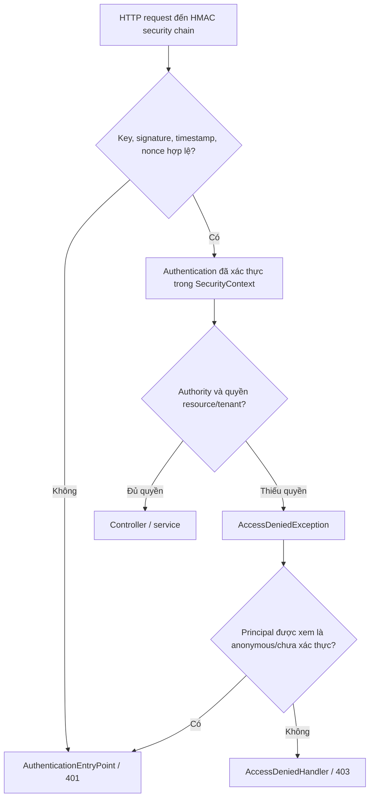

# 403 Forbidden trong xác thực HMAC: chữ ký hợp lệ nhưng không đủ quyền

## 1. Bối cảnh và mục tiêu

Module `SECURITY_AUTHENTICATION_HMAC_REQUEST_AUTHENTICATION` hướng dẫn thiết kế xác thực HTTP request bằng **HMAC với shared secret**. Client và server thống nhất một **canonical request** gồm phương thức, URI/query, những header được ký và/hoặc body digest; server xác minh chữ ký, kiểm tra timestamp/nonce chống replay, xử lý key rotation và kiểm thử request đi qua proxy/gateway. Sau xác thực, hệ thống còn phải quyết định client có quyền thực hiện thao tác được yêu cầu hay không.

Đó là lý do HTTP **403 Forbidden** có ý nghĩa quan trọng. Trong một API HMAC, 403 thường biểu thị:

> Server đã nhận diện được client thông qua một request có chữ ký hợp lệ, nhưng chính sách **authorization** không cho client thực hiện hành động hoặc truy cập tài nguyên này.

Ví dụ: service `report-worker` ký chính xác request `POST /internal/payments`, nhưng key/client chỉ được cấp quyền đọc `PAYMENT_READ`. Server đã biết client là ai; từ chối bằng **403 Forbidden** vì không có `PAYMENT_CREATE`.

Bài thuộc chương **Error semantics**, tập trung vào **403 Forbidden**. Sau bài học, người học có thể:

1. Phân biệt chắc chắn lỗi **authentication** (thường 401) với lỗi **authorization** (thường 403) trong giao thức HMAC.
2. Nêu điều kiện tối thiểu trước khi trả 403: chữ ký HMAC hợp lệ, timestamp/nonce hợp lệ, key được chấp nhận, principal đã xác thực và quy tắc quyền từ chối.
3. Dùng `GrantedAuthority`, `SecurityContext` và `AccessDeniedHandler` của Spring Security để xử lý 403 có chủ đích.
4. Tránh rò rỉ thông tin key, tenant và tài nguyên qua response 403, đồng thời vẫn cung cấp đủ mã lỗi ổn định cho client.
5. Kiểm thử 403 qua MVC/WebFlux, proxy/gateway và khi áp chính sách phân quyền ở tầng service.

> **Phạm vi:** Ví dụ dùng Spring Security 6.x, Spring Boot 3.x; mã Java phần lớn là Servlet/Spring MVC, kèm phần tích hợp WebFlux. Đây là bài về **ngữ nghĩa lỗi và phân quyền**, không phải một đặc tả triển khai HMAC đầy đủ.

## 2. Quy tắc cốt lõi: chữ ký HMAC hợp lệ không đồng nghĩa được phép truy cập

HMAC chứng minh bên gửi sở hữu shared secret tương ứng và những phần **được ký** của request không bị sửa đổi theo hợp đồng. Nó không tự chứng minh client được phép:

- Tạo hoặc xóa một payment.
- Đọc toàn bộ đơn hàng của một tenant khác.
- Gọi API quản trị hệ thống.
- Sử dụng một key ngoài phạm vi dịch vụ mà key đó được cấp.

Để hiểu 403, phải tách ba lớp:

| Lớp | Câu hỏi cần trả lời | Ví dụ | Kết quả |
| --- | --- | --- | --- |
| **Request integrity** | Canonical request, chữ ký, timestamp và nonce có hợp lệ không? | HMAC signature khớp raw body và method/URI | Đi tiếp; nếu không thì xác thực thất bại |
| **Authentication** | Key hợp lệ này thuộc client/service nào? | `keyId=report-key-2` thuộc `report-worker` | Xây `Authentication` đã xác thực |
| **Authorization** | Client có quyền thực hiện hành động trên resource/tenant này không? | `report-worker` chỉ có `PAYMENT_READ` nhưng gọi POST | **403 Forbidden** |

Không bao giờ tạo authorities bằng cách tin `X-Role: ADMIN` hoặc một trường quyền do client tự khai báo chỉ vì HMAC hợp lệ. Quyền nên được lấy từ registry/policy **phía server**, ràng buộc với principal đã được xác minh; quyền trên tài nguyên cụ thể có thể cần kiểm tiếp ở service/domain layer.

### 2.1. Tình huống minh họa

Giả sử client A được cấp:

```text
clientId = reconciliation-worker
tenantId = tenant-a
authorities = [PAYMENT_READ]
keyId = reconciliation-2026-b
keyStatus = ACTIVE
```

Client gửi:

```http
POST /internal/payments HTTP/1.1
Content-Type: application/json
X-Hmac-Key-Id: reconciliation-2026-b
X-Hmac-Timestamp: 2026-11-28T03:00:00Z
X-Hmac-Nonce: 7a93f0e0-8a68-4ed1-a322-7eb08ae787a6
X-Content-SHA256: <digest>
X-Hmac-Signature: <signature>

{"tenantId":"tenant-a","amount":100000}
```

Nếu chữ ký, timestamp và nonce hợp lệ, server có thể tạo `Authentication` cho `reconciliation-worker` với authority `PAYMENT_READ`. `AuthorizationFilter` phát hiện route POST đòi `PAYMENT_CREATE` và từ chối bằng **403**. Không nên dùng 401 ở đây vì client đã xác thực thành công.

Nếu cùng request có chữ ký sai hoặc key đã bị thu hồi thì đó lại là **authentication failure**, thường được trả 401. Một client hợp lệ không có quyền ghi cũng không được “nâng quyền” chỉ bằng cách ký đúng một request ghi.

## 3. Phân biệt 403 với các HTTP status dễ nhầm

| Trường hợp | Mã thường dùng | Lý do |
| --- | --- | --- |
| Thiếu/sai HMAC signature, key ID không hợp lệ, key bị thu hồi/hết hiệu lực | **401 Unauthorized** | Chưa có danh tính được xác thực chấp nhận cho request |
| Timestamp ngoài cửa sổ, nonce đã sử dụng, chữ ký không khớp body | **401 Unauthorized** | Request không vượt qua xác thực HMAC/freshness/replay |
| HMAC và principal hợp lệ nhưng thiếu `PAYMENT_CREATE` | **403 Forbidden** | Xác thực thành công, bị chính sách quyền từ chối |
| Principal được xác thực nhưng không thuộc tenant của payment | **403**, hoặc **404** nếu chủ đích che giấu tài nguyên | Quyền trên resource/tenant bị từ chối |
| JSON sai cú pháp hoặc thiếu field bắt buộc sau khi HMAC hợp lệ | **400 Bad Request** | Lỗi định dạng/validation của input |
| Request body vượt giới hạn đã thiết lập | **413 Content Too Large** | Giới hạn payload, không phải quyền truy cập |
| Không tồn tại route/tài nguyên, khi chính sách cho phép tiết lộ | **404 Not Found** | Resource/route không tồn tại hoặc được che giấu |
| Client vượt rate limit | **429 Too Many Requests** | Cơ chế giới hạn lưu lượng |
| Replay store/key registry tạm thời không sẵn sàng | **503 Service Unavailable** hoặc lỗi 5xx theo chính sách | Lỗi hạ tầng, phải **fail closed**; không tự chấp nhận request |
| Phương thức không được hỗ trợ trên endpoint công khai | **405 Method Not Allowed** nếu chính sách routing cho phép | Sai method; security policy vẫn có thể từ chối trước MVC |

Các mã trên là **chính sách thiết kế điển hình** cho một API HMAC. Trong HTTP, 403 có nghĩa server hiểu request nhưng từ chối thực hiện; chuẩn không bắt buộc chỉ xuất hiện sau khi xác thực. Tuy nhiên, để client HMAC phân biệt rõ nguyên nhân và để hệ thống dễ kiểm toán, thông lệ của bài này là: **401 cho xác thực thất bại; 403 cho danh tính đã xác thực nhưng thiếu quyền**.

### 3.1. Cách hiểu chính xác về HTTP 401

Tên `401 Unauthorized` trong HTTP dễ gây nhầm: ý nghĩa chủ yếu là thiếu **authentication credentials** hợp lệ. Theo HTTP authentication framework, response 401 gắn với `WWW-Authenticate` challenge phù hợp với cơ chế xác thực được hỗ trợ. Nếu thiết kế dùng một HMAC scheme riêng qua các header `X-Hmac-*`, cần đặc tả rõ challenge và hành vi client; **không trả `WWW-Authenticate: Bearer` hay `Basic` một cách máy móc** nếu API không dùng các scheme đó.

Response **403** không phải lời nhắc ký lại bằng cùng key. Client có thể cần được admin cấp quyền, dùng identity khác được phép hoặc thay đổi hành động. Tự động đổi nonce/timestamp rồi retry ngay một request 403 thường không giải quyết được việc thiếu authority.

### 3.2. 403 và 404 khi cần che giấu tài nguyên

Với tài nguyên nhạy cảm, backend có thể chủ động trả **404** thay vì **403** để không tiết lộ sự tồn tại của resource với principal không có quyền. Đây phải là policy nhất quán cho từng nhóm API, không phải behavior tình cờ của exception mapper.

Ví dụ, `GET /tenants/tenant-b/payments/P-1001` do client chỉ thuộc `tenant-a` gọi có thể được xử lý như “không tìm thấy” theo chính sách chống enumeration. Nhưng đổi mã status không thay thế kiểm phân quyền; response time, error detail và query behavior cũng phải được thiết kế để tránh lộ thông tin.

## 4. Trình tự tạo ra 403 trong Spring Security



Một số thành phần quan trọng:

| Thành phần | Nhiệm vụ |
| --- | --- |
| `Authentication` | Chứa principal, trạng thái authenticated, authorities |
| `SecurityContextHolder` | Giữ SecurityContext trong xử lý Servlet hiện tại |
| `AuthorizationFilter` | Áp các quy tắc `authorizeHttpRequests` cho request |
| `AuthorizationManager` | Quyết định cấp hay từ chối quyền theo chính sách |
| `AccessDeniedException` | Biểu diễn thất bại trong authorization |
| `ExceptionTranslationFilter` | Chuyển một số `AuthenticationException`/`AccessDeniedException` downstream sang xử lý HTTP tương ứng |
| `AuthenticationEntryPoint` | Bắt đầu xử lý request chưa xác thực, thường trả 401 |
| `AccessDeniedHandler` | Xử lý request đã xác thực nhưng bị từ chối quyền, thường trả 403 |

**Điểm dễ sai:** `ExceptionTranslationFilter` không đảm bảo bắt được `AuthenticationException` do một custom filter **nằm trước nó** ném ra. HMAC filter nên gọi `AuthenticationEntryPoint` hoặc xử lý 401 phù hợp ngay tại filter khi signature không hợp lệ. Ngược lại, lỗi quyền từ `AuthorizationFilter` được chuyển cho `AccessDeniedHandler` khi principal đã xác thực.

`@ControllerAdvice` thường không xử lý những lỗi 401/403 đã được security filter chain phản hồi **trước** `DispatcherServlet`. Với lỗi authorization ở method-level, luồng xử lý còn phụ thuộc MVC exception resolver và cách exception được truyền trở lại filter; cần kiểm thử cả tầng web và service, không chỉ dựa vào một handler duy nhất.

## 5. Xây Authentication và quyền theo nguồn tin cậy

Sau khi verifier đã xác minh key, signature, freshness và nonce, ứng dụng có thể tạo:

```java
import java.util.List;
import org.springframework.security.authentication.UsernamePasswordAuthenticationToken;
import org.springframework.security.core.Authentication;
import org.springframework.security.core.authority.SimpleGrantedAuthority;

record HmacClientPrincipal(String clientId, String tenantId) {}

// Các giá trị minh họa bên dưới phải được lấy từ registry/policy phía server
// sau khi xác minh HMAC thành công; không lấy role trực tiếp từ HTTP header.
HmacClientPrincipal principal =
    new HmacClientPrincipal("reconciliation-worker", "tenant-a");

Authentication authentication =
    UsernamePasswordAuthenticationToken.authenticated(
        principal,
        null,
        List.of(new SimpleGrantedAuthority("PAYMENT_READ"))
    );
```

Nếu route `POST /internal/payments` yêu cầu `PAYMENT_CREATE`, principal có chữ ký hợp lệ trên vẫn nhận **403** vì authorities không đáp ứng điều kiện. Lưu ý:

- `hasAuthority("PAYMENT_CREATE")` so khớp chính xác chuỗi authority; không tự thêm prefix.
- `hasRole("ADMIN")` thường kiểm `ROLE_ADMIN` theo prefix role mặc định của Spring Security. Chọn một quy ước và áp thống nhất.
- `isAuthenticated() == true` biểu thị kết quả xác thực, không đồng nghĩa đủ quyền với mọi route.
- Với multi-tenant, cả authority route và quyền trên `tenantId`/tài nguyên phải được kiểm tra. Chữ ký hợp lệ từ client tenant A không được dùng để tạo giao dịch cho tenant B chỉ nhờ thay body.

**Phân biệt key status và permission:** Key `REVOKED`/`EXPIRED` không còn là credential được chấp nhận nên verifier thất bại (401 theo chính sách bài này). Key còn `ACTIVE`, HMAC hợp lệ, nhưng principal thiếu quyền nghiệp vụ thì 403. Trong giai đoạn rotation, key cũ còn trong cửa sổ chấp nhận vẫn có thể được xác thực; quyền của client vẫn phải được kiểm tra độc lập.

## 6. Ví dụ Spring MVC: cấu hình 403 bằng AccessDeniedHandler

Ví dụ ứng dụng công bố:

| Route | Yêu cầu | Khi HMAC hợp lệ nhưng thiếu authority |
| --- | --- | --- |
| `POST /internal/payments` | `PAYMENT_CREATE` | 403 |
| `GET /internal/payments/{id}` | `PAYMENT_READ` | 403 |

Ta giả định đã có thành phần `HmacVerifier` xác minh đầy đủ canonical request, body digest, key lifecycle, timestamp và nonce, rồi trả về `Authentication` đã xác thực. Nếu verifier đọc raw request body từ stream, cần wrapper/replay có giới hạn để controller vẫn đọc được `@RequestBody`; xử lý đó thuộc tầng verifier/filter và phải được kiểm thử riêng.

### 6.1. Định nghĩa giao diện và custom authentication filter

```java
import jakarta.servlet.http.HttpServletRequest;
import org.springframework.security.core.Authentication;
import org.springframework.security.core.AuthenticationException;

public interface HmacVerifier {
    Authentication authenticate(HttpServletRequest request)
        throws AuthenticationException;
}
```

Filter chuyển kết quả xác thực vào `SecurityContext` rồi để authorization quyết định quyền:

```java
import jakarta.servlet.FilterChain;
import jakarta.servlet.ServletException;
import jakarta.servlet.http.HttpServletRequest;
import jakarta.servlet.http.HttpServletResponse;
import java.io.IOException;
import org.springframework.security.authentication.BadCredentialsException;
import org.springframework.security.core.Authentication;
import org.springframework.security.core.AuthenticationException;
import org.springframework.security.core.context.SecurityContext;
import org.springframework.security.core.context.SecurityContextHolder;
import org.springframework.security.web.AuthenticationEntryPoint;
import org.springframework.web.filter.OncePerRequestFilter;

public final class HmacAuthenticationFilter extends OncePerRequestFilter {

    private final HmacVerifier verifier;
    private final AuthenticationEntryPoint entryPoint;

    public HmacAuthenticationFilter(
        HmacVerifier verifier,
        AuthenticationEntryPoint entryPoint
    ) {
        this.verifier = verifier;
        this.entryPoint = entryPoint;
    }

    @Override
    protected void doFilterInternal(
        HttpServletRequest request,
        HttpServletResponse response,
        FilterChain chain
    ) throws IOException, ServletException {
        Authentication authenticated;

        try {
            authenticated = verifier.authenticate(request);
            if (authenticated == null ||
                !authenticated.isAuthenticated()) {
                throw new BadCredentialsException(
                    "HMAC authentication required"
                );
            }
        } catch (AuthenticationException ex) {
            SecurityContextHolder.clearContext();
            entryPoint.commence(request, response, ex);
            return;
        }

        SecurityContext context =
            SecurityContextHolder.createEmptyContext();
        context.setAuthentication(authenticated);
        SecurityContextHolder.setContext(context);

        try {
            chain.doFilter(request, response);
        } finally {
            SecurityContextHolder.clearContext();
        }
    }
}
```

Filter **không kiểm `PAYMENT_CREATE`**; nó chỉ nhận diện client. Không map thiếu authority sang `BadCredentialsException`, vì như vậy sẽ trả 401 cho một client đã có chữ ký hợp lệ. Khi `AuthorizationFilter` phía sau từ chối, Spring Security sử dụng cơ chế access denied.

Nếu tầng xác thực có một lỗi hạ tầng (ví dụ nonce store không khả dụng), verifier phải **fail closed** nhưng không nên biến mọi `RuntimeException` thành “invalid signature”. Mã HTTP cho outage và nội dung trả client cần chính sách riêng; tuyệt đối không cho đi tiếp vì kho nonce đang lỗi.

### 6.2. Response 403 theo Problem Details

Có thể dùng JSON theo dạng *Problem Details* để client phân biệt lỗi ổn định:

```http
HTTP/1.1 403 Forbidden
Content-Type: application/problem+json
Cache-Control: no-store

{
  "type": "about:blank",
  "title": "Forbidden",
  "status": 403,
  "detail": "The authenticated client is not allowed to perform this operation."
}
```

Không nên trả `"missingAuthority":"SUPER_ADMIN"`, danh sách roles, trạng thái key, secret, canonical string, chữ ký kỳ vọng hay nội dung giao dịch nhạy cảm. Có thể thêm một `requestId` sinh bởi hạ tầng tin cậy để đội vận hành tra log.

Ví dụ helper gửi JSON tĩnh, không nội suy dữ liệu client:

```java
import jakarta.servlet.http.HttpServletResponse;
import java.io.IOException;
import java.nio.charset.StandardCharsets;

final class SecurityProblemResponses {
    private SecurityProblemResponses() {}

    static void write(HttpServletResponse response, int code, String title)
        throws IOException {
        response.setStatus(code);
        response.setCharacterEncoding(StandardCharsets.UTF_8.name());
        response.setContentType("application/problem+json");
        response.setHeader("Cache-Control", "no-store");
        response.getWriter().write(
            "{\"type\":\"about:blank\",\"title\":\"" +
            title + "\",\"status\":" + code + "}"
        );
    }
}
```

Helper trên chỉ được gọi với `title` do server định nghĩa sẵn như `"Forbidden"` hoặc `"Unauthorized"`; nếu cần detail động, hãy dùng JSON serializer với chính sách redaction. Nó chỉ minh họa format; production có thể dùng `ProblemDetail`/serializer để đồng nhất response.

### 6.3. AuthenticationEntryPoint và AccessDeniedHandler

```java
import org.springframework.context.annotation.Bean;
import org.springframework.context.annotation.Configuration;
import org.springframework.security.web.AuthenticationEntryPoint;
import org.springframework.security.web.access.AccessDeniedHandler;

@Configuration
class HmacErrorHandlers {

    @Bean
    AuthenticationEntryPoint hmacEntryPoint() {
        return (request, response, exception) -> {
            // Đây là challenge minh họa cho HMAC scheme do API tự đặc tả;
            // không mặc nhiên áp dụng cho mọi HMAC protocol.
            response.setHeader(
                "WWW-Authenticate",
                "HMAC realm=\"internal-api\""
            );
            SecurityProblemResponses.write(
                response, 401, "Unauthorized"
            );
        };
    }

    @Bean
    AccessDeniedHandler hmacDeniedHandler() {
        return (request, response, exception) ->
            SecurityProblemResponses.write(
                response, 403, "Forbidden"
            );
    }
}
```

`AuthenticationEntryPoint` chịu trách nhiệm cho lỗi chưa xác thực, trong đó có chữ ký HMAC sai. Nếu API không dùng scheme `HMAC` theo cách ví dụ định nghĩa, hãy thiết kế `WWW-Authenticate` và hướng dẫn client theo giao thức thực tế; không coi tên `HMAC` trong snippet là một scheme liên thông mặc định.

`AccessDeniedHandler` chỉ chạy cho các lỗi từ chối quyền được Spring Security chuyển đến nó; nó không phải một bộ bắt mọi HTTP 403 do proxy, Spring MVC, CORS hoặc code nghiệp vụ phát sinh.

### 6.4. SecurityFilterChain phân quyền theo từng endpoint

```java
import org.springframework.context.annotation.Bean;
import org.springframework.context.annotation.Configuration;
import org.springframework.core.annotation.Order;
import org.springframework.http.HttpMethod;
import org.springframework.security.config.annotation.web.builders.HttpSecurity;
import org.springframework.security.config.annotation.web.configurers.AbstractHttpConfigurer;
import org.springframework.security.config.http.SessionCreationPolicy;
import org.springframework.security.web.AuthenticationEntryPoint;
import org.springframework.security.web.SecurityFilterChain;
import org.springframework.security.web.access.AccessDeniedHandler;
import org.springframework.security.web.authentication.UsernamePasswordAuthenticationFilter;
import org.springframework.security.web.servlet.util.matcher.MvcRequestMatcher;
import org.springframework.security.web.util.matcher.OrRequestMatcher;
import org.springframework.web.servlet.handler.HandlerMappingIntrospector;

@Configuration
class HmacPaymentSecurityConfig {

    @Bean
    @Order(1)
    SecurityFilterChain hmacPaymentChain(
        HttpSecurity http,
        HandlerMappingIntrospector introspector,
        HmacVerifier verifier,
        AuthenticationEntryPoint hmacEntryPoint,
        AccessDeniedHandler hmacDeniedHandler
    ) throws Exception {
        var mvc = new MvcRequestMatcher.Builder(introspector);
        var create = mvc.pattern(
            HttpMethod.POST, "/internal/payments"
        );
        var read = mvc.pattern(
            HttpMethod.GET, "/internal/payments/{id}"
        );

        return http
            .securityMatcher(new OrRequestMatcher(create, read))
            .sessionManagement(session ->
                session.sessionCreationPolicy(SessionCreationPolicy.STATELESS))
            .csrf(AbstractHttpConfigurer::disable)
            .httpBasic(AbstractHttpConfigurer::disable)
            .formLogin(AbstractHttpConfigurer::disable)
            .exceptionHandling(errors -> errors
                .authenticationEntryPoint(hmacEntryPoint)
                .accessDeniedHandler(hmacDeniedHandler))
            .authorizeHttpRequests(auth -> auth
                .requestMatchers(create).hasAuthority("PAYMENT_CREATE")
                .requestMatchers(read).hasAuthority("PAYMENT_READ")
                .anyRequest().denyAll())
            .addFilterBefore(
                new HmacAuthenticationFilter(verifier, hmacEntryPoint),
                UsernamePasswordAuthenticationFilter.class
            )
            .build();
    }

    @Bean
    @Order(2)
    SecurityFilterChain fallback(HttpSecurity http) throws Exception {
        return http
            .authorizeHttpRequests(auth -> auth
                .anyRequest().denyAll())
            .build();
    }
}
```

Ví dụ thể hiện các điểm sau:

- Chain HMAC được chọn theo **method/path**, không theo sự tồn tại của `X-Hmac-Signature`. Thiếu chữ ký vẫn vào chain HMAC và nhận 401.
- HMAC filter chạy trước authorization. Khi verifier trả `Authentication` đã xác thực, `AuthorizationFilter` kiểm authorities và dùng `AccessDeniedHandler` trả 403 nếu thiếu.
- Chain dự phòng từ chối những route không thuộc hợp đồng; **mã status cuối cùng của fallback** còn phụ thuộc cấu hình entry point và request có được xác thực hay không, nên không mặc định mọi `denyAll()` sẽ trả 403.
- Cấu hình `STATELESS` giúp request tiếp theo phải được ký lại; không biến xác thực HMAC của một request thành session.
- `csrf.disable()` ở đây chỉ dành cho API machine-to-machine stateless không dựa vào browser cookie. Không tắt CSRF trên những phần dùng session/cookie mà chưa có thiết kế riêng.
- Ví dụ khởi tạo filter trực tiếp trong SecurityFilterChain nhằm tránh Spring Boot tự đăng ký một filter bean như servlet filter chạy ngoài chuỗi bảo mật. Nếu dùng filter bean, cần kiểm soát registration để không chạy trùng.

## 7. 403 do quyền route và 403 do quyền tài nguyên

Một hệ thống thực có thể cần hai lớp authorization:

**Lớp HTTP route:** `hasAuthority("PAYMENT_READ")` quyết định client có thể gọi loại endpoint đọc payment hay không.

**Lớp domain/resource:** Client có được đọc payment cụ thể thuộc tenant đó không? Key của `tenant-a` không mặc nhiên được phép đọc payment của `tenant-b`, dù cả hai client đều có quyền đọc chung.

Ví dụ policy theo method security:

```java
import org.springframework.security.access.prepost.PreAuthorize;
import org.springframework.stereotype.Service;

@Service
class PaymentQueryService {

    @PreAuthorize(
        "hasAuthority('PAYMENT_READ') and " +
        "@paymentAccess.canRead(authentication, #paymentId)"
    )
    public PaymentDto getPayment(String paymentId) {
        // Lookup và trả dữ liệu nghiệp vụ.
        throw new UnsupportedOperationException("Example");
    }
}
```

Đây là ví dụ policy expression, cần bật `@EnableMethodSecurity`, cung cấp bean `paymentAccess` và triển khai `PaymentDto`/service thực tế. `paymentAccess` phải dùng dữ liệu tenant/resource đáng tin, không chỉ so sánh một header mà caller tự cung cấp. Với hệ thống reactive, dùng cơ chế reactive method security tương ứng.

Nếu phương thức từ chối, request có thể nhận 403 thông qua cơ chế method security và exception handling phù hợp. Một số ứng dụng chọn 404 để che giấu resource. Điều đó cần được xác định trong API contract, tránh response khác nhau giữa “không tồn tại” và “tồn tại nhưng không có quyền” làm lộ dữ liệu.

### 7.1. Quyền có thể thay đổi trong khi key vẫn hợp lệ

Key HMAC có thể tồn tại hàng tháng, nhưng authorities của client có thể bị thu hồi ngay lập tức. Đừng gắn quyền vào chữ ký rồi coi chúng có hiệu lực vô thời hạn. Quyền phải được tra từ nguồn cập nhật hoặc cơ chế cache có chính sách invalidation rõ ràng.

Trường hợp client ký đúng sau khi bị thu hồi `PAYMENT_CREATE` là **403** nếu key vẫn active và danh tính xác thực hợp lệ; trường hợp key bị revoke là **401** theo chính sách xác thực. Logging vận hành nên phân biệt hai nguyên nhân trong nội bộ nhưng không tiết lộ chi tiết kiểm tra key cho client ngoài.

## 8. WebFlux: 403 từ reactive AuthorizationWebFilter

Với Spring WebFlux, danh tính được truyền qua **Reactor Context** bằng `ReactiveSecurityContextHolder`, không đặt vào `SecurityContextHolder` kiểu ThreadLocal và mong các reactive operator nhìn thấy.

Một `WebFilter` HMAC hoặc `AuthenticationWebFilter` xác minh request, tạo `Authentication` đã xác thực và gắn nó cho pipeline:

```java
return chain.filter(exchange)
    .contextWrite(
        ReactiveSecurityContextHolder.withAuthentication(authentication)
    );
```

Đây là **đoạn trích**, chỉ được chạy sau khi verifier reactive đã xác thực signature, key, timestamp và nonce. `chain.filter(exchange)` phải được compose trong cùng publisher, tránh gọi `subscribe()` thủ công hoặc `block()` trên Netty event loop.

Nếu controller/service sau đó thiếu authority, cơ chế reactive authorization có thể trả 403. Có thể cấu hình handler:

```java
import org.springframework.context.annotation.Bean;
import org.springframework.http.HttpMethod;
import org.springframework.http.HttpStatus;
import org.springframework.security.config.web.server.ServerHttpSecurity;
import org.springframework.security.web.server.SecurityWebFilterChain;
import org.springframework.security.web.server.authorization.ServerAccessDeniedHandler;
import org.springframework.security.web.server.authentication.ServerAuthenticationEntryPoint;
import reactor.core.publisher.Mono;

@Bean
SecurityWebFilterChain reactiveHmacSecurity(
    ServerHttpSecurity http
) {
    ServerAccessDeniedHandler denied = (exchange, exception) -> {
        exchange.getResponse().setStatusCode(HttpStatus.FORBIDDEN);
        exchange.getResponse().getHeaders()
            .setCacheControl("no-store");
        return exchange.getResponse().setComplete();
    };

    ServerAuthenticationEntryPoint unauthorized =
        (exchange, exception) -> {
            exchange.getResponse().setStatusCode(HttpStatus.UNAUTHORIZED);
            return exchange.getResponse().setComplete();
        };

    return http
        .csrf(ServerHttpSecurity.CsrfSpec::disable)
        .authorizeExchange(exchanges -> exchanges
            .pathMatchers(HttpMethod.POST, "/internal/payments")
                .hasAuthority("PAYMENT_CREATE")
            .anyExchange().denyAll())
        .exceptionHandling(errors -> errors
            .authenticationEntryPoint(unauthorized)
            .accessDeniedHandler(denied))
        .build();
}
```

Ví dụ chỉ mô tả **authorization và response handlers**: phải thêm HMAC authentication `WebFilter`/`AuthenticationWebFilter` vào đúng `SecurityWebFilterChain`, cấu hình stateless `NoOpServerSecurityContextRepository`, matcher cụ thể và các chain khác theo thực tế trước khi dùng như một API hoàn chỉnh. Trong WebFlux, request không đi qua servlet filters hoặc `HttpServletRequest`.

Nếu cần trả body theo Problem Details trong reactive response, có thể serialize DTO theo JSON bằng `ServerHttpResponse.writeWith(...)` và dùng `DataBufferFactory` đúng cách; tránh gọi blocking response writer. Đừng để một `onErrorResume(...)` bắt tất cả exception từ controller rồi trả 401/403, vì sẽ che các lỗi nghiệp vụ và hạ tầng.

## 9. Nội dung response 403: nhất quán, đủ dùng và không tiết lộ thông tin

Client cần biết request bị từ chối và có thể cần mã lỗi để hướng dẫn xử lý. Server cần giữ ranh giới bảo mật.

### 9.1. Trường nào nên/không nên trả?

| Trường | Khuyến nghị | Lý do |
| --- | --- | --- |
| HTTP status `403` | Bắt buộc với ca này | Phân loại lỗi quyền |
| `Content-Type: application/problem+json` | Nên dùng nếu toàn API đã chuẩn hóa Problem Details | Cho client parse ổn định |
| `type`, `title`, `status` | Giá trị tĩnh theo contract | Không lộ chi tiết quyền |
| `errorCode: ACCESS_DENIED` | Có thể bổ sung | Mã máy đọc ổn định nếu thống nhất với API |
| `requestId` | Có thể bổ sung | Liên kết với log/trace; phải sanitize giá trị |
| `Cache-Control: no-store` | Nên xem xét cho error response nhạy cảm | Tránh lưu thông tin không cần thiết |
| Tên secret/key material và HMAC expected signature | **Không** | Tránh lộ dữ liệu xác thực |
| Danh sách roles, scope nội bộ, tenant tồn tại/không tồn tại | **Tránh** | Hạn chế resource/permission enumeration |
| Raw body hoặc canonical request có dữ liệu nhạy cảm | **Không** | Tránh rò thông tin nghiệp vụ |
| Stack trace, tên class/filter hay query đến database | **Không** | Lộ chi tiết triển khai |

Khi client thiếu quyền, một thông báo tổng quát như `"Access denied"` hoặc `"You do not have permission to perform this operation"` thường đủ. Thông báo cấp quyền chi tiết có thể đưa vào tài liệu dành cho admin hoặc kênh hỗ trợ có kiểm soát, thay vì cho mọi caller.

### 9.2. 403 không có nghĩa “thử lại sau vài giây”

Với cùng danh tính và quyền không thay đổi, retry chỉ thay timestamp/nonce vẫn dẫn đến 403. Client nên:

1. Kiểm tra action có phù hợp chức năng và quyền đã cấp không.
2. Yêu cầu cấp quyền qua quy trình quản trị nếu cần.
3. Đổi sang identity/key **đã được cấp quyền hợp lệ**, nếu ứng dụng có nhiều identity và policy cho phép.
4. Không tự động spam retry hoặc gửi thêm nhiều phiên bản chữ ký để “vượt” 403.

Nếu server từ chối tạm thời do rate limit, nên dùng `429` và chính sách retry thích hợp; nếu dependency quyền/nonce store đang outage, phân loại 5xx theo policy và fail closed. Như vậy client có hành vi retry đúng với từng loại lỗi.

## 10. Các lỗi thường khiến hệ thống trả 403 sai

### 10.1. Bắt mọi AuthenticationException rồi trả 403

`AuthenticationException` biểu diễn lỗi xác thực. Nếu HMAC signature sai, timestamp quá hạn hoặc key bị revoke, response thường là 401 theo contract. Chuyển thành 403 làm client không biết request cần được ký lại/đổi credential và làm khó phân tích hệ thống.

**Cách xử lý:** HMAC filter xử lý authentication bằng `AuthenticationEntryPoint`; `AccessDeniedHandler` dành cho authorization denial với principal đã xác thực.

### 10.2. Bắt mọi AccessDeniedException rồi trả 401

Nếu chữ ký đã hợp lệ mà client thiếu `PAYMENT_CREATE`, trả 401 gây nhầm rằng key/timestamp/signature sai. Client có thể retry hàng loạt bằng nonce mới và vẫn bị chặn.

**Cách xử lý:** Không xóa `Authentication` hoặc đánh dấu principal là unauthenticated chỉ để điều chỉnh HTTP status; giữ rõ kết quả verifier, rồi cho authorization xử lý thiếu quyền.

### 10.3. Dùng permitAll để tránh 403

`permitAll()` có thể khiến một endpoint bỏ qua authorization check, trong khi filter HMAC vẫn chạy tùy cấu hình. Dùng `permitAll()` để làm “request đi được vào controller” là cách dễ tạo bypass nếu controller thiếu kiểm quyền.

**Cách xử lý:** Cấu hình matcher, authentication filter và `authorizeHttpRequests` theo hợp đồng endpoint; route cần HMAC phải được bảo vệ kể cả khi client bỏ signature header.

### 10.4. Mặc định 403 từ CSRF là HMAC thiếu quyền

Trong ứng dụng có CSRF protection, một request POST có thể nhận 403 do thiếu/sai CSRF token **trước khi** tới authorization nghiệp vụ. Đây không chứng minh HMAC hợp lệ và thiếu authority.

**Cách xử lý:** Đối với chain machine-to-machine stateless không dùng cookie, cấu hình CSRF phù hợp; với browser/cookie endpoints, giữ cơ chế CSRF. Quan sát mã nguyên nhân bên trong thay vì chỉ nhìn status.

### 10.5. Gateway trả 403 trước khi backend xác minh HMAC

WAF, gateway ACL, IP allowlist hoặc CORS policy có thể trả 403 trước khi request vào ứng dụng. Backend sẽ không có log verifier tương ứng; client nhìn thấy cùng status nhưng nguyên nhân khác.

**Cách xử lý:** Correlate request ID giữa gateway và backend, phân biệt các mã lỗi nội bộ và kiểm policy tại từng hop. Không giải thích mọi response 403 là thiếu `GrantedAuthority`.

### 10.6. Quên kiểm tenant/resource

Chữ ký đúng và authority route đủ có thể vẫn cho phép thao tác sai tenant nếu chỉ kiểm `hasAuthority("PAYMENT_READ")`. Đây là thiếu **object-level authorization**, không phải thiếu HMAC.

**Cách xử lý:** Service kiểm resource ownership/tenant scope theo dữ liệu tin cậy và thiết kế 403/404 phù hợp. Viết test riêng cho truy cập chéo tenant.

### 10.7. Dùng header role hoặc quyền do client gửi làm authority

Ví dụ `X-Role: PAYMENT_CREATE` có thể được ký, nhưng vẫn do caller **tự chọn**. Nếu server dùng thẳng giá trị đó làm `GrantedAuthority`, một client có secret hợp lệ có thể tự nâng quyền.

**Cách xử lý:** Authorities phải xuất phát từ registry/policy phía server và được gắn với key/client đã xác minh; trường được ký chỉ chống sửa đổi, không chứng minh tính hợp lệ của quyết định cấp quyền.

### 10.8. Xử lý sai quyền sau key rotation

Key cũ đang trong cửa sổ chấp nhận có thể xác thực thành công nhưng quyền của client đã thay đổi. Nếu ứng dụng cache authorities quá lâu, 403 có thể đến muộn hoặc không xuất hiện.

**Cách xử lý:** Tách chính sách key lifecycle khỏi permission lifecycle; kiểm trạng thái key và quyền từ nguồn dữ liệu được quản lý với cache invalidation/TTL hợp lý.

## 11. Kiểm thử hành vi 403 từ verifier đến controller

### 11.1. Thiết kế ma trận kiểm thử theo ba lớp

| Request / trạng thái client | Authentication | Authorization | HTTP mong đợi |
| --- | --- | --- | --- |
| HMAC đúng, client có `PAYMENT_CREATE`, cùng tenant | PASS | PASS | 2xx/201 theo nghiệp vụ |
| HMAC đúng, client chỉ có `PAYMENT_READ`, gọi POST | PASS | FAIL | **403** |
| HMAC đúng, có `PAYMENT_CREATE` nhưng resource tenant khác | PASS | FAIL | **403** hoặc **404** theo policy |
| HMAC đúng, client có `PAYMENT_READ`, gọi GET được phép | PASS | PASS | 2xx theo nghiệp vụ |
| HMAC sai một byte | FAIL | Không đến bước xét quyền | **401** |
| Thiếu signature/key ID | FAIL | Không xét quyền | **401** |
| Key bị revoke hoặc ngoài cửa sổ rotation | FAIL | Không xét quyền | **401** |
| Timestamp quá hạn/đi trước clock quá xa | FAIL | Không xét quyền | **401** |
| Nonce gửi lại đã được chấp nhận | FAIL | Không xét quyền | **401** theo contract |
| HMAC đúng nhưng JSON sai cú pháp | PASS | PASS nếu đủ quyền | **400** khi MVC parse lỗi |
| Body quá giới hạn | Không cần xác minh hết | Không xét quyền | **413** |
| Vượt quota/rate limit | Tùy vị trí limiter | Tùy pipeline | **429** |
| Gateway/WAF chặn trước khi vào app | Không chạy verifier backend | Không chạy backend authz | Mã gateway quy định, có thể 403 |
| Proxy thay path, header ký hoặc body khiến HMAC mismatch | FAIL | Không xét quyền | **401** hoặc lỗi gateway theo hợp đồng |
| Quyền client vừa bị thu hồi, key vẫn active | PASS | FAIL | **403** |

### 11.2. Unit test: đã xác thực nhưng thiếu authority

Để kiểm riêng logic trả 403 của security chain, có thể dùng một fake HMAC verifier trả Authentication đã xác thực. Test này không kiểm thuật toán HMAC; nhiệm vụ là chứng minh authorization không bị bỏ qua.

```java
import java.util.List;
import org.junit.jupiter.api.Test;
import org.springframework.security.authentication.UsernamePasswordAuthenticationToken;
import org.springframework.security.core.authority.SimpleGrantedAuthority;
import static org.mockito.ArgumentMatchers.any;
import static org.mockito.Mockito.when;
import static org.springframework.test.web.servlet.request.MockMvcRequestBuilders.post;
import static org.springframework.test.web.servlet.result.MockMvcResultMatchers.status;

@Test
void validIdentityWithoutCreateAuthorityGets403() throws Exception {
    when(verifier.authenticate(any())).thenReturn(
        UsernamePasswordAuthenticationToken.authenticated(
            "reconciliation-worker",
            null,
            List.of(new SimpleGrantedAuthority("PAYMENT_READ"))
        )
    );

    mockMvc.perform(post("/internal/payments")
            .contentType("application/json")
            .content("{\"amount\":100000}"))
        .andExpect(status().isForbidden());
}
```

Đây là đoạn **bên trong một JUnit test class** đã cấu hình `MockMvc`, fake/mock `verifier` và Spring Security filter chain thật. Nó kiểm đúng nghĩa 403, không đủ để chứng minh chữ ký đã được xác minh. Test HMAC tích hợp phải sử dụng chữ ký được fixture tạo theo canonical request và key giả an toàn.

### 11.3. Integration test: giữ phân biệt 401/403

Với `MockMvc` hoặc `WebTestClient` chạy cùng Security filter chain thực, cần ít nhất:

1. Gửi **cùng method/path/body** với signature hợp lệ nhưng hai client có bộ authorities khác nhau. Client có quyền được 2xx; client thiếu quyền được 403.
2. Giữ nguyên client/key có quyền nhưng cố ý sửa chữ ký, body hoặc canonical query. Kết quả là 401 theo chính sách HMAC, không phải 403.
3. Gửi lại nonce với cùng key ở nhiều backend instance. Lần replay phải bị chặn bởi nonce store chung; không tạo Authentication để rồi trả 403.
4. Kiểm trạng thái key trong rotation: key cũ còn hiệu lực được xác thực nhưng vẫn chịu quyền; key hết hiệu lực bị từ chối từ lớp xác thực.
5. Kiểm request đi qua gateway có rewrite URI/header, CORS và WAF: xác định lớp nào thực sự phát response. Header bị mất có thể dẫn đến 401 từ backend; gateway chủ động từ chối có thể dẫn đến status khác.
6. Kiểm response không chứa expected signature, secret, raw request body, trạng thái resource nhạy cảm hoặc danh sách authorities nội bộ.
7. Kiểm log/tracing gắn đúng request ID và mã lỗi nội bộ; không để log lộ dữ liệu HMAC hoặc bị thay bởi header correlation giả mạo.

Không nên dùng duy nhất `@WithMockUser` để khẳng định HMAC hoạt động: annotation đó có thể dựng Authentication mà không chạy HMAC verifier. Có thể dùng nó để kiểm riêng authorization trong một test scope rõ ràng, nhưng test tích hợp vẫn cần ký HTTP request thật.

## 12. Vận hành và giám sát lỗi 403

### 12.1. Tách error code nội bộ khỏi thông tin công khai

Ở phía backend có thể ghi mã nguyên nhân có cấu trúc:

```text
AUTHN_SIGNATURE_INVALID
AUTHN_KEY_REVOKED
AUTHN_TIMESTAMP_EXPIRED
AUTHN_NONCE_REPLAY
AUTHZ_MISSING_AUTHORITY
AUTHZ_TENANT_DENIED
AUTHZ_RESOURCE_DENIED
EDGE_POLICY_DENIED
```

Những mã này giúp phân biệt sự cố HMAC và phân quyền; chúng không bắt buộc được công bố đầy đủ cho client. Một response 403 có thể chỉ trả `ACCESS_DENIED`, trong khi log nội bộ đã che định danh và request ID ghi `AUTHZ_MISSING_AUTHORITY`.

### 12.2. Metric nào hữu ích?

- Tỷ lệ 401/403 theo route template và nhóm client đã được ẩn danh/giảm độ chi tiết phù hợp.
- Số lần bị từ chối do authority, tenant, resource và key revocation (metrics nội bộ).
- Tương quan giữa deploy policy mới, key rotation và đột biến 403.
- Tỷ lệ response 403 do gateway so với backend.
- Độ trễ kiểm quyền, trạng thái cache quyền và việc thay đổi permission policy.

Không đưa key ID đầy đủ hoặc request body vào metric labels vì vừa có nguy cơ tiết lộ vừa tạo cardinality lớn. Chỉ dùng thông tin cần thiết để phát hiện sai cấu hình, quyền bị thu hồi hoặc hành vi gọi API bất thường.

### 12.3. Retry và trải nghiệm client

SDK HMAC nên phân nhánh hành vi theo status:

| Status | Hành vi client thường phù hợp |
| --- | --- |
| 401 | Kiểm lại key/signature, timestamp, nonce và hợp đồng canonical request; không retry vô hạn |
| **403** | Dừng retry tự động, kiểm quyền và phạm vi client hoặc yêu cầu cấp quyền qua quy trình quản trị |
| 404 | Xử lý theo chính sách không tồn tại/che giấu tài nguyên |
| 429 | Backoff theo contract và `Retry-After` nếu có |
| 503 | Retry có giới hạn/backoff nếu nghiệp vụ cho phép, không bỏ qua xác thực |

Với request ghi dữ liệu, mọi retry cần cân nhắc **idempotency**, trạng thái xử lý phía server và nonce mới. Đừng đánh đồng idempotency key với nonce chống replay. 403 do thiếu quyền không phải tình huống dùng retry để vượt kiểm soát truy cập.

## 13. Quy trình thiết kế 403 cho HMAC API

1. **Xác định từng endpoint cần HMAC** và authority tương ứng theo method/path. Có fallback rõ cho route không được công bố.
2. **Xác minh HMAC độc lập:** canonical request, body digest, key status/rotation, timestamp và nonce với thao tác nguyên tử. Thất bại ở đây đi theo nhánh authentication.
3. **Tạo Authentication từ registry tin cậy:** principal, tenant và authorities do server quyết định; bỏ credentials nhạy cảm khỏi SecurityContext.
4. **Dùng authorization của Spring Security** như `hasAuthority(...)`, method security và kiểm quyền tài nguyên/tenant tại service.
5. **Ánh xạ lỗi chuẩn:** `AuthenticationEntryPoint` cho 401, `AccessDeniedHandler` cho 403; định nghĩa riêng trường hợp 404 che giấu resource, 429 rate limit và 5xx hạ tầng.
6. **Chuẩn hóa response:** HTTP status đúng, JSON error ổn định, `Cache-Control` phù hợp, không lộ secret hay chi tiết quyền nhạy cảm.
7. **Kiểm thử end-to-end:** chữ ký hợp lệ nhưng thiếu quyền phải được 403; signature sai/replay phải bị từ chối ở authentication; kiểm cả gateway và backend.
8. **Quan sát và vận hành:** log mã nguyên nhân đã giảm nhạy cảm, dùng request ID đáng tin, theo dõi thay đổi quyền/key rotation và không retry tự động các request 403.

**Điểm cần nhớ:** **403 Forbidden** trong một API HMAC thường là kết quả của **authorization bị từ chối sau khi authentication đã thành công**. Chữ ký đúng chỉ giúp server xác minh client và các thành phần request được ký; nó không cấp quyền thực hiện thao tác. Hãy để HMAC verifier kết luận *ai đang gọi*, Spring Security và domain policy kết luận *người gọi được làm gì*, rồi trả status nhất quán, an toàn và có thể kiểm thử.
