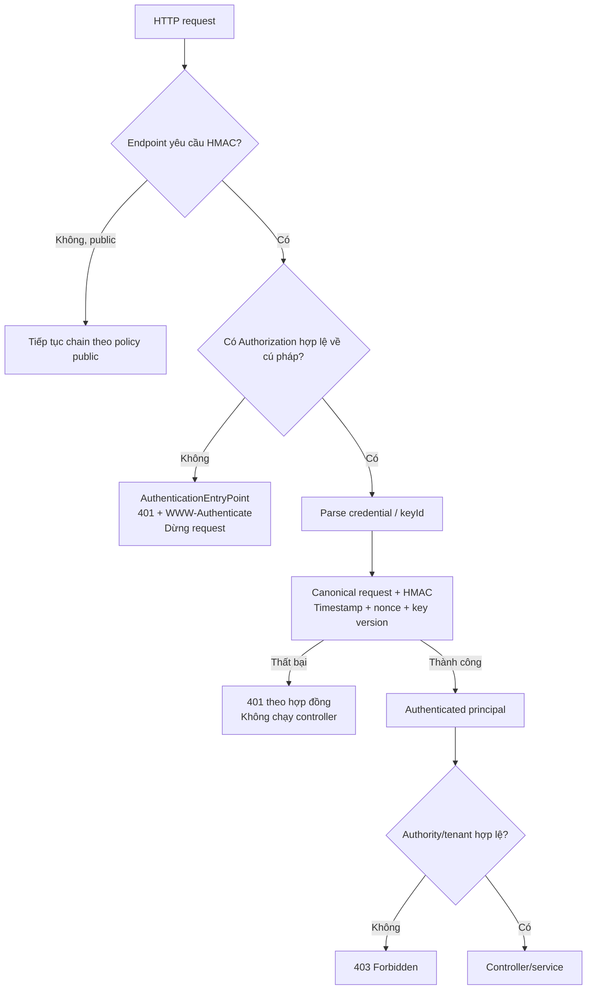
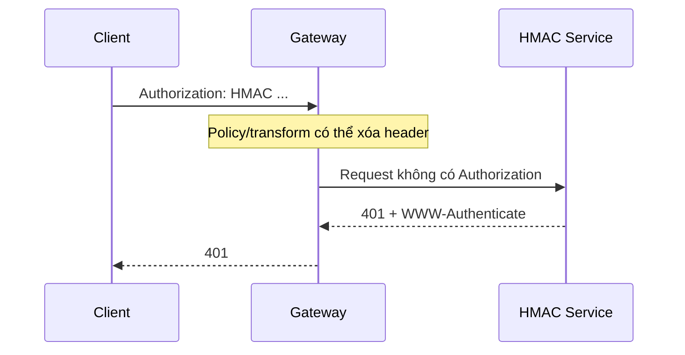

# Thiếu Authorization header: error semantics khi xác thực HTTP request bằng HMAC

## 1. Bối cảnh: request không mang thông tin xác thực

Trong module `SECURITY_AUTHENTICATION_HMAC_REQUEST_AUTHENTICATION`, client và server chia sẻ một secret hoặc một tập khóa có quản lý phiên bản. Client tính HMAC trên **canonical request** theo hợp đồng ký: HTTP method, URI, header được chọn và/hoặc hash của body. Service xác minh chữ ký, kiểm tra timestamp/nonce chống replay, chọn khóa đang hợp lệ khi key rotation và tạo principal cho bước phân quyền.

Chương **Error semantics** tập trung vào ý nghĩa của phản hồi HTTP khi một bước bảo mật thất bại. Chủ đề này xử lý một trường hợp đầu tiên và rất thường gặp: **request tới endpoint bắt buộc HMAC nhưng không có header `Authorization` mà hợp đồng yêu cầu**.

Ví dụ request:

```http
POST /api/orders HTTP/1.1
Host: api.example.test
Content-Type: application/json

{"sku":"A12","quantity":2}
```

Nếu hợp đồng yêu cầu chữ ký nằm trong `Authorization`, request trên **chưa cung cấp credential cần thiết để server xác thực**. Response thường đúng là:

```http
HTTP/1.1 401 Unauthorized
WWW-Authenticate: HMAC realm="signed-api"
Content-Type: application/problem+json
Cache-Control: no-store

{"type":"about:blank","title":"Unauthorized","status":401}
```

Header `WWW-Authenticate: HMAC realm="signed-api"` chỉ là **ví dụ về một authentication scheme riêng do API định nghĩa**. Không tồn tại quy tắc chung rằng tất cả API HMAC đều sử dụng cú pháp hay tên scheme này; client/server phải thống nhất cụ thể hợp đồng challenge và credential. Với HTTP authentication, phản hồi `401` cần có ít nhất một `WWW-Authenticate` challenge thích hợp.

**Quy tắc trung tâm:** thiếu `Authorization` trên endpoint buộc dùng credential trong header đó là **thiếu xác thực (authentication)**, không phải bằng chứng rằng client đã xác thực nhưng không có quyền (authorization). Vì vậy không tự động trả `403 Forbidden`.

### Kết quả học tập

Sau bài học, người học có thể:

1. Quyết định mã HTTP hợp lý cho request thiếu `Authorization`, credential sai và client đã xác thực nhưng thiếu authority.
2. Thiết kế response `401` ổn định, có challenge hợp lệ theo hợp đồng nhưng không lộ thông tin nhạy cảm.
3. Xử lý đúng trường hợp public endpoint, CORS preflight và các scheme khác.
4. Cài đặt đường lỗi trước controller trong Spring Security Servlet và WebFlux.
5. Phân biệt trường hợp client không gửi header với gateway/proxy làm mất header khi chuyển tiếp.
6. Kiểm thử không có side effect, cùng các tình huống timestamp/nonce, key rotation và phân quyền.

## 2. Định nghĩa “thiếu Authorization header” theo hợp đồng API

`Authorization` là tên HTTP request header tiêu chuẩn dùng mang credential cho một authentication scheme. Trong HTTP, **tên header không phân biệt chữ hoa/chữ thường**: `Authorization`, `authorization` và `AUTHORIZATION` đều cùng một field name về mặt ngữ nghĩa.

Tuy nhiên, HMAC không bắt buộc phải dùng header này. Một số API đặt chữ ký trong `X-Signature` và `keyId`, timestamp, nonce ở header riêng; một số dùng hệ thống HTTP Message Signatures. Bài này giả định hợp đồng yêu cầu:

```http
Authorization: HMAC keyId="client-42",ts="1795834800",nonce="n-abc123",sig="BASE64_SIGNATURE"
```

Đây là **định dạng minh họa do dịch vụ tự định nghĩa**. Cần chuẩn hóa grammar chính xác, escaping/quoting, thứ tự tham số (nếu có ý nghĩa), chiều dài, mã hóa chữ ký và cách từ chối tham số trùng lặp. Không dùng cách parse chuỗi kiểu `split(",")` khi chưa xử lý quoted string và escape.

Trong hợp đồng này, **thiếu `Authorization`** nghĩa là HTTP request không chứa field đó ở vị trí mà service mong đợi. Phải phân biệt các trạng thái gần nhau:

| Tình trạng request | Ví dụ | Phân loại |
| --- | --- | --- |
| Không có field `Authorization` | Không có dòng header | Credential bắt buộc bị thiếu |
| Có field nhưng giá trị rỗng hoặc chỉ có whitespace | `Authorization:` | Credential không sử dụng được |
| Có scheme khác | `Authorization: Bearer abc` | Scheme không được API HMAC chấp nhận, trừ khi policy cho phép |
| Có scheme HMAC nhưng thiếu `sig` | `Authorization: HMAC keyId="a"` | Credential HMAC thiếu thành phần |
| Có signature nhưng sai | `Authorization: HMAC ...sig="bad"` | Xác thực thất bại |
| Có nhiều field `Authorization` hoặc nhiều giá trị gây mơ hồ | Hai dòng header `Authorization` | Từ chối ambiguity theo hợp đồng |
| Đủ credential và chữ ký hợp lệ, nhưng thiếu `orders:create` | HMAC hợp lệ | Lỗi phân quyền |
| Endpoint công khai không yêu cầu HMAC | `GET /api/health` | Không phải lỗi, nếu policy thực sự cho phép anonymous |

Không nhất thiết trả cùng mã giữa header **thiếu** và credential **sai cú pháp**; với endpoint có bắt buộc HTTP authentication, `401` thường được dùng cho credential vắng mặt/không hợp lệ, còn một số lỗi định dạng request có thể nhận `400` theo hợp đồng. Dù chọn phương án nào, cần thống nhất xuyên suốt client, gateway và service.

**Lưu ý đặc biệt:** trường hợp “thiếu `Authorization`” chỉ có ý nghĩa nếu contract thực sự yêu cầu credential trong header đó. Nếu API dùng `X-Signature` và không dùng `Authorization`, sự vắng mặt của `Authorization` tự nó **không phải lỗi**. Hãy kiểm tra đúng bộ header mà version của scheme yêu cầu.

## 3. Vì sao response nên là 401, không phải 403?

HTTP `401 Unauthorized` có tên dễ gây hiểu nhầm: về mặt ngữ nghĩa, nó nói rằng request **chưa có thông tin xác thực hợp lệ cho tài nguyên được bảo vệ**. HTTP `403 Forbidden` nói rằng server hiểu request nhưng từ chối thực hiện; trong mô hình Spring Security phổ biến, đây là trường hợp **principal đã xác thực nhưng thiếu quyền truy cập**.

| Trạng thái bảo mật | Ví dụ | HTTP thường dùng | Client nên làm gì? |
| --- | --- | --- | --- |
| Chưa gửi HMAC credential | Thiếu `Authorization` | `401` | Cung cấp header/challenge scheme hợp lệ |
| Credential thiếu thành phần hoặc signature sai | `sig` không hợp lệ | `401` theo hợp đồng | Kiểm tra cách ký, key, thời gian và encoding |
| Timestamp quá hạn hoặc nonce đã dùng | Replay/freshness thất bại | Thường `401` theo hợp đồng | Tạo request mới theo chính sách timestamp/nonce |
| Đã xác thực, authority thiếu | `orders:read` nhưng cần `orders:create` | `403` | Kiểm tra quyền, không chỉ ký lại |
| Body/URL không hợp lệ ở tầng HTTP hoặc nghiệp vụ | Malformed JSON sau khi đã xác thực | `400` / `415` | Sửa request |
| Key store hoặc nonce store không khả dụng | Không thể xác minh an toàn | `5xx` thích hợp, ví dụ `503` | Retry theo chính sách vận hành; server phải fail closed |

Trong Spring Security, một `AccessDeniedException` khi request còn anonymous có thể được chuyển sang `AuthenticationEntryPoint` để trả `401`. Với principal đã xác thực, lỗi phân quyền thường đi tới `AccessDeniedHandler` để trả `403`.

Điều này không đồng nghĩa mọi loại `AccessDeniedException` đều mặc nhiên là `403` hoặc mọi lỗi `AuthenticationException` đều phải ném ra từ cùng một vị trí. **Vị trí filter và handler quyết định cách exception được dịch thành HTTP response**.

### Phân biệt authentication với authorization bằng ví dụ

```text
A. Không có Authorization:
    HMAC filter/entry point -> 401 -> controller KHÔNG chạy

B. Có Authorization nhưng HMAC không khớp:
    HMAC verifier/failure handler -> 401 -> controller KHÔNG chạy

C. HMAC hợp lệ, client thiếu orders:create:
    Xác thực thành công -> authorization -> 403

D. HMAC hợp lệ, đủ orders:create:
    Xác thực -> authorization thành công -> controller xử lý
```

Trong trường hợp C, request đã có principal; trả `401` có thể khiến client lặp lại thao tác ký dù vấn đề thực sự là policy quyền.

## 4. `WWW-Authenticate` và nội dung phản hồi

### 4.1. Challenge đi cùng phản hồi 401

Theo ngữ nghĩa HTTP authentication, server trả `401` kèm `WWW-Authenticate` để cho biết challenge có thể áp dụng. Trong một API tự định nghĩa scheme HMAC, có thể công bố:

```http
WWW-Authenticate: HMAC realm="signed-api"
```

`realm` mô tả không gian bảo vệ theo hợp đồng server. Nếu API hỗ trợ nhiều scheme, response có thể quảng bá nhiều challenge theo quy tắc HTTP. Không phát `WWW-Authenticate: Bearer` nếu API thực tế chỉ chấp nhận HMAC, vì client sẽ hiểu sai cách lấy credential.

Tài liệu API phải ghi rõ grammar của `Authorization`, canonical fields, key ID, thuật toán HMAC, encoding, timestamp/nonce và vòng đời khóa. Chỉ một challenge ngắn không đủ để mô tả toàn bộ hợp đồng ký.

Không nên ghi trực tiếp vào challenge các giá trị có thể làm lộ tình trạng khóa, client ID nhạy cảm hoặc nonce dự kiến. Nếu muốn trả thông tin đồng bộ đồng hồ, phải cân nhắc an toàn và quy ước rõ ràng; đừng tự mở rộng challenge khiến client cũ parse sai.

### 4.2. Body JSON ngắn và nhất quán

Một mẫu theo định dạng Problem Details:

```json
{
  "type": "about:blank",
  "title": "Unauthorized",
  "status": 401
}
```

Với `type: "about:blank"`, `title` nên phản ánh tên status chuẩn; `detail` nếu có nên nói chung rằng thông tin xác thực không hợp lệ. Response công khai nên tránh đưa ra:

- Shared secret hoặc bất kỳ phần nào của secret.
- Chữ ký HMAC server mong đợi.
- Nội dung canonical request nguyên vẹn chứa body/header nhạy cảm.
- Lý do phân biệt `keyId` có tồn tại hay đã bị thu hồi.
- Thông tin policy tenant, authority chi tiết và request nonce của client khác.

Có thể đặt `Cache-Control: no-store` để giảm khả năng lưu trữ response authentication. Với API stateless, không redirect sang form login HTML, không tạo session không cần thiết và không trả `200` cùng body `{"error":"unauthorized"}`.

### 4.3. API contract mẫu

| Thuộc tính | Ví dụ lựa chọn |
| --- | --- |
| Endpoint | `POST /api/orders` |
| Header bắt buộc | `Authorization` theo scheme HMAC riêng |
| Thiếu header | `401 Unauthorized` |
| Challenge | `WWW-Authenticate: HMAC realm="signed-api"` |
| Media type lỗi | `application/problem+json` |
| Body public | `type`, `title`, `status`; thông tin chung |
| Traceability | Request ID an toàn, gửi bằng header độc lập nếu có |
| Retry | Client tạo header và chữ ký mới theo canonical contract |
| Logging | Mã nội bộ `missing_authorization`, route, request ID; không log secret |

## 5. Phát hiện thiếu header ở đâu trong luồng request?

Nơi kiểm tra phụ thuộc kiến trúc authentication, nhưng nên là lớp **trước business handler**, chẳng hạn custom filter trong Spring Security Servlet hoặc `AuthenticationWebFilter` của Spring Security WebFlux.



Kiểm tra vắng mặt của header thường có thể làm rất sớm, **trước khi đọc body lớn để tính HMAC**, vì nếu contract bắt buộc `Authorization` thì khi thiếu đã đủ để từ chối request. Tuy vậy, gateway hoặc framework có thể có các kiểm tra tổng quát về kích thước, framing, CORS, routing ở phía trước; mã `413`, `400` hoặc lỗi transport có thể xuất hiện trước filter tùy kiến trúc. Đừng cam kết rằng mọi request thiếu header đều chắc chắn nhận `401` nếu bản thân request không thể được xử lý ở tầng HTTP.

Khi đã có header, verifier vẫn phải xác minh đầy đủ: hiện diện của header **không có nghĩa HMAC hợp lệ**.

## 6. Ví dụ Spring Security Servlet / Spring MVC

Đoạn sau minh họa custom `OncePerRequestFilter` dành cho `/api/**`. Nó chỉ xử lý bước **thiếu `Authorization` và xác thực credential**; phần tính HMAC, timestamp/nonce và key rotation được tách vào `HmacRequestAuthenticator`.

### 6.1. Interface của verifier

```java
@FunctionalInterface
interface HmacRequestAuthenticator {
    Authentication authenticate(
            HttpServletRequest request, String authorization)
            throws AuthenticationException, IOException;
}
```

Triển khai `authenticate` phải parse scheme, key ID và signature; xác minh canonical method/URI/header/body nếu hợp đồng có ký body; kiểm tra freshness/nonce và trả principal/authorities do server tin cậy tạo ra. Không được trả một `Authentication` đã xác thực khi chỉ mới đọc thấy chuỗi `Authorization`.

### 6.2. Filter phân nhánh rõ ràng

```java
public final class HmacHeaderAuthenticationFilter
        extends OncePerRequestFilter {

    private final HmacRequestAuthenticator authenticator;
    private final AuthenticationEntryPoint entryPoint;

    HmacHeaderAuthenticationFilter(
            HmacRequestAuthenticator authenticator,
            AuthenticationEntryPoint entryPoint) {
        this.authenticator = authenticator;
        this.entryPoint = entryPoint;
    }

    @Override
    protected boolean shouldNotFilter(HttpServletRequest request) {
        // Một endpoint công khai được định nghĩa cụ thể.
        return "/api/health".equals(request.getServletPath());
    }

    @Override
    protected void doFilterInternal(
            HttpServletRequest request,
            HttpServletResponse response,
            FilterChain chain) throws ServletException, IOException {

        List<String> values = Collections.list(
                request.getHeaders(HttpHeaders.AUTHORIZATION));

        if (values.size() != 1 || values.get(0).isBlank()) {
            SecurityContextHolder.clearContext();
            entryPoint.commence(
                    request, response,
                    new InsufficientAuthenticationException(
                            "Authorization header is missing or ambiguous"));
            return;
        }

        final Authentication authenticated;
        try {
            authenticated =
                    authenticator.authenticate(request, values.get(0));

            if (authenticated == null
                    || !authenticated.isAuthenticated()) {
                throw new AuthenticationServiceException(
                        "HMAC authenticator returned invalid result");
            }
        } catch (AuthenticationException ex) {
            SecurityContextHolder.clearContext();
            entryPoint.commence(request, response, ex);
            return;
        }

        SecurityContext context = SecurityContextHolder.createEmptyContext();
        context.setAuthentication(authenticated);
        SecurityContextHolder.setContext(context);

        // Ngoài catch: để authorization/exception translation phía sau xử lý.
        chain.doFilter(request, response);
    }
}
```

Các import được lược: `java.util.Collections`, `java.util.List`, `jakarta.servlet.*`, `jakarta.servlet.http.*`, `org.springframework.http.HttpHeaders` và các lớp Spring Security tương ứng. Code này giả định filter chỉ chạy trong security chain bảo vệ API và bộ verifier chịu trách nhiệm giới hạn/parse credential. Nếu verifier đọc request body, phải truyền một **request wrapper phát lại body** xuống chain; việc đọc body từ `request.getInputStream()` rồi gửi nguyên request có thể khiến `@RequestBody` ở controller nhận EOF.

**Những điều quan trọng trong ví dụ:**

- `getHeaders(...)` cho phép nhận diện nhiều giá trị thay vì tùy tiện lấy `getHeader(...)` đầu tiên khi có duplicate field. Nếu proxy gộp header thành một chuỗi, parser cũng phải từ chối grammar mơ hồ theo hợp đồng.
- `values.get(0).isBlank()` chỉ hợp lệ khi danh sách có đúng một phần tử và giá trị không `null` theo contract Servlet API. Kiểm tra chỉ xác nhận sự hiện diện, verifier vẫn phải validate scheme và tham số.
- Trong nhánh lỗi, gọi entry point rồi **`return`**; không gọi tiếp `chain.doFilter`.
- Không bao `chain.doFilter` trong khối `catch (AuthenticationException)` của verifier: lỗi của filter/controller phía sau phải được xử lý bởi thành phần sở hữu chúng.
- `SecurityContextHolder.createEmptyContext()` tạo context độc lập cho danh tính đã xác minh; `SecurityContextHolderFilter` trong cấu hình tiêu chuẩn dọn context theo vòng đời request.
- `InsufficientAuthenticationException` là một `AuthenticationException` thích hợp để biểu diễn yêu cầu chưa cung cấp credential đầy đủ. Message nội bộ này không được tự động echo sang response.

### 6.3. SecurityFilterChain và entry point 401

```java
@Bean
SecurityFilterChain signedApi(
        HttpSecurity http,
        HmacRequestAuthenticator authenticator) throws Exception {

    AuthenticationEntryPoint entryPoint = (request, response, ex) -> {
        response.setStatus(HttpServletResponse.SC_UNAUTHORIZED);
        response.setHeader(HttpHeaders.WWW_AUTHENTICATE,
                "HMAC realm=\"signed-api\"");
        response.setHeader(HttpHeaders.CACHE_CONTROL, "no-store");
        response.setContentType(
                MediaType.APPLICATION_PROBLEM_JSON_VALUE);
        response.setCharacterEncoding(StandardCharsets.UTF_8.name());
        response.getWriter().write(
                "{\"type\":\"about:blank\",\"title\":\"Unauthorized\",\"status\":401}");
    };

    AccessDeniedHandler deniedHandler = (request, response, ex) -> {
        response.setStatus(HttpServletResponse.SC_FORBIDDEN);
        response.setContentType(
                MediaType.APPLICATION_PROBLEM_JSON_VALUE);
        response.setCharacterEncoding(StandardCharsets.UTF_8.name());
        response.getWriter().write(
                "{\"type\":\"about:blank\",\"title\":\"Forbidden\",\"status\":403}");
    };

    return http
            .securityMatcher("/api/**")
            .sessionManagement(session -> session
                    .sessionCreationPolicy(SessionCreationPolicy.STATELESS))
            .requestCache(cache -> cache
                    .requestCache(new NullRequestCache()))
            .csrf(csrf -> csrf.disable())
            .httpBasic(AbstractHttpConfigurer::disable)
            .formLogin(AbstractHttpConfigurer::disable)
            .exceptionHandling(errors -> errors
                    .authenticationEntryPoint(entryPoint)
                    .accessDeniedHandler(deniedHandler))
            .authorizeHttpRequests(authz -> authz
                    .requestMatchers("/api/health").permitAll()
                    .requestMatchers(
                            HttpMethod.POST, "/api/orders")
                        .hasAuthority("orders:create")
                    .anyRequest().authenticated())
            .addFilterBefore(
                    new HmacHeaderAuthenticationFilter(
                            authenticator, entryPoint),
                    UsernamePasswordAuthenticationFilter.class)
            .build();
}
```

Đây là wiring minh họa Spring Security 6 với namespace Jakarta. Các import cấu hình được lược. `HmacRequestAuthenticator` phải do ứng dụng cung cấp.

- `securityMatcher` xác định chain cho `/api/**`. Nếu có nhiều security chain, cần đảm bảo không có chain đặt trước nuốt request thuộc API HMAC.
- `requestMatchers("/api/health").permitAll()` không tự tắt custom filter: `shouldNotFilter` ở ví dụ đồng bộ với chính sách public.
- Mặc dù filter chạy trước `ExceptionTranslationFilter`, nó đã tự gọi entry point khi thiếu/không hợp lệ `Authorization`; không mặc nhiên trông đợi `ExceptionTranslationFilter` bắt exception phát sinh **trước nó**.
- Khi HMAC hợp lệ, `AuthorizationFilter` tiếp tục kiểm tra `orders:create` và dùng denied handler trả `403` nếu thiếu.
- Tắt CSRF chỉ thích hợp với API stateless sử dụng credential trong header, không dựa vào cookie session của trình duyệt. Nếu có web login, tách chain và cấu hình CSRF thích hợp.
- Đừng đồng thời đăng ký custom HMAC filter làm servlet filter toàn cục và Spring Security filter; điều đó có thể tạo lần chạy ngoài thứ tự hoặc chạy lặp.

### 6.4. Khi để AuthorizationFilter phát hiện request anonymous

Một kiến trúc khác để converter “không có credential” trả về không có authentication attempt và để authorization yêu cầu `authenticated()`. Khi `AuthorizationFilter` từ chối anonymous, `ExceptionTranslationFilter` thường gọi `AuthenticationEntryPoint` trả `401`.

Cách này chỉ an toàn nếu **mọi route bắt buộc HMAC** được policy bảo vệ và không có cơ chế xác thực khác tạo principal được chấp nhận ngoài dự kiến. Với HMAC-only API, việc kiểm tra thiếu header trực tiếp ở filter khiến semantics rõ ràng hơn; cả hai hướng đều cần integration test để không cho request anonymous đến controller.

## 7. Spring WebFlux: reactive authentication và header thiếu

Spring WebFlux dùng `SecurityWebFilterChain`, `AuthenticationWebFilter`, `ServerAuthenticationConverter`, `ReactiveAuthenticationManager`. Phân loại lỗi vẫn giống HTTP Servlet, nhưng không dùng `HttpServletRequest` và không gọi `block()`.

Ví dụ converter cho API yêu cầu HMAC:

```java
public final class HmacHeaderConverter
        implements ServerAuthenticationConverter {

    @Override
    public Mono<Authentication> convert(ServerWebExchange exchange) {
        String path = exchange.getRequest()
                .getPath().pathWithinApplication().value();

        if ("/api/health".equals(path)) {
            return Mono.empty();
        }

        List<String> values = exchange.getRequest()
                .getHeaders()
                .getOrEmpty(HttpHeaders.AUTHORIZATION);

        if (values.size() != 1 || values.get(0).isBlank()) {
            return Mono.error(new InsufficientAuthenticationException(
                    "HMAC Authorization header is required"));
        }

        // Token này CHƯA xác thực; manager sẽ kiểm HMAC.
        Authentication candidate =
                UsernamePasswordAuthenticationToken.unauthenticated(
                        values.get(0), null);

        return Mono.just(candidate);
    }
}
```

`AuthenticationWebFilter` được cấu hình với converter này và `ReactiveAuthenticationManager`. Manager parse scheme rồi gọi verifier reactive để tra khóa, dựng canonical request, xác minh signature và chống replay, sau đó trả `Authentication` đã xác thực. Tránh truyền raw shared secret trong token, Reactor Context hoặc log.

Đường lỗi của converter/manager dùng `ServerAuthenticationEntryPointFailureHandler` kết nối `ServerAuthenticationEntryPoint` để trả `401` kèm `WWW-Authenticate`. Ví dụ handler:

```java
ServerAuthenticationEntryPoint entryPoint = (exchange, ex) -> {
    ServerHttpResponse response = exchange.getResponse();
    response.setStatusCode(HttpStatus.UNAUTHORIZED);
    response.getHeaders().set(
            HttpHeaders.WWW_AUTHENTICATE, "HMAC realm=\"signed-api\"");
    response.getHeaders().setCacheControl("no-store");
    response.getHeaders().setContentType(
            MediaType.APPLICATION_PROBLEM_JSON);

    byte[] payload = """
            {"type":"about:blank","title":"Unauthorized","status":401}
            """.getBytes(StandardCharsets.UTF_8);

    return response.writeWith(Mono.just(
            response.bufferFactory().wrap(payload)));
};
```

Trong cấu hình security, gắn entry point vào `exceptionHandling` và failure handler của `AuthenticationWebFilter`; dùng `NoOpServerSecurityContextRepository` khi API không lưu session. Principal của WebFlux đi qua **Reactor Context**, không nên đọc bằng `SecurityContextHolder` kiểu Servlet.

Nếu HMAC ký body, converter/verifier cần đọc body reactive bằng `Flux<DataBuffer>` có giới hạn, giải phóng buffer phù hợp và phát lại đúng bytes đã xác minh cho handler. **Thiếu Authorization** có thể bị từ chối trước bước gom body nếu kiến trúc chọn điều đó; đừng làm một request thiếu credential tiêu tốn toàn bộ body buffering một cách không cần thiết. Nếu đã có filter buffering body ở trước authentication, phải đặt limit và kiểm thử đường thiếu header.

## 8. Route công khai, CORS preflight và nhiều cơ chế xác thực

### 8.1. Endpoint public

`GET /api/health` có thể được cấu hình `permitAll` và skip HMAC theo matcher. Nếu filter vẫn buộc `Authorization` trên route này, client sẽ nhận `401` dù policy cuối cùng cho phép anonymous.

Cách chọn route public nên rõ ràng, ít và có kiểm thử; không skip toàn bộ `/api/**` khi thiếu header. Với API multi-tenant, một request public không nên tự mang principal có authority cao chỉ vì có header X-Client-Id.

### 8.2. CORS preflight

Trình duyệt thường gửi một preflight trước request chứa header `Authorization`:

```http
OPTIONS /api/orders HTTP/1.1
Origin: https://console.example.test
Access-Control-Request-Method: POST
Access-Control-Request-Headers: authorization,content-type
```

Preflight thường **không mang `Authorization` chứa HMAC thật**. Nếu API thực sự dùng browser, cấu hình CORS để xử lý preflight **trước** custom HMAC authentication, với allowlist origin/method/header thích hợp. Sau preflight, request business thực vẫn phải gửi signature và được xác minh đầy đủ.

Không xử lý bằng cách cho **mọi** request `OPTIONS` không cần xác thực nếu các endpoint `OPTIONS` thực có thao tác nghiệp vụ hoặc routing khác. Nếu hệ thống machine-to-machine không dùng browser, có thể không cần CORS.

**Bảo vệ shared secret:** JavaScript chạy trong browser thường không thể giữ bí mật dài hạn khỏi người dùng cuối và script bên thứ ba. Không đưa shared secret HMAC server-to-server vào frontend public; nếu cần browser, cân nhắc backend ký request hoặc một cơ chế xác thực phù hợp trust model.

### 8.3. API hỗ trợ nhiều scheme

Nếu một API cố ý chấp nhận cả Bearer và HMAC, không nên để HMAC-only filter từ chối mọi request `Authorization: Bearer ...` trước khi Bearer authentication có cơ hội chạy. Cấu hình rõ matcher, chuỗi security filter hoặc authentication manager resolver theo scheme. Mỗi endpoint phải có policy cho scheme nào được chấp nhận và authority nào được công nhận.

Không suy diễn “thiếu Authorization” đồng nghĩa “chưa xác thực” nếu có cơ chế authentication độc lập, đáng tin cậy khác theo hợp đồng (mTLS chẳng hạn). Ngược lại, không bỏ qua credential bắt buộc của HMAC chỉ vì có một header do client tự khai.

## 9. Gateway/proxy làm mất Authorization header

Một nguyên nhân triển khai rất phổ biến của `401` là **client đã gửi `Authorization` nhưng service phía sau proxy không nhận được**. Về quan sát HTTP tại service, header vẫn thiếu, song root cause nằm ở đường chuyển tiếp.



Các điểm cần xem khi debug:

- Gateway có quy tắc strip hoặc rewrite `Authorization` để xử lý scheme khác hay không.
- Reverse proxy có forward đúng header qua từng hop không.
- Service có dùng một security chain khác, route khác hoặc filter bypass theo path sau rewrite không.
- Có HTTP/1.1 và HTTP/2 chuyển đổi, normalization header name, duplicate authorization field gây reject không.
- Một upstream authentication module có thể đã xác thực tại edge rồi chủ động xóa credential; khi đó cần **hợp đồng danh tính giữa gateway và service** riêng.

Không sửa lỗi bằng cách tin bất kỳ `X-Authenticated-User` hoặc `X-Client-Id` do Internet gửi. Nếu edge xác thực thay cho service, nó phải loại bỏ header identity do client tự khai, truyền assertion qua kênh tin cậy (chẳng hạn mTLS và policy mạng, hoặc token/assertion ký có xác minh), đồng thời service vẫn áp dụng authorization phù hợp. Nếu service có nhiệm vụ **tự xác minh HMAC**, nó cần nhận đủ credential và dữ liệu canonical.

Một cách chẩn đoán an toàn là log boolean như `authorization_present=true/false`, request ID, route và trusted gateway identifier. Không log giá trị `Authorization`, signature, shared secret hoặc canonical body đầy đủ. Đối chiếu log tại edge và service theo request ID để tìm hop làm mất header.

### Forwarded header không thay Authorization

`Forwarded` và `X-Forwarded-*` có thể mô tả scheme, host, client IP hoặc prefix từ proxy, nhưng **không phải credential**. Chúng không thể thay thế `Authorization` bị thiếu.

Nếu hợp đồng HMAC ký URI/host public, service cần dựng đúng canonical target sau path rewrite bằng metadata proxy **đáng tin cậy**. Đừng lấy `Forwarded` do client tự thêm để “sửa” 401, cũng đừng thử nhiều URI candidate cho đến khi HMAC khớp.

## 10. HMAC verification sau khi đã có header

Có header `Authorization` chỉ cho phép đi tiếp đến **bước xác minh**, không cho phép trực tiếp vào controller. Verifier phải có một hợp đồng ký xác định.

Ví dụ canonical form (minh họa, không phải chuẩn chung):

```text
HMAC-v1
POST
/api/orders
content-type:application/json
BASE64(SHA256(EXACT_BODY_BYTES))
1795834800
n-abc123
```

Server phải thống nhất với client về cách viết method, raw path/query, signed headers, body bytes, timestamp format, nonce và key ID. Nếu body có JSON tương đương về ngữ nghĩa nhưng bytes khác, SHA-256 sẽ khác nếu hợp đồng ký raw bytes.

Các bước xác minh sau khi parse header:

1. Chọn credential từ `keyId`, kiểm tra key version còn active hoặc nằm trong overlap rotation; secret chỉ ở server.
2. Xây canonical request từ dữ liệu thực nhận ở đúng trust boundary; reject ambiguity do gateway rewrite, duplicate signed header hoặc encoding khác hợp đồng.
3. Tính HMAC đúng thuật toán (ví dụ HMAC-SHA256); decode và so sánh signature bytes bằng thao tác phù hợp giảm rò rỉ thời gian.
4. Kiểm tra timestamp trong khoảng cho phép và đồng hồ có clock skew theo policy.
5. Chống replay bằng nonce atomic theo namespace client/credential phù hợp với cửa sổ thời gian; hai request đồng thời cùng nonce không được đều thành công.
6. Gắn principal và authorities theo ánh xạ tin cậy phía server; kiểm tra quyền truy cập tài nguyên/tenant riêng sau authentication.

Một request không có `Authorization` thường có thể bị chặn ở bước 0 mà **không truy cập key store/nonce store**. Không coi missing header là replay: không nên chiếm nonce hoặc tạo bản ghi khóa khi còn chưa có credential cần parse.

Nếu nonce store bị lỗi, server phải **fail closed**; lỗi vận hành thường cần `5xx` thích hợp, không được cho request đi tiếp vì chữ ký “có vẻ đúng”. Tương tự, key rotation không có nghĩa thử tùy ý tất cả secret hoặc cho client chọn key ngoài policy.

## 11. Error semantics và nguy cơ lộ thông tin

### 11.1. Response ổn định, log nội bộ có lý do

Có thể phân loại sự kiện nội bộ:

| Mã log nội bộ | Nguyên nhân | Response công khai |
| --- | --- | --- |
| `missing_authorization` | Không thấy field bắt buộc | `401` chung |
| `blank_authorization` | Header có nhưng trống | `401` chung |
| `ambiguous_authorization` | Duplicate hoặc giá trị không xác định | `401` hoặc `400` theo hợp đồng |
| `unsupported_auth_scheme` | Scheme không được phép | `401` chung |
| `invalid_hmac_signature` | HMAC mismatch | `401` chung |
| `hmac_replay_detected` | Nonce đã dùng | `401` chung theo hợp đồng |
| `insufficient_authority` | Principal hợp lệ thiếu quyền | `403` |
| `nonce_store_unavailable` | Không thể bảo đảm chống replay | `5xx` thích hợp |

Ghi lý do khác nhau trong log để hỗ trợ vận hành, nhưng hạn chế thông tin public nhằm tránh oracle tiết lộ key ID, trạng thái revoke hoặc chi tiết chữ ký. Metric thiếu header tăng đột ngột sau deploy gateway thường gợi ý mất header; chỉ dựa vào metric không đủ kết luận nguyên nhân, cần trace theo hop.

### 11.2. Không biến lỗi hạ tầng thành “thiếu header”

Nếu key store lỗi khi đã đọc được credential, việc chuyển mọi exception thành `401 missing_authorization` là sai và làm khó vận hành. Để lỗi hạ tầng đi qua error handler phù hợp, trả `503` hoặc mã khác theo hợp đồng, và giữ hệ thống fail closed.

Ngược lại, không trả `500` vì code chủ động ném một unchecked exception khi thấy header thiếu mà chưa có failure handler xử lý. Đó là lỗi thiết kế filter.

### 11.3. Mối quan hệ với retry

Client nhận `401 missing Authorization` nên **sửa cách gửi credential**, không retry vô hạn cùng request thiếu header. Với HMAC có timestamp/nonce, khi tạo lại request phải dùng metadata và chữ ký tương ứng; retry cùng nonce có thể bị replay checker từ chối.

Với thao tác ghi như tạo đơn hàng, cần idempotency key riêng. Nonce chống replay không tự bảo đảm tính idempotent nếu client ký lại cùng nghiệp vụ bằng nonce mới.

## 12. Kiểm thử với Spring Security Test và MockMvc

Mục tiêu test không chỉ là status code. Phải chứng minh request thiếu header **không vào controller/service** và response có đúng challenge, content type và không lộ chi tiết.

Ví dụ Spring MVC với `MockMvc`:

```java
mockMvc.perform(post("/api/orders")
                .contentType(MediaType.APPLICATION_JSON)
                .content("{\"sku\":\"A12\",\"quantity\":2}"))
        .andExpect(status().isUnauthorized())
        .andExpect(header().string(
                HttpHeaders.WWW_AUTHENTICATE,
                "HMAC realm=\"signed-api\""))
        .andExpect(content().contentTypeCompatibleWith(
                MediaType.APPLICATION_PROBLEM_JSON));

// Service spy hoặc test-double:
verify(orderService, never()).create(any(), any());
```

`orderService`, `mockMvc` và fixture phải được dựng trong test class có Spring Security filters. Không dùng `@AutoConfigureMockMvc(addFilters = false)` cho bài test security vì sẽ bỏ qua chính cơ chế cần kiểm chứng.

Test authority sau authentication phải dùng chữ ký hợp lệ, ví dụ:

```java
// Helper signedRequest(...) tạo HMAC thật theo key test, nonce mới.
mockMvc.perform(signedRequest(
                post("/api/orders"), "client-read-only"))
        .andExpect(status().isForbidden());
```

`signedRequest(...)` là test helper do dự án xây dựng; giá trị `client-read-only` phải ánh xạ đến client đã xác minh nhưng thiếu `orders:create`. Nếu chỉ đặt một chuỗi giả trong header, test sẽ nhận `401` thay vì kiểm được `403`.

### Ma trận kiểm thử khuyến nghị

| Ca thử | Kết quả |
| --- | --- |
| Protected endpoint không có `Authorization` | `401` + challenge; không gọi service |
| Header khác casing tên field | Vẫn được nhận diện cùng header |
| Header rỗng hoặc chỉ có khoảng trắng | Từ chối theo hợp đồng, không đi tới HMAC verifier |
| Có hai `Authorization` field | Từ chối mơ hồ, không chọn ngẫu nhiên giá trị |
| `Authorization: Bearer ...` trên HMAC-only route | Từ chối scheme, không tạo principal HMAC |
| HMAC signature sai hoặc key bị thu hồi | `401` chung; không tiết lộ trạng thái key |
| HMAC hợp lệ, quyền thiếu | `403` |
| HMAC hợp lệ, quyền đủ | `2xx` theo endpoint |
| Body thay đổi sau khi ký | Signature mismatch, controller không chạy |
| Timestamp quá hạn, nonce đã dùng | Từ chối trước controller |
| Key store/nonce store lỗi | Fail closed, `5xx` phù hợp |
| Public `/api/health` không có credential | Thành công nếu policy cho phép |
| CORS preflight hợp lệ không mang Authorization | Được xử lý theo CORS policy |
| API hỗ trợ nhiều scheme | Chỉ scheme phù hợp được xử lý bởi filter tương ứng |
| Gateway làm mất Authorization | `401` tại service; trace tìm được hop mất header |
| Gateway rewrite path/host | HMAC dùng canonical representation theo hợp đồng |
| Hai request cùng nonce chạy đồng thời | Không cùng vượt qua replay checker |
| Nhiều `SecurityFilterChain` | Protected request luôn đi qua HMAC policy |

Với WebFlux, áp dụng `WebTestClient` và các assertion tương ứng:

```java
webTestClient.post()
        .uri("/api/orders")
        .contentType(MediaType.APPLICATION_JSON)
        .bodyValue("{\"sku\":\"A12\",\"quantity\":2}")
        .exchange()
        .expectStatus().isUnauthorized()
        .expectHeader().valueEquals(
                HttpHeaders.WWW_AUTHENTICATE,
                "HMAC realm=\"signed-api\"");
```

Nên bổ sung test trực tiếp với gateway staging hoặc một proxy giống production, vì `MockMvc` và `WebTestClient` không tự chứng minh reverse proxy có giữ `Authorization` hay không.

## 13. Checklist vận hành khi khách hàng báo “401 thiếu Authorization”

1. **Xác minh endpoint và contract**: request đó có thực sự yêu cầu `Authorization` theo HMAC version đang sử dụng không?
2. **Kiểm tra tại client**: thư viện HTTP có gửi header không; có ghi đè bởi interceptor, redirect sang host khác hoặc thay đổi authentication scheme không?
3. **Kiểm tra tại edge/gateway**: credential có được forward qua mọi hop không; có chính sách strip/rewrite hoặc chuyển hướng route không?
4. **Kiểm tra tại service**: security chain đúng, filter đúng thứ tự, parser reject duplicate/blank đúng contract, matcher public được cấu hình chính xác.
5. **Đối chiếu request ID ở mỗi hop**: log chỉ trạng thái hiện diện và mã lỗi, tuyệt đối không dump `Authorization` hay shared secret.
6. **Phân loại sau khi header có mặt**: signature mismatch, canonical path/query/body khác, clock skew, nonce lặp hay key rotation.
7. **Kiểm tra authorization**: principal đã xác thực nhưng thiếu authority phải được phản hồi `403` theo policy, và kiểm tra ownership/tenant riêng.
8. **Chặn retry gây side effect**: request `401` không tới controller; request ghi được xác thực nên có idempotency/retry contract rõ.

## 14. Bài thực hành: thiết kế semantics cho signed order API

Xây API `POST /api/orders` bắt buộc `Authorization: HMAC ...` theo hợp đồng credential riêng. Canonical request phải gồm method, path/query, các header được ký, SHA-256 raw JSON body, timestamp và nonce. Credential `keyId` chọn đúng phiên bản shared secret đang được cho phép. Endpoint `GET /api/health` là public; `POST /api/orders` yêu cầu `orders:create`.

Lần lượt thực hiện:

1. Viết parser từ chối header thiếu, trống, duplicate, scheme khác và auth-param sai theo quy ước.
2. Cấu hình authentication entry point trả `401` với challenge riêng của API và body problem JSON chung; dừng request trước controller.
3. Viết verifier tính HMAC đúng canonical bytes; kiểm tra timestamp và nonce atomic, key rotation và principal/authority server-side.
4. Cấu hình authorization trả `403` khi HMAC đúng nhưng thiếu `orders:create`; bảo vệ tài nguyên theo tenant.
5. Đặt gateway phía trước, thử request có và không có `Authorization`; kiểm tra header có đi tới service và canonical URI có bị rewrite không.
6. Viết unit/integration tests cho từng nhánh, đảm bảo `401`/`403` không tạo business side effect; đánh giá retry sau timeout với nonce và idempotency key.
7. Kiểm tra log/metrics: thấy `missing_authorization` hoặc lý do nội bộ thích hợp mà không ghi credential thô.

**Tiêu chí đạt:** Endpoint bắt buộc HMAC trả phản hồi `401` rõ ràng khi `Authorization` thiếu, có challenge phù hợp hợp đồng, không chạy controller và không lộ secret; route public/preflight được xử lý đúng; credential hiện diện vẫn phải trải qua xác minh HMAC và chống replay; principal đã xác thực nhưng thiếu quyền được phân biệt bằng `403`. Khi triển khai qua gateway/proxy, hệ thống phân biệt được lỗi client không gửi header với lỗi hạ tầng làm mất header mà vẫn giữ cùng chính sách bảo mật công khai.
