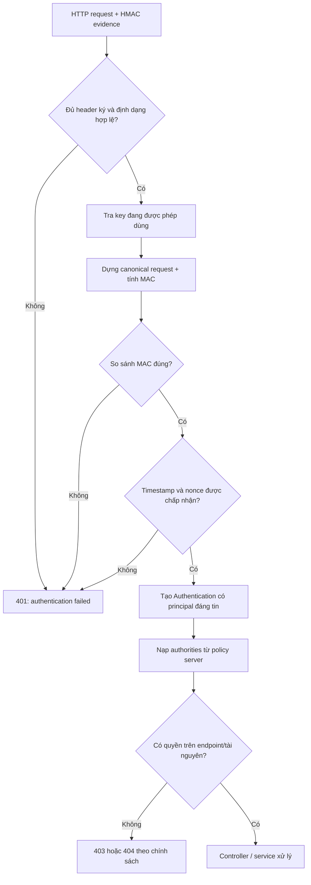

# Sai signature trong xác thực HTTP request bằng HMAC: nguyên nhân, error semantics và cách xử lý

## 1. Bối cảnh và mục tiêu

Trong module `SECURITY_AUTHENTICATION_HMAC_REQUEST_AUTHENTICATION`, client tạo chữ ký HMAC bằng shared secret trên một **canonical request** theo hợp đồng ký. Canonical request có thể chứa HTTP method, URI, query, các header được chọn và nội dung body hoặc body digest. Server dựng lại cùng biểu diễn byte, tính HMAC bằng secret tương ứng rồi so sánh với chữ ký client gửi. Timestamp và nonce được dùng để chống replay; key ID và trạng thái khóa giúp hỗ trợ key rotation.

Khi hai chữ ký **không khớp** (`invalid signature`), request chưa vượt qua bước xác thực. Đây là lỗi đặc biệt quan trọng vì nguyên nhân có thể là client dùng sai key, hai phía chuẩn hóa request khác nhau, gateway đã thay đổi dữ liệu ký hoặc có người cố tình chỉnh sửa request.

Bài thuộc chương **Error semantics**, với đề bài **Sai signature**. Sau bài học, người học có thể:

- Diễn giải thế nào là chữ ký HMAC sai và vì sao không thể tiếp tục request với danh tính đã xác thực.
- Phân biệt lỗi chữ ký, lỗi thời gian/nonce, lỗi thiếu quyền và sự cố hạ tầng; chọn HTTP status phù hợp.
- Thiết kế phản hồi lỗi nhất quán, ít tiết lộ thông tin và hữu ích cho client tích hợp.
- Tìm nguyên nhân mismatch ở canonical request, byte encoding, body, header và proxy/gateway.
- Cài đặt kiểm tra HMAC an toàn trong Java/Spring Security và kiểm thử các nhánh thất bại, key rotation, replay.

## 2. “Sai signature” nghĩa là gì?

Với cùng một thuật toán MAC, cùng secret và cùng dãy byte canonical, client và server phải tạo ra cùng kết quả:

```text
clientSignature = HMAC-SHA256(clientSharedSecret, clientCanonicalBytes)
serverSignature = HMAC-SHA256(serverSharedSecret, serverCanonicalBytes)

Hợp lệ khi:
    decode(clientSignature) == serverSignature
    và các điều kiện xác thực khác đều đạt
```

Điều kiện so khớp cần thực hiện trên **bytes** bằng cơ chế so sánh phù hợp để giảm rò rỉ thời gian. Hai chuỗi Base64 khác nhau không nhất thiết là bằng chứng dữ liệu HTTP khác nhau nếu hệ thống cho phép nhiều biểu diễn mã hóa; vì vậy hợp đồng phải định nghĩa chặt chẽ định dạng và verifier phải decode đúng một lần theo định dạng được chấp nhận. Với HMAC-SHA-256 đầy đủ, kết quả MAC là **32 byte** trước khi mã hóa Base64 hoặc hex.

Một request “sai signature” có thể thuộc ba nhóm nguyên nhân:

| Nhóm | Ví dụ | Bản chất |
| --- | --- | --- |
| Sai dữ liệu ký | Khác URI/query, body, signed headers, ký tự xuống dòng | Client và server tính HMAC trên hai dãy byte khác nhau |
| Sai vật liệu khóa/thuật toán | Sai secret, chọn nhầm key version, sai thuật toán hoặc mã hóa key | Không dùng cùng khóa/phép tính đã thỏa thuận |
| Can thiệp hoặc giả mạo | Body, method hoặc header nằm trong phạm vi ký bị sửa trên đường đi | Tính toàn vẹn request không được chứng minh |

**Không phải mọi request bị từ chối HMAC đều thực sự có MAC sai.** Một chữ ký có thể tính đúng nhưng request vẫn không được chấp nhận vì timestamp quá hạn, nonce đã dùng, key bị thu hồi hoặc client bị vô hiệu hóa. Đối với client, các lỗi này thường cùng xuất hiện như **lỗi xác thực**; đối với nội bộ, chúng cần mã nguyên nhân riêng để vận hành và điều tra.

## 3. Sai signature nằm ở đâu trong luồng xử lý?



Với một endpoint **bắt buộc HMAC**, sai chữ ký phải dừng request tại bước xác thực. Không được tự chuyển sang anonymous có quyền hoặc tạo `Authentication` đã xác thực chỉ dựa vào `X-Key-Id`.

Sau khi HMAC hợp lệ, client vẫn phải được kiểm tra **authorization**. Chẳng hạn client `partner-reporting` được cấp `ORDER_READ` ký đúng `POST /integrations/orders` vẫn bị `403 Forbidden` nếu endpoint cần `ORDER_CREATE`. HMAC chứng minh người gửi sở hữu secret và tính toàn vẹn của **phạm vi đã ký**; nó không tự chứng minh quyền nghiệp vụ.

## 4. Bảng quyết định HTTP status

Tùy contract của API, HTTP status phải diễn đạt đúng lớp lỗi:

| Tình huống | Status thường dùng | Lý do |
| --- | --- | --- |
| Thiếu/chưa cung cấp HMAC trên endpoint yêu cầu xác thực | `401 Unauthorized` | Chưa có credentials hợp lệ |
| Signature sai, Base64 không hợp lệ, MAC sai độ dài | `401 Unauthorized` | Bằng chứng xác thực không hợp lệ |
| Key ID không được chấp nhận, key bị thu hồi hoặc hết hạn | `401 Unauthorized` | Không xác thực được bằng key hợp lệ |
| Timestamp nằm ngoài cửa sổ chấp nhận | `401 Unauthorized` | Không thỏa hợp đồng xác thực có thời hạn |
| Nonce đã dùng lại hoặc từ chối theo replay policy | `401 Unauthorized` | Bằng chứng request không còn được chấp nhận |
| HMAC đúng nhưng client thiếu authority | `403 Forbidden` | Đã xác thực, chưa được phép thực hiện hành động |
| HMAC đúng nhưng tài nguyên thuộc tenant khác | `403` hoặc `404` | Theo chính sách che giấu tài nguyên của ứng dụng |
| JSON nghiệp vụ không đúng schema sau khi xác thực hợp lệ | `400 Bad Request` hoặc lỗi validation tương ứng | Dữ liệu nghiệp vụ không hợp lệ |
| Request body vượt giới hạn cho phép | `413 Content Too Large` | Giới hạn kích thước request, không phải bằng chứng secret sai |
| Vượt rate limit theo chính sách | `429 Too Many Requests` | Bảo vệ tài nguyên và chống abuse |
| Kho key hoặc nonce store không sẵn sàng | Lỗi server phù hợp, thường `503 Service Unavailable` | Không thể hoàn tất kiểm chứng; phải fail closed |

Đối với API HMAC-only, **`401` là kết quả mặc định hợp lý cho sai signature**. Tuy nhiên, ứng dụng phải nhất quán với mô hình xác thực được công bố. Theo ngữ nghĩa HTTP, response `401` cần có trường `WWW-Authenticate` chứa challenge phù hợp; nếu hệ thống tự định nghĩa authentication scheme `HMAC`, phải mô tả scheme/challenge đó trong contract. Không gửi `WWW-Authenticate: Bearer` nếu endpoint không hỗ trợ Bearer.

Việc chia `401` với `400` phụ thuộc cách API định nghĩa lỗi **HTTP request syntax** so với **credential syntax**. Ví dụ request-line HTTP không hợp lệ có thể bị container từ chối bằng `400` trước khi tới filter; một `X-Signature` không decode được trên endpoint cần HMAC nên được xử lý nhất quán như authentication failure.

**Tuyệt đối không trả `200` kèm nội dung “signature invalid”** rồi vẫn gọi nghiệp vụ. HTTP status phải giúp client và proxy hiểu request đã bị từ chối.

## 5. Thiết kế error response an toàn

Một phản hồi lỗi nên đủ ổn định để bên tích hợp biết yêu cầu cần được ký lại, nhưng không trở thành kênh dò secret hoặc khám phá key ID. Ví dụ JSON:

```http
HTTP/1.1 401 Unauthorized
Content-Type: application/problem+json
Cache-Control: no-store
WWW-Authenticate: HMAC realm="integrations"

{
  "type": "about:blank",
  "title": "Unauthorized",
  "status": 401,
  "code": "INVALID_REQUEST_AUTHENTICATION",
  "requestId": "req-8f42"
}
```

Đây là **mẫu error contract do ứng dụng tự quy định**. `code` và `requestId` là các extension field; `HMAC` trong `WWW-Authenticate` là tên scheme giả định, phải được tài liệu API định nghĩa trước khi triển khai. Với `application/problem+json`, các trường cơ bản theo Problem Details được sử dụng để giữ một cấu trúc thống nhất.

Lý do nên trả cùng một thông điệp bên ngoài cho nhiều loại lỗi xác thực:

- Tránh để client phân biệt dễ dàng “key ID có tồn tại” và “chữ ký chỉ sai một chút”.
- Tránh để phản hồi tiết lộ secret, canonical bytes, signature phía server hoặc chính sách nonce/key.
- Tránh tạo oracle cho kẻ tấn công suy đoán nội bộ từ các mã hoặc thông báo quá chi tiết.
- Duy trì một mã lỗi có thể xử lý được cho SDK: **request chưa được xác thực, cần kiểm tra lại cấu hình ký**.

Không đưa dữ liệu sau vào JSON hay response header: shared secret, signature do server tự tính, phần dữ liệu nhạy cảm trong body, danh sách key version hợp lệ hoặc trace chi tiết của verifier.

Ở hệ thống nội bộ có thể ghi **mã nguyên nhân nội bộ** như `HMAC_FORMAT_INVALID`, `HMAC_MAC_MISMATCH`, `HMAC_CLOCK_SKEW`, `HMAC_NONCE_REPLAY`, `HMAC_KEY_REVOKED`. Các mã ấy chỉ dùng trong telemetry/log bảo mật với quyền truy cập và chính sách lưu trữ phù hợp, không nhất thiết gửi cho client.

## 6. Những nguyên nhân sai chữ ký phổ biến

### 6.1. Khác canonical request

Ví dụ client ký:

```text
POST
/public-api/orders?source=partner
x-timestamp:2026-11-28T03:15:00Z
x-nonce:n-100
sha256-body:<hex-digest>
```

Nhưng backend dựng:

```text
POST
/integrations/orders?source=partner
x-timestamp:2026-11-28T03:15:00Z
x-nonce:n-100
sha256-body:<hex-digest>
```

Một gateway đã rewrite path từ `/public-api/orders` sang `/integrations/orders`. Hai chuỗi byte khác nhau nên HMAC khác nhau dù key và body không đổi. Phải thiết kế **điểm xác minh** phù hợp: verify tại gateway trước rewrite, hoặc có hợp đồng tin cậy để backend khôi phục request-target bên ngoài.

Không giải quyết bằng cách tùy tiện bỏ path khỏi chữ ký hoặc thử nhiều path cho đến khi có một chuỗi khớp; việc mở rộng tập biểu diễn được chấp nhận có thể tạo lỗ hổng request confusion.

### 6.2. Query, percent-encoding và Unicode

Các cặp sau có thể cho kết quả xử lý ứng dụng giống hoặc gần giống nhau nhưng là **chuỗi byte khác nhau**:

```text
?a=1&b=2         vs  ?b=2&a=1
?name=hello%20x   vs  ?name=hello+x
/orders/%2F       vs  /orders//
Unicode NFC       vs  Unicode NFD
```

Hợp đồng ký phải quy định request-target được ký ở dạng nào; có sort query hay không, xử lý tham số trùng tên, dấu `+`, percent-encoding và chuẩn hóa Unicode như thế nào. Không tự động gọi `URLDecoder` rồi ghép lại mà không có contract; kết quả sau gateway có thể khác client.

### 6.3. Header không nhất quán

Khác biệt thường gặp:

- Tên header viết hoa/thường; tên header HTTP không phân biệt hoa/thường nhưng canonicalizer phải thống nhất cách biểu diễn.
- Whitespace đầu/cuối hoặc nhiều dấu cách giữa các từ trong giá trị header.
- Nhiều header trùng tên; gateway gộp nhiều giá trị thành một dòng theo cách không giống client.
- Header được ký bị gateway thay, thêm hoặc loại bỏ. Ví dụ `Host`, `Forwarded`/`X-Forwarded-*` hoặc `Content-Type`.
- Client ký `Connection`, `Transfer-Encoding` hoặc header phụ thuộc hop; proxy thay framing khiến signature mismatch.

Với API HMAC, hãy dùng một **tập signed headers được server quy định**. Các trường bắt buộc như key ID, timestamp, nonce và body digest không thể được client tùy ý bỏ khỏi chữ ký. Từ chối giá trị header ký trùng/mơ hồ nếu contract không giải thích cách xử lý.

### 6.4. Body bytes bị biến đổi

JSON sau có thể là dữ liệu nghiệp vụ tương đương, nhưng **raw bytes khác nhau**:

```json
{"id":"O-17","amount":125000}
```

```json
{
  "amount": 125000,
  "id": "O-17"
}
```

Nếu hợp đồng ký **hash raw body**, signer phải hash **đúng bytes được gửi**, còn verifier hash **đúng bytes được nhận sau decoding theo hợp đồng**. Không parse JSON rồi serialize lại để tính hash vì thứ tự field, khoảng trắng, escape hoặc charset có thể đổi.

Ở Spring MVC, filter đọc `getInputStream()` để tính hash có thể làm controller `@RequestBody` mất body; cần wrapper replayable có giới hạn. Ở WebFlux, cần quản lý `Flux<DataBuffer>` và phát lại bytes thông qua `ServerHttpRequestDecorator` sau khi verifier đã đọc.

Proxy nén/giải nén hoặc thay encoding body cũng gây mismatch nếu không có contract chỉ rõ bytes nào được ký. `Transfer-Encoding: chunked` là framing ở HTTP/1.1; không nên ký raw chunk-size hay header transport như một phần nội dung ứng dụng.

### 6.5. Secret, key ID và key rotation sai

Ví dụ client ký bằng `key-2026-b` nhưng gửi `X-Key-Id: key-2026-a`. Server tra secret của key A, MAC không khớp. Một khóa cũ hết hạn/thu hồi cũng không được dùng để xác thực, ngay cả khi còn tạo ra MAC trùng với secret cũ.

Để rotation đúng, cần quy định key version, thời điểm hiệu lực, overlap window, mapping key → client/tenant, cache invalidation và chính sách thu hồi. **Không tự thử mọi secret còn tồn tại** nếu contract yêu cầu xác định rõ key ID; điều đó làm mờ audit trail và tăng nguy cơ chấp nhận khóa không còn dự định sử dụng.

### 6.6. Format signature và encoding khác nhau

Client dùng Base64 URL-safe nhưng server mong Base64 chuẩn; client ghi hex chữ hoa nhưng server lại decode theo Base64; hai bên sử dụng UTF-16/UTF-8 khác nhau; hoặc client cắt ngắn MAC ngoài hợp đồng. Những trường hợp này gây lỗi dù thông tin nghiệp vụ giống nhau.

Với HMAC-SHA-256 đầy đủ, yêu cầu decode chữ ký ra **đúng 32 byte** và dùng thuật toán đã thỏa thuận. Nếu contract có hỗ trợ MAC truncation, phải xác định rõ kích thước tối thiểu, format và bảo mật tương ứng; không âm thầm chấp nhận bất kỳ độ dài nào.

## 7. Quy trình chẩn đoán signature mismatch

Trình tự debug an toàn:

1. **Xác minh contract:** thuật toán HMAC, tên key ID, định dạng Base64/hex, encoding, ký tự LF/CRLF, dấu newline cuối, field order.
2. **Xác minh key lifecycle:** client và server có đang dùng cùng key version còn hiệu lực; có cache secret cũ hay không.
3. **So từng thành phần canonical:** method, raw path/query, signed headers, timestamp, nonce, body digest. So độ dài và hash của từng thành phần trong môi trường debug được kiểm soát.
4. **Kiểm tra body bytes:** encoding, JSON serialization, content compression/decompression, Content-Type và bất kỳ middleware đọc/thay body.
5. **Kiểm tra các hop:** CDN/gateway/reverse proxy rewrite path, Host, query, header, content encoding; chỉ tin `Forwarded`/`X-Forwarded-*` từ proxy đáng tin.
6. **Kiểm tra timestamp/nonce:** nếu MAC đúng nhưng vẫn trả `401`, xác định lỗi còn nằm ở thời gian, replay hay trạng thái key/policy.
7. **Đối chiếu test vector độc lập:** dùng vector có canonical bytes và kết quả MAC đã xác nhận, tránh cả signer lẫn verifier cùng mắc một lỗi.

Không log shared secret hoặc signature do server tính để “so bằng mắt”. Nếu cần điều tra, chỉ phát hành telemetry có phân quyền với request ID, key ID đã được che/biến đổi an toàn, mã bước lỗi, độ dài, hash không chứa dữ liệu nhạy cảm theo chính sách của tổ chức. Hash canonical request có thể tiết lộ thông tin qua đối chiếu nếu nội dung có ít khả năng biến thiên, nên không coi hash là vô điều kiện an toàn.

## 8. Ví dụ Java: kiểm tra MAC và phân loại lỗi

Ví dụ sau minh họa **phần kiểm tra chữ ký** bằng Java chuẩn. Nó giả định `SignedHmacRequest` được parser tạo ra từ request HTTP và canonical bytes được dựng theo hợp đồng ký; `KeyRegistry` chỉ trả key còn được phép dùng.

```java
import java.nio.charset.StandardCharsets;
import java.security.GeneralSecurityException;
import java.security.MessageDigest;
import java.util.Base64;
import javax.crypto.Mac;
import javax.crypto.spec.SecretKeySpec;
import org.springframework.security.authentication.BadCredentialsException;

public final class HmacSignatureVerifier {
    private final KeyRegistry keys;

    public HmacSignatureVerifier(KeyRegistry keys) {
        this.keys = keys;
    }

    public VerifiedHmacClient verifySignature(SignedHmacRequest signed) {
        // KeyRegistry phải kiểm tra trạng thái key và ràng buộc client/tenant.
        ActiveHmacKey key = keys.findUsable(signed.keyId())
                .orElseThrow(() ->
                        new BadCredentialsException("Invalid HMAC credentials"));

        byte[] receivedMac;
        try {
            receivedMac = Base64.getDecoder().decode(
                    signed.signatureBase64());
        } catch (IllegalArgumentException ex) {
            throw new BadCredentialsException(
                    "Invalid HMAC credentials", ex);
        }

        if (receivedMac.length != 32) {
            throw new BadCredentialsException("Invalid HMAC credentials");
        }

        byte[] expectedMac;
        try {
            Mac mac = Mac.getInstance("HmacSHA256");
            mac.init(new SecretKeySpec(
                    key.secretBytes(), "HmacSHA256"));
            expectedMac = mac.doFinal(signed.canonicalBytes());
        } catch (GeneralSecurityException ex) {
            // Misconfiguration/lỗi crypto provider là lỗi hạ tầng.
            throw new HmacInfrastructureException(
                    "Unable to compute HMAC", ex);
        }

        if (!MessageDigest.isEqual(expectedMac, receivedMac)) {
            throw new BadCredentialsException("Invalid HMAC credentials");
        }

        return new VerifiedHmacClient(
                key.clientId(), key.tenantId());
    }
}
```

Trong đó, các kiểu sau là **abstraction của ứng dụng**, cần tự triển khai:

```java
public record SignedHmacRequest(
        String keyId,
        String signatureBase64,
        byte[] canonicalBytes
) {
    public SignedHmacRequest {
        canonicalBytes = canonicalBytes.clone();
    }
    @Override
    public byte[] canonicalBytes() {
        return canonicalBytes.clone();
    }
}

public record VerifiedHmacClient(String clientId, String tenantId) {}

public record ActiveHmacKey(
        String clientId,
        String tenantId,
        byte[] secretBytes
) {
    public ActiveHmacKey {
        secretBytes = secretBytes.clone();
    }
    @Override
    public byte[] secretBytes() {
        return secretBytes.clone();
    }
}

public interface KeyRegistry {
    Optional<ActiveHmacKey> findUsable(String keyId);
}
```

`HmacInfrastructureException` là runtime exception do ứng dụng định nghĩa cho lỗi không thể tính MAC, không phải lỗi authentication của client. Các import như `java.util.Optional` được lược bớt ở đoạn định nghĩa để tập trung vào contract. Ví dụ cố ý **không** triển khai canonicalizer, timestamp/nonce hay key store để tránh tạo cảm giác đoạn code đơn lẻ đã là một HMAC verifier hoàn chỉnh.

Các nguyên tắc cần lưu ý:

- `MessageDigest.isEqual(expectedMac, receivedMac)` so sánh byte arrays theo cách phù hợp hơn `String.equals` để tránh timing leak; định dạng và độ dài vẫn phải được validate.
- Dùng `Mac.getInstance("HmacSHA256")` và secret lấy từ registry, **không** hash secret trước khi dùng trừ khi protocol riêng quy định.
- Nếu key ID không tồn tại, không tiết lộ khác biệt ở response so với MAC sai. Khi cần chống enumeration ở mức cao, còn phải xem xét chênh lệch thời gian của lookup và đường lỗi.
- Byte array chứa secret cần được hạn chế vòng đời và không đưa vào log, `toString()`, exception hoặc serialization. Các bản sao byte array giúp giới hạn sửa đổi không mong muốn nhưng không tự xóa memory.
- Nếu MAC sai, **không** tạo `Authentication` đã xác thực và **không** cấp authorities.

## 9. Bổ sung timestamp, nonce và chính sách key

Chỉ có `verifySignature(...)` chưa đủ chống replay: một request cũ với MAC đúng vẫn có thể bị gửi lại. Luồng của provider nên:

```java
VerifiedHmacClient client = signatureVerifier
        .verifySignature(signedRequest);

// Timestamp và nonce phải là các trường đã được bảo vệ bằng HMAC.
Instant now = clock.instant();
Instant timestamp = signedEvidence.timestamp();

if (timestamp.isBefore(now.minus(allowedSkew))
        || timestamp.isAfter(now.plus(allowedSkew))) {
    throw new BadCredentialsException("Invalid HMAC credentials");
}

boolean firstUse = nonceStore.claimAtomically(
        client.clientId(),
        signedEvidence.nonce(),
        replayTtl);
if (!firstUse) {
    throw new BadCredentialsException("Invalid HMAC credentials");
}

// Tiếp tục kiểm tra client đang hoạt động và tải authorities từ policy server.
Authentication verified = authenticationFactory.authenticated(client);
```

`signedRequest` và `signedEvidence` trong đoạn code đại diện **cùng một request đã parse**; parser phải kiểm soát format timestamp/nonce và khẳng định những giá trị ấy thực sự nằm trong canonical bytes được ký. `nonceStore.claimAtomically(...)` là API minh họa, cần triển khai bằng kho dùng chung hỗ trợ insert-if-absent nguyên tử với TTL. TTL phải bao phủ cửa sổ timestamp theo cách triển khai thực tế, kể cả độ lệch đồng hồ hợp lệ.

Nên kiểm tra MAC **trước** khi ghi nonce để tránh kẻ tấn công không có secret cố tình “đốt” nonce của client bằng một chữ ký sai. Sau khi MAC đúng, ghi nonce phải hoàn tất trước khi thực hiện nghiệp vụ, kể cả nếu bước phân quyền sau đó trả `403`. Chống replay và idempotency nghiệp vụ là hai cơ chế khác nhau: nonce ngăn tái sử dụng request đã ký, còn idempotency xử lý yêu cầu lặp được phép theo business contract.

Nếu key/nonce store gặp lỗi hạ tầng, **fail closed**: không tiếp tục như thể MAC hợp lệ hay nonce chưa tồn tại. Đừng mặc định chuyển mọi exception hạ tầng thành `401` vì client có thể thử ký đi ký lại mà không giải quyết được sự cố hệ thống.

## 10. Tích hợp với Spring Security MVC

Trong Spring MVC, custom `OncePerRequestFilter` có thể tạo token chưa xác thực và gọi `AuthenticationManager`. Provider trả token đã xác thực sau khi HMAC, timestamp, nonce, key và policy đều hợp lệ. Khi sai chữ ký, provider ném `AuthenticationException` như `BadCredentialsException`.

```java
@Override
protected void doFilterInternal(
        HttpServletRequest request,
        HttpServletResponse response,
        FilterChain chain) throws ServletException, IOException {

    Authentication authenticated;
    HttpServletRequest wrapped = bodyFactory.wrap(request);

    try {
        HmacSignedRequest evidence = parser.parse(wrapped);
        Authentication candidate =
                HmacAuthenticationToken.unauthenticated(evidence);
        authenticated = authenticationManager.authenticate(candidate);
        if (authenticated == null || !authenticated.isAuthenticated()) {
            throw new BadCredentialsException("Invalid HMAC credentials");
        }
    } catch (AuthenticationException ex) {
        SecurityContextHolder.clearContext();
        entryPoint.commence(request, response, ex);
        return;
    }

    SecurityContext context = SecurityContextHolder.createEmptyContext();
    context.setAuthentication(authenticated);
    SecurityContextHolder.setContext(context);
    try {
        chain.doFilter(wrapped, response);
    } finally {
        SecurityContextHolder.clearContext();
    }
}
```

Đoạn code là **lõi minh họa** của filter, giả định `bodyFactory`, `parser`, token và provider là thành phần ứng dụng đã có. Vì custom filter thường chạy trước `ExceptionTranslationFilter`, đừng mặc định lỗi authentication ném ngay tại filter sẽ tự được xử lý; cần `AuthenticationEntryPoint` hoặc failure handler thích hợp để trả `401` và kết thúc chain.

Nên dùng `SecurityFilterChain` dành riêng cho endpoint HMAC, ví dụ `/integrations/**`, và quy định `hasAuthority("ORDER_READ")` hay `hasAuthority("ORDER_CREATE")` trong authorization. Không để một `permitAll` hoặc fallback anonymous vô tình cho request signature sai đi vào controller.

Nếu parser/filter cần đọc body để hash, phải dùng request wrapper cho phép controller đọc lại đúng bytes đã ký. Wrapper phải giới hạn body size và phân loại lỗi `413` hoặc lỗi I/O riêng biệt; không biến tất cả thành sai signature.

## 11. Tích hợp với Spring WebFlux

WebFlux dùng `ServerWebExchange`, `WebFilter`/`AuthenticationWebFilter` và reactive `ReactiveAuthenticationManager`. Authentication được truyền qua Reactor `Context` bằng `ReactiveSecurityContextHolder`; không dựa vào thread-local như cách dùng truyền thống trong Servlet stack.

Một hướng thiết kế:

```java
AuthenticationWebFilter hmacFilter =
        new AuthenticationWebFilter(reactiveAuthenticationManager);

hmacFilter.setServerAuthenticationConverter(signedRequestConverter);
hmacFilter.setSecurityContextRepository(
        NoOpServerSecurityContextRepository.getInstance());
hmacFilter.setRequiresAuthenticationMatcher(
        new PathPatternParserServerWebExchangeMatcher(
                "/integrations/**"));
```

`signedRequestConverter` phải tạo token **chưa xác thực**; manager reactive kiểm tra MAC, timestamp/nonce và key, trả `Mono<Authentication>` nếu thành công hoặc `Mono.error(new BadCredentialsException(...))` nếu thất bại. Filter dùng failure handler thích hợp để phản hồi `401`.

Nếu phải đọc body, dùng `Flux<DataBuffer>` với giới hạn kích thước, quản lý release và `ServerHttpRequestDecorator` để phát lại body cho handler. Không gọi `block()` trong event-loop để lấy secret, policy hoặc kiểm tra Redis nonce; sử dụng reactive driver, hoặc cô lập I/O blocking trên scheduler được kiểm soát.

**Không gọi `subscribe()` thủ công trong custom WebFilter** rồi cho downstream chạy ngay. Luồng xác thực phải được compose để request chỉ đi vào handler khi toàn bộ publisher xác thực đã hoàn thành thành công.

## 12. Gateway/proxy có thể làm chữ ký sai dù client ký đúng

Ví dụ:

```text
Client ký: POST /api/v1/orders?source=partner
Gateway rewrite: POST /integrations/orders?source=partner
Backend tự canonicalize path nội bộ → chữ ký không khớp
```

Các thay đổi có thể gây lỗi:

- Rewrite path, query order, percent-encoding hoặc authority.
- Xóa hoặc sửa signed header khi cân bằng tải.
- Loại `Connection` và các hop-by-hop headers theo quy tắc HTTP; nếu client đưa `X-Signature` vào danh sách `Connection` thì gateway có thể bỏ header chữ ký.
- Giải nén body, thay đổi `Content-Encoding`, normalize JSON hoặc chuyển bytes.
- Chuyển HTTP/1.1 chunked sang HTTP/2/3 DATA frames; cách framing thay đổi nhưng nội dung ứng dụng phải được ký theo contract ổn định.

Chọn rõ **trust boundary**:

1. Xác minh chữ ký tại gateway **trước khi rewrite**, hoặc
2. Xác minh tại backend với một hợp đồng đã định nghĩa request-target và header mà backend nhận hoặc được gateway truyền theo đường tin cậy.

Không tin `X-Original-URI`, `Forwarded` hoặc `X-Forwarded-*` do client trực tiếp đặt. Nếu gateway chuyển danh tính đã được xác minh tới backend, gateway phải xóa dữ liệu identity tự khai từ Internet và bảo vệ kênh nội bộ (ví dụ mTLS hoặc signed assertion). Backend vẫn phải tự kiểm tra authorization, tenant và ownership.

**Không “chữa” chữ ký sai bằng cách bỏ body digest, bỏ timestamp hoặc chấp nhận request chưa ký.** Hãy sửa canonicalization/hợp đồng ký và test qua đúng đường proxy.

## 13. Logging, tracing và giám sát lỗi signature

Một hệ thống có thể có nhiều lần `401` vì client deploy signer sai, key rotation chưa đồng bộ hoặc do tấn công. Cần telemetry phân biệt nguyên nhân bên trong:

| Tín hiệu nội bộ | Ý nghĩa vận hành | Cách phản hồi |
| --- | --- | --- |
| `hmac.auth.failure`, reason=`mac_mismatch` | Sai MAC/canonical bytes/secret | Trả `401` chung, kiểm tra signer và gateway |
| reason=`format_invalid` | Base64, field length, timestamp parse sai | `401` chung, kiểm tra SDK contract |
| reason=`timestamp_outside_window` | Clock lệch hoặc request quá hạn | `401` chung, kiểm tra NTP và allowed skew |
| reason=`nonce_replay` | Trùng nonce hoặc request bị gửi lại | `401` chung, điều tra retry/concurrency |
| reason=`key_unusable` | Key hết hạn/thu hồi, client dùng version sai | `401` chung, kiểm tra rotation |
| `hmac.auth.infrastructure_error` | Không truy cập được key/nonce store | Lỗi server phù hợp; alert hạ tầng |
| `hmac.authz.denied` | HMAC hợp lệ nhưng thiếu authority | `403`, kiểm tra policy client |

Các log nên liên kết qua `requestId`/trace ID do hạ tầng tạo và được sanitize. Không ghi:

- Shared secret, decoded key bytes hoặc MAC phía server.
- Raw `X-Signature`/`Authorization`, body nhạy cảm hoặc canonical request chứa thông tin cá nhân.
- Thông báo khác nhau cho client tùy vào việc key ID có tồn tại.

Metrics nên theo dõi **tỷ lệ thất bại** theo endpoint/loại lỗi, mức tăng đột biến sau release, key rotation và số lượng replay bị chặn. Giới hạn độ chi tiết của label, tránh đưa nonce hoặc signature thành label khiến cardinality tăng cao và dữ liệu nhạy cảm bị lộ.

Nếu cần rate limiting khi phát hiện thử chữ ký liên tục, đặt biện pháp phù hợp tại gateway hoặc application mà không làm mất khả năng xử lý các client hợp lệ; mã `429` dùng khi request bị từ chối do quota, không phải để ngụy trang mọi lỗi signature.

## 14. Ma trận kiểm thử lỗi signature

| Nhóm | Ca thử | Kỳ vọng |
| --- | --- | --- |
| Thành công | HMAC hợp lệ, key active, nonce mới, đủ quyền | Request đến service; `200/201` tùy endpoint |
| Mismatch | Body thay một byte sau khi ký | `401`, không có side effect |
| Mismatch | Method hoặc path đã ký bị thay | `401` |
| Mismatch | Signed header thay đổi | `401` |
| Format | Signature không phải Base64 hợp lệ | `401` chung |
| Format | MAC sau decode khác 32 byte (với HMAC-SHA-256 đầy đủ) | `401` chung |
| Secret | Key ID sai secret hoặc chưa được phép dùng | `401`; không tiết lộ key có tồn tại |
| Clock | Timestamp quá cũ hoặc tương lai quá xa | `401` |
| Replay | Gửi lại request với nonce đã dùng | Request thứ hai `401`, không có side effect |
| Concurrency | Hai request đồng thời cùng nonce | Tối đa một request được chấp nhận |
| Rotation | Key cũ còn trong overlap window | Hợp lệ nếu policy cho phép |
| Revocation | Key cũ đã bị thu hồi | `401` sau thời điểm hiệu lực |
| Authorization | HMAC đúng nhưng client thiếu `ORDER_CREATE` | `403`, không thực hiện thao tác |
| Tenant | Client có `ORDER_READ` nhưng đọc đơn tenant khác | `403`/`404` theo policy, không lộ dữ liệu |
| Proxy | Gateway rewrite path đã ký | Phát hiện mismatch hoặc giải quyết qua contract đã định nghĩa |
| Body integration | Filter kiểm tra body rồi controller đọc `@RequestBody` | Controller nhận đúng bytes đã kiểm tra |
| Infrastructure | Nonce/key registry mất kết nối | Fail closed; lỗi server phù hợp, không xử lý nghiệp vụ |
| Information leak | Signature sai và key ID không tồn tại | Response công khai giống cùng nhóm lỗi xác thực |

### 14.1. Ví dụ kiểm thử Spring MVC với MockMvc

```java
@SpringBootTest
@AutoConfigureMockMvc(addFilters = true)
class HmacSignatureErrorTest {
    @Autowired MockMvc mockMvc;

    @Test
    void wrongSignatureReturns401() throws Exception {
        mockMvc.perform(post("/integrations/orders")
                .header("X-Key-Id", "active-test-key")
                .header("X-Timestamp", "2026-11-28T03:15:00Z")
                .header("X-Nonce", "nonce-invalid-mac")
                .header("X-Signature", "invalid-base64-or-mac")
                .contentType(MediaType.APPLICATION_JSON)
                .content("{\"orderId\":\"O-17\"}"))
            .andExpect(status().isUnauthorized());
    }
}
```

Đây là ví dụ theo quy ước header của ứng dụng. Test phải cấu hình test key registry, `Clock`/nonce store phù hợp, security chain thật và xác nhận **controller không thực thi**. `@AutoConfigureMockMvc(addFilters = true)` giúp tránh bypass filter trong lúc test; không sử dụng `@WithMockUser` để giả lập sẵn principal trong bài test chữ ký.

### 14.2. Test vector xác minh đúng byte

Một bộ vector tốt cần lưu:

```text
method
raw path + query
canonical signed headers
raw body bytes hoặc SHA-256 body digest
timestamp + nonce
key id + test secret (không phải secret production)
canonical bytes ở dạng hex
expected HMAC bytes / Base64
```

Dùng vector cho cả client signer và server verifier. Test nên có body rỗng, Unicode, query order, percent-encoding, header trùng/khác case, newline cuối và request qua proxy. Nếu signer và verifier dùng chung một hàm canonicalizer lỗi, test end-to-end nội bộ có thể vẫn xanh; vector độc lập giúp phát hiện vấn đề này.

## 15. Bài thực hành có hướng dẫn

Hãy xây API `GET /integrations/orders/{id}` và `POST /integrations/orders`. Client `reporting-client` chỉ có `ORDER_READ`; `fulfillment-client` có `ORDER_READ` và `ORDER_CREATE`. Mỗi client có key ID, shared secret test, tenant và policy lấy từ registry phía server.

Các bước:

1. Định nghĩa canonical request bằng method, raw path/query, các header bắt buộc, timestamp, nonce và digest body. Viết test vector cố định.
2. Cài parser và HMAC verifier, decode Base64 thành bytes, so MAC đúng thuật toán và định dạng. Với signature sai, ném `BadCredentialsException`.
3. Thêm `Clock` có thể inject, nonce store nguyên tử có TTL và registry quản lý trạng thái key/rotation. Không ghi nonce khi MAC chưa được kiểm tra.
4. Gắn `AuthenticationProvider` và custom filter vào Spring Security chain. Trả lỗi `401` chung qua authentication entry point, trả `403` khi thiếu quyền.
5. Tạo integration tests cho body/path/header bị sửa, timestamp quá hạn, replay nonce, key bị thu hồi, đổi policy và request đi qua gateway.
6. Kiểm tra response không lộ secret/MAC, service không bị gọi sau lỗi, body vẫn được controller đọc đúng khi xác thực thành công.
7. Tạo telemetry nội bộ có reason code và request ID, thử một lần “rotation giả lập” để bảo đảm client sử dụng key version đúng.

### Câu hỏi tự kiểm tra

**1. Client ký đúng nhưng server trả `401`, có chắc MAC sai không?** Không. Timestamp quá hạn, nonce đã dùng, key không còn hiệu lực hoặc thiếu bằng chứng bắt buộc cũng có thể gây lỗi xác thực.

**2. Có nên trả thông điệp “unknown key ID” cho client không?** Không nên phân biệt công khai với “MAC mismatch”, vì dễ hỗ trợ dò trạng thái key. Trả lỗi xác thực chung và dùng reason code nội bộ.

**3. Chữ ký sai do gateway đổi path thì nên bỏ URI khỏi canonical request không?** Không. Phải xác định chính xác trust boundary và biểu diễn request-target được ký; sửa contract/điểm xác minh và test qua gateway.

**4. Vì sao cần so MAC bằng byte arrays theo cách an toàn về thời gian?** Để hạn chế tín hiệu về độ dài/tiền tố đúng mà phép so sánh chuỗi hoặc code tự viết có thể vô tình tiết lộ.

**5. Tại sao HMAC đúng vẫn có thể trả `403`?** Vì xác thực đã thành công nhưng client thiếu authority hoặc không được phép thao tác trên tài nguyên.

**6. Khi nonce store không phản hồi, có nên bỏ bước chống replay và cho request chạy tiếp?** Không. Phải fail closed và trả lỗi hệ thống phù hợp; bỏ kiểm tra làm mở đường replay.

**7. Khi client retry request bị `401`, có được dùng lại cùng nonce không?** Cần xác định nguyên nhân và hợp đồng retry. Nếu nonce đã bị dùng, request cần được tạo và ký lại với nonce mới; không gửi lại mù quáng request có side effect khi chưa biết server đã xử lý hay chưa.

## 16. Ghi nhớ

**Sai signature** nghĩa là server không thể xác nhận tính toàn vẹn và danh tính người ký theo hợp đồng HMAC hiện tại. Với endpoint bắt buộc HMAC, request phải dừng ở bước xác thực, thường phản hồi `401 Unauthorized` với nội dung lỗi nhất quán và không tiết lộ key, secret hoặc MAC nội bộ.

Chẩn đoán đúng cần bắt đầu từ **canonical request ở mức bytes**, tiếp đến key version, signed headers, body, timestamp/nonce và biến đổi tại gateway/proxy. Dù request đã qua được HMAC verifier, ứng dụng vẫn phải kiểm tra **authorization** và tenant riêng biệt. Bộ kiểm thử hoàn chỉnh phải chứng minh request sai MAC không thể tạo side effect, nonce không bị replay, key bị thu hồi không còn hiệu lực và hệ thống fail closed khi hạ tầng xác thực gặp sự cố.
