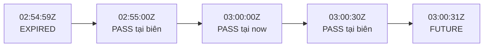
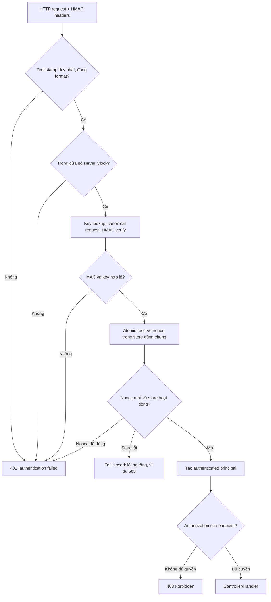

# Timestamp không hợp lệ trong xác thực HTTP request bằng HMAC

## 1. Bối cảnh và mục tiêu

Trong chương **Error semantics**, bài **Timestamp không hợp lệ** trình bày cách nhận biết, từ chối và biểu diễn lỗi liên quan tới thời điểm gửi HTTP request khi hệ thống xác thực bằng **HMAC với shared secret**. Một request có chữ ký chính xác vẫn có thể không được chấp nhận nếu timestamp quá cũ, vượt quá giới hạn tương lai hoặc không tuân thủ hợp đồng ký. HMAC bảo vệ tính toàn vẹn của các trường được ký; **timestamp chỉ giới hạn khoảng thời gian chấp nhận**, còn chống replay đầy đủ cần thêm **nonce và kho ghi nhận nguyên tử**.

Bài thuộc mô-đun `SECURITY_AUTHENTICATION_HMAC_REQUEST_AUTHENTICATION`: client tạo chữ ký từ **canonical request** theo hợp đồng thống nhất (method, URI, một số header và/hoặc body); server xác minh chữ ký, chống replay bằng timestamp/nonce, quản lý key rotation, kiểm thử hành vi qua proxy/gateway và tách bước **authentication** khỏi **authorization**.

Sau khi học, người học cần:

- Phân biệt timestamp **thiếu**, **sai cú pháp**, **sai đơn vị/múi giờ**, **quá cũ** và **quá xa trong tương lai**.
- Hiểu tại sao timestamp phải được đưa vào dữ liệu ký và kiểm theo **đồng hồ server** với cửa sổ chấp nhận có biên rõ ràng.
- Thiết kế một hợp đồng timestamp có thể canonicalize và kiểm thử xuyên client, gateway và backend.
- Xác định phản hồi HTTP nhất quán, đặc biệt ranh giới giữa `401`, `400`, `403` và lỗi hạ tầng như `503`.
- Kết hợp kiểm timestamp, HMAC, nonce, key lifecycle và phân quyền đúng trình tự.
- Viết unit/integration test có `Clock` điều khiển được, bao gồm thời điểm đúng sát biên, lệch đồng hồ và request phát lại.
- Xây dựng logging, metrics và hướng xử lý lỗi cho client mà không tiết lộ thông tin về secret hoặc trạng thái credential.

**Phạm vi:** ví dụ tập trung vào Java và Spring Security; các nguyên tắc tương tự trên Spring MVC/Servlet và Spring WebFlux, nhưng API filter/security context khác nhau.

## 2. Vì sao HMAC đúng vẫn chưa đủ?

Giả sử một client gửi `POST /api/payments` với body, nonce và timestamp rồi ký toàn bộ theo hợp đồng HMAC. Server nhận request và tính lại MAC bằng shared secret hợp lệ. Nếu không có giới hạn thời gian hoặc kiểm nonce, kẻ có bản sao request đã ký có thể gửi lại nó sau một giờ, một ngày hoặc ngay trong cùng giây; MAC vẫn hợp lệ vì các byte không thay đổi.

Ví dụ request dùng các header ứng dụng:

```http
POST /api/payments HTTP/1.1
Host: api.example.test
Content-Type: application/json
X-Client-Id: partner-a
X-Key-Id: key-2026-11
X-Timestamp: 2026-11-28T03:00:00Z
X-Nonce: 5c6504fa-f0f3-4bcf-b654-1beb2b4b57f5
X-Signature: <Base64 HMAC>

{"orderId":"O-100","amount":250000}
```

Một hợp đồng `HMAC-V1` *minh họa* có thể ký:

```text
HMAC-V1
POST
/api/payments
host:api.example.test
content-type:application/json
x-client-id:partner-a
x-key-id:key-2026-11
x-timestamp:2026-11-28T03:00:00Z
x-nonce:5c6504fa-f0f3-4bcf-b654-1beb2b4b57f5
body-sha256:<SHA-256 hex của byte body theo hợp đồng>
```

Trong ví dụ này, client tính:

```text
tag = HMAC_SHA256(
    sharedSecretForKeyId,
    UTF8(canonicalRequest)
)
X-Signature = Base64(tag)
```

Đây là một **định dạng do hệ thống tự quy định**, không phải format HMAC mặc định của Spring Security. Các trường client ID, key ID, timestamp và nonce phải được ràng buộc bằng MAC. Nếu timestamp không nằm trong dữ liệu được ký, bên thứ ba có thể sửa thời điểm gửi của một request hợp lệ mà không làm thay đổi chữ ký; khi đó kiểm timestamp mất ý nghĩa bảo vệ freshness.

Ngay cả khi timestamp **được ký**, việc cho phép một cửa sổ năm phút vẫn tạo ra khoảng thời gian để phát lại **chính xác cùng request**. Vì thế phải coi hai câu hỏi là độc lập:

1. **Freshness:** timestamp nằm trong cửa sổ thời gian mà server cho phép?
2. **Uniqueness:** nonce gắn với client/key này đã được dùng trong cửa sổ đó chưa?

Chỉ khi cả chữ ký, freshness và uniqueness đạt yêu cầu, request mới đủ điều kiện trở thành `Authentication` đã được xác thực.

## 3. Định nghĩa rõ “timestamp không hợp lệ”

Không có một cách diễn giải timestamp mặc định duy nhất cho mọi API HMAC. Hợp đồng ký phải chỉ rõ cách biểu diễn và quy tắc kiểm. Dưới đây là các nhóm lỗi thường gặp:

| Nhóm | Ví dụ | Giải thích |
| --- | --- | --- |
| Thiếu timestamp | Không có `X-Timestamp` | Server không thể xác minh thời điểm gửi đã được ký. |
| Giá trị trống/không đúng format | `X-Timestamp: abc` hoặc chuỗi rỗng | Không parse được theo grammar được công bố. |
| Ngày giờ không tồn tại | `2026-02-30T10:00:00Z` | Sai lịch, dù hình thức giống ISO 8601. |
| Sai timezone/offset quy định | `2026-11-28T10:00:00+07:00` khi hợp đồng chỉ cho phép hậu tố `Z` | Có thể cùng một instant, nhưng không cùng biểu diễn canonical. |
| Sai độ chính xác | `2026-11-28T03:00:00.123Z` khi hợp đồng chỉ chấp nhận giây nguyên | Giá trị hợp lệ theo một chuẩn khác nhưng **không hợp lệ theo hợp đồng hiện hành**. |
| Sai đơn vị | `1795834800000` (milliseconds) khi hợp đồng yêu cầu epoch seconds | Nếu parser chấp nhận nhầm, thời điểm sẽ sai rất lớn. |
| Quá cũ / expired | Request được gửi quá lâu so với đồng hồ server | Hết khoảng chấp nhận; chữ ký đúng vẫn phải bị từ chối. |
| Quá xa trong tương lai | Timestamp vượt giới hạn lệch đồng hồ dương | Có thể do đồng hồ client nhanh, cấu hình sai hoặc request giả mạo. |
| Header trùng hoặc nhập nhằng | Hai `X-Timestamp` khác nhau, header gộp dấu phẩy | Các hop có thể lấy giá trị khác nhau, gây khác biệt canonicalization. |
| Timestamp bị sửa sau khi ký | Một proxy hoặc bên khác sửa `X-Timestamp` | MAC phải thất bại nếu timestamp nằm trong dữ liệu ký. |
| Không đồng bộ giữa các node | Cùng request được node A nhận, node B từ chối sát biên | Đồng hồ backend hoặc policy khác nhau; cần theo dõi lệch giờ. |

Trong bài này, ta chọn một hợp đồng đơn giản:

- Header bắt buộc: `X-Timestamp`, **đúng một giá trị**.
- Định dạng: UTC, chính xác `yyyy-MM-dd'T'HH:mm:ss'Z'`, ví dụ `2026-11-28T03:00:00Z`.
- Chỉ giây nguyên, không nhận milliseconds, offset `+07:00`, khoảng trắng thừa, newline hoặc giá trị chứa dấu phẩy.
- Timestamp được đưa vào canonical string theo **đúng chuỗi đã được hợp đồng chấp nhận**, sau bước đọc/chuẩn hóa header được mô tả rõ.
- Cửa sổ kiểm theo đồng hồ server UTC: tối đa **5 phút trong quá khứ** và **30 giây trong tương lai**.
- Biên thời gian **được chấp nhận**, nghĩa là bằng đúng mốc `now - 5 phút` hoặc `now + 30 giây` vẫn hợp lệ về freshness.

Các thông số này chỉ là **ví dụ thiết kế**. Dịch vụ thật phải lựa chọn theo network latency, clock discipline, tải vận hành, threat model và hợp đồng với client. Thay đổi format hoặc ngưỡng chấp nhận sau khi triển khai cần xem là thay đổi API/security contract.

## 4. Cửa sổ thời gian và ranh giới chấp nhận

Cho `t_s` là timestamp đã ký và `t_now` là đồng hồ của verifier, đặt:

- `maxPast = 300 giây`.
- `maxFuture = 30 giây`.

Điều kiện freshness:

```text
(t_now - maxPast) <= t_s <= (t_now + maxFuture)
```

Sơ đồ minh họa tại thời điểm kiểm `2026-11-28T03:00:00Z`:



Nếu hệ thống không hỗ trợ HTML trong nhãn sơ đồ, có thể đọc các mốc theo bảng tương đương sau:

| Timestamp đã ký | So với `now = 03:00:00Z` | Kết quả freshness |
| --- | --- | --- |
| `02:54:59Z` | Cũ hơn 301 giây | `EXPIRED` |
| `02:55:00Z` | Cũ đúng 300 giây | `VALID` |
| `02:59:59Z` | Cũ 1 giây | `VALID` |
| `03:00:00Z` | Bằng đồng hồ verifier | `VALID` |
| `03:00:30Z` | Nhanh đúng 30 giây | `VALID` |
| `03:00:31Z` | Nhanh 31 giây | `TOO_FAR_IN_FUTURE` |

Với chính sách này, request timestamp trong tương lai gần vẫn được nhận để dung sai cho đồng hồ client nhanh hơn đồng hồ server. **Cho phép thời gian tương lai không đồng nghĩa mọi timestamp tương lai đều hợp lệ.** Giới hạn tương lai nên nhỏ, đo được và có lý do vận hành.

Các điểm cần lưu ý:

- So sánh bằng `Instant` ở UTC, tránh dùng giờ hiển thị theo timezone của máy chủ. `LocalDateTime.now()` không đủ thông tin instant nếu thiếu timezone, và dễ lỗi khi máy chạy ở vùng giờ khác.
- Không chỉ dùng `Math.abs(now - timestamp) <= window` nếu hệ thống muốn **cửa sổ bất đối xứng** (quá khứ 5 phút, tương lai 30 giây).
- Không bỏ kiểm future chỉ vì thời gian quá khứ đã có giới hạn.
- Chốt rõ điều kiện `<`/`>` hay `<=`/`>=` trong hợp đồng và test đúng biên. Cảnh giác sai khác mili giây khi now có nanos còn timestamp chỉ có giây.
- Khi timestamp được ký ở đơn vị giây, client phải biết quy tắc làm tròn/cắt phần lẻ. Verifier nên so sánh bằng `Instant`, không vô tình cắt now sang phút hoặc ép timestamp thành local time.

## 5. Diễn giải lỗi ra HTTP response

Timestamp là một phần **credential của request HMAC**. Trong một API định nghĩa timestamp là trường bắt buộc để xác thực, timestamp sai format, bị thiếu, quá hạn hoặc quá xa tương lai thường được trả về như **authentication failure**, chẳng hạn `401 Unauthorized`, với message công khai thống nhất.

| Tình huống | Tầng phát hiện | Phản hồi minh họa |
| --- | --- | --- |
| Thiếu hoặc sai `X-Timestamp` bắt buộc của scheme HMAC | Authentication filter/verifier | `401 Unauthorized` |
| Timestamp ngoài cửa sổ cho phép | Authentication verifier | `401 Unauthorized` |
| Timestamp bị sửa khiến MAC sai | Authentication verifier | `401 Unauthorized` |
| Chữ ký HMAC sai, key bị thu hồi, nonce đã dùng | Authentication verifier | `401 Unauthorized` |
| Request đã xác thực nhưng principal thiếu quyền | Authorization filter/policy | `403 Forbidden` |
| Request có lỗi cú pháp HTTP/JSON không thuộc credential | HTTP/MVC/WebFlux decoder, validation | `400 Bad Request` theo API contract |
| Body vượt giới hạn | Gateway/body reader | `413 Content Too Large` |
| Replay store không sẵn sàng nên không thể đảm bảo chống replay | Credential infrastructure | Fail closed; có thể dùng `503 Service Unavailable` |
| TLS handshake thất bại trước khi HTTP tới server | TLS client/gateway | Lỗi kết nối/TLS, thường chưa có HTTP status |

**401 và 400 không phải quy tắc cứng áp dụng cho mọi hệ thống:** nếu API công bố timestamp như một lỗi validation của request thông thường, có thể chọn `400`. Tuy nhiên khi timestamp là **đầu vào xác thực bắt buộc**, việc nhất quán trả `401` và không tiết lộ loại credential sai giúp client và người vận hành phân biệt đúng authentication với nghiệp vụ. Không trả `403` chỉ vì timestamp hết hạn: request chưa xác thực thành công để đi tới phân quyền.

Về HTTP challenge, một triển khai theo scheme `Authorization` chuẩn hóa nên tuân thủ quy tắc `WWW-Authenticate` tương ứng khi trả `401`. Nếu API chỉ dùng các header `X-*` tự định nghĩa, cần tài liệu hóa rõ cơ chế challenge/thông báo xác thực; đừng tự tuyên bố một chuẩn `WWW-Authenticate: HMAC` khi chưa có scheme và cú pháp challenge được quy định.

### Ví dụ response không tiết lộ nguyên nhân credential

Một API có thể sử dụng body dạng problem details hoặc schema lỗi riêng. Ví dụ minh họa:

```http
HTTP/1.1 401 Unauthorized
Content-Type: application/problem+json
Cache-Control: no-store
```

```json
{
  "type": "about:blank",
  "title": "Unauthorized",
  "status": 401,
  "detail": "HMAC authentication failed",
  "code": "AUTHENTICATION_FAILED"
}
```

`code` ở đây là extension **của API minh họa**, không phải trường bắt buộc của mọi problem-details response. Nếu API chọn mã lỗi riêng cho timestamp, hãy cân nhắc nguy cơ lộ thông tin qua nhiều phản hồi khác nhau. Ít nhất, không bao giờ gửi expected signature, shared secret, key ID có tồn tại hay không, hoặc nội dung đầy đủ của canonical request nhạy cảm.

Phía server vẫn cần có mã nguyên nhân **nội bộ** để quan sát, ví dụ:

```text
HMAC_TIMESTAMP_MISSING
HMAC_TIMESTAMP_MALFORMED
HMAC_TIMESTAMP_EXPIRED
HMAC_TIMESTAMP_FUTURE
HMAC_SIGNATURE_INVALID
HMAC_NONCE_REPLAY
HMAC_KEY_REVOKED
HMAC_REPLAY_STORE_UNAVAILABLE
```

Tập mã nội bộ là các nhãn low-cardinality. Không đưa raw timestamp do client cung cấp, nonce hay client ID có cardinality cao thành tên metric. Ghi request correlation ID theo chính sách log và che dữ liệu nhạy cảm.

## 6. Thứ tự kiểm timestamp, chữ ký và nonce

Một verifier có thể kiểm định dạng timestamp và cửa sổ thời gian **trước** khi tính HMAC để từ chối request vô lý với chi phí thấp; hoặc tích hợp freshness vào một pipeline sau key lookup. Dù chọn thứ tự tối ưu nào, các bất biến bảo mật phải được giữ:

1. **Giới hạn input trước khi xử lý:** giới hạn số lượng header, độ dài timestamp, nonce, signature, key ID và body. Từ chối request có nhiều giá trị timestamp hoặc giá trị gộp nhập nhằng.
2. **Parse timestamp theo hợp đồng:** format, UTC, đơn vị, thời điểm tồn tại trên lịch. Không tự sửa sai format bằng `trim()`, tự suy timezone hoặc đổi milliseconds thành seconds nếu contract không cho phép.
3. **Đánh giá freshness từ một `Clock` server:** giới hạn quá khứ/tương lai và cách xử lý biên rõ ràng.
4. **Tra credential theo client/key ID có ràng buộc:** chỉ dùng shared secret thuộc principal/tenant được phép, xét trạng thái key và khoảng hiệu lực. Không thử toàn bộ khóa của mọi tenant.
5. **Dựng canonical request thống nhất và kiểm MAC:** timestamp phải là dữ liệu được ký; hash body nếu hợp đồng yêu cầu. So sánh các byte MAC bằng cơ chế phù hợp chống rò rỉ thời gian, chẳng hạn `MessageDigest.isEqual` trên mảng byte đã decode đúng format.
6. **Ghi nonce atomically sau khi MAC/freshness hợp lệ:** chỉ request đầu tiên có nonce hợp lệ trong namespace client/key được chấp nhận. Lưu vào kho chung cho mọi node verifier, có TTL tương ứng với cửa sổ chấp nhận.
7. **Tạo `Authentication` đã xác minh** chứa principal và authorities lấy từ nguồn server-side; tiếp tục tới authorization. Chỉ tại bước này mới có thể xét `403` cho thiếu quyền.

Sơ đồ khái niệm:



**Lưu ý về thứ tự:** việc kiểm timestamp quá hạn trước MAC chỉ là **bộ lọc từ chối sớm**, chưa chứng minh người gửi có secret. Vì vậy tuyệt đối không tạo principal, ghi nonce hợp lệ, cấp quyền hay xử lý nghiệp vụ trước khi HMAC thực sự được xác minh. Nếu phân loại lỗi nội bộ khác nhau theo nhánh, response công khai vẫn cần nhất quán để giảm khả năng dò key/credential bằng thông báo hoặc timing.

## 7. Code Java: kiểm timestamp nghiêm ngặt bằng `Clock`

Ví dụ dưới đây dùng Java 17+ và **chính sách của bài**: UTC, định dạng chính xác `yyyy-MM-dd'T'HH:mm:ss'Z'`, không có phần thập phân của giây, cho phép 5 phút quá khứ và 30 giây tương lai. Kết quả là mã lỗi **nội bộ**, được bộ xác thực ánh xạ sang phản hồi công khai.

```java
import java.time.Clock;
import java.time.Duration;
import java.time.Instant;
import java.time.LocalDateTime;
import java.time.ZoneOffset;
import java.time.format.DateTimeFormatter;
import java.time.format.DateTimeFormatterBuilder;
import java.time.format.DateTimeParseException;
import java.time.format.ResolverStyle;
import java.util.Locale;

enum TimestampIssue {
    VALID,
    MISSING,
    MALFORMED,
    EXPIRED,
    TOO_FAR_IN_FUTURE
}

final class HmacTimestampPolicy {
    private static final Duration MAX_PAST = Duration.ofMinutes(5);
    private static final Duration MAX_FUTURE = Duration.ofSeconds(30);

    // Chỉ cho UTC Z, giây nguyên; reject ngày không tồn tại.
    private static final DateTimeFormatter FORMAT =
        new DateTimeFormatterBuilder()
            .appendPattern("uuuu-MM-dd'T'HH:mm:ss'Z'")
            .toFormatter(Locale.ROOT)
            .withResolverStyle(ResolverStyle.STRICT);

    private final Clock clock;

    HmacTimestampPolicy(Clock clock) {
        this.clock = clock;
    }

    TimestampIssue check(String rawHeader) {
        if (rawHeader == null) {
            return TimestampIssue.MISSING;
        }
        // Không tự trim, đổi offset, parse số epoch hoặc chấp nhận
        // dấu phẩy / nhiều timestamp theo heuristic.
        if (rawHeader.length() != 20) {
            return TimestampIssue.MALFORMED;
        }

        final Instant signedAt;
        try {
            LocalDateTime dateTime =
                LocalDateTime.parse(rawHeader, FORMAT);
            signedAt = dateTime.toInstant(ZoneOffset.UTC);
        } catch (DateTimeParseException error) {
            return TimestampIssue.MALFORMED;
        }

        Instant now = clock.instant();
        if (signedAt.isBefore(now.minus(MAX_PAST))) {
            return TimestampIssue.EXPIRED;
        }
        if (signedAt.isAfter(now.plus(MAX_FUTURE))) {
            return TimestampIssue.TOO_FAR_IN_FUTURE;
        }

        return TimestampIssue.VALID;
    }
}
```

**Ý nghĩa thiết kế:**

- `Clock` được inject thay cho `Instant.now()` viết rải rác. Production có thể cung cấp `Clock.systemUTC()`; test dùng `Clock.fixed(...)` để không phụ thuộc thời gian thực.
- Parser với `ResolverStyle.STRICT` từ chối ngày không tồn tại; hậu tố `Z` ở đây là **literal bắt buộc** và toàn bộ thời gian được hiểu ở UTC.
- Kiểm độ dài 20 ký tự giúp loại format lệch chính sách, nhưng **không thay** kiểm số lượng header và input size ở tầng HTTP. Nếu container gộp nhiều header, các dấu phân tách không đúng format sẽ bị từ chối.
- Dùng `signedAt.isBefore(now.minus(MAX_PAST))` và `isAfter(now.plus(MAX_FUTURE))` để **chấp nhận cả biên**. Nếu chính sách khác, phải đổi code lẫn test cùng nhau.
- Chỉ xử lý ngày trong phạm vi `Instant` hỗ trợ; với contract giới hạn năm bốn chữ số như ví dụ, mọi chuỗi năm khác cũng sẽ bị loại. Bản production nên kiểm soát kích thước input trước parse và không dùng ngoại lệ parser như một log có dữ liệu không tin cậy.

### Tích hợp vào filter hoặc authentication provider

Trong Spring Security, thành phần authentication có thể dùng policy theo cách khái niệm:

```java
TimestampIssue issue =
    timestampPolicy.check(singleTimestampHeader);

if (issue != TimestampIssue.VALID) {
    // Ghi metric nội bộ bằng issue.name() nếu được phép.
    // Không trả riêng "key tồn tại" hay expected MAC ra client.
    throw new BadCredentialsException("Invalid HMAC request");
}

// Sau kiểm format/freshness: lookup key với client scope,
// dựng canonical bytes, verify HMAC, kiểm replay nonce.
// Chỉ khi tất cả PASS mới tạo authenticated Authentication.
```

`singleTimestampHeader` phải được lấy sau bước kiểm tra **chính xác một header/giá trị**. Ví dụ trên chưa triển khai key lookup, MAC, replay store và security filter; các thành phần đó là trách nhiệm của ứng dụng. Không nhầm `HmacTimestampPolicy` với API dựng sẵn của Spring Security.

Trong **Spring MVC**, có thể dùng một `OncePerRequestFilter` hoặc `AuthenticationProvider` theo thiết kế của chain. Nếu muốn `ExceptionTranslationFilter` bắt `BadCredentialsException` do custom filter ném, filter phải nằm trong phần downstream của `ExceptionTranslationFilter` và trước `AuthorizationFilter`; hoặc tự chuyển exception qua `AuthenticationEntryPoint` ở vị trí được chọn.

Trong **Spring WebFlux**, dùng `WebFilter`/`AuthenticationWebFilter` kết hợp `ReactiveAuthenticationManager` và `ReactiveSecurityContextHolder`; không dùng `SecurityContextHolder` ThreadLocal của Servlet stack làm nguồn danh tính trong pipeline reactive. Dù công nghệ khác, cùng policy về timestamp, byte ký và error semantics vẫn phải áp dụng.

## 8. Vì sao parse header và canonicalization phải đồng nhất?

Timestamp là **một giá trị do client truyền qua HTTP**, có thể đi qua gateway, reverse proxy và server adapter trước khi thành chuỗi Java. Nếu các thành phần khác nhau diễn giải một giá trị theo những cách khác nhau, hệ thống sẽ có parser ambiguity:

- Client ký `2026-11-28T03:00:00Z`, gateway thay bằng `2026-11-28T10:00:00+07:00`. Hai giá trị biểu diễn cùng một instant nhưng khác byte; MAC cần bị từ chối nếu hợp đồng ký raw canonical timestamp.
- Proxy loại khoảng trắng ở đầu/cuối trong khi client ký nguyên văn; server nên thống nhất quy tắc chuẩn hóa giá trị trước khi ký hoặc reject giá trị ngoài grammar, không tự chữa sai lặng lẽ.
- Client gửi hai header `X-Timestamp`, một hợp lệ và một quá hạn. Một tầng dùng giá trị đầu, tầng khác dùng giá trị cuối hoặc ghép bằng dấu phẩy; kết quả có thể không nhất quán.
- Một client dùng `1795834800` trong khi server đọc như milliseconds hoặc ngược lại. Không đoán đơn vị bằng số chữ số khi hợp đồng đã quy định rõ format.
- Timestamp có leap second `23:59:60Z`. Nhiều parser `java.time` không chấp nhận literal `60` theo format nghiêm ngặt trong bài; phải thống nhất chính sách thay vì âm thầm normalize.
- URI và body cũng được dùng trong canonical request. Nếu proxy thay path/query hoặc chuyển đổi body trước verifier, chữ ký có thể sai dù timestamp hoàn toàn hợp lệ. Phân loại đúng nguyên nhân là quan trọng khi debug, nhưng response công khai vẫn nên che khác biệt nhạy cảm.

**Quy tắc an toàn:** bên ký và bên xác minh cần chia sẻ một đặc tả canonicalization **bằng văn bản**, có phiên bản và golden test vectors. Nếu muốn chấp nhận offset hoặc milliseconds, hãy thay đổi hợp đồng có chủ đích và quyết định **chính xác chuỗi nào được đưa vào MAC**. Việc hai chuỗi parse thành một `Instant` giống nhau không tự làm chúng có cùng chữ ký.

### Ràng buộc danh tính/key trong cùng canonical request

Timestamp nằm trong request HMAC do **một client cụ thể** ký, vì vậy key lookup và chống replay không thể hoàn toàn tách rời danh tính:

- `X-Client-Id` và `X-Key-Id` cần được ký.
- Server tra `keyId` trong phạm vi principal/tenant tin cậy; không dùng một header clientId chưa kiểm MAC để cấp authority.
- Nếu key có `validFrom`, `validTo` hoặc trạng thái `VERIFY_ONLY`/`REVOKED`, verifier phải có quy tắc thời gian/key rõ ràng. Freshness của request và hiệu lực của credential là **hai điều kiện khác nhau**.
- Key đã thu hồi phải bị từ chối dù timestamp nằm trong cửa sổ và MAC có thể tính đúng bằng secret cũ.
- Trong key rotation, key cũ có thể xác minh request trong khoảng chuyển tiếp hữu hạn theo policy; không kéo dài cửa sổ timestamp chỉ vì có key cũ.

## 9. Timestamp hợp lệ không thay thế chống replay bằng nonce

Giả sử cửa sổ cho phép là 5 phút quá khứ và 30 giây tương lai. Request ký lúc `03:00:00Z` sẽ còn hợp lệ về freshness cho tới khoảng `03:05:00Z`. Trong khoảng đó, cùng một request có thể được gửi lại nhiều lần qua các node khác nhau.

Hệ thống cần kho nonce dùng chung với thao tác **ghi nếu chưa tồn tại** nguyên tử. Ví dụ về ý tưởng với Redis:

```text
SET replay:<tenant>:<client>:<keyId>:<nonce> 1 NX PX <ttlMillis>
```

`SET NX` cần thành công mới coi nonce chưa được dùng. Lưu ý:

1. Chỉ ghi nonce **sau khi** HMAC và timestamp được xác minh, để request giả mạo không dễ chiếm kho.
2. Namespace replay key phải gắn với scope credential/client/tenant đã xác minh, không chỉ dựa vào nonce trần từ client chưa được tin cậy.
3. Các node có thể nhận request tương đương phải chia sẻ cùng replay store và key namespace.
4. **TTL phải đủ dài** để nonce chưa bị quên trong khi cùng timestamp vẫn còn có thể được chấp nhận ở một node khác.
5. Kho replay lỗi mà API bắt buộc chống replay thì **fail closed**. Đây là lỗi hạ tầng, không phải “timestamp expired” hay “MAC incorrect”.

### Tính TTL theo cửa sổ bất đối xứng

Nếu verifier nhận timestamp **sớm tối đa 30 giây**, một request timestamp `03:00:30Z` có thể được chấp nhận ngay `03:00:00Z` và vẫn còn nằm trong cửa sổ tại `03:05:30Z`. Vì vậy TTL cố định đúng **5 phút** kể từ lần nhận đầu có thể quá ngắn.

Một lựa chọn bảo thủ cho ví dụ là:

```text
ttl >= maxPast + maxFuture + clockMargin
    >= 5 phút + 30 giây + biên dự phòng đồng hồ/vận hành
```

Nếu tính TTL động, dựa vào hạn chót chấp nhận theo timestamp và chừa biên cho lệch đồng hồ giữa các node. TTL phải thống nhất với chính sách expiry, độ lệch đồng hồ, key namespace và thực tế lưu trữ. Với `SET NX PX`, cần tính `ttlMillis` dương và có trần theo chính sách.

**Nonce không phải idempotency key.** Hai request cùng body nhưng nonce khác nhau có thể được xác thực hợp lệ; nếu endpoint tạo thanh toán/đơn hàng, cần idempotency policy nghiệp vụ riêng để tránh hiệu ứng kép khi retry.

## 10. Kiểm thử timestamp theo biên thời gian bằng JUnit

Không nên kiểm freshness bằng cách dùng `Thread.sleep(...)` rồi chờ thời gian thực trôi qua. Test như vậy thường chậm và dễ flake khi CI quá tải. Inject `Clock` và khóa thời gian ở một instant cố định.

Ví dụ JUnit 5 tương ứng với lớp `HmacTimestampPolicy`:

```java
import static org.junit.jupiter.api.Assertions.assertEquals;

import java.time.Clock;
import java.time.Instant;
import java.time.ZoneOffset;
import org.junit.jupiter.api.Test;

final class HmacTimestampPolicyTest {

    private final HmacTimestampPolicy policy =
        new HmacTimestampPolicy(
            Clock.fixed(
                Instant.parse("2026-11-28T03:00:00Z"),
                ZoneOffset.UTC));

    @Test
    void acceptsExactBoundaries() {
        assertEquals(TimestampIssue.VALID,
            policy.check("2026-11-28T02:55:00Z"));
        assertEquals(TimestampIssue.VALID,
            policy.check("2026-11-28T03:00:00Z"));
        assertEquals(TimestampIssue.VALID,
            policy.check("2026-11-28T03:00:30Z"));
    }

    @Test
    void rejectsExpiredAndTooFarFuture() {
        assertEquals(TimestampIssue.EXPIRED,
            policy.check("2026-11-28T02:54:59Z"));
        assertEquals(TimestampIssue.TOO_FAR_IN_FUTURE,
            policy.check("2026-11-28T03:00:31Z"));
    }

    @Test
    void rejectsMissingAndWrongSyntax() {
        assertEquals(TimestampIssue.MISSING,
            policy.check(null));
        assertEquals(TimestampIssue.MALFORMED,
            policy.check(""));
        assertEquals(TimestampIssue.MALFORMED,
            policy.check("2026-02-30T03:00:00Z"));
        assertEquals(TimestampIssue.MALFORMED,
            policy.check("2026-11-28T10:00:00+07:00"));
        assertEquals(TimestampIssue.MALFORMED,
            policy.check("2026-11-28T03:00:00.000Z"));
    }
}
```

Test unit này chỉ chứng minh **phân loại thời gian theo policy**. Nó chưa chứng minh chữ ký có ràng buộc timestamp, servlet/reactive filter được chạy, hay nonce được ghi nguyên tử. Cần integration test cho cả request HMAC.

### Ma trận integration test nên có

| Ca kiểm thử | Input | Kỳ vọng |
| --- | --- | --- |
| Happy path | HMAC đúng, timestamp trong cửa sổ, nonce mới, authority hợp lệ | Request tới handler; phản hồi nghiệp vụ. |
| Thiếu timestamp | Không có `X-Timestamp` nhưng gửi các header khác | Không tạo authenticated principal; response authentication failure. |
| Header trùng | Hai giá trị `X-Timestamp` hoặc giá trị ghép nhập nhằng | Bị từ chối theo grammar, không lấy tùy tiện một giá trị. |
| Cùng instant khác format | Thay `Z` bằng `+00:00` khi hợp đồng chỉ nhận `Z` | Bị từ chối đúng policy dù diễn tả cùng thời điểm. |
| Sai milliseconds/seconds | Gửi epoch milliseconds thay vì format UTC đã quy định | Không tự diễn giải theo heuristic; bị từ chối. |
| Expired | Timestamp cách `now` hơn 5 phút, MAC ký đúng trên giá trị đó | `401` theo hợp đồng ví dụ; handler không chạy. |
| Future | Timestamp vượt `now + 30 giây`, MAC ký đúng | `401`, không chấp nhận request từ tương lai xa. |
| Exact boundary | Timestamp đúng `now - 5 phút` hoặc `now + 30 giây` | Qua freshness; còn cần MAC + nonce + quyền. |
| Sửa timestamp | Giữ MAC cũ, thay chỉ `X-Timestamp` | Chữ ký sai và bị từ chối. |
| Replay | Gửi hai lần đúng timestamp/nonce/chữ ký trong cửa sổ | Lần thứ hai không vào handler. |
| Concurrent replay | Hai node nhận cùng request sát nhau | Không quá một request vượt nonce guard. |
| Key rotation | Timestamp hợp lệ nhưng key revoked hoặc hết hiệu lực | Authentication failure theo credential policy. |
| Authorization | Timestamp và HMAC hợp lệ nhưng thiếu authority | `403`, chứng minh authentication khác authorization. |
| Proxy/gateway | Header/URI được proxy normalize/rewrite | Chỉ request có canonical bytes đúng hợp đồng được xác minh. |
| Replay store unavailable | HMAC + timestamp đúng nhưng store lỗi | Fail closed; lỗi hạ tầng được phân loại đúng. |

Khi test request “expired”, **phải ký thật trên timestamp expired** bằng test signer; nếu dùng chữ ký tạo với timestamp hiện tại rồi chỉ sửa header sang expired, test chỉ chứng minh MAC không khớp, chưa chứng minh chính sách hết hạn hoạt động.

Tương tự, test “future” cần dùng signer có đủ shared secret fixture để tạo MAC hợp lệ trên timestamp trong tương lai. Test 401 không đủ: xác nhận controller/service nghiệp vụ không chạy.

## 11. Spring MVC và Spring WebFlux: kiểm thử đường đi thực

### Với Spring MVC

`MockMvc` hoặc HTTP integration test có thể gửi các header HMAC và byte body chính xác. Để kiểm full chain, phải bật Spring Security trong môi trường test, tạo credential fixture và replay store có trạng thái. Từ verifier nên nhận `Clock` bean cùng giá trị với signer test. Nếu filter đọc body để ký, cần wrapper hỗ trợ phát lại body cho `@RequestBody`.

Ví dụ mang tính phác họa:

```java
byte[] body = "{\"sku\":\"P100\"}"
    .getBytes(StandardCharsets.UTF_8);

HttpHeaders signed = testSigner.sign(
    "POST", "/api/orders", body,
    Instant.parse("2026-11-28T02:54:59Z"),
    "nonce-expired-case");

mockMvc.perform(post("/api/orders")
        .headers(signed)
        .contentType(MediaType.APPLICATION_JSON)
        .content(body))
    .andExpect(status().isUnauthorized());
```

`testSigner` là helper riêng của dự án, phải ký đúng canonical request, timestamp, nonce và header theo hợp đồng. Đoạn ví dụ giả định `Clock` của backend đã được cố định ở `2026-11-28T03:00:00Z` và không có lỗi khác làm hỏng request trước bước kiểm timestamp.

### Với Spring WebFlux

`WebTestClient` cho phép gửi một mảng `byte[]` đã ký qua reactive `SecurityWebFilterChain`. Chọn `bindToApplicationContext(...).apply(springSecurity())` hoặc client kết nối server thật nếu muốn xác minh authentication WebFilter, codec và routing; `bindToController(...)` đơn lẻ không tự chứng minh bộ lọc HMAC được thực thi.

```java
byte[] body = "{\"sku\":\"P100\"}"
    .getBytes(StandardCharsets.UTF_8);

HttpHeaders signed = testSigner.sign(
    "POST", "/api/orders", body,
    Instant.parse("2026-11-28T03:00:31Z"),
    "nonce-future-case");

webTestClient.post()
    .uri("/api/orders")
    .headers(headers -> headers.addAll(signed))
    .bodyValue(body)
    .exchange()
    .expectStatus().isUnauthorized();
```

Trong WebFlux, request body là `Flux<DataBuffer>`. Nếu custom HMAC `WebFilter` đọc body trước handler, phải thiết kế cache/decorator có giới hạn để downstream vẫn đọc được body; không `block()` trên event loop. Test timestamp đúng mà handler không đọc được body là **test tích hợp thất bại**, không phải thành công.

Cả `MockMvc` và `WebTestClient.bindToApplicationContext(...)` đều **không thay thế** việc kiểm gateway/ingress thật. Khi HMAC ký URI/header/body đi qua TLS termination hoặc proxy rewrite, cần một HTTP integration test đi đúng đường triển khai.

## 12. Đồng hồ client/server và vấn đề vận hành

Một API dùng timestamp có thể thất bại khi đồng hồ thiết bị client hoặc một node backend lệch giờ. Cần phân biệt ba nguồn sai lệch:

1. **Client clock skew:** signer sử dụng đồng hồ chưa đồng bộ hoặc timezone bị hiểu sai. Dấu hiệu: nhiều request của cùng một client rơi vào nhóm `EXPIRED` hoặc `FUTURE`.
2. **Backend clock skew:** một node có đồng hồ sai, khiến cùng request lúc thì được chấp nhận, lúc thì không khi load balancer phân phối. Dấu hiệu: tỷ lệ lỗi theo từng node lệch đáng kể.
3. **Transit delay:** request bị xếp hàng/chờ xử lý lâu tại client, proxy hoặc backend; thời điểm xác minh muộn hơn timestamp lúc ký. Dấu hiệu: tăng latency tương ứng với lỗi expired.

Nên dùng đồng bộ thời gian hệ thống như NTP/chrony, theo dõi clock offset và độ trễ gateway/backend. Không tự động nới cửa sổ timestamp vô hạn để che lỗi đồng hồ. Nếu cần điều chỉnh cửa sổ, đánh giá đồng thời replay-store TTL, khả năng phát lại và tác động đến client hiện có.

### Khi client nhận 401 vì timestamp

Client triển khai HMAC nên:

- Xác minh đồng hồ đang đồng bộ theo UTC và đang dùng **định dạng** đã được API công bố.
- Sinh timestamp và nonce mới, rồi **ký lại toàn bộ canonical request**. Không chỉ thay `X-Timestamp` trên request có signature cũ.
- Không retry vô hạn. Nếu hành động có side effect (chuyển tiền/tạo đơn), cần idempotency key và cơ chế xác định trạng thái nghiệp vụ khi phản hồi trước bị mất.
- Không lưu secret hay request body nhạy cảm trong log khi debug timestamp. Có thể ghi clock skew ước lượng và correlation ID an toàn.
- Không coi mọi 401 là lỗi đồng hồ: key bị revoke, MAC sai hoặc nonce replay cũng có thể dùng cùng public error.

Một HTTP `Date` header từ server có thể giúp client chẩn đoán lệch thời gian, nhưng không nên xem dữ liệu từ nguồn không được xác thực là cơ sở tự chỉnh clock nhạy cảm. HTTPS và trust boundary của client vẫn quan trọng.

## 13. Quan sát và bảo mật thông tin lỗi

Hệ thống vận hành nên tách số liệu nội bộ theo `MISSING`, `MALFORMED`, `EXPIRED` và `TOO_FAR_IN_FUTURE`, nhưng client nhận một hợp đồng lỗi công khai ổn định.

Ví dụ telemetry:

```text
hmac_authentication_failures_total{reason="timestamp_expired"} 12
hmac_authentication_failures_total{reason="timestamp_future"} 3
hmac_authentication_failures_total{reason="signature_invalid"} 9
hmac_authentication_failures_total{reason="nonce_replay"} 2
```

Các số chỉ minh họa. Phân tích thêm theo service/node/region với cardinality có kiểm soát, đồng thời theo dõi đồng hồ hệ thống, độ trễ replay store và số key cũ đang được dùng trong kỳ rotation.

Không xuất secret, full signature, raw nonce, full canonical request chứa thông tin nhạy cảm, body thanh toán, hoặc header credential ra log. Nếu chẩn đoán một lỗi timestamp bằng cách in input, nên giới hạn, làm sạch và che giá trị theo chính sách dữ liệu. Tránh log injection qua các header do client tự gửi.

**Khác biệt timing:** việc trả các thông báo hoặc thời gian xử lý quá khác nhau cho “không có key”, “key đúng nhưng timestamp sai” và “signature sai” có thể hỗ trợ enumeration. Không cần giả định mọi response đều có thời gian tuyệt đối bằng nhau, nhưng nên giới hạn sự khác biệt công khai, tránh phản hồi tiết lộ tồn tại của credential và áp dụng rate limiting phù hợp.

## 14. Những sai lầm thường gặp

| Sai lầm | Hệ quả | Cách xử lý |
| --- | --- | --- |
| Timestamp không nằm trong dữ liệu được ký | Có thể sửa timestamp mà vẫn giữ MAC hợp lệ. | Ký timestamp, key/client identity và nonce theo cùng canonical contract. |
| Chỉ kiểm timestamp, bỏ nonce | Request hợp lệ có thể được phát lại nhiều lần trong cửa sổ. | Dùng nonce và replay store nguyên tử trên tất cả verifier. |
| Cho phép timestamp mọi lúc trong tương lai | Request ký trước có thể tiếp tục hợp lệ lâu bất thường. | Có ngưỡng `maxFuture` rõ ràng, đủ nhỏ và có test. |
| Chấp nhận mọi format “parse được” | Lệch canonicalization, khác cách diễn giải giữa các hop. | Dùng grammar/version nghiêm ngặt, test golden vectors. |
| So sánh giờ địa phương `LocalDateTime.now()` với UTC | Sai khi timezone hoặc daylight saving thay đổi. | Chuyển về `Instant` UTC và dùng `Clock` inject. |
| Đọc epoch seconds như milliseconds | Timestamp bị diễn giải thành thời điểm khác. | Công bố một đơn vị, không đoán tự động. |
| Tự động `trim()` hoặc sửa offset trước khi kiểm MAC | Che lỗi đầu vào, sinh khác biệt ký giữa client/server. | Ký và xác minh theo cùng quy tắc canonicalization được công bố. |
| Trả `403` cho timestamp quá hạn | Nhầm lỗi chưa xác thực với lỗi thiếu quyền. | Authentication failure (`401` theo contract ví dụ). |
| Trả lỗi riêng cho key tồn tại/chữ ký kỳ vọng | Lộ thông tin credential, hỗ trợ enumeration. | Public error nhất quán; telemetry nội bộ mã nguyên nhân. |
| TTL replay store chỉ bằng cửa sổ quá khứ | Có thể hết TTL khi timestamp tương lai đã ký vẫn còn được phép. | Tính cả `maxFuture` và clock margin. |
| Test expired bằng cách sửa header sau khi ký | 401 có thể do MAC sai, không kiểm chứng freshness. | Test signer ký thật trên timestamp expired/future. |
| Dùng `Thread.sleep()` cho các boundary test | Test chậm, flaky, phụ thuộc CI scheduling. | `Clock.fixed` và assert sát từng biên. |
| Gateway rewrite header/path/body mà không có hợp đồng rõ | Signer/verifier tạo canonical bytes khác nhau. | Kiểm thử end-to-end qua proxy đúng cấu hình. |
| Dùng nonce như idempotency key nghiệp vụ | Retry có thể tạo hiệu ứng kép hoặc bị chặn không đúng ngữ nghĩa. | Thiết kế idempotency riêng cho side-effect. |

## 15. Checklist thiết kế và review

- [ ] Timestamp là trường bắt buộc trong canonical request và được MAC bảo vệ.
- [ ] Grammar, timezone, đơn vị, độ chính xác và cách canonicalize header được công bố rõ.
- [ ] Thiếu, rỗng, sai format, header trùng, ngày không tồn tại, future và expired đều được xử lý theo policy.
- [ ] `maxPast`, `maxFuture` có biên rõ ràng; dùng `Clock` UTC thay vì timezone máy.
- [ ] Kết quả authentication failure trả lỗi công khai nhất quán; `403` chỉ dành cho request đã xác thực thiếu quyền.
- [ ] Chữ ký MAC được xác minh bằng đúng key gắn với client/tenant, kể cả key rotation và revoked key.
- [ ] Timestamp và nonce đều được kiểm, nonce dùng thao tác nguyên tử và TTL đủ cho cửa sổ.
- [ ] Khi replay store lỗi, hệ thống fail closed thay vì chấp nhận request.
- [ ] Test signer ký **đúng timestamp đang test**, không sửa header sau khi ký rồi coi đó là test expiry.
- [ ] Integration test chứng minh handler không chạy khi timestamp sai, và request hợp lệ vẫn đến được handler.
- [ ] Môi trường nhiều node có đồng hồ đồng bộ; theo dõi clock skew, gateway latency và replay metrics.
- [ ] Gateway/proxy giữ đúng canonical input hoặc xác minh HMAC tại trust boundary đã định.
- [ ] Log, response và metrics không làm lộ secret, full signature, nonce chi tiết hay credential state nhạy cảm.

## 16. Câu hỏi tự kiểm tra

1. Một request có HMAC đúng nhưng timestamp cũ 20 phút cần được xử lý ra sao nếu cửa sổ quá khứ là 5 phút?
2. Vì sao timestamp nằm trong dữ liệu ký nhưng không có nonce vẫn chưa chống replay đầy đủ?
3. Khi cho phép timestamp tương lai 30 giây và quá khứ 5 phút, tại sao replay TTL cố định 5 phút có thể chưa đủ?
4. Tại sao `2026-11-28T03:00:00Z` và `2026-11-28T10:00:00+07:00` có thể biểu thị cùng instant nhưng không đồng nghĩa hợp lệ theo cùng canonical contract?
5. Vì sao cần phân biệt lỗi `401` timestamp hết hạn với `403` thiếu authority?
6. Nếu test sửa timestamp thành quá hạn nhưng giữ MAC cũ, kết quả 401 chứng minh được điều gì?
7. Hai backend có clock skew 40 giây nhận cùng request gần biên; bài kiểm thử nào giúp phát hiện?
8. Khi nonce store không hoạt động, có nên bỏ kiểm nonce để giữ availability của endpoint thanh toán?
9. Key bị revoke nhưng timestamp nằm trong cửa sổ và MAC đúng với secret cũ: request có được xác thực không?
10. Khi client nhận 401, vì sao nó không thể chỉ đổi header timestamp rồi gửi lại signature cũ?

**Ghi nhớ:** Timestamp không hợp lệ là một **thất bại xác thực request HMAC**, cần được xác định bằng hợp đồng ký có grammar rõ ràng và `Clock` tin cậy của server. Một timestamp hợp lệ vẫn phải đi cùng MAC đúng, nonce chưa dùng, key còn hiệu lực và quy tắc phân quyền riêng. Trả lỗi công khai nhất quán, test các biên thời gian và kiểm tra replay TTL xuyên nhiều node giúp bảo vệ hệ thống trước phát lại và lỗi đồng hồ ngoài thực tế.
