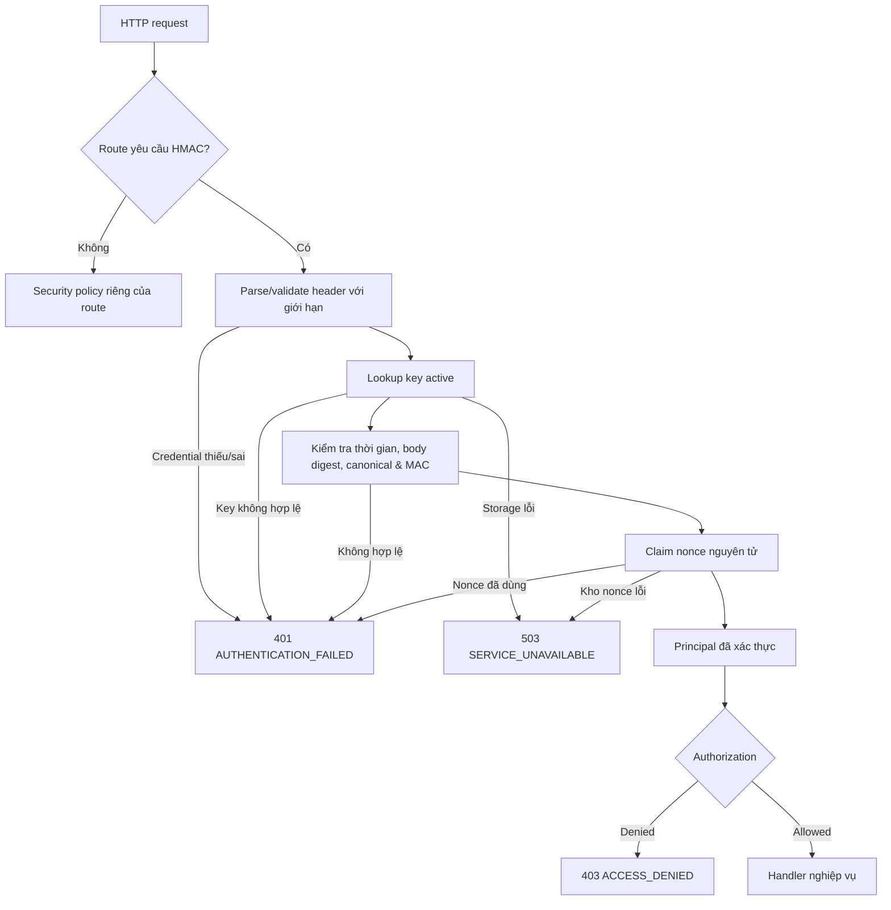
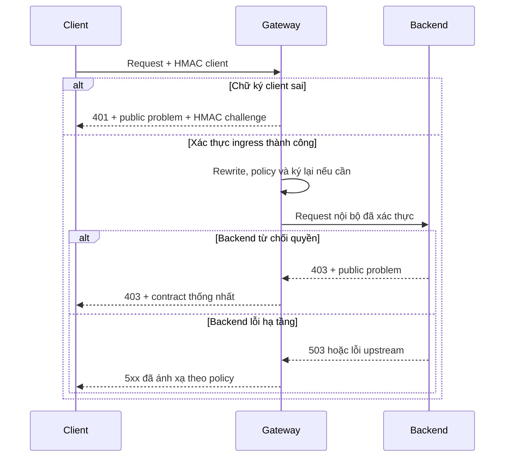

# Error response nhất quán trong xác thực HMAC

## 1. Mục tiêu và phạm vi

Bài học nằm trong chương **Error semantics** của module **SECURITY_AUTHENTICATION_HMAC_REQUEST_AUTHENTICATION**. Module xây dựng cơ chế xác thực HTTP request bằng **HMAC với shared secret**: hai phía thống nhất canonical request có thể bao gồm method, URI, header hoặc byte body; phía nhận xác minh chữ ký, kiểm tra timestamp/nonce để chống replay, quản lý key rotation và quan sát những thay đổi khi qua gateway/proxy. Sau bước xác thực, hệ thống vẫn phải **phân quyền** client trên từng thao tác và tài nguyên.

Một hệ thống có thể kiểm tra HMAC chính xác về mặt mật mã nhưng vẫn gây lỗi tích hợp hoặc lộ thông tin nếu các thành phần trả lỗi không giống nhau. Ví dụ, cùng một chữ ký sai có lúc trả `401` với JSON, lúc trả `403` dạng HTML, lúc trả `500` vì Redis timeout bị bắt chung, còn gateway lại thay body thành chuỗi văn bản. Client khó biết có nên ký lại; vận hành khó phân biệt tấn công với sự cố hạ tầng; kẻ tấn công có thêm tín hiệu để đoán key.

Mục tiêu của bài học là xây dựng **hợp đồng lỗi công khai nhất quán** cho cả gateway, Spring MVC, Spring WebFlux và backend: phân loại **nguyên nhân nội bộ → HTTP status → response body/header công khai**, duy trì tính bảo mật và phục vụ chẩn đoán bằng request ID/log/metrics.

Sau bài học, người học có thể:

- Xác định những đặc tính phải thống nhất: status, Content-Type, cấu trúc JSON, mã lỗi công khai, challenge, cache policy, request ID và cách version hóa.
- Thiết kế response dựa trên **Problem Details for HTTP APIs** với trường chuẩn và trường mở rộng có kiểm soát.
- Phân biệt rõ lỗi authentication, authorization, định dạng request, giới hạn kích thước, rate limit, replay và lỗi phụ thuộc hạ tầng.
- Ánh xạ exception ở đúng tầng Spring Security/HTTP và định nghĩa cùng một hợp đồng lỗi qua gateway/proxy.
- Tránh lộ shared secret, chữ ký đúng kỳ vọng, trạng thái key/tenant và lỗi nội bộ; không dùng response như một “oracle” để đoán credential.
- Viết contract test chứng minh mọi nhánh tương ứng trả đúng status, header, body và không cho handler chạy khi xác thực thất bại.

## 2. “Nhất quán” gồm những gì?

**Nhất quán không có nghĩa mọi lỗi đều dùng status 401 hoặc cùng một câu thông báo.** Nghĩa đúng là **các lỗi có cùng ý nghĩa công khai phải có cùng cách biểu diễn**, và các loại lỗi khác nhau vẫn giữ nguyên HTTP semantics.

Một hợp đồng rõ ràng trả lời được những câu hỏi sau:

| Thành phần | Quy tắc nhất quán nên áp dụng | Lý do |
|---|---|---|
| HTTP status | Phân loại theo bản chất: 401, 403, 400, 413, 429, 5xx... | Client quyết định xử lý và retry đúng |
| `Content-Type` | `application/problem+json` cho JSON error body có thể tạo được | Client parse một kiểu phản hồi |
| Cấu trúc body | Bộ trường chuẩn cố định, phần mở rộng có kiểm soát | Không cần viết parser riêng theo từng service |
| Mã lỗi công khai | `code` ổn định như `AUTHENTICATION_FAILED`, `ACCESS_DENIED` | Cho phép xử lý bằng máy, không parse `detail` |
| Thông báo | Mô tả chung, an toàn; không tiết lộ bí mật | Tránh tiết lộ key/nonce/tenant |
| Request ID | Một ID được tạo/chuẩn hóa ở ingress và truyền qua các hop | Liên kết response với log/trace |
| `WWW-Authenticate` | Có challenge áp dụng khi trả 401 | Tuân thủ semantics 401 và hướng client chọn scheme |
| Cache policy | `Cache-Control: no-store` cho phản hồi có ngữ cảnh bảo mật | Giảm nguy cơ cache lỗi chứa thông tin liên quan xác thực |
| Retry metadata | `Retry-After` cho 429/503 nếu có thời điểm trì hoãn hợp lý | Giúp client tránh retry vô hạn |
| Gateway mapping | Chính sách rõ ràng khi lỗi xuất hiện ở ingress/backend/hop nội bộ | Không biến lỗi upstream thành lỗi credential client |

**Phạm vi tính nhất quán:** cùng một API/version có thể dùng một schema JSON chung cho mọi `4xx/5xx`. Nhưng response đã bắt đầu streaming, lỗi mạng trước khi có HTTP response hoặc rejection tại HTTP parser của reverse proxy có thể không tạo được JSON theo schema. Hợp đồng phải mô tả giới hạn này; không hứa mọi failure đều có một body như nhau.

## 3. Chọn hợp đồng Problem Details

HTTP Problem Details (RFC 9457) cung cấp dạng biểu diễn lỗi phổ biến với media type `application/problem+json`. Các trường chính:

| Trường | Kiểu | Ý nghĩa |
|---|---|---|
| `type` | URI reference | Xác định loại vấn đề; `about:blank` có ý nghĩa mặc định |
| `title` | String | Mô tả ngắn, ổn định về loại vấn đề |
| `status` | Number | HTTP status code; nếu có trường này phải khớp status trên status line |
| `detail` | String | Mô tả hướng tới lần lỗi cụ thể, có thể cố ý chung chung vì bảo mật |
| `instance` | URI reference | Định danh lần phát sinh lỗi; có thể bỏ qua nếu không phù hợp |

Ứng dụng được phép bổ sung extension fields. Trong bài học, chọn hai trường:

- `code`: mã ổn định do API định nghĩa, ví dụ `AUTHENTICATION_FAILED`. **Client nên rẽ nhánh theo HTTP status và code**, không dựa vào văn bản có thể được dịch.
- `requestId`: chuỗi định danh opaque để support tra log/trace, được cấp ở gateway hoặc lớp ingress tin cậy. Không dùng raw email, user ID, key ID hoặc secret làm request ID.

Ví dụ khi request ký HMAC sai:

```http
HTTP/1.1 401 Unauthorized
Content-Type: application/problem+json
Cache-Control: no-store
WWW-Authenticate: HMAC realm="partner-api"
X-Request-Id: req-9f0b62

{
  "type": "about:blank",
  "title": "Unauthorized",
  "status": 401,
  "detail": "Authentication is required or invalid.",
  "code": "AUTHENTICATION_FAILED",
  "requestId": "req-9f0b62"
}
```

Đây là **hợp đồng minh họa**. `HMAC` trong `WWW-Authenticate` là authentication scheme do ứng dụng định nghĩa, không mặc định được mọi HTTP client hỗ trợ. Phải tài liệu hóa scheme, các header, thuật toán, canonical request, cách ký và xử lý retry cho đối tác. 401 theo HTTP cần có ít nhất một challenge `WWW-Authenticate` áp dụng cho tài nguyên; không tự đưa `Basic`/`Bearer` nếu route chỉ hỗ trợ HMAC.

Nếu dùng `type: "about:blank"`, `title` nên là cụm từ tiêu chuẩn của HTTP status, như `Unauthorized`, `Forbidden` hay `Service Unavailable`. `code` giữ vai trò phân biệt các nhóm lỗi nghiệp vụ mà bạn chủ động công bố. Nếu sau này cung cấp URI `type` riêng, URL nên ổn định và dẫn đến tài liệu an toàn, không mang ID động/secret.

### 3.1. Một lỗi, một thông điệp công khai

Các lỗi **cùng nhóm authentication** nên có cùng body công khai:

```json
{
  "type": "about:blank",
  "title": "Unauthorized",
  "status": 401,
  "detail": "Authentication is required or invalid.",
  "code": "AUTHENTICATION_FAILED",
  "requestId": "req-9f0b62"
}
```

Nhóm đó gồm, theo chính sách của API:

- Thiếu header HMAC bắt buộc, chữ ký sai cú pháp, sai định dạng Base64.
- `keyId` không tìm thấy, key đã revoke, key hết hạn, key chưa được cấp quyền dùng tại hop này.
- Body SHA-256 không khớp, canonical method/raw path/raw query/header không khớp.
- Timestamp quá cũ/quá xa tương lai so với cửa sổ chấp nhận.
- Nonce đã dùng; request bị replay.

Đầu ra có thể khác ở `requestId` do mỗi request sinh ID riêng; **không khác ở nội dung/challenge nhằm lộ chi tiết xác thực**. Bộ xử lý nội bộ có thể ghi các reason cụ thể nhưng không trả chúng cho client. Để hạn chế side channel còn cần xem xét độ trễ lookup key, rate limit, kích thước request và các phép so sánh MAC an toàn; JSON giống nhau chưa đủ bảo đảm chống mọi tấn công đo thời gian.

### 3.2. Những trường và dữ liệu không nên đưa vào body

Không đưa vào error response bất kỳ dữ liệu nào sau:

- `sharedSecret`, expected MAC, raw key material, key version bí mật, token dùng để gọi KMS/Vault.
- Chữ ký đầy đủ, canonical string đầy đủ, body request có dữ liệu cá nhân hoặc thanh toán.
- Phân biệt công khai “key tồn tại nhưng sai chữ ký”, “key đã bị khóa”, “nonce này đã sử dụng” nếu điều đó tạo oracle.
- Đường dẫn file cấu hình, tên cluster Redis, SQL/stack trace, thông tin nội bộ về upstream hoặc danh sách audience/tenant.
- Toàn bộ dữ liệu validator nội bộ nếu có thể echo byte client gửi, đặc biệt field chứa secret hoặc header ký.

Với lỗi validation dữ liệu nghiệp vụ, có thể bổ sung danh sách **tên field theo allowlist** và mã ràng buộc (ví dụ `INVALID_QUANTITY`), nhưng không sao chép giá trị input nhạy cảm. Nếu thêm một trường mới, xác định rõ liệu nó có hợp đồng ổn định và có thể xuất hiện ở mọi nhánh cần thiết hay không.

## 4. Phân loại lỗi trước khi viết response

Bộ kiểm tra HMAC cần ánh xạ **lỗi nội bộ** tới **nhóm lỗi công khai**. Đây là một mẫu hợp đồng cho REST API yêu cầu HMAC; hành vi cuối cùng được xác định bởi yêu cầu bảo mật và tài liệu API.

| Nhóm lỗi | Ví dụ liên quan HMAC | HTTP | `code` công khai | Có nên retry ngay? |
|---|---|---:|---|---|
| Authentication thất bại | Thiếu/sai chữ ký, key không active, timestamp ngoài cửa sổ, nonce replay | **401** | `AUTHENTICATION_FAILED` | Chỉ sau khi sửa credential/timestamp/nonce và ký lại |
| Authorization thất bại | Chữ ký hợp lệ nhưng client thiếu scope hoặc tenant không sở hữu resource | **403** | `ACCESS_DENIED` | Không nếu chưa được cấp quyền |
| Request sai cú pháp | JSON không parse được, HTTP request-target hỏng, request thiếu trường nghiệp vụ bắt buộc | **400** | `INVALID_REQUEST` | Sửa payload/cú pháp |
| Unsupported media type | API chỉ nhận JSON nhưng nhận media type không hỗ trợ | **415** | `UNSUPPORTED_MEDIA_TYPE` | Sửa Content-Type/body |
| Dữ liệu hợp lệ cú pháp nhưng không đáp ứng ràng buộc nghiệp vụ | Quantity âm, khoảng thời gian không hợp lệ theo contract, nếu API quy định 422 | **422** | `INVALID_INPUT` | Sửa dữ liệu |
| Request body quá lớn | Body vượt ngưỡng giới hạn tại server/gateway | **413** | `PAYLOAD_TOO_LARGE` | Giảm body, dùng upload/stream theo hợp đồng |
| Rate limit | Vượt quota theo client/route/IP | **429** | `RATE_LIMITED` | Chờ theo quota/Retry-After |
| Lỗi chương trình hoặc lỗi server không dự kiến | NPE, lỗi cấu hình nội bộ | **500** | `INTERNAL_ERROR` | Không retry mù quáng |
| Kho key, nonce hoặc dịch vụ xác minh không khả dụng tạm thời | Redis/KMS/Vault timeout, cluster credential mất kết nối | **503** | `SERVICE_UNAVAILABLE` | Có thể backoff sau khi hạ tầng phục hồi |
| Gateway nhận response upstream hỏng | Upstream gửi response không hợp lệ | **502** tại gateway | `UPSTREAM_ERROR` | Theo policy; cẩn thận với request có side effect |
| Gateway chờ upstream quá thời hạn | Timeout ở hop gateway → backend | **504** tại gateway | `UPSTREAM_TIMEOUT` | Theo policy + idempotency |

Những trường hợp có nhiều lựa chọn hợp lệ cần **quyết định rõ trong contract**:

- Header authentication sai cấu trúc có thể được phân loại `401` nếu đó là bằng chứng HMAC không hợp lệ; HTTP request sai ở parser/transport có thể bị từ chối `400` trước bộ xác minh.
- Chữ ký hợp lệ nhưng không được phép truy cập tài nguyên thường là `403`; hệ thống có thể dùng `404` để che sự tồn tại tài nguyên theo chính sách thống nhất.
- Lỗi domain cụ thể có thể dùng `400` hoặc `422` tùy cách API định nghĩa validation; không đổi tùy tiện giữa các service.
- Không có đảm bảo khi socket đã bị đóng hoặc response đã commit; trong trường hợp đó có thể không gửi được body theo chuẩn.

**Cần tránh ba kiểu ánh xạ sai phổ biến:**

1. `catch (Exception) → 401` khiến lỗi Redis/bug bị gắn nhãn “client sai secret”.
2. `MAC đúng → 200` bỏ qua authorization và lỗi nghiệp vụ.
3. `retry tất cả 4xx/5xx` có thể tạo tải lớn và nghiệp vụ trùng lặp.

## 5. Hành vi lỗi trong quy trình verify HMAC

Một request chỉ có thể được coi là đã xác thực khi toàn bộ chứng cứ HMAC thỏa thuận đã được kiểm tra:



Sơ đồ rút gọn bỏ qua một số lỗi độc lập như `413`/`429`. Trong triển khai thật, có thể kiểm tra body-size/rate-limit từ sớm để tránh tốn CPU hoặc bộ nhớ; **đảm bảo không phát sinh side effect nghiệp vụ khi HMAC chưa được xác thực**.

### 5.1. Xử lý nonce: replay khác với hạ tầng không khả dụng

Một kho nonce tập trung thường dùng thao tác atomic tương tự Redis:

```text
SET hmac:v1:<keyId>:<nonce> 1 NX EX 660
```

Với cửa sổ timestamp ±300 giây, TTL khoảng 660 giây có khoảng đệm để ngăn cùng request được nhận ở nhiều node. Giá trị thực phải theo threat model và đồng bộ clock. Chỉ claim nonce **sau khi MAC hợp lệ** để không cho kẻ gửi request rác “đốt” nonce hợp lệ của client.

Ánh xạ kết quả:

```text
claim == true  → request chưa replay; tiếp tục authentication
claim == false → nonce đã tồn tại; 401 AUTHENTICATION_FAILED
claim bị timeout/lỗi mạng → 503 SERVICE_UNAVAILABLE; fail-closed
```

Không thử lại nonce claim một cách vô hạn sau timeout: có thể lần đầu đã ghi thành công nhưng response Redis bị mất. Nếu cơ chế retry phụ thuộc thực tế này, phải định nghĩa rõ cách xử lý kết quả không chắc chắn; không tự giả định “chưa dùng”.

### 5.2. Key rotation: phản hồi công khai vẫn ổn định

Khi client dùng key vừa revoke, hệ thống trả **cùng 401** như khi dùng key không tồn tại hoặc MAC sai. Trong log nội bộ có thể phân loại `credential_revoked` để support tìm vấn đề, nhưng không gửi thông điệp “key A bị revoke lúc 10:05” ra ngoài.

Mọi key phải có ID rõ ràng và được ánh xạ tới secret, owner, tenant/scope, trạng thái, thời hạn; không duyệt qua toàn bộ key để đoán secret theo chữ ký. Trong giai đoạn chuyển tiếp, key mới và cũ có thể cùng active theo policy. Secret nên được quản lý trong vault/key manager; không log và không echo vào error JSON.

### 5.3. Xác thực và phân quyền có response khác nhau

Giả sử `partner-a` sở hữu tenant A, có chữ ký HMAC đúng cho `GET /orders/987`, nhưng order 987 thuộc tenant B:

- **Authentication:** pass; xác định được principal là `partner-a`/tenant A.
- **Authorization:** fail theo resource/tenant; trả `403 ACCESS_DENIED` (hoặc `404` theo chính sách che tài nguyên).
- **Error body:** cùng schema Problem Details, nhưng `status/code/title/detail` phản ánh nhóm authorization.

Không chuyển mọi trường hợp bị từ chối thành 401 chỉ vì filter HMAC nằm trước controller. Sự phân biệt này giúp client và vận hành xử lý đúng cấp quyền.

## 6. Xây dựng bảng mã lỗi công khai

Thay vì mỗi exception tự viết JSON, tạo **một catalog lỗi công khai**. Ví dụ dưới đây dùng code ổn định và thông điệp không tiết lộ chi tiết nhạy cảm:

| `code` | `status` | `title` | `detail` đề xuất |
|---|---:|---|---|
| `AUTHENTICATION_FAILED` | 401 | Unauthorized | Authentication is required or invalid. |
| `ACCESS_DENIED` | 403 | Forbidden | Access denied. |
| `INVALID_REQUEST` | 400 | Bad Request | Request is invalid. |
| `UNSUPPORTED_MEDIA_TYPE` | 415 | Unsupported Media Type | Content type is not supported. |
| `PAYLOAD_TOO_LARGE` | 413 | Payload Too Large | Request content exceeds the allowed limit. |
| `INVALID_INPUT` | 422 | Unprocessable Content | Request content violates the API constraints. |
| `RATE_LIMITED` | 429 | Too Many Requests | Request rate limit exceeded. |
| `INTERNAL_ERROR` | 500 | Internal Server Error | An unexpected server error occurred. |
| `SERVICE_UNAVAILABLE` | 503 | Service Unavailable | Service is temporarily unavailable. |
| `UPSTREAM_ERROR` | 502 | Bad Gateway | Upstream service returned an invalid response. |
| `UPSTREAM_TIMEOUT` | 504 | Gateway Timeout | Upstream service did not respond in time. |

Các thông điệp này là **hợp đồng minh họa**. Do dữ liệu bảo mật, riêng `AUTHENTICATION_FAILED` nên được gom ở mức chung; các thông điệp khác có thể cung cấp hướng dẫn thêm nếu không lộ chi tiết hệ thống. Nếu API hỗ trợ nhiều ngôn ngữ, `code` giữ nguyên, `detail` có thể được localize theo contract, còn client không được parse chuỗi ngôn ngữ tự nhiên.

**Thiết kế để mở rộng:** có thể thêm trường extension mới theo hướng tương thích, nhưng không đổi kiểu `status` từ number sang string, không đổi nghĩa `code` đã phát hành, không ngẫu nhiên bỏ `requestId` ở một service. Nếu cần thay đổi breaking, xác định chiến lược version API/schema và giai đoạn chuyển đổi.

## 7. Ví dụ Java: catalog chung để sinh Problem Details

Đây là ví dụ Java 17+ cho một hệ thống Spring Framework 6 / Spring Boot 3. Mục đích là dùng **một nguồn định nghĩa** cho status/code/message thay vì lặp literal ở controller, filter và gateway. Lớp DTO dùng record thuần để có thể serialize bằng Jackson; các đoạn code kế tiếp chỉ là những cách **gọi** catalog chung này.

```java
import org.springframework.http.HttpStatus;

enum PublicErrorKind {
    AUTH_FAILURE(
            HttpStatus.UNAUTHORIZED,
            "AUTHENTICATION_FAILED",
            "Authentication is required or invalid."),
    ACCESS_DENIED(
            HttpStatus.FORBIDDEN,
            "ACCESS_DENIED",
            "Access denied."),
    INVALID_REQUEST(
            HttpStatus.BAD_REQUEST,
            "INVALID_REQUEST",
            "Request is invalid."),
    PAYLOAD_TOO_LARGE(
            HttpStatus.PAYLOAD_TOO_LARGE,
            "PAYLOAD_TOO_LARGE",
            "Request content exceeds the allowed limit."),
    RATE_LIMITED(
            HttpStatus.TOO_MANY_REQUESTS,
            "RATE_LIMITED",
            "Request rate limit exceeded."),
    INTERNAL_ERROR(
            HttpStatus.INTERNAL_SERVER_ERROR,
            "INTERNAL_ERROR",
            "An unexpected server error occurred."),
    DEPENDENCY_UNAVAILABLE(
            HttpStatus.SERVICE_UNAVAILABLE,
            "SERVICE_UNAVAILABLE",
            "Service is temporarily unavailable.");

    private final HttpStatus status;
    private final String code;
    private final String publicDetail;

    PublicErrorKind(HttpStatus status, String code, String publicDetail) {
        this.status = status;
        this.code = code;
        this.publicDetail = publicDetail;
    }

    HttpStatus status() { return status; }
    String code() { return code; }
    String publicDetail() { return publicDetail; }
}

record PublicProblem(
        String type,
        String title,
        int status,
        String detail,
        String code,
        String requestId) {}

final class ProblemFactory {
    private ProblemFactory() {}

    static PublicProblem create(PublicErrorKind kind, String requestId) {
        return new PublicProblem(
                "about:blank",
                kind.status().getReasonPhrase(),
                kind.status().value(),
                kind.publicDetail(),
                kind.code(),
                requestId);
    }
}
```

Những đặc điểm cần giữ:

1. `status` trong DTO lấy từ chính enum HTTP status được dùng để set response status; không nhập mã và số độc lập, tránh body ghi 401 nhưng status line là 500.
2. `title` dựa trên reason phrase HTTP thống nhất. `detail` và `code` là giá trị do nhà cung cấp API kiểm soát, không ghép từ exception message.
3. `requestId` phải được lấy từ một **bộ tạo ID đáng tin cậy**. Nếu chấp nhận request ID từ proxy, chỉ tin proxy đã xác thực và giới hạn chặt độ dài/ký tự; không echo một header tự do từ Internet.
4. Chỉ các lỗi tương ứng trong enum được liệt kê để minh họa; production phải bổ sung đầy đủ mapping 400/415/422/502/504... theo catalog đã thống nhất, không dùng giá trị mặc định `AUTH_FAILURE` cho mọi exception.

### 7.1. Spring MVC: authentication entry point và access denied

Trong Servlet stack, `AuthenticationEntryPoint` là nơi phù hợp để trả lỗi authentication; `AccessDeniedHandler` trả lỗi authorization. Cả hai có thể gọi cùng một writer nhận `PublicErrorKind`.

```java
import com.fasterxml.jackson.databind.ObjectMapper;
import jakarta.servlet.http.HttpServletRequest;
import jakarta.servlet.http.HttpServletResponse;
import java.io.IOException;
import java.util.UUID;

import org.springframework.security.core.AuthenticationException;
import org.springframework.security.access.AccessDeniedException;
import org.springframework.security.web.AuthenticationEntryPoint;
import org.springframework.security.web.access.AccessDeniedHandler;

final class ServletProblemWriter {
    private final ObjectMapper mapper;

    ServletProblemWriter(ObjectMapper mapper) {
        this.mapper = mapper;
    }

    void write(
            HttpServletRequest request,
            HttpServletResponse response,
            PublicErrorKind kind) throws IOException {

        if (response.isCommitted()) {
            // Chỉ ghi log/correlation; response đã gửi không thể đổi body.
            return;
        }

        String requestId = request.getAttribute("requestId") instanceof String id
                && id.matches("[A-Za-z0-9._-]{1,80}")
                ? id : UUID.randomUUID().toString();

        response.resetBuffer();
        response.setStatus(kind.status().value());
        response.setContentType("application/problem+json");
        response.setCharacterEncoding("UTF-8");
        response.setHeader("Cache-Control", "no-store");
        response.setHeader("X-Request-Id", requestId);

        if (kind == PublicErrorKind.AUTH_FAILURE) {
            response.setHeader(
                    "WWW-Authenticate", "HMAC realm=\"partner-api\"");
        }

        mapper.writeValue(
                response.getOutputStream(),
                ProblemFactory.create(kind, requestId));
    }
}

final class HmacAuthEntryPoint implements AuthenticationEntryPoint {
    private final ServletProblemWriter writer;

    HmacAuthEntryPoint(ServletProblemWriter writer) {
        this.writer = writer;
    }

    @Override
    public void commence(
            HttpServletRequest request,
            HttpServletResponse response,
            AuthenticationException error) throws IOException {

        writer.write(request, response, PublicErrorKind.AUTH_FAILURE);
    }
}

final class HmacAccessDeniedHandler implements AccessDeniedHandler {
    private final ServletProblemWriter writer;

    HmacAccessDeniedHandler(ServletProblemWriter writer) {
        this.writer = writer;
    }

    @Override
    public void handle(
            HttpServletRequest request,
            HttpServletResponse response,
            AccessDeniedException error) throws IOException {

        writer.write(request, response, PublicErrorKind.ACCESS_DENIED);
    }
}
```

Cấu hình các handler trên ở **SecurityFilterChain có scope phù hợp**:

```java
http.exceptionHandling(ex -> ex
        .authenticationEntryPoint(hmacAuthEntryPoint)
        .accessDeniedHandler(hmacAccessDeniedHandler));
```

Cần tạo/inject các instance `hmacAuthEntryPoint` và `hmacAccessDeniedHandler` trong cấu hình ứng dụng. Với các route dùng scheme khác, nên có security chain hoặc entry point tương ứng; không phát `WWW-Authenticate: HMAC` cho endpoint chỉ chấp nhận Bearer hay session.

**Quan trọng về vị trí filter:** `ExceptionTranslationFilter` chỉ bắt các exception phát sinh từ phần xử lý nằm **sau** nó trong Servlet filter chain. Nếu custom HMAC filter ở trước, phải nối `AuthenticationFailureHandler` hoặc gọi entry point có kiểm soát; không giả định bất kỳ `AuthenticationException` nào cũng tự trở thành 401. `@RestControllerAdvice` cũng không thay thế việc xử lý lỗi trong các security filter.

**Quan trọng về lỗi hạ tầng:** một filter có thể gặp `CredentialStoreUnavailableException` hoặc `ReplayStoreUnavailableException`. Không bọc tất cả bằng `BadCredentialsException`; lỗi phụ thuộc cần được đưa vào handler riêng có status 503/5xx theo chính sách và tuyệt đối không tiếp tục request khi chưa verify được.

### 7.2. Spring MVC: lỗi validation và lỗi controller

Với lỗi phát sinh **sau security filters**, `@RestControllerAdvice` có thể sử dụng cùng catalog:

```java
import jakarta.servlet.http.HttpServletRequest;
import org.springframework.http.MediaType;
import org.springframework.http.ResponseEntity;
import org.springframework.web.bind.MethodArgumentNotValidException;
import org.springframework.web.bind.annotation.ExceptionHandler;
import org.springframework.web.bind.annotation.RestControllerAdvice;

import java.util.UUID;

@RestControllerAdvice
class ApiValidationAdvice {

    @ExceptionHandler(MethodArgumentNotValidException.class)
    ResponseEntity<PublicProblem> invalidRequest(
            MethodArgumentNotValidException error,
            HttpServletRequest request) {

        String id = request.getAttribute("requestId") instanceof String s
                && s.matches("[A-Za-z0-9._-]{1,80}")
                ? s : UUID.randomUUID().toString();

        PublicErrorKind kind = PublicErrorKind.INVALID_REQUEST;

        return ResponseEntity
                .status(kind.status())
                .contentType(MediaType.parseMediaType("application/problem+json"))
                .header("Cache-Control", "no-store")
                .header("X-Request-Id", id)
                .body(ProblemFactory.create(kind, id));
    }
}
```

Ví dụ trên cho thấy cách dùng cùng `ProblemFactory`; trong dự án thật nên trích riêng logic lấy request ID và xây dựng headers thành một thành phần để MVC security handler/controller advice/gateway không copy lại. Không bắt mọi exception từ controller thành `INVALID_REQUEST`: lỗi lập trình là 500 và phải có log nội bộ.

### 7.3. Spring WebFlux: xử lý lỗi reactive

Trong Spring Security WebFlux, dùng `ServerAuthenticationEntryPoint` cho 401 và `ServerAccessDeniedHandler` cho 403. Có thể tái sử dụng `PublicErrorKind`, `PublicProblem` và `ProblemFactory` ở tầng không phụ thuộc Servlet.

Ví dụ bộ ghi response reactive:

```java
import com.fasterxml.jackson.databind.ObjectMapper;
import java.util.UUID;

import org.springframework.http.HttpHeaders;
import org.springframework.http.MediaType;
import org.springframework.http.server.reactive.ServerHttpResponse;
import org.springframework.web.server.ServerWebExchange;

import reactor.core.publisher.Mono;

final class ReactiveProblemWriter {
    private final ObjectMapper mapper;

    ReactiveProblemWriter(ObjectMapper mapper) {
        this.mapper = mapper;
    }

    Mono<Void> write(
            ServerWebExchange exchange,
            PublicErrorKind kind) {

        return Mono.fromCallable(() -> {
            Object candidate = exchange.getAttribute("requestId");
            String id = candidate instanceof String value
                    && value.matches("[A-Za-z0-9._-]{1,80}")
                    ? value : UUID.randomUUID().toString();
            return new ResponseBytes(
                    id,
                    mapper.writeValueAsBytes(
                            ProblemFactory.create(kind, id)));
        }).flatMap(body -> {
            ServerHttpResponse response = exchange.getResponse();
            if (response.isCommitted()) {
                return Mono.error(new IllegalStateException(
                        "Response already committed"));
            }

            response.setStatusCode(kind.status());
            response.getHeaders().setContentType(
                    MediaType.parseMediaType("application/problem+json"));
            response.getHeaders().set(
                    HttpHeaders.CACHE_CONTROL, "no-store");
            response.getHeaders().set("X-Request-Id", body.requestId());

            if (kind == PublicErrorKind.AUTH_FAILURE) {
                response.getHeaders().set(
                        HttpHeaders.WWW_AUTHENTICATE,
                        "HMAC realm=\"partner-api\"");
            }

            return response.writeWith(
                    Mono.fromSupplier(() ->
                            response.bufferFactory().wrap(body.bytes())));
        });
    }

    private record ResponseBytes(String requestId, byte[] bytes) {}
}
```

Đấu nối vào Spring Security:

```java
var entryPoint = (org.springframework.security.web.server
        .ServerAuthenticationEntryPoint) (exchange, error) ->
        reactiveProblemWriter.write(
                exchange, PublicErrorKind.AUTH_FAILURE);

var deniedHandler = (org.springframework.security.web.server.authorization
        .ServerAccessDeniedHandler) (exchange, error) ->
        reactiveProblemWriter.write(
                exchange, PublicErrorKind.ACCESS_DENIED);

http.exceptionHandling(ex -> ex
        .authenticationEntryPoint(entryPoint)
        .accessDeniedHandler(deniedHandler));
```

Đây là **đoạn cấu hình minh họa**: `reactiveProblemWriter` và `http` cần được tạo/inject tại nơi cấu hình `SecurityWebFilterChain`. Nếu tự triển khai `AuthenticationWebFilter`, hãy sử dụng `ServerAuthenticationEntryPointFailureHandler` để chuyển auth failure về cùng entry point, và đảm bảo lỗi hạ tầng không bị gom nhầm thành `AuthenticationException`.

Trong WebFlux, **không gọi `block()` hoặc `subscribe()` thủ công** trong filter/error renderer; để Reactor quản lý vòng đời. Không đọc request body một lần nữa chỉ để ghi error JSON; response body được tạo từ thông báo tĩnh, không chứa payload của client. Nếu response đã commit do streaming, không thể chen `application/problem+json` vào giữa stream; cần ghi log và để transport báo lỗi theo khả năng.

**Giới hạn của ví dụ Java:** Các đoạn minh họa chủ yếu tập trung vào cách sinh hợp đồng lỗi thống nhất; chúng không triển khai toàn bộ HMAC verifier, credential store, Redis replay guard hoặc route security configuration. Trong ứng dụng thực, các thành phần đó phải được tích hợp và kiểm thử riêng.

## 8. Cách giữ nhất quán khi đi qua gateway/proxy

Một hệ thống có thể phát lỗi tại ba vị trí khác nhau:



Phải ghi rõ **ai phát lỗi** và **hợp đồng nào áp dụng**:

1. **Ingress gateway xác minh HMAC client:** thiếu/sai chữ ký, timestamp quá hạn hoặc nonce replay được biểu diễn thành `401 AUTHENTICATION_FAILED` của API đối tác; backend không được nhận request.
2. **Gateway ký lại hop nội bộ:** nếu gateway không lấy được secret nội bộ hoặc chưa xác minh xong client, không phát request ra backend với chữ ký “mặc định”. Trả lỗi hạ tầng thích hợp và ghi sự cố tích hợp.
3. **Backend xác minh chữ ký gateway:** lỗi MAC/audience/nonce ở hop này là **lỗi xác thực nội bộ**, không nhất thiết có nghĩa secret của client sai. Gateway cần giữ trace/cause nội bộ và ánh xạ response công khai theo policy rõ ràng; tránh chuyển nguyên `WWW-Authenticate` của hop nội bộ ra Internet.
4. **Backend phân quyền/kiểm tra nghiệp vụ:** gateway có thể chuyển 403/400/422 theo đúng hợp đồng, miễn không rò rỉ danh tính hay tài nguyên bị ẩn.
5. **Gateway gặp timeout/upstream lỗi:** 502/504/503 có thể xuất hiện do gateway. Cần tạo cùng Problem Details schema **nếu vẫn còn khả năng gửi HTTP response**.

Nếu gateway/proxy thay đổi raw path/query/body/header thuộc hợp đồng ký, HMAC verify thất bại dẫn đến 401 **dù client đã ký đúng request nó gửi**. Do đó, 401 tăng mạnh sau deploy proxy thường là dấu hiệu cần kiểm tra canonicalization, path rewrite, Content-Encoding, order query và body bytes ở đúng điểm verify. Không khuyên đối tác thay secret nếu bằng chứng vận hành chỉ ra cấu hình proxy.

### 8.1. Header tối thiểu qua các hop

| Header | Public ingress | Backend/internal | Khi ra Internet |
|---|---|---|---|
| `Content-Type` | API quyết định định dạng lỗi | Có thể dùng cùng Problem Details | Giữ `application/problem+json` nếu có JSON lỗi |
| `WWW-Authenticate` | Challenge cho **client** khi 401 | Challenge cho **gateway** khi 401 nội bộ | Không forward challenge nội bộ sai audience/scheme |
| `X-Request-Id` | Sinh hoặc xác minh tại ingress | Truyền ID qua hop tin cậy | Cùng ID có thể đối chiếu với trace/log |
| `Cache-Control` | `no-store` với error bảo mật | Áp dụng theo policy | Không cho cache sai các lỗi auth |
| `Retry-After` | Nếu có chính sách rate limit/unavailable rõ ràng | Có thể khác theo upstream | Chỉ công bố giá trị có ý nghĩa với client |
| `X-Gw-*`, `X-Verified-*` | Không tin nếu client gửi | Có thể là metadata gateway ký | Loại bỏ nội dung nội bộ khỏi response |

Đừng cho client tự chọn ID gateway nội bộ, tenant đã xác minh hoặc audience bằng header không ký. Gateway phải xóa hoặc ghi đè những header thuộc namespace nội bộ trước khi sinh chữ ký mới; backend chỉ dùng claim sau khi verify chữ ký gateway và kiểm tra quyền.

### 8.2. Khi nào gateway được phép thay body lỗi?

Một gateway có thể chuẩn hóa lỗi của một backend dùng HTML hoặc body cũ sang Problem Details, nhưng phải giữ nguyên **nghĩa status** và không biến thông tin bí mật từ hop nội bộ thành nội dung public. Chính sách biến đổi phải quan tâm:

- Đúng giá trị `status` cả ở HTTP status line lẫn body JSON.
- Đúng `WWW-Authenticate` cho đối tượng thực sự nhận challenge.
- Không để hai lớp cùng ghi response sau khi đã commit.
- Nếu upstream phản hồi status 401 vì gateway key sai, phải phân loại sự cố như lỗi nội bộ khi công bố ra client, không buộc client đổi secret cá nhân.
- Không ẩn tất cả 500/503/504 thành 401 khiến client retry sai.

Nếu client gửi `Accept` không chấp nhận JSON, cách xử lý media negotiation phải được quy định thống nhất theo HTTP semantics và khả năng của gateway; không nên phát JSON với Content-Type sai.

## 9. Chẩn đoán nội bộ tách khỏi hợp đồng public

Vận hành cần nhìn thấy lý do cụ thể mà client không được phép nhìn. Phân tách **public error code** với **internal reason**:

| Internal reason | Public status/code | Telemetry |
|---|---|---|
| `missing_hmac_headers` | 401 / `AUTHENTICATION_FAILED` | Count + route |
| `unknown_key`, `revoked_key` | 401 / `AUTHENTICATION_FAILED` | Count + safe key reference |
| `invalid_mac`, `body_digest_mismatch` | 401 / `AUTHENTICATION_FAILED` | Count + request ID, không log MAC/body |
| `timestamp_outside_window` | 401 / `AUTHENTICATION_FAILED` | Count + clock-skew bucket |
| `nonce_replayed` | 401 / `AUTHENTICATION_FAILED` | Replay counter, không log raw nonce |
| `nonce_store_timeout` | 503 / `SERVICE_UNAVAILABLE` | Dependency latency/error |
| `authorization_denied` | 403 / `ACCESS_DENIED` | Policy/route scope, tránh lộ tài nguyên |
| `gateway_upstream_timeout` | 504 / `UPSTREAM_TIMEOUT` | Service/hop, retry count |

Ví dụ log nội bộ:

```json
{
  "event": "api_request_rejected",
  "requestId": "req-9f0b62",
  "route": "/partner/orders",
  "hop": "gateway-ingress",
  "internalReason": "invalid_mac",
  "publicCode": "AUTHENTICATION_FAILED",
  "httpStatus": 401,
  "durationMs": 12
}
```

Không log shared secret, MAC chuẩn kỳ vọng, full signature, full canonical request hay body nhạy cảm. `keyId` nếu dùng để điều tra nên được ẩn/băm và hạn chế quyền truy cập; tuyệt đối không thêm raw key ID/nonce/requestId làm **metrics label** có cardinality không kiểm soát. Metrics nên nhóm theo `httpStatus`, `publicCode`, `internalReason`, route pattern và service/hop.

**Request ID an toàn:** nếu header `X-Request-Id` đến từ Internet, sinh ID mới hoặc chỉ chấp nhận giá trị đã được validate bằng chính sách chống injection. Đối với yêu cầu từ proxy đáng tin, có thể truyền trace ID theo tiêu chuẩn tracing đã cấu hình, nhưng không để người gửi lợi dụng ID để đoán secret hoặc ghi log tùy ý.

## 10. Client xử lý theo nhóm lỗi

Contract công khai nên nói rõ hành vi client tương ứng:

| Nhóm response | Client nên làm gì | Không nên làm gì |
|---|---|---|
| 401 | Kiểm tra key/clock/hợp đồng ký, sinh nonce mới, ký lại khi đã sửa nguyên nhân | Retry vô hạn cùng nonce/chữ ký; gửi secret vào ticket/log |
| 403 | Kiểm tra quyền/scope/tenant; yêu cầu cấp quyền qua quy trình phù hợp | Thử nhiều key ngẫu nhiên để vượt authorization |
| 400/415/422 | Sửa body, header, định dạng hoặc dữ liệu theo docs | Ký lại không thay dữ liệu rồi spam request |
| 413 | Giảm body hoặc chuyển sang API upload có giới hạn phù hợp | Thử gửi cùng payload lớn liên tục |
| 429 | Backoff theo quota và `Retry-After` nếu có | Flood retry nhiều luồng |
| 503/502/504 | Backoff có giới hạn, đối chiếu trạng thái/idempotency | Mặc định request chắc chắn chưa được xử lý |
| 500 | Ghi request ID, báo lỗi theo hỗ trợ; retry có giới hạn nếu an toàn | Đổi key vì nghĩ mọi 5xx là lỗi HMAC |

Với các API có side effect như tạo đơn hoặc thanh toán, việc retry cần **idempotency key nghiệp vụ** có ràng buộc đúng principal/tài nguyên. Nonce HMAC chỉ chống phát lại cùng bằng chứng xác thực; **hai request khác nonce nhưng cùng hành động** vẫn có thể cùng hợp lệ và cùng chạy handler. Khi retry sau timeout, body/method/path hoặc các header tham gia ký thay đổi thì phải tính lại digest/canonical và chữ ký theo hợp đồng.

## 11. Kiểm thử hợp đồng lỗi end-to-end

Đơn vị kiểm thử cần không chỉ kiểm tra status mà còn các trường body, headers và side effects. Với Spring MVC dùng `MockMvc`; với WebFlux dùng `WebTestClient`. Bổ sung integration test chạy qua gateway thật hoặc cấu hình proxy mô phỏng đúng rewrite/retry.

### 11.1. Ma trận lỗi

| Ca thử | Status + code | Header cần kiểm tra | Handler nghiệp vụ |
|---|---|---|---|
| Không gửi HMAC ở route bảo vệ | 401 / `AUTHENTICATION_FAILED` | `WWW-Authenticate` + no-store + request ID | Không chạy |
| Key ID không tồn tại hoặc đã revoke | 401 / `AUTHENTICATION_FAILED` | Như nhau với MAC sai | Không chạy |
| Chữ ký sai một byte | 401 / `AUTHENTICATION_FAILED` | Challenge giống key invalid | Không chạy |
| Body digest sai, query/path bị proxy sửa | 401 / `AUTHENTICATION_FAILED` | Response public đồng nhất | Không chạy |
| Timestamp quá hạn/tương lai, nonce replay | 401 / `AUTHENTICATION_FAILED` | Cùng body shape | Không chạy |
| HMAC hợp lệ nhưng thiếu quyền tenant | 403 / `ACCESS_DENIED` | Problem JSON + request ID | Không chạy thao tác |
| JSON request sai độc lập với HMAC | 400 / `INVALID_REQUEST` | Problem JSON | Không chạy |
| Body vượt giới hạn tại ingress | 413 / `PAYLOAD_TOO_LARGE` | Problem JSON nếu gateway còn ghi được | Không chạy |
| Rate limit | 429 / `RATE_LIMITED` | `Retry-After` nếu có policy | Không chạy |
| Redis nonce store bị lỗi | 503 / `SERVICE_UNAVAILABLE` | Problem JSON, không challenge HMAC sai | Không chạy |
| Gateway timeout backend | 504 / `UPSTREAM_TIMEOUT` | Problem JSON nếu có thể | Không xác định chắc upstream đã chạy |
| Request thành công | 2xx/3xx theo nghiệp vụ | Không tự thêm Problem Details | Theo route |
| Hai request đồng thời trùng key+nonce | Tối đa một request vượt qua replay guard; request khác 401 | Body lỗi đồng nhất | Không chạy hai lần do replay |
| Key rotation old/new active rồi revoke old | Active hợp lệ; revoke 401 | Không lộ trạng thái rotation | Chỉ request hợp lệ chạy |
| Response đã commit rồi gặp lỗi stream | Không bắt buộc sinh JSON mới | Không tạo response thứ hai | Quan sát theo transport |

### 11.2. Contract assertions

Một suite mẫu nên kiểm tra cả body và các header:

```java
// Ý tưởng với MockMvc: handler/signer/test fixture được cấu hình ở project.
mockMvc.perform(post("/partner/orders")
        .contentType("application/json")
        .content("{\"sku\":\"A7\"}"))
    .andExpect(status().isUnauthorized())
    .andExpect(header().string(
            "WWW-Authenticate", "HMAC realm=\"partner-api\""))
    .andExpect(header().string("Cache-Control", "no-store"))
    .andExpect(content().contentTypeCompatibleWith(
            "application/problem+json"))
    .andExpect(jsonPath("$.type").value("about:blank"))
    .andExpect(jsonPath("$.title").value("Unauthorized"))
    .andExpect(jsonPath("$.status").value(401))
    .andExpect(jsonPath("$.code").value("AUTHENTICATION_FAILED"))
    .andExpect(jsonPath("$.detail")
            .value("Authentication is required or invalid."))
    .andExpect(jsonPath("$.requestId").isNotEmpty());
```

Mở rộng test:

1. Kiểm tra response public của `unknown_key`, `revoked_key`, `invalid_mac`, `expired_timestamp` và `nonce_replayed` có cùng status/code/detail/header, ngoại trừ ID động.
2. Kiểm tra body `status` bằng HTTP status; header `X-Request-Id` bằng `requestId` trong JSON; ID không chứa ký tự CR/LF hoặc dữ liệu người dùng chưa validate.
3. Kiểm tra lỗi phụ thuộc (mất Redis/KMS) không biến thành `401` và không thực thi nghiệp vụ.
4. Kiểm tra `WWW-Authenticate` chỉ được dùng ở endpoint/scheme thích hợp, không bị gateway thay bằng challenge của hop nội bộ.
5. Kiểm tra Unicode, body rỗng, JSON whitespace, raw path có `%2F`, raw query đổi thứ tự; nếu MAC sai, response vẫn theo contract, không log nội dung nhạy cảm.
6. Kiểm tra response đã commit, timeout, client disconnect và body quá lớn; thừa nhận tình huống không thể xuất đủ JSON, nhưng không sinh thêm response thứ hai.
7. Test nhiều instance: hai request cùng nonce nhưng khác node chỉ có một claim thành công; mọi exception về Redis lưu nội bộ đúng loại.
8. Chạy snapshot/JSON schema test qua cả Servlet, WebFlux và gateway để phát hiện drift giữa các service, giữ cùng tên trường và kiểu dữ liệu.

### 11.3. Tiêu chí hoàn thành

Một hệ thống đạt hợp đồng lỗi nhất quán nếu:

- Có **bảng mapping trung tâm** cho auth, authorization, validation, rate limit, dependency và upstream.
- Mọi HTTP error response do ứng dụng kiểm soát có schema và headers tương ứng, không rò rỉ chi tiết nhạy cảm.
- `401` luôn thể hiện authentication failure với challenge áp dụng; `403` thể hiện authorization denial; lỗi Redis/KMS có phân loại 5xx riêng.
- Gateway giữ request ID, không trộn challenge công khai/nội bộ, không biến một hop failure thành lời khuyên sai cho client.
- Kiểm thử tự động bắt được body/status mismatch, filter double-write, response khác nhau tùy key ID và lỗi xử lý nonce.

## 12. Bài tập thực hành

Thiết kế một API `POST /partner/payments` đi qua gateway và backend WebFlux:

**Yêu cầu đầu vào:** client cung cấp `X-Key-Id`, `X-Timestamp`, `X-Nonce`, `X-Content-SHA256`, `X-Signature`; canonical request chứa method, raw URI và hash body theo hợp đồng đã công bố; backend kiểm tra credential/nonce rồi phân quyền theo tenant.

Hãy thực hiện:

1. Định nghĩa một JSON Problem Details thống nhất có `type`, `title`, `status`, `detail`, `code` và `requestId`; quy định `Content-Type`, `WWW-Authenticate` và cache policy.
2. Lập bảng mapping ít nhất cho: thiếu chữ ký, MAC sai, timestamp quá hạn, nonce replay, key revoke, client thiếu quyền tenant, JSON invalid, rate limit, Redis timeout, gateway timeout.
3. Tạo `PublicErrorKind` và renderer dùng lại từ auth entry point, denied handler và validation advice. Không đưa `exception.getMessage()` trực tiếp vào `detail`.
4. Cấu hình gateway chuyển đúng challenge ở ingress, đồng thời không forward thông tin credential của hop gateway–backend. Kiểm tra ký lại HMAC sau rewrite nếu backend không tự verify byte request gốc.
5. Viết test cho tất cả nhánh: đồng nhất public response của những lỗi auth, mã 403 riêng khi HMAC hợp lệ nhưng không có quyền, mã 503 khi nonce store lỗi, body `status` luôn khớp HTTP status, handler không chạy khi xác thực thất bại.
6. Thử retry một yêu cầu tạo payment sau timeout. Giải thích tại sao cần **nonce mới và chữ ký mới**, đồng thời cần **idempotency key nghiệp vụ** để không xử lý payment hai lần.

### Câu hỏi tự đánh giá

- Thế nào là response lỗi nhất quán nếu HTTP status và nguyên nhân khác nhau?
- Vì sao `AUTHENTICATION_FAILED` nên gom nhiều nguyên nhân chi tiết thành một mã công khai?
- Khi nào `WWW-Authenticate` bắt buộc, và vì sao challenge nội bộ không nên chuyển nguyên cho client Internet?
- Vì sao lỗi Redis replay store không được “cho qua” hoặc được biểu diễn thành `invalid_mac`?
- Vì sao `@RestControllerAdvice` không thay thế xử lý lỗi trong Spring Security filter?
- Vì sao request ID phải được sinh/validate ở nguồn tin cậy và không làm metrics label tùy ý?
- Vì sao timeout ở gateway không chứng minh backend chưa xử lý một yêu cầu thanh toán?

**Kết quả mong đợi:** người học xây dựng được một hợp đồng error response dùng chung xuyên suốt gateway, bộ xác minh HMAC, Spring Security và controller; client nhận HTTP status, headers và JSON ổn định để xử lý chính xác, trong khi log/metrics nội bộ giữ đủ thông tin điều tra mà không lộ shared secret hoặc cơ chế xác thực.
