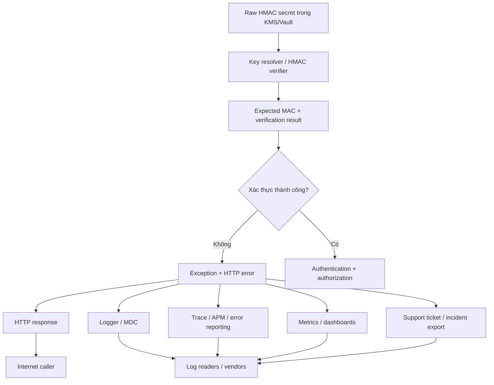

# Không lộ chi tiết secret

## 1. Vì sao error semantics là một ranh giới bảo mật của HMAC?

Trong xác thực **HTTP request bằng HMAC**, phía gửi và phía nhận chia sẻ một **secret** dùng để tính message authentication code (MAC) trên một **canonical request**. Canonical request có thể chứa method, URI, signed headers, timestamp, nonce và SHA-256 của raw body. Khi chữ ký hợp lệ, server vẫn phải kiểm key state/rotation, cửa sổ thời gian, chống replay và authorization của authenticated principal.

Một hệ thống có thể xác minh MAC đúng về mặt mật mã, nhưng vẫn thất bại nghiêm trọng nếu khi reject request nó trả:

```json
{
  "error": "signature_mismatch",
  "secret": "production-shared-key-...",
  "expectedSignature": "Base64-tag-...",
  "canonicalRequest": "POST\n/v1/payments\n...",
  "keyStorePath": "vault://prod/tenants/tenant-42/client-api"
}
```

Đây là **ví dụ phản hồi nguy hiểm, không được triển khai**. Lỗi không chỉ nằm ở trường `secret`: expected MAC, raw Authorization/signature header, signed request và secret-store locator có thể hỗ trợ phát lại request, tìm cấu trúc nội bộ hoặc điều tra tấn công.

Bài **“Không lộ chi tiết secret”** thuộc chương **Error semantics**, mô-đun **`SECURITY_AUTHENTICATION_HMAC_REQUEST_AUTHENTICATION`**. Mô-đun hướng dẫn thiết kế xác thực HTTP request bằng HMAC với shared secret và canonical request gồm method, URI, header hoặc body theo hợp đồng ký; xác minh chữ ký, chống replay timestamp/nonce, key rotation, kiểm thử proxy/gateway và phân biệt authentication với authorization.

**Mục tiêu học tập:**

- Phân biệt **raw shared secret**, **secret reference**, **key ID**, **MAC tag**, **canonical request**, **nonce/timestamp** và **authenticated principal** về mức độ nhạy cảm.
- Thiết kế **public error contract** không lộ secret, expected signature, key existence hay hạ tầng nội bộ.
- Chọn đúng **400/401/403/413/429/503** mà không tạo authentication bypass hoặc tiết lộ thông tin không cần thiết.
- Áp dụng **allowlist-based structured logging**, exception sanitization, trace/metric cardinality control và request-header redaction.
- Chặn leak qua Servlet/WebFlux filters, Spring Security exceptions, DTO serialization, `toString()`, logging MDC, APM agents và gateway.
- Triển khai ví dụ Java 17 HMAC-SHA-256 và Spring Security failure handling theo hướng **fail closed**.
- Kiểm thử bằng **sentinel secret**, golden vectors độc lập, negative cases, mock HTTP responses và fault injection.
- Thiết kế runbook khi phát hiện secret đã lọt vào logs, HTTP error, traces hoặc hỗ trợ khách hàng.

**Nguyên tắc:** lỗi xác thực phải cung cấp cho client **đủ thông tin để xử lý theo hợp đồng**, nhưng không công bố những dữ liệu giúp giả mạo credentials, enumerate key/tenant hoặc thăm dò kiến trúc backend.

## 2. Trước tiên phải phân loại dữ liệu: cái gì là “secret”?

Trong một giao thức HMAC, không phải mọi metadata đều là secret mật mã, nhưng nhiều metadata vẫn phải được hạn chế trong error responses và telemetry.

| Dữ liệu | Ví dụ | Phân loại/ứng xử |
| --- | --- | --- |
| Raw shared secret | 32 random bytes | **Bí mật tuyệt đối**, không bao giờ phản hồi hoặc log |
| Secret được encode | Base64/hex của 32 bytes | **Cùng mức độ bí mật như raw bytes** |
| Secret manager credential | Vault token, IAM bearer token | **Bí mật tuyệt đối** |
| Secret reference / locator | `vault://prod/tenant-42/...` | Metadata nội bộ nhạy cảm; không đưa ra public response |
| Key ID/version | `k-2026-11` | Không phải raw secret, nhưng có thể tiết lộ credential inventory/rotation |
| Client ID/tenant ID | `client-api`/`tenant-42` | Có thể là thông tin riêng tư/cơ sở cho enumeration |
| Supplied HMAC tag | 32-byte MAC encode Base64 | **Authentication proof** gắn với signed request; tránh log/echo |
| Expected HMAC tag | Tag server tính từ secret | Tuy không tiết lộ ngay secret, **không công bố** vì có thể giúp so sánh, oracle và replay |
| Canonical request | Path/query/headers/body hash | Có thể chứa PII, signed nonce và business metadata; không trả đầy đủ |
| Raw request body | JSON payment, webhook data | Có thể chứa dữ liệu cá nhân/kinh doanh; không log mặc định |
| Timestamp + nonce | `1795856400` + 16-byte nonce | Không phải key, nhưng là dữ liệu của signed attempt; không cần echo |
| Authenticated principal | `svc-payments-42` | Identity từ trusted catalog sau verify; chỉ hiển thị theo policy |
| HTTP status + generic error code | `401`, `invalid_request_authentication` | Dữ liệu công khai có thể chấp nhận |
| Server-generated request ID | Opaque random identifier | Có thể phản hồi để hỗ trợ troubleshooting |

### 2.1. Raw secret và secret được encode là một thứ

```text
raw bytes 32 B
   -> Base64 string 44 ASCII chars
   -> hex string 64 ASCII chars
```

Ba dạng là **biểu diễn của cùng key material**. “Không log raw bytes” nhưng lại log `Base64.getEncoder().encodeToString(secret)` vẫn là **lộ secret hoàn toàn**.

### 2.2. MAC tag không phải shared secret, nhưng vẫn không được echo

MAC tag trên một message **không thông thường cho phép suy ngược raw secret** của HMAC-SHA-256 nếu primitive và key mạnh. Tuy nhiên, tag là **chữ ký của request cụ thể**. Nếu timestamp còn hạn, nonce chưa được consume hoặc một dịch vụ không chống replay, attacker có thể thử dùng lại signed message.

Đừng tuyên bố “tag không phải secret nên có thể log”. Giữ response/log ở mức **outcome**, không phải raw proof.

### 2.3. Key ID không cho phép ký request, nhưng có thể là thông tin nội bộ

`k-2026-11` tự nó không cho phép tính HMAC. Dù vậy, response dạng:

```json
{"error":"key k-2026-11 exists, but k-2026-10 is active"}
```

có thể tiết lộ **trạng thái rotation**, khách hàng đang dùng key nào và key tồn tại hay không. Trả generic error trên public API; giữ lý do cụ thể ở audit nội bộ có phân quyền.

## 3. Threat model: secret có thể rò qua những đường nào?



**Những trust boundaries quan trọng:**

1. **Secret manager → verifier memory:** secret được dùng để tính MAC, không mang sang HTTP response.
2. **Verifier → exception:** exception không chứa raw secret, full tag hoặc canonical request.
3. **Exception → Spring Security handler:** chỉ nhận **safe classification**, không serialize throwable.
4. **HTTP handler → Internet client:** không tiết lộ key inventory, internal URLs, stacktrace.
5. **Application → logs/traces/metrics:** dữ liệu ra khỏi process sang những hệ thống có quyền truy cập rộng hơn và retention dài hơn.
6. **Gateway/proxy → backend:** debug logging hoặc proxy-generated 4xx/5xx có thể lộ headers/body dù application đã redact.
7. **Support/incident → bên thứ ba:** screenshots, raw traces, HAR files và ticket attachments có thể tiết lộ credential.

### 3.1. Attacker cần biết gì?

Một attacker có thể điều khiển:

- `X-Client-Id`, `X-Key-Id`, `X-Timestamp`, `X-Nonce`, `X-Signature`.
- Method, URL, query, headers và raw body trước gateway.
- Tần suất, thời điểm và loại request để quan sát **status/body/timing**.
- Các chuỗi chứa CRLF, tab, JSON escape hoặc dữ liệu rất dài nhằm gây **log injection**.
- Một client credential bị lộ của chính tenant, để thử leo qua boundaries tenant/merchant.

Attacker thường **không** có quyền trực tiếp đọc Vault, nhưng có thể lợi dụng exception log, debug endpoint hoặc APM dashboard bị cấu hình sai để suy thêm chi tiết.

### 3.2. “Chỉ hiển thị khi debug” không đủ

Debug mode có thể vô tình bật trong production, logs bị thu thập tự động và tồn tại lâu hơn key validity. Một secret trong debug log vẫn là sự cố bảo mật. Không xây an toàn dựa trên `if (log.isDebugEnabled())` cho nội dung raw secret.

### 3.3. Log/trace không phải vùng “nội bộ tuyệt đối”

Nhân viên hỗ trợ, nhà cung cấp APM, log forwarders và các service accounts có thể đọc telemetry. Quyền truy cập log thường rộng hơn quyền đọc Vault. Khi đưa raw shared secret vào log, bạn đã mở thêm bề mặt tấn công và phá nguyên tắc **least privilege**.

## 4. Public error contract: đủ dùng nhưng không lộ internals

Một API HMAC backend-to-backend có thể công bố một tập lỗi an toàn, **không phản chiếu input không tin cậy**:

| Trường hợp | Public HTTP | Public body minh họa | Có tạo authenticated principal? |
| --- | ---: | --- | --- |
| Thiếu/sai HMAC, unknown client/key, revoked key | 401 | `invalid_request_authentication` | Không |
| Timestamp stale / nonce replay | 401 | `invalid_request_authentication` | Không |
| Malformed HTTP framing hoặc request không theo shape | 400 | `invalid_request` | Không |
| Signed body vượt size limit | 413 | `payload_too_large` | Không |
| Gateway rate limiting | 429 | `too_many_requests` | Không |
| KMS/Vault/catalog/replay store unavailable | 503 | `authentication_temporarily_unavailable` | Không |
| HMAC đúng nhưng principal thiếu quyền | 403 | `access_denied` | Có |
| HMAC đúng nhưng resource thuộc tenant khác | 403 hoặc 404 theo policy | `access_denied` hoặc `not_found` | Có |
| Unexpected application bug | 500 | `internal_error` | Không suy ngược từ status |

Response 401 minh họa:

```http
HTTP/1.1 401 Unauthorized
WWW-Authenticate: HMAC realm="payments"
Content-Type: application/json
Cache-Control: no-store

{"error":"invalid_request_authentication","requestId":"r-opaque-123"}
```

**`HMAC` trong challenge là scheme nội bộ mang tính minh họa**, cần được API tự định nghĩa; không phải tên một chuẩn HMAC áp dụng cho mọi provider. HTTP 401 yêu cầu authentication challenge phù hợp. Nếu API có contract khác, đừng trả `Basic` hoặc `Bearer` một cách tùy tiện.

### 4.1. Gợi ý cho client mà không lộ khóa

Bên đối tác có thể nhận tài liệu public mô tả:

- Cần ký method/URI/headers/body theo **versioned canonical contract**.
- Timestamp cần nằm trong cửa sổ chính thức.
- Dùng nonce mới và ký lại khi retry.
- Cách liên hệ support kèm **requestId**, không kèm shared secret.

Các lời khuyên này có thể đưa vào **tài liệu API**, không nhất thiết phải phản chiếu mọi chi tiết nội bộ trong response cụ thể.

### 4.2. Không nhầm 401 và 403

Nếu HMAC sai, server chưa biết caller là ai → **401**. Nếu MAC và anti-replay pass, server biết principal nhưng resource authorization không cho phép → **403** (hoặc 404 theo policy che giấu tồn tại resource).

Đổi mọi lỗi thành 401 không giúp che giấu secret tốt hơn nếu làm mất semantics, tạo retry sai và phá authorization monitoring.

### 4.3. 503 là fail-closed, không phải xác thực thất bại của caller

Khi Vault/Redis outage, server **không đủ bằng chứng** để xác minh. Không accept request và cũng không tự khẳng định key client sai. `503` có thể giúp caller áp dụng backoff và giữ trách nhiệm vận hành rõ.

Không đặt `Retry-After` bằng một con số tuỳ ý nếu không có backoff policy hoặc dự báo đáng tin.

## 5. Authentication oracle: tránh tiết lộ key existence qua lỗi

Một lỗi thường gặp là phản hồi chi tiết theo từng nhánh lookup:

```json
{"error":"tenant-42 exists but client-api is unknown"}
```

```json
{"error":"key k-2026-11 is revoked; use k-2026-12"}
```

```json
{"error":"signature mismatch; expected ..."}
```

Ba response có thể cho attacker biết tenant/client/key ID có tồn tại không, key rotation đang ở giai đoạn nào và thông tin phục vụ tấn công tiếp.

**Thiết kế đề xuất:**

```text
Internal reasons:
  MISSING_SIGNATURE
  MALFORMED_SIGNATURE
  UNKNOWN_CREDENTIAL
  KEY_NOT_VERIFY_ELIGIBLE
  BAD_MAC
  TIMESTAMP_OUT_OF_WINDOW
  NONCE_ALREADY_USED

Public:
  HTTP 401
  {"error":"invalid_request_authentication"}
```

### 5.1. Generic response không có nghĩa che hết observability

Internal reason vẫn cần cho metrics và audit có phân quyền:

```text
auth.outcome    = rejected
reasonCategory  = bad_mac
routeTemplate   = /v1/tenants/{tenantId}/payments
requestId       = server-generated opaque ID
responseStatus  = 401
```

**Không** đưa raw signature, expected tag, raw body hoặc secret-store locator vào event.

### 5.2. Status/body thống nhất chưa giải quyết timing oracle

Kể cả trả cùng 401, thời gian xử lý có thể khác giữa unknown key và known key do:

- Vault/cache hits/misses.
- Database access pattern.
- HMAC computation skipped cho unknown credential.
- Key version/tenant policy lookup.
- Rate limiting và HTTP connection behavior.

`MessageDigest.isEqual` không khiến **toàn endpoint constant-time**. Nếu threat model có enumeration qua timing, cần đánh giá và giảm chênh lệch, rate-limit và load-test. Không đánh đổi tính đúng bằng cách “chọn dummy key rồi accept nếu MAC khớp”; dummy computation nếu dùng chỉ là kỹ thuật phụ được review và **không bao giờ cấp principal**.

### 5.3. Public errors phải không bị client input chi phối

Không làm:

```java
// SAI: phản chiếu keyId/nonce vào HTTP response.
response.getWriter().write(
    "{\"error\":\"Unknown key " + request.getHeader("X-Key-Id") + "\"}");
```

Ngoài enumeration, chuỗi attacker điều khiển có thể gây response injection/JSON invalid nếu escape sai. Chỉ sử dụng **allowlisted error codes và constants** trong public response.

## 6. Ranh giới giữa metadata an toàn và authentication proof

Một số thông tin có thể được hiển thị **sau một kênh hỗ trợ đã xác thực và được ủy quyền**, nhưng không được xuất hiện tự động trong error response công khai.

| Cần hỗ trợ | Phương án ít rủi ro | Tránh |
| --- | --- | --- |
| Client hỏi vì sao 401 | Trả requestId, hướng dẫn kiểm canonical contract | Echo expected MAC/canonical raw bytes |
| Khách hàng quên key | Cấp **new credential** qua secure enrollment | “Nhắc lại” raw secret trong HTTP error |
| Đối tác đang xoay key | Authenticated management API hiển thị key ID và trạng thái được phép | Public error báo key mới nào active |
| Incident của key A | Key revocation event trong audit có ACL | Log raw A, dump cache |
| Request bị ký sai body | Debug với **test-only fixture** và hash từ bên gửi | Gửi production body/secret đến public pastebin |
| Need correlation | Server-generated request ID và audit category | Full Authorization header/cookie/nonce |
| Tenant ownership mismatch | Generic deny và protected policy audit | Response tiết lộ tenant khác sở hữu merchant |

### 6.1. Một “key fingerprint” không mặc nhiên an toàn

Hash không khóa `SHA-256(secret)` giúp liên kết logs nhưng nếu secret entropy yếu hoặc lấy từ mật khẩu, fingerprint có thể hỗ trợ dictionary attack. Đừng xuất raw hash/fingerprint secret ra public errors.

Nếu thật sự cần correlation trong internal telemetry, dùng **opaque server-generated key record ID** đã được phân quyền; hoặc keyed pseudonymization bằng key riêng với rotation/ACL policy. **Không** lấy key HMAC request làm key để tạo log fingerprints một cách tùy tiện.

### 6.2. Đừng gửi “expected signature” để tiện debug

Expected signature là kết quả MAC do server tính. Việc trả expected bytes cho request attacker tự tạo tạo **MAC oracle**: với đủ quyền điều khiển message, attacker có thể nhận tag hợp lệ cho message đó và dùng lại trong cửa sổ freshness/nonce nếu server không chặn phù hợp.

Ngay cả khi chỉ một vài callers nhìn thấy thông tin này, đó vẫn là một điểm yếu kiến trúc. **Tuyệt đối không đưa expected MAC vào public response.**

### 6.3. Canonical request có thể mang dữ liệu nhạy cảm

Một canonical request có thể chứa query chứa email/merchant ID, headers `X-Nonce`, body digest và đường dẫn tenant. Không echo toàn canonical request để chứng minh “server đã ký chuỗi nào” trong production. Debug canonicalization bằng **golden fixtures**, test environment hoặc tool phía client dùng **chính dữ liệu của họ**.

## 7. Error semantics và các trust boundaries trong Spring Security

Trong Spring MVC Servlet, custom HMAC filter thường nằm trước authorization filters và có thể đứng **trước** `ExceptionTranslationFilter`:

```text
SecurityContextHolderFilter
       |
HmacAuthenticationFilter
       |  -> Invalid MAC -> AuthenticationEntryPoint -> 401
       |  -> Vault down  -> safe 503
       v
ExceptionTranslationFilter
       |
AuthorizationFilter
       |  -> authenticated-but-denied -> AccessDeniedHandler -> 403
       v
Controller
```

`ExceptionTranslationFilter` chủ yếu bắt các `AuthenticationException` và `AccessDeniedException` từ **phần downstream** mà nó bao quanh. Nếu custom HMAC filter ném `BadCredentialsException` trực tiếp khi đứng trước `ExceptionTranslationFilter`, bạn **không được mặc định tin** ETF sẽ chuyển nó thành 401.

### 7.1. Cách tổ chức an toàn

- Ở **HMAC filter**: bắt đúng `HmacRejectedException` và gọi `AuthenticationEntryPoint`; backend unavailable → 503; malformed/size theo contract.
- Ở **authorization layer**: `AccessDeniedHandler` xử lý 403 sau khi principal đã xác thực.
- Ở **business layer**: `@ControllerAdvice`/business error handler xử lý domain validation/DB errors.
- Ở **generic server boundary**: unexpected exceptions → 500 generic + protected alert, **không trả stacktrace**.

### 7.2. Không bọc `chain.doFilter` bằng catch-all thành 401

```java
// SAI: biến downstream 403/500 thành "Invalid HMAC".
try {
    verifyHmac();
    chain.doFilter(request, response);
} catch (Exception any) {
    response.sendError(401, any.getMessage());
}
```

Đoạn trên có **hai lỗi**: bắt sai phạm vi và trả `any.getMessage()` có thể chứa internals/secret. Kể cả exception không có secret, HTTP 401 cũng sai nếu MAC đã hợp lệ nhưng thiếu quyền.

### 7.3. `@ControllerAdvice` không bao trùm mọi Servlet Filter exception

`@ControllerAdvice` áp dụng qua Spring MVC exception resolution. Một custom filter có thể ném exception trước `DispatcherServlet`, nên không được coi advice là lớp bảo vệ duy nhất chống leak.

## 8. Thiết kế exception taxonomy: lý do nội bộ, thông điệp public cố định

Tách lý do nội bộ khỏi thông điệp mà HTTP client nhìn thấy.

```java
import org.springframework.security.core.AuthenticationException;

public final class HmacAuthRejectedV1
        extends AuthenticationException {

    public enum Reason {
        MISSING_CREDENTIAL,
        MALFORMED_CREDENTIAL,
        UNKNOWN_CREDENTIAL,
        KEY_INACTIVE,
        BAD_MAC,
        TIMESTAMP_OUT_OF_WINDOW,
        NONCE_REPLAY
    }

    private final Reason internalReason;

    public HmacAuthRejectedV1(Reason internalReason) {
        // Không chứa clientId, keyId, secret, expected MAC
        // hoặc canonical request trong message.
        super("HMAC authentication rejected");
        this.internalReason =
            java.util.Objects.requireNonNull(internalReason);
    }

    public Reason internalReason() {
        // Chỉ dành cho metrics/audit nội bộ đã được bảo vệ.
        return internalReason;
    }
}
```

Backend unavailable có kiểu khác:

```java
public final class HmacBackendUnavailableV1
        extends RuntimeException {

    public enum Dependency {
        KEY_CATALOG, SECRET_MANAGER, REPLAY_STORE
    }

    private final Dependency dependency;

    public HmacBackendUnavailableV1(
            Dependency dependency, Throwable cause) {

        super("HMAC verification dependency unavailable",
              cause);
        this.dependency =
            java.util.Objects.requireNonNull(dependency);
    }

    public Dependency dependency() {
        return dependency;
    }
}
```

### 8.1. Tại sao cần tách `cause` khỏi public message?

`cause` từ secret-manager SDK có thể chứa internal HTTP URL, secret locator, request headers hoặc access-token-related context tùy library. Hãy **không serialize throwable** vào HTTP response và **không log raw cause một cách mặc định**.

Trên secure incident channel, có thể giữ exception trace đã sanitized và được kiểm quyền; còn public response chỉ là constant error code.

### 8.2. Không dùng exception message để mang dynamic credential data

```java
// SAI: formatter/toString/log có thể tự xuất message.
throw new BadCredentialsException(
    "Expected HMAC " + expectedTagB64
    + " for secret " + secretB64);
```

Dù handler hiện tại bỏ message, một layer khác có thể gọi `ex.toString()`, logger hoặc tracer thu exception detail. **Từ nguồn**, không đưa secret/expected tag vào exception message hoặc cause tự tạo.

### 8.3. Exception classification phục vụ cả vận hành

- `HmacAuthRejectedV1` là **client-supplied request không đạt policy**.
- `HmacBackendUnavailableV1` là **hệ thống không xác minh được**.
- `AccessDeniedException` là **authenticated principal thiếu quyền**.
- Unknown programming exceptions là **bug**.

Không map mọi exception thành BAD_MAC; sẽ che outage và gây đối tác rotate keys vô ích.

## 9. Java 17: public error response DTO không chứa secret fields

Một cách tránh serialize nhầm là dùng DTO có **đúng hai trường được phép**:

```java
public record HmacPublicErrorV1(
        String error,
        String requestId) {

    public HmacPublicErrorV1 {
        if (!java.util.Set.of(
                "invalid_request_authentication",
                "invalid_request",
                "payload_too_large",
                "too_many_requests",
                "authentication_temporarily_unavailable",
                "access_denied",
                "internal_error").contains(error)) {
            throw new IllegalArgumentException(
                "Unsupported public error code");
        }

        if (requestId == null
                || !requestId.matches("[A-Za-z0-9_-]{8,80}")) {
            throw new IllegalArgumentException(
                "Invalid server-generated request id");
        }
    }
}
```

Nếu dùng Jackson/Spring MVC serialize record trên, nó có thể trở thành:

```json
{
  "error": "invalid_request_authentication",
  "requestId": "rOpaqu3_Example42"
}
```

**Không thêm** fields như `debugSecret`, `expectedSignature`, `keyExists` hoặc `exceptionStackTrace`, kể cả dưới `if (debug)` trong production.

### 9.1. `requestId` phải do server cấp

Một attacker có thể tự đặt `X-Request-Id` với CRLF hoặc chuỗi cực dài nhằm gây log injection. Nếu cho phép client-supplied correlation ID, bắt buộc validate length/charset, và vẫn phân biệt nó với **trusted server-generated ID**.

Ví dụ server-generated ID là `UUID.randomUUID()` encode theo format có giới hạn; không dùng HMAC secret hoặc full request body làm seed.

### 9.2. Error DTO là một lớp chặn, không phải toàn bộ bảo vệ

Một response writer có thể vô tình gọi `response.sendError(500, exception.getMessage())` ngoài DTO; gateway cũng có thể gắn thêm debug headers. Cần **integration tests trên HTTP response thật**, không chỉ unit test constructor.

## 10. Java 17: HTTP error writer allowlist và no-store

Với Servlet `HttpServletResponse`, tạo response writer nhận **hằng số trạng thái và error code**, không nhận exception raw.

```java
import java.io.IOException;
import java.nio.charset.StandardCharsets;
import jakarta.servlet.http.HttpServletResponse;

public final class SafeHmacHttpErrorsV1 {
    private SafeHmacHttpErrorsV1() {}

    public static void unauthorized(
            HttpServletResponse response,
            String trustedRequestId) throws IOException {

        if (!response.isCommitted()) {
            // Private HTTP HMAC scheme được API công bố.
            response.setHeader("WWW-Authenticate",
                    "HMAC realm=\"payments\"");
        }

        write(response, 401,
                "invalid_request_authentication",
                trustedRequestId);
    }

    public static void unavailable(
            HttpServletResponse response,
            String trustedRequestId) throws IOException {

        write(response, 503,
                "authentication_temporarily_unavailable",
                trustedRequestId);
    }

    public static void forbidden(
            HttpServletResponse response,
            String trustedRequestId) throws IOException {

        write(response, 403,
                "access_denied",
                trustedRequestId);
    }

    public static void write(
            HttpServletResponse response,
            int status,
            String code,
            String trustedRequestId) throws IOException {

        // Không cho caller gửi arbitrary error string.
        if (!java.util.Set.of(
                "invalid_request_authentication",
                "authentication_temporarily_unavailable",
                "access_denied",
                "invalid_request",
                "payload_too_large",
                "too_many_requests",
                "internal_error").contains(code)) {
            throw new IllegalArgumentException(
                "Unknown public error code");
        }

        if (response.isCommitted()) {
            // Không thể bảo đảm đổi response đã được gửi.
            return;
        }

        String requestId = new HmacPublicErrorV1(
                code, trustedRequestId).requestId();

        response.setStatus(status);
        response.setCharacterEncoding(
                StandardCharsets.UTF_8.name());
        response.setContentType("application/json");
        response.setHeader("Cache-Control", "no-store");
        response.setHeader("Pragma", "no-cache");

        response.getWriter().write(
                "{\"error\":\"" + code
              + "\",\"requestId\":\"" + requestId + "\"}");
    }
}
```

### 10.1. Những lựa chọn có chủ đích

- `code` chỉ có thể đến từ **allowlist constants**, không phải `ex.getMessage()`.
- `trustedRequestId` phải được sinh/validate ở server-side boundary.
- `401` có `WWW-Authenticate` theo hợp đồng riêng của API.
- `Cache-Control: no-store` tránh caching response chứa metadata.
- `setStatus` + writer dùng để kiểm soát body; không dùng `sendError(..., secretBearingMessage)`.
- Nếu response đã committed, writer không cố **ghi response thứ hai**.

### 10.2. Lỗi sau khi HTTP response đã committed

Nếu một downstream handler đã stream response 200 rồi gặp exception, không thể chắc chắn đổi nó thành 401/503. **Đó là lý do HMAC phải được xác minh trước khi business xử lý hoặc xuất response.**

### 10.3. JSON xây bằng string có an toàn không?

Trong ví dụ này, `code` và `requestId` có grammar rất chặt, không chứa dấu nháy, gạch chéo ngược, CRLF hoặc user input tự do. Trong ứng dụng lớn, có thể dùng JSON serializer trên **allowlisted DTO**; điều quan trọng vẫn là **không nhét raw Throwable hoặc credential object vào DTO**.

## 11. Java 17: `AuthenticationEntryPoint` và `AccessDeniedHandler`

Spring Security có hai handlers khác nhau:

```java
import org.springframework.security.web.AuthenticationEntryPoint;
import org.springframework.security.web.access.AccessDeniedHandler;

public final class HmacSecurityHandlersV1 {
    private HmacSecurityHandlersV1() {}

    public static AuthenticationEntryPoint entryPoint() {
        return (request, response, failure) -> {
            String id = ServerRequestIdsV1.getOrCreate(request);
            SafeHmacHttpErrorsV1.unauthorized(response, id);
        };
    }

    public static AccessDeniedHandler accessDeniedHandler() {
        return (request, response, denied) -> {
            String id = ServerRequestIdsV1.getOrCreate(request);
            SafeHmacHttpErrorsV1.forbidden(response, id);
        };
    }
}
```

Hàm trợ giúp tạo request ID server-side:

```java
import jakarta.servlet.http.HttpServletRequest;
import java.util.UUID;

public final class ServerRequestIdsV1 {
    private static final String ATTR =
            ServerRequestIdsV1.class.getName() + ".requestId";

    private ServerRequestIdsV1() {}

    public static String getOrCreate(
            HttpServletRequest request) {

        Object current = request.getAttribute(ATTR);
        if (current instanceof String known) {
            return known;
        }

        // UUID không chứa key material và không lấy input
        // chưa tin cậy làm authority.
        String created =
                UUID.randomUUID().toString().replace("-", "");
        request.setAttribute(ATTR, created);
        return created;
    }
}
```

**Lưu ý:** `AuthenticationEntryPoint` dành cho chưa authenticated hoặc authentication không hợp lệ; `AccessDeniedHandler` dành cho đã authenticated nhưng không có quyền. Không sử dụng `HmacSecurityHandlersV1.entryPoint()` cho mọi exception từ business code.

## 12. Anti-pattern: tự log toàn bộ HMAC verification context

Một đoạn code dễ viết nhưng nguy hiểm:

```java
// KHÔNG LÀM: 'debug' không biện minh việc ghi credential.
log.warn("HMAC failed: key={}, secret={}, expected={}, actual={}, canonical={}",
        keyId, secret, expectedMac, suppliedSignature, canonical);
```

Rủi ro:

1. Nếu secret là `String`/Base64, logger có thể ghi **trọn secret**.
2. `expectedMac` là output secret-derived, không được cho attacker xem.
3. `suppliedSignature` là proof có thể replay trong cửa sổ ngắn.
4. `canonical` có thể chứa signed URI, body hash, nonce, data định danh.
5. `keyId` từ request là untrusted, có thể chứa log-forging/control characters nếu parser chưa chặn.
6. Log collector/APM có thể sao chép sang nhiều tenants hoặc nhà cung cấp.

**Thay bằng structured event allowlist:**

```text
event=HMAC_AUTH_REJECTED
requestId=7fd641e1bd034ef88e2369b56e16d1b2
result=rejected
reason=BAD_MAC
routeTemplate=/v1/tenants/{tenantId}/payments
algorithm=HmacSHA256
publicStatus=401
```

Trong log minh họa không có raw key, key value, supplied/expected MAC, nonce hay body.

### 12.1. Redaction bằng blacklist thường không đủ

Một blacklist xóa `password`, `secret` và `token` nhưng bỏ sót:

- `Authorization`, `X-Signature`, `X-Api-Key`.
- `hmacKey`, `clientSecret`, `credentialValue`.
- Custom nested property `config.auth.hmac.shared`.
- Base64 secret trong exception message không có field name.
- HTTP response headers echo `X-Debug-Canonical`.
- Multi-line logs và escaped representations.

**Ưu tiên allowlist**: chỉ ghi những fields đã thiết kế an toàn; không log object hoặc map toàn bộ rồi cố thay chuỗi sau.

### 12.2. Không dùng `toString()` của request/credential records

Auto-generated `record.toString()` hoặc Lombok `@Data` có thể đưa mọi field vào log. Nếu một record chứa `byte[]` nó có thể in object identity thay vì bytes; nhưng **không dựa vào đặc điểm hiện tại của `toString()` để đảm bảo an toàn**, vì sau này field có thể thành `String` hoặc serializer có thể encode bytes.

Tách **metadata record dùng audit** khỏi **secret-bearing object**.

### 12.3. Logging arguments có thể bị thu thập ngoài ý muốn

Kể cả khi `log.debug` không bật, một số instrumentation/appender có thể nhìn thấy throwable/arguments nếu được cấu hình; đừng tạo message chứa raw secret. Không dùng `String.format("secret=%s", ...)` trước khi kiểm debug flag.


## 13. Java 17: giữ HMAC key trong phạm vi ngắn, không biến nó thành exception

Một shared secret có thể được lưu bằng Vault/KMS/secret manager, rồi resolver đọc một **owned raw byte array** để tính MAC. Dù secret bytes không đi vào error DTO, nó vẫn có nguy cơ lộ nếu code vô tình:

- Convert sang `String`, hex hoặc Base64 để debug.
- Gắn `secret` vào `RuntimeException` message.
- Cho `Exception.toString()` của một credential wrapper chứa secret.
- Đưa `SecretKeySpec`, `rawKey` hoặc `expectedTag` vào `Authentication.credentials`.
- Dump toàn bộ variables vào error reporting/APM.
- Serialize object chứa key cùng API response.

### 13.1. Primitive MAC: không log expected tag hoặc secret

```java
import java.security.GeneralSecurityException;
import java.security.MessageDigest;
import java.util.Arrays;
import java.util.Base64;
import java.util.Objects;
import javax.crypto.Mac;
import javax.crypto.spec.SecretKeySpec;

public final class HmacFullTagVerifierV1 {
    private HmacFullTagVerifierV1() {}

    // rawKey phải là một bản copy thuộc quyền sở hữu
    // của request hiện tại; function sẽ zeroize best-effort.
    public static boolean matches(
            byte[] ownedRawKey,
            byte[] canonicalBytes,
            String suppliedBase64Tag)
            throws GeneralSecurityException {

        Objects.requireNonNull(ownedRawKey);
        Objects.requireNonNull(canonicalBytes);

        try {
            // Format bắt buộc: full HMAC-SHA256 32 bytes,
            // Base64 Basic padded chính tắc 44 ký tự.
            if (ownedRawKey.length != 32) {
                // Server provisioning/configuration bug,
                // không giả thành HMAC mismatch 401.
                throw new IllegalStateException(
                    "Invalid provisioned HMAC key length");
            }

            if (suppliedBase64Tag == null
                    || !suppliedBase64Tag.matches(
                            "[A-Za-z0-9+/]{43}=")) {
                return false;
            }

            final byte[] suppliedTag;
            try {
                suppliedTag = Base64.getDecoder()
                        .decode(suppliedBase64Tag);
            } catch (IllegalArgumentException malformed) {
                return false;
            }

            if (suppliedTag.length != 32
                    || !Base64.getEncoder()
                        .encodeToString(suppliedTag)
                        .equals(suppliedBase64Tag)) {
                return false;
            }

            Mac mac = Mac.getInstance("HmacSHA256");
            mac.init(new SecretKeySpec(
                    ownedRawKey, "HmacSHA256"));
            byte[] expectedTag = mac.doFinal(canonicalBytes);

            // Không truyền expectedTag ra logger/response.
            try {
                return MessageDigest.isEqual(
                        expectedTag, suppliedTag);
            } finally {
                Arrays.fill(expectedTag, (byte) 0);
            }
        } finally {
            // Best effort: JVM/HSM/libs có thể giữ copies.
            Arrays.fill(ownedRawKey, (byte) 0);
        }
    }
}
```

**Giới hạn của ví dụ:** class này chỉ kiểm full tag. **Credential lookup, key ownership/state/rotation, canonical request, timestamp, nonce atomic, tenant scoping và authorization phải được xử lý ở các layers khác**. Trả `true` từ `matches` **không tự động cấp quyền truy cập**.

### 13.2. Tại sao không in “expected vs received” khi mismatch?

Một kỹ sư thường thêm:

```java
// KHÔNG LÀM THẾ.
throw new IllegalArgumentException(
    "Expected tag=" + Base64.getEncoder()
       .encodeToString(expectedTag)
    + ", received=" + suppliedBase64Tag);
```

Đoạn đó biến exception thành một vật chứa authentication proof, và message có thể bị truyền tới gateway/HTTP error/APM. Thay bằng `new HmacAuthRejectedV1(Reason.BAD_MAC)`. Nếu cần phân tích mismatch, dùng **public golden fixtures** hoặc chạy local integration test với secret test-only.

### 13.3. Xóa byte[] chỉ là best effort

`Arrays.fill(ownedRawKey, (byte) 0)` chỉ xóa array mà verifier sở hữu; secret manager, JCA provider, native code hoặc heap copies có thể vẫn chứa bytes. Không tuyên bố “đã xóa secret khỏi RAM hoàn toàn”.

Với key thường xuyên sử dụng, production có thể dùng secret manager caching hoặc HSM MAC interface, nhưng phải bảo vệ lifecycle, key revocation, IAM, heap dump policy và logs. Không xóa một **shared cache byte[]** mà nhiều requests còn dùng; adapter cần đưa **per-request owned copy** cho helper trên.

### 13.4. Không cấp secret qua error endpoint

Một lỗi key rotation không phải lý do gửi raw key cho caller trong JSON response. Nếu client cần cấp lại credential, dùng **authenticated provisioning workflow** với kênh bảo mật, thời gian hiển thị giới hạn và chính sách thu hồi. Đừng dùng response của HMAC verification để “nhắc” shared secret.

## 14. `SecurityContext` chỉ giữ principal/authorities đáng tin

Một verified caller nên là record nhỏ, không có secret-bearing fields:

```java
import java.security.Principal;
import java.util.List;
import java.util.Objects;
import org.springframework.security.core.GrantedAuthority;

public final class HmacVerifiedIdentityV1 {
    private HmacVerifiedIdentityV1() {}

    public record HmacPrincipal(
            String tenantId,
            String principalId,
            String clientId) implements Principal {

        public HmacPrincipal {
            Objects.requireNonNull(tenantId);
            Objects.requireNonNull(principalId);
            Objects.requireNonNull(clientId);

            if (tenantId.isBlank()
                    || principalId.isBlank()
                    || clientId.isBlank()) {
                throw new IllegalArgumentException(
                        "Missing authenticated identity");
            }
        }

        @Override public String getName() {
            return tenantId + ":" + principalId;
        }
    }

    public record VerifiedCaller(
            HmacPrincipal principal,
            List<GrantedAuthority> authorities) {

        public VerifiedCaller {
            Objects.requireNonNull(principal);
            Objects.requireNonNull(authorities);
            authorities = List.copyOf(authorities);
        }
    }
}
```

**Trust contract:** `VerifiedCaller` chỉ do HMAC verifier return khi **đúng credential, full MAC, timestamp window và nonce single-use**. Principal và `GrantedAuthority` phải được gán từ trusted key/authorization catalog, không lấy từ `X-Role` hoặc request body do caller tự khai.

### 14.1. Không dùng `Authentication.credentials` để lưu raw HMAC key

`UsernamePasswordAuthenticationToken.authenticated(principal, null, authorities)` là một lựa chọn adapter sau verification. Đặt credentials bằng `null`, không phải shared key hay HMAC tag. Token có thể xuất hiện trong debug, `toString()` hoặc security event.

### 14.2. Principal và secret là hai vòng đời khác nhau

Khi xoay key A→B, cùng service principal có thể ký bằng hai key versions khác nhau trong planned grace. Không đổi danh tính business chỉ vì key ID đổi.

**Khi key A revoked**, request dùng A không được tạo `VerifiedCaller`, kể cả MAC toán học vẫn khớp. Điều kiện key lifecycle phải được kiểm **trước** khi cấp authenticated context.

## 15. Servlet filter: lỗi được map an toàn trước business operation

Mẫu **Spring MVC servlet** dưới đây minh họa điểm đặt public response writer và cleanup. `HmacRequestVerifierV1` là interface miền nghiệp vụ đã kiểm đầy đủ HMAC, timestamp/nonce, key state và chuẩn bị **replayable request wrapper** nếu đã consume body.

```java
import jakarta.servlet.http.HttpServletRequest;

public interface HmacRequestVerifierV1 {
    record Result(
            HttpServletRequest replayableRequest,
            HmacVerifiedIdentityV1.VerifiedCaller caller) {}

    // Only return when authenticated.
    // If body was consumed, replayableRequest MUST replay
    // exactly the bytes that were verified.
    Result verify(HttpServletRequest input);
}
```

Filter dùng exception classification có chọn lọc:

```java
import java.io.IOException;
import jakarta.servlet.FilterChain;
import jakarta.servlet.ServletException;
import jakarta.servlet.http.HttpServletRequest;
import jakarta.servlet.http.HttpServletResponse;
import org.springframework.security.authentication.UsernamePasswordAuthenticationToken;
import org.springframework.security.core.Authentication;
import org.springframework.security.core.context.SecurityContext;
import org.springframework.security.core.context.SecurityContextHolder;
import org.springframework.security.web.AuthenticationEntryPoint;
import org.springframework.web.filter.OncePerRequestFilter;

public final class SafeHmacAuthenticationFilterV1
        extends OncePerRequestFilter {

    private final HmacRequestVerifierV1 verifier;
    private final AuthenticationEntryPoint entryPoint;

    public SafeHmacAuthenticationFilterV1(
            HmacRequestVerifierV1 verifier,
            AuthenticationEntryPoint entryPoint) {
        this.verifier = java.util.Objects.requireNonNull(verifier);
        this.entryPoint = java.util.Objects.requireNonNull(entryPoint);
    }

    @Override
    protected void doFilterInternal(
            HttpServletRequest request,
            HttpServletResponse response,
            FilterChain chain)
            throws ServletException, IOException {

        SecurityContextHolder.clearContext();
        String trustedRequestId =
                ServerRequestIdsV1.getOrCreate(request);

        try {
            // Chỉ catch lỗi của verification phase.
            final HmacRequestVerifierV1.Result result;
            try {
                result = verifier.verify(request);
            } catch (HmacAuthRejectedV1 rejected) {
                // Không đọc rejected.getMessage() hoặc
                // exception cause để đưa vào response.
                entryPoint.commence(
                        request, response, rejected);
                return;
            } catch (HmacBackendUnavailableV1 unavailable) {
                SafeHmacHttpErrorsV1.unavailable(
                        response, trustedRequestId);
                return;
            }

            if (result == null
                    || result.caller() == null
                    || result.replayableRequest() == null) {
                // Fail closed khi verifier vi phạm contract.
                entryPoint.commence(
                    request, response,
                    new HmacAuthRejectedV1(
                        HmacAuthRejectedV1.Reason.BAD_MAC));
                return;
            }

            var caller = result.caller();
            Authentication authentication =
                UsernamePasswordAuthenticationToken.authenticated(
                    caller.principal(), null,
                    caller.authorities());

            SecurityContext context =
                    SecurityContextHolder.createEmptyContext();
            context.setAuthentication(authentication);
            SecurityContextHolder.setContext(context);

            // Downstream exceptions được xử lý bởi layer
            // authorization / MVC / server error boundary,
            // KHÔNG bị catch thành 401 BAD_MAC.
            chain.doFilter(result.replayableRequest(), response);
        } finally {
            SecurityContextHolder.clearContext();
        }
    }
}
```

**Những điểm không được bỏ qua:**

- `verifier.verify(...)` phải kiểm HMAC **trên đúng HTTP bytes** theo canonical contract đã công bố, không chỉ lookup key ID.
- Vì body có thể chỉ đọc một lần, `Result.replayableRequest()` phải giữ đúng raw body bytes cho MVC. Nếu chưa cần đọc body, nó có thể trả original request.
- `HmacAuthRejectedV1` gọi entry point với **public generic response**, dù internal reason khác nhau.
- `HmacBackendUnavailableV1` trả 503/fail closed, không thử secret khác hoặc accept.
- Khi `verifier` ném unexpected runtime exception, nó propagate cho generic 500 boundary; context vẫn được clear.
- `chain.doFilter` không nằm trong catch của verifier, nên `AccessDeniedException` từ downstream không bị đổi thành 401.
- Không gắn full request body, raw secret hay expected tag vào `SecurityContext`.
- `finally` dọn ThreadLocal ngay cả khi handler lỗi hoặc client disconnect.

### 15.1. Filter đứng trước ExceptionTranslationFilter

Nếu filter HMAC được chèn trước `UsernamePasswordAuthenticationFilter` thì nó có thể đứng **trước `ExceptionTranslationFilter`**. Exception ném trực tiếp từ HMAC filter không mặc nhiên được ETF bắt; vì thế ví dụ tự gọi `AuthenticationEntryPoint` cho authentication rejects.

**Đừng** giả định `@ControllerAdvice` bắt được mọi exception từ servlet filters; nó phục vụ cơ chế exception resolution của Spring MVC handler.

### 15.2. Unexpected verifier failure

Nếu lỗi xuất hiện sau khi secret được đọc nhưng trước khi HMAC xong, verify implementation phải giải phóng owned key bytes trong `finally`. Filter **không** cố tạo `Authentication` khi verifier exception. Generic 500 response cũng phải sử dụng **safe constant message**, không echo throwable/cause.

### 15.3. Không đăng ký filter hai lần

Khi dùng Spring Boot, filter được tạo qua `new` trong `SecurityFilterChain` có thể tránh tình huống một bean filter bị auto-register ở servlet container **và** chèn vào Spring Security chain. Double execution có thể đọc body hai lần hoặc reserve nonce hai lần, rồi leak exception nội bộ trong error path.

## 16. Cấu hình Spring Security: entry point và access denied riêng

Cấu hình mẫu dành cho **backend HMAC API thuần**, không dùng cookie-based browser authentication:

```java
import org.springframework.context.annotation.Bean;
import org.springframework.context.annotation.Configuration;
import org.springframework.http.HttpMethod;
import org.springframework.security.config.annotation.web.builders.HttpSecurity;
import org.springframework.security.config.annotation.web.configurers.AbstractHttpConfigurer;
import org.springframework.security.config.http.SessionCreationPolicy;
import org.springframework.security.web.SecurityFilterChain;
import org.springframework.security.web.authentication.UsernamePasswordAuthenticationFilter;
import org.springframework.security.web.context.NullSecurityContextRepository;

@Configuration
public class SafeHmacSecurityConfigV1 {

    @Bean
    SecurityFilterChain hmacChain(
            HttpSecurity http,
            HmacRequestVerifierV1 verifier)
            throws Exception {

        var entryPoint =
                HmacSecurityHandlersV1.entryPoint();

        var filter = new SafeHmacAuthenticationFilterV1(
                verifier, entryPoint);

        http
            .securityMatcher("/v1/**")
            .securityContext(c -> c.securityContextRepository(
                new NullSecurityContextRepository()))
            .sessionManagement(s -> s.sessionCreationPolicy(
                SessionCreationPolicy.STATELESS))
            .csrf(AbstractHttpConfigurer::disable)
            .httpBasic(AbstractHttpConfigurer::disable)
            .formLogin(AbstractHttpConfigurer::disable)
            .exceptionHandling(e -> e
                .authenticationEntryPoint(entryPoint)
                .accessDeniedHandler(
                    HmacSecurityHandlersV1.accessDeniedHandler()))
            .authorizeHttpRequests(a -> a
                .requestMatchers(
                    HttpMethod.POST, "/v1/tenants/*/payments")
                    .hasAuthority("payments:create")
                .anyRequest().authenticated())
            .addFilterBefore(
                filter, UsernamePasswordAuthenticationFilter.class);

        return http.build();
    }
}
```

### 16.1. Tại sao stateless và NullSecurityContextRepository?

HMAC authentication của API này là **per request**. Không được lưu context thành `HttpSession` để request kế tiếp thiếu signature vẫn thành authenticated. `NullSecurityContextRepository` ngăn persistence qua repository, nhưng **không** thay thế anti-replay nonce store có trạng thái dùng chung giữa nodes.

### 16.2. Tại sao tắt CSRF trong ví dụ?

Vì profile này chỉ có machine-to-machine HMAC credentials, **không dựa vào browser cookie để xác thực**. Nếu ứng dụng dùng session/cookie authentication trên route khác, CSRF vẫn phải được thiết kế cho route đó. Không copy `csrf.disable()` thành blanket policy khi có browser flows.

### 16.3. Route matcher và multi-chain

`securityMatcher("/v1/**")` không bao phủ `/v2/**`, actuator, admin key rotation hoặc WebSocket endpoints. Những route còn lại cần security chains riêng; không để một fallback permit-all vô tình cho phép truy cập dữ liệu.

### 16.4. Public errors có thể khác nhau giữa tầng server và application

Gateway/WAF có thể trả 413/429/502/504 trước Spring Security. Phải kiểm **cả gateway responses**, không chỉ Java filter, để không lộ signed headers hoặc secret-store paths trong error pages.

## 17. Structured logging: allowlist từ lúc tạo event

Một audit event an toàn nên chứa **tập trường cố định**, tránh serializing bất kỳ `HttpServletRequest`/`Authentication`/`Throwable` nào.

Ví dụ:

```java
import java.util.Objects;
import org.slf4j.Logger;

public final class HmacSafeAuditV1 {
    private HmacSafeAuditV1() {}

    public enum Outcome {
        VERIFIED, REJECTED, UNAVAILABLE,
        AUTHORIZATION_DENIED
    }

    public enum Category {
        NONE, BAD_MAC, INVALID_CREDENTIAL,
        TIMESTAMP, REPLAY, KEY_CATALOG,
        SECRET_MANAGER, REPLAY_STORE, POLICY
    }

    public record Event(
            String serverRequestId,
            Outcome outcome,
            Category category,
            int httpStatus) {

        public Event {
            Objects.requireNonNull(serverRequestId);
            Objects.requireNonNull(outcome);
            Objects.requireNonNull(category);
            if (!serverRequestId.matches("[a-f0-9]{32}")) {
                throw new IllegalArgumentException(
                    "Request ID must be server-issued UUID hex");
            }
            if (httpStatus < 100 || httpStatus > 599) {
                throw new IllegalArgumentException(
                    "Invalid HTTP status");
            }
        }
    }

    public static void write(Logger log, Event event) {
        Objects.requireNonNull(log);
        Objects.requireNonNull(event);

        // Chỉ log trusted short ID + enum names + status.
        log.info(
            "hmac_auth requestId={} outcome={} category={} status={}",
            event.serverRequestId(),
            event.outcome().name(),
            event.category().name(),
            event.httpStatus());
    }
}
```

**Không có `rawSecret` field để ghi**, cũng không có `getMessage()` của throwable, `X-Signature` hoặc canonical request.

### 17.1. Internal reason vẫn phải được phân quyền

`Category.BAD_MAC` hoặc `KEY_CATALOG` phục vụ vận hành, nhưng có thể gián tiếp tiết lộ credential inventory nếu user dễ xem logs. Audit access phải theo quyền, retention và scope tenant/operations. Với public client, chỉ dùng generic error.

### 17.2. Vì sao không ghi untrusted `clientId` trực tiếp?

Giá trị HTTP header có thể chứa CRLF, Unicode control chars hoặc hàng megabytes nếu upstream không limit. Nếu cần correlation theo client ID, chỉ ghi **authenticated ID từ trusted catalog**, đã validate và có policy retention; tuyệt đối không ghi full secret hoặc claimed roles.

### 17.3. Log format thay đổi không làm input đáng tin hơn

JSON logging hay structured events giúp parse dễ, nhưng nếu đưa raw secret vào field `"secret"`, giá trị vẫn lộ. **Chọn field an toàn trước**, không trông chờ JSON escaping/obfuscation bảo vệ nội dung.

### 17.4. Đừng log `Throwable` tự động cho mọi HMAC reject

Các lỗi BAD_MAC/nonce replay có thể xảy ra rất nhiều. Ghi stacktrace cho từng request vừa tốn tài nguyên vừa có nguy cơ chứa request metadata trong exception chain. Chỉ ghi safe category/metrics và đưa **sanitized stacktrace cho incidents backend** vào kênh bảo vệ có giới hạn.

## 18. MDC: rò dữ liệu xuyên thread và telemetry

`MDC` (Mapped Diagnostic Context) thường chứa request ID, tenant và trace context. Nó có thể bị **lưu trong ThreadLocal** và bị tái sử dụng ở thread pools nếu không xóa.

```java
// KHÔNG LÀM: dán HMAC credential vào logging context.
org.slf4j.MDC.put("secret", sharedSecretBase64);
org.slf4j.MDC.put("signature", request.getHeader("X-Signature"));
org.slf4j.MDC.put("rawBody", rawBodyJson);
```

Một số logging patterns tự động in **tất cả MDC fields** (`%X`). Khi đó secret có thể xuất hiện ở bất kỳ log statement nào, kể cả không liên quan authentication.

### 18.1. MDC chỉ chứa những giá trị phù hợp policy

```java
import org.slf4j.MDC;

public final class SafeMdcScopeV1 implements AutoCloseable {
    private final String previousRequestId;

    public SafeMdcScopeV1(String trustedRequestId) {
        if (trustedRequestId == null
                || !trustedRequestId.matches("[a-f0-9]{32}")) {
            throw new IllegalArgumentException(
                "Invalid trusted requestId");
        }

        previousRequestId = MDC.get("requestId");
        MDC.put("requestId", trustedRequestId);
    }

    @Override
    public void close() {
        if (previousRequestId == null) {
            MDC.remove("requestId");
        } else {
            MDC.put("requestId", previousRequestId);
        }
    }
}
```

Dùng với `try-with-resources` cho **synchronous scope** phù hợp:

```java
try (var scope = new SafeMdcScopeV1(trustedRequestId)) {
    // Chỉ log safe fields, không log secrets.
    auditService.recordSafeEvent();
}
```

Ví dụ này không tự giải quyết MDC propagation trên async executors hoặc Reactor pipelines; các mô hình đó cần context propagation và cleanup riêng.

### 18.2. Reactor/WebFlux không dùng MDC ThreadLocal như Servlet một cách ngây thơ

Trong WebFlux, reactive work có thể chuyển threads; đặt MDC từ một request rồi tưởng nó “đi cùng” pipeline là sai. Dùng Reactor Context/OpenTelemetry context propagation được cấu hình rõ, **không đưa raw secret vào context**, và kiểm log/trace từ các operators trên nhiều threads.

### 18.3. `@Async` và executor

Executor workers được tái sử dụng. Một task có thể vô tình mang MDC cũ của tenant-42 sang tenant-99 nếu copy/cleanup sai. Cần task decorator hoặc managed context propagation có kiểm soát, và luôn xóa/khôi phục scoped values ở `finally`.

## 19. APM, tracing và exception recording: rò rỉ không chỉ ở logger

Tracing có thể tự động thu thập:

- HTTP request headers, query string và response status.
- Error stacktrace, `exception.message`, `exception.stacktrace`.
- DB/HTTP client spans, URLs và request/response bodies.
- Baggage được propagate sang services khác.
- Attributes được user thêm qua `span.setAttribute(...)`.

**Tuyệt đối không đưa** raw key, full signature, Authorization header, canonical request, signed body hoặc secret-store credential vào span attributes/events/baggage.

### 19.1. Safe span attributes

```text
hmac.auth.outcome = "rejected"
hmac.auth.reason_category = "bad_mac"
http.response.status_code = 401
http.route = "/v1/tenants/{tenantId}/payments"
service.name = "payments-api"
```

Không nên dùng:

```text
hmac.secret.base64 = ...
hmac.expected_mac = ...
http.request.header.authorization = ...
http.request.body = ...
hmac.canonical_request = ...
```

### 19.2. `recordException(e)` không mặc nhiên an toàn

OpenTelemetry/APM `recordException` có thể thu `exception.message` và stacktrace. Nếu upstream library tạo exception chứa secret path hoặc header, trace xuất ra vẫn lộ.

- Tạo **safe domain exceptions** từ nguồn, không nhét key/expected MAC.
- Kiểm instrumentation auto-capture và config redaction.
- Với backend incidents, chỉ gửi sanitized category/stacktrace qua telemetry có ACL, không dùng raw Throwable ở mọi trường hợp.
- Kiểm tracing baggage không được propagate secret qua HTTP headers sang dịch vụ khác.

### 19.3. Sentry, Crashlytics, APM agents và heap dumps

Ngay cả khi application logger đã dùng allowlist, một exception reporter có thể tự attach request object, session details, environment variables hoặc local variables.

Cần cấu hình:
- Sensitive-field scrubbing **trước upload**, không chỉ tại dashboard.
- Disable request body/raw sensitive headers capture cho HMAC routes.
- Secret-store exceptions được sanitize.
- ACL/retention đối với artifacts và crash dumps.
- Test thật bằng sentinel values để chứng minh không có leak.

Không khẳng định một plugin “đã bật redaction” là đủ nếu chưa kiểm output lưu ở vendor side.

## 20. Metrics và dashboard: giảm cardinality, không nhét credential vào labels

Metrics thường được đọc rộng và giữ lâu. Một lỗi instrumentation phổ biến:

```text
hmac_auth_failure{
  client_id="<raw X-Client-Id>",
  signature="<full Base64 tag>",
  secret="<raw key>",
  nonce="<raw nonce>"
} 1
```

**Không làm vậy.** Secret và signature không bao giờ là nhãn metric. Raw user-provided IDs tạo **high cardinality** và có thể bị attacker lợi dụng để làm cạn bộ nhớ của metrics backend.

### 20.1. Metric labels đề xuất

```text
hmac_auth_total{result="success"}
hmac_auth_total{result="rejected",reason="bad_mac"}
hmac_auth_total{result="rejected",reason="timestamp"}
hmac_auth_total{result="rejected",reason="replay"}
hmac_auth_backend_unavailable_total{dependency="secret_manager"}
hmac_auth_backend_unavailable_total{dependency="replay_store"}
hmac_auth_response_total{status="401"}
hmac_auth_response_total{status="503"}
hmac_key_revocation_propagation_seconds
```

`result`, `reason` và `dependency` có **tập enum hữu hạn**. Không gán `clientId`/`keyId`/`nonce` trực tiếp cho mọi request metric. Nếu cần phân tích theo khách hàng, dùng restricted audit events hoặc rollups với số lượng labels được kiểm soát.

### 20.2. Tránh “hash signature để làm metric label”

Một SHA-256 của signature vẫn có thể tạo label khác nhau theo từng request, gây cardinality explosion và cho phép correlate signed attempts. Không dùng content-derived identifiers làm nhãn metrics mặc định.

### 20.3. Tách security monitoring với business authorization

HMAC BAD_MAC là **authentication rejected**, còn `payments:create` deny là **authorization denied**. Hai nhóm metrics khác nhau giúp phát hiện sự cố key rotation so với permission rollout. Không ghi toàn bộ context và key material chỉ để tiện dashboard.

## 21. Reverse proxy, API Gateway và Web Application Firewall

Gateway có thể tự sinh error response trước khi request đến Spring Security:

```text
Internet client
    |
    v
CDN / WAF          -> 400/413/429 response
    |
    v
API Gateway        -> 401/403/502/504 response
    |
    v
Spring Security    -> 401/403/503 response
    |
    v
Business service
```

Nếu gateway bật request/response logging quá chi tiết, nó có thể capture `X-Signature`, `Authorization`, query/body hoặc internal `X-Original-URI` **ngay cả khi Java app không log gì**.

### 21.1. Header redaction ở mọi lớp

Các tên header cần xem là nhạy cảm trong profile HMAC, tùy contract:

```text
Authorization
X-Signature
X-Api-Key
X-Hmac-Signature
X-Client-Secret
Cookie
Set-Cookie
Proxy-Authorization
```

`X-Client-Id`, `X-Key-Id`, `X-Timestamp` và `X-Nonce` có thể không chứa raw secret nhưng không cần ghi toàn bộ vào mọi access log. Cần **default deny capture** hoặc allowlist fields ở từng lớp.

### 21.2. Không tin inbound debug headers

Một client có thể gửi:

```http
X-Debug-Hmac: true
X-Return-Canonical: true
X-Log-Signature: true
```

Không cho client điều khiển chính sách tiết lộ internals chỉ bằng header. Debug mode trong production, nếu tồn tại, phải dựa trên authenticated administrative channel, policy/approval, không trả raw key hoặc expected MAC.

### 21.3. Không echo các header không tin cậy

```http
X-Original-URI: /internal/keys?secret=...
X-Authenticated-Principal: admin
```

Các header từ Internet phải bị strip/validate tại gateway. Không trả chúng trong lỗi HTTP hoặc log như trusted identity. Đối với HMAC, nếu gateway rewrite public URI, cần verify trước rewrite hoặc bảo vệ canonical public target metadata khi chuyển tới backend.

### 21.4. Proxy lỗi không đồng nghĩa backend đã reject HMAC

Một `502 Bad Gateway` có thể do network/KMS outage trước ứng dụng; public response nên dùng generic gateway message, không expose private upstream IP, stacktrace hay secret-store URLs. Correlation ID cần được nối giữa gateway và backend bằng cơ chế tin cậy.

## 22. Multi-tenant và key rotation: không rò credential inventory

Trong hệ thống nhiều tenants, credential lookup phải scope theo:

```text
(tenantId, clientId, environment, purpose, keyId)
```

Hai tenants có thể cùng tên `client-api` và cùng text `k-2026-11`, nhưng **raw secrets độc lập**. Một public 401 không được nói:

```json
{
  "tenant": "tenant-42",
  "client": "client-api",
  "knownKeys": ["k-2026-10", "k-2026-11"],
  "currentSigner": "k-2026-11",
  "verifyOnlyUntil": "2026-12-01T00:00:00Z",
  "secretLocator": "vault://prod/tenant-42/client-api"
}
```

Thông tin đó có thể chỉ hiển thị trong **authenticated management UI/API** với quyền scope đúng tenant/client và audit, không trong HMAC authentication failure response.

### 22.1. Planned rotation và emergency revoke khác nhau

- **Planned:** key A có thể `VERIFY_ONLY` một thời gian để hỗ trợ client cutover sang B. Public HMAC error không cần nói cụ thể key A/B nào đang active.
- **Compromise:** key A `REVOKED`, không được verify dù MAC đúng; không cho grace cứu key đã lộ.
- **Secret store unavailable:** trả 503/fail closed, không fallback đến một key cũ bị revoke.

Khi key bị lộ qua log, đó là **security incident**; cần revoke/rotate theo blast radius, không chỉ bật log redaction rồi coi như đủ.

### 22.2. Secret path có thể lộ tenant structure

Ngay cả khi không ghi raw secret, locator `vault://prod/tenants/tenant-42/client-api/key-B` có thể tiết lộ tên tenant, environment, cấu trúc deployment và key rotation. Không đưa locator vào error body hoặc broad telemetry. Secret manager access phải dựa trên server-side trusted catalog/IAM, không dựa vào path caller truyền.

### 22.3. Tenant ID từ header chưa đáng tin

`X-Tenant-Id: tenant-42` do caller tự khai chỉ là candidate lookup hint. Sau MAC và key record ownership verified mới được tạo authenticated tenant principal. Không gắn `X-Tenant-Id` trực tiếp vào audit field tên `authenticatedTenant` trước verification.

## 23. Replay protection và idempotency trong error contract

Đối với HMAC request:

```text
Client request:
  keyId      = k-2026-11
  timestamp  = T1
  nonce      = N1
  signature  = HMAC(secret, canonical T1/N1/body)

Server:
  full MAC pass
  timestamp pass
  replayStore.reserveOnce(principal, N1) = true
  -> authenticated
```

Khi gửi lại cùng request:

```text
replayStore.reserveOnce(principal, N1) = false
-> authentication rejected, public 401 generic
```

### 23.1. Vì sao không trả “nonce N1 đã được dùng vào lúc ...”?

Echo nonce và thời điểm có thể cung cấp replay-state oracle, tiết lộ xử lý nội bộ, hoặc làm lộ dữ liệu request. Public response chỉ cần `invalid_request_authentication`; internal reason `NONCE_REPLAY` có thể phục vụ rate limiting và security alerts.

### 23.2. Redis timeout khác nonce trùng

- `false`: server **biết** nonce đã tồn tại → reject.
- Timeout/unavailable: server **không xác minh được** uniqueness → 503/fail closed.
- Không chuyển timeout thành local in-memory allowlist để cứu availability khi có nhiều pods/regions.

### 23.3. Retry sau timeout

Một request đã reserve nonce có thể hoàn tất business nhưng response mất. Khi retry, client dùng **timestamp mới, nonce mới, signature mới**; giữ business `Idempotency-Key` cho cùng intent. Không cần trả raw nonce cũ trong lỗi HTTP để client retry được.

### 23.4. Không dùng idempotency key như HMAC secret

`Idempotency-Key` là business request identifier, không phải shared secret. Nó cần scope theo authenticated principal/tenant và có privacy/length policy; không ghi vô hạn vào metrics. Kể cả idempotency cache hit, phải xác thực và authorization trước khi trả cached result.

## 24. Resource authorization và 403: không lộ tenant/resource tồn tại

Nếu HMAC của tenant-42 hợp lệ nhưng caller yêu cầu merchant thuộc tenant-99:

```text
HMAC verification:
  authenticated tenant = tenant-42
  principal = svc-payments-42
  authorities = [payments:create]

Business authorization:
  requested merchantId = m-99 (belongs to tenant-99)
  -> DENY
```

Đây **không** phải BAD_MAC. Nhưng response `403` có thể vô tình tiết lộ:

```json
{
  "error":"access_denied",
  "actualOwnerTenant":"tenant-99",
  "resourceExists":true,
  "adminContacts":["alice@example.org"]
}
```

Đừng làm vậy. Nếu threat model cần không xác nhận sự tồn tại resource, sử dụng **404 not found** theo API policy nhất quán, nhưng vẫn đảm bảo không có cross-tenant access và không để timing/lookup patterns tiết lộ dữ liệu nhạy cảm quá mức.

### 24.1. Chỉ dùng trusted principal trong policy

Authorization service không nên lấy tenant từ `X-Tenant-Id` chưa được HMAC verify. Nó cần lấy **authenticated principal** đã được tạo từ credential record và tenant boundary, sau đó so ownership của resource.

### 24.2. 403 có thể xuất hiện sau business method security

Spring `@PreAuthorize`/`AuthorizationManager` có thể từ chối quyền sau khi filter đã set `Authentication`. Nếu filter bắt `AccessDeniedException` downstream rồi trả HMAC 401, hệ thống phân loại sai và có thể lộ thông tin khi debug.

### 24.3. Không đưa authorization policy nội bộ vào lỗi

Không trả expression `hasAuthority('ROLE_ADMIN') && tenantId == ...` hoặc danh sách quyền còn thiếu. Đó có thể là dữ liệu giúp attacker tìm đường leo quyền; management APIs có authenticated/self-service permission discovery thì cần contract riêng.


## 25. Golden HMAC vectors công khai để debug mà không cần production secret

Một cách giúp đối tác sửa canonicalization **mà không yêu cầu họ tiết lộ shared secret** là cung cấp **test-only HMAC vectors**: raw key công khai, request cố định, body hash và signature mong đợi. Những vectors đó chỉ dùng cho unit tests, **không thể đại diện production credentials**.

Profile riêng của bài: `HMAC-ERROR-REDACTION-V1`, HMAC-SHA-256, full 32-byte tag, Base64 Basic padded.

Request mẫu:

```http
POST /v1/tenants/tenant-42/payments?merchantId=m-42 HTTP/1.1
Content-Type: application/json
X-Tenant-Id: tenant-42
X-Client-Id: client-api
X-Key-Id: k-test-01
X-Timestamp: 1795856400
X-Nonce: AAAAAAAAAAAAAAAAAAAAAA
X-Signature: <Base64 Basic full HMAC tag>

{"orderId":"O-42","amountMinor":250000,"currency":"VND"}
```

Body có **56 UTF-8 bytes**, không LF cuối:

```json
{"orderId":"O-42","amountMinor":250000,"currency":"VND"}
```

SHA-256 body lowercase hex:

```text
eaeb86c57439a64c80d023bc882535c45ebfcabb7617add8d2a628637faab41a
```

**Test key công khai**, 32 raw bytes, hiển thị bằng hex:

```text
00112233445566778899aabbccddeeff00112233445566778899aabbccddeeff
```

**Canonical request chính xác 11 dòng**, ghép bằng LF (`\n`), không có LF sau dòng cuối; **282 UTF-8 bytes**:

```text
HMAC-ERROR-REDACTION-V1
POST
/v1/tenants/tenant-42/payments
merchantId=m-42
content-type:application/json
tenant-id:tenant-42
client-id:client-api
key-id:k-test-01
x-timestamp:1795856400
x-nonce:AAAAAAAAAAAAAAAAAAAAAA
eaeb86c57439a64c80d023bc882535c45ebfcabb7617add8d2a628637faab41a
```

Full HMAC-SHA-256:

```text
Tag HEX, 32 bytes:
8c1e8ef89ea2824cca4601835727e240a84eff22d8797de8d2c6b6b56eb2338e

Tag Base64 Basic padded, 44 ASCII chars:
jB6O+J6igkzKRgGDVyfiQKhO/yLYeX3o0sa2tW6yM44=
```

### 25.1. Khi body bị sửa số tiền

Nếu `amountMinor` từ `250000` thành `250001`:

```json
{"orderId":"O-42","amountMinor":250001,"currency":"VND"}
```

Body SHA-256 mới:

```text
db14082abf9cce1c093d31baca5cb661e24b54afe5650eb13f5bef67bb217d28
```

Tag mới (nếu ký lại bằng key test):

```text
R6AG20QO/8bpXldoh8VSI1LHrmcC0tAvbURIIgipU5Y=
```

Nếu attacker giữ tag cũ `jB6O+...` thì MAC mismatch → **401 generic**, không có expected tag trong error response.

### 25.2. Khi đổi tenant

Nếu đổi **cả path và signed tenant ID** thành `tenant-99` nhưng dùng cùng key **test-only**:

```text
uqIECPkJk8TSEgKLCusjVYnvj48m1TLoe3s8Qrq94fU=
```

Tag thay đổi vì canonical identity/target thay đổi. Trong production, tenant-99 phải sở hữu **key material riêng**, và verifier chỉ lookup theo scope tenant/client/environment/purpose/keyId, không fallback secret tenant-42.

### 25.3. Ba vectors để so sánh

| Input | Body length | Canonical length | Base64 full tag |
| --- | ---: | ---: | --- |
| Hợp lệ | 56 B | 282 B | `jB6O+J6igkzKRgGDVyfiQKhO/yLYeX3o0sa2tW6yM44=` |
| Body amount +1 | 56 B | 282 B | `R6AG20QO/8bpXldoh8VSI1LHrmcC0tAvbURIIgipU5Y=` |
| Tenant/path đổi | 56 B | 282 B | `uqIECPkJk8TSEgKLCusjVYnvj48m1TLoe3s8Qrq94fU=` |

**Các giá trị trên được tính độc lập từ raw body bytes và raw 32-byte test key.** Chúng giúp gỡ lỗi ở môi trường phát triển **mà không cần ghi production secret/expected tag vào log**.

### 25.4. Test vector không có nghĩa mọi request tương tự được authenticate

Ngay cả MAC test hợp lệ vẫn bị reject nếu timestamp `1795856400` nằm ngoài cửa sổ hiện tại, nonce đã được dùng hoặc key không còn active. Unit tests cần dùng `Clock.fixed`/test replay store theo contract để kiểm các layer đó.

## 26. JUnit 5: kiểm golden vectors mà không dùng production credentials

Ví dụ Java 17 dưới đây dùng JCA Mac và SHA-256 trực tiếp, tách khỏi Spring Security; no production secret:

```java
import static org.junit.jupiter.api.Assertions.*;
import java.nio.charset.StandardCharsets;
import java.security.MessageDigest;
import java.util.Base64;
import java.util.HexFormat;
import javax.crypto.Mac;
import javax.crypto.spec.SecretKeySpec;
import org.junit.jupiter.api.Test;

class HmacErrorRedactionGoldenV1Test {

    static byte[] body(long amountMinor) {
        return ("{\"orderId\":\"O-42\",\"amountMinor\":"
            + amountMinor + ",\"currency\":\"VND\"}")
            .getBytes(StandardCharsets.UTF_8);
    }

    static byte[] canonical(
            String tenant, byte[] rawBody)
            throws Exception {

        String bodyHash = HexFormat.of().formatHex(
            MessageDigest.getInstance("SHA-256")
                .digest(rawBody));

        return String.join("\n",
            "HMAC-ERROR-REDACTION-V1",
            "POST",
            "/v1/tenants/" + tenant + "/payments",
            "merchantId=m-42",
            "content-type:application/json",
            "tenant-id:" + tenant,
            "client-id:client-api",
            "key-id:k-test-01",
            "x-timestamp:1795856400",
            "x-nonce:AAAAAAAAAAAAAAAAAAAAAA",
            bodyHash).getBytes(StandardCharsets.UTF_8);
    }

    static byte[] testKey() {
        return HexFormat.of().parseHex(
            "00112233445566778899aabbccddeeff"
          + "00112233445566778899aabbccddeeff");
    }

    static String sign(
            String tenant, byte[] rawBody)
            throws Exception {

        Mac mac = Mac.getInstance("HmacSHA256");
        mac.init(new SecretKeySpec(
            testKey(), "HmacSHA256"));

        return Base64.getEncoder().encodeToString(
            mac.doFinal(canonical(tenant, rawBody)));
    }

    @Test
    void originalMatchesIndependentFixture()
            throws Exception {

        byte[] raw = body(250000);
        assertEquals(56, raw.length);
        assertEquals(282,
            canonical("tenant-42", raw).length);

        assertEquals(
            "eaeb86c57439a64c80d023bc882535c45ebfcabb7617add8d2a628637faab41a",
            HexFormat.of().formatHex(
                MessageDigest.getInstance("SHA-256")
                    .digest(raw)));

        assertEquals(
            "jB6O+J6igkzKRgGDVyfiQKhO/yLYeX3o0sa2tW6yM44=",
            sign("tenant-42", raw));
    }

    @Test
    void tamperedBodyMustChangeExpectedMac()
            throws Exception {

        assertEquals(
            "R6AG20QO/8bpXldoh8VSI1LHrmcC0tAvbURIIgipU5Y=",
            sign("tenant-42", body(250001)));

        assertNotEquals(
            sign("tenant-42", body(250000)),
            sign("tenant-42", body(250001)));
    }

    @Test
    void tenantBindingMustChangeMac()
            throws Exception {

        assertEquals(
            "uqIECPkJk8TSEgKLCusjVYnvj48m1TLoe3s8Qrq94fU=",
            sign("tenant-99", body(250000)));
    }

    @Test
    void fullTagVerifierDoesNotAcceptTamperedBody()
            throws Exception {

        byte[] originalCanonical =
            canonical("tenant-42", body(250000));
        byte[] tamperedCanonical =
            canonical("tenant-42", body(250001));

        // Secret array được helper zeroize; cấp mới mỗi call.
        assertTrue(HmacFullTagVerifierV1.matches(
            testKey(), originalCanonical,
            "jB6O+J6igkzKRgGDVyfiQKhO/yLYeX3o0sa2tW6yM44="));

        assertFalse(HmacFullTagVerifierV1.matches(
            testKey(), tamperedCanonical,
            "jB6O+J6igkzKRgGDVyfiQKhO/yLYeX3o0sa2tW6yM44="));
    }
}
```

### 26.1. Tại sao test expected MAC vẫn có mặt trong mã nguồn?

Đây là **public, deterministic test fixture**. Nó không sử dụng production key và không có giá trị xác thực trên production. Chúng ta không cấm mọi chữ ký xuất hiện trong tài liệu: ta cấm lộ **production secret/production expected MAC/actual signed requests** qua lỗi và telemetry.

### 26.2. Nên để fixtures ở đâu?

Trong project thực, đặt fixtures test-only, không bundle keys vào production config. CI có thể chạy test cryptographic bytes bằng JCA, nhưng không nên đọc production Vault credentials để tạo golden snapshot.

## 27. Sentinel secret tests: chứng minh lỗi không chứa dữ liệu nhạy cảm

Một bộ test cần đặt **giá trị giả dễ nhận dạng** vào nơi có thể bị leak, rồi xem **HTTP response** và **log appender/test trace exporter** không chứa giá trị đó.

**Chỉ dùng canary/test-only strings**, không bao giờ dùng raw production secret cho leak tests.

### 27.1. Test response khi verifier reject

```java
import static org.junit.jupiter.api.Assertions.*;
import java.util.concurrent.atomic.AtomicBoolean;
import org.junit.jupiter.api.Test;
import org.springframework.mock.web.MockHttpServletRequest;
import org.springframework.mock.web.MockHttpServletResponse;

class HmacErrorExposureV1Test {

    // KHÔNG PHẢI key production; chỉ là test sentinel.
    static final String SENTINEL =
        "TEST_ONLY_SECRET_CANARY_4fc8d2c1e952";

    static MockHttpServletRequest request() {
        return new MockHttpServletRequest(
            "POST", "/v1/tenants/tenant-42/payments");
    }

    @Test
    void generic401MustNotExposeKeyOrExpectedSignature()
            throws Exception {

        HmacRequestVerifierV1 rejectedVerifier = input -> {
            throw new HmacAuthRejectedV1(
                HmacAuthRejectedV1.Reason.BAD_MAC);
        };

        var filter = new SafeHmacAuthenticationFilterV1(
            rejectedVerifier,
            HmacSecurityHandlersV1.entryPoint());

        var response = new MockHttpServletResponse();
        AtomicBoolean called = new AtomicBoolean();

        filter.doFilter(
            request(), response,
            (req, res) -> called.set(true));

        assertFalse(called.get());
        assertEquals(401, response.getStatus());

        String responseText =
            response.getContentAsString();

        assertTrue(responseText.contains(
            "invalid_request_authentication"));

        assertFalse(responseText.contains(SENTINEL));
        assertFalse(responseText.contains("expectedSignature"));
        assertFalse(responseText.contains("secretLocator"));
        assertFalse(responseText.contains("vault://"));

        assertEquals(
            "no-store",
            response.getHeader("Cache-Control"));
    }

    @Test
    void backendCauseWithCanaryMustNotEscapeTo503()
            throws Exception {

        HmacRequestVerifierV1 unavailable = input -> {
            // Giả lập SDK vô tình chứa secret trong cause.
            throw new HmacBackendUnavailableV1(
                HmacBackendUnavailableV1.Dependency.SECRET_MANAGER,
                new IllegalStateException(
                    "Dangerous external cause: " + SENTINEL));
        };

        var filter = new SafeHmacAuthenticationFilterV1(
            unavailable,
            HmacSecurityHandlersV1.entryPoint());

        var response = new MockHttpServletResponse();

        filter.doFilter(
            request(), response,
            (req, res) ->
                fail("Unavailable verifier must stop chain"));

        assertEquals(503, response.getStatus());
        assertFalse(
            response.getContentAsString().contains(SENTINEL));
        assertFalse(
            response.getContentAsString()
                .contains("Dangerous external cause"));
    }
}
```

**Giới hạn quan trọng:** canary xuất hiện trong source test vì test chủ động khai báo nó. Mục tiêu là **không thấy canary trong dữ liệu được xuất khỏi process**, như HTTP response, log, trace, metrics hoặc crash report. Không thể đơn giản grep toàn bộ source rồi yêu cầu canary không tồn tại.

### 27.2. Test logger với captured events

Nếu project dùng Logback test scope, có thể attach một test appender vào logger `HmacSafeAuditV1` và kiểm formatted messages:

```java
import static org.junit.jupiter.api.Assertions.*;
import ch.qos.logback.classic.spi.ILoggingEvent;
import ch.qos.logback.core.read.ListAppender;
import org.junit.jupiter.api.Test;
import org.slf4j.LoggerFactory;

class HmacSafeAuditV1Test {

    @Test
    void auditEventNeverSerializesSecretFields() {

        var logger = (ch.qos.logback.classic.Logger)
            LoggerFactory.getLogger(HmacSafeAuditV1.class);

        var appender = new ListAppender<ILoggingEvent>();
        appender.start();
        logger.addAppender(appender);

        try {
            HmacSafeAuditV1.write(logger,
                new HmacSafeAuditV1.Event(
                    "7fd641e1bd034ef88e2369b56e16d1b2",
                    HmacSafeAuditV1.Outcome.REJECTED,
                    HmacSafeAuditV1.Category.BAD_MAC,
                    401));

            String output = appender.list.stream()
                .map(ILoggingEvent::getFormattedMessage)
                .collect(java.util.stream.Collectors.joining());

            assertTrue(output.contains("BAD_MAC"));
            assertFalse(output.contains(
                HmacErrorExposureV1Test.SENTINEL));
            assertFalse(output.contains("secret="));
            assertFalse(output.contains("expectedMac="));
        } finally {
            logger.detachAppender(appender);
            appender.stop();
        }
    }
}
```

**Cần kiểm thêm** các loggers của KMS client, HTTP client, gateway access logs và APM. Một unit test của `HmacSafeAuditV1` không chứng minh mọi logger của cả hệ thống đã an toàn.

### 27.3. Kiểm nhiều dạng biểu diễn của cùng secret

Nếu test có raw sentinel bytes, cần kiểm cả các biến thể:

- Raw text sentinel.
- Base64 encoded sentinel.
- Hex encoded sentinel.
- URL-encoded/JSON-escaped representations.
- Upper/lowercase hoặc chunked fragments nếu exporter cắt messages.

Không đưa các biến thể vào public error nhằm phục vụ test; chỉ xác nhận **chúng không có mặt trong output**. Với production secret, không sinh ra các dạng encode để “tìm trong log” trừ khi incident plan xác định cách xử lý bí mật an toàn.

### 27.4. Negative tests có tính bảo mật cao

- Exception `getCause()` chứa canary → client vẫn chỉ nhận safe error.
- `X-Key-Id` chứa CRLF/long string → không được phản chiếu thành log/response.
- Unknown/revoked/bad MAC → cùng public status/body shape.
- Failed HMAC → không có authenticated principal, business không chạy.
- Backend unavailable → 503, không fallback to stale secret.
- Authorization denied → 403, không tiết lộ resource owner tenant.
- Debug flag/header từ caller → không sinh extra fields `expectedMac`.
- Throwable serializer/`@ControllerAdvice` → không đưa stacktrace hoặc raw headers vào JSON.

## 28. WebFlux: cùng nguyên tắc, khác cơ chế phản hồi

Trong Spring WebFlux, lỗi có thể phát ra từ một `Mono` hoặc `Flux`. `ReactiveSecurityContextHolder` mang authentication qua **Reactor Context**, không dựa trên Servlet ThreadLocal. Error handling phải giới hạn **phạm vi của verification publisher** để không bắt nhầm downstream exception.

Một publisher minh họa:

```java
import org.springframework.security.authentication.UsernamePasswordAuthenticationToken;
import org.springframework.security.core.Authentication;
import org.springframework.security.core.context.ReactiveSecurityContextHolder;
import org.springframework.web.server.ServerWebExchange;
import org.springframework.web.server.WebFilter;
import org.springframework.web.server.WebFilterChain;
import reactor.core.publisher.Mono;

public final class SafeReactiveHmacFilterV1
        implements WebFilter {

    public interface Verifier {
        // Mono.just(VerifiedCaller) chỉ sau full HMAC,
        // key lifecycle, timestamp và nonce atomic PASS.
        Mono<HmacVerifiedIdentityV1.VerifiedCaller> verify(
            ServerWebExchange exchange);
    }

    private final Verifier verifier;

    public SafeReactiveHmacFilterV1(Verifier verifier) {
        this.verifier = java.util.Objects.requireNonNull(verifier);
    }

    private enum Kind {
        VALID, REJECTED, UNAVAILABLE
    }

    private record Decision(
            Kind kind,
            HmacVerifiedIdentityV1.VerifiedCaller caller) {

        static Decision verified(
                HmacVerifiedIdentityV1.VerifiedCaller caller) {
            return new Decision(Kind.VALID, caller);
        }

        static Decision rejected() {
            return new Decision(Kind.REJECTED, null);
        }

        static Decision unavailable() {
            return new Decision(Kind.UNAVAILABLE, null);
        }
    }

    @Override
    public Mono<Void> filter(
            ServerWebExchange exchange,
            WebFilterChain chain) {

        // Chỉ map exception từ verifier, không đặt
        // onErrorResume bao quanh cả chain.filter(...).
        Mono<Decision> phase = verifier.verify(exchange)
            .switchIfEmpty(Mono.error(
                new HmacAuthRejectedV1(
                    HmacAuthRejectedV1.Reason.BAD_MAC)))
            .map(Decision::verified)
            .onErrorResume(
                HmacAuthRejectedV1.class,
                error -> Mono.just(Decision.rejected()))
            .onErrorResume(
                HmacBackendUnavailableV1.class,
                error -> Mono.just(Decision.unavailable()));

        return phase.flatMap(decision -> {
            if (decision.kind() == Kind.REJECTED) {
                return ReactiveSafeHmacErrorsV1.write(
                    exchange, 401,
                    "invalid_request_authentication");
            }

            if (decision.kind() == Kind.UNAVAILABLE) {
                return ReactiveSafeHmacErrorsV1.write(
                    exchange, 503,
                    "authentication_temporarily_unavailable");
            }

            var caller = decision.caller();

            Authentication auth =
                UsernamePasswordAuthenticationToken
                    .authenticated(
                        caller.principal(),
                        null,
                        caller.authorities());

            return chain.filter(exchange)
                .contextWrite(
                    ReactiveSecurityContextHolder
                        .withAuthentication(auth));
        });
    }
}
```

Response writer dùng allowlist:

```java
import java.nio.charset.StandardCharsets;
import org.springframework.http.HttpStatusCode;
import org.springframework.http.MediaType;
import org.springframework.web.server.ServerWebExchange;
import reactor.core.publisher.Mono;

public final class ReactiveSafeHmacErrorsV1 {
    private ReactiveSafeHmacErrorsV1() {}

    public static Mono<Void> write(
            ServerWebExchange exchange,
            int status,
            String code) {

        if (!java.util.Set.of(
            "invalid_request_authentication",
            "authentication_temporarily_unavailable",
            "access_denied").contains(code)) {
            return Mono.error(new IllegalArgumentException(
                "Unknown public error code"));
        }

        var response = exchange.getResponse();
        if (response.isCommitted()) {
            return Mono.error(new IllegalStateException(
                "Response already committed"));
        }

        response.setStatusCode(
            HttpStatusCode.valueOf(status));
        response.getHeaders().setContentType(
            MediaType.APPLICATION_JSON);
        response.getHeaders().setCacheControl("no-store");

        if (status == 401) {
            response.getHeaders().set(
                "WWW-Authenticate",
                "HMAC realm=\"payments\"");
        }

        byte[] json = ("{\"error\":\"" + code + "\"}")
            .getBytes(StandardCharsets.UTF_8);

        return response.writeWith(
            Mono.fromSupplier(() ->
                response.bufferFactory().wrap(json)));
    }
}
```

### 28.1. Không dùng `subscribe()` để chạy verification phụ

```java
// SAI: authentication chạy ở publisher tách rời,
// request business có thể tiếp tục trước kết quả.
verifier.verify(exchange).subscribe();
return chain.filter(exchange);
```

Đúng là dùng `flatMap` để chain chỉ chạy **sau khi verifier emit `VerifiedCaller`** và cấu hình Reactor Context.

### 28.2. Body handling trong reactive verifier

Nếu HMAC ký SHA-256 raw body, `Verifier.verify(exchange)` phải **consume body một lần, giới hạn bytes, tính MAC và cung cấp `ServerHttpRequestDecorator`** chứa exact bytes cho downstream. Mẫu WebFilter trên chỉ minh họa **error mapping / context**, không cung cấp body replay implementation. Không copy nguyên mẫu để ký body rồi cho controller đọc source `Flux<DataBuffer>` đã consume.

### 28.3. Đừng lạm dụng error hooks

`doOnError(error -> log.error("{}", error))` có thể in `Throwable.toString()` chứa sensitive cause. Dùng safe error categories, tracing scrubber và đủ correlation ID. Không ghi raw HMAC secret trong Reactor Context hoặc tracing baggage.

### 28.4. Authorization denied vẫn là 403

`chain.filter(exchange)` ở nhánh thành công được để nguyên cho Spring Security authorization/error handling; không đặt một catch-all `onErrorResume(Throwable.class, e -> 401)` bao quanh nó. Thiếu quyền sau HMAC không phải bad signature.

## 29. Integration tests: kiểm HTTP response thật, không chỉ DTO

MockMvc/WebTestClient cần chứng minh **cả status, headers, JSON body, absence of secret, absence of business side effect**.

| Test | HTTP status | Không được lộ |
| --- | ---: | --- |
| Missing signature | 401 | Expected MAC, key status |
| Signature Base64 malformed | 401 | Parser stacktrace |
| Wrong HMAC | 401 | Secret, expected tag, canonical bytes |
| Unknown client | 401 | Danh sách registered clients |
| Unknown key | 401 | Available key IDs |
| Revoked key | 401 | Rotation timeline |
| Key expired | 401 | verifyUntil nội bộ |
| Stale timestamp | 401 | Exact server clock/internal TTL nếu không theo contract |
| Nonce replay | 401 | Stored nonce/replay cache state |
| Secret manager timeout | 503 | Vault path/host/token, cause message |
| Replay store timeout | 503 | Redis URL/credential |
| Catalog DB exception | 503 hoặc generic 5xx | SQL query/parameters |
| Malformed framing/duplicate signed header | 400/401 theo API contract | Header debug dump |
| Body > allowed size | 413 | Body contents/partial payload |
| Rate limiting | 429 | Internal quota state và sensitive identifiers |
| HMAC pass nhưng thiếu authority | 403 | Authorization policy expression |
| HMAC pass nhưng merchant tenant khác | 403/404 | Tenant owner identity |
| Downstream unexpected exception | 500 | Stacktrace, raw request data |
| Gateway 502/504 | 502/504 | Internal upstream URL/secrets |
| Response already committed | Không cố ghi response lần hai | Secret/canonical trên fallback error page |

### 29.1. MockMvc/Spring Security

Dùng `@SpringBootTest` + `@AutoConfigureMockMvc` hoặc `MockMvcBuilders.webAppContextSetup(...).apply(springSecurity())` để chạy filter chain thật. Unit test gọi filter trực tiếp chỉ kiểm response mapping, chưa đảm bảo filter order/route coverage.

**`@WithMockUser` không chứng minh HMAC verification**. Nó đưa sẵn test authentication, có thể hữu ích để test authorization nhưng phải tách với end-to-end HMAC signed request tests.

### 29.2. WebTestClient/Spring WebFlux

Dùng `@SpringBootTest` + `@AutoConfigureWebTestClient` hoặc WebTestClient bind application context. Với reactive body phải kiểm cả **exact downstream bytes**; hash đúng ở filter nhưng handler nhận body biến đổi là lỗi security.

### 29.3. Đưa canary vào nơi dễ leak

Trong test profile, inject sentinel vào:

- Secret manager SDK exception cause.
- Header `X-Signature` và `Authorization` giả.
- `keyId` chứa chuỗi có escape characters.
- Raw body chứa marker.
- Trace/APM mock exporter.
- Mock gateway upstream 502 message.
- Structured audit event với fields giới hạn.

Assert sentinel **không xuất hiện trong HTTP body/headers, log output hay exported telemetry**. Những trường được phép như server request ID và generic status vẫn phải có.

### 29.4. Reuse key IDs across tenants

Khi tenant-42/client-api và tenant-99/client-api cùng `k-test-01` text, phải dùng key material/catalog records khác. HMAC tenant-42 không cho quyền đọc tenant-99; public error không tiết lộ key tenant khác tồn tại. Kiểm negative cross-tenant key lookup và cache scoping.

## 30. Ma trận kiểm thử bảo mật và fault injection

### 30.1. Unit tests cho public errors và serialization

| ID | Trường hợp | Kỳ vọng |
| --- | --- | --- |
| U01 | Missing signature | Public 401 generic |
| U02 | Unknown client | Cùng body shape như BAD_MAC |
| U03 | Unknown key | Không trả registered keys |
| U04 | Revoked key | Không tiết lộ key version/state |
| U05 | Malformed Base64 tag | Không echo supplied bytes |
| U06 | Truncated tag | Reject, không chấp nhận prefix |
| U07 | BAD_MAC | Không trả expected tag |
| U08 | Canonicalization mismatch | Không echo canonical request |
| U09 | Stale timestamp | Không ghi signed timestamp vào response |
| U10 | Nonce replay | Không công bố replay-store entry |
| U11 | Secret-store unavailable | 503, không lộ Vault path/cause |
| U12 | Catalog DB unavailable | 503/5xx, không SQL |
| U13 | Replay-store timeout | 503, không Redis URL |
| U14 | HMAC key length sai server config | Internal failure, không thành “MAC đúng” |
| U15 | Secret-bearing exception cause | Public response không chứa sentinel |
| U16 | Log invocation with credential | Linter/test chặn credential serialization |
| U17 | Safe event `toString()` | Không chứa raw secret/tag/body |
| U18 | `HmacPublicErrorV1` serializer | Chỉ fields allowlisted |
| U19 | `requestId` input chứa CRLF | Validation reject |
| U20 | Inbound `X-Debug-Hmac` | Không bật debug secret output |
| U21 | Base64/hex encoded sentinel | Không có trong response/log |
| U22 | Spring error handler `include-message` | Không expose cause |
| U23 | Response committed | Không ghi body lỗi lần hai |
| U24 | Authorization denied | 403, không giả thành BAD_MAC |
| U25 | Wrong tenant merchant | Không lộ actual owner |
| U26 | Key cache metadata | Không log secret locator |
| U27 | `Authentication.credentials` | Null/không chứa raw key |
| U28 | Session/cookie reuse | Không thay signature bắt buộc mỗi request |
| U29 | Golden fixture original | Full tag khớp |
| U30 | Golden fixture amount tampered | Tag mới khác và old tag bị reject |
| U31 | Golden fixture tenant changed | Canonical tag khác |
| U32 | Internal logging enum category | Bounded vocabulary, không raw inputs |

### 30.2. Integration tests cho end-to-end leak boundaries

| ID | Tình huống | Kỳ vọng |
| --- | --- | --- |
| I01 | 401 do HMAC invalid qua gateway | Không có `X-Debug-Signature`/raw auth header |
| I02 | 401 do key revoked | Không leak key catalog inventory |
| I03 | 503 khi Vault outage | Không leak Vault URL/token |
| I04 | 503 khi Redis outage | Không leak Redis config/stack |
| I05 | 403 thiếu `payments:create` | Không leak policy details |
| I06 | 403/404 cross-tenant resource | Không leak tenant owner |
| I07 | 413 từ WAF trước app | Gateway error page không echo raw body |
| I08 | 429 rate limit | Không leak per-user private quotas |
| I09 | Client sends Authorization with canary | Access logs/header capture redacted |
| I10 | Request body contains canary | APM capture disabled/sanitized |
| I11 | Exception cause contains canary | HTTP body/log/trace không chứa |
| I12 | Debug toggle from caller | Không tiết lộ expected MAC |
| I13 | WebFlux exception event | Reactor tracing không expose secret |
| I14 | HMAC filter đứng trước ETF | 401 entrypoint đúng, không 500 stacktrace |
| I15 | Downstream `AccessDeniedException` | 403, không bị HMAC filter bắt thành 401 |
| I16 | Downstream DB 500 | Generic body, không SQL/secret |
| I17 | Gateway public URI rewrite | Không echo raw canonical request khi MAC mismatch |
| I18 | HTTP/2 lowercase + duplicate headers | Reject ambiguous request và log an toàn |
| I19 | Secret rotation in grace | Key state private, no public inventory |
| I20 | Emergency revoked key | MAC toán học đúng vẫn 401 |
| I21 | Multi-region stale key cache | Revocation SLA test, không log key material |
| I22 | Same keyId text across tenants | Scope isolation và generic failures |
| I23 | Two pods same nonce | Chỉ một pass; không echo nonce |
| I24 | Gateway và backend cùng reserve nonce | Test phát hiện double-consumption |
| I25 | Retry payment A→B key rotation | Stable Idempotency-Key, no duplicate charge |
| I26 | Error body cached by intermediary | `Cache-Control: no-store` policy |
| I27 | Error `Throwable` auto capture | APM scrubbing được kiểm |
| I28 | Crash report upload | Không attach environment secrets/raw headers |
| I29 | Support export/HAR file | HMAC-bearing headers bị scrub |
| I30 | Logs được chuyển tới vendor SIEM | ACL/retention/sanitizer policy đạt |

### 30.3. Fault injection nên thử

```text
F1. Vault timeout với secret locator trong SDK exception message.
F2. Redis timeout khi nonce reservation có thể đã ghi.
F3. SQL exception từ key catalog chứa query parameters.
F4. Duplicate X-Signature headers qua HTTP/1.1 -> HTTP/2 gateway.
F5. Unknown key và valid key MAC sai: so status/body/latency distribution.
F6. Client gửi X-Debug-Hmac: true.
F7. Client gửi X-Key-Id kèm CRLF/log-injection payload.
F8. DataBuffer/Servlet body reader ném lỗi giữa raw body.
F9. Security filter đã set context, controller ném AccessDeniedException.
F10. Controller stream partial response rồi ném RuntimeException.
F11. HMAC filter vô tình register hai lần, nonce bị consume lại.
F12. Emergency revoke key A nhưng cache region B vẫn verify-only.
F13. Secret store trả raw key array shared cache bị zeroize nhầm.
F14. APM agent bật capture HTTP request headers/body.
F15. Crash dump/heap dump ở thời điểm verifier có key trong RAM.
F16. MDC còn dữ liệu request trước trên pooled thread.
F17. WebFlux Reactor pipeline đổi worker thread giữa các operators.
F18. Support ticket tự attach full HAR file.
F19. Gateway trả 502 chứa upstream internal hostname.
F20. Client retry signed request cũ và được ghi nhiều logs.
```

Với mỗi fault, xác nhận **không có secret/proof trong HTTP response, logs, metrics, tracing hoặc support artifacts**, không có authentication bypass, error status hợp đồng đúng và có đủ safe correlation để vận hành.

## 31. Checklist review trước khi triển khai production

### 31.1. Quy tắc secrets và authentication

- [ ] Raw shared secret chỉ tồn tại trong protected secret manager/memory cần thiết; không đi vào error response.
- [ ] Không log Base64/hex representation của secret.
- [ ] Không trả expected HMAC tag, full provided tag hoặc raw canonical request.
- [ ] Signature có full 32 raw bytes và Base64 canonical; không accept truncated tag.
- [ ] Credential lookup scope đúng tenant/client/environment/purpose/keyId.
- [ ] Key revoked/expired không verify kể cả MAC đúng.
- [ ] Timestamp/nonce được ký; replay reservation atomic, fail closed khi unavailable.
- [ ] Không tạo authenticated principal trước HMAC + key policy + freshness + replay.
- [ ] Không dùng client-supplied `X-Roles` làm `GrantedAuthority`.
- [ ] `Authentication.credentials` không chứa shared secret/tag.

### 31.2. Quy tắc public error semantics

- [ ] Unknown key, revoked key, BAD_MAC có public response đồng nhất theo contract.
- [ ] Response 401 dùng challenge phù hợp; không tùy tiện chọn Basic/Bearer.
- [ ] Authenticated-but-denied trả 403/404 theo resource policy, không 401 giả.
- [ ] Secret manager/catalog/replay outage trả lỗi hạ tầng và **không accept**.
- [ ] Response DTO có **allowlisted fields**, không serialize Throwable.
- [ ] Không reflect untrusted client/key IDs, nonce, request body hoặc internal secret paths.
- [ ] `Cache-Control: no-store` cho auth errors theo policy.
- [ ] HTTP response đã committed thì không cố ghi thêm debug body.
- [ ] Spring MVC `@ControllerAdvice` không bị xem là handler duy nhất cho filter exceptions.
- [ ] Spring Security filter order và entrypoint/access-denied behavior được integration test.

### 31.3. Quy tắc telemetry và vận hành

- [ ] Structured logs dùng allowlist, không log request objects hoặc credential `toString()`.
- [ ] MDC chỉ có server-generated request ID và approved fields, cleanup đúng scope.
- [ ] APM/tracing không capture raw signed headers, body, secret locator hoặc exception cause không sanitize.
- [ ] Metrics labels là bounded enums, không chứa secret/nonce/signature.
- [ ] Gateway/CDN/WAF/ingress redaction được kiểm bằng HTTP end-to-end test.
- [ ] Heap dumps/crash reports được bảo vệ bằng ACL/retention và secret handling policy.
- [ ] Support workflow không yêu cầu đối tác gửi raw shared secret qua chat/ticket.
- [ ] Canary tests cho HTTP response, captured logs và tracing exporter.
- [ ] Key compromise runbook có revoke/rotate, containment và forensic scope.
- [ ] Production toggles không thể bật raw HMAC diagnostics bằng public headers.
- [ ] Backup/restore không tái kích hoạt key đã revoked.

## 32. Runbook: nếu phát hiện secret xuất hiện trong error hoặc log

Giả sử phát hiện `X-Signature` hoặc shared key material trong production logs. Cần phân biệt **raw shared secret compromise** với **authentication proof/canonical metadata exposure**, nhưng cả hai đều cần phản ứng theo threat model và thời gian lưu trữ.

### 32.1. Bước 1 — Xác định loại dữ liệu bị lộ

- **Raw shared secret** (kể cả Base64/hex): giả định credential đó có thể bị sử dụng để tạo HMAC cho request bất kỳ cho đến khi revoke.
- **Full signed request + MAC tag**: đánh giá replay window, nonce consumption, URL/body/tenant scope; có thể vẫn nguy hiểm nếu nonce store hoặc gateway không nhất quán.
- **Expected MAC tag**: đánh giá nguy cơ MAC oracle và khả năng attacker reuse signature.
- **Key IDs/secret paths/tenant inventory**: lộ metadata; xem privilege escalation/enumeration impact.
- **Body/PII trong canonical/request dump**: đánh giá data breach/privacy obligations riêng.

Không đưa chính dữ liệu đã lộ vào kênh support công khai để “xác minh” sự cố.

### 32.2. Bước 2 — Ngăn rò thêm nhưng giữ bằng chứng phù hợp

1. Tắt/rollback debug middleware hoặc instrumentation đang ghi sensitive fields.
2. Cập nhật redaction/sanitizer ở application, gateway, collectors và APM.
3. Khoanh vùng log buckets/indexes, restrict ACL và retention policy.
4. Bảo quản forensic evidence cần thiết qua kênh có kiểm quyền, không sao chép raw secrets tùy tiện.
5. Đánh giá logs đã được forward/export/cached tới những hệ thống/đối tác nào.

**Chỉ tắt logging không làm key đã lộ trở lại an toàn.**

### 32.3. Bước 3 — Revoke và rotate theo blast radius

Nếu raw shared secret của `tenant-42/client-api/k-A` bị lộ:

```text
1. Mark k-A REVOKED hoặc kích hoạt deny policy phù hợp SLO.
2. Ngăn verifier nodes dùng stale cached k-A.
3. Provision key B mới độc lập bằng CSPRNG, keyId mới.
4. Deliver key B qua secure enrollment channel.
5. Kiểm canary signed request bằng B.
6. Không giữ grace chấp nhận key A đã compromised.
7. Theo dõi bad MAC/replay/authorization attempts.
8. Audit clients và tenants bị ảnh hưởng theo scope.
```

Không revoke tất cả tenants nếu incident chỉ giới hạn rõ trong một client và IAM isolation thực sự đạt; ngược lại, nếu tenant master key hoặc secret manager root credential bị compromise, phải đánh giá phạm vi **rộng hơn**.

### 32.4. Bước 4 — Đánh giá request đã được attacker gửi

- Audit server-side verified principals, route/resource access, time window và nonce store events.
- Tìm bất thường sau thời điểm secret bị lộ.
- Kiểm server clock skew và replay store consistency giữa regions.
- Kiểm các business operations idempotency ledger / payment effects.
- Không dựa vào logs chứa full HMAC tag như một “proof” duy nhất về attack; cần correlating trusted audit events.

### 32.5. Bước 5 — Khôi phục an toàn và ngăn tái diễn

- Thêm regression test với sentinel cho đúng leak path.
- Đánh giá code paths có `ex.getMessage()`, request dump, `toString()`, baggage, APM exporters.
- Kiểm error contract từ gateway tới application.
- Xác nhận key A bị revoke ở **mọi region**, kể cả sau restore/failover.
- Rà soát IAM/log access/retention và documentation debug.
- Nếu có nghĩa vụ disclosure hoặc privacy incident process, xử lý qua chính sách/pháp luật hiện hành với bộ phận phụ trách.

### 32.6. Khi không phải raw secret nhưng là full signature

Nếu chỉ lộ `X-Signature` của một request, **không kết luận ngay shared secret đã bị suy ra**. HMAC mạnh không dễ bị đảo ngược từ tag. Tuy nhiên full signed request có thể bị replay nếu timestamp window còn hiệu lực và nonce protection yếu. Cần kiểm impact, containment và chính sách incident tương ứng; không phản ứng như thể mọi MAC tag đều là raw secret, nhưng cũng không bỏ qua.

## 33. Bài tập thực hành: bảo vệ error và telemetry của HMAC API

Bạn quản lý API payment multi-tenant viết bằng Java 17 và Spring Security. Client ký `POST /v1/tenants/{tenantId}/payments` bằng HMAC-SHA-256; gateway có WAF, backend tra key catalog/Vault, Redis chống replay, Spring kiểm authorization và log được gửi sang APM.

**Câu hỏi:**

1. Raw shared secret khác HMAC tag như thế nào về khả năng tạo chữ ký?
2. Base64/hex của shared secret có được xem là public debug output không?
3. Vì sao không trả expected HMAC tag trong response 401?
4. Vì sao log đầy đủ canonical request có thể nhạy cảm?
5. Key ID có phải raw secret không? Có nên luôn đưa nó ra 401 không?
6. Unknown key, revoked key, bad MAC nên có public error giống nhau vì sao?
7. Một API nên trả 401 khi nào, trả 403 khi nào?
8. Nếu Vault timeout, nên trả 401, 403 hay 503 theo profile bài?
9. Nếu Redis `reserveOnce` trả false và nếu timeout, khác nhau thế nào?
10. Có thể đặt `X-Role: ADMIN` từ client thành `GrantedAuthority` không?
11. `Authentication.credentials` có nên giữ key HMAC sau verify không?
12. Vì sao `@ControllerAdvice` không bảo đảm bắt exception từ custom filter?
13. Filter đứng trước `ExceptionTranslationFilter` nên xử lý `HmacAuthRejectedV1` thế nào?
14. Vì sao không `catch(Exception)` quanh cả `chain.doFilter` rồi trả 401?
15. Khi response committed, có thể thay body bằng 401 JSON không?
16. Vì sao log `Throwable` nguyên xi có thể lộ secret path?
17. Vì sao một `record` chứa secret không nên được log qua `toString()`?
18. MDC chứa `X-Signature` có thể gây leak như thế nào?
19. Vì sao logback pattern `%X` có thể xuất mọi MDC fields?
20. Reactor Context/WebFlux khác Servlet ThreadLocal trong propagation?
21. APM `recordException` có thể thu những gì?
22. Metric label theo raw nonce/signature có những rủi ro nào?
23. Vì sao gateway access logs phải redact HMAC headers dù backend đã an toàn?
24. Public `X-Debug-Hmac: true` có được bật expected signature output không?
25. Khi key A bị revoked nhưng server cache vẫn dùng A, rủi ro gì?
26. Vì sao idempotency không thay nonce anti-replay?
27. Tại sao retry payment sau timeout phải tạo signature/nonce mới nhưng giữ business idempotency key?
28. Golden HMAC fixture có thể dùng public raw key vì sao?
29. Cần kiểm những output nào bằng sentinel secret?
30. Nếu raw secret xuất hiện trong log, vì sao xóa log và tắt debug là chưa đủ?
31. Nếu chỉ lộ một full HMAC tag, có thể kết luận đã lộ raw secret không?
32. Bên hỗ trợ có thể yêu cầu client gửi gì để tìm lỗi mà không nhận raw key?
33. Nếu HMAC hợp lệ nhưng merchant thuộc tenant khác, nên phản hồi gì theo resource policy?
34. Hãy đề xuất ba fault injections để kiểm không lộ secret.

### Gợi ý đáp án

1. Shared secret cho phép tính MAC trên message mới; tag là output cho một message cụ thể.
2. Không; encode không làm key bớt bí mật.
3. Có thể tạo MAC oracle/proof reuse và lộ thông tin nội bộ.
4. Nó có thể chứa signed headers, path, nonce và business metadata/PII.
5. Không phải raw secret, nhưng có thể lộ credential inventory/rotation; public error nên generic.
6. Tránh enumeration và giảm oracle, giữ reasons chi tiết ở internal audit.
7. 401 chưa authenticated/invalid HMAC; 403 authenticated nhưng thiếu quyền.
8. 503/fail closed, không bypass authentication.
9. False là duplicate biết rõ, timeout là chưa xác minh được uniqueness.
10. Không; authorities từ trusted server policy.
11. Không, dùng `null`/token chỉ có principal và authorities.
12. Filter có thể chạy trước `DispatcherServlet` và MVC resolver.
13. Gọi `AuthenticationEntryPoint` theo filter order/contract, không phụ thuộc ETF bắt upstream.
14. Có thể đổi 403/500 downstream thành 401 và leak exception message.
15. Không đáng tin; status/headers/body có thể đã gửi.
16. SDK cause có thể chứa URL, secret locator, headers hoặc internal hosts.
17. Auto `toString()` có thể serialize fields, kể cả secret dưới String.
18. MDC được log ở nơi khác/threads và có thể bị propagate sang vendors.
19. Nó có thể in tất cả MDC entries, không chỉ requestId.
20. WebFlux dùng Reactor Context theo subscription; Servlet thường dùng ThreadLocal.
21. Exception message/stacktrace, auto request details và attributes.
22. Cardinality explosion, correlation và tiết lộ authentication proof.
23. Gateway là lớp độc lập, có thể ghi headers/body trước khi Java lọc.
24. Không, inbound debug flag chưa được tin và không bao giờ cho phép raw key/MAC.
25. Node có thể accept compromised key sau revoke, vi phạm SLO.
26. Nonce bảo vệ HTTP attempt; idempotency bảo vệ business intent.
27. Mỗi attempt cần freshness/unique nonce, còn payment intent vẫn như cũ.
28. Nó hoàn toàn test-only, không đại diện production credential.
29. HTTP headers/body, app/gateway logs, traces/APM, metrics, crash/support exports.
30. Key có thể đã bị đọc/sao chép; phải revoke/rotate và điều tra blast radius.
31. Không; MAC không mặc nhiên tiết lộ secret, nhưng có replay/oracle risk.
32. Server-issued requestId, API version, approximate timestamp, test vectors/result không bí mật.
33. 403 hoặc 404 theo policy che resource existence, không công bố owner tenant.
34. Vault exception chứa secret locator, public debug header, APM capture signed headers.

## 34. Tổng kết

**Không lộ chi tiết secret** không chỉ là “đừng trả password”. Với HMAC authentication, phải bảo vệ **raw shared key và mọi biểu diễn của nó**, không trả expected HMAC tag, không echo signed headers/canonical request/body và không dùng public errors để tiết lộ key/tenant inventory hoặc rotation state.

Một API có thể trả **401 generic cho invalid authentication**, **403 cho authenticated principal không đủ quyền**, **400/413/429 cho HTTP/rate policy** và **503 fail closed khi catalog/Vault/Redis không phục vụ được**. Public error body nên chỉ chứa **allowlisted codes và server-generated correlation ID**, còn internal reasons ở audit/metrics bảo vệ theo quyền.

Ở Spring Security, custom HMAC filter chỉ được tạo authenticated `SecurityContext` **sau khi key policy, full MAC, timestamp và atomic nonce checks thành công**; không catch lỗi business thành 401, không serialize Throwable ra response, và dọn context ở mọi đường xử lý. Với WebFlux, cùng nguyên tắc áp dụng qua `ReactiveSecurityContextHolder` và publisher error stages.

Cuối cùng, cần kiểm cả **gateway, application, logging MDC, tracing/APM, metrics, crash reports và support exports**. Dùng **public golden vectors** để debug canonicalization thay vì production credentials; dùng **sentinel canaries** để xác nhận không rò dữ liệu; có **revoke/rotate incident runbook** khi một shared key đã bị lộ. Một chữ ký được xác minh đúng chỉ an toàn khi **các thông tin bí mật liên quan không bị phát tán qua đường báo lỗi và quan sát hệ thống**.


