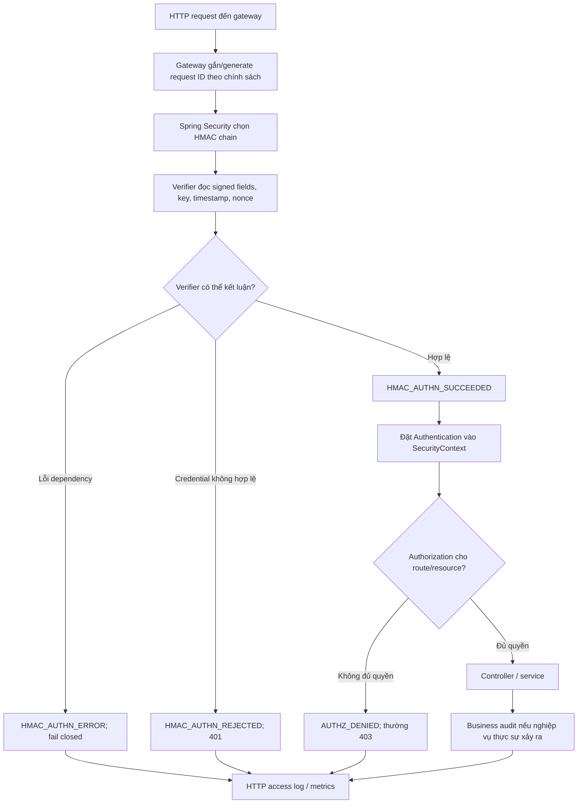

# Log authentication event cho HTTP HMAC: ghi nhận đúng sự kiện mà không lộ bí mật

## 1. Bối cảnh và mục tiêu

Trong module `SECURITY_AUTHENTICATION_HMAC_REQUEST_AUTHENTICATION`, client ký HTTP request bằng HMAC sử dụng **shared secret**. Hai phía phải thống nhất **canonical request**, gồm method, URI/query, những header được ký và/hoặc body theo hợp đồng. Server xác minh chữ ký, chống replay bằng timestamp/nonce, quản lý vòng đời và rotation của key, xử lý request qua proxy/gateway; sau đó Spring Security mới quyết định client được phép làm gì.

Khi triển khai, một yêu cầu quan trọng không kém việc xác minh HMAC là **ghi nhận sự kiện xác thực (authentication event)**. Đội vận hành cần trả lời được các câu hỏi:

- Bao nhiêu request HMAC được chấp nhận hoặc từ chối?
- Request bị từ chối do format thiếu, chữ ký sai, timestamp hết hạn, nonce bị phát lại, key không được chấp nhận hay verifier gặp lỗi hạ tầng?
- Một client xác thực thành công nhưng bị từ chối quyền ở bước tiếp theo hay chưa?
- Gateway nào chuyển request, điểm lỗi nằm trước hay sau proxy?
- Đợt key rotation hoặc thay đổi cấu hình có khiến tỷ lệ lỗi tăng đột biến không?

Tuy nhiên, ghi log không đúng có thể tạo một **kênh rò rỉ credential**: shared secret, chữ ký, nonce, raw body, canonical string chứa dữ liệu nhạy cảm và header `Authorization` có thể lọt vào hệ thống tập trung log. Vì thế chủ đề **“Log authentication event”** trong chương **Security logging** phải được thiết kế như một phần của kiến trúc bảo mật, với dữ liệu tối thiểu, trạng thái rõ ràng và ranh giới tin cậy.

Sau bài học, người học có thể:

1. Phân biệt **authentication event**, **authorization-denied event**, HTTP access log và audit event nghiệp vụ.
2. Thiết kế cấu trúc event nhất quán cho HMAC success, rejection và verifier error.
3. Chọn thông tin được phép log theo trạng thái *trước/sau khi đã xác thực*.
4. Ghi structured log trong Spring Security custom filter mà không log trùng hoặc đổi lỗi 403 thành 401.
5. Liên kết sự kiện giữa gateway, service và tracing bằng correlation ID an toàn.
6. Kiểm thử log redaction, kết quả HMAC, retry/replay, tải lớn và key rotation.

> **Phạm vi phiên bản:** Ví dụ Java dựa trên Spring Boot 3.x, Spring Security 6.x và SLF4J 2.x. Phần chính dùng Servlet/Spring MVC; phần riêng giải thích Spring WebFlux. Mẫu code chỉ biểu diễn điểm phát event; HMAC verifier phải hiện thực thuật toán và kiểm soát replay đầy đủ theo hợp đồng thực tế.

## 2. Log authentication event là gì?

Một **authentication event** là bản ghi một lần hệ thống **đưa ra kết luận về danh tính/credential** ở một ranh giới xác thực. Đối với HMAC, kết luận đó chỉ được phát ra sau khi verifier xử lý method/URI/header/body được ký, key, timestamp, nonce và chính sách tương ứng.

Nó khác những loại log thường bị trộn lẫn:

| Loại log/event | Điểm phát | Nội dung chính | Ví dụ |
| --- | --- | --- | --- |
| **Authentication success** | HMAC verifier/filter kết luận hợp lệ | Danh tính đã được xác minh và outcome success | `HMAC_AUTHN_SUCCEEDED` |
| **Authentication rejected** | Verifier từ chối credential/request | Lý do tổng quát, không gắn danh tính chưa xác minh | `HMAC_AUTHN_REJECTED` |
| **Authentication infrastructure error** | Không thể kết luận do dependency hoặc lỗi nội bộ | Phân biệt outage với sai chữ ký; fail closed | `HMAC_AUTHN_ERROR` |
| **Authorization denied** | Sau khi Authentication đã có, rule quyền từ chối | Principal đã xác thực không đủ authority/scope | `AUTHZ_DENIED` |
| **HTTP access log** | Gateway hoặc server sau khi response hoàn tất | Method, route, HTTP status, latency | `POST /internal/orders → 403` |
| **Business audit event** | Service/domain khi thực hiện nghiệp vụ | Hành động nghiệp vụ được phép/đã commit | `ORDER_CREATED` |

Ví dụ, một request có chữ ký đúng nhưng client thiếu `ORDER_CREATE` cần có thể quan sát:

```text
HMAC_AUTHN_SUCCEEDED  client_ref=svc-4c2...  route=POST /internal/orders
AUTHZ_DENIED         client_ref=svc-4c2...  reason=INSUFFICIENT_AUTHORITY
HTTP_ACCESS         route=POST /internal/orders  status=403
```

**Không ghi `HMAC_AUTHN_REJECTED` chỉ vì status cuối cùng là 403.** Request đó đã vượt qua xác thực HMAC. Ngược lại, một request thiếu signature thường chưa có principal đáng tin và phải được ghi là authn rejection, kể cả khi trước đó client đã gửi `X-Client-Id` trong header.

### 2.1. Mốc phát event trong chuỗi xử lý



Một event authentication success **không dự đoán được response cuối cùng**. Sau khi xác thực thành công, authorization có thể trả 403; JSON binding có thể trả 400; service có thể trả 409 hoặc lỗi hệ thống. Vì vậy không chèn `http_status=200` vào event success khi controller chưa chạy.

## 3. Thiết kế danh mục event và reason code

### 3.1. Ba kết quả có ý nghĩa khác nhau

Định nghĩa ba loại kết quả rõ ràng:

- **SUCCEEDED:** Chữ ký và các điều kiện xác thực đã qua; verifier trả `Authentication` đã xác thực.
- **REJECTED:** Request không đáp ứng hợp đồng HMAC. Không tạo danh tính tin cậy và thường trả 401 theo API contract.
- **ERROR:** Không thể kiểm chứng một cách đáng tin do lỗi dependency, bug hoặc trạng thái hạ tầng. Từ chối request an toàn (*fail closed*), nhưng không đếm như một signature sai của client.

Lỗi từ nonce store không sẵn sàng phải phân loại **ERROR**, không được biến thành thành công vì “chưa thấy nonce trùng”. Nếu API dùng 503 cho dependency outage hoặc 500 cho lỗi hệ thống, mã response cần nhất quán và tách khỏi mã reason nội bộ.

### 3.2. Reason code ngắn, do server kiểm soát

| Outcome | Reason code minh họa | Ý nghĩa vận hành |
| --- | --- | --- |
| REJECTED | `MISSING_CREDENTIALS` | Thiếu header bắt buộc theo hợp đồng |
| REJECTED | `MALFORMED_CREDENTIALS` | Header sai encoding/format/độ dài, có giá trị mơ hồ |
| REJECTED | `SIGNATURE_INVALID` | Signature không khớp canonical bytes |
| REJECTED | `TIMESTAMP_OUT_OF_WINDOW` | Timestamp hết hạn hoặc quá xa tương lai |
| REJECTED | `NONCE_REPLAY` | Nonce đã sử dụng trong phạm vi ngăn replay |
| REJECTED | `KEY_NOT_ACCEPTED` | Key không được chấp nhận theo chính sách |
| REJECTED | `CANONICAL_REQUEST_INVALID` | Request không thể canonicalize theo hợp đồng |
| ERROR | `KEY_STORE_UNAVAILABLE` | Key registry tạm thời không truy cập được |
| ERROR | `NONCE_STORE_UNAVAILABLE` | Không thể kiểm tra/ghi nonce theo yêu cầu atomicity |
| ERROR | `AUTHENTICATOR_INTERNAL_ERROR` | Lỗi ứng dụng không thuộc danh sách rejection |
| SUCCEEDED | `VERIFIED` | Đã xác minh chữ ký, freshness và key |

Danh sách này cần versioning và quy tắc rõ: cùng một lỗi không được lúc ghi `INVALID_SIGNATURE`, lúc ghi `BAD_MAC` tùy code path. Không dùng `exception.getMessage()` làm reason code hoặc message log, vì message có thể chứa dữ liệu request, key ID, URI, body hoặc thông tin thư viện hạ tầng.

Với **API response gửi ra internet**, có thể chỉ trả mã tổng quát `INVALID_HMAC_REQUEST` cho nhóm REJECTED; reason cụ thể được giữ trong audit nội bộ có kiểm soát. Không tiết lộ key có tồn tại, key đã bị revoke hay signature kỳ vọng.

### 3.3. Thứ tự xác minh ảnh hưởng ý nghĩa của event

Một verifier có thể chọn key, parse canonical data, kiểm signature, timestamp và nonce theo thứ tự phù hợp hiệu năng/chống tấn công. Nhưng event phải phản ánh **kết luận chính xác**:

1. Không ghi `SUCCEEDED` chỉ vì HMAC digest khớp nếu timestamp đã quá hạn.
2. Không ghi `SUCCEEDED` nếu nonce chưa được ghi nhận thành công bằng thao tác nguyên tử trên kho chia sẻ.
3. Không ghi `REJECTED` do “signature sai” khi thực chất key registry timeout và chưa lấy được key.
4. Nếu một request đồng thời vi phạm nhiều điều kiện, định nghĩa quy tắc chọn **một reason code chính** nhất quán với thứ tự verifier.
5. Event `NONCE_REPLAY` không đồng nghĩa client chắc chắn đang tấn công: nó cũng có thể do SDK retry request cũ, lỗi đồng bộ nonce hoặc hạ tầng gửi trùng. Không suy luận danh tính kẻ tấn công từ một event riêng lẻ.

## 4. Schema event: đủ chẩn đoán, ít dữ liệu nhạy cảm

Một event cần có cấu trúc máy đọc được để tìm kiếm, alert và nối dấu vết giữa các thành phần. Không nên ghi một chuỗi tự do như:

```text
AUTH FAILED for client=admin key=secret-17 nonce=abc signature=... body=...
```

Thay bằng **schema cố định** với field đã được review và danh sách giá trị cho phép.

### 4.1. Những trường nên có

| Trường | Ví dụ | Nguồn & lưu ý an toàn |
| --- | --- | --- |
| `event_type` | `hmac.authentication` | Hằng số do server định nghĩa |
| `event_version` | `1` | Phiên bản schema log |
| `outcome` | `SUCCEEDED / REJECTED / ERROR` | Kết quả verifier, không lấy từ status HTTP cuối cùng |
| `reason_code` | `VERIFIED / SIGNATURE_INVALID` | Enum/allowlist phía server |
| `timestamp` | Thời điểm server ghi event | Đồng hồ server, UTC; không thay bằng timestamp client tự ký |
| `request_id` | UUID do ingress/app tạo | Được tạo hoặc xác nhận trong ranh giới tin cậy |
| `trace_id` | Trace ID hợp lệ đã được chuẩn hóa | Dùng quan sát phân tán; không mặc nhiên tin mọi `traceparent` |
| `route_id` | `POST /internal/orders` | Route template/chính sách đã khai báo; tránh raw URI |
| `http_method` | `POST` | Phân loại method đã normalize, không log path/query nguyên vẹn |
| `client_ref` | `svc_7d3e` | Chỉ gán sau khi xác thực; nên là pseudonym/opaque reference |
| `tenant_ref` | `tnt_f2b1` | Chỉ khi cần và đã xác minh; tránh tên tenant nhạy cảm |
| `key_family` | `rotating-hmac-v2` | Metadata không bí mật từ key registry, không phải shared secret |
| `canonicalization_version` | `hmac-v1` | Hữu ích khi hai client dùng phiên bản ký khác nhau |
| `duration_ms` | `12` | Đo bằng monotonic clock; không có nội dung request |
| `service` và `instance` | `payments-api`, `pod-...` | Phục vụ tương quan; cân nhắc cardinality |
| `http_status` | `401` trong event rejection | Chỉ log nếu status do chính lớp đó phát, không đoán kết quả downstream |

Với **event REJECTED**, `client_ref` phải để trống/`null` trừ khi có một danh tính đã được xác minh độc lập. Header `X-Hmac-Key-Id` có thể trỏ tới một key candidate, nhưng chưa chứng minh quyền sở hữu key. Nếu đội vận hành cần nhóm request theo key candidate, chỉ dùng một **hash có khóa riêng cho telemetry**, giới hạn truy cập và retention; không ghi raw key ID từ request rồi coi đó là principal.

### 4.2. JSON mẫu

Ví dụ một request HMAC **đã xác thực**:

```json
{
  "event_type": "hmac.authentication",
  "event_version": 1,
  "outcome": "SUCCEEDED",
  "reason_code": "VERIFIED",
  "request_id": "req-4e99b3bf",
  "route_id": "POST /internal/orders",
  "http_method": "POST",
  "client_ref": "svc_7d3e",
  "tenant_ref": "tnt_f2b1",
  "canonicalization_version": "hmac-v1",
  "duration_ms": 8,
  "service": "orders-api"
}
```

Ví dụ một request **chưa xác thực được**:

```json
{
  "event_type": "hmac.authentication",
  "event_version": 1,
  "outcome": "REJECTED",
  "reason_code": "SIGNATURE_INVALID",
  "request_id": "req-22a3e5f0",
  "route_id": "POST /internal/orders",
  "http_method": "POST",
  "client_ref": null,
  "duration_ms": 4,
  "service": "orders-api"
}
```

Những ID ở trên chỉ để minh họa và không đại diện dữ liệu thật. Nên để collector bổ sung timestamp chuẩn của hệ thống logging hoặc gắn thời điểm UTC đã chuẩn hóa trong event schema; mọi tầng cần thống nhất timezone và format.

### 4.3. Tuyệt đối không ghi các giá trị sau theo mặc định

- **Shared secret / derived secret / private key**, secret trong key registry, HMAC key material, secret phiên bản rotation.
- **Signature nhận được hoặc signature kỳ vọng** ở dạng raw, base64 hay hex. Chữ ký có thể bị dùng lại trong cửa sổ chống replay nếu những điều kiện khác bị cấu hình yếu; không đưa vào log.
- **Nonce raw** hoặc danh sách nonce đã sử dụng. Nó là metadata chống replay; log raw tạo nguy cơ rò request correlation/metadata nhạy cảm và cardinality cao. Nếu thật cần truy vết, dùng mã sự kiện riêng hoặc fingerprint bảo vệ.
- **Full canonical request**, raw URI/query, toàn bộ request/response headers, body JSON, file upload hoặc bản hash body nếu hash có thể được dùng để suy đoán payload.
- `Authorization`, cookies, session identifiers, bearer tokens, API keys, signed URL, forwarded credentials.
- Exception message và stack trace chứa raw input từ parser/verifier. Stack trace nội bộ chỉ nên ở kênh hạn chế quyền với redaction đã kiểm chứng.
- Dữ liệu cá nhân, thông tin thanh toán, email/điện thoại, tenant name hoặc quyền chi tiết không cần thiết cho mục đích vận hành.

Ngay cả khi log pipeline có “masking”, không nên ghi secret rồi dựa duy nhất vào regex để xóa. Redaction tại **điểm tạo event** với schema allowlist là biện pháp đáng tin hơn.

## 5. Trust boundary: log cái gì trước và sau xác thực?

### 5.1. Trước khi HMAC được xác minh

`X-Client-Id`, `X-Hmac-Key-Id`, `X-Tenant-Id`, `X-Forwarded-For` và mọi field do client internet cung cấp là **untrusted input**. Việc chúng xuất hiện trong request không đủ để gọi đó là danh tính.

Trước authentication success, event có thể ghi:

- `route_id` xác định bởi matcher đã khai báo, ví dụ `POST /internal/orders`.
- `request_id` do thành phần tin cậy tạo ra hoặc xác minh format.
- `outcome=REJECTED` và reason code phía server.
- Thời gian xử lý, service ID và một nhãn phân loại nguồn đã được gateway tin cậy cung cấp nếu thật cần.

Không đưa giá trị untrusted vào message template của logger, không lưu raw path/query hoặc exception message tùy ý. Một URI bất thường có thể chứa newline/ký tự điều khiển/PII; nếu ghi trực tiếp vào text log, có nguy cơ **log injection** hoặc vô tình tạo dòng log giả.

### 5.2. Sau khi HMAC được xác minh

Khi verifier đã xác nhận key và chống replay thành công, có thể log **opaque client reference** do registry trả về. Nó phải phản ánh principal **đã xác thực**, không phải một trường tự khai báo được tin trước đó.

Sơ đồ ranh giới:

```text
HTTP header X-Hmac-Key-Id  -->  tìm candidate key (chưa đáng tin)
                                      |
                             verify signature/freshness/nonce
                                      |
                                      v
                          trusted principal từ key registry
                                      |
                                      v
                      audit client_ref + Authentication
                                      |
                                      v
                  authorization sử dụng server-side authorities
```

Nếu cần pseudonymize `clientId` để phục vụ điều tra qua nhiều event, dùng một **HMAC khác với key chỉ dành cho telemetry/audit** trên định danh chuẩn ở registry. Không dùng shared secret ký request làm khóa pseudonymization. Kết quả được rút gọn với độ dài đủ tránh collision trong quy mô hệ thống, kèm chính sách rotation/retention và quyền truy cập riêng; cân nhắc người dùng có quyền đối chiếu bản ghi với danh tính gốc hay không.

### 5.3. Nguồn IP và forwarded metadata

Khi backend sau gateway, `request.getRemoteAddr()` thường là địa chỉ proxy, còn `X-Forwarded-For` có thể chứa chuỗi IP do nhiều hop nối thêm. Không coi raw `X-Forwarded-For` là IP thật của người gọi nếu chưa định nghĩa các trusted proxies, thao tác strip/append và cách phân tích chain.

Nếu cần logging về nguồn request, nên đặt metadata này ở gateway đầu vào đáng tin hoặc truyền kèm nhãn nguồn đã kiểm chứng. Với HMAC, IP chỉ là tín hiệu điều tra/rate limit; **không chứng minh danh tính** và không thay thế chữ ký.

## 6. Spring Security Servlet: ghi event ngay tại custom HMAC authentication filter

Một số ứng dụng dùng `AuthenticationManager`/`AuthenticationProvider` có cơ chế phát `AuthenticationSuccessEvent`, `AbstractAuthenticationFailureEvent` thông qua `AuthenticationEventPublisher` khi được cấu hình phù hợp. Tuy nhiên, **custom filter tự gọi verifier rồi gán `SecurityContextHolder` không được mặc định bảo đảm phát các event đó**. Vì vậy, ví dụ dưới đây phát event rõ ràng tại điểm verifier kết luận.

### 6.1. Định nghĩa kết quả và các trường an toàn

Giả sử verifier trả về `Authentication` đã xác thực chứa principal thuộc kiểu nội bộ sau; `auditClientRef`/`auditTenantRef` là opaque reference được registry cấp:

```java
import org.springframework.security.core.Authentication;
import org.springframework.security.core.AuthenticationException;
import jakarta.servlet.http.HttpServletRequest;

record VerifiedHmacPrincipal(
    String clientId,
    String tenantId,
    String auditClientRef,
    String auditTenantRef
) {}

interface HmacRequestVerifier {
    Authentication verify(HttpServletRequest request)
        throws AuthenticationException;
}

enum HmacRejectReason {
    MISSING_CREDENTIALS,
    MALFORMED_CREDENTIALS,
    SIGNATURE_INVALID,
    TIMESTAMP_OUT_OF_WINDOW,
    NONCE_REPLAY,
    KEY_NOT_ACCEPTED,
    CANONICAL_REQUEST_INVALID
}
```

Verifier có thể phát exception chuyên biệt để báo **reason code do server cấp**, tuyệt đối không ghép dữ liệu raw request vào reason:

```java
import org.springframework.security.authentication.BadCredentialsException;

final class HmacRejectedException extends BadCredentialsException {
    private final HmacRejectReason reason;

    HmacRejectedException(HmacRejectReason reason) {
        super("HMAC authentication rejected");
        this.reason = reason;
    }

    HmacRejectReason reason() {
        return reason;
    }
}
```

`AuthenticationException` khác có thể được map sang `AUTHENTICATION_REJECTED` chung khi không thể gán reason cụ thể. Lỗi hạ tầng không nên được verifier biến thành `BadCredentialsException`; hãy báo lỗi kỹ thuật tách biệt và **fail closed**.

### 6.2. Structured logging bằng SLF4J 2.x

SLF4J 2.x hỗ trợ key/value event fields qua `atInfo()`, `atWarn()` và `addKeyValue()`. Để những field này được serialize thành JSON thực sự, logging backend/encoder cần được cấu hình tương ứng; không phải mọi layout mặc định đều xuất các field dưới dạng JSON.

```java
import org.slf4j.Logger;
import org.slf4j.LoggerFactory;
import org.springframework.security.core.Authentication;
import org.springframework.security.core.AuthenticationException;
import java.util.concurrent.TimeUnit;

final class HmacAuthenticationAudit {
    private static final Logger LOG =
        LoggerFactory.getLogger(HmacAuthenticationAudit.class);

    // Một route_id từ policy cấu hình, không dùng raw request URI.
    private static final String ROUTE_ID = "POST /internal/orders";

    void succeeded(
        String requestId,
        Authentication authentication,
        long startedAtNanos
    ) {
        String clientRef = "unattributed";
        String tenantRef = "unattributed";

        if (authentication.getPrincipal() instanceof VerifiedHmacPrincipal p) {
            clientRef = p.auditClientRef();
            tenantRef = p.auditTenantRef();
        }

        LOG.atInfo()
            .addKeyValue("event_type", "hmac.authentication")
            .addKeyValue("event_version", 1)
            .addKeyValue("outcome", "SUCCEEDED")
            .addKeyValue("reason_code", "VERIFIED")
            .addKeyValue("request_id", requestId)
            .addKeyValue("route_id", ROUTE_ID)
            .addKeyValue("client_ref", clientRef)
            .addKeyValue("tenant_ref", tenantRef)
            .addKeyValue("duration_ms", elapsedMs(startedAtNanos))
            .log("HMAC authentication completed");
    }

    void rejected(
        String requestId,
        AuthenticationException exception,
        long startedAtNanos
    ) {
        String reason = exception instanceof HmacRejectedException hmac
            ? hmac.reason().name()
            : "AUTHENTICATION_REJECTED";

        LOG.atWarn()
            .addKeyValue("event_type", "hmac.authentication")
            .addKeyValue("event_version", 1)
            .addKeyValue("outcome", "REJECTED")
            .addKeyValue("reason_code", reason)
            .addKeyValue("request_id", requestId)
            .addKeyValue("route_id", ROUTE_ID)
            .addKeyValue("duration_ms", elapsedMs(startedAtNanos))
            .log("HMAC authentication completed");
    }

    void internalError(String requestId, long startedAtNanos) {
        LOG.atError()
            .addKeyValue("event_type", "hmac.authentication")
            .addKeyValue("event_version", 1)
            .addKeyValue("outcome", "ERROR")
            .addKeyValue("reason_code", "AUTHENTICATOR_INTERNAL_ERROR")
            .addKeyValue("request_id", requestId)
            .addKeyValue("route_id", ROUTE_ID)
            .addKeyValue("duration_ms", elapsedMs(startedAtNanos))
            .log("HMAC authentication could not complete");
    }

    private static long elapsedMs(long startedAtNanos) {
        return TimeUnit.NANOSECONDS.toMillis(
            System.nanoTime() - startedAtNanos
        );
    }
}
```

Ở đây `client_ref` và `tenant_ref` chỉ lấy từ `VerifiedHmacPrincipal` do verifier tạo **sau xác thực**. Nếu hệ thống không có opaque reference phù hợp, thay bằng một pseudonymization service có policy rõ ràng hoặc bỏ các field đó; không tự fallback sang `request.getHeader("X-Client-Id")`.

### 6.3. Filter phát đúng một event cho một lần xác thực

Ví dụ một endpoint nội bộ ký HMAC bằng custom Servlet filter:

```java
import jakarta.servlet.FilterChain;
import jakarta.servlet.ServletException;
import jakarta.servlet.http.HttpServletRequest;
import jakarta.servlet.http.HttpServletResponse;
import java.io.IOException;
import java.util.UUID;
import org.springframework.security.authentication.BadCredentialsException;
import org.springframework.security.core.Authentication;
import org.springframework.security.core.AuthenticationException;
import org.springframework.security.core.context.SecurityContext;
import org.springframework.security.core.context.SecurityContextHolder;
import org.springframework.security.web.AuthenticationEntryPoint;
import org.springframework.web.filter.OncePerRequestFilter;

public final class HmacAuditedAuthenticationFilter
    extends OncePerRequestFilter {

    public static final String REQUEST_ID_ATTR =
        HmacAuditedAuthenticationFilter.class.getName() + ".requestId";

    private final HmacRequestVerifier verifier;
    private final AuthenticationEntryPoint entryPoint;
    private final HmacAuthenticationAudit audit;

    public HmacAuditedAuthenticationFilter(
        HmacRequestVerifier verifier,
        AuthenticationEntryPoint entryPoint,
        HmacAuthenticationAudit audit
    ) {
        this.verifier = verifier;
        this.entryPoint = entryPoint;
        this.audit = audit;
    }

    @Override
    protected void doFilterInternal(
        HttpServletRequest request,
        HttpServletResponse response,
        FilterChain chain
    ) throws IOException, ServletException {
        String requestId = UUID.randomUUID().toString();
        // Internal attribute; không tin request-id header từ internet.
        request.setAttribute(REQUEST_ID_ATTR, requestId);
        response.setHeader("X-Request-Id", requestId);
        long started = System.nanoTime();

        Authentication authentication;
        try {
            authentication = verifier.verify(request);
            if (authentication == null ||
                !authentication.isAuthenticated()) {
                throw new BadCredentialsException(
                    "HMAC authentication required"
                );
            }
        } catch (AuthenticationException rejected) {
            SecurityContextHolder.clearContext();
            audit.rejected(requestId, rejected, started);
            entryPoint.commence(request, response, rejected);
            return;
        } catch (RuntimeException unexpected) {
            SecurityContextHolder.clearContext();
            audit.internalError(requestId, started);
            throw unexpected; // Để tầng xử lý lỗi trả 5xx; không cho đi tiếp.
        }

        SecurityContext context =
            SecurityContextHolder.createEmptyContext();
        context.setAuthentication(authentication);
        SecurityContextHolder.setContext(context);

        try {
            audit.succeeded(requestId, authentication, started);
            chain.doFilter(request, response);
        } finally {
            SecurityContextHolder.clearContext();
        }
    }
}
```

Những điểm quan trọng:

1. Filter chỉ log **SUCCEEDED sau khi verifier kết luận toàn bộ HMAC/freshness/nonce hợp lệ**. Nếu verifier chưa ghi nonce an toàn, không được trả Authentication đã xác thực.
2. Chỉ `AuthenticationException` từ **đoạn verifier** mới được log là rejection. `chain.doFilter(...)` nằm **ngoài** `try/catch` đó; vì thế một lỗi từ controller hoặc authorization không bị ghi nhầm là HMAC rejection.
3. Khi verifier ném lỗi kỹ thuật bất ngờ, filter ghi event **ERROR** và dừng bằng exception, không chấp nhận request và không giả vờ chữ ký sai.
4. Mỗi lần filter thực hiện xác thực tạo một event, với `requestId` do server sinh. Ví dụ không coi raw `X-Request-Id`/`traceparent` của client là dữ liệu tin cậy.
5. `SecurityContext` được thiết lập trước authorization rồi dọn khi downstream kết thúc. Event authn success là sự kiện độc lập với kết quả quyền hoặc nghiệp vụ.
6. Ví dụ giả định filter chạy trong **một SecurityFilterChain dành cho endpoint được ký**. Filter registration và dispatcher type phải được cấu hình/kiểm thử để không chạy hai lần hoặc ghi trùng khi ERROR/ASYNC redispatch.

**Giới hạn:** Ví dụ dùng `HttpServletRequest` nguyên bản để minh họa log. Nếu verifier phải đọc body để tính digest, hãy dùng wrapper có giới hạn và truyền request có thể đọc lại cho controller trước `chain.doFilter(...)`; `ContentCachingRequestWrapper` tự nó không bảo đảm stream được phát lại sau khi verifier đọc hết.

### 6.4. Kết nối với Spring Security chain

Một cấu hình rút gọn:

```java
http
    .securityMatcher(hmacRequestMatcher)
    .sessionManagement(session -> session
        .sessionCreationPolicy(SessionCreationPolicy.STATELESS))
    .csrf(AbstractHttpConfigurer::disable)
    .authorizeHttpRequests(auth -> auth
        .requestMatchers(createOrderMatcher)
            .hasAuthority("ORDER_CREATE")
        .anyRequest().denyAll()
    )
    .addFilterBefore(
        new HmacAuditedAuthenticationFilter(verifier, entryPoint, audit),
        UsernamePasswordAuthenticationFilter.class
    );
```

Các biến `hmacRequestMatcher` và `createOrderMatcher` là `RequestMatcher` do ứng dụng định nghĩa, nhận diện endpoint theo **method/path**, không dựa vào header chữ ký. Nếu filter chỉ dùng cho một route, `ROUTE_ID` trong mẫu audit có thể cố định; khi filter phục vụ nhiều route, lấy **route ID từ policy đã match**, không ghép trực tiếp path/query do client điều khiển.

Việc `csrf.disable()` chỉ phù hợp với API machine-to-machine stateless không sử dụng cookie/session làm cơ chế xác thực. Không đăng ký đồng thời cùng filter như servlet filter `@Component` và trong `SecurityFilterChain`, vì có thể chạy hai lần hoặc trên endpoint không dự định.

Lưu ý: nếu cơ chế authn đi qua `AuthenticationManager` và `AuthenticationEventPublisher`, có thể tái sử dụng event infrastructure của Spring Security. Phải quyết định **một điểm phát event chủ đạo** để không ghi song song cả custom event và framework event cho cùng một kết luận mà không có dấu phân biệt.

## 7. 403 phải là authorization event riêng

Một client có key hợp lệ và HMAC hợp lệ nhưng thiếu `ORDER_CREATE` thường nhận **403 Forbidden**. Không nên sửa event đã phát thành authn failure. Hãy ghi thêm sự kiện authorization denial:

```java
import jakarta.servlet.http.HttpServletRequest;
import org.springframework.security.core.Authentication;
import org.springframework.security.core.context.SecurityContextHolder;
import org.springframework.security.web.access.AccessDeniedHandler;

AccessDeniedHandler deniedHandler = (request, response, error) -> {
    Authentication authentication =
        SecurityContextHolder.getContext().getAuthentication();

    Object ref = request.getAttribute(
        HmacAuditedAuthenticationFilter.REQUEST_ID_ATTR
    );
    String requestId = ref instanceof String ? (String) ref : "unavailable";

    // audit.authzDenied dùng cùng requestId, outcome=DENIED,
    // route template/permission code do server kiểm soát.
    // client_ref chỉ lấy từ principal đã xác minh.
    audit.authzDenied(requestId, authentication, "INSUFFICIENT_AUTHORITY");

    response.sendError(HttpServletResponse.SC_FORBIDDEN);
};
```

Đoạn trên minh họa **điểm tích hợp** và giả định `audit` có thêm phương thức `authzDenied(...)` do ứng dụng triển khai theo cùng schema. Với `ExceptionTranslationFilter`, một request anonymous bị từ chối có thể chuyển sang `AuthenticationEntryPoint` thay vì `AccessDeniedHandler`; do đó chỉ dựa vào mã 403/401 ngoài HTTP không đủ để suy ra event nội bộ nào đã xảy ra.

Trường hợp controller/service dùng method security hoặc policy theo tenant cũng có thể phát denial; cần thiết kế một kênh audit riêng sao cho không log lặp khi cùng một denial bị xử lý qua nhiều tầng. Không đưa danh sách authorities đầy đủ vào response hay log thông thường. Có thể ghi một **policy ID cố định** hoặc reason code nội bộ `TENANT_ACCESS_DENIED` và ẩn chi tiết resource.

Một request có chữ ký đúng nhưng JSON sai có thể ghi **HMAC_AUTHN_SUCCEEDED** và kết thúc bằng **400 Bad Request** ở MVC binding; không có authn rejection hoặc authz denial nếu quyền đã đủ. Tương tự, HTTP 403 từ **WAF/gateway** trước backend không tạo event authn ở backend: phải tìm log edge tương ứng.

## 8. WebFlux: log trong một reactive pipeline, không subscribe thủ công

Spring WebFlux không dùng `HttpServletRequest` hay `SecurityContextHolder` kiểu ThreadLocal làm nguồn context chính. Authenticated principal được truyền qua Reactor Context bằng `ReactiveSecurityContextHolder`, còn authentication filter nằm trong `SecurityWebFilterChain`.

Ví dụ rút gọn về **thời điểm log**:

```java
Mono<Authentication> verified = reactiveVerifier.authenticate(exchange)
    .switchIfEmpty(Mono.error(new BadCredentialsException(
        "HMAC authentication required"
    )))
    .flatMap(auth -> auth.isAuthenticated()
        ? Mono.just(auth)
        : Mono.error(new BadCredentialsException("Not authenticated")))
    .doOnNext(auth ->
        audit.succeeded(requestId, auth, startedAtNanos))
    .doOnError(AuthenticationException.class, error ->
        audit.rejected(requestId, error, startedAtNanos))
    .onErrorResume(AuthenticationException.class, error ->
        unauthorized(exchange).then(Mono.empty())
    );

return verified.flatMap(auth ->
    chain.filter(exchange).contextWrite(
        ReactiveSecurityContextHolder.withAuthentication(auth)
    )
);
```

Đây là đoạn trích trong một reactive `WebFilter`, giả định các biến và helper `unauthorized(...)` được cấu hình riêng. **Quan trọng:** `doOnNext` và `doOnError` nằm trên publisher của **verifier**, trước khi gọi `chain.filter(...)`; nếu catch toàn bộ lỗi downstream, một `AuthenticationException` của handler có thể bị log nhầm là lỗi HMAC.

Không gọi `subscribe()` thủ công trong filter để ghi audit và không gọi `block()` trên Netty event loop. Nếu gửi event đến queue/log service qua API reactive, phải quyết định rõ event nằm trong pipeline nào, cách xử lý backpressure, timeout và trường hợp gửi log thất bại. Với body ký HMAC, cần giữ `DataBuffer` đúng vòng đời và decoratе request cho downstream; không đọc body rồi để handler subscribe vào body nguồn đã bị consume.

Nếu dùng `AuthenticationWebFilter`, `ReactiveAuthenticationManager` và success/failure handler có sẵn của Spring Security, có thể ghi event ở các handler hoặc một adapter được kiểm soát, bảo đảm chỉ phát **một kết luận xác thực** cho mỗi lần xử lý. Với event stream bị retry/cancel, chú ý hiệu ứng phụ: `doOnNext` có thể chạy lại nếu upstream được **resubscribe**. Cần gắn `event_id`/deduplication policy nếu kiến trúc có retry hoặc at-least-once delivery.

## 9. Correlation giữa client, gateway, backend và audit store

### 9.1. Phân biệt bốn định danh

| Định danh | Phạm vi/nguồn | Có thể tin trực tiếp không? |
| --- | --- | --- |
| **Client ID** | Được khai báo qua key ID và xác minh bởi HMAC registry | Chỉ tin **sau** verifier success |
| **HMAC nonce** | Client tạo để chống replay | Không dùng làm request ID trong log; tuyệt đối không log raw mặc định |
| **Request ID** | Gateway hoặc backend tạo để theo dõi HTTP request | Tin nếu được tạo/validate tại trust boundary |
| **Trace ID** | Tracing/distributed context, có thể bắt đầu từ client | Có thể theo dõi qua hop; phải validate/giới hạn và hiểu là untrusted cho tới boundary |

Một nonce chống replay thường khác hoàn toàn idempotency key và request ID. Ghi raw nonce vào log gây tăng cardinality và có thể tạo nguy cơ tái sử dụng metadata. Nếu cần so nhiều request gửi lại, nên dựa vào reason code `NONCE_REPLAY`, internal event ID và liên kết chính sách đã kiểm soát.

### 9.2. Qua reverse proxy và gateway

Ví dụ request có thể đi qua:

```text
Client -> API Gateway -> Ingress -> Spring Security HMAC filter -> Service
```

Gateway có thể thay đổi `Host`, prefix URI, thứ tự/casing header hoặc body. Một lỗi `SIGNATURE_INVALID` sau khi deploy ingress mới có thể do canonicalization không thống nhất, thay vì client sử dụng secret sai.

Khi điều tra, đối chiếu:

1. Request ID/trace ID đáng tin ở từng hop.
2. Route template trước/sau rewrite và **canonicalization version**, chỉ log metadata đã giảm nhạy cảm.
3. Trạng thái bảo toàn **signed headers** theo policy, không dump raw header.
4. Thay đổi key rotation, clock sync, nonce store và các lỗi hạ tầng.
5. Source của 401/403: gateway, Spring Security filter, authorization hay service.

Nếu một header “verified client” được gateway gửi cho backend, gateway phải loại bỏ bản do internet client tự đặt và chỉ tạo sau khi đã xác minh; kết nối tới backend phải nằm trong ranh giới tin cậy. Backend không được xem giá trị header đó là Authentication nếu không có thiết kế xác thực gateway → backend.

### 9.3. Correlation ID và log injection

Request ID hoặc `traceparent` có thể được client cố tình đặt thành chuỗi dài, chứa control characters hoặc dữ liệu PII. Tại ingress, hãy tạo mới hoặc kiểm tra format/độ dài theo policy, rồi truyền thông tin an toàn xuống backend. Log schema dùng những giá trị đã chuẩn hóa; không ghép raw header vào một dòng log tự do.

Khi dùng SLF4J MDC, cần đặt và **clear** giá trị trong `finally` tại ranh giới xử lý. Trong WebFlux, MDC dựa trên ThreadLocal không tự lan truyền qua thread hopping; dùng cơ chế Reactor Context/tracing bridge thích hợp. Không lưu client principal hoặc request header trong mutable field của singleton filter.

## 10. Vận hành hệ thống log như một tài sản bảo mật

### 10.1. Retention, quyền truy cập và integrity

Authentication logs hữu ích cho điều tra nhưng có thể tiết lộ cấu trúc API, thời điểm hoạt động của client và trạng thái bảo mật. Cần:

- Chỉ ghi những field cần cho mục tiêu vận hành/audit; ban hành retention rõ theo yêu cầu hệ thống.
- Phân quyền đọc, export và tìm kiếm log; tách quyền vận hành chung khỏi quyền điều tra bảo mật.
- Mã hóa đường truyền app → collector, lưu trữ có kiểm soát và hạn chế tác vụ sửa/xóa log.
- Có khả năng phát hiện log bị sửa hoặc mất với cơ chế phù hợp, chẳng hạn audit trail của nền tảng và lưu trữ immutable khi có yêu cầu.
- Tránh đưa secret và PII vào pipeline log ngay từ đầu; không dựa vào chính sách xóa sau này để khắc phục leak đã xảy ra.
- Ghi nhận event version/schema để việc đổi field không khiến alert và dashboard hiểu sai.

Với hệ thống có yêu cầu audit bền vững nghiêm ngặt, một logger text `atInfo()` là chưa đủ để cam kết **delivery hoặc durability**. Cần thiết kế hàng đợi/transactional outbox/đích audit chuyên dụng, cơ chế xác nhận và chính sách khi audit sink không sẵn sàng. Quyết định **fail closed hay tiếp tục** phải dựa trên yêu cầu nghiệp vụ và mức độ pháp lý của hệ thống; không mặc định audit log đồng bộ thành dependency chặn mọi request.

### 10.2. Tránh gây DoS qua logging

Một kẻ tấn công có thể gửi hàng nghìn request HMAC sai để tạo bão log. Không tạo một stack trace dài hoặc raw payload cho mỗi lần signature mismatch. Nên sử dụng:

- **Counters** theo outcome/reason/route cố định.
- Rate limit/tối ưu ingestion và backpressure phù hợp.
- Gộp hoặc sampling những sự kiện lặp lại ở lưu lượng lớn khi policy cho phép, trong khi giữ được thông tin an ninh quan trọng.
- Alert trên tỷ lệ thay đổi và phân bố theo cửa sổ thời gian, tránh alert mỗi một 401.
- Monitoring sức khỏe log pipeline và tỷ lệ event bị drop.

Không dùng `keyId`, nonce, raw URI, user input hoặc request ID làm **metric label** có cardinality không giới hạn. Dashboard có thể group theo `service`, `route_id`, `outcome`, `reason_code` và canonicalization version đã được kiểm soát.

### 10.3. Các chỉ số phù hợp

| Metric | Mục đích | Nhãn nên giới hạn |
| --- | --- | --- |
| `hmac_authn_total{outcome,reason_code,route_id}` | Theo dõi xác thực thành công/thất bại/lỗi | Reason code và route từ allowlist |
| `hmac_authn_duration_seconds` | Theo dõi độ trễ key lookup, signature và nonce | Route và kết quả |
| `hmac_nonce_replay_total` | Phát hiện dấu hiệu replay hoặc retry sai SDK | Service/route |
| `hmac_key_rotation_rejection_total` | Nhận diện lỗi khi chuyển key | Key family/version không nhạy cảm |
| `authz_denied_total{policy_id,route_id}` | Theo dõi thiếu quyền sau HMAC success | Policy ID cố định |
| `audit_sink_delivery_errors_total` | Phát hiện thiếu event ở hệ thống audit | Destination class, không phải raw message |

Để tính tỷ lệ 401/403, nên dùng **HTTP access metrics** hoặc access log có status thực tế, không suy ra 403 chỉ từ `HMAC_AUTHN_SUCCEEDED`. Một event success có thể dẫn đến cả 201, 400, 403 hoặc 500.

## 11. Kiểm thử log authentication event

### 11.1. Ma trận kết quả và event mong đợi

| Request/tình huống | Kết luận HMAC | Authentication event | Event bổ sung / HTTP thường gặp |
| --- | --- | --- | --- |
| Chữ ký đúng, key active, timestamp/nonce hợp lệ, đủ quyền | PASS | `SUCCEEDED / VERIFIED` | 2xx theo nghiệp vụ |
| Chữ ký đúng, client thiếu `ORDER_CREATE` | PASS | `SUCCEEDED / VERIFIED` | `AUTHZ_DENIED`; 403 |
| Chữ ký đúng nhưng body JSON không hợp lệ | PASS | `SUCCEEDED / VERIFIED` | MVC validation 400 nếu đủ quyền |
| Thiếu `X-Hmac-Signature` | REJECT | `REJECTED / MISSING_CREDENTIALS` | 401 |
| Signature khác expected digest | REJECT | `REJECTED / SIGNATURE_INVALID` | 401 |
| Timestamp ngoài cửa sổ | REJECT | `REJECTED / TIMESTAMP_OUT_OF_WINDOW` | 401 |
| Nonce đã sử dụng | REJECT | `REJECTED / NONCE_REPLAY` | 401 |
| Key bị thu hồi, ngoài rotation window | REJECT | `REJECTED / KEY_NOT_ACCEPTED` | 401 |
| Signed header có nhiều giá trị không hợp đồng | REJECT | `REJECTED / MALFORMED_CREDENTIALS` | 401/400 theo policy |
| Key registry timeout | ERROR | `ERROR / KEY_STORE_UNAVAILABLE` | 5xx theo policy, không cho qua |
| Nonce store không hoạt động | ERROR | `ERROR / NONCE_STORE_UNAVAILABLE` | 5xx theo policy, fail closed |
| Gateway/WAF từ chối request trước app | Không chạy | **Không có event authn backend** | Event tại gateway; status tùy policy |
| HTTP request sai method/path ngoài HMAC chain | Không chạy | Không có event HMAC từ filter đó | Policy fallback |
| Same request tới nhiều instance do retry | Xét từng request | Event riêng theo từng lần verify | Chống replay bằng kho nonce dùng chung |
| ERROR/ASYNC redispatch | Theo dispatcher policy | Không nhân đôi kết luận authn vô ý | Event riêng nếu một lần verify mới có chủ đích |

### 11.2. Test log không chứa secret

Không chỉ assert mã HTTP. Trong unit/integration test, cấp dữ liệu giả có sentinel nhạy cảm:

```text
SECRET_SENTINEL_DO_NOT_LOG
SIGNATURE_SENTINEL_DO_NOT_LOG
NONCE_SENTINEL_DO_NOT_LOG
RAW_BODY_SENTINEL_DO_NOT_LOG
```

Đưa sentinel vào secret ký, signature/header hoặc body phù hợp với test fixture. Thu những structured events từ test appender/sink rồi khẳng định:

- Không field/message nào chứa sentinel, raw signature, secret, nonce hay raw body.
- `outcome` và `reason_code` là giá trị hợp đồng, không phải exception message.
- Rejected event không gán `client_ref` theo một header chưa được xác thực.
- Success event lấy opaque `client_ref` từ principal tin cậy, không từ `X-Client-Id`.
- Khi HMAC success nhưng authorization fail, có **một success authn event** và **một denial event** (nếu policy phát denial), không ghi authn rejected.
- Trong request song song có nhiều client, event không lẫn request ID/principal; không rò MDC qua thread tái sử dụng.

Ví dụ assertion ở mức nguyên tắc:

```java
String capturedEvents = testAuditSink.serializedEvents();

assertThat(capturedEvents)
    .doesNotContain("SECRET_SENTINEL_DO_NOT_LOG")
    .doesNotContain("SIGNATURE_SENTINEL_DO_NOT_LOG")
    .doesNotContain("NONCE_SENTINEL_DO_NOT_LOG")
    .doesNotContain("RAW_BODY_SENTINEL_DO_NOT_LOG");

assertThat(testAuditSink.eventsFor(requestId))
    .extracting(AuditEvent::outcome)
    .containsExactly("SUCCEEDED");
```

Đây là pseudocode trong một test class có `testAuditSink`/`AuditEvent` do dự án định nghĩa, không phải API có sẵn của Spring Security. Nên kiểm trên **đầu ra cuối của encoder JSON** để phát hiện formatter/logger có vô tình in thêm exception hoặc MDC nhạy cảm ngoài các field được kiểm.

### 11.3. Test end-to-end qua filter chain và gateway

Kiểm thử ít nhất các đường:

1. Spring Security filter được gọi đúng một lần cho route HMAC; không có registration trùng ở servlet container.
2. `MockMvc` hoặc `WebTestClient` chạy cùng security chain thật, gửi request ký bởi fixture dùng test secret; `@WithMockUser` không chứng minh HMAC được verify.
3. Request đúng/sai chữ ký, timestamp/nonce và key rotation cho đúng event/reason.
4. HMAC đúng nhưng thiếu authority được 403 và **vẫn có authn success event**.
5. Controller ném exception sau authn success không tạo một authn rejection bổ sung.
6. Async/error dispatch không nhân đôi event trong cùng logical request ngoài policy đã định.
7. Gateway rewrite URI/Host, gộp header hoặc thay body khiến event phản ánh đúng kết luận verifier và log nào được phát tại edge/backend.
8. Trace/request ID được truyền ổn định, có độ dài/format hợp lệ; spoofed forwarded/client headers không trở thành client_ref.
9. Khi audit sink gián đoạn, hệ thống ứng xử đúng policy: đo error/drop, fail closed hoặc tiếp tục có kiểm soát; không nuốt lỗi bảo mật.

### 11.4. Kiểm tra việc log lộ thông tin qua exception

Một số thư viện có thể đưa header/request target vào exception message. Hãy cố tình thử body, URI và header chứa ký tự điều khiển, chuỗi dài hoặc sentinel; xác nhận log không xuất hiện newline giả, dữ liệu nhạy cảm hoặc log field không hợp lệ. Với request malformed, gateway/container có thể chặn trước ứng dụng, vì vậy cần kiểm tra telemetry ở đúng hop phát sinh.

## 12. Quy trình triển khai thực tế

1. **Định nghĩa hợp đồng HMAC:** method, canonical URI/query, signed headers, body digest, key ID, timestamp, nonce và version. Chỉ khi verifier có kết luận rõ mới phát authn event.
2. **Tạo enum outcome/reason code:** phân biệt `SUCCEEDED`, `REJECTED` và `ERROR`; không map lỗi hạ tầng thành signature invalid.
3. **Thiết kế event schema có allowlist:** route template, timestamp server, correlation ID đã kiểm soát, reason code, latency; chỉ gắn opaque principal sau authn success.
4. **Redact từ nguồn:** loại secret, signature, nonce raw, canonical request, full headers/body và exception message không kiểm soát.
5. **Ghi ở đúng điểm trong filter hoặc authentication manager:** event phát khi verifier kết luận, trước authorization; bảo đảm không log trùng do filter registration/dispatch hoặc nhiều event publishers.
6. **Ghi authorization denial riêng:** để 401, 403 và kết quả nghiệp vụ có nghĩa nhất quán; tránh suy đoán authn từ HTTP status cuối cùng.
7. **Liên kết proxy/backend:** kiểm trust boundary cho `Forwarded`, request ID, trace ID và header đã được gateway xác minh; phân biệt lỗi edge với lỗi HMAC backend.
8. **Kiểm thử event và privacy:** fake/test vector ký request, các lỗi signature/replay/rotation, 403, exception, async và kiểm sentinel không lọt qua encoder.
9. **Vận hành hệ thống audit:** retention, phân quyền truy cập, integrity, counters, alerting, backpressure, metric cardinality và chính sách khi log sink lỗi.

**Điểm cần nhớ:** Một **authentication event** phải ghi nhận **kết luận xác thực HMAC** và chỉ gắn danh tính sau khi server đã xác minh key, chữ ký, timestamp và nonce. **403 Forbidden** là kết luận phân quyền riêng; response HTTP cuối cùng không định nghĩa lại authn success/failure. Ghi log dạng cấu trúc với field được kiểm soát, giữ bí mật của shared secret/signature/body và liên kết request qua gateway bằng định danh đáng tin sẽ giúp điều tra sự cố mà không biến hệ thống log thành điểm yếu bảo mật.
