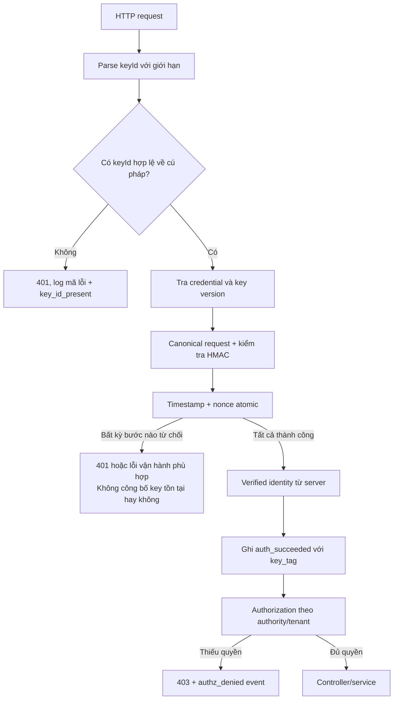

# Log key ID khi xác thực HMAC: quan sát được sự cố mà không lộ thông tin nhạy cảm

## 1. Mục tiêu: vì sao cần log key ID?

Trong module `SECURITY_AUTHENTICATION_HMAC_REQUEST_AUTHENTICATION`, client ký HTTP request bằng HMAC với shared secret. Server dựng lại **canonical request** theo hợp đồng (method, URI, header được chọn và/hoặc hash body), tra khóa theo `keyId`, xác minh chữ ký và kiểm tra freshness bằng timestamp/nonce. Khi xác thực thành công, server mới ánh xạ credential tới principal và authorities; phân quyền cho tài nguyên hoặc tenant là bước riêng.

Một hệ thống production cần trả lời được: “Request nào dùng credential nào?”, “Một phiên bản khóa sau khi rotate còn được gọi không?”, “Vì sao lượng `401` tăng sau khi deploy gateway?”, “Các request replay có tập trung ở một credential không?”. **Log key ID** cung cấp dữ liệu tương quan hữu ích cho những câu hỏi đó.

Tuy nhiên, `keyId` chỉ là **định danh tra cứu khóa**, không phải secret và cũng **không phải bằng chứng xác thực**. Trước khi kiểm tra HMAC, giá trị `keyId` đến từ HTTP request là dữ liệu do client tự khai, có thể bị giả mạo. Nếu ghi thẳng giá trị này vào log rồi gắn nhãn “client đã đăng nhập”, hệ thống sẽ tạo bằng chứng kiểm toán sai. Nếu dùng raw key ID làm nhãn metric, attacker có thể tạo vô số giá trị khác nhau để tăng cardinality và chi phí lưu trữ.

Bài học này đặt trọng tâm vào **ghi nhận key ID đúng thời điểm, đúng độ tin cậy và đúng mức thông tin**, kết hợp key rotation, anti-replay, canonicalization, proxy/gateway và phân biệt authentication với authorization.

Sau bài này, người học cần có khả năng:

1. Phân biệt key ID *do client khai* với key ID *được tra cứu và xác minh*.
2. Thiết kế log event dùng trường có cấu trúc, không chứa shared secret, chữ ký kỳ vọng hay body nhạy cảm.
3. Chọn khi nào có thể log raw ID trong môi trường kiểm soát, khi nào nên dùng pseudonym hoặc alias.
4. Tạo key tag phục vụ correlation mà không làm lộ giá trị gốc.
5. Liên kết event xác thực, replay, key rotation và phân quyền bằng request ID/trace ID.
6. Viết và kiểm thử logging cho Spring Security Servlet và WebFlux.

## 2. Key ID là gì và không phải là gì?

Hợp đồng HMAC minh họa:

```http
POST /api/orders?region=vn HTTP/1.1
Host: api.example.test
X-Key-Id: client-a-key-v2
X-Request-Timestamp: 2026-11-28T03:00:00Z
X-Request-Nonce: 3aa4f7bf-new
X-Signature: <base64-hmac-sha256>
Content-Type: application/json

{"sku":"A-17","quantity":1}
```

Ở đây:

- `X-Key-Id` giúp server chọn credential hoặc phiên bản khóa trong kho tin cậy.
- Shared secret chỉ được lưu ở bên ký và phía xác minh; không gửi trong header.
- `X-Signature` là HMAC được tính từ secret và canonical request.
- Timestamp và nonce được dùng để giới hạn và phát hiện replay; **HMAC đúng mà nonce đã dùng vẫn bị từ chối**.
- Một ID hợp lệ về cú pháp hoặc có trong key store **không chứng minh** client sở hữu shared secret.

Tên header, thuật toán, encoding, các trường ký và cách canonicalize là **hợp đồng riêng của API**. Có hệ thống sử dụng `Authorization: HMAC ...` thay vì `X-Key-Id`; quy tắc logging vẫn giống nhau. Nếu định danh khóa nằm trong `Authorization`, tuyệt đối không log nguyên header chỉ để trích `keyId`.

Định danh khóa có thể là chuỗi ngẫu nhiên, alias của tổ chức hoặc một mã liên quan khách hàng. Dù `keyId` không phải secret mật mã, nó có thể tiết lộ cấu trúc tenant, môi trường, phiên bản khóa và tương quan hoạt động của khách hàng. Vì vậy cần áp dụng **data minimization**.

| Dữ liệu | Có chứng minh danh tính không? | Chính sách log gợi ý |
| --- | --- | --- |
| `keyId` do client gửi, chưa xác minh | Không | Không dùng làm “authenticated client”; thường chỉ log `key_id_present` |
| `keyId` đã được server tra và kiểm chứng | Chỉ khi request HMAC/freshness/replay đều hợp lệ | Dùng `key_tag` hoặc alias nội bộ |
| Shared secret/HMAC key material | Không phải metadata theo dõi | **Không bao giờ** log |
| Chữ ký client gửi | Chưa chứng minh thành công | Không log raw; nếu cần chỉ ghi tình trạng có/không, độ dài |
| Expected signature/HMAC bytes | Là kết quả nhạy cảm của verifier | Không log |
| Canonical request đầy đủ/body | Có thể chứa URI, token, PII, payload tài chính | Không log mặc định; chỉ metadata đã kiểm soát |
| Timestamp/nonce | Chỉ là thành phần chống replay | Ưu tiên mã lỗi, độ lệch thời gian theo bucket; không log raw nonce |
| Authorities/tenant | Từ chính sách server sau xác thực | Ghi ở mức tối thiểu và đã kiểm soát quyền truy cập log |

## 3. Phân biệt hai trạng thái: supplied key ID và verified key ID

Các bước trong verifier thường là:



**Trước khi xác thực:** nếu request gửi `X-Key-Id: client-a-key-v2`, server mới chỉ biết *client tuyên bố* giá trị đó. Kẻ tấn công có thể cố tình gửi key ID của một khách hàng khác để làm nhiễu audit. Không ghi một event kiểu “client A đăng nhập thất bại” rồi suy ra chính khách hàng A là người gửi request.

**Sau khi xác thực:** verifier đã tìm đúng khóa theo policy, kiểm tra chữ ký, timestamp và nonce, tạo principal từ key record đã được tin cậy. Lúc đó có thể log một định danh **đã kiểm chứng** cho mục đích audit. Nếu replay checker từ chối cùng nonce, không ghi `auth_succeeded`.

Nên phân biệt các tên trường:

| Trường event | Ngữ nghĩa |
| --- | --- |
| `key_id_present` | Có hay không có trường định danh trong request |
| `key_id_syntax_valid` | Parser chấp nhận định dạng hay không; chưa khẳng định key tồn tại |
| `key_ref_source` | `client_supplied` hoặc `trusted_key_record` (nếu cần) |
| `verified_key_tag` | Pseudonym/alias lấy từ credential đã kiểm chứng |
| `credential_version_tag` | Định danh an toàn của phiên bản key đã kiểm chứng |
| `auth_outcome` | `accepted` / `rejected` / `unavailable` |
| `reason_code` | Mã nội bộ từ allowlist |
| `authz_outcome` | `allowed` / `denied` / `not_evaluated` |

Không coi `key_id_syntax_valid=true` là `authenticated=true`. Hai sự kiện cùng có request ID nhưng độ tin cậy khác nhau.

## 4. Có nên log raw key ID không?

Không có quy tắc tuyệt đối rằng key ID luôn là bí mật; nhiều giao thức công bố key ID dưới dạng public identifier. Quyết định ghi raw ID phụ thuộc nội dung ID, nguy cơ liên kết dữ liệu, quy tắc bảo mật và người được phép xem log.

Đối với hệ thống đa khách hàng, mặc định nên dùng **mã định danh thay thế (pseudonym)** hoặc **alias nội bộ do server cấp**. Điều này giảm khả năng log bị dùng để lập bản đồ credential hoặc kết nối hoạt động giữa các tổ chức.

### 4.1. Các lựa chọn

| Cách ghi | Ưu điểm | Rủi ro / giới hạn |
| --- | --- | --- |
| Raw `keyId` | Tra cứu trực tiếp nhanh | Dễ lộ cấu trúc credential, PII nếu ID mang thông tin nhận diện; dễ bị giả mạo trong sự kiện chưa xác thực |
| Mask một phần | Dễ nhận biết thủ công | Nếu ID ngắn/dễ đoán, phần lộ còn lại vẫn đủ nhận diện; có thể trùng |
| Băm `SHA-256(keyId)` không khóa | Correlation ổn định | Dễ thử từ điển nếu không gian ID dự đoán được |
| HMAC riêng cho log trên key ID | Pseudonym ổn định, khó thử từ điển nếu log key không lộ | Phải bảo vệ và rotate **khóa tạo tag**, vận hành thêm logic |
| Alias ngẫu nhiên trong credential registry | Không phát lộ ID gốc, dễ quản lý chính sách | Cần mapping server-side, xử lý lifecycle alias |
| Chỉ log request ID và reason | Ít nhạy cảm, cardinality thấp | Không thể tìm theo credential từ log đơn lẻ |

Nên tách **log tag key** khỏi **shared secret dùng ký HTTP request**. Dùng cùng HMAC secret của client để pseudonymize key ID làm tăng nơi sử dụng key, gây rủi ro quản lý rotation và không cần thiết.

### 4.2. Không dùng raw key ID làm tên metric

Ví dụ không nên dùng:

```text
hmac_auth_failures_total{key_id="arbitrary-client-input"} 1
```

Attacker có thể gửi hàng triệu giá trị `key_id` tùy ý, tạo lượng time series khổng lồ cho Prometheus hoặc hệ metric khác. Metrics nên dùng nhãn có cardinality thấp như `outcome`, `reason_group`, `service`, `route_template` và `environment`. Truy vấn theo credential đã xác minh nên được thực hiện qua event log bảo vệ phù hợp, không mở rộng cardinality của mọi metric.

## 5. Thiết kế cấu trúc log event

Một event audit sau xác thực có thể dùng cấu trúc JSON như sau:

```json
{
  "event_type": "hmac.authentication.accepted",
  "event_time": "2026-11-28T03:00:00Z",
  "service": "order-api",
  "environment": "production",
  "request_id": "req-41f0",
  "trace_id": "6f2c...redacted-for-example",
  "http_method": "POST",
  "route_template": "/api/orders",
  "verified_key_tag": "kt1:ed9b57e0194f6c0bcab2ea06781fbc30",
  "auth_outcome": "accepted",
  "authz_outcome": "not_evaluated"
}
```

Đây là ví dụ; tag là giá trị giả, không được suy diễn từ secret thật. `authz_outcome=not_evaluated` làm rõ **authentication thành công chưa đồng nghĩa request đã được phép**. Khi `AuthorizationFilter` hoặc service kiểm tra quyền, có thể ghi event tiếp theo liên kết bằng request ID:

```json
{
  "event_type": "hmac.authorization.denied",
  "request_id": "req-41f0",
  "verified_key_tag": "kt1:ed9b57e0194f6c0bcab2ea06781fbc30",
  "required_permission": "orders:create",
  "reason_code": "insufficient_authority",
  "http_status": 403
}
```

Không nên ghi nguyên resource ID hoặc tenant name nếu chúng có thể là PII hoặc dữ liệu nhạy cảm mà người dùng log không cần. Nếu cần truy vết tài nguyên, dùng ID nội bộ có kiểm soát hoặc pseudonym riêng và chính sách phân quyền đọc log.

Đối với request chưa xác thực, event thích hợp:

```json
{
  "event_type": "hmac.authentication.rejected",
  "request_id": "req-41f1",
  "key_id_present": true,
  "auth_outcome": "rejected",
  "reason_code": "invalid_credentials",
  "http_status": 401
}
```

Không thêm `verified_key_tag` ở nhánh này vì chưa có credential được xác minh. Đặc biệt, không khẳng định người sở hữu một key ID đã gửi request chỉ vì attacker cung cấp ID đó.

## 6. Tạo key tag từ ID đã được xác minh

Một lựa chọn là tính HMAC-SHA256 bằng **khóa chuyên dùng cho logging**, rồi lấy một phần digest đủ dài để correlation. Ví dụ Java 17:

```java
import java.nio.charset.StandardCharsets;
import java.util.HexFormat;
import javax.crypto.Mac;
import javax.crypto.spec.SecretKeySpec;

public final class VerifiedKeyTagger {
    private final byte[] logTagSecret;
    private final String tagVersion;

    public VerifiedKeyTagger(byte[] logTagSecret, String tagVersion) {
        if (logTagSecret == null || logTagSecret.length < 32) {
            throw new IllegalArgumentException("Log tag key is too short");
        }
        this.logTagSecret = logTagSecret.clone();
        this.tagVersion = tagVersion;
    }

    public String tagForVerifiedKey(String canonicalStoredKeyId) {
        if (canonicalStoredKeyId == null || canonicalStoredKeyId.isBlank()) {
            throw new IllegalArgumentException("Missing verified key ID");
        }
        try {
            Mac mac = Mac.getInstance("HmacSHA256");
            mac.init(new SecretKeySpec(logTagSecret, "HmacSHA256"));

            // Domain separation để không trộn tag keyId với dữ liệu khác.
            byte[] digest = mac.doFinal(
                    ("hmac-log-key-id:v1:" + canonicalStoredKeyId)
                            .getBytes(StandardCharsets.UTF_8));

            // 16 bytes = 128 bits; xác suất va chạm ngẫu nhiên rất thấp.
            return tagVersion + ":"
                    + HexFormat.of().formatHex(digest, 0, 16);
        } catch (GeneralSecurityException ex) {
            throw new IllegalStateException("Cannot calculate log key tag", ex);
        }
    }
}
```

Bổ sung import `java.security.GeneralSecurityException`. Ví dụ giả định `logTagSecret` được cấp qua secret manager ở thời điểm khởi động, **không hard-code secret trong source/repository**. Ở hệ thống thật, cần quyết định nơi giữ secret, quyền cấp phát, lifecycle, rotate, zeroization phù hợp và bảo vệ memory dump. Không log exception chứa input ID.

Chỉ gọi `tagForVerifiedKey(...)` với **ID chuẩn lấy từ key record đã được verifier xác minh**, thay vì chuỗi client gửi trước authentication. Prefix `tagVersion` là phiên bản của khóa dùng pseudonymization, **không phải** version secret ký request.

Nếu ứng dụng phải tương quan dữ liệu qua quá trình rotate khóa tạo log tag, cần có kế hoạch chuyển đổi: giữ mapping ở hệ thống audit được bảo vệ, hỗ trợ một khoảng thời gian truy vấn hai phiên bản hoặc dùng alias ngẫu nhiên nội bộ ổn định. Không mặc nhiên giữ log tag secret cũ mãi mãi.

### 6.1. Xử lý key rotation

Có hai ID khác nhau nên cân nhắc:

- **Credential ID/key version:** xác định secret hoặc phiên bản khóa cụ thể đang được dùng để verify.
- **Client identity:** xác định ứng dụng/đối tác sở hữu credential đó sau khi đã xác thực.

Khi rotate từ key `K1` sang `K2`, cả hai có thể được chấp nhận trong giai đoạn overlap theo policy. Nếu log chỉ tag client, không biết key cũ đã ngừng được sử dụng hay chưa. Nếu log chỉ tag key version, khó tổng hợp hoạt động của một client xuyên rotation.

Thiết kế có thể ghi hai tag khác nhau từ dữ liệu **đã được xác minh**:

```json
{
  "event_type": "hmac.authentication.accepted",
  "verified_client_tag": "ct1:example",
  "verified_key_tag": "kt1:example",
  "key_lifecycle_state": "rotation_overlap",
  "request_id": "req-4110"
}
```

Các tag trong JSON là giá trị minh họa. `key_lifecycle_state` chỉ nên thuộc allowlist nội bộ (ví dụ `active`, `rotation_overlap`) và không tiết lộ thông tin lifecycle nhạy cảm ra HTTP response. Khi khóa bị revoke, yêu cầu dùng khóa đó **không được log accepted**.

## 7. Log theo từng nhánh của xác thực HMAC

Key ID chỉ là một phần trong quá trình xác thực. Hệ thống cần log chính xác **trạng thái kiểm tra toàn bộ hợp đồng ký**.

| Điều kiện | Kết quả thường dùng | Log an toàn gợi ý |
| --- | --- | --- |
| Không có `keyId`/credential bắt buộc | `401` | `missing_credential`, `key_id_present=false` |
| Key ID quá dài, chứa ký tự điều khiển hoặc duplicate | `400` hoặc `401` theo hợp đồng | `malformed_key_identifier`, không log raw input |
| Key ID không tồn tại | `401` chung | `invalid_credentials` ở response; nội bộ phân loại có kiểm soát nếu thật cần |
| Key tồn tại nhưng signature sai | `401` chung | `signature_mismatch`, **không gắn tag “authenticated client”** |
| Timestamp ngoài cửa sổ | Thường `401` | `timestamp_out_of_window` và bucket độ lệch, không log timestamp nhạy cảm nếu không cần |
| Nonce đã dùng, replay bị từ chối | Thường `401` | `replay_detected`, correlation bằng request ID; không log raw nonce |
| Key revoked hoặc version không được phép | `401` chung | `credential_unavailable`/`revoked` nội bộ nếu cần và có quyền |
| HMAC và anti-replay đều hợp lệ | Xác thực thành công | `auth_accepted` + verified key tag |
| Client đã xác thực nhưng thiếu quyền | `403` | `authorization_denied` + verified tag |
| Key store/nonce store lỗi | `503` hoặc `5xx` phù hợp | `dependency_unavailable`, tên dependency an toàn, không giả làm sai signature |
| Body/URI bị proxy biến đổi so với hợp đồng | Có thể `401` | `signature_mismatch` và mã gợi ý canonicalization trong log nội bộ |
| Request đã xác thực và được phép | `2xx`/status nghiệp vụ | Auth event và request outcome riêng biệt |

**Không log `auth_accepted` ngay sau khi so sánh HMAC nếu nonce chưa được kiểm tra và đánh dấu nguyên tử.** Một request replay có thể có chữ ký đúng nhưng vẫn không được đi tiếp. Khi cùng một nonce được gửi song song đến nhiều instance, chỉ request qua thao tác atomic reserve mới được coi là chấp nhận theo hợp đồng.

Đối với các lỗi “key unknown” và “signature wrong”, phản hồi public nên tương đương để tránh tạo oracle liệt kê key. Log nội bộ có thể dùng mã chi tiết hơn nếu chính sách an toàn thông tin và yêu cầu vận hành cho phép, nhưng không được khiến log trở thành con đường rò rỉ credential inventory.

## 8. Spring Security Servlet / Spring MVC: log ở đâu?

Trong hệ Servlet, custom HMAC filter có thể chạy trước `AuthorizationFilter`. Nơi ghi sự kiện `auth_accepted` hợp lý là **sau khi verifier trả thành công** và trước khi filter gọi `chain.doFilter(...)`, bởi khi đó Spring Security có danh tính đáng tin cậy.

Ví dụ interface tách xác thực và logging:

```java
public record VerifiedHmacIdentity(
        Authentication authentication,
        String storedKeyId,
        String storedClientId) {
}

@FunctionalInterface
public interface HmacRequestVerifier {
    VerifiedHmacIdentity verify(HttpServletRequest request)
            throws AuthenticationException;
}
```

`storedKeyId` và `storedClientId` phải được verifier lấy từ **credential registry phía server**, không đơn thuần echo header client. Verifier phải kiểm tra signature/canonical request, timestamp, nonce atomic và key state trước khi trả kết quả.

Filter minh họa:

```java
public final class HmacAuditFilter extends OncePerRequestFilter {
    private final HmacRequestVerifier verifier;
    private final AuthenticationEntryPoint entryPoint;
    private final VerifiedKeyTagger tagger;
    private final Logger log = LoggerFactory.getLogger(getClass());

    // Constructor nhận đầy đủ dependency ở trên.

    @Override
    protected void doFilterInternal(
            HttpServletRequest request,
            HttpServletResponse response,
            FilterChain chain) throws ServletException, IOException {

        final String requestId = trustedRequestId(request);

        final VerifiedHmacIdentity verified;
        try {
            verified = verifier.verify(request);
        } catch (AuthenticationException ex) {
            // Header có mặt không có nghĩa key thuộc client đó.
            log.warn("event={} request_id={} key_id_present={} outcome={}",
                    "hmac.authentication.rejected",
                    requestId,
                    request.getHeader("X-Key-Id") != null,
                    "rejected");
            SecurityContextHolder.clearContext();
            entryPoint.commence(request, response, ex);
            return;
        }

        String keyTag = tagger.tagForVerifiedKey(verified.storedKeyId());
        log.info("event={} request_id={} verified_key_tag={} outcome={}",
                "hmac.authentication.accepted",
                requestId, keyTag, "accepted");

        SecurityContext context = SecurityContextHolder.createEmptyContext();
        context.setAuthentication(verified.authentication());
        SecurityContextHolder.setContext(context);

        // Authorization/Controller phía sau có thể trả 403 hoặc lỗi nghiệp vụ.
        chain.doFilter(request, response);
    }

    private static String trustedRequestId(HttpServletRequest request) {
        // Minh họa: request ID do ingress tin cậy hoặc ứng dụng tạo.
        return (String) request.getAttribute("trustedRequestId");
    }
}
```

Đây là cấu trúc minh họa, không phải một file Java có thể chạy độc lập: cần constructor, dependency, import từ SLF4J, Jakarta Servlet và Spring Security, và cơ chế tạo `trustedRequestId`. Nếu thuộc tính request ID có thể thiếu, production nên phát sinh ID nội bộ trước khi log. Không tin một request ID tùy ý từ Internet làm giá trị log không qua validation.

**Chú ý giới hạn ví dụ:** Khi verifier đọc body để xác minh HMAC, controller cần được truyền request wrapper có khả năng phát lại **đúng bytes đã ký**. Trong trường hợp đó đổi `chain.doFilter(request, response)` thành `chain.doFilter(verified.requestForChain(), response)` và đưa wrapper vào kết quả verifier. Chỉ ghi accepted sau khi replay store đã xử lý thành công.

### 8.1. Tách auth event khỏi kết quả authorization

Sự kiện `hmac.authentication.accepted` ghi trước `chain.doFilter(...)` không khẳng định controller đã chạy thành công. Bước `AuthorizationFilter` vẫn có thể ném `AccessDeniedException` và trả `403`, hoặc controller có thể trả `400`/`500` do dữ liệu/nghiệp vụ.

Vì vậy:

- Auth event mô tả **credential đã được xác minh**.
- Authorization event mô tả **quyền đã được chấp nhận/từ chối**.
- HTTP request completion event mô tả **status cuối cùng**, không tự suy ra từ auth event.

Không ghi hai sự kiện “request thành công” chỉ vì HMAC đã được kiểm chứng trước khi controller chạy.

### 8.2. MDC trong Servlet

MDC của SLF4J dựa trên ngữ cảnh thread. Với Servlet đồng bộ, có thể gắn request ID và một tag đã xác minh để log sâu trong controller, nhưng phải **dọn trong `finally`** để tránh dữ liệu request trước rò sang request sau trên cùng thread pool.

```java
try (MDC.MDCCloseable rid = MDC.putCloseable("request_id", requestId);
     MDC.MDCCloseable kid = MDC.putCloseable("verified_key_tag", keyTag)) {
    chain.doFilter(request, response);
}
```

Nếu dùng Servlet async hoặc chuyển dispatch thread, cần cơ chế propagation/cleanup theo vòng đời thực tế. Không giả định MDC tự động lan truyền sang mọi executor.

## 9. Spring WebFlux: logging trong reactive pipeline

Spring WebFlux dùng `SecurityWebFilterChain`, `AuthenticationWebFilter` và `ReactiveAuthenticationManager`. Danh tính sau xác thực nằm trong Reactor Context. `ThreadLocal`/MDC thông thường **không tự động đi theo luồng bất đồng bộ** nếu chưa cấu hình cơ chế propagation phù hợp.

Một manager có thể ghi event sau khi verifier trả principal đáng tin cậy:

```java
public Mono<Authentication> authenticate(Authentication candidate) {
    HmacEvidence evidence = extractEvidence(candidate);

    return verifier.verify(evidence)
            .doOnNext(verified -> {
                String tag =
                        tagger.tagForVerifiedKey(verified.storedKeyId());
                log.info("event={} verified_key_tag={} outcome={}",
                        "hmac.authentication.accepted", tag, "accepted");
            })
            .map(verified ->
                    UsernamePasswordAuthenticationToken.authenticated(
                            verified.principal(), null,
                            verified.authorities()))
            .doOnError(AuthenticationException.class, ex ->
                    log.warn("event={} reason_group={}",
                            "hmac.authentication.rejected",
                            "invalid_credentials"));
}
```

`extractEvidence`, `verifier`, `tagger` là thành phần ứng dụng. Dữ liệu `verified.storedKeyId()` phải đến từ key store đã xác thực, không phải raw header. Việc ghi event trong `doOnNext`/`doOnError` là side effect của subscription đang xử lý request; **không được tự gọi `subscribe()`** để log.

Nếu muốn thêm `request_id`, hãy lấy từ `ServerWebExchange`/Reactor Context và truyền đúng vào pipeline; không dựa vào MDC thread tự động. Các operator như `deferContextual` cho phép truy cập Reactor Context khi cần; với tracing/Micrometer có thể cấu hình propagation phù hợp rồi kiểm thử việc log đúng request ID qua các scheduler.

Với log sink có I/O blocking, không thực hiện thao tác ghi mạng đồng bộ trong `doOnNext` trên Netty event-loop. Dùng logging backend có queue bất đồng bộ, giới hạn queue, backpressure/drop policy hoặc một audit publisher reactive. Không biến `Mono.error` của key/nonce store thành thành công chỉ vì logger gặp lỗi.

### 9.1. Tránh ghi lại nhiều lần do resubscription

Reactive publisher có thể bị subscribe lại khi dùng retry/repeat. Logging side effect trong `doOnNext` có thể phát ra nhiều lần nếu chính publisher bị subscribe lại. Điều này đặc biệt quan trọng khi verifier dùng nonce atomic: retry cùng nonce có thể chuyển từ accepted sang replay rejected, tùy vị trí và ngữ nghĩa retry.

Thiết kế audit cần quy định event tương ứng **một lần xác thực** hay **một logical request**, và sử dụng request ID + attempt ID để phân biệt. Không áp dụng `retry()` tùy tiện lên toàn bộ thao tác verify HMAC/nonce reserve.

## 10. Logging khi đi qua proxy/gateway

Một request có thể đi qua CDN, API gateway, service mesh và Spring Boot. Gateway có thể rewrite path, query, host/scheme, header và body. HMAC sẽ sai nếu client ký một canonical request nhưng verifier tái tạo biểu diễn khác.

Khi debug, nên log các trường đã giảm nhạy cảm:

| Trường | Mục đích | Thận trọng |
| --- | --- | --- |
| `request_id` / `trace_id` | Liên kết các hop | Xác minh định dạng và nguồn, không cho newline/log injection |
| `route_template` | Tìm route chịu ảnh hưởng | Không log raw path/query chứa token |
| `gateway_id` | Xác định hop tin cậy | Chỉ lấy từ cấu hình/identity đáng tin |
| `canonical_contract_version` | Biết cách ký đang dùng | Sử dụng allowlist version nội bộ |
| `signed_header_set_id` | Định danh tập header theo hợp đồng | Không log raw values |
| `body_length_bucket` | Phát hiện khác biệt kích thước | Không log raw body |
| `canonical_mismatch_group` | Chỉ dẫn debug: host/path/header/body | Không đưa expected signature/canonical bytes vào log |
| `verified_key_tag` | Tương quan credential sau xác thực | Không dùng cho request chưa được xác minh |

Đặc biệt cẩn thận với `Forwarded` và `X-Forwarded-*`: các header này có thể do client tự gửi và giả mạo nếu ingress không làm sạch. Không dùng raw forwarding header làm key tag, identity hoặc bằng chứng đã xác thực. Nếu cần ghi identity gateway, lấy từ trust boundary có kiểm soát (mTLS/network policy/trusted ingress), không từ header tùy ý.

Ví dụ log phù hợp:

```json
{
  "event_type": "hmac.authentication.rejected",
  "request_id": "req-1002",
  "route_template": "/api/orders",
  "canonical_contract_version": "hmac-v1",
  "reason_code": "signature_mismatch",
  "gateway_id": "edge-gw-1"
}
```

Nếu signature mismatch tăng đột ngột sau deploy proxy, có thể đối chiếu `canonical_contract_version` và request ID để tìm khác biệt mà không cần dump body hoặc secret. Trường `gateway_id` ở ví dụ chỉ hợp lệ nếu xuất phát từ nguồn tin cậy.

## 11. Bảo vệ log trước input độc hại

Attacker có thể đưa dữ liệu nguy hiểm vào `keyId`, `nonce`, query hoặc forwarding headers:

```text
X-Key-Id: client-A%0A[INFO] HMAC authenticated client-admin
```

Trong một số hệ thống, dữ liệu điều khiển nếu được decode và đưa vào log text có thể tạo dòng giả hoặc làm hỏng parser. Log injection không chỉ xảy ra với ký tự newline: các dấu phân cách của định dạng log, JSON chưa encode, Unicode control characters và các trường quá dài cũng có thể gây sự cố.

Các biện pháp:

1. **Không log raw input của `keyId` trước xác thực.** Chỉ log trạng thái hiện diện/định dạng và mã lỗi từ allowlist.
2. **Validate grammar và giới hạn độ dài** của credential ID trước khi tra key store; từ chối duplicate/multiple ambiguous headers.
3. **Sử dụng structured logging** với encoder JSON an toàn; không tự nối chuỗi JSON từ các trường chưa tin cậy.
4. **Không dùng header client làm event name, log level, metric label hoặc request ID** khi chưa kiểm soát nguồn/giới hạn.
5. **Giới hạn tần suất và dung lượng log** cho lỗi lặp để ngăn log flooding/DoS; luôn giữ các tín hiệu bảo mật tổng hợp.
6. **Hạn chế quyền truy cập log**, mã hóa lưu trữ/khi chuyển, kiểm soát retention và audit người tra cứu.

Đối với `keyId` đã xác minh, ưu tiên tag chỉ gồm ký tự hex và prefix do ứng dụng sinh; cách này vừa dễ index vừa tránh log injection từ chuỗi nguyên bản.

## 12. Monitoring và alert từ log key ID

Mục đích của log là hỗ trợ quyết định vận hành, không phải thu càng nhiều dữ liệu càng tốt.

Các tín hiệu hữu ích:

- Tỷ lệ `hmac.authentication.rejected` tăng, phân theo `reason_group` và route template.
- Tỷ lệ `replay_detected` tăng trong cùng cửa sổ thời gian, đặc biệt sau retry hoặc mất kết nối.
- Số lượng request thành công tiếp tục dùng **phiên bản khóa cũ** trong giai đoạn rotation overlap.
- Request thành công với key đã được đánh dấu revoked: phải điều tra ngay nếu xuất hiện vì vi phạm chính sách.
- Sai khác giữa log edge gateway và service: edge thấy có `Authorization`/`X-Key-Id` nhưng service thấy thiếu, hoặc canonical contract version không khớp.
- Tỷ lệ `authorization_denied` sau xác thực: phân biệt lỗi cấp quyền với lỗi mật mã.
- Lỗi key store/nonce store khiến không thể xác minh: phải hiển thị riêng với `invalid_credentials`.

Không đưa `verified_key_tag` vào mọi nhãn Prometheus chỉ vì nó đã pseudonymize; **pseudonym vẫn có cardinality cao**. Dùng event log được index, hệ thống truy vấn audit có quyền truy cập riêng hoặc sampling phù hợp cho correlation theo credential. Với security audit bắt buộc, sampling có thể không phù hợp; cần thiết kế lưu trữ và throughput đáp ứng yêu cầu.

### 12.1. Sampling có thể làm mất bằng chứng

Nếu chỉ lưu 1% event xác thực thành công, việc theo dõi key rotation có thể thiếu chính xác cho những key có ít lưu lượng. Nếu log thất bại bị rate-limit, cần duy trì **counter tổng** để biết số lượng thực sự và chỉ giới hạn chi tiết ở event log. Cần phân biệt “không có event” với “event bị dropped”.

### 12.2. Logging không được tự trở thành điểm yếu xác thực

Hệ thống log có thể tạm thời không hoạt động. Với application log/metrics bình thường, nên tách khỏi quyết định HMAC để không làm hỏng authentication flow khi backend log mất kết nối. Nhưng đối với hệ thống yêu cầu **audit bắt buộc trước khi thực hiện giao dịch**, có thể cần bền vững hóa audit theo chính sách (ví dụ transactional outbox) và từ chối hoạt động khi không thể bảo đảm ghi nhận. Đây là **quyết định nghiệp vụ và kiểm soát**, không được mặc định một chế độ cho mọi dịch vụ.

Bất kể lựa chọn nào, lỗi logging **không bao giờ** được dùng làm lý do bỏ qua xác minh HMAC, timestamp, nonce hoặc authorization.

## 13. Kiểm thử log key ID

Kiểm thử ở cả đơn vị tạo tag, contract verifier và luồng filter thực tế. Không đủ chỉ assert `401` hoặc `200`: cần kiểm tra **trường log xuất hiện hoặc vắng mặt đúng theo trạng thái bảo mật**.

| Ca thử | Kỳ vọng log và hành vi |
| --- | --- |
| Không có `keyId` hoặc `Authorization` | `key_id_present=false`, `401`, không có verified tag |
| `keyId` sai cú pháp hoặc chứa newline | Từ chối, không có raw malicious input trong log |
| `keyId` không tồn tại | `401` chung, không gắn “verified client” |
| `keyId` của client A nhưng chữ ký sai | `401`; không log sự kiện “client A authenticated” |
| HMAC đúng, timestamp quá hạn | Bị từ chối; không có `auth_accepted` |
| HMAC đúng, nonce phát lại | Bị từ chối; không có `auth_accepted` cho lần replay |
| HMAC đúng, key active và nonce mới | Một `auth_accepted` với tag của stored key ID |
| HMAC đúng, authority thiếu | `auth_accepted` riêng và `authorization_denied`/`403` |
| Key rotation overlap | Tag key cũ/key mới phân biệt; tag client có thể tương quan |
| Key revoked | Không có accepted event, không leak trạng thái key ra response |
| Log tag secret rotate | Tag có prefix version; đối chiếu lịch sử có chính sách |
| Request đi qua proxy rewrite | Trace correlation đúng; không log raw canonical request nhạy cảm |
| Dependency key/nonce store outage | Mã vận hành riêng, fail closed |
| Hai request đồng thời dùng cùng nonce | Tối đa một `auth_accepted` theo anti-replay contract |
| Log backend unavailable | Không mở bypass HMAC; tuân thủ chính sách logging/audit |
| WebFlux scheduler thay đổi | Request ID/security event không gắn nhầm request |
| Nhiều security filter chain | Không phát log duplicate ngoài dự kiến |

### 13.1. Unit test cho pseudonymization

Ví dụ kiểm tra tính ổn định và khác biệt, không hard-code expected digest nếu không có test vector độc lập:

```java
byte[] testLogSecret = new byte[32];
Arrays.fill(testLogSecret, (byte) 0x42);

VerifiedKeyTagger tagger =
        new VerifiedKeyTagger(testLogSecret, "kt-test");

String first = tagger.tagForVerifiedKey("stored-key-1");
String again = tagger.tagForVerifiedKey("stored-key-1");
String different = tagger.tagForVerifiedKey("stored-key-2");

assertEquals(first, again);
assertNotEquals(first, different);
assertFalse(first.contains("stored-key-1"));
assertTrue(first.startsWith("kt-test:"));
```

Dữ liệu secret ở ví dụ chỉ dành cho test fixture; **không dùng secret toàn byte `0x42` trong production**. Production tạo key đủ entropy và quản lý qua secret manager.

### 13.2. Integration test với appender test

Một `ListAppender` (Logback) hoặc custom test sink có thể nhận event trong test environment. Test nên assert:

- Log success chỉ xuất hiện **sau** verifier trả authenticated principal/known key record.
- Log failure không chứa raw `keyId` do attacker khai, `X-Signature`, shared secret, nonce hay body.
- Key tag có cùng định dạng, request ID liên kết đúng giữa event xác thực và authorization.
- Không phát `auth_accepted` trong nhánh replay, signature mismatch hoặc lỗi key/nonce store.
- `@SpringBootTest`/`MockMvc` thực sự chạy security filter; WebFlux dùng `WebTestClient` qua security chain.

Ví dụ sai cần phát hiện:

```java
// SAI: raw key ID chưa được chứng thực có thể giả mạo/log inject.
log.info("Client {} sent signed request", request.getHeader("X-Key-Id"));

// SAI: các giá trị này nhạy cảm, kể cả trong DEBUG.
log.debug("secret={} expectedSignature={} body={}",
        secret, expectedSignature, rawBody);
```

Một logger dùng placeholder `{}` **không tự làm input an toàn**. Dữ liệu raw vẫn có thể chứa ký tự điều khiển, identifier nhạy cảm hoặc lượng dữ liệu vượt mức. Quy tắc quan trọng là **chọn đúng trường để log**, không chỉ thay nối chuỗi bằng formatter.

## 14. Thực hành: log key ID trong hệ thống HMAC nhiều client

Hãy triển khai endpoint `POST /api/orders` dùng HMAC-SHA256 với shared secret per credential. Hợp đồng ký gồm method, canonical URI, `Content-Type`, hash body, timestamp và nonce. Có hai key version của một client trong thời gian rotation; service chạy sau gateway và dùng Spring Security để kiểm tra `orders:create`.

Yêu cầu triển khai:

1. Viết parser định danh credential có giới hạn độ dài, kiểm tra duplicate header và không ghi raw input vào log.
2. Dựng canonical request thống nhất với gateway, xác minh HMAC theo đúng key version và chặn replay bằng nonce store atomic.
3. Trả một đối tượng verified identity từ registry đáng tin cậy **chỉ sau khi** mọi bước xác minh hoàn tất.
4. Tạo pseudonym `verified_key_tag` bằng secret log riêng; có version prefix và rotation policy độc lập với HMAC signing key.
5. Thiết kế các event `authentication.rejected`, `authentication.accepted`, `authorization.denied` với request ID và reason code cho phép.
6. Tạo test khi client gửi key ID giả mạo, header chứa newline, nonce lặp, key revoked, key old/new overlap, store outage và proxy rewrite.
7. Kiểm tra rằng `401`/`403` không tạo side effect nghiệp vụ và log không chứa shared secret, raw signature, canonical body hoặc raw user-provided key ID.
8. Thiết lập metric ít cardinality, alert cho replay/signature mismatch và bảng điều khiển theo dõi key cũ còn hoạt động trong rotation.

**Tiêu chí hoàn thành:** Mọi log diễn giải rõ nguồn độ tin cậy của key ID; event accepted chỉ xuất hiện sau khi HMAC, timestamp, nonce và key state đều hợp lệ; event rejected không gán nhầm danh tính cho attacker; pseudonym hỗ trợ truy vết và rotation mà không tiết lộ secret hoặc raw credential; các sự kiện authentication và authorization được phân biệt. Khi đó logging giúp vận hành và điều tra sự cố HMAC trong môi trường nhiều client/gateway mà không tạo thêm điểm rò rỉ hoặc lỗ hổng xác thực.
