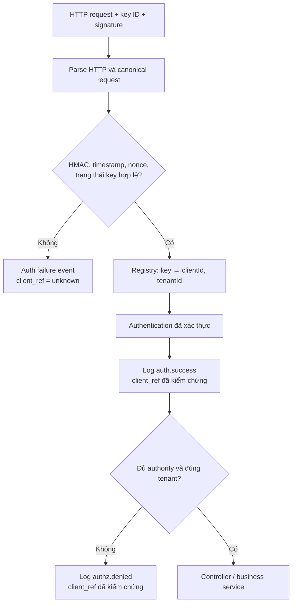
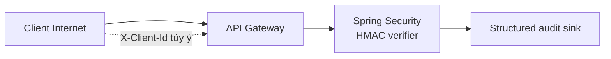

# Log client ID an toàn trong hệ thống xác thực HTTP request bằng HMAC

## 1. Bối cảnh và mục tiêu

Trong hệ thống tích hợp máy gọi máy, client gửi HTTP request kèm chữ ký HMAC được tạo từ **shared secret** và một **canonical request** theo hợp đồng ký. Canonical request có thể bảo vệ HTTP method, URI, query, các header được chọn và body hoặc body digest. Server xác minh MAC, kiểm tra timestamp/nonce để chống replay, tra key còn hiệu lực khi rotation, rồi mới xác định client và quyết định quyền truy cập.

Khi một request thất bại hoặc xuất hiện dấu hiệu tấn công, đội vận hành cần trả lời được: **client nào đã thực hiện request, bằng chứng xác thực có hợp lệ không, endpoint nào bị gọi và kết quả phân quyền ra sao?** Vì vậy, ghi log client ID là một phần quan trọng của chương **Security logging** trong module `SECURITY_AUTHENTICATION_HMAC_REQUEST_AUTHENTICATION`.

Tuy nhiên, giá trị `X-Client-Id` hoặc `X-Key-Id` do phía gọi tự khai báo **chưa chứng minh danh tính**. Ghi chúng như danh tính đã xác thực sẽ làm sai audit trail và có thể giúp kẻ tấn công tạo log giả về client khác.

Sau bài học, người học có thể:

- Phân biệt `clientId` đã xác thực với key ID, tenant ID, request ID và header do client tự khai.
- Xác định **thời điểm an toàn** để log client ID trong luồng xác minh HMAC.
- Thiết kế sự kiện audit có cấu trúc cho xác thực thành công, thất bại và từ chối phân quyền.
- Tránh log secret, signature, canonical request chứa dữ liệu nhạy cảm, nonce và thông tin có thể hỗ trợ replay.
- Tích hợp logging với Spring MVC, Spring WebFlux, MDC và Reactor Context theo vòng đời request.
- Kiểm thử an toàn của log khi có proxy/gateway, nhiều key trong rotation, request bị sửa và nonce lặp.

## 2. Client ID là gì và khác Key ID như thế nào?

Đặt ví dụ: hệ thống quản lý đơn hàng cho hai đối tác gọi API bằng HMAC.

| Khái niệm | Ý nghĩa | Ví dụ | Được tin khi nào? |
| --- | --- | --- | --- |
| `clientId` | Danh tính ứng dụng/đối tác được server đăng ký | `partner-reporting` | **Sau khi** xác minh signature và ánh xạ từ key registry đáng tin |
| `keyId` | Mã định vị phiên bản khóa dùng để tra secret | `reporting-key-v2` | Ban đầu chỉ là **gợi ý tra cứu** do client cung cấp |
| `tenantId` | Phạm vi dữ liệu của client | `tenant-a` | Khi lấy từ registry/policy sau xác thực |
| `requestId` | ID dùng liên kết các log của một request | `req-73a4` | Khi do hệ thống phát sinh hoặc được gateway tin cậy chuẩn hóa |
| `traceId` | Mã theo dõi luồng gọi qua nhiều dịch vụ | `a91f...` | Dùng để liên kết trace; **không** chứng minh danh tính |
| `authority` | Quyền truy cập do server cấp | `ORDER_READ` | Sau khi tra chính sách của client đã xác thực |
| `X-Client-Id` | Header ứng dụng tự khai nếu API có dùng | `partner-reporting` | Không phải danh tính đã xác thực chỉ vì header có giá trị này |

Một client có thể sở hữu **nhiều key** trong thời gian key rotation:

```text
clientId: partner-reporting
tenantId: tenant-a
keys:
  - reporting-key-v1   # Đang hết hạn hoặc đã thu hồi
  - reporting-key-v2   # Đang hoạt động
permissions:
  - ORDER_READ
```

Hai key khác nhau vẫn có thể xác thực về **cùng một client**. Vì thế log `clientId` được server xác minh giúp điều tra hành vi xuyên các lần rotation, còn `keyId` chỉ là thông tin liên quan lifecycle của credential. Nếu cần điều tra key version, có thể ghi **mã tham chiếu key nội bộ** theo chính sách truy cập log; không nên công khai key ID hay trạng thái tồn tại của key trong response lỗi.

**Nguyên tắc:** một chuỗi xuất hiện trong HTTP header chưa phải là danh tính an toàn để log với nhãn `authenticated_client_id`.

## 3. Ranh giới tin cậy của client ID



Với một request yêu cầu HMAC, trình tự cần tách biệt rõ:

1. **Trước xác thực:** filter nhận key ID, signature, timestamp, nonce và canonical bytes như dữ liệu chưa đáng tin. Có thể log sự kiện nhận request bằng request ID và route ở mức đã chuẩn hóa, nhưng chưa được gắn client ID là “verified”.
2. **Sau MAC và chống replay:** verifier xác nhận key hợp lệ và request còn thời hạn, nonce chưa được sử dụng. Registry xác định chính xác `clientId`/`tenantId` gắn với key đã xác thực.
3. **Sau khi tạo `Authentication`:** log thành công với client reference từ principal đáng tin cậy; mới được dùng reference này để liên kết audit theo client.
4. **Khi phân quyền:** `GrantedAuthority` và kiểm tra tenant/ownership quyết định được thao tác hay không. Nếu thiếu quyền, tạo event `authorization.denied` riêng, không ghi “HMAC signature failed”.

Ví dụ, `partner-reporting` ký đúng request `POST /integrations/orders` nhưng chỉ có `ORDER_READ`. Request được xác thực thành công và ghi event `hmac.auth.success`; bước authorization tiếp theo ghi `hmac.authz.denied`, trả `403 Forbidden`. Trái lại, chữ ký sai cần ghi `hmac.auth.failure`, chưa xác lập client ID và thường trả `401 Unauthorized`.

## 4. Khi nào được ghi client ID vào log?

| Thời điểm | Có được ghi `clientId` đã xác thực? | Dữ liệu phù hợp |
| --- | --- | --- |
| Request vừa vào gateway | Không, trừ khi gateway vừa hoàn thành một bước xác thực đáng tin | `requestId`, route, method, thời điểm |
| Đọc `X-Key-Id` hoặc `X-Client-Id` | **Không** | Nếu thật sự cần, ghi mã tham chiếu **unverified** tách biệt, được giảm nhạy cảm |
| Chữ ký sai hoặc thiếu credentials | Không | `client_ref=unknown`, mã lỗi nội bộ đã chuẩn hóa |
| Timestamp quá hạn hoặc nonce replay | Chỉ khi verifier đã có bằng chứng đủ để khẳng định danh tính theo chính sách logging | Thường dùng failure event và reference hạn chế; tránh suy diễn client ID từ header |
| HMAC, replay và trạng thái key đều hợp lệ | Có | Client reference từ kết quả xác thực; tenant reference nếu cần |
| Xác thực thành công nhưng thiếu quyền | Có | Client reference đã xác thực và mã rule bị từ chối |
| Controller xử lý nghiệp vụ | Có nếu thông tin được lấy từ principal đáng tin | Client reference, operation, kết quả, mã nghiệp vụ không nhạy cảm |

Không phải cứ có key ID hợp lệ trong registry là đã chứng minh request do client sở hữu key gửi. Nếu signature sai, kẻ tấn công có thể đoán key ID của một client thật rồi gửi request giả. Log “`client_id=partner-reporting` đã xác thực thất bại” từ dữ liệu key lookup có thể khiến người phân tích hiểu nhầm client đó đang trực tiếp tấn công.

Một số hệ thống cần điều tra thất bại theo key được nhắm đến. Khi ấy tạo **trường khác** như `presented_key_ref` hoặc `key_lookup_ref`, áp dụng pseudonymization/hạn chế truy cập, và đánh dấu rõ `unverified`. Không gộp nó vào trường `verified_client_ref`; không cho phép giá trị client tự khai làm nguồn sự thật của audit.

## 5. Thiết kế một sự kiện security log có cấu trúc

Log có cấu trúc giúp truy vấn theo request ID, outcome, route và loại sự kiện mà không phải parse chuỗi tự do. Ví dụ schema nội bộ:

| Trường | Ý nghĩa | Nguồn đáng tin |
| --- | --- | --- |
| `event` | Loại sự kiện, ví dụ `hmac.auth.success` | Tên sự kiện cố định trong code |
| `timestamp` | Thời điểm backend ghi nhận sự kiện | Clock của server |
| `request_id` | Liên kết các bước xử lý request | Gateway đã xác thực/chuẩn hóa hoặc backend tự cấp |
| `client_ref` | Tham chiếu client đã xác thực | Principal từ verifier + server registry |
| `tenant_ref` | Phạm vi tenant nếu cần thiết | Registry/policy sau xác thực |
| `route` | Tên route đã chuẩn hóa, không chứa ID tài nguyên | Cấu hình route/handler |
| `method` | HTTP method | HTTP parser đáng tin; validate và chuẩn hóa |
| `outcome` | `success`, `failure`, `denied` | Quyết định của auth/authz component |
| `reason` | Mã nguyên nhân nội bộ theo allowlist | Verifier/authorization, không dùng raw exception message |
| `status` | HTTP status thực tế nếu có | Response sau khi hoàn tất |
| `trace_id` | Liên kết trace giữa dịch vụ | Tracing middleware; không dùng làm bằng chứng xác thực |

Ví dụ **xác thực thành công** (ID được giả lập):

```json
{
  "event": "hmac.auth.success",
  "timestamp": "2026-11-28T03:15:00Z",
  "request_id": "req-73a4",
  "client_ref": "partner-reporting",
  "tenant_ref": "tenant-a",
  "route": "integrations.orders.read",
  "method": "GET",
  "outcome": "success"
}
```

Ví dụ **không xác thực được**:

```json
{
  "event": "hmac.auth.failure",
  "timestamp": "2026-11-28T03:15:05Z",
  "request_id": "req-73a5",
  "client_ref": "unknown",
  "route": "integrations.orders.create",
  "method": "POST",
  "outcome": "failure",
  "reason": "MAC_MISMATCH",
  "status": 401
}
```

`reason=MAC_MISMATCH` là mã **nội bộ**; phản hồi HTTP gửi cho client nên dùng lỗi xác thực chung và không tiết lộ key tồn tại hay không. Một số tổ chức không muốn xuất hiện client ID thật trong log tập trung; khi đó thay `client_ref` bằng **pseudonymous reference** từ một dịch vụ mapping có kiểm soát.

Các ví dụ không log raw URI như `/orders/123456789`, vì path có thể mang ID khách hàng hoặc tài nguyên. Dùng `route=integrations.orders.read` hoặc route template `/integrations/orders/{id}`.

## 6. Những dữ liệu không được log khi kiểm tra HMAC

| Dữ liệu | Vì sao cần tránh | Giá trị thay thế nếu cần giám sát |
| --- | --- | --- |
| **Shared secret**, secret key bytes, secret từ vault | Lộ bí mật có thể cho phép giả mạo request | Mã phiên bản/nhóm secret nội bộ đã giảm nhạy cảm |
| Raw `X-Signature` hoặc MAC do server tính | Bằng chứng xác thực có thể hỗ trợ điều tra ngược, lộ thông tin không cần thiết | Mã lỗi `MAC_MISMATCH`, request ID |
| Raw `Authorization` header | Có thể chứa token/credential khác | Tên authentication scheme cố định |
| Toàn bộ canonical request | Có thể chứa query, header, body nhạy cảm | Số lượng trường ký, route key, mã canonical contract |
| Raw request/response body | Dữ liệu cá nhân, đơn hàng, tài chính, nội dung riêng tư | Kết quả nghiệp vụ tổng quát và mã lỗi đã chuẩn hóa |
| Timestamp + nonce + signature đầy đủ | Làm tăng nguy cơ lộ bằng chứng có thể bị replay trong cửa sổ cho phép | `replay_rejected=true` và reason code |
| Raw `X-Forwarded-*` hoặc `X-Client-Id` | Giá trị có thể do client giả mạo hoặc chứa input bất kỳ | Forwarded identity từ gateway tin cậy sau khi sanitize |
| `Exception.getMessage()` và stack trace trong response | Có thể tiết lộ đường dẫn, key ID, secret hoặc policy | Error code công khai; trace nội bộ theo quy định |

**Trường `clientId` bản thân cũng có thể là dữ liệu nhạy cảm**: nó có thể tiết lộ danh sách đối tác, liên kết tới một cá nhân hoặc tenant quan trọng. Chỉ ghi bản rõ khi được policy log cho phép; giới hạn retention, quyền truy cập và vị trí lưu. Với client ID dễ đoán, chỉ dùng SHA-256 trần không phải cơ chế ẩn danh mạnh vì có thể dò từ điển.

Khi cần tham chiếu ổn định mà hạn chế lộ danh tính, có thể dùng một **HMAC riêng dành cho audit pseudonymization**, với key khác hoàn toàn secret ký HTTP:

```text
client_ref = hex(
    HMAC-SHA256(audit_pseudonym_key, UTF8(verified_client_id))
)[0..23]
```

Đây là gợi ý thiết kế, không phải yêu cầu mọi hệ thống phải tự tính hash client ID. Audit key cần được quản lý trong secret manager riêng, có kế hoạch rotation và kiểm soát truy cập; thay key sẽ thay pseudonym nếu không có phương án chuyển tiếp. Kết quả vẫn là **dữ liệu có thể liên kết các sự kiện**, không mặc nhiên trở thành dữ liệu vô danh theo pháp lý.

## 7. Định danh từ gateway/proxy: có thể tin đến đâu?

Giả sử gateway đứng trước Spring MVC:



Nếu backend tự xác minh HMAC, **client ID để log phải đến từ kết quả registry của backend**. Header `X-Client-Id` hoặc `X-Key-Id` ở request chỉ được xem như input cho giao thức ký/lookup; không đưa trực tiếp vào MDC với nhãn `client_id`.

Nếu gateway **đã xác minh HMAC** trước khi chuyển request, backend chỉ có thể tin danh tính do gateway truyền nếu:

1. Gateway loại bỏ mọi header “verified identity” do client tự gửi trước khi tạo giá trị mới.
2. Backend chỉ nhận kết quả đó qua kênh nội bộ tin cậy (ví dụ mTLS và chính sách network/identity), hoặc kiểm tra signed internal assertion.
3. Backend xác định rõ gateway nào được phép chứng thực thay client, thời hạn và phạm vi bằng chứng.
4. Tầng nghiệp vụ vẫn kiểm tra authority, tenant và ownership; kết quả xác thực không đồng nghĩa toàn quyền.

Một `X-Verified-Client` tự xuất hiện trong request **không phải bằng chứng** ngay cả khi tên header nghe đáng tin. Tương tự, `X-Request-Id` và `traceparent` có thể do client tự gửi; hệ thống cần validate giới hạn ký tự/độ dài hoặc phát sinh ID mới ở edge để tránh giả mạo log và làm bẩn hệ thống tracing.

Gateway có thể rewrite URI, `Host`, signed headers hoặc body làm HMAC ở backend không khớp. Khi điều tra phải dùng contract canonicalization đúng trust boundary; log có thể giữ tên route nội bộ và mã contract version, nhưng **không nên đổ toàn bộ canonical string** vào log production để so bằng mắt.

## 8. Spring MVC: log sau khi `AuthenticationManager` xác minh

Trong Servlet stack, `OncePerRequestFilter` thường nhận HTTP request, tạo token chưa xác thực và gọi `AuthenticationManager`/`AuthenticationProvider`. Provider dùng HMAC verifier kiểm tra signature, timestamp, nonce, trạng thái key rồi trả `Authentication` chứa principal đáng tin cậy.

Định nghĩa principal và metadata tối giản:

```java
public record HmacPrincipal(String clientId, String tenantId) {}

// Metadata do backend chuẩn hóa, không lấy trực tiếp từ header tùy ý.
public record AuditRequestContext(
        String requestId,
        String routeKey,
        String method
) {}

public enum InternalAuthReason {
    CREDENTIALS_INVALID,
    MAC_MISMATCH,
    TIMESTAMP_OUTSIDE_WINDOW,
    NONCE_REPLAY,
    KEY_UNUSABLE
}
```

Một logger có cấu trúc tối giản:

```java
import org.slf4j.Logger;
import org.slf4j.LoggerFactory;
import org.springframework.security.core.Authentication;

public final class HmacAuditLogger {
    private static final Logger LOG =
            LoggerFactory.getLogger(HmacAuditLogger.class);

    private final ClientReferenceService clientRefs;

    public HmacAuditLogger(ClientReferenceService clientRefs) {
        this.clientRefs = clientRefs;
    }

    public void authSuccess(Authentication verified, AuditRequestContext ctx) {
        if (verified == null || !verified.isAuthenticated()
                || !(verified.getPrincipal() instanceof HmacPrincipal principal)) {
            throw new IllegalArgumentException(
                    "Missing verified HMAC principal");
        }

        // Chỉ ánh xạ từ clientId của principal đã xác minh.
        String clientRef = clientRefs.fromVerifiedId(principal.clientId());
        LOG.info(
                "event=hmac.auth.success request_id={} client_ref={} route={} method={}",
                ctx.requestId(), clientRef, ctx.routeKey(), ctx.method());
    }

    public void authFailure(
            AuditRequestContext ctx, InternalAuthReason reason) {
        LOG.warn(
                "event=hmac.auth.failure request_id={} client_ref=unknown route={} method={} reason={}",
                ctx.requestId(), ctx.routeKey(), ctx.method(), reason.name());
    }
}
```

`ClientReferenceService` là interface ứng dụng **tự thiết kế** để trả về client ID đã chuẩn hóa hoặc pseudonym an toàn; chỉ chấp nhận ID lấy từ kết quả xác minh, kiểm soát định dạng/độ dài và escape ký tự điều khiển. `AuditRequestContext` cũng phải do phía server tạo từ ID và route đã chuẩn hóa. Logger dùng tham số `{}` thay cho ghép chuỗi; nếu hệ thống hỗ trợ JSON structured logging, nên để encoder thực hiện escape ký tự và áp dụng schema cố định.

Ví dụ cách gọi tại **điểm sau khi authenticate thành công** trong custom filter:

```java
Authentication candidate =
        HmacAuthenticationToken.unauthenticated(parser.parse(wrappedRequest));

Authentication verified;
try {
    verified = authenticationManager.authenticate(candidate);
    if (verified == null || !verified.isAuthenticated()) {
        throw new BadCredentialsException("Invalid HMAC authentication");
    }
} catch (AuthenticationException ex) {
    // Không dùng ex.getMessage() làm nội dung log công khai.
    auditLogger.authFailure(ctx, InternalAuthReason.CREDENTIALS_INVALID);
    SecurityContextHolder.clearContext();
    entryPoint.commence(request, response, ex); // Thường 401
    return;
}

auditLogger.authSuccess(verified, ctx);

SecurityContext context = SecurityContextHolder.createEmptyContext();
context.setAuthentication(verified);
SecurityContextHolder.setContext(context);
try {
    chain.doFilter(wrappedRequest, response);
} finally {
    SecurityContextHolder.clearContext();
}
```

Đây là **lõi minh họa**, không phải cả class filter. `wrappedRequest` cần giữ body có thể đọc lại nếu verifier phải đọc raw bytes; `parser`, token, audit logger và `entryPoint` là thành phần ứng dụng. Việc log `authSuccess` phải diễn ra **sau khi** cả MAC, timestamp, nonce và kiểm tra key đều đạt yêu cầu; nếu provider chưa thực hiện toàn bộ bước này thì tên event “success” sẽ gây hiểu nhầm.

Nếu cần log một mã nguyên nhân chi tiết hơn `CREDENTIALS_INVALID`, phải phân loại bằng **enum nội bộ** tại điểm phát hiện lỗi, không lấy exception message chứa dữ liệu người dùng. Không ghi log trùng từ cả verifier, provider và filter cho cùng sự kiện nếu chưa có lý do thiết kế rõ ràng.

### 8.1. Dùng MDC trong request đồng bộ

MDC hỗ trợ thêm metadata vào những log nghiệp vụ phát sinh **trong cùng request thread**, nhưng cần xóa ngay khi request kết thúc:

```java
// Sau khi HMAC authentication đã thành công:
HmacPrincipal principal = (HmacPrincipal) verified.getPrincipal();
String clientRef = clientRefs.fromVerifiedId(principal.clientId());

try (MDC.MDCCloseable idScope =
             MDC.putCloseable("request_id", ctx.requestId());
     MDC.MDCCloseable clientScope =
             MDC.putCloseable("client_ref", clientRef)) {

    chain.doFilter(wrappedRequest, response);
} finally {
    SecurityContextHolder.clearContext();
}
```

`MDC` trong SLF4J thường dựa vào ngữ cảnh thread. Dùng `try-with-resources` để tránh mang `client_ref` của request trước sang request sau khi thread trong pool được tái sử dụng. Cần kiểm tra cách log framework xử lý MDC ở ứng dụng thực; đoạn minh họa không tự giải quyết việc truyền MDC qua servlet async, `@Async` hoặc các thread pool khác.

Không gắn `client_ref` trước khi xác minh để “tiện theo dõi”, và không đặt giá trị không kiểm soát trực tiếp từ `request.getHeader("X-Client-Id")` vào MDC.

## 9. Spring WebFlux: lấy client ID từ reactive authentication

WebFlux dùng `WebFilter`/`AuthenticationWebFilter` và `ReactiveAuthenticationManager`. Authentication được truyền qua Reactor `Context` thông qua `ReactiveSecurityContextHolder`; không thể giả định `SecurityContextHolder`/MDC gắn với một thread sẽ đúng trong mọi operator hoặc scheduler.

Ví dụ hook để ghi **một auth result event** trong reactive chain:

```java
Mono<Authentication> authentication = reactiveManager
        .authenticate(candidate)
        .doOnNext(verified -> auditLogger.authSuccess(verified, ctx))
        .doOnError(AuthenticationException.class,
                ex -> auditLogger.authFailure(
                        ctx, InternalAuthReason.CREDENTIALS_INVALID));

// authentication phải được compose vào AuthenticationWebFilter hoặc WebFilter;
// không gọi authentication.subscribe() thủ công trong filter.
```

`AuthenticationWebFilter` có các handler cho kết quả thành công/thất bại; nếu dùng chúng để ghi audit thì **không** lặp lại cùng event ở reactive manager. Nếu cần trực tiếp đọc authentication trong một reactive service:

```java
Mono<String> verifiedClientId =
        ReactiveSecurityContextHolder.getContext()
                .map(SecurityContext::getAuthentication)
                .filter(Authentication::isAuthenticated)
                .map(Authentication::getPrincipal)
                .cast(HmacPrincipal.class)
                .map(HmacPrincipal::clientId);
```

Trong production, khi không có context hoặc principal không phải `HmacPrincipal`, phải xử lý theo policy thay vì tạo client ID dự phòng từ header. Để đưa client reference vào log bên trong reactive pipeline, có thể dùng Reactor `Context` hoặc khả năng context propagation được hỗ trợ bởi stack logging đang dùng. Không đưa thẳng client ID vào thread-local MDC rồi tin rằng nó tự được bảo toàn qua các lần đổi thread.

**Chú ý số lần ghi log:** publisher reactive có thể được subscribe lại hoặc retry theo cấu hình. Cần đặt audit event tại điểm xác thực thực tế, xác định rõ semantics mỗi attempt và sử dụng `request_id`/attempt ID để tránh hiểu nhiều log thành nhiều HTTP request độc lập.

## 10. Ghi log lỗi HMAC, replay và key rotation

| Tình huống | Auth outcome | Ghi client ID như thế nào? | HTTP thường gặp |
| --- | --- | --- | --- |
| Signature hợp lệ, key active, timestamp/nonce hợp lệ | `auth.success` | Client reference đã xác minh | Tiếp tục kiểm tra quyền |
| Signature sai hoặc thiếu | `auth.failure` | `unknown` | `401` |
| Timestamp quá hạn | `auth.failure` | `unknown`, trừ chính sách audit cho phép chứng cứ xác minh khác | `401` |
| Nonce đã dùng lại | `auth.failure` | Thận trọng, có thể ghi mã tham chiếu hạn chế sau khi xác minh MAC | `401` |
| Key không tồn tại hoặc đã thu hồi | `auth.failure` | `unknown`, không lấy client ID từ header | `401` |
| Key cũ còn hiệu lực trong overlap rotation | `auth.success` | **Cùng client reference** nếu cùng client | Tiếp tục |
| Chữ ký hợp lệ nhưng thiếu `ORDER_CREATE` | `authz.denied` | Client reference đã xác minh | `403` |
| HMAC hợp lệ, truy cập chéo tenant | `authz.denied` hoặc domain denial | Client reference đã xác minh | `403`/`404` |
| Kho key/nonce không truy cập được | `auth.infrastructure_error` | Thường `unknown`; không tuyên bố xác thực thành công | Lỗi server phù hợp, thường `503` |

Với key rotation, **đừng dùng key ID làm client ID trong log**: một lần chuyển từ `reporting-key-v1` sang `reporting-key-v2` không có nghĩa có hai client. Nếu cần điều tra key nào tạo request, ghi key reference hạn chế riêng cho sự kiện đã xác thực, với thời gian hiệu lực và chính sách retention.

Nonce store cần có thao tác đánh dấu đã dùng **nguyên tử**, cùng TTL đủ để bao phủ cửa sổ timestamp được chấp nhận; cache cục bộ mỗi server không đủ khi có nhiều instance. Logging không thay thế bước chống replay: event `nonce_replay` chỉ chứng minh hệ thống phát hiện và chặn theo chính sách, không phải bản thân việc có log đã làm request an toàn.

**Không làm lộ nội bộ qua response:** các reason code `MAC_MISMATCH`, `KEY_UNUSABLE`, `NONCE_REPLAY` phục vụ điều tra; response HMAC failure có thể dùng cùng mã bên ngoài như `INVALID_REQUEST_AUTHENTICATION` để tránh key enumeration.

## 11. Phân biệt authentication log và authorization log

Trong Spring Security, `Authentication` mang principal và authorities do hệ thống cấp. HMAC hợp lệ không bảo đảm client được gọi mọi endpoint.

Một ví dụ audit cho client đã xác thực nhưng bị từ chối tạo đơn:

```json
{
  "event": "hmac.authz.denied",
  "request_id": "req-73a6",
  "client_ref": "partner-reporting",
  "route": "integrations.orders.create",
  "method": "POST",
  "required_authority": "ORDER_CREATE",
  "outcome": "denied",
  "status": 403
}
```

`required_authority` phải là tên rule từ **policy phía server**, không phản chiếu role do client tự gửi. Tùy nhu cầu bảo mật, không nhất thiết log toàn bộ danh sách authorities của principal trong mỗi request; việc đó tạo nhiều dữ liệu và có thể tiết lộ cấu hình quyền.

Nếu request bị từ chối vì truy cập tài nguyên của tenant khác, chỉ log loại vi phạm/route và client reference đáng tin. Không cần log raw resource ID hoặc tenant ID đích nếu có khả năng lộ dữ liệu cá nhân hoặc thông tin khách hàng. Trường hợp ứng dụng cố ý trả `404` để không lộ sự tồn tại của tài nguyên, log nội bộ có thể chứa reason code riêng trong sink được kiểm soát.

**Quy tắc phân loại:** `401` thường thuộc authentication, `403` thường thuộc authorization, còn `429` là rate limit. Lỗi hạ tầng key store/nonce store phải **fail closed** và ghi sự kiện infrastructure error tương ứng; không biến hệ thống mất kết nối với kho secret thành “client ký sai” nếu việc phân loại làm sai hướng xử lý sự cố.

## 12. Độ tin cậy và tính toàn vẹn của audit log

Log security là một phần của **dữ liệu có giá trị bảo mật**: kẻ tấn công có thể cố chèn chuỗi xuống dòng, tạo JSON giả hoặc làm tràn log để che dấu request.

Các biện pháp thiết kế:

1. **Chuẩn hóa tại nguồn:** tên event và reason code lấy từ enum/allowlist; method, route và request ID có định dạng, độ dài tối đa rõ ràng.
2. **Escape đúng định dạng:** dùng structured encoder cho JSON; nếu log text, loại bỏ/escape CR, LF, tab và ký tự điều khiển từ mọi trường có thể bị ảnh hưởng bởi input HTTP.
3. **Không nhận danh tính từ input chưa xác thực:** `X-Client-Id`, `X-Key-Id` và `X-Forwarded-*` là dữ liệu không đáng tin ở biên Internet.
4. **Giới hạn log volume:** rate limit, sampling có kiểm soát và aggregation cho sự kiện lặp; tránh bỏ toàn bộ log an ninh quan trọng do lưu lượng cao.
5. **Kiểm soát sink:** hạn chế quyền đọc/ghi, retention, mã hóa khi truyền/lưu, theo dõi thay đổi và cơ chế chống xóa/sửa tùy mức độ yêu cầu audit.
6. **Tách metric và log:** tránh đưa `clientId` hoặc nonce làm metric label có cardinality không giới hạn. Dùng tổng hợp theo route/outcome/reason; giữ client reference trong audit log có kiểm soát.
7. **Liên kết thời gian:** đồng bộ clock giữa các node/gateway để so sánh sequence; không dùng timestamp do client tự khai như timestamp của sự kiện audit.

`requestId` và `traceId` giúp liên kết sự kiện nhưng không nên coi chúng là bí mật hoặc bằng chứng đăng nhập. Nếu request ID do client cung cấp, hãy kiểm soát length/charset và khả năng collision; khi cần bảo đảm tính duy nhất, backend hoặc gateway phát sinh ID chuẩn riêng.

Khi audit sink không khả dụng, lựa chọn fail closed hay tiếp tục phục vụ phải theo yêu cầu vận hành/compliance của ứng dụng. Dù chọn cách nào cũng phải có alert, giới hạn buffer/backpressure và chính sách chống mất event quan trọng; không được để việc ghi log bất đồng bộ không giới hạn gây hết bộ nhớ.

## 13. Kiểm thử log client ID trong Spring Security

Kiểm thử cần xác nhận **nội dung log**, **nguồn của client ID** và **side effect**. Không chỉ kiểm tra HTTP status.

Ma trận gợi ý:

| Ca thử | Kết quả HTTP | Điều cần assert trong audit |
| --- | --- | --- |
| `partner-reporting` ký đúng GET | `200` nếu tài nguyên tồn tại | Một event `auth.success` với client reference đúng |
| Client ký đúng POST nhưng thiếu quyền | `403` | Có `auth.success` và `authz.denied`, không có `auth.failure` |
| Chữ ký sai nhưng header `X-Client-Id: partner-reporting` | `401` | `auth.failure` có `client_ref=unknown`, không giả mạo verified identity |
| Key ID của client thật nhưng MAC sai | `401` | Không log key ID như client ID đã xác thực |
| Thiếu signature hoặc sai định dạng | `401` | Reason code nội bộ, không có secret/signature |
| Timestamp quá hạn | `401` | `auth.failure`, không thực hiện nghiệp vụ |
| Nonce đã dùng lại | `401` | Replay failure; không tạo side effect lần hai |
| Đổi từ key v1 sang v2 còn hiệu lực | Theo quyền client | Client reference vẫn cùng một danh tính |
| Thu hồi key v1 | `401` với key v1 | Không ghi sự kiện auth success bằng key bị thu hồi |
| Gateway đưa header verified identity tự khai | `401` hoặc bị gateway từ chối | Không có log khẳng định danh tính từ header giả |
| Request chứa CR/LF trong header không nhạy cảm | Theo validation | Không tạo được nhiều bản ghi log giả |
| Request A và B dùng cùng thread servlet | Tùy mỗi request | MDC của A không rò vào B |
| WebFlux xử lý với đổi scheduler | Theo mỗi request | Client reference đúng subscription, không lẫn request |
| Key/nonce store gặp lỗi | `503` hoặc lỗi server phù hợp | Infrastructure event, không tạo `auth.success` |

Ví dụ với `MockMvc`, giả sử hệ thống test cung cấp một `CapturingAuditSink` để ghi nhận sự kiện nội bộ:

```java
@Test
void invalidHmacNeverLogsClaimedClientAsVerified() throws Exception {
    mockMvc.perform(get("/integrations/orders/O-17")
            .header("X-Client-Id", "partner-reporting")
            .header("X-Key-Id", "reporting-key-v2")
            .header("X-Timestamp", "2026-11-28T03:15:00Z")
            .header("X-Nonce", "nonce-invalid")
            .header("X-Signature", "invalid-signature"))
        .andExpect(status().isUnauthorized());

    assertThat(auditSink.events())
            .anySatisfy(event -> {
                assertThat(event.type()).isEqualTo("hmac.auth.failure");
                assertThat(event.clientRef()).isEqualTo("unknown");
            });
    assertThat(auditSink.events())
            .noneMatch(event -> event.type().equals("hmac.auth.success"));
}
```

`CapturingAuditSink` và kiểu `event` là test helper do ứng dụng cài đặt, không phải API có sẵn của Spring Security. Thời gian test cần cố định qua `Clock` nếu verifier kiểm tra timestamp; mỗi test cần nonce store và key fixtures tách biệt. Test không dùng `@WithMockUser` để thay thế xác minh chữ ký thật.

Khi kiểm tra MDC, có thể gắn một appender test hoặc instrument service để quan sát `request_id`/`client_ref` trong lúc request chạy, sau đó khẳng định không còn giá trị của request trước trên thread được dùng lại. Với WebFlux, sử dụng `WebTestClient` và kiểm tra kết quả từ audit sink gắn với Reactor Context; không assert dựa trên một MDC thread-local chưa được cấu hình context propagation.

## 14. Bài thực hành: hai client, nhiều key và một audit sink

Xây API `GET /integrations/orders/{id}` cần `ORDER_READ` và `POST /integrations/orders` cần `ORDER_CREATE`.

Policy server:

- `partner-reporting`, tenant `tenant-a`, có `ORDER_READ`, hai key `reporting-v1`/`reporting-v2` trong giai đoạn rotation.
- `partner-fulfillment`, tenant `tenant-b`, có `ORDER_READ` và `ORDER_CREATE`, một key đang hoạt động.

Các bước thực hiện:

1. Xây HMAC verifier dựa trên canonical request đã thống nhất về method, path/query, signed headers và body digest. Đảm bảo timestamp/nonce được ký và nonce được claim nguyên tử.
2. Tạo `HmacPrincipal` từ **key registry sau xác minh**. Không sử dụng `X-Client-Id` trực tiếp làm principal hoặc trường `client_ref` trong log.
3. Định nghĩa schema event `hmac.auth.success`, `hmac.auth.failure` và `hmac.authz.denied` với reason code/route theo allowlist.
4. Cài `ClientReferenceService` có thể trả raw client ID đã chuẩn hóa hoặc pseudonym tùy chính sách bảo mật, đồng thời giới hạn ký tự và độ dài.
5. Ở Spring MVC, ghi audit sau authentication manager thành công và quản lý `MDC` bằng `try/finally` hoặc `MDCCloseable`. Nếu dùng WebFlux, ghi dựa trên `Authentication` của reactive chain, tránh `subscribe()` thủ công.
6. Viết kiểm thử HMAC sai nhưng tự khai client ID của một đối tác có thật; assert `client_ref=unknown`. Test key rotation giữ cùng client reference và key bị revoke không tạo success event.
7. Kiểm tra log không chứa shared secret, chữ ký đầy đủ, raw body hoặc canonical request; xác minh response `401` không tiết lộ thông tin nội bộ.
8. Test qua gateway/proxy thật để kiểm tra request ID và danh tính nội bộ đã được làm sạch/đảm bảo, kể cả khi gateway rewrite path/header.

### Câu hỏi tự kiểm tra

**1. Có thể ghi `X-Key-Id` vào `client_id` ngay lúc nhận request không?** Không. Key ID là dữ liệu do client khai; chưa có chứng cứ HMAC hợp lệ để xác định danh tính.

**2. Một client xoay từ key v1 sang v2 thì log thành hai client khác nhau?** Không. Cả hai key có thể trỏ về cùng `clientId` đã xác minh từ registry; key reference là trường phụ nếu cần.

**3. Chữ ký sai nhưng request có `X-Client-Id: partner-reporting` thì audit `client_ref` là gì?** Thường là `unknown`; nếu lưu thông tin key được nhắm tới thì phải dùng trường `unverified` riêng, không mạo nhận client đã xác thực.

**4. Vì sao không ghi raw signature hoặc canonical request vào log?** Chúng có thể chứa thông tin nhạy cảm và làm lộ bằng chứng xác thực, dữ liệu cá nhân hoặc thông tin có thể hỗ trợ điều tra/tái sử dụng request.

**5. HMAC đúng nhưng thiếu `ORDER_CREATE` thì log loại nào?** Ghi `auth.success` cho bước xác thực và `authz.denied` cho bước phân quyền; thường trả `403`.

**6. Dùng MDC trong WebFlux có tự theo request không?** Không mặc định. Cần dùng Reactor Context hoặc cơ chế context propagation được cấu hình; đổi thread có thể làm mất hoặc lẫn MDC.

**7. Đâu là điều kiện để tin `X-Verified-Client` từ gateway?** Backend phải biết đó là giá trị do gateway đáng tin lập sau xác thực, mọi giá trị client tự gửi đã bị xóa và kênh/bằng chứng nội bộ được bảo vệ.

**8. Client ID đã pseudonymize bằng HMAC audit key có hoàn toàn vô danh không?** Không nhất thiết. Nó vẫn cho phép liên kết các request và có thể khôi phục bằng dữ liệu mapping hoặc khóa thích hợp; phải tuân theo chính sách truy cập, retention và bảo vệ dữ liệu.

## 15. Ghi nhớ

**Log client ID có giá trị khi nguồn danh tính đáng tin.** Với xác thực HTTP HMAC, chỉ ghi nhận client reference như một danh tính đã xác thực **sau** khi MAC, canonical request, timestamp/nonce và trạng thái key đều được kiểm tra; client ID phải đến từ registry/policy hoặc bằng chứng gateway nội bộ đã được bảo vệ. Request sai chữ ký không được dùng header tự khai để mạo nhận danh tính trong audit.

Security logging tốt còn phải phân biệt authentication với authorization, chuẩn hóa event/reason, giới hạn dữ liệu nhạy cảm, bảo vệ log trước injection và truy cập trái phép, xử lý MDC/Reactor Context đúng vòng đời, đồng thời có test qua gateway và khi key rotation/replay. Log là bằng chứng vận hành để quan sát hệ thống; **chính verifier, nonce store và policy phân quyền** mới thực thi các quyết định bảo mật.
