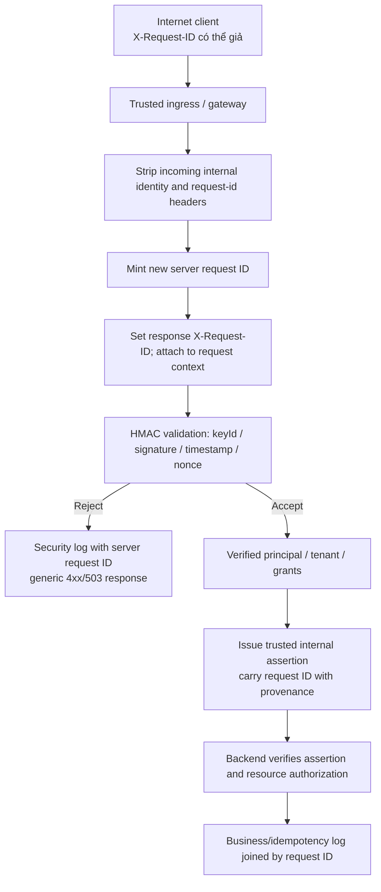
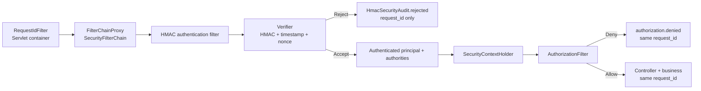

# Log request ID trong xác thực HTTP HMAC: theo dõi request mà không đánh mất ranh giới tin cậy

> **Chương:** Security logging  
> **Bài học:** Log request ID  
> **Module:** `SECURITY_AUTHENTICATION_HMAC_REQUEST_AUTHENTICATION`  
> **Phạm vi:** Xác thực HTTP request bằng HMAC với shared secret, canonical request ký method/URI/headers/body, kiểm chữ ký, timestamp/nonce chống replay, key rotation, gateway/proxy và phân biệt authentication với authorization.

**Request ID** là một định danh tương quan (correlation identifier) giúp tìm các bản ghi liên quan đến **một lần request đi qua hệ thống**. Trong HTTP HMAC, nó đặc biệt quan trọng khi request có thể bị từ chối **trước khi có principal đáng tin**, khi cùng request đi qua gateway và nhiều services, hoặc khi cần điều tra replay/credential rotation mà **không được log secret, chữ ký hay body nhạy cảm**.

Bài sử dụng ví dụ **Java 17+, Spring Boot 3.x, Spring MVC/Servlet, Spring Security 6.x**. Một phần mở rộng trình bày gateway và WebFlux. Đây là **hướng dẫn về request-ID logging**, không phải bài hướng dẫn thay thế toàn bộ HMAC verifier. Mẫu code chỉ hiện thực correlation logging và giả định HMAC filter/provider riêng đã có verifier theo hợp đồng ký. API có thể thay đổi giữa các bản Spring: hãy dùng dependency BOM tương thích và kiểm cấu hình dự án thật.

## 1. Vì sao HMAC API cần request ID?

Xét một request thanh toán:

```http
POST /api/hmac/v1/tenants/merchant-a/payments HTTP/1.1
Host: api.example.test
Content-Type: application/json
Idempotency-Key: payment-order-42
X-Key-Id: merchant-a-k2
X-Timestamp: 1767225600
X-Nonce: 87a3d56ea72d40af89f5b68cb3e831d4
X-Signature: v1=<BASE64URL_HMAC_TAG>

{"amount":100000,"currency":"VND"}
```

Nếu server trả:

```http
HTTP/1.1 401 Unauthorized
Content-Type: application/json
Cache-Control: no-store
X-Request-ID: 39a8c4ea-7b74-4f7f-9aa1-71ff7e85937d

{"error":"unauthenticated"}
```

Client có thể cung cấp `X-Request-ID` trong ticket hỗ trợ thay vì gửi full signature, secret hoặc toàn bộ dữ liệu thanh toán. Người vận hành tìm các events trong gateway, HMAC verifier và backend bằng **cùng một ID** để biết request:

- Đã vào gateway nào, route nào và có bị proxy rewrite không?
- Được xác minh chữ ký hay bị reject do malformed/unknown key/stale timestamp/replay?
- Được xác thực rồi nhưng bị thiếu authority/tenant/resource permission?
- Đã chạm business/idempotency transaction hoặc chưa?
- Đã tạo upstream request nào và phản hồi HTTP gì?
- Có retry, network timeout, key rotation hoặc multi-region error liên quan?

**Không có request ID:** Người vận hành thường phải tìm bằng timestamp gần đúng, IP, key ID hoặc thậm chí yêu cầu khách gửi lại secret/signature — vừa khó đối chiếu vừa tăng rủi ro lộ dữ liệu.

**Có request ID:** Ta có một **điểm nối logs**, nhưng **không phải bằng chứng xác thực hay quyền truy cập**. Một chuỗi trông giống UUID không chứng minh request do client hợp pháp gửi.

### Mục tiêu học tập

Sau bài này, người học có thể:

1. Phân biệt **request ID**, **trace ID/span ID**, **HMAC nonce**, **Idempotency-Key**, **credential ID**, **key ID**, **tenant ID** và **business operation ID**.
2. Xây chính sách phát sinh request ID tại **trusted ingress**, ngăn caller áp đặt raw `X-Request-ID` lên server logs.
3. Ghi request ID **trước authentication** để cả lỗi 400/401/413/503 đều có ID tra cứu.
4. Dùng Servlet filter và `MDC` để gắn request ID vào structured logs, đồng thời cleanup khi thread được tái sử dụng.
5. Ghi outcome authn/authz/replay mà không log shared secret, expected HMAC, raw signature, sensitive body hoặc spoofed principal.
6. Truyền request ID qua gateway/backend **theo kênh tin cậy**, không xem nó là identity assertion.
7. Thiết kế quan hệ request ID ↔ retry attempts ↔ idempotency business outcome ↔ distributed tracing.
8. Nhận diện log injection, cardinality explosions, ID collisions, privacy leaks, missing/duplicate fields và metadata spoofing.
9. Kiểm thử `MockMvc`, reverse proxy, error dispatch, async/ThreadLocal cleanup và multi-instance operation.
10. Xây checklist logging, retention, access control và incident playbook cho HMAC API.

## 2. Ngữ nghĩa: nhiều ID nhưng không được nhập làm một

| Giá trị | Đơn vị định danh | Ai nên tạo? | Thời gian sống / cách dùng | Có thay HMAC authentication không? |
| --- | --- | --- | --- | --- |
| **Request ID** | Một HTTP ingress request/attempt được quan sát. | Gateway/server ở ingress tin cậy. | Nối gateway/auth/backend logs, trả cho client để hỗ trợ. | **Không**. |
| **Trace ID** | Toàn bộ distributed trace, có thể gồm nhiều HTTP calls. | Tracing instrumentation; có thể chấp nhận remote parent theo policy. | Nối spans theo W3C Trace Context; sampling khác request log. | Không. |
| **Span ID** | Một thao tác trong trace. | Tracer. | Định vị từng HTTP/gRPC/DB operation. | Không. |
| **HMAC nonce** | Một signing attempt trong namespace của credential. | Client ký; được ký trong HMAC. | Atomic single-use + TTL theo freshness. | Không; một thành phần chống replay. |
| **Idempotency-Key** | Một business intent qua nhiều HTTP attempts. | Client theo business workflow; **được ký**. | Durable reservation, trả prior result khi retry đúng. | Không. |
| **`X-Key-Id`** | Selector để tìm một HMAC credential. | Client gửi, registry kiểm mapping. | Có thể rotate; không dùng làm authority. | Không, header tự nó là untrusted. |
| **Credential ID** | Định danh bất biến của credential trong registry. | Server control plane. | Nonce namespace, audit, revoke/rotate. | Chỉ tin sau registry+HMAC checks. |
| **Principal ID** | Danh tính đã verified của service/client. | Server credential registry. | Authorization, audit, quotas; không suy từ raw headers. | Là **kết quả** authentication. |
| **Tenant ID** | Target tenant hoặc verified tenant. | Caller có thể yêu cầu target; registry/policy chứng minh grant. | Resource isolation và authorization. | Không. |
| **Operation/payment ID** | Một giao dịch nghiệp vụ đã được nhận/commit. | Backend business. | Reconciliation, PSP/outbox, durable audit. | Không. |
| **Gateway assertion ID (JWT `jti`)** | Một assertion nội bộ được gateway phát hành. | Gateway issuer. | Token replay/binding theo policy. | Không đồng nghĩa với request ID. |

**Ví dụ retry sau response timeout:**

```text
Lần gửi #1:
  request_id     = req-1 (do gateway tạo)
  key_id         = merchant-a-k1
  nonce          = N1
  idempotency_key= payment-order-42
  operation_id   = payment-2026-42 (tạo trong business)
  outcome        = COMMITTED nhưng response mất

Lần gửi #2:
  request_id     = req-2 (MỚI, vì là HTTP ingress attempt mới)
  key_id         = merchant-a-k2 (sau rotation)
  nonce          = N2 (MỚI)
  idempotency_key= payment-order-42 (GIỮ)
  operation_id   = payment-2026-42 (TRẢ PRIOR OUTCOME)
  outcome        = IDEMPOTENT_REPLAY
```

**Không tái sử dụng request ID làm nonce**: request ID do server tạo **sau** khi client đã ký thường không nằm trong HMAC, trong khi nonce phải do client ký, bí mật không cần nhưng chống replay một-lần. Không dùng request ID làm Idempotency-Key vì mỗi network retry sẽ có ID mới và có thể tạo side effect lặp.

**Không dùng trace ID làm credential ID**: Trace context là observability metadata, remote client có thể kiểm soát hoặc ảnh hưởng theo propagation policy; nó không xác thực caller.

## 3. Threat model khi nhận request ID từ Internet

Một request ID có vẻ vô hại, nhưng nếu log hoặc proxy tin nó vô điều kiện, attacker có thể:

1. **Log injection:** Gửi `X-Request-ID: ok\nSECURITY_EVENT user=admin decision=allow` để tạo các dòng log giả.
2. **Correlation spoofing:** Dùng request ID đã biết từ ticket người khác để trộn hai request khác tenant trong một truy vấn log.
3. **High-cardinality abuse:** Gửi chuỗi dài hàng MB hoặc hàng triệu IDs khiến log storage và metrics labels nổ.
4. **Truncation collision:** Gửi nhiều IDs cùng prefix, hệ thống cắt tới 32 ký tự rồi coi chúng giống nhau.
5. **Header parser differential:** Gửi hai `X-Request-ID`; proxy chọn first còn backend chọn last.
6. **Unicode tricks:** Gửi Unicode control/homoglyph/RTL, gây nhầm trong dashboards, terminal hoặc alert.
7. **Fake upstream trust:** Gửi `X-Verified-Principal`, `traceparent` hoặc `X-Forwarded-For` tự khai để đổi truy vấn logs/identity.
8. **Privacy tracking:** Dùng ID ổn định qua nhiều lần gọi hoặc nhúng email/đơn hàng/tenant IDs làm correlation token, liên kết dữ liệu trái phép.
9. **ID-based authorization:** Lợi dụng ứng dụng cho rằng chỉ cần biết request ID là được đọc bản ghi/payment.
10. **Audit tampering:** Nếu logs không được bảo vệ quyền ghi/retention, attacker hoặc insider có thể xóa/sửa timeline.

**Nguyên tắc:** Request ID là **metadata dùng để quan sát**, không phải shared secret, bearer token, replay nonce, resource authorization proof, hay giá trị bắt buộc phải được client đặt.

### 3.1. Ví dụ log injection

**Không an toàn:**

```java
log.info("requestId=" + request.getHeader("X-Request-ID")
        + " HMAC rejected");
```

Attacker có thể đưa newline/control text vào header nếu một tầng HTTP parser chưa reject, hoặc đưa ký tự có nghĩa đặc biệt tới log sink. Dù logging framework escape một số thứ, không được mặc định mọi exporter/SIEM đều xử lý như nhau.

**An toàn hơn:** Gateway tạo ID riêng bằng CSPRNG/UUIDv4; chỉ đưa **ID server-generated** vào MDC/log, và dùng structured fields với whitelist. Nếu cần giữ client correlation, validate length/grammar, gắn nhãn `untrusted_client_correlation_id`, **không thay thế ID server** và không cho phép nó kiểm soát log template.

### 3.2. Vị trí đặt trust boundary



Ở **public gateway** nên mint một request ID mới **cho mỗi inbound request attempt**. Ở **backend chỉ được gọi bởi gateway tin cậy**, có thể tiếp tục sử dụng ID do gateway phát hành **nếu provenance đã được xác thực**, đồng thời tạo riêng local span/backend invocation ID khi cần.

### 3.3. Có nên chấp nhận `X-Request-ID` do client gửi?

Có ba chính sách rõ:

| Policy | Mô tả | Đề xuất |
| --- | --- | --- |
| **Server-owned (mặc định)** | Bỏ qua/strip inbound `X-Request-ID`, tạo UUIDv4 ngẫu nhiên; trả ID mới cho caller. | **Đơn giản và an toàn** cho public HMAC API. |
| **Dual identifiers** | Tạo server ID và giữ một client correlation ID đã validate dưới **field khác** và nhãn untrusted. | Hữu ích cho B2B support nếu có lý do rõ. |
| **Trusted upstream ID** | Chỉ giữ ID từ **authenticated gateway/load balancer** đã được strip/overwritten tại external ingress. | Hợp lý giữa các thành phần nội bộ, không áp cho Internet input. |

Nếu client muốn ID xuất hiện trong HMAC signature, client phải tạo nó **trước khi ký**, đưa vào danh sách signed headers và ký đúng bytes. Nếu gateway phát sinh ID **sau** khi client ký, không được tự thêm ID vào signing input rồi đòi client có chữ ký cho field chưa tồn tại. Đây là **hai contracts khác nhau**, không được trộn.

## 4. Request-ID contract cho hệ thống HMAC

Một hợp đồng đơn giản, có thể kiểm:

```yaml
requestId:
  source: trusted_ingress
  generation: UUIDv4
  format: lowercase-hyphenated-uuid-v4
  length: 36
  header: X-Request-ID
  servletAttribute: security.request_id
  logField: request_id
  clientSuppliedXRequestId: ignored_and_replaced
  response: always_set_when_response_reaches_this_filter
  perNetworkAttempt: fresh
  linkedToSignedNonce: false
  linkedToIdempotencyKey: only_in_audited_business_events
  secretOrIdentityProof: false
```

**Ví dụ UUIDv4:**

```text
39a8c4ea-7b74-4f7f-9aa1-71ff7e85937d
```

Java `UUID.randomUUID()` sinh UUID loại 4 với nguồn ngẫu nhiên đủ mạnh cho định danh. 122 bit random trong UUIDv4 làm xác suất trùng rất nhỏ nếu dùng đúng implementation; **tính duy nhất là xác suất, không phải một constraint database**. Nếu hệ thống yêu cầu uniqueness tuyệt đối trong audit store, vẫn cần unique constraint/handling. Không lấy `System.currentTimeMillis()` nối với IP/key ID hoặc số thứ tự per-process để tạo ID dễ đoán/trùng.

### 4.1. Khi nào tạo request ID?

Càng sớm tại trusted ingress càng tốt, **trước**:

- Tìm HMAC credential/key ID.
- Decode signature, kiểm canonical request.
- Kiểm timestamp/nonce.
- Parse body vào business DTO.
- Authorization/business side effects.

Nhờ đó cả lỗi 400/401/413/503 đều có request ID. Với request bị reject **trước khi lọt vào ứng dụng** (TLS handshake failure, malformed HTTP framing, WAF drop, rate-limit sớm), **Java filter không chạy**: gateway/WAF phải tự tạo ID và log ở tầng đó; đừng tuyên bố “mọi request đều có app request ID”.

### 4.2. Response header và giao ước hỗ trợ

```http
HTTP/1.1 401 Unauthorized
X-Request-ID: 39a8c4ea-7b74-4f7f-9aa1-71ff7e85937d
Cache-Control: no-store
Content-Type: application/json

{"error":"unauthenticated"}
```

Có thể trả request ID trong body nếu API contract muốn:

```json
{"error":"unauthenticated",
 "request_id":"39a8c4ea-7b74-4f7f-9aa1-71ff7e85937d"}
```

Không bao giờ đưa expected HMAC, secretRef, full signature, raw nonce hoặc full business payload vào error body. Request ID là **tra cứu support**, nhưng quyền xem log tương ứng phải được kiểm bằng identity/authorization độc lập — biết ID **không** đồng nghĩa được xem audit trail của tenant khác.

### 4.3. Request ID với HTTP cache và public endpoints

- Với API trả data nhạy cảm, response có thể cần `Cache-Control: no-store` theo policy (như example 401).
- `X-Request-ID` là response metadata, không được dùng làm cache key mặc định trừ khi contract thực sự yêu cầu.
- Nếu CORS cần browser JavaScript đọc header, allowlist chính xác `Access-Control-Expose-Headers: X-Request-ID`; không nhầm CORS với authentication.
- Nếu request nhận nhiều retries từ reverse proxy cho một **client ingress attempt**, có thể giữ **gateway request ID** xuyên các upstream retries và bổ sung `upstream_attempt_no`/`span_id` cho mỗi lần thử. Nếu client tự gửi lại một HTTP request mới, gateway tạo **request ID mới**.

## 5. Request ID có nằm trong canonical HMAC request không?

Không có câu trả lời duy nhất; phải chọn policy **trước khi** phát hành client/server signing SDK.

### 5.1. Thiết kế A — Server ID tạo sau ký, **không** covered

Đây là lựa chọn được sử dụng trong các ví dụ code của bài.

```text
Client signing:
  POST
  external authority
  raw path
  canonical query
  signed content-type/key-id/timestamp/nonce/idempotency
  sha256(raw body)

At gateway AFTER client sent request:
  request_id = UUIDv4 generated by gateway
  attach to logs, response, internal trusted propagation
  DO NOT add request_id to client HMAC string-to-sign
```

**Ưu điểm:** Client signing SDK không cần biết server ID. Correlation độc lập với cryptographic proof; gateway có thể tạo ID trước HMAC để log mọi failures.

**Rủi ro cần giải:** Nếu backend nhận request ID từ gateway dưới plain header trên một kênh không bảo vệ, một client trực tiếp có thể giả mạo header. Cần xác thực gateway workload hoặc identity assertion; bản thân request ID không phải trust proof.

### 5.2. Thiết kế B — Client-supplied ID là covered header

```text
X-Client-Request-ID: client-4a7c...
signedHeaders = ...;x-client-request-id;...
HMAC signs the EXACT client-created ID
gateway separately mints server-owned X-Request-ID
```

**Ưu điểm:** Gateway chứng minh field client correlation không bị sửa khi đi qua proxy.

**Giới hạn:** Client sở hữu secret K_A có thể chọn **bất kỳ** client request ID hợp grammar và tự ký hợp lệ. “Field được ký” không biến ID đó thành server-issued audit ID, quyền truy cập hoặc proof rằng nó là duy nhất. Giữ ID server riêng.

### 5.3. Bảng so sánh

| Field | Ai tạo | Covered bởi client HMAC? | Vai trò |
| --- | --- | --- | --- |
| `X-Request-ID` | Trusted gateway | **Không** trong contract A. | Server audit/support correlation. |
| `X-Client-Request-ID` (tùy chọn) | Client | Có nếu thiết kế B cho phép và đã đưa vào signed header list. | Client support correlation, vẫn untrusted identity. |
| `X-Nonce` | Client bằng CSPRNG | **Có**. | Replay detection, một lần theo credential. |
| `Idempotency-Key` | Client theo business intent | **Có**. | Business deduplication qua retries. |
| `X-Timestamp` | Client tại signing time | **Có**. | Freshness. |
| `X-Key-Id` | Client | **Có**. | Credential selector, ngăn swap. |
| `X-Gateway-Assertion` | Gateway sau verification | Không nằm trong client signature. | Internal authenticated delegation, phải được backend verify. |

### 5.4. Vì sao request ID không dùng thay nonce?

Nonce hợp lệ cần được ràng buộc bởi HMAC và claim atomically với key namespace; request ID server-generated đến **sau** signing, có thể thay khi qua gateway, hoặc tái sử dụng trong một parent request khi gateway retry upstream. Nhầm chúng có thể:

- Chấp nhận replay cũ vì server-generated request ID mới.
- Reject retry upstream hợp lệ vì ID giữ nguyên.
- Đặt replay TTL không theo timestamp đã ký.
- Trộn request ID giữa key rotation và tenant grants.
- Dùng untrusted header để chiếm nonce namespace.

**Đúng:** HMAC nonce độc lập và có anti-replay store; request ID chỉ phục vụ correlation.

## 6. Kiến trúc logging cho HMAC: gắn ID trước authn, thêm danh tính sau authn

```mermaid
sequenceDiagram
    participant C as HTTP client
    participant G as Gateway / trusted ingress
    participant R as Request ID filter
    participant H as HMAC filter/verifier
    participant N as Shared replay store
    participant A as Authorization
    participant B as Controller/Business
    C->>G: HTTP request; optional spoofed X-Request-ID
    G->>G: Validate HTTP / strip spoofable internal fields
    G->>R: Sanitized request / trusted metadata
    R->>R: Generate UUIDv4 + put in MDC
    R->>H: requestId in server context
    H->>H: Parse/verify HMAC + credential state + freshness
    H->>N: Atomic nonce claim when proof valid
    alt authentication rejected
        H-->>G: 400/401/503 with same request ID
    else HMAC verified
        H->>A: Verified principal + authorities
        A->>B: Authorized request
        B->>B: Idempotency + resource ownership
        B-->>G: Business response
    end
    G-->>C: Response X-Request-ID
```

### 6.1. Các events tối thiểu

| Event type | Thời điểm | Những fields được phép |
| --- | --- | --- |
| `http.ingress.received` | Sau khi mint server request ID. | request_id, route_template (server), method, ingress_node, timestamp; external client ID nếu đã validate và gắn nhãn untrusted. |
| `hmac.authentication.rejected` | Parser/key/HMAC/freshness/nonce fail. | request_id, result=DENY, reason_code enum, HTTP status, latency; **không** gán principal chưa verified. |
| `hmac.authentication.accepted` | Chữ ký/state/timestamp/nonce đều pass. | request_id, verified principal_id/tenant_id/credential_id, key revision, auth_method, latency. |
| `authorization.denied` | Principal đã verify nhưng không được phép. | request_id, verified principal/tenant, route/action, policy_id, deny reason category. |
| `business.idempotency.reused` | Retry hợp lệ, prior result được trả. | request_id, immutable business_operation_id, verified tenant/principal, outcome. |
| `http.response.sent` | Response được tạo. | request_id, route_template, HTTP status, total latency, upstream attempt count. |
| `credential.rotation/revoke` | Control-plane thay đổi key lifecycle. | actor identity, credential ID/revision, event ID, approval, target service; tách với per-request logs. |

**Đừng tạo false accepted event:** Việc `keyId` có trong registry hoặc HMAC primitive chạy mà chưa kiểm key revoked/nonce không đủ để log `authentication.accepted`. Chỉ log ACCEPT khi toàn bộ verification policy pass.

### 6.2. Một request bị từ chối vẫn có ích cho điều tra

Trước authentication, chưa có trusted principal/tenant. Security log **không** nên ghi:

```json
{"request_id":"...",
 "principal_id":"merchant-a",
 "tenant_id":"merchant-a",
 "outcome":"AUTHENTICATED"}
```

chỉ vì header `X-Key-Id: merchant-a-k2` trông quen. Đúng hơn:

```json
{"request_id":"39a8c4ea-7b74-4f7f-9aa1-71ff7e85937d",
 "event":"hmac.authentication",
 "outcome":"REJECTED",
 "reason_code":"INVALID_SIGNATURE",
 "route":"/api/hmac/v1/tenants/{tenantId}/payments",
 "principal_verified":false,
 "status":401}
```

Đây là **event mẫu**, không phải cam kết codec logger tự chuyển mọi `log.info` thành JSON. Cần cấu hình JSON/structured log encoder và schema ở production.

### 6.3. HMAC fail khác 403

Authentication/authorization phải được quan sát riêng:

```text
request_id=R1, HMAC invalid:
  authn outcome=REJECTED, status=401
  no verified principal, no authorization decision, no business effect

request_id=R2, HMAC valid but insufficient authority:
  authn outcome=ACCEPTED, verified_principal=service-A
  authz outcome=DENIED, status=403
  no business effect

request_id=R3, HMAC valid and allowed:
  authn outcome=ACCEPTED
  authz outcome=ALLOWED
  idem outcome=COMMITTED or REUSED
  final http status=201 or 200
```

Request ID giúp nối ba loại events này; nó **không thay** việc phân loại event/stage/trust_level.

---

## 7. Java 17 / Spring MVC: tạo ID server trước Spring Security

Với Spring Boot Servlet, có thể đăng ký **một container filter riêng cho request ID** chạy trước Spring Security. Mẫu dưới đây dùng `FilterRegistrationBean` để kiểm soát thứ tự/dispatcher và tránh trường hợp cùng một filter vừa nằm trong Servlet chain vừa được `http.addFilterBefore(...)` của Spring Security.

**Chọn một mô hình:** `RequestIdFilter` dưới đây là *container filter*, còn HMAC authentication filter là *Spring Security filter*. **Không** đồng thời thêm `RequestIdFilter` vào `SecurityFilterChain` vì dễ chạy hai lần hoặc xử lý context không đúng.

### 7.1. `RequestIdFilter.java`

```java
package com.example.hmaclogging;

import jakarta.servlet.FilterChain;
import jakarta.servlet.ServletException;
import jakarta.servlet.http.HttpServletRequest;
import jakarta.servlet.http.HttpServletRequestWrapper;
import jakarta.servlet.http.HttpServletResponse;
import java.io.IOException;
import java.util.Collections;
import java.util.Enumeration;
import java.util.List;
import java.util.UUID;
import org.slf4j.MDC;
import org.springframework.web.filter.OncePerRequestFilter;

public final class RequestIdFilter extends OncePerRequestFilter {
    public static final String ATTRIBUTE = "security.request_id";
    public static final String HEADER = "X-Request-ID";
    public static final String MDC_KEY = "request_id";

    @Override
    protected void doFilterInternal(
            HttpServletRequest req,
            HttpServletResponse resp,
            FilterChain chain) throws ServletException, IOException {

        // Server-owned ID: ALWAYS fresh at this trust boundary.
        // UUID.randomUUID() creates a UUIDv4 backed by secure randomness.
        String requestId = UUID.randomUUID().toString();

        // Store BEFORE downstream HMAC authentication can reject.
        req.setAttribute(ATTRIBUTE, requestId);
        resp.setHeader(HEADER, requestId);

        // Do not let @RequestHeader("X-Request-ID") read
        // an untrusted client header inside this servlet chain.
        HttpServletRequest safeRequest =
                new RequestIdHeaderWrapper(req, requestId);

        // MDC is thread-bound. Restore prior state even when
        // security filter/controller fails or thread is reused.
        String previous = MDC.get(MDC_KEY);
        MDC.put(MDC_KEY, requestId);
        try {
            chain.doFilter(safeRequest, resp);
        } finally {
            if (previous == null) {
                MDC.remove(MDC_KEY);
            } else {
                MDC.put(MDC_KEY, previous);
            }
        }
    }

    static final class RequestIdHeaderWrapper
            extends HttpServletRequestWrapper {
        private final String requestId;

        RequestIdHeaderWrapper(
                HttpServletRequest original, String requestId) {
            super(original);
            this.requestId = requestId;
        }

        @Override
        public String getHeader(String name) {
            return HEADER.equalsIgnoreCase(name)
                    ? requestId
                    : super.getHeader(name);
        }

        @Override
        public Enumeration<String> getHeaders(String name) {
            if (HEADER.equalsIgnoreCase(name)) {
                return Collections.enumeration(List.of(requestId));
            }
            return super.getHeaders(name);
        }

        @Override
        public Enumeration<String> getHeaderNames() {
            List<String> names =
                new java.util.ArrayList<>(
                    Collections.list(super.getHeaderNames()));
            names.removeIf(n -> HEADER.equalsIgnoreCase(n));
            names.add(HEADER);
            return Collections.enumeration(names);
        }
    }
}
```

**Điểm chính:**

- Request ID được tạo **trước** HMAC; ngay cả request thiếu `X-Signature` vẫn được trả ID khi request đã qua filter.
- `req.setAttribute` là kênh server-local; không lấy giá trị từ HTTP header client.
- Request wrapper **thay thế quan sát của header `X-Request-ID`** trong Servlet downstream, kể cả `getHeader`, `getHeaders`, `getHeaderNames`.
- Response được set sớm. Nếu downstream override header hoặc response bị error dispatch/container thay thế, cần integration test và cấu hình enforcement riêng.
- `MDC` chỉ áp dụng **thread hiện tại**; `finally` dọn đúng giá trị đã ghi ngay khi request kết thúc synchronous dispatch.
- `OncePerRequestFilter` không có nghĩa toàn bộ logical request qua async/error dispatch luôn chỉ chạy một lần trong mọi tình huống. Mẫu này sẽ đăng ký cho dispatcher `REQUEST` để ranh giới rõ.
- Nếu dự án dùng `RequestIdFilter` như bean trong Spring Security chain thay vì Servlet container, thứ tự với Spring Security authentication/exception filters phải được đánh giá lại. Không copy hai cách đồng thời.

### 7.2. `RequestIdServletConfiguration.java`

```java
package com.example.hmaclogging;

import jakarta.servlet.DispatcherType;
import java.util.EnumSet;
import org.springframework.boot.web.servlet.FilterRegistrationBean;
import org.springframework.context.annotation.Bean;
import org.springframework.context.annotation.Configuration;
import org.springframework.core.Ordered;

@Configuration
public class RequestIdServletConfiguration {

    @Bean
    FilterRegistrationBean<RequestIdFilter> requestIdRegistration() {
        FilterRegistrationBean<RequestIdFilter> reg =
            new FilterRegistrationBean<>(new RequestIdFilter());

        // Before Spring Security proxy in typical Boot setup;
        // confirm actual filter registrations in integration tests.
        reg.setOrder(Ordered.HIGHEST_PRECEDENCE);
        reg.setDispatcherTypes(
            EnumSet.of(DispatcherType.REQUEST));
        reg.addUrlPatterns("/*");
        reg.setName("trustedRequestId");
        return reg;
    }
}
```

Không đồng thời khai `@Component` trên `RequestIdFilter` rồi gắn thêm `@Bean FilterRegistrationBean` thứ hai. Filter registration trong ví dụ **không** tham gia HMAC signing input và **không** claim nonce.

**Lưu ý ordering:** Mặc dù `Ordered.HIGHEST_PRECEDENCE` nhằm chạy trước Spring Security Boot filter registration, filter khác của container/WAF có thể chạy trước và reject request; hãy kiểm trong staging với chain thực, không khẳng định mọi 400/TLS errors đều sẽ có ID.

### 7.3. Đọc request ID từ servlet attribute, không từ raw header

```java
package com.example.hmaclogging;

import jakarta.servlet.http.HttpServletRequest;

public final class RequestIds {
    private RequestIds() {}

    public static String requiredServerId(HttpServletRequest request) {
        Object value = request.getAttribute(
            RequestIdFilter.ATTRIBUTE);

        if (!(value instanceof String id)
                || !id.matches(
                    "[0-9a-f]{8}-[0-9a-f]{4}-4"
                    + "[0-9a-f]{3}-[89ab][0-9a-f]{3}-"
                    + "[0-9a-f]{12}")) {
            // Do not silently trust unvalidated request headers.
            throw new IllegalStateException(
                "Trusted request ID filter not applied");
        }
        return id;
    }
}
```

`UUID.randomUUID()` sinh UUIDv4 lower-case canonical string, nên regex strict version/variant không cần hỗ trợ arbitrary client IDs. Nếu thiếu attribute, đó là **integration/configuration defect**, không tự đọc `request.getHeader("X-Request-ID")` rồi coi là trusted. Với production có thể bảo đảm chặn route thiếu filter và ghi một internal misconfiguration event.

### 7.4. Vì sao lấy `UUID.randomUUID()` thay vì `nonce` của HMAC?

Request ID được mint **ngay cả khi client không có nonce hợp lệ**. Nó không cần quan hệ nào với key ID/tenant để tránh rò thông tin và liên kết chéo. HMAC nonce được chọn bởi client rồi **ký**, cần single-use atomic verification; request ID không phải replay protection.

### 7.5. Hạn chế của filter synchronous

Mẫu này đáp ứng synchronous MVC `REQUEST` dispatch. Nếu application dùng:

- Servlet `ASYNC`, `Callable`, `DeferredResult`, `CompletableFuture`.
- Error dispatch hoặc cross-thread executor.
- Reactive WebFlux/Netty.
- Servlet container filters ngoài Spring Security.
- Tracing agent tự quản lý MDC.

cần bổ sung context propagation/cleanup tương ứng. Không biến `MDC` thành global static mutable map. Không log `MDC.get("request_id")` như nguồn duy nhất trong một async worker chưa được truyền context.

## 8. Structured audit events: request ID là khóa nối, không phải payload

### 8.1. Dùng schema ổn định

Tối thiểu một event:

```json
{
  "schema_version": 1,
  "event": "hmac.authentication",
  "timestamp": "2026-01-01T00:00:00Z",
  "request_id": "39a8c4ea-7b74-4f7f-9aa1-71ff7e85937d",
  "service": "payments-api",
  "environment": "test",
  "route": "/api/hmac/v1/tenants/{tenantId}/payments",
  "stage": "authentication",
  "outcome": "REJECTED",
  "reason_code": "INVALID_SIGNATURE",
  "http_status": 401,
  "principal_verified": false
}
```

Đây là **schema minh họa**; timestamp và route là fixtures. Sử dụng field names nhất quán giữa gateway, verifier, backend, audit pipeline, và schema version khi thay đổi.

**Phân loại fields theo trust:**

| Field | Tình trạng trước HMAC | Sau HMAC |
| --- | --- | --- |
| `request_id` | Trusted **nếu do ingress server tạo** và attribute/context không thể bị client override. | Vẫn chỉ correlation metadata. |
| `route_template` | Server-defined, có thể log. | Server-defined, có thể log. |
| `method`/`request_target` | Untrusted HTTP input; nên log method + route template, tránh raw URI/query. | HMAC-covered components có integrity theo contract nhưng không nhất thiết an toàn để log raw. |
| `X-Key-Id` | Untrusted, có thể dùng abuse analytics sau policy, không gán identity. | Registry đã bind credential; log masked credentialId/revision thay vì raw keyId khi có thể. |
| `tenant_id` từ URL/header | **Claimed**; không log như verified tenant. | Chỉ log verified tenant/authorized tenant với access control. |
| `principal_id` | **Không có**. | Có sau credential + signature + freshness/nonce pass. |
| `reason_code` | Server-defined fixed enum. | Có thể chi tiết nội bộ nhưng generic response cho caller. |
| `X-Signature`/shared secret | **Không log**. | **Không log**. |
| Raw request body | **Không log** nếu chứa dữ liệu nhạy cảm. | **Không log** mặc dù đã ký đúng. |
| `X-Nonce`/timestamp | Untrusted until signature verified; có thể dùng trong controlled incident debugging theo policy. | Không dùng làm request correlation key; log digest/age bucket khi cần, không high-cardinality label. |

### 8.2. SLF4J 2.x structured key-value logging

```java
package com.example.hmaclogging;

import jakarta.servlet.http.HttpServletRequest;
import org.slf4j.Logger;
import org.slf4j.LoggerFactory;

public final class HmacSecurityAudit {
    private static final Logger LOG =
        LoggerFactory.getLogger(HmacSecurityAudit.class);

    // Internal enums are never taken from raw client headers.
    public enum Reason {
        MISSING_CREDENTIAL,
        MALFORMED_REQUEST,
        INVALID_SIGNATURE,
        STALE_TIMESTAMP,
        REPLAY_DETECTED,
        CREDENTIAL_REVOKED,
        VERIFIER_UNAVAILABLE
    }

    public enum Outcome { ACCEPTED, REJECTED }

    private HmacSecurityAudit() {}

    public static void rejected(
            HttpServletRequest request, Reason reason,
            int status, long latencyMillis) {
        String id = RequestIds.requiredServerId(request);

        LOG.atWarn()
            .addKeyValue("event", "hmac.authentication")
            .addKeyValue("request_id", id)
            .addKeyValue("route",
                "/api/hmac/v1/tenants/{tenantId}/payments")
            .addKeyValue("outcome", Outcome.REJECTED.name())
            .addKeyValue("reason_code", reason.name())
            .addKeyValue("principal_verified", false)
            .addKeyValue("http_status", status)
            .addKeyValue("latency_ms", latencyMillis)
            .log("security authentication decision");
    }

    public static void accepted(
            HttpServletRequest request,
            VerifiedHmacAuditPrincipal verified,
            long latencyMillis) {
        String id = RequestIds.requiredServerId(request);

        LOG.atInfo()
            .addKeyValue("event", "hmac.authentication")
            .addKeyValue("request_id", id)
            .addKeyValue("route",
                "/api/hmac/v1/tenants/{tenantId}/payments")
            .addKeyValue("outcome", Outcome.ACCEPTED.name())
            .addKeyValue("principal_verified", true)
            // Pseudonymize/limit sensitive IDs per policy.
            .addKeyValue("credential_id", verified.credentialId())
            .addKeyValue("principal_id", verified.principalId())
            .addKeyValue("tenant_id", verified.tenantId())
            .addKeyValue("credential_revision",
                verified.credentialRevision())
            .addKeyValue("latency_ms", latencyMillis)
            .log("security authentication decision");
    }
}

// Construct ONLY in trusted authentication code AFTER signature,
// timestamp, nonce and credential-state checks succeeded.
record VerifiedHmacAuditPrincipal(
        String credentialId,
        String principalId,
        String tenantId,
        long credentialRevision) {}
```

**Lưu ý triển khai:**

- Các chuỗi `event`, `route`, `outcome`, `reason_code` là **fixed server-side values**, giảm log injection/high cardinality.
- Các IDs từ registry được xem là trusted identity **sau verification**, nhưng vẫn có thể là PII/pseudonymous identifiers và cần masking/access control/retention.
- `SLF4J 2.x LoggingEventBuilder.addKeyValue` tạo **key-value pairs**; log output có phải JSON hay không phụ thuộc formatter/encoder, logback config và collector. Không tuyên bố code này tự cấu hình JSON logging.
- Dùng request ID trong MDC để mọi lớp có correlation, nhưng structured audit event vẫn đặt explicit `request_id` để schema không phụ thuộc hoàn toàn vào global MDC.
- `HmacSecurityAudit.rejected(...)` chỉ gọi với reason enum từ server; không truyền exception message của crypto/SQL/Vault hoặc full HTTP headers vào logger.
- Không log “authentication accepted” chỉ vì HMAC primitive khớp: cần credential state/freshness/atomic nonce policy đều pass.

### 8.3. Gọi audit logger ở đúng thời điểm

```text
RequestIdFilter sets trusted server request_id
    ↓
HMAC filter parses strict signing contract
    ↓ invalid structure
  HmacSecurityAudit.rejected(reason=MALFORMED_REQUEST)
  Generic response; NO trusted principal
    ↓
Credential lookup + HMAC + freshness + nonce
    ↓ invalid/replay/unavailable
  HmacSecurityAudit.rejected(...)
  Generic response; NO business action
    ↓ verified
  HmacSecurityAudit.accepted(VerifiedHmacAuditPrincipal)
  Spring SecurityContext <- trusted Authentication
    ↓
AuthorizationFilter / method-security
    ↓ deny
  authorization.denied log, same request_id
    ↓ allow
  Controller/business log, same request_id
```

Có thể phát log rejection **trước khi trả HTTP status**, nhưng tránh gọi logger với một `Exception` chưa được sanitize mà `toString` có thể chứa secretRef/headers/body. Dùng reason code enum.

### 8.4. Lỗi hạ tầng không được biến thành “key invalid” về mặt vận hành

Nếu Redis nonce store timeout:

- **Client:** `503 verification_unavailable` hoặc hợp đồng lỗi tương đương, generic.
- **Internal audit:** `outcome=REJECTED`, `reason_code=VERIFIER_UNAVAILABLE`, `request_id`.
- **Action:** Không gọi payment backend; không dùng local nonce map để bypass distributed anti-replay.
- **Metric:** Increment `hmac_verification_dependency_error_total{dependency="nonce_store"}` với **dependency label cố định**, không dùng request ID làm label.

Nếu key ID không tồn tại: **Client 401 generic**; internal reason có thể là `MISSING_CREDENTIAL`/`UNKNOWN_KEY` tùy policy, nhưng log không trở thành public key enumeration oracle.

## 9. Gắn request ID với Spring Security authentication outcome

Một thiết kế điển hình:



### 9.1. Spring Security filter và container filter phải có trách nhiệm tách biệt

| Filter | Nhiệm vụ | Không nên làm |
| --- | --- | --- |
| `RequestIdFilter` | Mint server ID, response header, request attribute, MDC. | Không lookup secret, không cấp principal, không claim nonce. |
| `HmacAuthenticationFilter` | Strict parse, full HMAC/credential/freshness/nonce, tạo `Authentication`, audit outcome. | Không dùng raw request ID để xác thực hoặc làm business key. |
| `AuthorizationFilter` | HTTP authority checks. | Không thay per-resource ownership. |
| Servlet/MVC controller | Parse DTO/bind verified principal, gọi service. | Không tự tin `X-Key-Id` hoặc `X-Request-ID` là identity. |
| Application service | Tenant/resource policy, idempotency, business transactions. | Không tạo side effect trước authorization. |

**Không đặt `@Component` trên cùng một authentication filter rồi vừa đăng ký Servlet container vừa `http.addFilterBefore(...)`**. Request ID và HMAC filters có thể là hai objects khác nhau, mỗi object một lần trong đúng chain.

### 9.2. Khi nào log principal/tenant?

Chỉ sau khi authentication **hoàn toàn thành công**. Đối với HMAC, điều đó thường bao gồm:

1. Key ID strict grammar và lookup đúng một credential.
2. Credential state ACTIVE/VERIFY_ONLY chưa quá hạn, không REVOKED.
3. Canonical request method, URI/query, headers và raw body digest đúng contract.
4. Full HMAC tag so raw bytes bằng `MessageDigest.isEqual`.
5. Signed timestamp còn trong freshness window.
6. Signed nonce được claim atomically và chưa bị dùng.
7. Verified principal/tenant/grants được lấy từ trusted registry/policy.

**Nhưng** kể cả sau đó, principal có thể không có quyền thao tác resource. Log `authn=ACCEPTED` và `authz=DENIED` riêng, cùng `request_id` để không nhầm authentication failure với authorization failure.

### 9.3. Status error mapping

| HTTP | Giai đoạn | Log nên có | Không được có |
| --- | --- | --- | --- |
| `400` | Malformed method/headers/URI/request ID format theo policy | server request_id, `MALFORMED_REQUEST`, route/template. | Full malformed header text, forged IDs. |
| `401` | Missing/invalid HMAC, revoked credential, stale/replay | server request_id, authn reject category. | Expected tag, raw signature, raw secret. |
| `403` | Authentication pass nhưng thiếu action/tenant/resource permission | request_id + **verified** principal/tenant + action category. | Raw claimed tenant được dùng thay trusted tenant. |
| `409` | Idempotency fingerprint conflict | request_id + business operation context đã được authorize. | Raw sensitive payload/fingerprint contents. |
| `413` | Body vượt giới hạn | request_id + size bucket, route. | Body bytes/sensitive content. |
| `429` | Rate limited | request_id, quota policy ID, trusted/untrusted attribution rõ ràng. | Unverified raw tenant như verified user. |
| `503` | Credential/nonce store unavailable | request_id + dependency class, retry metadata. | Secret manager tokens/stack trace raw cho public client. |

### 9.4. Request ID không được cấp quyền đọc logs

API tra cứu `GET /support/logs/{requestId}` phải yêu cầu authentication và authorization của **người xem**:

```text
support agent has valid identity
    + authorized support scope for tenant
    + request_id is valid server-issued format
    + row/resource owner belongs to permitted tenant
    + every access audited
        → may see a REDACTED subset of events
```

Không dùng `WHERE request_id = ?` rồi trả toàn bộ log cho người biết ID. Request ID có thể xuất hiện trong response/client ticket, là một **lookup key**, không phải bearer secret.

## 10. Distributed tracing: `traceparent` có vai trò khác request ID

W3C Trace Context định nghĩa `traceparent` như:

```text
00-4bf92f3577b34da6a3ce929d0e0e473-00f067aa0ba902b7-01
```

- Trace ID: 16 bytes, thường thể hiện bằng 32 hex ký tự.
- Parent ID/span ID: 8 bytes, thường 16 hex ký tự.
- Flags: sampling metadata.
- `tracestate` chứa vendor-specific details theo contract và có thể mang dữ liệu chưa đáng tin từ remote parent.

**Không tự gán request ID = trace ID** trong mọi trường hợp: một trace có thể bao gồm nhiều HTTP calls, retries, async jobs và spans. Request ID theo một **ingress attempt**. Muốn nối:

```json
{
  "request_id": "39a8c4ea-7b74-4f7f-9aa1-71ff7e85937d",
  "trace_id": "4bf92f3577b34da6a3ce929d0e0e473",
  "span_id": "00f067aa0ba902b7",
  "event": "hmac.authentication",
  "outcome": "REJECTED"
}
```

Client có thể truyền `traceparent` hợp grammar nhưng nó **không** phải nguồn identity. Nếu remote trace context được accept, vẫn phải validate syntax, route trust policy và sampling/resource limits. Tránh đưa `baggage` tự do chứa secrets/PII vào logs.

### 10.1. Tương quan khi distributed tracing bị sampling

Nếu một trace không được ghi do sampling, **security audit logs cần còn request ID** và các critical security decisions theo retention policy. Không cho rằng trace sample=off có nghĩa có thể bỏ mọi logs về replay/credential rejection.

Sampling nên có chính sách: loại events tần suất cao có thể aggregate; các critical deny/revoke/incident events cần audit coverage phù hợp mà không làm log volume trở thành DoS amplifier.

### 10.2. HTTP retries và upstream attempts

```text
Internet inbound request R1 (gateway request_id = 39a8...)
    |
    +-- backend attempt #1, span_id=S1 -> connection timeout
    |
    +-- backend attempt #2, span_id=S2 -> success (only if safe retry)
    |
    +-- final client response X-Request-ID=39a8...

Client retry of same business intent:
    new Internet inbound request R2 (new request_id)
    new HMAC nonce + timestamp + signature
    SAME Idempotency-Key/payment operation
```

Đừng tự động retry side-effecting POST ở gateway sau timeout mà không có business idempotency/reconciliation guarantee. Request ID giúp quan sát retries, **không tự ngăn double charge**.

## 11. Truyền request ID qua gateway/backend mà không tạo lỗ hổng

### 11.1. Sơ đồ truyền thông tin

```mermaid
sequenceDiagram
    participant C as Internet Client
    participant G as TLS Gateway
    participant I as Internal Assertion Issuer
    participant B as Backend Resource Server
    participant S as Service/Database
    C->>G: POST + HMAC + optional spoofed X-Request-ID
    G->>G: Strip spoofed header; mint server ID R1
    G->>G: Verify HMAC, signed time and atomic nonce
    G->>I: Trusted identity + R1 + signed-request binding
    I-->>G: Signed short-lived assertion
    G->>B: Over mTLS: X-Request-ID=R1 + assertion
    B->>B: Verify gateway identity/issuer/audience/expiry/binding
    B->>B: Bind trusted R1 to backend log context
    B->>S: Verified principal and authorized tenant/resource
    S-->>C: Response with gateway R1
```

**Điểm quan trọng:** Backend không được tin một `X-Request-ID` do client trực tiếp gửi; chỉ có thể coi giá trị được gateway chuyển tới là **trusted correlation** khi nguồn gateway được xác thực, header đã được sanitize và/hoặc request ID được ràng buộc trong assertion mà backend verify.

### 11.2. Không dùng `X-Request-ID` làm signed gateway identity assertion

Ví dụ token payload minh họa:

```json
{
  "iss": "https://gateway-issuer.internal.example.test",
  "aud": "payments-backend",
  "sub": "service-merchant-a",
  "tenant_id": "merchant-a",
  "credential_id": "cred-A2",
  "request_id": "39a8c4ea-7b74-4f7f-9aa1-71ff7e85937d",
  "method": "POST",
  "original_target": "/v1/tenants/merchant-a/payments?orderId=42",
  "body_sha256": "<DIGEST_OF_VERIFIED_BODY>",
  "iat": 1767225601,
  "exp": 1767225631,
  "jti": "unique-assertion-id"
}
```

Đây **không phải JWT đã được ký**. Với JWT thực, backend phải kiểm signature/algorithm allowlist/issuer/audience/expiry, gateway mTLS peer, request binding và service authorization. Khi assertion chứa `request_id`, backend so nó với forwarded `X-Request-ID` **sau sanitize** hoặc ưu tiên claim đã verify làm authoritative internal correlation. Request ID bên trong token không tự cấp resource permissions.

### 11.3. Backend tự tạo ID khi không có trusted upstream

Nếu backend có public ingress riêng hoặc không thể xác thực provenance của `X-Request-ID`:

- Tạo **local backend request ID** riêng.
- Không lấy raw forwarded ID làm `request_id` tin cậy.
- Có thể log `upstream_request_id_untrusted` **chỉ sau validation** và nhãn trust rõ ràng, hoặc không log.
- Khi backend nhận internal assertion hợp lệ từ gateway sau đó, link `gateway_request_id` từ **verified claim** với `backend_request_id`.
- Nếu ứng dụng yêu cầu cả hai services có cùng authoritative ID, phải đưa bước verify trusted peer/assertion vào **trước** khi backend bind ID tới security logs.

### 11.4. Log context trên message queue

Khi một request tạo async event:

```text
HTTP request_id=R1 → payment_command_id=P42 → Kafka event_id=E1
                                          → consumer process_id=C1
```

Không copy raw HTTP MDC map vào event headers. Mang **approved non-sensitive correlation fields** có integrity/provenance phù hợp; consumer xác thực message producer/ACL/schema, rồi log `origin_request_id`, `event_id`, `consumer_processing_id` với trust labels. Queue retry có **processing ID mới**, nhưng business operation ID phải giữ ổn định.

## 12. Test request-ID filter bằng MockMvc: chống spoofing và cleanup

Dùng `MockMvc` với một MVC controller minh họa và **RequestIdFilter thực**, không cần giả lập verifier. Các tests ở đây **chỉ chứng minh request-ID behavior**; sau đó phải thêm integration tests cùng HMAC filter/Spring Security/gateway thật.

### 12.1. `RequestIdFilterTest.java`

Ví dụ dùng JUnit 5, Spring Test và Spring MVC. Các class `RequestIdFilter`, `RequestIds` đã được trình bày ở mục 7.

```java
package com.example.hmaclogging;

import jakarta.servlet.Filter;
import jakarta.servlet.http.HttpServletRequest;
import jakarta.servlet.http.HttpServletResponse;
import java.util.UUID;
import org.junit.jupiter.api.BeforeEach;
import org.junit.jupiter.api.Test;
import org.slf4j.MDC;
import org.springframework.http.MediaType;
import org.springframework.test.web.servlet.MockMvc;
import org.springframework.test.web.servlet.MvcResult;
import org.springframework.test.web.servlet.setup.MockMvcBuilders;
import org.springframework.web.bind.annotation.GetMapping;
import org.springframework.web.bind.annotation.RequestHeader;
import org.springframework.web.bind.annotation.RestController;
import static org.junit.jupiter.api.Assertions.*;
import static org.springframework.test.web.servlet.request.MockMvcRequestBuilders.*;
import static org.springframework.test.web.servlet.result.MockMvcResultMatchers.*;

class RequestIdFilterTest {
    private MockMvc mvc;

    @BeforeEach
    void setup() {
        mvc = MockMvcBuilders
            .standaloneSetup(new EchoController())
            .addFilters(new RequestIdFilter())
            .build();
    }

    @RestController
    static class EchoController {
        @GetMapping(value = "/echo", produces = "text/plain")
        public String echo(
                @RequestHeader("X-Request-ID") String header,
                HttpServletRequest request) {
            String attribute = RequestIds.requiredServerId(request);
            String mdc = MDC.get(RequestIdFilter.MDC_KEY);

            // Simple test fixture only: no secrets in response.
            return header + "|" + attribute + "|" + mdc;
        }
    }

    @Test
    void serverReplacesClientSuppliedId() throws Exception {
        MvcResult result = mvc.perform(
                get("/echo")
                    .header("X-Request-ID", "fake-attacker-1")
                    .accept(MediaType.TEXT_PLAIN))
            .andExpect(status().isOk())
            .andReturn();

        String assigned = result.getResponse()
            .getHeader("X-Request-ID");

        assertNotNull(assigned);
        assertEquals(4, UUID.fromString(assigned).version());
        assertNotEquals("fake-attacker-1", assigned);
        assertEquals(
            assigned + "|" + assigned + "|" + assigned,
            result.getResponse().getContentAsString());
    }

    @Test
    void duplicateClientIdDoesNotControlTrustedId()
            throws Exception {
        MvcResult result = mvc.perform(
                get("/echo")
                    .header("X-Request-ID",
                        "client-first", "client-second"))
            .andExpect(status().isOk())
            .andReturn();

        String assigned = result.getResponse()
            .getHeader("X-Request-ID");

        assertNotEquals("client-first", assigned);
        assertNotEquals("client-second", assigned);
        assertEquals(4, UUID.fromString(assigned).version());
    }

    @Test
    void eachInboundAttemptGetsNewId() throws Exception {
        String id1 = mvc.perform(get("/echo"))
            .andReturn().getResponse().getHeader("X-Request-ID");
        String id2 = mvc.perform(get("/echo"))
            .andReturn().getResponse().getHeader("X-Request-ID");

        assertNotNull(id1);
        assertNotNull(id2);
        assertNotEquals(id1, id2);
    }

    @Test
    void mdcIsRestoredAfterRequest() throws Exception {
        String prior = MDC.get(RequestIdFilter.MDC_KEY);
        try {
            MDC.put(RequestIdFilter.MDC_KEY, "outer-context");
            mvc.perform(get("/echo"))
                .andExpect(status().isOk());

            // Servlet filter must restore whatever was present.
            assertEquals(
                "outer-context",
                MDC.get(RequestIdFilter.MDC_KEY));
        } finally {
            if (prior == null) {
                MDC.remove(RequestIdFilter.MDC_KEY);
            } else {
                MDC.put(RequestIdFilter.MDC_KEY, prior);
            }
        }
    }

    @Test
    void rejectedBeforeControllerStillHasRequestId()
            throws Exception {
        // Simulates an HMAC filter rejecting a request before MVC.
        Filter reject = (req, resp, chain) -> {
            ((HttpServletResponse) resp).setStatus(401);
        };

        MockMvc withRejection = MockMvcBuilders
            .standaloneSetup(new EchoController())
            .addFilters(new RequestIdFilter(), reject)
            .build();

        MvcResult result = withRejection.perform(
                get("/echo")
                    .header("X-Request-ID", "attacker-provided"))
            .andExpect(status().isUnauthorized())
            .andReturn();

        String id = result.getResponse()
            .getHeader("X-Request-ID");
        assertNotNull(id);
        assertEquals(4, UUID.fromString(id).version());
        assertNotEquals("attacker-provided", id);
        assertEquals("", result.getResponse().getContentAsString());
    }
}
```

**Những tests trên không xác thực HMAC**, vì filter `reject` chỉ mô phỏng trả 401. Điều cần chứng minh là **request ID vẫn được cấp ngay cả khi security filter reject trước controller**, và MDC không rò sang request khác. Với HMAC thật, cần bổ sung test đồng thời: invalid signature, revoked credential, stale nonce, 503 dependency outage và 403 authorization.

### 12.2. Một cạm bẫy với unit test giả tạo security context

```java
@WithMockUser(authorities = "payments:create")
```

không thay thế HMAC request signature. Nếu test setup bỏ qua `FilterChainProxy` hoặc tắt custom HMAC filter, mock user có thể làm endpoint pass dù production HMAC policy chưa được thực thi. Cần `@SpringBootTest + @AutoConfigureMockMvc` hoặc full security filter chain test khi muốn chứng minh **HMAC + request-ID logging integration**.

### 12.3. Kiểm cả chuỗi 401 → logs → response header

Một integration test đạt yêu cầu nên kiểm:

```text
Client:
  X-Request-ID: attacker-claim
  X-Key-Id: merchant-a-k2
  X-Signature: invalid

Gateway/Servlet:
  New trusted request ID = 39a8...
  HMAC rejects (no verified principal)
  Structured audit event request_id=39a8...
  Response X-Request-ID=39a8...

Assertions:
  response.status == 401
  response.X-Request-ID matches server UUIDv4
  logged request_id == response.X-Request-ID
  logged principal_verified == false
  raw signature/secret/body not in logs
  controller/paymentSideEffects == 0
  MDC in reused servlet thread restored
```

Log assertions có thể dùng controlled in-memory appender/test log sink **không chứa secrets**, nhưng phải test schema/structured fields chứ không so chuỗi dựa trên layout phỏng đoán. Nếu log được chuyển qua asynchronous appender, yêu cầu context capture đúng lúc publish event.

## 13. MDC trong async Servlet và WebFlux: không dùng ThreadLocal sai chỗ

### 13.1. Servlet synchronous

Trong synchronous MVC, `MDC.put("request_id", id)` trước `chain.doFilter` và `finally MDC.remove` (hoặc restore prior value) là pattern phù hợp. Nếu downstream throws exception, `finally` vẫn chạy.

**Nhưng** Servlet error dispatch có thể chạy ở dispatcher type khác. Mẫu `FilterRegistrationBean` chỉ đăng ký `DispatcherType.REQUEST`, do đó `MDC` không mặc nhiên được thiết lập lại trong `ERROR` dispatch. Nếu error controller cần logging correlation, dùng **trusted servlet request attribute** đã tạo, cấu hình dispatcher policy riêng và test; không tạo UUID mới vô tội vạ cho cùng request error dispatch.

### 13.2. `Callable`, `DeferredResult` và executor

```java
@GetMapping("/status")
public java.util.concurrent.Callable<String> status() {
    return () -> "done";
}
```

`Callable` có thể chạy trên worker thread khác. MDC là thread-local nên **không tự chuyển** sang worker. Nếu copy nguyên MDC map từ request thread, có thể vô tình mang PII, old identity hoặc secret-related fields vào thread pool; nếu quên clear sẽ rò ID của request A sang task của B.

**Chọn một trong hai cách phù hợp:**

1. **Truyền request ID như immutable value** (ví dụ parameter của task hoặc một typed correlation context), thiết lập scope trong worker và restore/clear trong `finally`.
2. Sử dụng **context-propagation instrumentation đã cấu hình** của Spring/Micrometer/tracing với allowlist keys rõ ràng, kiểm async task, rejection và cancellation.

Ví dụ thủ công giới hạn phạm vi task:

```java
package com.example.hmaclogging;

import java.util.concurrent.Callable;
import org.slf4j.MDC;

public final class CorrelationTasks {
    private CorrelationTasks() {}

    public static <T> Callable<T> withRequestId(
            String trustedId, Callable<T> task) {
        if (trustedId == null
                || !trustedId.matches(
                    "[0-9a-f]{8}-[0-9a-f]{4}-4"
                    + "[0-9a-f]{3}-[89ab][0-9a-f]{3}-"
                    + "[0-9a-f]{12}")) {
            throw new IllegalArgumentException(
                "Invalid trusted request ID");
        }

        return () -> {
            String previous = MDC.get("request_id");
            MDC.put("request_id", trustedId);
            try {
                return task.call();
            } finally {
                if (previous == null) {
                    MDC.remove("request_id");
                } else {
                    MDC.put("request_id", previous);
                }
            }
        };
    }
}
```

**Không truyền `Authentication` có secret hoặc entire mutable `SecurityContext`** như giải pháp logging. Request ID có thể đi cùng task như metadata, còn security principal/resource grants cần context propagation/reauthorization riêng, có provenance rõ.

### 13.3. Reactive WebFlux / Spring Cloud Gateway

Trong Reactor, `MDC` ThreadLocal **không phải context carrier đáng tin qua mọi async operator**. Dùng Reactor `Context`, Micrometer Tracing/Context Propagation hoặc instrumentation tương đương để đưa request ID vào log format khi signal được xử lý trên các threads khác nhau.

Một WebFlux `WebFilter` tạo ID ở **trusted ingress**:

```java
package com.example.hmaclogging;

import java.util.UUID;
import org.springframework.core.Ordered;
import org.springframework.core.annotation.Order;
import org.springframework.http.server.reactive.ServerHttpRequest;
import org.springframework.stereotype.Component;
import org.springframework.web.server.ServerWebExchange;
import org.springframework.web.server.WebFilter;
import org.springframework.web.server.WebFilterChain;
import reactor.core.publisher.Mono;

@Component
@Order(Ordered.HIGHEST_PRECEDENCE)
public final class ReactiveRequestIdWebFilter implements WebFilter {
    static final String ATTRIBUTE = "security.request_id";

    @Override
    public Mono<Void> filter(
            ServerWebExchange exchange,
            WebFilterChain chain) {
        String id = UUID.randomUUID().toString();

        ServerHttpRequest clean = exchange.getRequest()
            .mutate()
            .headers(h -> h.remove("X-Request-ID"))
            .build();

        ServerWebExchange withContext = exchange.mutate()
            .request(clean)
            .build();

        withContext.getAttributes().put(ATTRIBUTE, id);
        withContext.getResponse().getHeaders()
            .set("X-Request-ID", id);

        return chain.filter(withContext)
            // Reactor Context, NOT automatically SLF4J MDC.
            .contextWrite(ctx -> ctx.put(ATTRIBUTE, id));
    }
}
```

Đây là **WebFlux boundary sample**, chưa hiện thực backend propagation hoặc JSON log instrumentation. Khi dùng Spring Cloud Gateway, các `GatewayFilter` chỉ áp cho matched routes; một `WebFilter` chạy sớm hơn trong WebFlux chain nhưng vẫn không thấy TLS/WAF failures bị drop trước reactive server.

**Các yêu cầu bảo mật vẫn giống Servlet:**

- Strip raw inbound request ID/identity headers từ Internet ở trusted ingress.
- Mint ID một lần cho mỗi inbound HTTP attempt.
- Gắn response ID sớm, duy trì trên gateway reject, body size errors và normal responses.
- Không đặt ID do client gửi trực tiếp vào Reactor Context như trusted identity.
- Không copy `MDC` map nguyên vẹn qua async boundaries.
- Không tạo principal từ request ID.
- Chỉ forward request ID tới backend trong **trusted, authenticated** channel/assertion; backend kiểm provenance.

### 13.4. `CompletableFuture` và scheduler

Nếu một asynchronous task chạy sau khi HTTP response đã trả, event đó có thể tiếp tục mang `origin_request_id` để audit, nhưng cũng nên tạo riêng **`job_execution_id`** hoặc **`processing_id`**. Request ID không nên bị giữ như một session identity vô thời hạn, và không được tự động gia hạn authorization của principal vì có cùng ID.

## 14. Độ tin cậy, privacy và chi phí logging

### 14.1. Không đưa request ID làm metrics label

**Sai:**

```text
hmac_auth_failures_total{
    request_id="39a8c4ea-7b74-4f7f-9aa1-71ff7e85937d",
    tenant="raw-from-request"
} 1
```

Mỗi request ID gần như duy nhất, khiến Prometheus/OpenTelemetry metrics xuất hiện **một time series cho mỗi request**. Đây là high-cardinality explosion, gây chi phí lớn hoặc metric pipeline outage.

**Đúng hơn:**

```text
hmac_auth_failures_total{
    service="payments-api",
    route="/api/hmac/v1/tenants/{tenantId}/payments",
    reason="INVALID_SIGNATURE",
    environment="prod"
} 1
```

Giữ request ID trong **logs/traces/audit records**, không làm dimensions của aggregate metrics. Tenant ID, raw key ID, client IP, full URI/query cũng thường không phù hợp làm generic metrics labels vì privacy/cardinality; thêm chỉ khi có lý do và quota rõ.

### 14.2. Những dữ liệu tuyệt đối không được log

| Dữ liệu | Vì sao không nên log |
| --- | --- |
| Shared HMAC secret (bytes, Base64, hex) | Lộ key là mất authentication integrity, cho phép giả chữ ký. |
| Expected HMAC / full request `X-Signature` | Tăng rủi ro nhầm proof/oracle và replay, có thể liên kết dữ liệu. |
| Vault token, AppRole SecretID, KMS credentials | Cho phép truy cập secret manager. |
| HTTP Authorization bearer token / gateway assertion raw JWT | Có thể bị replay nếu chưa binding, lộ claims nhạy cảm. |
| Full payment body / account number / personal details | Privacy, regulatory/security risk. |
| Raw `X-Request-ID` của client | Log injection/spoofing và high cardinality. |
| Raw header dump/query string | Có thể chứa authentication material, sensitive search params. |
| Full exception stack traces trả cho caller | Tiết lộ internal infrastructure/key path/schema. |

Nếu cần debug canonicalization, **dùng test fixtures không nhạy cảm** và so canonical bytes ở môi trường kiểm soát. Trong production, chỉ có thể log aggregate digests/categories theo policy với retention ngắn và access control, tránh log direct HMAC signing bytes có payment data.

### 14.3. Audit events cần bảo vệ khỏi sửa/xóa

Request ID chỉ nối các bản ghi; **không chứng minh logs nguyên vẹn**. Đối với security-critical logging:

- Gửi events qua TLS/mTLS tới collector đáng tin với xác thực service/agent.
- Giới hạn quyền ghi/xóa, phân tách operator và security auditor.
- Chọn retention và access control theo phân loại dữ liệu, regulatory obligations và threat model.
- Dùng append-only/WORM storage, tamper-evident hashing/signing/ledger khi có yêu cầu kiểm toán.
- Monitor delivery failure, queue backlog, dropped events, time skew và schema parse errors.
- Đồng bộ đồng hồ servers, lưu UTC timestamps + trace/span/request IDs để xác định thứ tự thời gian. Request ID không chứa thứ tự thời gian.
- Nếu logging pipeline unavailable, quyết định policy rõ cho **critical audit admission**: có workflows phải fail closed hoặc durable-queue trước side effect; không nói mọi debug log outage đều buộc chặn toàn API.

### 14.4. Logs phục vụ nhiều tenant phải bị phân quyền

Một operator support của tenant A biết request ID tenant B qua ticket/shared screenshot **không được quyền xem** các security events/PII của B. Định danh random không thay authentication/authorization của log viewer.

Gợi ý:

- Tenant-scoped log indices/views hoặc query filters do policy engine áp.
- Mask principal/credential IDs theo role của người truy cập.
- Tách audit về key rotation/revoke (control plane) khỏi HTTP request events.
- Ghi audit **ai đã tra cứu log nào** khi truy vấn sensitive security events.
- Dùng data lifecycle policy để xóa/redact dữ liệu theo quyền và kỳ hạn, nhưng vẫn giữ evidence thiết yếu của incidents theo legal/security policy.

## 15. Kịch bản vận hành: theo dấu request bị 401 khi chuyển key k1 sang k2

### 15.1. Timeline mẫu

```text
T0: Server gateway receives request R1
    request_id=R1
    claimed keyId=merchant-a-k1 (untrusted until verified)
    authn=REJECTED; reason=STALE_TIMESTAMP
    response=401

T1: Client retries with keyId k2, nonce N2 and fresh timestamp
    request_id=R2 (fresh)
    authn=ACCEPTED; verified credentialId=cred-A2
    authz=ALLOWED
    idempotency=REUSED; paymentId=P42
    response=200

T2: Security operator searches R1 then R2
    Finds independent request IDs connected by
    authenticated principal, authorized tenant and
    a durable business operation ID (restricted logs).

T3: Customer support receives only sanitized summary:
    R1 expired; R2 succeeded without duplicate payment.
```

**Bài học:** `R1` và `R2` không cần giống nhau; chúng là hai HTTP attempts. Tracing có thể cho parent span chung hoặc không; **Idempotency-Key** giúp business nhận ra cùng intent, nonce luôn khác.

### 15.2. Debug 401 không yêu cầu khách gửi shared secret

Mẫu yêu cầu hỗ trợ an toàn:

```text
Vui lòng cung cấp X-Request-ID trong phản hồi,
thời điểm gửi gần đúng (UTC), endpoint/method
và status code.

Không gửi shared secret, đầy đủ chữ ký HMAC,
Authorization token hoặc dữ liệu thanh toán nhạy cảm.
```

Vận hành tìm `request_id` trong logs. Khi cần phân tích signing mismatch, dùng golden fixture/SDK diagnostics để so byte-level canonicalization mà không log production secrets. Nếu không có ID do request bị WAF chặn trước app, dùng gateway/WAF event ID và thời gian/route/net source đã được policy cho phép.

### 15.3. Runbook phân tích request ID bị thay qua nhiều hops

1. Xác định ID do client tự khai hay server trusted ingress phát.
2. Đối chiếu response `X-Request-ID` với gateway ingress `request_id`.
3. Kiểm gateway đã strip input `X-Request-ID` và internal identity headers trước routing chưa.
4. Kiểm service→service propagation có authenticated mTLS peer/verified assertion binding không.
5. Kiểm backend có mint ID mới vì không tin upstream không; nếu có, liên kết bằng `gateway_request_id` **sau** authentication.
6. Kiểm header coalescing/duplicate trên HTTP/1.1, HTTP/2 và routing.
7. Kiểm access logs trước/sau HMAC và mapping `authn/authorization/idempotency`.
8. Kiểm MDC bị leak/empty khi async hoặc thread reuse; không kết luận raw header là nguồn đúng.
9. Kiểm logs bị sampled/lost, JSON encoder schema mismatch, collector backlog và clock skew.
10. Khắc phục trust boundary và viết regression tests; không yêu cầu client gửi secret hoặc cho bypass HMAC để “dễ debug”.

---

## 16. Ma trận kiểm thử request-ID logging cho HTTP HMAC (90 tình huống)

Ma trận dưới đây nhấn mạnh **khả năng tương quan đúng**, **danh tính được xác thực đúng thời điểm**, **không lộ dữ liệu nhạy cảm** và **không rò context giữa các requests**. Các tests nên được chia theo tầng: Java/Servlet filter, Spring Security HMAC integration, gateway HTTP traffic, distributed tracing/collector và multi-instance operations.

| # | Tình huống | Kết quả mong đợi |
| --- | --- | --- |
| 1 | Public request không gửi `X-Request-ID`. | Gateway/server mint UUIDv4, trả response header và ghi event cùng ID. |
| 2 | Client gửi `X-Request-ID: forged-1`. | Không echo làm trusted ID; tạo server ID mới. |
| 3 | Client gửi UUIDv4 hợp grammar. | Vẫn mint server ID riêng theo server-owned policy. |
| 4 | Client gửi hai `X-Request-ID`. | Strip/replace ở ingress; không chọn first/last làm authoritative. |
| 5 | Client gửi ID có CRLF giả log line. | Rejected at HTTP ingress hoặc hoàn toàn không log raw header. |
| 6 | Client gửi ID Unicode RTL/homoglyph. | Không đưa vào trusted log/MDC; sanitized ID server thay thế. |
| 7 | Client gửi ID rất dài. | Ingress limit, không log/store nguyên bản. |
| 8 | Client gửi `X-Request-ID` với upper/lowercase field names khác nhau. | Names case-insensitive; caller không tạo hai trusted identities. |
| 9 | Caller gửi ID chứa tenant/email/order number. | Không dùng làm server ID, không làm PII tracker. |
| 10 | Một triệu requests từ nhiều clients. | IDs có phân bố tốt, storage/metrics có quota, không có collisions trong test set. |
| 11 | Hai requests nối tiếp trên cùng Servlet worker thread. | IDs khác, MDC không rò từ request trước. |
| 12 | Hai requests chạy concurrent trên hai threads. | Mỗi request có ID riêng, không cross-contamination. |
| 13 | Filter downstream ném exception. | `finally` restore MDC; error pipeline có ID theo policy. |
| 14 | Outer logging context đã có MDC key trước filter. | Filter restore previous value sau request. |
| 15 | `MDC` trước request không có key. | Sau request key bị xóa. |
| 16 | Nested filter cùng dùng `request_id` vô tình. | Review/priority guard; không silently override trusted ID. |
| 17 | Filter được đăng ký hai lần. | Regression phát hiện double invocation/overwriting, sửa registration. |
| 18 | HMAC filter reject 401 trước controller. | Response vẫn có server ID, audit reject cùng ID. |
| 19 | Malformed method/headers reject 400 tại HMAC filter. | Có ID nếu đã qua request-ID filter; không có principal verified. |
| 20 | Body vượt giới hạn, trả 413 ở Servlet filter. | Có ID nếu request-ID filter đã chạy; không log body. |
| 21 | Credential registry/Vault timeout 503. | Có ID, event reason=VERIFIER_UNAVAILABLE, không log secretRef. |
| 22 | TLS handshake fail trước HTTP/application. | WAF/gateway event ID ở tầng tương ứng; không bịa app request ID. |
| 23 | WAF drop trước Servlet container. | WAF-generated correlation/audit, app logs có thể không tồn tại. |
| 24 | Client nhận response 401 không có HMAC debug details. | Chỉ generic error + safe request ID. |
| 25 | Downstream controller overwrite `X-Request-ID` response. | Contract regression phát hiện, bảo đảm response ID thống nhất. |
| 26 | Async error dispatch làm mất MDC. | Request attribute/propagation strategy cung cấp ID theo policy; không tạo ID mới tùy tiện. |
| 27 | Servlet `Callable` chuyển sang worker thread. | Explicit context propagation; không dùng stale MDC. |
| 28 | Async worker bị cancel/timeout. | Scope finally clear/restore; không lưu request A tới task B. |
| 29 | `CompletableFuture` tiếp tục sau HTTP response. | Giữ `origin_request_id` có provenance; cấp processing ID riêng. |
| 30 | Reactor pipeline đổi scheduler nhiều lần. | Reactor Context/tracing instrumentation giữ ID; không phụ thuộc naïve MDC. |
| 31 | WebFlux `WebFilter` mint ID ở trusted ingress. | Response/attributes đúng; raw client header stripped. |
| 32 | Gateway `GlobalFilter` chạy sau path rewrite. | Request ID vẫn hợp lệ; HMAC canonical signing phải xử lý original target riêng. |
| 33 | Gateway route không match, trả 404. | ID từ ingress boundary nếu filter đã chạy, không forward. |
| 34 | Gateway retry backend hai lần trong một inbound request. | Một external request ID, upstream attempt/span IDs riêng. |
| 35 | Client retry toàn bộ HTTP request lần thứ hai. | External request ID mới; Idempotency-Key business giữ nguyên. |
| 36 | Client retry nhưng gửi lại nonce/signature cũ. | Replay reject, nhưng có server request ID mới để điều tra. |
| 37 | Legit retry nonce mới + same idem key. | Hai request IDs khác, một business operation ID. |
| 38 | K1→K2 key rotation giữa retry. | Request IDs khác; principal/tenant/business operation correlation còn. |
| 39 | Client dùng request ID làm `X-Nonce`. | Test/protocol review phát hiện nhầm semantics; nonce client-signed phải single-use. |
| 40 | Business dùng request ID làm `Idempotency-Key`. | Design test phát hiện duplicate effects qua retries. |
| 41 | HMAC signer thêm `X-Request-ID` do gateway tạo vào signed headers. | Contract fail; signer không thể ký giá trị server chưa phát. |
| 42 | Client gửi signed `X-Client-Request-ID` theo contract B. | Gateway verify integrity của client correlation, vẫn mint server request ID khác. |
| 43 | Gateway tự đổi signed client correlation sau signing. | HMAC mismatch nếu field covered. |
| 44 | Proxy rewrite `Host/path` sau signing. | HMAC mismatch theo contract; request ID không sửa signature. |
| 45 | Proxy/Servlet nhìn duplicate signed `X-Key-Id` khác nhau. | Reject canonical ambiguity trước business; log server ID. |
| 46 | Raw `X-Key-Id` unknown. | Log generic authn reason với request ID, không gán principal. |
| 47 | Key ID có vẻ là tenant A nhưng signature sai. | Không log tenant A như verified tenant. |
| 48 | HMAC raw tag đúng nhưng credential REVOKED. | Authn REJECTED event, no `principal_verified=true`. |
| 49 | HMAC valid nhưng timestamp stale. | Authn REJECTED event, same request ID, no principal. |
| 50 | HMAC valid nhưng nonce đã claim. | Replay reason log, request ID mới cho replay attempt; no business effect. |
| 51 | HMAC valid, nonce mới, authority đủ. | Authn ACCEPTED event với verified principal/tenant + request ID. |
| 52 | Authn pass nhưng thiếu `payments:create`. | Separate authz DENIED event, 403, same request ID. |
| 53 | Principal A ký đúng request tới tenant B. | Authn may ACCEPT, resource authz DENY, không log target B là verified grant. |
| 54 | Resource DB row thuộc tenant B, path tenant A. | Business deny; audit có principal A + target category, không lộ row B. |
| 55 | Verify fail do nonce store unavailable. | 503, no business effect, no false ACCEPT event. |
| 56 | Nonce store failover trả ambiguous claim. | Không tạo payment; event category=UNAVAILABLE với request ID. |
| 57 | Một upstream gateway và backend cùng claim nonce. | Detect false replay qua logs; sửa authoritative claim point. |
| 58 | Gateway phát assertion có request ID claim đã ký. | Backend verify assertion và link ID đúng provenance. |
| 59 | Internet caller tự gửi `X-Gateway-Assertion` giả. | Strip/reject, không lấy request ID trong fake assertion làm trusted. |
| 60 | Gateway assertion đúng signature nhưng wrong audience. | Backend reject, không link principal từ token sai audience. |
| 61 | Assertion hết hạn. | Backend reject, không dùng request ID để bypass token expiry. |
| 62 | Backend direct access không qua gateway. | Network/identity policy deny; mint local ID khi cần điều tra. |
| 63 | Backend nhận trusted gateway ID và local backend ID. | Correlate có source labels rõ, không trộn hai namespaces. |
| 64 | JWT/Traceparent từ Internet chứa cùng request ID khác tenant. | Không được biến thành principal/resource permission. |
| 65 | `traceparent` được client điều khiển, sampling off. | Security audit events vẫn có server request ID. |
| 66 | Trace có nhiều spans và HTTP requests. | Trace ID chung có thể hợp lệ; request IDs theo attempts độc lập. |
| 67 | Trace baggage chứa secret/token. | Không log/export raw baggage; sanitize theo policy. |
| 68 | Log pattern/JSON encoder thay đổi giữa gateway và backend. | Schema contract bảo toàn `request_id` và event fields. |
| 69 | Logger `addKeyValue` nhưng backend log pattern không in `%kvp`. | Integration test phát hiện missing structured fields; sửa encoder. |
| 70 | Exception message có Vault path/token. | Không log trực tiếp trong public event; sanitize/internal controlled handling. |
| 71 | Appender nhận raw request headers khi authn reject. | Security test fail; allowlist fields, no raw body/signature. |
| 72 | Đưa `request_id` vào Prometheus label. | Cardinality test fail; bỏ ID khỏi metrics dimensions. |
| 73 | Đưa raw keyId/tenant từ client vào metric labels. | Reject/normalize labels; không cho attacker gây cardinality explosion. |
| 74 | Security logs drop do collector queue overload. | Monitoring/alerting và durable queue/fail policy theo yêu cầu audit. |
| 75 | Event delivery không mã hóa hoặc không xác thực collector. | Security control fail; bật TLS/mTLS/ACL. |
| 76 | Operator không có scope tenant B tìm request ID của B. | Denied access, audit search attempt. |
| 77 | Support thấy request ID từ ticket tenant A. | Chỉ xem sanitized tenant-A events với proper authz. |
| 78 | Request ID lộ trong public response. | Không cho phép dùng như bearer credential/resource-access token. |
| 79 | Request ID chứa email/tenant ID được hệ thống tự phát. | Privacy policy fail; dùng opaque random UUIDv4. |
| 80 | Logs chứa full HMAC signature, expected tag hoặc secretRef. | DLP/security regression fail; redact/drop fields. |
| 81 | Log UTC clock trên hai vùng bị skew. | Monitor NTP/skew, không dùng request ID để suy temporal order. |
| 82 | Reuse idempotency key sau business timeout. | Search nhiều request IDs bằng authorized business operation ID. |
| 83 | PSP committed nhưng backend response mất. | Audit timeline nối request ID với durable payment/outbox ID, no duplicate. |
| 84 | Gateway body rewrite làm HMAC mismatch. | Request ID tra được cả ingress/proxy and authn decision, không cần log body. |
| 85 | HTTP/1.1→HTTP/2 field case/rewrite. | Correlation ID không bị mất, HMAC signing bytes vẫn theo protocol. |
| 86 | Error dispatch tạo một request ID thứ hai. | Integration test phát hiện; giữ ID của original attempt theo policy. |
| 87 | Spring Security filter order thay đổi khi upgrade. | Request-ID filter vẫn trước HMAC rejection và MDC cleanup đúng. |
| 88 | OpenTelemetry SDK đổi cách map trace/span fields. | Request ID field độc lập vẫn được log; schema tests. |
| 89 | Key compromised, operator revoke k1 và điều tra attempts. | Request IDs + credential revision/revoke events liên kết qua audit quyền hạn. |
| 90 | Tất cả dependencies logging/secret/replay cùng chịu chaos test. | Không fail-open authentication, audit critical events theo resilience policy. |

### 16.1. Ma trận assertions không được bỏ qua

Một test chỉ `response.getHeader("X-Request-ID") != null` **chưa đủ**. Những bất biến cần khẳng định:

- Server ID **không giống** raw value attacker gửi, có grammar/length/version/entropy policy hợp lệ.
- Response header, request attribute và structured security events **cùng ID** cho một synchronous request.
- HMAC-invalid vẫn có request ID, **không có verified principal**, không có controller/business effects.
- HMAC-valid-but-403 có **hai events tách biệt** authn ACCEPTED và authz DENIED cùng request ID.
- Một client retry nhận ID mới; idempotency/business operation ID đúng theo intent.
- Sau khi request xong, `MDC` trở về trạng thái trước khi filter chạy, kể cả exceptional path.
- Dữ liệu nhạy cảm **không** vào logs/metrics hoặc error response.
- Xem log bằng request ID yêu cầu **authorization của log viewer**, không chỉ có ID.
- Gateway/backend correlation được thiết lập **sau** khi xác minh provenance của gateway assertion.
- Multi-node/async/tracing behavior không dựa vào thread-local hoặc raw forwarded headers một cách ngầm định.

## 17. Checklist triển khai request-ID logging cho HMAC

### Ingress và request ID generation

- [ ] Định nghĩa rõ request ID là **per-inbound-HTTP-attempt server-owned** hay loại khác; không nhập với trace/nonce/idem.
- [ ] Trusted public gateway/server mint opaque random ID (UUIDv4 hoặc equivalent), không nhúng email/tenant/key vào ID.
- [ ] Strip/ignore raw `X-Request-ID` từ Internet; nếu giữ client correlation thì field riêng, bounded, valid và gắn nhãn untrusted.
- [ ] Strict one-value policy cho internal headers khi forward; reject HTTP parser ambiguities ngay tại edge.
- [ ] Đặt response `X-Request-ID` ngay khi request vào app; test cả 400/401/403/413/503.
- [ ] Ghi rõ những failures xảy ra **trước Java filter** sẽ do gateway/WAF log và tạo ID.
- [ ] Không thêm gateway-generated ID vào canonical client HMAC signing input.
- [ ] Nếu muốn client signed correlation ID, version hợp đồng ký và giữ **server request ID riêng**.

### Spring Security/Java integration

- [ ] Đăng ký `RequestIdFilter` **một lần** ở Servlet boundary trước HMAC, hoặc chọn mô hình khác đã review.
- [ ] Không để filter tự động đăng ký container đồng thời thêm vào Spring Security chain.
- [ ] Request attribute và MDC chứa server-generated ID, không raw header.
- [ ] Request header wrapper thay thế `X-Request-ID` trong Servlet downstream, không để controller log raw spoofed header.
- [ ] `MDC` restore/clear trong `finally` ở synchronous request, bao phủ exception paths.
- [ ] Async/WebFlux dùng context propagation phù hợp, không giả định ThreadLocal tự truyền.
- [ ] HMAC verifier audit ACCEPTED **chỉ sau** key state, HMAC, timestamp và atomic nonce pass.
- [ ] Không gán principal/tenant từ claimed key ID/path/header trước authentication.
- [ ] Authorization và idempotency có events riêng, dùng cùng request ID nhưng khác stage/outcome.

### Logs, metrics, privacy

- [ ] Schema versioned, các event names/reason codes là enum/fixed server-defined values.
- [ ] Có structured JSON/kvp encoder được kiểm thử; không chỉ tin SLF4J formatting mặc định.
- [ ] Không log shared secret, raw/expected HMAC, bearer token, gateway assertion JWT, sensitive body.
- [ ] Route template thay full raw path/query nơi không cần; masked principal/tenant/credential IDs theo role/policy.
- [ ] Không đưa request ID vào Prometheus/OTel aggregate metric labels.
- [ ] Sampling/aggregation không xóa critical security audit events theo yêu cầu tổ chức.
- [ ] Collector/transport được bảo vệ, retention/access control/immutability phù hợp threat model.
- [ ] Support lookup bằng request ID **phải xác thực và phân quyền tenant**, có audit người xem.
- [ ] Monitor clock skew, data loss, malformed schema, oversized log records và log backpressure.

### Gateway/backend và vận hành

- [ ] Trusted gateway strip raw spoofed ID và internal assertion headers từ Internet.
- [ ] Backend chỉ accept forwarded correlation từ authenticated gateway peer/verified assertion.
- [ ] Nếu backend không verify được upstream provenance, mint local ID và link sau verification.
- [ ] Request ID không được dùng thay HMAC nonce, Idempotency-Key, key ID, JWT `jti` hoặc trace ID.
- [ ] Client retry tạo new request ID/new signed nonce, same business intent key.
- [ ] Multi-hop logs có fields `request_id`, `trace_id`, `span_id`, `upstream_attempt_no` khi phù hợp.
- [ ] Direct-to-backend route không dùng raw `X-Verified-Principal` hoặc raw request ID làm auth.
- [ ] Test real gateway HTTP/1.1/HTTP/2, route rewrites và duplicate headers.
- [ ] On-call runbook truy cứu 401/403/503 không yêu cầu khách gửi secret/signature/body.
- [ ] Khi nâng Spring Security/Gateway/tracing library, chạy regression suite về ID/response/MDC/trace.

---

## 18. Bài tập thực hành

### Bài tập A — Tạo request ID ở đúng điểm tin cậy

Triển khai `RequestIdFilter` tại Servlet ingress, gửi ba requests: không có ID, có ID `attacker-123`, có ID dạng UUIDv4 hợp grammar do client tự chọn.

**Tiêu chí đạt:** Cả ba response có **server-generated UUIDv4 mới**, controller nhìn cùng server ID trong request attribute/MDC, và raw client ID không thay ID trong security log.

### Bài tập B — 401 trước controller vẫn có ID

Dựng HMAC-only `SecurityFilterChain` và một custom authentication filter. Gửi request thiếu `X-Signature` hoặc có HMAC sai.

**Tiêu chí đạt:** Trả generic 401 cùng `X-Request-ID`; không gọi controller; security log có `request_id`, `outcome=REJECTED` nhưng **không có verified principal**.

### Bài tập C — Log injection và header duplicates

Gửi `X-Request-ID` chứa CRLF, tab, Unicode RTL, chuỗi dài và duplicate header fields (qua HTTP transport test). Kiểm gateway, Servlet filter, JSON log encoder và error response.

**Tiêu chí đạt:** Raw input không thể tạo dòng audit giả, không làm tăng metric cardinality, không thay server ID; HTTP parser có thể reject trước Java filter và phải có WAF/gateway log đúng tầng.

### Bài tập D — HMAC valid nhưng 403

Client merchant A có key hợp lệ, ký request nhắm tenant B. HMAC pass nhưng không có quyền resource.

**Tiêu chí đạt:** Có event authn ACCEPTED (verified principal A) và authz DENIED cùng request ID; không log tenant B như verified grant của A; không có payment side effect.

### Bài tập E — Nonce và Idempotency-Key qua retry

Giả lập request đầu tiên đã commit payment nhưng response bị mất. Client retry với nonce/timestamp/signature mới và cùng Idempotency-Key; có thể chuyển key k1→k2 trong lúc retry.

**Tiêu chí đạt:** Hai request IDs khác nhau, hai HMAC attempts khác nonce, một business operation/payment ID; service trả prior outcome mà không tạo double charge.

### Bài tập F — MDC không rò qua thread reuse và exceptions

Dùng `MockMvc`, executor với số worker threads nhỏ và một handler ném exception. Kiểm MDC trước, trong và sau request.

**Tiêu chí đạt:** `MDC.get("request_id")` trong handler tương ứng đúng request; sau request restore prior value; một task khác không thừa hưởng ID của request cũ.

### Bài tập G — WebFlux Reactor Context

Đưa request ID vào `ServerWebExchange.attributes` và Reactor `Context`, chạy body publisher qua nhiều schedulers.

**Tiêu chí đạt:** Log instrumentation/tracing đọc đúng ID từ context tại từng signal; không dùng naïve `MDC.put` ở event loop và không sao chép raw authentication headers làm identity.

### Bài tập H — Gateway signed assertion

Gateway tạo `X-Request-ID` và signed internal assertion có `request_id` claim, `iss`, `aud`, `exp` và request binding. Backend verify assertion qua mTLS/allowed issuer.

**Tiêu chí đạt:** Client không thể tự áp một `X-Request-ID`/`X-Gateway-Assertion` và trở thành principal; backend chỉ link ID từ verified claim sau trust validation, không bỏ qua resource authorization.

### Bài tập I — Log search được phân quyền

Xây endpoint nội bộ tìm security events theo request ID, với support role giới hạn tenant A. Cố truy vấn ID của tenant B và ID giả nhưng cùng UUID grammar.

**Tiêu chí đạt:** Tenant-B lookup bị deny/masked, có audit người xem, không cho phép request ID trở thành bearer token; query results được redact theo role.

### Bài tập J — Metrics & sampling

Tạo 100.000 synthetic request IDs. So mức sử dụng memory/time-series count giữa cấu hình label `request_id` và cấu hình chỉ dùng `service/route/reason` (tất cả fixed/bounded values).

**Tiêu chí đạt:** Không có request-ID label trong aggregate metrics, security-critical audit events vẫn có ID tra cứu theo retention policy mà không làm log collection trở thành nguồn DoS.

### Bài tập K — Incident 401 sau gateway rewrite

Thay cấu hình gateway để external Host/path khác internal Host/path. Client ký canonical external target nhưng backend verify internal target. Truy tìm bằng server request ID và public fixtures.

**Tiêu chí đạt:** Phát hiện signed-byte mismatch qua logs/test fixtures; sửa trust boundary/canonical request, **không** bỏ ký path, body hoặc bỏ nonce để hết 401.

## 19. Câu hỏi tự kiểm tra

**Câu 1.** Request ID là gì trong HTTP HMAC?

*Đáp án:* Một định danh tương quan dùng để nối bản ghi cho một HTTP request/attempt. Nó không phải mật mã chứng thực, quyền truy cập hay token bí mật.

**Câu 2.** Vì sao cần tạo request ID **trước** HMAC filter?

*Đáp án:* Để request thiếu/invalid signature, stale timestamp, replay hoặc verifier outage vẫn có ID tra cứu trong log/response, dù chưa có principal tin cậy.

**Câu 3.** Có thể sử dụng raw `X-Request-ID` do client gửi làm trusted request ID không?

*Đáp án:* Không theo server-owned policy. Client có thể spoof/inject/collision. Gateway mint ID riêng; nếu muốn client correlation, giữ ở field khác với validation/trust label.

**Câu 4.** `UUID.randomUUID()` có tạo identity/secret không?

*Đáp án:* Nó tạo UUIDv4 ngẫu nhiên để correlation, không chứng minh user identity/credential ownership, không thay authentication/authorization.

**Câu 5.** Có thể dùng request ID thay HMAC nonce không?

*Đáp án:* Không. Nonce phải client-signed, scoped theo credential và claim atomically; request ID có thể server-generated sau ký và không đại diện single-use cryptographic attempt.

**Câu 6.** Có thể dùng request ID thay `Idempotency-Key` không?

*Đáp án:* Không. Mỗi HTTP retry thường có request ID mới, trong khi Idempotency-Key nên giữ cho cùng business intent để tránh tạo side effects lặp.

**Câu 7.** Key ID và credential ID khác nhau ra sao?

*Đáp án:* `X-Key-Id` là untrusted selector do caller gửi; credential ID là identity registry đáng tin, thường ổn định theo một credential qua lifecycle và chỉ log như verified sau khi authentication pass.

**Câu 8.** Request ID có nhất thiết cùng trace ID không?

*Đáp án:* Không. Trace ID có thể trải qua nhiều requests/spans; request ID thường là một ingress attempt. Log cả hai fields nếu có để correlation.

**Câu 9.** Traceparent do client gửi có chứng minh caller đã authenticated không?

*Đáp án:* Không. Trace context phục vụ observability, có thể chịu influence từ remote client theo propagation policy; không dùng làm identity proof.

**Câu 10.** Nếu client có HMAC secret và ký client correlation header thì ID đó trở thành server-issued audit ID không?

*Đáp án:* Không. HMAC bảo vệ integrity của **field do chính client chọn**, nhưng không biến nó thành identity/uniqueness proof; server request ID vẫn cần riêng.

**Câu 11.** Tại sao không log raw HMAC signature để debug 401?

*Đáp án:* Rủi ro lộ dữ liệu credential/proof, replay hoặc sensitive association; dùng fixed reason codes, request ID và public golden fixtures thay thế.

**Câu 12.** Khi HMAC sai, có được điền principalId từ `X-Key-Id` vào audit event không?

*Đáp án:* Không. Key ID chưa chứng minh holder sở hữu secret; principal/tenant chỉ trusted sau full HMAC, credential state, freshness và nonce pass.

**Câu 13.** HMAC đúng nhưng principal không có quyền tenant B phải log thế nào?

*Đáp án:* Authn ACCEPTED với verified principal A, authz DENIED trên requested resource/tenant B theo policy, cùng server request ID; không báo authentication failed.

**Câu 14.** Vì sao cần `MDC` trong Spring MVC?

*Đáp án:* Nó giúp các log statements synchronous trên cùng thread tự có request ID, nhưng cần cleanup/restore để không rò sang request khác.

**Câu 15.** `MDC.remove` trong `finally` có đủ nếu trước request đã có MDC value không?

*Đáp án:* Có thể làm mất context của outer instrumentation. Pattern an toàn là lưu prior value, rồi restore hoặc remove đúng theo prior state.

**Câu 16.** `OncePerRequestFilter` có đảm bảo cùng request ID trên mọi async/error dispatch không?

*Đáp án:* Không mặc nhiên. Behavior phụ thuộc dispatcher types, filter registration và lifecycle; dùng request attribute/propagation policy và test thực tế.

**Câu 17.** Có nên đưa cả `SecurityContext` vào background task chỉ để log request ID không?

*Đáp án:* Không. Truyền typed immutable correlation metadata hoặc propagation API có allowlist; security context/authorization phải xử lý riêng.

**Câu 18.** Trong WebFlux, dùng `MDC.put` tại đầu reactive pipeline có tự propagate tới mọi scheduler không?

*Đáp án:* Không. Sử dụng Reactor Context và Micrometer/tracing context propagation được cấu hình đúng, không tin ThreadLocal giữ nguyên qua asynchronous operators.

**Câu 19.** Tại sao `X-Request-ID` có thể bị thay trên reverse proxy?

*Đáp án:* Một số proxies mint hoặc overwrite correlation IDs. Cần định nghĩa authoritative ingress boundary và hop propagation contract; không suy provenance từ header name.

**Câu 20.** Backend nên tin `X-Request-ID` từ gateway khi nào?

*Đáp án:* Khi upstream là authenticated trusted gateway, headers đã được strip/overwritten đúng policy và/hoặc ID được ràng buộc bởi signed identity assertion mà backend verify.

**Câu 21.** Request ID bên trong signed JWT gateway assertion có cấp quyền resource không?

*Đáp án:* Không. Nó chỉ là correlation metadata được ràng buộc integrity; backend vẫn kiểm issuer/audience/expiry/peer, method/body binding, principal grants và resource ownership.

**Câu 22.** Tại sao log reason codes nên là enum cố định?

*Đáp án:* Hạn chế log injection, giảm cardinality, ổn định alert/schema và tránh log raw exception messages chứa secrets.

**Câu 23.** SLF4J `addKeyValue` có tự ghi JSON logs không?

*Đáp án:* Không nhất thiết. Nó gắn key-value pairs vào event; output phụ thuộc Logback/encoder/collector config. Phải kiểm structured schema trong integration tests.

**Câu 24.** Vì sao không đặt request ID vào Prometheus metric label?

*Đáp án:* Mỗi request ID gần như duy nhất, tạo time-series cardinality cực lớn. Giữ ID trong logs/traces, chỉ dùng bounded labels trong aggregate metrics.

**Câu 25.** Nếu response mất sau khi payment commit, request ID mới có gây payment duplicate không?

*Đáp án:* Request ID không xử lý nghiệp vụ. Retry phải ký nonce/timestamp mới, dùng cùng Idempotency-Key và backend durable idempotency để trả prior payment.

**Câu 26.** Khi nonce store timeout, logger nên ghi ACCEPTED hay REJECTED?

*Đáp án:* Không thể chứng minh request hợp lệ => fail closed, log REJECTED/UNAVAILABLE, trả 503 theo contract và không tạo business effects.

**Câu 27.** Nếu WAF reject request trước Servlet, sao Java filter không sinh request ID?

*Đáp án:* Bởi vì request không vào ứng dụng. WAF/gateway cần event/correlation ID ở chính trust boundary đó; không giả định mọi HTTP/TLS failure đều qua Servlet filter.

**Câu 28.** Nếu một request ID xuất hiện trong ticket, support có được xem tất cả logs liên quan không?

*Đáp án:* Chỉ khi support agent authenticated/authorized theo tenant/role và dữ liệu được redact đúng policy; request ID không phải quyền truy cập.

**Câu 29.** Request ID có giúp chứng minh audit logs chưa bị chỉnh sửa không?

*Đáp án:* Không. Cần authenticated log transport, storage ACL/immutability, retention và tamper-evident mechanisms theo threat model.

**Câu 30.** Khi một trace bị sampling off, có nên bỏ security audit vì không có span không?

*Đáp án:* Không. Critical audit events cần coverage độc lập hoặc policy riêng; request ID vẫn nối các events tồn tại.

**Câu 31.** Lỗi phổ biến khi vừa đăng ký `RequestIdFilter` làm `@Component` vừa dùng `FilterRegistrationBean`?

*Đáp án:* Có thể tạo double-registration/inconsistent ordering; chỉ đăng ký theo một cách kiểm soát và test actual filter chain.

**Câu 32.** Logging có thay thế authorization kiểm tenant/resource không?

*Đáp án:* Không. Logging chỉ quan sát decisions; authorization phải reject cross-tenant attempts **trước business side effect**, dù HMAC hợp lệ.

**Câu 33.** Khi client gửi ID quá dài có nên truncate rồi coi là trusted không?

*Đáp án:* Không. Truncation có thể tạo collisions/ambiguous logs. Với server-owned policy hãy bỏ raw input và mint random ID; với client ID tùy chọn phải reject/validate trước lưu dưới untrusted field.

**Câu 34.** Log request ID cần chính xác thứ tự thời gian không?

*Đáp án:* ID ngẫu nhiên không biểu diễn thời gian. Lưu UTC timestamps, monotonic elapsed times và trace/span/operation relationships; monitor clock skew.

**Câu 35.** Bất biến quan trọng nhất của request-ID logging trong HMAC?

*Đáp án:* Một **server-controlled correlation ID** được tạo trước authentication, truyền có provenance, log cùng các stage outcomes mà **không** dùng nó làm authn/authz/replay/idempotency proof và **không** rò secrets hoặc request context giữa tenants/threads.

---

## Tài liệu tham khảo

Các tài liệu sau là nguồn để đối chiếu khi triển khai. Những tên header/log schemas trong bài là **hợp đồng minh họa**, không phải một giao thức request-ID bắt buộc của mọi sản phẩm gateway.

- [RFC 9110 — HTTP Semantics](https://www.rfc-editor.org/rfc/rfc9110): request fields, status codes, HTTP authentication và message semantics.
- [RFC 9112 — HTTP/1.1](https://www.rfc-editor.org/rfc/rfc9112): HTTP framing/headers và các nguy cơ parser differences.
- [RFC 9113 — HTTP/2](https://www.rfc-editor.org/rfc/rfc9113): header name/value rules và transport mapping.
- [RFC 4122 — UUID](https://www.rfc-editor.org/rfc/rfc4122): historical UUID version semantics; xem thêm RFC 9562 cho cập nhật hiện hành.
- [RFC 9562 — Universally Unique IDentifiers](https://www.rfc-editor.org/rfc/rfc9562): UUIDv4 uniqueness/entropy representation và các UUID variants.
- [W3C Trace Context](https://www.w3.org/TR/trace-context/): `traceparent`, `tracestate`, trace/span IDs và propagation contract.
- [W3C Baggage](https://www.w3.org/TR/baggage/): baggage propagation và phân biệt với authenticated identity.
- [Spring Framework — OncePerRequestFilter Javadoc](https://docs.spring.io/spring-framework/docs/current/javadoc-api/org/springframework/web/filter/OncePerRequestFilter.html): request dispatcher và filter lifecycle.
- [Spring Boot — Servlet Filters](https://docs.spring.io/spring-boot/reference/web/servlet.html): filter registration/order và Boot Servlet integration.
- [Spring Framework — WebFlux](https://docs.spring.io/spring-framework/reference/web/webflux.html): reactive request lifecycle, WebFilter/Reactive Context.
- [Spring Security — Servlet Architecture](https://docs.spring.io/spring-security/reference/servlet/architecture.html): filter ordering, Spring Security chain và context.
- [Spring Security — Authentication Architecture](https://docs.spring.io/spring-security/reference/servlet/authentication/architecture.html): `SecurityContextHolder`, `Authentication` và verified principal.
- [Spring Security — Authorize HTTP Requests](https://docs.spring.io/spring-security/reference/servlet/authorization/authorize-http-requests.html): tách authentication khỏi authorization.
- [Spring Security — Reactive Architecture](https://docs.spring.io/spring-security/reference/reactive/architecture.html): `SecurityWebFilterChain` và WebFlux security.
- [Spring Cloud Gateway — Reference](https://docs.spring.io/spring-cloud-gateway/reference/): route filters, gateway order và proxy behavior.
- [SLF4J — MDC Manual](https://www.slf4j.org/manual.html): logging facade, MDC và structured key-value API.
- [Logback — MDC](https://logback.qos.ch/manual/mdc.html): per-thread mapped diagnostic context, cleanup và log pattern integration.
- [Logback — Layouts](https://logback.qos.ch/manual/layouts.html): pattern/`%kvp`/`%X` và structured field rendering.
- [Project Reactor — Context](https://projectreactor.io/docs/core/release/reference/advancedFeatures/context.html): per-subscriber context propagation.
- [Micrometer Context Propagation](https://docs.micrometer.io/context-propagation/reference/): ThreadLocal/Reactor context integration.
- [OpenTelemetry — Context](https://opentelemetry.io/docs/concepts/context-propagation/): trace context và service-to-service propagation.
- [OpenTelemetry — Logs](https://opentelemetry.io/docs/specs/otel/logs/data-model/): log record structure, trace/span correlations và semantic resource attributes.
- [OWASP — Logging Cheat Sheet](https://cheatsheetseries.owasp.org/cheatsheets/Logging_Cheat_Sheet.html): log event design, injection defense, privacy và transport.
- [OWASP — REST Security Cheat Sheet](https://cheatsheetseries.owasp.org/cheatsheets/REST_Security_Cheat_Sheet.html): API authentication và secret protection.
- [OWASP — Authorization Cheat Sheet](https://cheatsheetseries.owasp.org/cheatsheets/Authorization_Cheat_Sheet.html): least privilege và per-resource authorization.
- [RFC 2104 — HMAC](https://www.rfc-editor.org/rfc/rfc2104): keyed message authentication (khác request correlation ID).
- [RFC 4231 — HMAC-SHA2 Test Vectors](https://www.rfc-editor.org/rfc/rfc4231): xác minh HmacSHA256 primitive độc lập với logs.
- [RFC 9421 — HTTP Message Signatures](https://www.rfc-editor.org/rfc/rfc9421): covered components và ranh giới input được ký.
- [Oracle Java SE 17 — UUID](https://docs.oracle.com/en/java/javase/17/docs/api/java.base/java/util/UUID.html): `randomUUID()` tạo type-4 UUID.
- [Oracle Java SE 17 — SecureRandom](https://docs.oracle.com/en/java/javase/17/docs/api/java.base/java/security/SecureRandom.html): nguồn entropy CSPRNG trong Java.

**Ghi nhớ:** Trong HTTP HMAC, **request ID để quan sát, không phải để xác thực**. Hãy tạo một `X-Request-ID` do **trusted ingress** phát hành trước khi kiểm HMAC, thay thế giá trị client có thể giả mạo, gắn ID vào request attribute/MDC/Reactor Context và dọn context đúng lifecycle. Ghi các events authentication, replay, authorization và business idempotency bằng **cùng server-controlled ID** nhưng chỉ gắn verified principal/tenant **sau** khi credential, signature, signed timestamp và atomic nonce đạt. Khi truyền sang backend, xác minh nguồn gateway và assertion, không tin raw header; đừng dùng request ID làm HMAC nonce, Idempotency-Key, trace ID, key ID hoặc bearer authorization token. Không log secret, expected signature, raw token/body; không đặt request ID vào metrics labels; và **giữ logging có cấu trúc, phân quyền, kiểm thử được kể cả khi request bị từ chối**.

