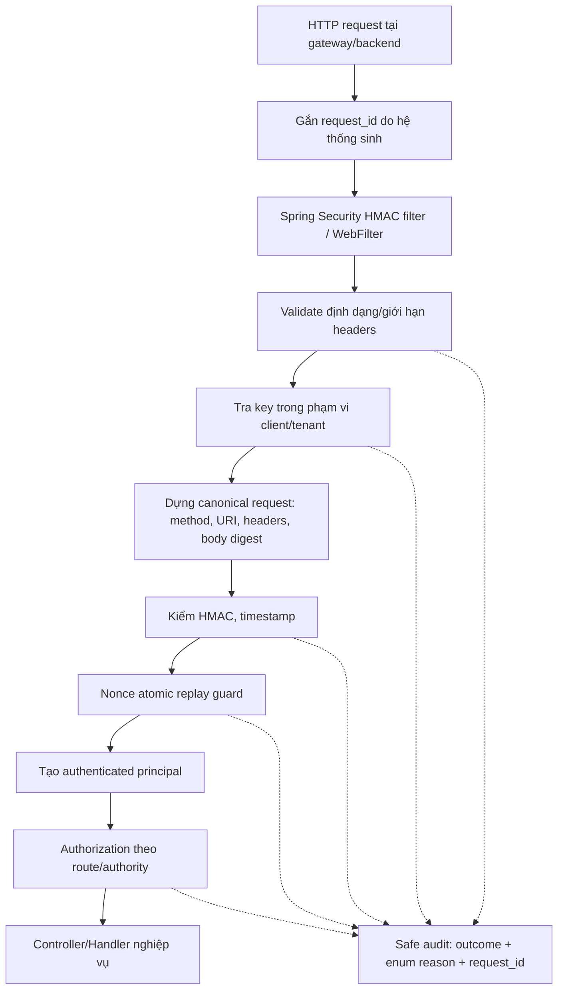

# Không ghi secret: nguyên tắc security logging cho xác thực HMAC

## 1. Bối cảnh và mục tiêu bài học

Trong chương **Security logging**, bài **Không ghi secret** tập trung vào cách tạo log đủ để quan sát, điều tra và vận hành cơ chế xác thực mà không làm lộ thông tin có thể dùng để giả mạo client hoặc tiết lộ dữ liệu nghiệp vụ. Đối với module `SECURITY_AUTHENTICATION_HMAC_REQUEST_AUTHENTICATION`, client ký HTTP request bằng **HMAC với shared secret** trên một **canonical request** gồm method, URI, các header và/hoặc body theo hợp đồng. Backend xác minh chữ ký, chống replay bằng timestamp/nonce, hỗ trợ key rotation, xử lý trường hợp proxy/gateway thay đổi request và chỉ thực thi nghiệp vụ sau authentication cùng authorization.

Một thiết kế HMAC đúng về mặt mật mã vẫn có thể mất an toàn nếu filter, framework, gateway hoặc hệ thống APM vô tình ghi shared secret vào log. Log thường được chuyển đến hệ thống tập trung, sao lưu, tìm kiếm và hiển thị trên dashboard; vì thế dữ liệu bí mật có thể được nhân bản ra nhiều nơi và tồn tại lâu hơn thời gian xử lý một HTTP request.

**Mục tiêu** của bài học:

- Xác định chính xác thông tin nào **tuyệt đối không ghi**, thông tin nào có thể ghi có điều kiện và thông tin nào an toàn để đo lường.
- Thiết kế một **schema sự kiện theo danh sách cho phép (allowlist)** cho các trường hợp HMAC thành công, chữ ký sai, timestamp hết hạn, nonce phát lại, key bị thu hồi, thiếu quyền hoặc hệ thống replay store lỗi.
- Tổ chức logging xuyên Spring Security, Spring MVC, Spring WebFlux, reverse proxy/gateway và hệ thống giám sát mà không dump body, header xác thực hay canonical request.
- Viết code Java tránh rò rỉ qua `toString()`, exception message, MDC, HTTP tracing và các log level `DEBUG`/`TRACE`.
- Kiểm thử rằng các giá trị nhạy cảm **không xuất hiện trong bất kỳ đầu ra log được kiểm soát nào**, kể cả đường xử lý lỗi, trước khi cho phép release.
- Hiểu cách xử lý khi một secret đã từng lọt vào log: cô lập, thu hồi/rotation và đánh giá lại dữ liệu lưu trữ.

## 2. Vì sao log có thể trở thành đường rò rỉ xác thực?

HMAC giúp server kiểm tra bên gửi có biết khóa chung và request chưa bị sửa trong phạm vi đã ký. Nó **không mã hóa** shared secret, cũng không khiến các hệ thống ghi log tự biết trường nào cần ẩn. Một dòng log tưởng chừng thuận tiện cho debug có thể biến thành bản sao credential hoặc thông tin có thể dùng để tái gửi request.

Ví dụ **không được sử dụng**:

```java
// SAI: log secret và dữ liệu client gửi để xác thực.
log.debug("HMAC secret={}, signature={}, request={}",
        sharedSecret, request.getHeader("X-Signature"), request);

// SAI: canonical string có thể chứa URI/query, header, body,
// nonce, signature-related metadata hoặc thông tin nghiệp vụ.
log.trace("canonicalRequest={}", canonicalRequest);

// SAI: body chứa dữ liệu cá nhân, token, hoặc dữ liệu thanh toán.
log.error("Authentication failed; body={}", requestBodyUtf8);

// SAI: Throwable có thể chứa request headers / credential.
log.error("HMAC authentication failed", rawVerificationException);
```

Hậu quả có thể gồm:

1. Người có quyền đọc log, backup, trace hoặc dashboard nhìn thấy khóa đang còn hiệu lực và có thể tự ký request mới.
2. Chữ ký cùng request-target, timestamp, nonce và body nếu bị log đầy đủ có thể tạo vật liệu **replay** trong khoảng server còn chấp nhận, đặc biệt khi replay protection lỗi hoặc không được chia sẻ giữa các node.
3. URI query hoặc JSON body trong canonical string có thể chứa thông tin cá nhân, token, mã đơn hàng, định danh tenant, nội dung thanh toán.
4. Log sink của bên thứ ba trở thành một bản sao dữ liệu nhạy cảm nằm ngoài phạm vi quản lý credential chính.
5. Việc xóa một log line không xóa được bản sao ở queue, index, archive, dữ liệu export, ảnh chụp dashboard hoặc máy người từng truy cập.

**Nguyên tắc nền tảng:** không lấy thông tin về các bước xác thực bằng cách log toàn bộ đầu vào; hãy thiết kế **sự kiện quan sát tối thiểu** thể hiện điều kiện nào đạt hoặc thất bại. Lọc/mask ở pipeline xử lý log chỉ là lớp phòng vệ bổ sung, không thay thế việc **không phát sinh dữ liệu nhạy cảm ngay từ đầu**.

## 3. Phân loại dữ liệu trước khi thiết kế schema log

Không phải mọi trường trong request đều là secret theo cùng một nghĩa. Cần đánh giá cả khả năng sử dụng lại, ràng buộc quyền và thông tin cá nhân.

| Dữ liệu | Phân loại và nguy cơ | Cách xử lý đề xuất |
| --- | --- | --- |
| **Shared secret HMAC**, khóa đã giải mã, base64/hex biểu diễn secret | Credential cấp quyền ký request; lộ có thể cho phép giả mạo client. | **Tuyệt đối không log**, kể cả hash đơn giản hay vài ký tự đầu/cuối. |
| TLS private key, API credential tra secrets manager, token nội bộ cấp quyền | Credential có quyền ngoài phạm vi HMAC. | **Tuyệt đối không log**; bảo vệ khi load, rotate và cấu hình. |
| `Authorization`, `Cookie`, `Set-Cookie`, token trong header/query | Có thể là bearer credential, session hoặc dữ liệu nhạy cảm. | Mặc định không log; không dump full headers. |
| `X-Signature` hoặc HMAC tag client gửi | Không phải shared secret, nhưng có thể được dùng với request gốc để replay và tiết lộ dữ liệu đối chiếu. | Không log nguyên giá trị; log `signature_present=true/false` nếu cần. |
| Canonical request, string-to-sign, payload bytes | Có thể bao gồm URI/query, header/body nhạy cảm và các phần của request có thể replay. | Không log nguyên nội dung; dùng mã lỗi/canonical version để chẩn đoán. |
| Raw JSON/body, multipart/file, request/response dump | Có thể chứa PII, thông tin thanh toán, bí mật của khách hàng. | Không log theo mặc định; cấm body logging trong authentication path. |
| `X-Nonce` và `X-Timestamp` ở dạng đầy đủ | Không phải secret riêng lẻ, nhưng kết hợp với request đã ký tạo vật liệu replay và dấu vết theo dõi. | Dùng kết quả kiểm `freshness_status`/`replay_result`; không ghi raw nonce. Timestamp có thể ghi ở dạng đã tổng hợp/độ lệch theo bucket khi cần. |
| `X-Key-Id`, client ID, tenant ID | Không nhất thiết là secret nhưng có thể giúp enumeration, liên kết người dùng hoặc phân tích cơ cấu tenant. | Chỉ ghi khi có mục đích audit/điều tra và phân quyền truy cập; cân nhắc pseudonymization. Không dùng làm metric labels có cardinality cao. |
| Raw URI/query, client IP, User-Agent, forwarded headers | Có thể chứa token/PII, dữ liệu attacker kiểm soát và nguy cơ log injection. | Không ghi query; ưu tiên route template/route ID, giới hạn/chuẩn hóa các trường được cho phép. |
| Mã sự kiện, kết quả, mã nguyên nhân cố định, status code, thời lượng | Metadata vận hành có miền giá trị hữu hạn. | Có thể log/đo đạc theo schema đã công bố. |
| Correlation ID do hệ thống tin cậy tạo | Dùng ghép các sự kiện mà không cần raw request. | Ghi được sau khi đảm bảo chỉ gồm ký tự và độ dài an toàn; không coi là credential. |

**Không dùng “hash secret rồi log hash” như giải pháp mặc định.** Nếu secret có entropy thấp, hash không có khóa có thể hỗ trợ tấn công dò từ điển. Hash đơn giản của client ID/PII cũng có thể bị đoán nếu miền giá trị nhỏ. Khi thật sự cần một tham chiếu ổn định để điều tra, tạo pseudonym bằng **khóa riêng cho mục đích logging/tokenization**, có chính sách rotation và phân quyền truy cập phù hợp. Khóa tokenization không được dùng chung với secret HMAC cấp cho client.

### Log full signature có khác log secret không?

Có. `X-Signature` là MAC của một thông điệp cụ thể; chỉ biết chữ ký thường không đủ tạo chữ ký hợp lệ cho một request mới. Tuy nhiên, logging full signature vẫn có nguy cơ: khi request body, target và timestamp/nonce cũng bị ghi ở nơi khác, tập dữ liệu có thể bị ghép lại để replay hoặc phân tích. Vì vậy **vẫn không ghi signature** trong log xác thực thông thường. Cần phân biệt *không đủ để ký request mới* với *an toàn để phát tán vô hạn*.

## 4. Thiết kế sự kiện HMAC theo allowlist

Một sự kiện security logging nên trả lời những câu hỏi vận hành cụ thể: request thuộc vùng API nào, được xử lý ở bước nào, kết quả ra sao, lý do nội bộ thuộc nhóm nào và có phải lỗi hạ tầng không?

Mẫu event dạng cấu trúc minh họa:

```json
{
  "event": "hmac.authentication",
  "schema_version": 1,
  "request_id": "18df9b0c2b214e17a49e5d5c8672e781",
  "route_id": "partner_orders_create",
  "outcome": "REJECTED",
  "reason": "TIMESTAMP_EXPIRED",
  "http_status": 401,
  "stage": "AUTHENTICATION",
  "duration_ms": 12,
  "canonical_version": "HMAC-V1"
}
```

Ví dụ này **không** ghi shared secret, request body, chữ ký, raw timestamp/nonce, canonical string, query, toàn bộ client ID hoặc key ID. `route_id` là định danh do backend cấu hình, không phải đường dẫn tùy ý do client gửi. `request_id` do ingress/backend tin cậy sinh, còn `reason` lấy từ enum nội bộ.

### Schema gợi ý

| Trường | Giá trị hợp lệ | Mục đích |
| --- | --- | --- |
| `event` | `hmac.authentication`, `hmac.authorization`, `hmac.infrastructure` | Xác định loại sự kiện. |
| `schema_version` | Số nguyên phiên bản | Giúp dashboard xử lý khi schema đổi. |
| `request_id` | ID ngẫu nhiên do hệ thống tin cậy cấp, đã giới hạn định dạng | Ghép log nhiều hop. |
| `route_id` | Tên route nội bộ có danh sách cho phép | Xác định phạm vi API mà không ghi raw URL. |
| `stage` | `PARSE`, `KEY_LOOKUP`, `VERIFY`, `REPLAY`, `AUTHORIZATION` | Giai đoạn kết thúc hoặc gặp vấn đề. |
| `outcome` | `ACCEPTED`, `REJECTED`, `ERROR` | Kết quả xử lý. |
| `reason` | Enum nguyên nhân nội bộ được giới hạn | Tổng hợp sự cố mà không cần log giá trị đầu vào. |
| `http_status` | `200`, `201`, `401`, `403`, `413`, `503` ... | Theo dõi HTTP result. |
| `duration_ms` | Số không âm, có giới hạn | Đo hiệu năng verifier. |
| `canonical_version` | Giá trị từ allowlist như `HMAC-V1` | Chẩn đoán mismatch khi chuyển hợp đồng ký. |

Các trường có thể bổ sung có điều kiện: định danh node, vùng triển khai, loại key status (như `ACTIVE`, `VERIFY_ONLY`), tên API partner đã pseudonymize, hoặc phân loại skew như `PAST_GT_5M`. Mỗi bổ sung cần có **mục đích sử dụng, thời hạn lưu và chính sách truy cập**; không đặt tất cả metadata vào log chỉ vì có thể thu thập.

Chú ý `canonical_version` chỉ nên lấy từ danh sách server hỗ trợ, không log tự do giá trị phiên bản lạ mà client gửi. Đặc biệt tránh một trường `additional_context` hoặc `raw_details` tùy ý: nó thường trở thành nơi log request headers/body ngoài kiểm soát.

## 5. Phân tách log xác thực, phân quyền và hạ tầng

Bảng ví dụ dưới mô tả cách ghi event nội bộ mà vẫn cung cấp response HTTP ổn định cho client.

| Sự kiện | Internal reason | Stage | Response gợi ý |
| --- | --- | --- | --- |
| Thiếu `X-Signature` hoặc trường HMAC bắt buộc | `MISSING_CREDENTIAL` | `PARSE` | `401 Unauthorized` |
| MAC không khớp với canonical request | `SIGNATURE_INVALID` | `VERIFY` | `401 Unauthorized` |
| Timestamp sai format/quá cũ/quá xa tương lai | `TIMESTAMP_MALFORMED`/`TIMESTAMP_EXPIRED`/`TIMESTAMP_FUTURE` | `PARSE` hoặc `VERIFY` | `401` theo scheme HMAC của API |
| Nonce đã tồn tại | `NONCE_REPLAY` | `REPLAY` | `401 Unauthorized` |
| Key bị revoke/hết hiệu lực | `KEY_NOT_ACCEPTED` | `KEY_LOOKUP` | `401 Unauthorized` |
| Chữ ký và freshness hợp lệ | `AUTHENTICATED` | `VERIFY` | Tiếp tục authorization. |
| Principal đã xác thực nhưng thiếu authority | `ACCESS_DENIED` | `AUTHORIZATION` | `403 Forbidden` |
| Kho nonce/credential gặp sự cố | `REPLAY_STORE_UNAVAILABLE` / `CREDENTIAL_STORE_UNAVAILABLE` | `REPLAY`/`KEY_LOOKUP` | Fail closed, có thể `503` theo contract |
| Proxy khiến raw URI/body bị rewrite khác hợp đồng | `CANONICAL_MISMATCH` khi có thể phân loại đáng tin | `VERIFY` | Authentication failure; điều tra qua route/config |
| Body vượt giới hạn | `BODY_TOO_LARGE` | `PARSE` hoặc gateway | `413 Content Too Large` |

**Phân loại nội bộ không phải thông điệp gửi công khai.** Response có thể dùng lỗi chung `AUTHENTICATION_FAILED` cho các sai sót credential để tránh hỗ trợ enumeration qua chi tiết lý do. Nếu API trả `401` cho HMAC dùng scheme tùy biến, phải tài liệu hóa chính sách HTTP challenge/`WWW-Authenticate` tương ứng; không tự nhận đó là scheme chuẩn nếu chưa định nghĩa. Không trả `403` khi chưa xác thực thành công.

Trong security logging, một lỗi expected như `SIGNATURE_INVALID` không nhất thiết phải ghi stack trace hoặc `ERROR`. Logging không kiểm soát trên mỗi request tấn công có thể làm đầy ổ đĩa và tăng chi phí vận hành. Có thể tổng hợp counter theo reason, giới hạn tốc độ ghi event và vẫn giữ audit event cần thiết theo risk policy.

## 6. Ví dụ Java: log nguyên nhân cố định, không ghi request

Mẫu dưới dùng Java, SLF4J và enum. Đây là code minh họa áp dụng tại thành phần HMAC verifier hoặc wrapper của nó; `requestId` phải **được sinh ở ingress đáng tin cậy** và `routeId` phải là ID route từ cấu hình server. Không truyền raw header, request object, canonical string hoặc exception chứa dữ liệu nhạy cảm vào API logger.

```java
import org.slf4j.Logger;
import org.slf4j.LoggerFactory;

enum HmacFailureReason {
    MISSING_CREDENTIAL,
    TIMESTAMP_MALFORMED,
    TIMESTAMP_EXPIRED,
    TIMESTAMP_FUTURE,
    SIGNATURE_INVALID,
    NONCE_REPLAY,
    KEY_NOT_ACCEPTED,
    REPLAY_STORE_UNAVAILABLE,
    CREDENTIAL_STORE_UNAVAILABLE
}

final class HmacAuditLogger {
    private static final Logger LOG =
        LoggerFactory.getLogger(HmacAuditLogger.class);

    private static final String ROUTE_ID = "partner_orders_create";

    void authenticationRejected(
            String serverGeneratedRequestId,
            HmacFailureReason reason) {

        // serverGeneratedRequestId phải đến từ cơ chế tin cậy,
        // có giới hạn độ dài/ký tự, không copy từ header bất kỳ.
        LOG.warn(
            "event=hmac.authentication route_id={} request_id={} "
            + "outcome=REJECTED reason={}",
            ROUTE_ID,
            serverGeneratedRequestId,
            reason.name()
        );
    }

    void authenticationAccepted(String serverGeneratedRequestId) {
        LOG.info(
            "event=hmac.authentication route_id={} request_id={} "
            + "outcome=ACCEPTED",
            ROUTE_ID,
            serverGeneratedRequestId
        );
    }
}
```

Ví dụ sử dụng sau khi verifier trả kết quả:

```java
try {
    AuthenticatedClient principal = verifier.verify(request);
    audit.authenticationAccepted(serverGeneratedRequestId);
    // Dùng principal đã xác minh để tạo Authentication
    // hoặc Reactive Authentication; authorization chạy sau.
} catch (HmacRejectedException rejected) {
    // Phân loại enum do verifier tạo, không ghi rejected
    // hoặc rejected.getMessage() nếu có dữ liệu request.
    audit.authenticationRejected(
        serverGeneratedRequestId,
        rejected.reason());
    throw new BadCredentialsException("Invalid HMAC request");
}
```

`AuthenticatedClient`, `HmacRejectedException`, `verifier` và `request` là các lớp/tham số **do ứng dụng tự định nghĩa**. Khi `HmacRejectedException` có nguyên nhân `REPLAY_STORE_UNAVAILABLE` hoặc `CREDENTIAL_STORE_UNAVAILABLE`, cần ánh xạ sang luồng lỗi hạ tầng **fail closed**, không biến mọi trường hợp thành `BadCredentialsException`/`401`; ví dụ ở trên chỉ áp dụng cho các lỗi credential expected. Ở production, nên tách error enum và exception infrastructure ngay từ thiết kế.

### Tránh rò rỉ qua `toString()` và exception

Ngay cả khi logger chỉ dùng một câu lệnh, dữ liệu nhạy cảm có thể lọt qua việc nội suy object:

```java
// SAI: toString() của Credential có thể chứa secret/key material.
log.debug("Loaded credential: {}", credential);

// SAI: toString() của request có thể chứa header/body.
log.warn("Bad signed request {}", signedRequest);

// SAI: e.getMessage() có thể nối raw header hoặc expected signature.
log.warn("HMAC rejected: {}", exception.getMessage());

// SAI: stack trace có thể chứa exception message nhạy cảm.
log.error("Verification exception", exception);
```

Đặt `toString()` an toàn cho DTO là lớp bảo vệ tốt, nhưng **không thể thay thế** API log theo allowlist. Exception từ thư viện, HTTP client, JSON codec hoặc phần mềm cũ có thể chứa giá trị input ngoài ý muốn. Khi cần stack trace cho lỗi **không mong đợi**, hãy đánh giá nguồn exception, phân loại lỗi, dùng incident ID và đảm bảo không đưa thông điệp nhạy cảm vào log tập trung. Nếu cần giữ thông tin phục vụ điều tra riêng, sử dụng quy trình dữ liệu nhạy cảm được cấp quyền thay vì tự dump vào log thông thường.

### Không cần log mọi lần xác thực thành công

API lưu lượng lớn có thể chỉ cần metrics tổng hợp success/failure và log chi tiết khi lỗi vận hành hoặc audit có yêu cầu. Một ứng dụng có thể tạo hàng triệu log `ACCEPTED` mỗi giờ. Thiết kế sự kiện phải cân nhắc chi phí, giá trị điều tra và khả năng bị khai thác để gây log flooding; không coi số lượng log là độ mạnh của bảo mật.

## 7. Vị trí logging trong luồng HMAC và Spring Security

Một luồng xác minh request điển hình:



**Tuyệt đối không chuyển dữ liệu từ `C` (canonical string, raw headers, body, shared secret) thẳng đến `E` (audit logger).** Mọi nhánh phát event chỉ chuyển mã nguyên nhân, loại route và correlation ID được kiểm soát.

Với **Spring MVC/Servlet**, HMAC filter có thể nằm trong `SecurityFilterChain` trước `AuthorizationFilter`. Nếu filter tự ném `AuthenticationException` và dùng `ExceptionTranslationFilter` để xử lý, nó phải chạy ở phần downstream mà bộ dịch lỗi bao quanh, hoặc filter tự gọi `AuthenticationEntryPoint` nếu chọn vị trí khác. Log từ `OncePerRequestFilter`, `HandlerInterceptor`, exception handler và HTTP request logging phải cùng tuân thủ chính sách; controller không tự dump request đã qua authentication.

Với **Spring WebFlux**, filter reactive dùng `SecurityWebFilterChain` và danh tính đi theo `ReactiveSecurityContextHolder`/Reactor Context. **SLF4J MDC dựa trên ThreadLocal không tự động lan truyền qua mọi operator/thread reactive.** Nếu cần correlation ID, giữ nó trong context theo cơ chế reactive/observability phù hợp, bridge MDC có phạm vi rõ ràng và dọn khi kết thúc; không dùng một `static` map hoặc tự tin rằng MDC ở request thread sẽ luôn có mặt ở worker thread. Cũng tránh log `Flux<DataBuffer>` hoặc bật wiretap ghi plaintext body.

### Phân quyền ghi log khác phân loại lỗi xác thực

Một request có MAC đúng nhưng authority không đủ cần một event `hmac.authorization` / `ACCESS_DENIED`, phản hồi thường là `403`. Nó **không phải** `SIGNATURE_INVALID` và không nên log lại secret hoặc ký lại request để “debug”. Phân loại này giúp dashboard trả lời đúng: đang bị tấn công signature, khách hàng lệch đồng hồ, key hết hiệu lực hay cấu hình quyền của service chưa phù hợp.

## 8. Những vị trí rò rỉ ngoài ứng dụng Java

Thực tế, một secret có thể bị log ngay cả khi mã `HmacAuditLogger` hoàn toàn an toàn. Cần kiểm soát các điểm thu thập sau:

| Nơi thu thập | Rủi ro phổ biến | Cách giảm thiểu |
| --- | --- | --- |
| Reverse proxy / API gateway access log | Log full `$request` hoặc `$request_uri`, gồm query có token; debug ghi headers hoặc body. | Sử dụng format allowlist không có query/header/body; giới hạn quyền cấu hình log. |
| Gateway error log / WAF | Rule debug lưu request bị từ chối nguyên vẹn. | Tắt hoặc lọc capture payload; phân quyền và kiểm soát chính sách WAF. |
| Spring Security DEBUG/TRACE | Tăng lượng log authentication/HTTP routing; mã custom ghi `Authentication` hoặc exception. | Chỉ bật có kiểm soát; không gọi `toString()` của credential hay request. |
| Spring `CommonsRequestLoggingFilter` | Tùy cấu hình có thể log query string, headers và payload. | Không bật full request logging trên API HMAC; rà soát các flags includeHeaders/includePayload/includeQueryString. |
| WebFlux/Reactor Netty HTTP wiretap | Có thể ghi dữ liệu frame hoặc plaintext HTTP khi cấu hình ở mức chi tiết. | Tắt wiretap chứa payload ở môi trường có dữ liệu nhạy cảm; đánh giá logging level và format. |
| `WebClient`/`RestTemplate` interceptors | Log outbound headers, URL query, token hoặc request body; retry log copy signed request. | Sử dụng interceptor theo allowlist; không dump request/response toàn phần. |
| Exception handlers / APM tracing | Tự thu thập exception message, attributes, headers, URL hoặc HTTP body. | Cấu hình denylist toàn cục và allowlist span attributes; xác minh hành vi agent thực tế. |
| Actuator / diagnostics / heap/thread dump | Có thể lộ environment, cấu hình hoặc object chứa secret khi thu thập. | Giới hạn endpoint và quyền truy cập; áp dụng redaction và quy trình dump riêng. |
| CI/CD, shell, support tickets, chat | Lệnh `curl -v`, environment dump, log startup và ảnh chụp lỗi. | Không in khóa/lệnh chứa credential; dùng secret manager, che log job và giới hạn chia sẻ. |
| Hệ thống tập trung lưu log | Index, backup, export và analytics nhân bản sự kiện không an toàn. | Data minimization tại nguồn, encryption at rest/in transit, RBAC, retention, audit người xem. |

Một số thành phần chỉ lộ dữ liệu **khi tùy chọn debug/capture được bật**; không giả định chúng luôn ghi secret. Điều bắt buộc là kiểm tra cấu hình, chạy test với dữ liệu giả và xác minh sink cuối cùng nhận được những trường nào.

### NGINX: tránh `$request` và raw query trong access log

Ví dụ cấu hình log tối thiểu tại gateway (cần điều chỉnh theo môi trường):

```nginx
http {
    log_format auth_safe escape=json
        '{"time":"$time_iso8601",'
        '"request_id":"$request_id",'
        '"method":"$request_method",'
        '"status":$status,'
        '"upstream_status":"$upstream_status",'
        '"duration_s":"$request_time"}';

    server {
        listen 443 ssl;
        server_name api.example.test;

        # Cấu hình certificate/TLS/routing thực tế bị lược bỏ.
        access_log /var/log/nginx/hmac-access.log auth_safe;

        location /api/ {
            proxy_set_header X-Correlation-ID $request_id;
            proxy_pass https://backend.internal.example.test;
        }
    }
}
```

Trong ví dụ, `$request_id` do NGINX sinh tại gateway, còn backend cần chỉ tin header correlation từ proxy được kiểm soát và loại bỏ giá trị giả mạo từ client. `$upstream_status` được đặt trong chuỗi vì có thể nhận giá trị như dấu `-` hoặc danh sách mã khi retry. Cấu hình không dùng `$request`, `$request_uri`, `$args`, full `$http_authorization`, `$http_x_signature` hoặc body.

Việc không ghi URI **có thể giảm khả năng phân tích từng endpoint**; để bù lại, gửi một `route_id` theo định tuyến server-side đã xác định, hoặc tổng hợp metrics theo route template khi backend biết pattern. **Không bổ sung `$uri` một cách mặc định** nếu path chứa số điện thoại, email, order ID, access token hoặc thông tin nhạy cảm.

### TLS termination không làm secret an toàn để log

Khi TLS kết thúc ở gateway, gateway có thể thấy HTTP plaintext. Kết nối client-gateway được mã hóa không ngăn gateway, plugin WAF hoặc hệ thống quan sát ở edge ghi header/body. Nếu gateway mở TLS/mTLS mới tới backend, cần bảo vệ **log của cả hai hop**. Không đồng nhất “gói tin trên dây được mã hóa” với “bản ghi HTTP đã được che trước khi lưu”.

## 9. Canonical request và body digest: debug an toàn thế nào?

Khi client/server bất đồng canonicalization, người vận hành thường muốn in cả string-to-sign để so sánh. Với HMAC request, canonical string có thể chứa raw URI/query, định danh, signed headers và body digest. Nếu debug in nguyên canonical string, nhiều trường nhạy cảm đã vượt qua tất cả kiểm soát log.

Cách tiếp cận ít rủi ro hơn:

1. **Ghi phiên bản canonicalization** do server hỗ trợ, ví dụ `HMAC-V1`.
2. **Ghi tên nhóm dữ liệu được ký** từ danh sách cố định như `method`, `path`, `content-type`, `timestamp`, `nonce`, `body_digest`, không ghi giá trị thật.
3. **Ghi loại sai lệch** được xác định bằng logic đáng tin cậy, ví dụ `UNSUPPORTED_CANONICAL_VERSION`, `DUPLICATE_SIGNED_HEADER`, `INVALID_CONTENT_TYPE_FORMAT` hoặc `SIGNATURE_INVALID`.
4. **Đo độ dài body** theo bucket thay vì log full payload; không ghi body hash nếu mục đích không yêu cầu.
5. Nếu cần so sánh với test vectors, dùng **payload giả cố định** trong môi trường phát triển, không thu thập canonical request thật từ production.
6. Với mismatch qua proxy, kiểm tra cấu hình rewrite và test ký request giả qua cùng gateway; không bật raw header/body capture cho lưu lượng khách hàng.

**Body SHA-256 có thể là thông tin nhạy cảm.** Dù digest không khôi phục ngay nội dung tùy ý, người có danh sách payload ứng viên vẫn có thể kiểm tra các nội dung đoán được, đặc biệt với payload nhỏ, có cấu trúc hoặc domain giá trị thấp. Không biến `body_sha256` thành trường mặc định cho mọi event.

### Request-target và query string

Nếu signed URI là `/api/orders?token=...`, nguyên chuỗi `request.getRequestURI() + "?" + request.getQueryString()` không được in ra. Một phương án an toàn hơn là ánh xạ sang một mã định tuyến đã được lập trình, ví dụ `partner_orders_create`, và ghi `method=POST` nếu thông tin này có ích và không nhạy cảm trong hệ thống.

Không dùng `X-Forwarded-Uri`, `X-Original-URI` hay `Forwarded` làm nguồn cho trường “safe route” nếu header đó do client tự cung cấp. Routing và logging cần dùng giá trị do gateway/backend tin cậy xác định.

## 10. Correlation ID, MDC và nguyên tắc dữ liệu tin cậy

Correlation ID có thể giúp ghép log gateway, HMAC verifier, replay store và handler mà không cần dump request:

```text
gateway   request_id=18df... route=partner_orders_create status=401
backend   request_id=18df... event=hmac.authentication reason=NONCE_REPLAY
metrics   hmac_auth_failure_total{reason="NONCE_REPLAY",route="partner_orders_create"}
```

Những dòng trên minh họa cách biểu diễn ID rút gọn, không phải định dạng parser bắt buộc. Một `request_id` đầy đủ nên có format giới hạn (ví dụ UUID hoặc 32 ký tự hex) và được tạo bởi hệ thống tin cậy. Nếu client tự gửi header `X-Request-ID`, cần quyết định tin nguồn nào, giới hạn độ dài/ký tự và có thể tạo ID mới ở edge. Không log giá trị không giới hạn có chứa newline hoặc ký tự điều khiển.

Ví dụ về tạo ID ở lớp ứng dụng khi chưa có ingress tin cậy:

```java
String requestId = UUID.randomUUID().toString();
// Truyền ID này tới logger/correlation context thích hợp.
// Không tái sử dụng header bất kỳ mà client tự điền làm ID tin cậy.
```

Trong Spring MVC, `MDC.put("request_id", requestId)` và `MDC.remove("request_id")` trong `finally` có thể hữu ích cho luồng đồng bộ. Nếu handler chuyển sang async executor, MDC không tự động truyền theo tất cả tác vụ; cần propagation có chủ đích.

Trong WebFlux, Reactor có thể chuyển thread; việc `MDC.put` ngoài reactive chain không đảm bảo log của mọi subscriber có cùng ID. Dùng Reactor Context và khả năng context propagation của hệ thống observability, với cơ chế bridge rõ ràng. Kiểm thử sự tương quan và dọn context ở cả success/error/cancel để tránh lẫn ID giữa request.

**Không nhét credential vào MDC**, vì pattern log như `%X` có thể tự in toàn bộ map trên mọi dòng log. Một lần đưa signature/secret vào MDC có thể nhân bản nó hàng nghìn lần qua framework logs.

## 11. Metrics khác log: đừng tạo nhãn có cardinality vô hạn

Metrics rất hữu ích để biết lượng request HMAC sai chữ ký, clock skew, replay hoặc lỗi kho nonce. Nhưng một metric có nhãn từ raw nonce, client ID, key ID, signature hay request ID tạo vô số chuỗi thời gian, tăng chi phí lưu trữ và có thể rò rỉ metadata.

Ví dụ **không nên làm**:

```text
hmac_verify_failed_total{nonce="5c650...",signature="abc...",client_id="partner-a"} 1
```

Ví dụ phù hợp hơn:

```text
hmac_authentication_total{route="partner_orders_create",outcome="rejected",reason="signature_invalid"} 124
hmac_authentication_total{route="partner_orders_create",outcome="rejected",reason="timestamp_expired"} 17
hmac_authentication_total{route="partner_orders_create",outcome="rejected",reason="nonce_replay"} 4
hmac_authentication_total{route="partner_orders_create",outcome="error",reason="replay_store_unavailable"} 2
```

Các số chỉ minh họa. `route` và `reason` cần được lấy từ tập giá trị đã công bố. Với latency của verifier, sử dụng histogram theo route/stage hữu hạn; nếu cần phân tích theo một tenant cụ thể cho incident, dùng công cụ audit có quyền kiểm soát thay vì chèn tenant ID vào metric label.

### Cách xử lý sự kiện nguy cơ cao

Không phải lỗi nào cũng cần cùng mức độ thông báo:

| Sự kiện | Quan sát phù hợp |
| --- | --- |
| Chữ ký sai đơn lẻ | Counter theo reason, có thể WARN event hạn chế tốc độ. |
| Tỷ lệ sai chữ ký tăng đột biến | Alert theo ngưỡng/tỷ lệ, kết hợp route và nguồn tin cậy sau khi ẩn PII. |
| Timestamp expired nhiều ở một nhóm client | Theo dõi bucket skew, clock health, traffic latency. |
| Nonce replay tăng | Audit an toàn, kiểm atomicity của store và retry policy; alert có ngưỡng. |
| Key bị thu hồi vẫn được sử dụng | Audit credential lifecycle theo ID nội bộ hạn chế truy cập, không log key material. |
| Replay store lỗi hoặc không có khả năng fail closed | Metric lỗi hạ tầng, alert ưu tiên cao và kiểm tra chính sách từ chối. |
| HMAC thành công nhưng thiếu authority | Event authorization, mã reason `ACCESS_DENIED` và kiểm policy. |

Không dùng attacker-controlled header làm label hoặc giá trị log cho pipeline alert. Nếu muốn nghiên cứu nguồn request độc hại, cần thu thập có điều kiện trong hệ thống bảo vệ riêng theo chính sách điều tra, không nhân bản mọi request vào log chính.

## 12. Kiểm thử để chứng minh không rò rỉ secret

Một code review bằng tìm kiếm `log.debug` là cần thiết nhưng chưa đủ. Rò rỉ có thể xuất phát từ library, exception, proxy, APM hoặc thay đổi config sau này. Thiết kế kiểm thử nên dùng **dữ liệu canary giả** dễ nhận biết và kiểm tra các sink mà test có quyền quan sát.

### 12.1. Ma trận kiểm thử

| Tình huống | Canary/input | Điều cần khẳng định |
| --- | --- | --- |
| HMAC hợp lệ | Secret giả, signature/nonce giả, body JSON chứa canary | Success event không chứa secret/signature/body/nonce. |
| Signature sai | Đổi một byte chữ ký hoặc body | Log chỉ có enum `SIGNATURE_INVALID` và metadata allowlist. |
| Timestamp thiếu/quá hạn | Header chứa chuỗi canary hoặc timestamp cũ | Không log raw `X-Timestamp`; có mã phân loại phù hợp. |
| Nonce bị replay | Cố ý gửi lại request đã ký | Event `NONCE_REPLAY` không chứa nonce gốc. |
| Key bị revoke | `keyId` fixture của key bị thu hồi | Không log secret/key object; audit key state theo policy. |
| Replay store exception | Exception test mang message có canary | Không in nguyên message/stack trace chứa canary. |
| Body bị lỗi parse | JSON có chuỗi canary trong trường nhạy cảm | Error handler/decoder không đưa nguyên body vào log. |
| Header chứa newline/ký tự điều khiển | Input cố ý phá định dạng log | Không xuất raw header, không chèn log giả. |
| Request đi qua gateway | URL query/header chứa canary | Access/error log không chứa query/signature/secret. |
| WebFlux DEBUG/wiretap | Payload và headers giả | Trace payload capture không được bật hoặc không ghi dữ liệu nhạy cảm. |
| CI startup/config | Secret lấy từ môi trường test | Không xuất environment dump/config property secret ra job log. |

### 12.2. Ví dụ unit test cho API logger

Đây là skeleton kiểm thử với Logback Classic, JUnit 5 và AssertJ. Nó kiểm **đúng lớp HmacAuditLogger**; muốn khẳng định toàn bộ ứng dụng và gateway an toàn còn phải chạy thêm integration tests ở các sink thực tế.

```java
import ch.qos.logback.classic.spi.ILoggingEvent;
import ch.qos.logback.core.read.ListAppender;
import org.junit.jupiter.api.Test;
import org.slf4j.LoggerFactory;

import static org.assertj.core.api.Assertions.assertThat;

class HmacAuditLoggerTest {

    @Test
    void rejectedHmacDoesNotEmitRequestSecrets() {
        var logger = (ch.qos.logback.classic.Logger)
            LoggerFactory.getLogger(HmacAuditLogger.class);

        var appender = new ListAppender<ILoggingEvent>();
        appender.start();
        logger.addAppender(appender);

        try {
            String requestId =
                "18df9b0c2b214e17a49e5d5c8672e781";
            String sentinelSecret = "TEST_SECRET_NEVER_LOG_8f24";
            String sentinelSignature = "TEST_SIGNATURE_NEVER_LOG_8f24";
            String sentinelNonce = "TEST_NONCE_NEVER_LOG_8f24";

            new HmacAuditLogger().authenticationRejected(
                requestId, HmacFailureReason.SIGNATURE_INVALID);

            String logged = appender.list.stream()
                .map(ILoggingEvent::getFormattedMessage)
                .reduce("", (a, b) -> a + "\n" + b);

            assertThat(logged)
                .contains("SIGNATURE_INVALID")
                .contains("hmac.authentication")
                .doesNotContain(
                    sentinelSecret, sentinelSignature, sentinelNonce);
        } finally {
            logger.detachAppender(appender);
            appender.stop();
        }
    }
}
```

Test trên xác nhận logger chỉ dùng enum và request ID của fixture; vì canary **chưa được đưa vào đường request/verifier**, nó **không đủ** để bắt rò rỉ từ các lớp khác. Một end-to-end test cần thực sự cấu hình secret giả, gửi request chứa canary qua Spring Security, kích hoạt cả success/failure và kiểm log từ tất cả appender/sink liên quan. Với gateway, cần đọc access/error log của môi trường test hoặc dùng một sink thu thập log riêng để xác minh.

### 12.3. Integration test với canary end-to-end

Quy trình cụ thể:

1. Cấp key HMAC giả có giá trị rõ ràng như `TEST_SHARED_SECRET_DO_NOT_LOG_...` trong credential repository của môi trường test.
2. Gửi signed request với body, URI query và header chứa các canary khác nhau, đảm bảo mỗi canary thuộc một nơi phát sinh riêng.
3. Chạy request thành công, request chữ ký sai, timestamp ngoài cửa sổ, replay và lỗi hạ tầng giả lập.
4. Thu thập log từ application, Spring Security/filter, HTTP server/client, proxy/gateway và APM exporter mà test môi trường kiểm soát.
5. Assert **không xuất hiện canary** trong message đã format, structured attributes, exception details, context map và sink lưu trữ.
6. Assert **có xuất hiện metadata cho phép**: request ID, route ID, outcome, reason enum và status để bảo đảm observability không bị mất.
7. Khi có thay đổi phiên bản framework, instrumentation, config debug hoặc vendor agent, chạy lại test ở môi trường giống production.

Đừng chỉ tìm vài ký tự prefix của secret: nếu một sink encode base64/hex, cắt chuỗi hoặc ghi dưới dạng JSON escaped, cần thêm assertion cho các biến thể biểu diễn liên quan. Tuy nhiên **không biến kiểm thử thành lý do để lưu hoặc phát tán secret thật**. Canary luôn là dữ liệu giả và không có quyền trong production.

## 13. Bảo vệ hệ thống lưu log và vòng đời dữ liệu

Ngăn secret khỏi được ghi là bước đầu tiên; schema an toàn vẫn có thể chứa thông tin đáng bảo vệ như request ID, định danh nội bộ đã pseudonymize và lịch sử lỗi truy cập. Do đó cần:

- Dùng TLS để chuyển log/trace/metrics đến collector, kiểm tra endpoint và quyền của collector.
- Mã hóa dữ liệu tại nơi lưu, tách quyền ghi và đọc; dùng least privilege, kiểm toán người truy cập/export.
- Áp dụng retention tối thiểu theo mục đích điều tra, chính sách pháp lý và khả năng replay; xóa index/backups theo quy trình được kiểm soát.
- Giới hạn truy vấn hoặc export có thể liên kết nhiều event để suy đoán hoạt động của một client/tenant.
- Kiểm soát schema version và review mỗi lần thêm trường logging mới.
- Có sampling/rate limiting cho lỗi xác thực lặp liên tục, không để attacker tạo log flooding đến mức ảnh hưởng hệ thống.
- Bảo vệ pipeline có khả năng thất bại: ứng dụng không nên mất bảo mật chỉ vì logger/collector không sẵn sàng. Nếu audit bắt buộc để đáp ứng yêu cầu hệ thống, lựa chọn fail-safe/fail-closed phải được kiến trúc quy định rõ.
- Kiểm tra backup, dead-letter queue, debug capture và dashboard vì các bản sao này có thể nằm ngoài retention của log index chính.

## 14. Nếu đã lỡ ghi secret vào log phải xử lý thế nào?

Xử lý như một **sự cố lộ credential tiềm năng**. Chỉ xóa vài dòng log và tiếp tục dùng khóa cũ thường chưa đủ vì không thể biết ai đã xem hoặc export bản ghi.

Quy trình xử lý được đề xuất:

1. **Ngăn ghi thêm:** tắt logging/capture gây rò rỉ ở app, proxy, agent hoặc job; đưa bản sửa vào review và test.
2. **Phân loại ảnh hưởng:** xác định loại secret, client/tenant, key ID/phiên bản, khoảng thời gian đã bị ghi, log sink, index, backup và quyền truy cập liên quan.
3. **Thu hồi hoặc rotation:** revoke/rotate shared secret HMAC bị lộ theo credential lifecycle, ưu tiên khóa còn hiệu lực. Nếu cần giai đoạn chuyển tiếp để giữ dịch vụ hoạt động, phải đánh giá nguy cơ giả mạo và áp dụng hạn chế tương ứng.
4. **Điều tra dấu hiệu lạm dụng:** tìm request bất thường, key usage, nonce replay, tác động nghiệp vụ và dữ liệu truy cập trong khoảng ảnh hưởng; không log tiếp secret để điều tra.
5. **Xóa/cô lập dữ liệu đã rò rỉ:** phối hợp quản trị sink, index, archive, backup, export và vendor theo quy trình lưu trữ; ghi nhận giới hạn thực tế của việc xóa.
6. **Khôi phục kiểm soát:** triển khai logger allowlist, kiểm thử canary end-to-end, thu hẹp quyền truy cập, thêm cảnh báo cho nguồn capture mới.
7. **Ghi nhận và thông báo:** theo quy trình incident response/nội quy bảo mật và nghĩa vụ pháp lý áp dụng; dùng mô tả không chứa credential.

Nếu secret đã lộ và có khả năng bị sử dụng để ký request, **không coi timestamp/nonce là đủ để bù lại việc lộ khóa**. Kẻ có khóa có thể tạo request mới với timestamp/nonce mới. Rotation/revoke và đánh giá truy cập là yếu tố quyết định.

## 15. Các sai lầm thường gặp

| Sai lầm | Vì sao nguy hiểm | Cách khắc phục |
| --- | --- | --- |
| Ghi shared secret/secret fingerprint vào log | Có thể trực tiếp cho phép giả mạo hoặc giúp dò key. | Không log secret hoặc hash secret; dùng trạng thái key enum. |
| Ghi nguyên `X-Signature` để so sánh HMAC | Có thể kết hợp với request đã ghi để replay. | Chỉ log `SIGNATURE_INVALID`, phiên bản canonical và stage. |
| Ghi canonical request khi 401 | Có thể chứa URI/query, body digest, header nhạy cảm. | Dùng test vectors giả và metadata allowlist. |
| Bật `CommonsRequestLoggingFilter` với payload và headers | Mọi request có thể bị dump ở middleware trước verifier. | Tắt payload/header capture trên API HMAC. |
| Chỉ mask ở Elasticsearch/dashboard | Dữ liệu gốc vẫn có thể tồn tại trong stream/index/backup. | Data minimization tại nguồn, mask bổ sung ở collector. |
| Dùng `log.error("...", ex)` với exception có raw credential | Stack trace/message có thể làm lộ input và khóa. | Lỗi expected ghi enum; exception bất ngờ theo quy trình điều tra an toàn. |
| Đưa `X-Nonce`, `X-Key-Id` vào metric label | Cardinality cao và rò rỉ metadata. | Counter theo reason/route hữu hạn. |
| Gắn tất cả header vào MDC/trace attributes | Có thể in hàng loạt trên mọi log line. | Chỉ allowlist request ID, route ID, stage, outcome. |
| Tin request ID hoặc original URI do client tự đưa | Log injection, spoof correlation, ảnh hưởng chẩn đoán. | Mint/validate ở ingress và tin đúng proxy boundary. |
| Chỉ kiểm log tại Spring controller | Gateway, reactive transport, error handler và APM vẫn có thể leak. | End-to-end test từ edge đến sink. |
| Tắt toàn bộ logging vì sợ lộ secret | Mất khả năng phát hiện tấn công, replay, outage. | Event cấu trúc an toàn và metrics hữu hạn. |
| Giữ secret cũ sau khi phát hiện trong log | Kẻ có quyền truy cập log có thể ký request mới. | Incident response, thu hồi/rotation và điều tra. |

## 16. Checklist review trước triển khai

- [ ] Shared secret, TLS private key, token, signature và body không được truyền vào logger ở bất kỳ branch nào.
- [ ] Canonical string, raw URI/query và toàn bộ headers không được ghi qua error/debug logs.
- [ ] Schema audit có allowlist field và reason enum hữu hạn; không có raw message/details tùy ý.
- [ ] Client/key/tenant ID chỉ được ghi khi có mục đích audit và quyền truy cập phù hợp; metrics không chứa các ID có cardinality cao.
- [ ] Request ID được sinh/kiểm tra bởi thành phần tin cậy và không chứa control characters.
- [ ] Spring MVC logging filter, exception handlers, Spring WebFlux wiretap, HTTP client logging và APM agent đã được rà soát.
- [ ] Gateway access/error logs không chứa raw query, signature, authorization header hoặc body.
- [ ] HMAC verify, timestamp/nonce, replay protection, key rotation và authorization có mã lý do riêng nhưng public response không lộ credential.
- [ ] Khi replay/credential store hỏng, API fail closed theo chính sách và log lỗi hạ tầng không kèm dữ liệu nhạy cảm.
- [ ] Unit test logger và integration tests với canary giả xác nhận không có dữ liệu nhạy cảm ở các sink.
- [ ] Log sink có TLS, RBAC, retention, khả năng audit và quy trình xử lý incident.
- [ ] Có quy trình revoke/rotate khi secret lỡ xuất hiện trong log.

## 17. Câu hỏi tự đánh giá

1. Vì sao `X-Signature` không phải shared secret nhưng vẫn không nên được ghi đầy đủ vào log?
2. Một canonical request chứa method, URI, query, header và body digest. Những thông tin nào có thể bị lộ nếu log cả canonical string?
3. Vì sao regex redaction ở log collector không thay thế được allowlist logging ngay tại filter?
4. Trong Spring MVC, những thành phần nào ngoài `HmacAuthenticationFilter` có thể vô tình ghi body hoặc headers?
5. Trong WebFlux, vì sao đặt một request ID vào MDC ở đầu request không đảm bảo mọi bước reactive đều có đúng ID?
6. Dữ liệu nào phù hợp làm metric label cho lỗi nonce replay, và vì sao raw nonce/key ID không phù hợp?
7. Vì sao không nên viết `log.error("Verification failed", exception)` khi exception do thư viện có thể chứa thông tin credential?
8. Vì sao log từ gateway sau TLS termination có thể chứa plaintext dù các hop mạng dùng HTTPS/mTLS?
9. Test có canary tại logger unit đã đủ chứng minh toàn bộ pipeline không leak secret chưa? Cần bổ sung những kiểm tra nào?
10. Nếu shared secret bị ghi vào log trong nhiều ngày, những hành động nào cần thực hiện ngoài xóa bản ghi?
11. Khi HMAC hợp lệ nhưng client thiếu authority, nên phát event xác thực hay event phân quyền?
12. Khi gateway thay path/query làm MAC không khớp, cách chẩn đoán nào giữ được thông tin hữu ích mà không dump request thật?

**Ghi nhớ:** Logging cho HMAC phải bảo vệ **toàn bộ vật liệu xác thực và dữ liệu request có thể nhạy cảm**, từ client và TLS gateway đến Spring Security, HTTP codecs, APM và log sink. Hãy log **sự kiện có cấu trúc với trường được cho phép** (route ID, correlation ID đáng tin cậy, outcome, reason enum, HTTP status, latency), đồng thời giữ shared secret, signature, canonical request, nonce và body ngoài log. Quan sát an toàn, kiểm thử canary và quy trình rotate key khi rò rỉ giúp duy trì cả khả năng vận hành lẫn ranh giới bảo mật.
