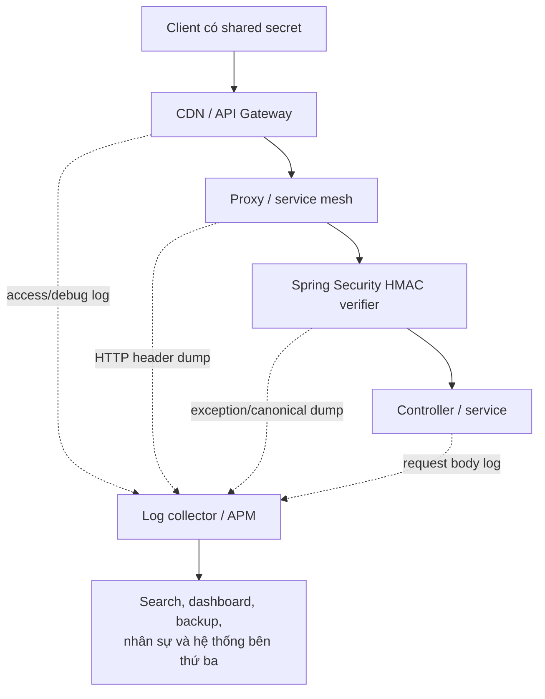

# Không log secret khi xác thực HMAC: thiết kế security logging an toàn

## 1. Tình huống thực tế: HMAC đúng nhưng bí mật lại nằm trong log

Một API xác thực HTTP request bằng **HMAC (Hash-based Message Authentication Code)** thường vận hành với shared secret do client và server cùng nắm giữ. Client xây dựng **canonical request** từ HTTP method, URI, header được chọn hoặc hash của body theo hợp đồng ký. Server sử dụng đúng secret để tính lại HMAC, đối chiếu chữ ký, kiểm tra timestamp và nonce chống replay; khi có key rotation, server chọn phiên bản key hợp lệ theo policy.

Đây là phạm vi của module `SECURITY_AUTHENTICATION_HMAC_REQUEST_AUTHENTICATION`: xác thực request có chữ ký, bảo vệ replay, tương thích proxy/gateway và tách **authentication** khỏi **authorization**.

Một lỗi phổ biến không nằm ở thuật toán HMAC mà nằm ở logging:

```java
// SAI: log key material và giá trị nhạy cảm.
log.debug("HMAC secret={} suppliedSignature={} canonical={}",
        secret, signature, canonicalRequest);
```

Dòng log ấy có thể được chuyển đến hệ thống tập trung, tồn tại trong bản sao lưu, gửi tới bên thứ ba qua observability platform, hoặc bị truy cập bởi những người không có quyền đọc kho khóa. Dù verifier dùng HMAC-SHA256 chuẩn và so sánh an toàn, việc làm lộ secret vẫn cho phép bên có được nó tạo chữ ký hợp lệ.

**Quy tắc xuyên suốt bài học: không ghi shared secret, phiên bản secret, khóa tạo HMAC, giá trị cấu hình chứa secret hoặc dữ liệu đủ để tái tạo credential vào bất kỳ loại log, trace, metric hay exception text nào.**

Không chỉ cần tránh câu lệnh `log.info("secret={}", ...)`. Phải xét toàn bộ chuỗi tiếp nhận: HTTP client, gateway, reverse proxy, servlet/WebFlux filter, thư viện cryptography, exception handler, structured logger, MDC, APM, tracing, access log và hệ thống thu thập log.

### Mục tiêu học tập

Sau bài này, người học có thể:

1. Nhận diện mọi nơi secret và dữ liệu HMAC nhạy cảm có thể bị ghi lại.
2. Phân biệt **shared secret**, **key ID**, **client signature**, **nonce** và dữ liệu trong canonical request.
3. Thiết kế sự kiện bảo mật theo **allowlist** trường được phép, không phụ thuộc một blacklist redaction duy nhất.
4. Triển khai logging an toàn trong Spring Security Servlet/MVC và Spring WebFlux.
5. Chẩn đoán chữ ký sai, replay, key rotation hoặc gateway rewrite mà không in credential.
6. Kiểm thử chống rò rỉ và có phương án ứng phó khi secret đã vào log.

## 2. Phân loại dữ liệu: không phải trường nào cũng có cùng độ nhạy cảm

Ví dụ request có chữ ký:

```http
POST /api/orders?region=vn HTTP/1.1
Host: api.example.test
Content-Type: application/json
X-Key-Id: client-42-v2
X-Request-Timestamp: 2026-11-28T03:00:00Z
X-Request-Nonce: nonce-unique-001
X-Signature: <hmac-signature-base64>

{"sku":"A-12","quantity":2}
```

Shared secret **không được truyền trực tiếp** trong request HMAC đúng thiết kế, nhưng có thể nằm trong cấu hình ứng dụng hoặc secret manager. Chữ ký HMAC cũng không phải shared secret: nó là kết quả tính từ secret và thông điệp. Tuy nhiên, chữ ký gắn với một request cụ thể và có thể bị lạm dụng để phát lại nếu anti-replay yếu hoặc môi trường chấp nhận lại nonce/timestamp. Vì vậy nên tránh log cả signature.

| Dữ liệu | Vai trò | Cách xử lý trong log |
| --- | --- | --- |
| Shared secret / HMAC key bytes | Bí mật chứng minh quyền sở hữu credential | **Tuyệt đối không log**, kể cả một phần, dưới dạng Base64/hex hoặc hash |
| Key secret của phiên bản cũ khi rotation | Vẫn là credential nhạy cảm | Không log cả khi key đã hết hạn hoặc revoked |
| Log-tag secret, encryption key, token signing key | Bí mật khác của hệ thống | Không log |
| `keyId` do client gửi | Gợi ý chọn khóa, chưa chứng minh danh tính | Không ghi raw theo mặc định; ghi trạng thái hiện diện/cú pháp |
| Key ID/credential alias từ registry đã xác minh | Metadata đã tin cậy | Có thể ghi alias hoặc pseudonym có kiểm soát |
| HMAC signature do client gửi | Bằng chứng ứng viên, có thể bị replay | Không log raw; dùng `signature_present` hoặc mã lỗi |
| Expected signature do server tính | Sản phẩm của secret và canonical bytes | Không log, không đưa vào response |
| Timestamp và nonce | Kiểm soát freshness và replay | Không log raw mặc định; dùng skew bucket và `replay_detected` |
| Canonical request đầy đủ | Có thể gồm header, URI và body hash | Không log nguyên văn; dùng version, trường đã ký và nhóm mismatch |
| Raw body hoặc JSON nghiệp vụ | Có thể có PII, tài chính, token | Không log mặc định, kể cả khi dùng request caching |
| `Authorization`, `Cookie`, `Set-Cookie` | Credential/session và dữ liệu nhạy cảm | Không dump trong request/response log |
| Route template cố định, request ID đáng tin | Phục vụ truy vết | Có thể log sau khi chuẩn hóa/validate |
| HTTP status, reason code allowlist | Kết quả xử lý | Phù hợp structured logging |
| Client IP từ `Forwarded` chưa tin cậy | Chỉ là khai báo của request | Không dùng làm danh tính xác thực; có thể nhạy cảm |

Một số dự án dùng chữ “secret” để chỉ cả API key, bearer token, mật khẩu, session cookie hoặc khóa mã hóa. Quy tắc tối thiểu của bài này bảo vệ **tất cả** giá trị ấy, không chỉ HMAC shared secret.

### Key ID không đồng nghĩa key material

`keyId` có thể công khai về mặt giao thức mà không làm lộ secret. Nhưng ID dạng `tenant-acme-prod-v2` có thể tiết lộ tên đối tác và topology vận hành. Vì thế, “không log secret” **không cho phép** tự động log mọi giá trị không phải secret. Có thể giữ một pseudonym sinh từ *stored key ID đã được xác minh* để điều tra mà không ghi tên credential raw.

### Không dùng hash của secret để “logging an toàn”

Đoạn sau không nên được coi là an toàn:

```java
// SAI: tạo fingerprint ổn định trực tiếp từ secret để ghi log.
log.info("secret_sha256={}", sha256Hex(hmacSecret));
```

Digest của secret làm tăng thông tin về credential, có thể hỗ trợ so khớp giữa hệ thống, kiểm tra secret có bị tái sử dụng hoặc thử từ điển nếu secret yếu. Muốn correlation theo credential, dùng **key ID tin cậy** được pseudonym hóa bằng khóa logging riêng hoặc alias ngẫu nhiên, **không băm chính shared secret**.

## 3. Threat model: secret rò rỉ qua những lớp nào?

Một request có thể đi qua nhiều hệ thống trước khi vào HMAC verifier.



Mỗi vị trí có failure mode riêng:

| Vị trí | Ví dụ lỗi | Kiểm soát |
| --- | --- | --- |
| Client SDK | In secret trong debug config hoặc dump signing context | Định nghĩa logger không nhận key material; kiểm thử SDK |
| Reverse proxy | Access log ghi toàn bộ `Authorization` hoặc query chứa token | Format access log allowlist, bỏ credential/URI nhạy cảm |
| Gateway plugin | Debug log header + body để điều tra `401` | Redact trước thu thập, giới hạn quyền bật debug |
| Spring security filter | Log `request.getHeader("Authorization")` | Chỉ ghi `authorization_present` và reason code |
| HMAC verifier | Log `Mac` key, expected HMAC, canonical string | Không cho key material/canonical bytes vào audit API |
| Spring MVC | `CommonsRequestLoggingFilter` bật header/payload logging | Không bật full header/body ở route nhạy cảm |
| Spring WebFlux | Reactor Netty wiretap hoặc `Flux<DataBuffer>` body dump | Tắt body/headers dump nhạy cảm, chỉ thu metadata |
| Exception handler | `log.error("verification failed", ex)` với message chứa secret | Exception type/message được kiểm soát, không echo request |
| MDC/tracing | Đẩy raw `keyId`, signature, header vào baggage | Chỉ đặt tag đáng tin/route template/request ID |
| Metrics | Metric label dùng raw `keyId` hoặc signature | Label cardinality thấp, không chứa credential |
| Support/incident ticket | Dán raw log chứa credential | Quy trình chia sẻ dữ liệu đã làm sạch |
| Backup/export | Secret có trong log cũ được giữ lại nhiều nơi | Retention, encryption, access control, incident handling |

Một nơi duy nhất ghi secret có thể làm mất ý nghĩa của mọi biện pháp mã hóa còn lại. Việc truyền log qua TLS hoặc mã hóa log lúc lưu chỉ giảm rủi ro; nó **không biến việc ghi secret vào log thành hành vi đúng**.

## 4. Nguyên tắc thiết kế: logging theo allowlist

Cách hiệu quả nhất là **chỉ tạo log event từ các trường đã duyệt trước**.

Thay vì:

```java
// SAI: lấy tất cả field rồi hy vọng redactor che hết.
log.debug("request={} headers={} body={} details={}",
        request, request.getHeaderNames(), body, verificationContext);
```

nên xây sự kiện bảo mật rõ cấu trúc:

```json
{
  "event": "hmac.authentication.rejected",
  "request_id": "req-70af",
  "service": "order-api",
  "route_template": "/api/orders",
  "http_method": "POST",
  "auth_outcome": "rejected",
  "reason_code": "signature_mismatch",
  "canonical_contract_version": "hmac-v1",
  "authorization_present": true,
  "http_status": 401
}
```

Event không có `secret`, `signature`, `authorization_value`, raw body, nonce hay canonical string. `reason_code` đến từ **tập mã lỗi cố định**, không lấy nguyên exception message hoặc header của client.

### Quy tắc dữ liệu đáng tin

- `route_template` phải lấy từ một route registry/allowlist, không tùy tiện lấy raw path/query.
- `request_id` phải do hệ thống tạo hoặc được ingress tin cậy làm sạch; giới hạn charset và length.
- `key_tag` chỉ được sinh từ key record đã xác minh; không gắn “client X” dựa trên `X-Key-Id` chưa được kiểm tra.
- `method` là một nhóm giá trị HTTP hữu hạn, nhưng với method lạ có thể log “OTHER” thay vì chuỗi client tùy ý.
- `reason_code` là enum, không phải `ex.getMessage()`.
- `http_status` là số từ response đã được quyết định; không tự suy ra status cuối cùng từ một event authentication.

### Authentication và authorization là hai loại event

Ví dụ signature hợp lệ nhưng client không có `orders:create`:

```json
{
  "event": "hmac.authentication.accepted",
  "request_id": "req-70b0",
  "verified_key_tag": "kt1:39f3d8e3e61f",
  "auth_outcome": "accepted"
}
```

```json
{
  "event": "hmac.authorization.denied",
  "request_id": "req-70b0",
  "verified_key_tag": "kt1:39f3d8e3e61f",
  "required_permission": "orders:create",
  "http_status": 403
}
```

Đây là **hai sự kiện có ý nghĩa khác nhau**. HMAC signature đúng chứng minh request thuộc credential hợp lệ theo contract, **không tự cấp quyền** trên endpoint hoặc tenant. Khi request chưa được xác thực, không gắn `verified_key_tag`.

## 5. Bộ trường logging an toàn cho HMAC

Một schema gợi ý:

| Trường | Kiểu/giá trị | Khi nào được ghi? |
| --- | --- | --- |
| `event` | Enum cố định, ví dụ `hmac.authentication.rejected` | Mọi security event |
| `timestamp` | Thời điểm do server tạo | Mọi security event |
| `request_id` | ID được kiểm soát | Mọi security event |
| `trace_id` | ID tracing hợp lệ/được kiểm soát | Khi có tracing đáng tin |
| `service` / `environment` | Cấu hình nội bộ | Mọi security event |
| `route_template` | Template từ allowlist | Khi xác định được route |
| `http_method` | Enum hoặc `OTHER` | Khi có |
| `authorization_present` | Boolean | Nhánh request chưa xác thực |
| `key_id_present` | Boolean | Nhánh request chưa xác thực |
| `canonical_contract_version` | Version được policy chọn | Khi parse contract thành công |
| `signed_header_set_id` | ID tập header theo policy | Khi cần debug canonicalization |
| `body_size_bucket` | `empty`, `small`, `medium`, `large` | Khi cần vận hành, không log body |
| `clock_skew_bucket` | Ví dụ `0-30s`, `30-120s`, `over-window` | Khi cần debug timestamp, không log nonce |
| `reason_code` | Enum từ application | Khi lỗi |
| `verified_key_tag` | Pseudonym từ stored key record | **Chỉ sau xác thực đầy đủ** |
| `auth_outcome` | `accepted` / `rejected` / `unavailable` | Khi authentication đã có kết quả |
| `authz_outcome` | `allowed` / `denied` / `not_evaluated` | Khi authorization được đánh giá |
| `http_status` | Status thực tế hoặc status dự kiến có chú thích | Khi handler đã quyết định |

Không tự đưa body hash vào log như “ẩn danh hóa body”. Hash của một giá trị ngắn, dễ đoán hoặc dữ liệu tài chính có thể trở thành fingerprint nhạy cảm; hơn nữa, nó có thể tạo thêm liên kết giữa các request. Dùng độ dài theo bucket hoặc một mã mismatch được tính nội bộ thường đã đủ.

### Vì sao không in canonical request để tìm lỗi ký?

Canonical request có thể bao gồm raw query chứa mã truy cập, header `Authorization` hoặc nội dung body nhạy cảm. Khi signature mismatch, thay vì in nguyên message ký, ghi:

```text
event=hmac.authentication.rejected
reason_code=signature_mismatch
canonical_contract_version=hmac-v1
signed_header_set_id=headers-v1
route_template=/api/orders
gateway_route_id=edge-orders
request_id=req-70af
```

Đối chiếu **test vectors không chứa dữ liệu thật**, cấu hình contract và metadata ở các hop để tìm lỗi path/query/header/body. Nếu cần thu thập thông tin chuyên sâu trong incident, phải có quy trình dữ liệu nhạy cảm riêng, giới hạn người truy cập và không dump secret vào log tiêu chuẩn.

## 6. Java: API ghi security event không nhận secret

Để giảm nguy cơ “developer tiện tay truyền secret vào logger”, có thể thiết kế một lớp chỉ chấp nhận enum, boolean và tag đã chuẩn hóa, thay vì nhận `Map<String, Object>` tùy ý.

```java
public enum HmacFailureCode {
    MISSING_CREDENTIAL,
    MALFORMED_CREDENTIAL,
    INVALID_CREDENTIAL,
    SIGNATURE_MISMATCH,
    TIMESTAMP_OUT_OF_WINDOW,
    REPLAY_DETECTED,
    KEY_STORE_UNAVAILABLE,
    NONCE_STORE_UNAVAILABLE
}

public enum ApiRoute {
    ORDERS_CREATE("/api/orders"),
    ORDERS_READ("/api/orders/{id}"),
    UNKNOWN("unknown");

    private final String template;

    ApiRoute(String template) {
        this.template = template;
    }

    public String template() {
        return template;
    }
}
```

Lớp audit logging:

```java
public final class HmacSecurityAudit {
    private static final Logger LOG =
            LoggerFactory.getLogger(HmacSecurityAudit.class);

    public void rejected(
            String trustedRequestId,
            ApiRoute route,
            boolean authorizationPresent,
            HmacFailureCode reason) {

        LOG.warn(
                "event={} request_id={} route_template={} "
              + "authorization_present={} reason_code={} auth_outcome={}",
                "hmac.authentication.rejected",
                safeRequestId(trustedRequestId),
                route.template(),
                authorizationPresent,
                reason.name().toLowerCase(Locale.ROOT),
                "rejected");
    }

    public void accepted(
            String trustedRequestId,
            ApiRoute route,
            VerifiedKeyTag keyTag) {

        LOG.info(
                "event={} request_id={} route_template={} "
              + "verified_key_tag={} auth_outcome={}",
                "hmac.authentication.accepted",
                safeRequestId(trustedRequestId),
                route.template(),
                keyTag.value(),
                "accepted");
    }

    private static String safeRequestId(String value) {
        if (value == null || !value.matches("[A-Za-z0-9_-]{1,64}")) {
            return "unavailable";
        }
        return value;
    }
}

public record VerifiedKeyTag(String value) {
    public VerifiedKeyTag {
        if (value == null
                || !value.matches("[A-Za-z0-9_-]{1,16}:[a-f0-9]{16,64}")) {
            throw new IllegalArgumentException("Invalid verified key tag");
        }
    }
}
```

Cần import `java.util.Locale`, `org.slf4j.Logger` và `org.slf4j.LoggerFactory`. Các kiểu minh họa có thể tổ chức thành file riêng trong dự án thật; trong bài học, code nhằm làm rõ interface.

**Điểm thiết kế chính:** `HmacSecurityAudit` không có tham số `SecretKey`, `byte[] sharedSecret`, `Authorization`, `HttpServletRequest` hoặc `Map` tự do. Developer khó vô tình đưa key material vào event qua API này.

Việc sử dụng placeholder `{}` của SLF4J tự nó **không che secret**. Chỉ khi đầu vào của logger là những trường đã được kiểm duyệt thì log mới an toàn.

## 7. Tạo key tag đúng cách: không dùng chính shared secret

Khi cần truy vết theo credential đã xác minh, hệ thống có thể tạo pseudonym từ **stored key ID** bằng một khóa riêng cho logging. Khóa này không phải shared secret HTTP HMAC và phải được bảo vệ theo chính sách secret manager.

Ví dụ:

```java
public final class VerifiedKeyTagFactory {

    private final byte[] loggingTagKey;

    public VerifiedKeyTagFactory(byte[] loggingTagKey) {
        if (loggingTagKey == null || loggingTagKey.length < 32) {
            throw new IllegalArgumentException("Invalid logging tag key");
        }
        this.loggingTagKey = loggingTagKey.clone();
    }

    public VerifiedKeyTag fromVerifiedStoredId(String storedKeyId) {
        Objects.requireNonNull(storedKeyId);

        try {
            Mac mac = Mac.getInstance("HmacSHA256");
            mac.init(new SecretKeySpec(loggingTagKey, "HmacSHA256"));

            // Tách domain: không dùng cùng output cho dữ liệu khác.
            byte[] digest = mac.doFinal(
                    ("security-log-key-id:v1:" + storedKeyId)
                        .getBytes(StandardCharsets.UTF_8));

            // 16 bytes (128 bits) đầu; không cần in toàn digest.
            String hex = HexFormat.of().formatHex(digest, 0, 16);
            return new VerifiedKeyTag("kt1:" + hex);
        } catch (GeneralSecurityException ex) {
            // Exception công khai không chứa key ID hay secret.
            throw new IllegalStateException("Cannot create key tag");
        }
    }
}
```

Import cần thiết: `java.nio.charset.StandardCharsets`, `java.security.GeneralSecurityException`, `java.util.HexFormat`, `java.util.Objects`, `javax.crypto.Mac`, `javax.crypto.spec.SecretKeySpec`.

Các điểm bắt buộc:

- `storedKeyId` phải đến từ credential registry **sau khi** HMAC, timestamp và nonce được xác minh; không lấy trực tiếp raw `X-Key-Id` ở nhánh thất bại.
- `loggingTagKey` là secret độc lập với HTTP HMAC key và không được log, không hard-code.
- Tag có prefix phiên bản cho phép lập kế hoạch rotate khóa pseudonymization; rotation của tag key sẽ thay đổi tag nếu không có mapping riêng.
- Không in `storedKeyId` trong exception khi factory lỗi.
- Nếu không cần correlation theo key, **đơn giản nhất là không ghi key tag**.

Tạo tag không phải bằng chứng xác thực tự thân. Chỉ quy trình verifier đầy đủ mới cho phép gắn nhãn `verified` vào event.

## 8. Spring Security Servlet/MVC: log đúng sau xác thực

Trong hệ Servlet với Spring Security 6, HMAC thường được triển khai bằng custom `OncePerRequestFilter` đặt ở vị trí thích hợp trong `SecurityFilterChain`. Filter phải chặn credential không hợp lệ **trước khi** controller chạy; lỗi HMAC trong filter có thể cần được chuyển thẳng đến `AuthenticationEntryPoint`.

Hợp đồng verifier trả kết quả tin cậy:

```java
public record HmacVerifiedRequest(
        Authentication authentication,
        HttpServletRequest requestForChain,
        String storedKeyId) {
}

@FunctionalInterface
public interface HmacRequestVerifier {
    HmacVerifiedRequest verify(HttpServletRequest request)
            throws AuthenticationException;
}
```

Nếu verifier đọc body để tính chữ ký, `requestForChain` phải là request còn đọc được đúng body đã ký (ví dụ request wrapper phát lại bytes có giới hạn). `storedKeyId` chỉ được trả từ key record đáng tin sau khi signature, timestamp, nonce và key state đều hợp lệ.

Ví dụ nhánh filter:

```java
public final class HmacAuthenticationFilter
        extends OncePerRequestFilter {

    private final HmacRequestVerifier verifier;
    private final AuthenticationEntryPoint entryPoint;
    private final HmacSecurityAudit audit;
    private final VerifiedKeyTagFactory tagFactory;

    // Constructor nhận bốn dependency.

    @Override
    protected void doFilterInternal(
            HttpServletRequest request,
            HttpServletResponse response,
            FilterChain chain) throws ServletException, IOException {

        String requestId = trustedOrGeneratedRequestId(request);
        ApiRoute route = routeFromAllowlist(request);

        final HmacVerifiedRequest verified;
        try {
            verified = verifier.verify(request);
        } catch (AuthenticationException ex) {
            audit.rejected(
                    requestId,
                    route,
                    request.getHeader("Authorization") != null,
                    HmacFailureCode.INVALID_CREDENTIAL);

            SecurityContextHolder.clearContext();
            entryPoint.commence(request, response, ex);
            return; // Không đi tiếp khi chữ ký sai hoặc thiếu.
        }

        // Fail closed nếu verifier vi phạm hợp đồng nội bộ.
        if (verified == null
                || verified.authentication() == null
                || !verified.authentication().isAuthenticated()
                || verified.requestForChain() == null
                || verified.storedKeyId() == null) {
            SecurityContextHolder.clearContext();
            throw new ServletException("Invalid verifier result");
        }

        SecurityContext context = SecurityContextHolder.createEmptyContext();
        context.setAuthentication(verified.authentication());
        SecurityContextHolder.setContext(context);

        VerifiedKeyTag tag =
                tagFactory.fromVerifiedStoredId(verified.storedKeyId());
        audit.accepted(requestId, route, tag);

        // Không đặt chain.doFilter trong catch(AuthenticationException).
        chain.doFilter(verified.requestForChain(), response);
    }

    private String trustedOrGeneratedRequestId(HttpServletRequest request) {
        // Trả ID do trusted ingress hoặc ứng dụng tạo; validate tại nguồn.
        return (String) request.getAttribute("trustedRequestId");
    }

    private ApiRoute routeFromAllowlist(HttpServletRequest request) {
        // Ví dụ: mapping an toàn theo route đã công bố.
        return "/api/orders".equals(request.getServletPath())
                ? ApiRoute.ORDERS_CREATE
                : ApiRoute.UNKNOWN;
    }
}
```

Ví dụ minh họa, không phải một lớp standalone; các import, constructor và implementation verifier phải được cung cấp. `HmacRequestVerifier` trong hệ thật còn phải phân loại outage key/nonce store riêng, không catch rộng để biến lỗi hạ tầng thành credential sai. Không ghi `ex.getMessage()`, `ex` hoặc stack trace của ngoại lệ từ parser/secret store trong auth failure log nếu chưa chắc chúng không chứa raw input hoặc cấu hình.

### 8.1. Không ghi body từ ContentCachingRequestWrapper

`ContentCachingRequestWrapper` có thể cache những byte đã được đọc qua wrapper, thường dùng cho logging. Nhưng trong API HMAC, body có thể chứa thông tin cá nhân, dữ liệu tài chính hoặc credential nghiệp vụ. Không vì dễ dùng `getContentAsByteArray()` mà in toàn bộ body:

```java
// SAI: đưa raw request body vào log.
log.debug("requestBody={}",
        new String(wrapper.getContentAsByteArray(), UTF_8));
```

Ngoài rủi ro dữ liệu, `ContentCachingRequestWrapper` không tự rewind stream đã bị verifier đọc để controller dùng lại. Khi HMAC ký body, cần wrapper phát lại đúng bytes sau xác minh và giới hạn size. Logging có thể ghi `body_size_bucket` thay vì bytes.

### 8.2. MDC và kết thúc request

MDC (Mapped Diagnostic Context) thường dựa trên thread ở hệ Servlet. Nếu thêm `request_id` và `verified_key_tag`, phải cleanup:

```java
try (MDC.MDCCloseable requestTag =
             MDC.putCloseable("request_id", safeRequestId);
     MDC.MDCCloseable keyTag =
             MDC.putCloseable("verified_key_tag", verifiedKeyTag)) {

    chain.doFilter(requestForChain, response);
}
```

Mã là ví dụ hậu xác thực; `safeRequestId` và `verifiedKeyTag` là chuỗi đã chuẩn hóa. Không đặt shared secret hoặc Authorization vào MDC. Với async servlet/executor, cần cơ chế propagation và cleanup đúng vòng đời; đừng giả định MDC thread tự lan truyền.

## 9. Spring WebFlux: logging trong Reactor Context, không dump Flux<DataBuffer>

Spring WebFlux dùng `SecurityWebFilterChain`, `AuthenticationWebFilter` và `ReactiveAuthenticationManager`. Principal đã xác minh được truyền trong Reactor Context, không phụ thuộc một `ThreadLocal` cố định.

Trường hợp dùng HMAC ký body, verifier cần xử lý `Flux<DataBuffer>` có giới hạn và phát lại bytes cho handler sau khi xác minh. **Đọc body để logging** sẽ tiêu thụ publisher và có thể phá luồng xác thực hoặc làm handler không đọc được body. Nếu body sử dụng pooled buffer, việc giữ hoặc log nó còn gây leak/chi phí bộ nhớ.

Một manager có thể ghi event hậu xác thực bằng Reactor operator:

```java
public Mono<Authentication> authenticate(Authentication candidate) {
    HmacEvidence evidence = extractEvidence(candidate);

    return verifier.verify(evidence)
            .switchIfEmpty(Mono.error(
                    new BadCredentialsException("Invalid HMAC credential")))
            .map(verified -> {
                Authentication auth =
                        UsernamePasswordAuthenticationToken.authenticated(
                                verified.principal(),
                                null,
                                verified.authorities());
                return new VerifiedAuthentication(
                        auth, verified.storedKeyId());
            })
            .doOnNext(result -> audit.accepted(
                    trustedRequestIdFromEvidence(evidence),
                    routeFromEvidence(evidence),
                    tagFactory.fromVerifiedStoredId(result.storedKeyId())))
            .map(VerifiedAuthentication::authentication);
}
```

Ở đây `VerifiedAuthentication` là record do ứng dụng định nghĩa chứa `Authentication` và stored key ID tin cậy; `HmacEvidence` là credential được trích xuất. Các helper chỉ được trả request ID/route đã qua chính sách cho phép. Code minh họa cơ chế compose, không phải implementation verifier đầy đủ.

Điều quan trọng:

- Chỉ log `accepted` sau khi verifier đã hoàn tất HMAC, timestamp, nonce atomic và key-state check.
- Không `block()` hoặc tự `subscribe()` để ghi log; điều đó có thể làm mất error propagation hoặc chạy tác vụ ngoài request lifecycle.
- `doOnNext` là side effect theo subscription; khi một chuỗi bị subscribe lại, audit event có thể lặp. Thiết kế idempotency cho event và không đặt `retry()` tùy tiện quanh nonce reservation.
- Không log raw `ServerWebExchange`, `ServerHttpRequest`, headers hay `DataBuffer`.
- Logging backend ghi mạng đồng bộ có thể block event-loop; dùng backend/queue phù hợp, timeout và chính sách tải.
- Nếu dùng MDC với Reactor, cần cấu hình propagation có kiểm thử; không tự suy ra dữ liệu của request từ MDC trên thread hiện tại.

## 10. Lỗi khi dùng exception và stack trace làm kênh logging

Các đoạn sau tiềm ẩn lộ credential:

```java
// SAI: exception từ SDK hoặc parser có thể chứa input nhạy cảm.
log.error("HMAC verification failed: {}", ex.getMessage());
log.error("Key lookup failed", ex);

// SAI: đưa nguyên cấu hình hoặc object vào toString().
log.debug("securityConfig={}", configuration);
log.trace("request={}", request);
```

Không có nghĩa là phải cấm mọi stack trace. Stack trace có thể hữu ích cho lỗi vận hành, **nếu** các exception type và message trong chuỗi đã được audit, không chứa raw headers, key material hoặc canonical request. Với một thư viện không kiểm soát được message, log reason code và correlation ID; lưu stack trace nhạy cảm qua quy trình incident riêng nếu thật sự cần.

### 10.1. Nhóm lỗi bảo mật thay cho message động

Một bảng reason code có thể gồm:

| `reason_code` | Ý nghĩa | HTTP response điển hình |
| --- | --- | --- |
| `missing_credential` | Thiếu header credential bắt buộc | `401` |
| `malformed_credential` | Định dạng auth header không hợp lệ | `400` hoặc `401` theo hợp đồng |
| `invalid_credential` | Sai key/signature, không tiết lộ lý do công khai | `401` |
| `signature_mismatch` | HMAC không khớp | `401` |
| `timestamp_out_of_window` | Vượt cửa sổ freshness | Thường `401` |
| `replay_detected` | Nonce đã được dùng | Thường `401` |
| `key_store_unavailable` | Không thể tra key an toàn | `503` hoặc `5xx` phù hợp |
| `nonce_store_unavailable` | Không thể bảo đảm anti-replay | `503` hoặc `5xx` phù hợp |
| `insufficient_authority` | Authenticated principal thiếu quyền | `403` |

Response public có thể gom các lý do authentication thành thông điệp chung “Unauthorized”, nhưng log nội bộ giữ mã để điều tra. Không gửi expected signature, canonical body hoặc trạng thái key tồn tại/revoked qua lỗi `401`.

### 10.2. Fail closed với outage, không biến thành auth accepted

Khi key store hoặc nonce store mất kết nối, hệ thống phải từ chối request thay vì bỏ qua kiểm tra. **Logging failure không phải lý do để fail open authentication**. Với audit pháp lý bắt buộc, chính sách có thể yêu cầu không thực thi giao dịch nếu audit sink không ghi nhận được; quyết định này phải được thiết kế riêng. Đối với application log không bắt buộc, mất log không nhất thiết nên khiến mọi request an toàn bị từ chối, nhưng không được làm thay đổi xác minh HMAC.

## 11. Rủi ro ở cấu hình logging và thư viện quan sát

Không đủ kiểm soát code `log.info(...)` nếu hạ tầng hoặc thư viện tự ghi request/response.

### 11.1. Spring Boot và logging level

Một cấu hình tham khảo:

```yaml
logging:
  level:
    root: INFO
    org.springframework.security: INFO
    org.springframework.web: INFO
    reactor.netty: INFO
```

Đây chỉ là ví dụ để giảm độ ồn. Không có mức log nào tự bảo đảm bí mật: một dòng `INFO` sai vẫn có thể lộ secret, còn một thư viện có thể bật header dump thông qua cơ chế độc lập với logging level. **Không dùng `TRACE`/wiretap toàn bộ traffic production để debug lỗi HMAC**.

Đặc biệt kiểm tra các cấu hình sau:

- `CommonsRequestLoggingFilter`, `AbstractRequestLoggingFilter` và các thư viện HTTP logging: đừng bật `includeHeaders`/`includePayload` trên route nhạy cảm mà không có policy lọc chặt.
- Filter log request/response tự viết: không tuần tự hóa toàn bộ `HttpServletRequest`, `ServerWebExchange` hoặc body.
- Reactor Netty wiretap: có chế độ ghi chi tiết traffic; cân nhắc vô hiệu hóa trên production hoặc bảo đảm không in credential/payload.
- HTTP client interceptors và SDK retry: không dump outgoing `Authorization`, signature hay config key.
- Reverse proxy access log: không đưa toàn bộ query/header/body vào format.
- OpenTelemetry/APM: hạn chế HTTP request/response header capture, baggage, span attributes và exception events có dữ liệu nhạy cảm.
- Error tracking: scrub request payload, breadcrumbs, stack variables và environment config trước khi xuất sang nền tảng ngoài.

### 11.2. Environment variables và secret manager

Một lỗi nghiêm trọng:

```java
// SAI: lộ thông tin cấu hình, có thể chứa nhiều credential.
log.info("environment={}", System.getenv());
log.info("hmacConfig={}", hmacConfig);
```

Không log object cấu hình có `toString()` tự sinh từ record/Lombok nếu object chứa `sharedSecret`. Cân nhắc định nghĩa `toString()` an toàn hoặc không dùng nó trong logging; tránh ghi raw secret trong exception, startup diagnostics, health endpoint hoặc actuator info.

Secret manager được dùng để cấp khóa và rotation; log chỉ trạng thái hệ thống như `key_provider=internal_vault` hoặc `key_cache_refresh=success` nếu những metadata đó an toàn, tuyệt đối không log giá trị secret nhận được.

## 12. Gateway/proxy, forwarding headers và secret trong access logs

Khi client ký canonical request ở public URL nhưng service xác minh sau gateway rewrite, lỗi HMAC có thể xuất hiện vì method, URI, query, host/header hoặc body bị biến đổi. Để debug, **không cần in raw canonical request**.

Ví dụ client ký:

```text
POST https://api.example.test/v1/orders?region=vn
```

Gateway chuyển sang:

```text
POST http://orders-service:8080/internal/orders?region=vn
```

Nếu contract ký public URI, server phải có cách tin cậy để lấy đúng public path/query hoặc xác minh HMAC ở edge trước rewrite. `Forwarded`/`X-Forwarded-*` có thể giúp diễn giải scheme/host, nhưng không mặc nhiên phục hồi raw original path và có thể bị client spoof nếu ingress không lọc.

Log gợi ý khi mismatch:

```json
{
  "event": "hmac.authentication.rejected",
  "request_id": "req-a911",
  "route_template": "/api/orders",
  "trusted_gateway_id": "edge-a",
  "canonical_contract_version": "hmac-v1",
  "signed_header_set_id": "v1-default",
  "reason_code": "signature_mismatch",
  "http_status": 401
}
```

`trusted_gateway_id` phải đến từ kênh trusted ingress/mTLS hoặc policy mạng, không từ raw `X-Gateway-ID` do client khai. Log theo request ID và version contract đủ để đối chiếu với gateway config và **test vectors giả lập**.

Đồng thời, cần tắt các tuyến rò rỉ thứ cấp:

- Access log không ghi `Authorization` hoặc `X-Signature`.
- Không log `X-Original-URI` nguyên văn nếu query có token.
- Không dump body ở gateway để điều tra Content-Encoding mismatch.
- Không chuyển đầy đủ `Forwarded` hoặc `X-Forwarded-For` vào log nếu không cần và chưa xác định dữ liệu cá nhân.
- Ghi route ID/template nội bộ, không gắn nguyên path/query thành metric label.

Nếu gateway là nơi **tự xác minh HMAC**, nó cũng phải áp dụng cùng chính sách không log secret; identity truyền tới service cần được chứng thực, không chỉ gửi header dễ giả mạo.

## 13. Timestamp, nonce, key rotation: điều tra mà không in secret

### 13.1. Replay

Nonce cần được quản lý theo credential/client phù hợp và đánh dấu dùng một lần bằng thao tác atomic, nếu không hai request đồng thời có thể cùng vượt qua. Một request có chữ ký HMAC hợp lệ nhưng nonce bị phát lại **không phải authentication accepted**.

Ví dụ log:

```json
{
  "event": "hmac.authentication.rejected",
  "request_id": "req-r2",
  "reason_code": "replay_detected",
  "clock_skew_bucket": "0-30s",
  "http_status": 401
}
```

Không in nonce raw hoặc toàn bộ canonical string để tìm request giống nhau. Muốn truy vết, dùng request ID/trace ID hoặc thông tin stored-key đã được xác minh theo chính sách; không coi key ID do attacker gửi là identity chắc chắn.

### 13.2. Key rotation

Trong giai đoạn rotation, key cũ và mới có thể cùng hợp lệ trong khoảng overlap do server định nghĩa. Quan sát “key v1 còn được dùng bao nhiêu?” cần log **key version tag** đã tin cậy, không log key material.

Có thể ghi:

```json
{
  "event": "hmac.authentication.accepted",
  "request_id": "req-r3",
  "verified_client_tag": "ct1:example",
  "verified_key_tag": "kt1:example",
  "key_lifecycle_state": "rotation_overlap"
}
```

Các tag trên là minh họa. Không đưa trạng thái key active/revoked chi tiết vào response công khai. Khi một key bị revoke, request dùng nó phải bị từ chối; không thể có sự kiện accepted theo policy nếu verifier vẫn chấp nhận key revoked.

### 13.3. Chống oracle qua log và metric public

Kể cả log không chứa secret, nếu một dashboard công khai cho phép xem “key ID này tồn tại”, nó có thể trở thành một credential enumeration oracle. Hạn chế quyền xem event chi tiết, tránh trả lý do phân biệt unknown key và signature mismatch cho client, và dùng metric tổng hợp ít cardinality.

## 14. Test chống rò rỉ: cần kiểm tra cả content lẫn đường thất bại

Một bộ test đúng phải chứng minh rằng cả request thành công, thất bại, outage và gateway mismatch **không** ghi secret. Test bằng fake secret/sentinel, không dùng credential production.

| Trường hợp | Yêu cầu log |
| --- | --- |
| HMAC hợp lệ, nonce mới, key active | Event accepted với verified tag; không chứa secret/signature/body |
| Thiếu chữ ký hoặc key ID | Event rejected với `key_id_present`/reason; không dump header |
| HMAC sai, client dùng key ID giả | Không khẳng định danh tính của chủ key ID |
| Timestamp ngoài cửa sổ | Reason code, có thể skew bucket; không log raw nonce |
| Nonce replay | Rejected; không có accepted event cho lần replay |
| Key revoked/rotation overlap | Chỉ log lifecycle state/tag, không log phiên bản secret |
| HMAC đúng nhưng thiếu authority | Auth accepted riêng, authz denied/403 riêng |
| Key/nonce store ngừng hoạt động | Fail closed; reason vận hành, không in exception chứa cấu hình |
| Body JSON có token/password | Không in body, kể cả khi dùng `ContentCachingRequestWrapper` |
| Header chứa CR/LF hoặc Unicode control | Không tạo log injection |
| Gateway rewrite host/path | Ghi route/template + contract version, không dump raw URI nhạy cảm |
| WebFlux publisher bị cancel/retry | Không giữ body trong log; không ghi nhầm accepted nhiều lần |
| Log backend bị chậm | Không block event-loop quá mức, không bypass authentication |
| MDC/reactor context chuyển thread | Không gắn tag của request khác |
| Tracing và proxy access log | Không capture credential/header/body bị cấm |
| Heap dump/support ticket | Có quy trình bảo vệ ngoài application logging |

### 14.1. Unit test cho audit logger với fake secret

Giả sử test dùng Logback `ListAppender<ILoggingEvent>` hoặc một test sink để thu các sự kiện của `HmacSecurityAudit`. Test không được dựa vào việc “secret tình cờ không xuất hiện trong câu log hiện tại”; nên có các sentinel dễ nhận diện để phát hiện regression.

```java
String fakeSharedSecret = "TEST-ONLY-SECRET-DO-NOT-LOG-7654";
String fakeSignature = "TEST-ONLY-SIGNATURE-1122";
String fakeBody = "{\"token\":\"TEST-ONLY-TOKEN-9090\"}";

// Đưa các sentinel vào fake verifier/request test fixture.
// Kích hoạt đủ các nhánh success, wrong signature, replay, outage.

String capturedLog = testLogSink.allText();
assertFalse(capturedLog.contains(fakeSharedSecret));
assertFalse(capturedLog.contains(fakeSignature));
assertFalse(capturedLog.contains("TEST-ONLY-TOKEN-9090"));
assertFalse(capturedLog.contains("Authorization:"));
assertTrue(capturedLog.contains("reason_code="));
```

Đây là pseudocode cho test fixture; `testLogSink` là helper do dự án xây dựng. Có thể mở rộng test với secret ở dạng Base64, hex, URL-encoded và exception message; không dùng các phép kiểm tra này làm lý do được phép log trước rồi redaction.

### 14.2. Unit test cho API audit theo allowlist

```java
HmacSecurityAudit audit = new HmacSecurityAudit();

// Fake keyId do attacker gửi chỉ nên được diễn giải
// là metadata chưa được xác minh; KHÔNG truyền vào audit.
audit.rejected("req-22", ApiRoute.ORDERS_CREATE,
        true, HmacFailureCode.INVALID_CREDENTIAL);

// Kiểm tra captured log chỉ có reason, route template,
// boolean và request ID đúng policy.
assertNoSensitiveFields(testLogSink.events());
```

Không nhất thiết phải mô phỏng một shared secret thật để kiểm tra cấu trúc log. Kiểm tra test sink không ghi `X-Signature` hoặc raw `Authorization` là tiêu chí quan trọng.

### 14.3. Integration test qua security chain

Với Spring MVC, dùng `MockMvc` có Spring Security filters; với WebFlux, dùng `WebTestClient`. Một request có HMAC giả phải nhận `401`, controller/service không chạy và captured log không chứa credential. Một request HMAC hợp lệ nhưng thiếu quyền phải nhận `403`, không log secret, đồng thời có thể quan sát một accepted auth event và một denied authorization event.

Đừng tắt security filters khi test. Đối với gateway, test end-to-end qua proxy staging cần quan sát cả access log/tracing config; unit test Java **không tự chứng minh** gateway hay APM đã scrub credential.

## 15. Khi phát hiện secret đã xuất hiện trong log

Đây không còn là vấn đề định dạng log; nó là một **security incident** cần xử lý theo quy trình của tổ chức.

Các bước trọng tâm:

1. **Giảm rò rỉ tiếp diễn:** vô hiệu hóa đường ghi secret ngay lập tức bằng thay đổi logging/config phù hợp, không copy secret sang log mới để điều tra.
2. **Xác định phạm vi:** secret nào, credential/client nào, môi trường nào, thời gian nào, log collector/backup/export/ticket nào đã nhận dữ liệu. Hạn chế người xem.
3. **Rotate hoặc revoke credential bị lộ:** cấp key mới theo quy trình tin cậy, cập nhật client, kiểm soát overlap và thời điểm thu hồi key cũ. Đừng giả định xóa log là đủ.
4. **Điều tra truy cập và dấu hiệu lạm dụng:** tìm request bất thường qua request ID, verified key tag, thời gian và audit event, không cần lặp lại secret trong báo cáo.
5. **Xử lý dữ liệu tồn dư:** giới hạn quyền, xóa/expire theo cơ chế hệ thống và policy, xem xét backup/retention; ghi lại quyết định về điều tra và nghĩa vụ thông báo nếu áp dụng.
6. **Ngăn tái diễn:** bổ sung automated tests, logging allowlist, kiểm soát APM/gateway và review code/secret handling.

Lưu ý: nếu có bằng chứng một secret từng được ghi vào log, không thể kết luận nó “an toàn” chỉ vì log đã bị xóa ở một nơi. Secret có thể đã được nhân bản sang hệ thống thu thập, snapshot hoặc bản sao lưu. **Rotation/revocation** là biện pháp quyết định để giảm khả năng ký request trái phép bằng secret đã lộ.

## 16. Bài thực hành: thiết kế logging an toàn cho signed orders API

Cho ứng dụng Spring Boot bảo vệ `POST /api/orders` bằng HMAC-SHA256. Client gửi `X-Key-Id`, timestamp, nonce, signature; canonical request gồm method, URI, `Content-Type` và SHA-256 raw JSON body. Server quản lý key rotation, lưu nonce atomic, có gateway rewrite path và dùng Spring Security phân quyền `orders:create`.

Hãy triển khai:

1. Viết HMAC verifier chỉ đọc secret từ kho bảo vệ và **không** log secret, key bytes, expected signature hay full canonical request.
2. Thiết kế `HmacSecurityAudit` theo allowlist `event`, `request_id`, `route_template`, `reason_code`, `auth_outcome`; không cho event API nhận raw headers/body/secret.
3. Khi signature, timestamp, nonce và key state đều hợp lệ, tạo `verified_key_tag` từ stored key ID bằng khóa logging riêng; trước đó chỉ ghi credential presence/format.
4. Tách audit xác thực với audit phân quyền. HMAC đúng nhưng thiếu `orders:create` phải là `403`, không biến thành sự kiện “credential sai”.
5. Kiểm tra Spring MVC filter, WebFlux reactive pipeline, reverse proxy và APM để loại bỏ các đường dump headers/body.
6. Dùng fake secret và sentinel trong unit/integration test; kiểm tra captured log trong các nhánh success, fail, replay, rotation, outage và proxy canonical mismatch.
7. Cấu hình metric ít cardinality, log retention/access control và quy trình xử lý incident nếu credential từng bị ghi vào log.
8. Chứng minh không có bypass HMAC/anti-replay khi logging sink lỗi hoặc chậm, đồng thời tránh block event-loop.

**Tiêu chí hoàn thành:** Không một nhánh xác thực, phân quyền, debug, exception, gateway hay observability nào ghi shared secret, phiên bản secret, expected signature hoặc raw credential nhạy cảm; event bảo mật dùng allowlist và phân biệt key ID chưa/đã xác minh; vẫn điều tra được lỗi canonicalization, timestamp/nonce, key rotation và permission qua request ID, reason code, version và verified tag an toàn. Nhờ đó logging phục vụ vận hành mà không phá vỡ chính cơ chế HMAC đang bảo vệ API.
