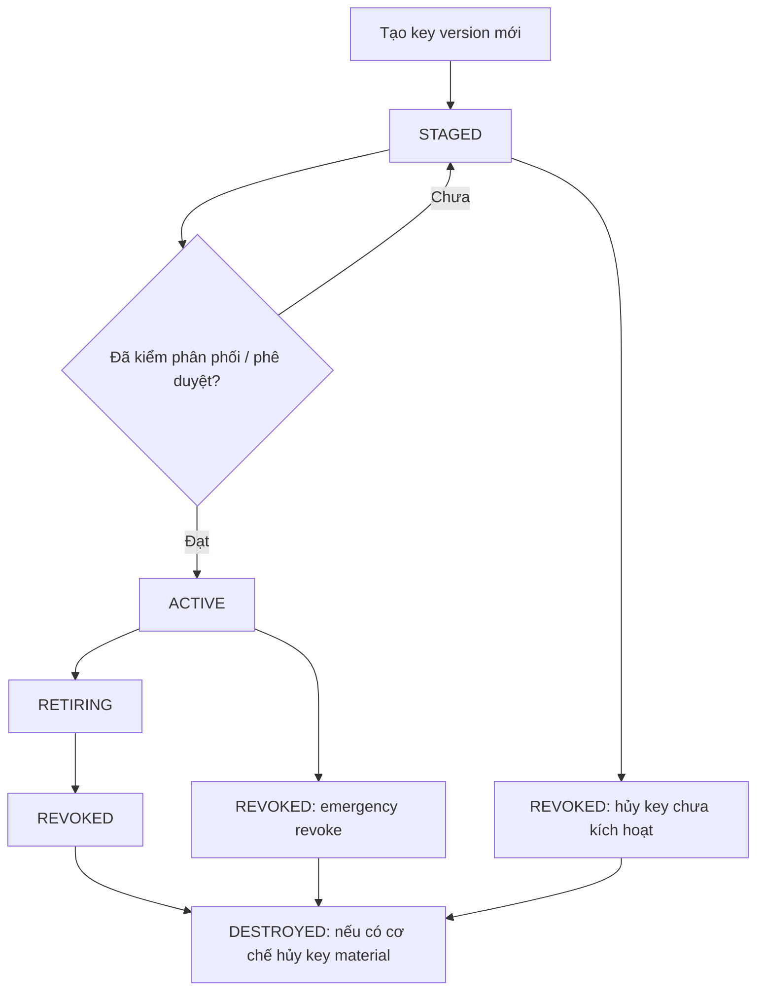
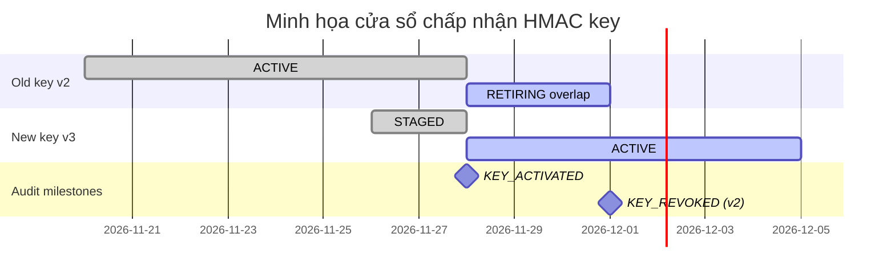
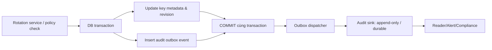
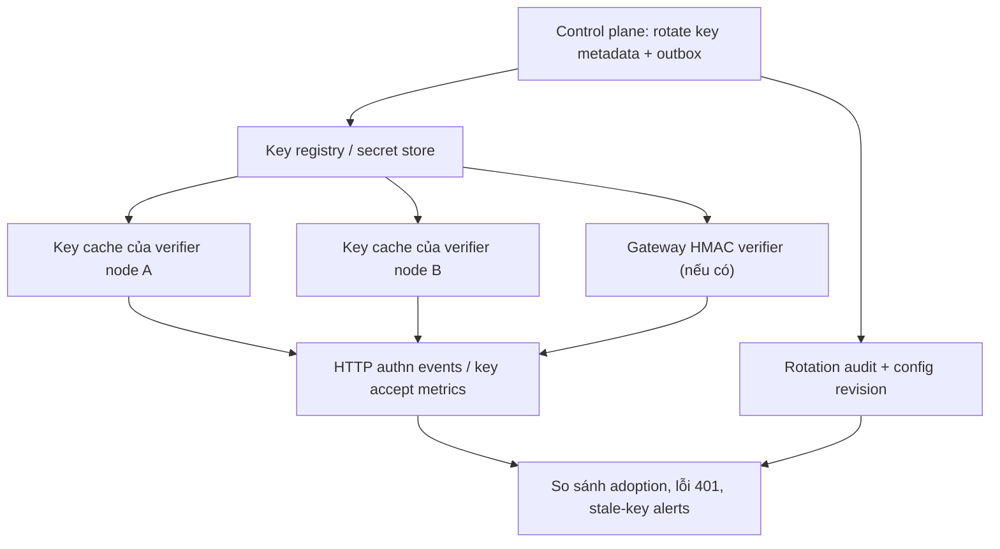

# Audit rotation: kiểm toán vòng đời và thay đổi khóa HMAC

## 1. Audit rotation giải quyết vấn đề gì?

Trong module `SECURITY_AUTHENTICATION_HMAC_REQUEST_AUTHENTICATION`, client xác thực HTTP request bằng **HMAC với shared secret**. Chữ ký được tính trên **canonical request** theo hợp đồng thống nhất giữa client và server: method, URI/query, header và/hoặc digest của body. Verifier còn phải kiểm timestamp/nonce chống replay, trạng thái key, chính sách key rotation, các biến đổi từ proxy/gateway và quyền của client sau khi xác thực.

Shared secret có vòng đời: được cấp phát, phân phối an toàn, kích hoạt, thay thế, ngừng chấp nhận và thu hồi. Một lần **rotation** không chỉ là “đổi giá trị secret” trong cấu hình. Đây là một **thay đổi bảo mật có tác động đến request đang chạy**, nhiều service/client, cache, gateway và đôi khi cả các tenant khác nhau. Nếu không có audit trail, nhóm vận hành rất khó trả lời:

- Ai yêu cầu và ai phê duyệt việc xoay key? Thay đổi nào đã thực sự được áp dụng?
- Key nào được kích hoạt, key nào bắt đầu ngừng sử dụng, key nào đã bị thu hồi?
- Thời điểm có hiệu lực và cửa sổ chấp nhận key cũ/mới là gì?
- Vì sao tỷ lệ `401` tăng ngay sau một đợt rotation?
- Có key bị kích hoạt ngoài quy trình hoặc được chấp nhận sau khi đã bị revoke không?
- Khi một node/gateway cập nhật chậm, audit nào giúp tìm đúng thay đổi gây lỗi?

**Audit rotation** là việc tạo lịch sử kiểm toán **có cấu trúc, có thể truy vết và được bảo vệ** cho quá trình thay đổi vòng đời HMAC key. Nó khác với **log rotation** (xoay file log, thay file khi đầy): log rotation là việc quản lý nơi lưu log, còn audit rotation ở đây ghi nhận những thay đổi key/secret. Hai chủ đề có liên quan đến retention và độ bền lưu trữ, nhưng không được nhầm lẫn.

Bài thuộc chương **Security logging**, với chủ đề **Audit rotation**. Sau bài học, người học có thể:

1. Mô tả state machine của HMAC key và các sự kiện audit tương ứng.
2. Tách audit **key lifecycle** khỏi log từng lần xác thực HTTP và khỏi authorization denial.
3. Thiết kế schema audit không rò shared secret, raw signature hoặc dữ liệu được ký.
4. Ghi audit và cập nhật metadata key nhất quán bằng transaction/outbox.
5. Theo dõi rotation nhiều instance/client/gateway, xử lý rollback và emergency revoke.
6. Kiểm thử khả năng truy vết, tính đầy đủ, chống log giả và tác động lên xác thực/replay.

> **Phạm vi:** Ví dụ dùng Java và Spring Security theo phong cách Spring Boot 3.x/Spring Security 6.x. Trạng thái key, thời gian chấp nhận và yêu cầu phê duyệt dưới đây là **một mô hình minh họa**; sản phẩm thực tế phải xác lập chính sách quản lý key riêng. Không có `SPECIAL_NOTE` bổ sung cho bài này.

## 2. Phân biệt ba loại sự kiện trong hệ thống HMAC

Một ứng dụng có thể phát ba loại sự kiện khác nhau trong cùng một lần thay key:

| Nhóm sự kiện | Khi nào phát | Câu hỏi được trả lời |
| --- | --- | --- |
| **Rotation/lifecycle audit** | Thay đổi trạng thái, lịch chấp nhận hoặc policy của key | Ai đổi key nào, từ trạng thái nào sang trạng thái nào, khi nào, vì lý do gì? |
| **Authentication event** | Mỗi lần verifier kết luận chữ ký HMAC được chấp nhận/từ chối/lỗi | Request này có key, canonical request, timestamp và nonce hợp lệ không? |
| **Authorization event** | Sau khi đã xác thực, kiểm quyền endpoint/tenant/resource | Danh tính đã xác thực có được phép thực hiện hành động này không? |

Ví dụ:

```text
2026-11-28 02:00 UTC  KEY_ACTIVATED          key_ref=key_v3
2026-11-28 02:00 UTC  KEY_RETIREMENT_STARTED key_ref=key_v2
2026-11-28 02:05 UTC  HMAC_AUTHN_SUCCEEDED   key_family_ref=fam_7d...
2026-11-28 02:05 UTC  AUTHZ_DENIED          policy_id=PAYMENT_CREATE
2026-11-28 04:00 UTC  KEY_REVOKED           key_ref=key_v2
```

Các dòng trên là minh họa **diễn biến và mã sự kiện**, không phải format log bắt buộc. Rotation audit được ghi **một lần cho một thay đổi trạng thái có hiệu lực**, không ghi lại toàn bộ sự kiện rotation trên từng request HTTP. Ngược lại, authentication event có thể ghi thống kê key family/version đã được xác minh mà không dump key material.

Khi một request HMAC hợp lệ nhưng client thiếu authority, kết quả là **authentication success và authorization denial (thường HTTP 403)**. Không gán lỗi này cho key rotation chỉ vì nó xảy ra trong cùng thời điểm. Khi một request có chữ ký sai hoặc key bị thu hồi, đây là thất bại xác thực (**thường HTTP 401**), và rotation audit giúp giải thích thay đổi key liên quan.

## 3. Mô hình vòng đời key có thể kiểm toán

### 3.1. Trạng thái key và ranh giới chấp nhận

Một hệ thống có thể dùng các trạng thái:

| Trạng thái | Ý nghĩa | Verifier có chấp nhận để xác minh request mới? |
| --- | --- | --- |
| `STAGED` | Key version đã được tạo và phân phối theo quy trình nhưng chưa được phép dùng | **Không**, trừ một chế độ thử nghiệm được tách biệt và định nghĩa rõ |
| `ACTIVE` | Key được phép dùng theo policy hiện tại | **Có**, sau khi mọi kiểm tra HMAC/freshness/scope đều qua |
| `RETIRING` | Key cũ đang trong giai đoạn chuyển tiếp, có deadline ngừng chấp nhận | **Có thể có**, chỉ trong khoảng và phạm vi được quy định |
| `REVOKED` | Key đã bị thu hồi, không được chấp nhận | **Không** |
| `DESTROYED` (tùy thiết kế) | Key material đã được hủy/khóa vĩnh viễn theo quy trình | **Không**; metadata/audit cần được lưu theo retention policy |

**Không coi `RETIRING` đồng nghĩa được phép sử dụng vô hạn.** Verifier phải kiểm thời gian có hiệu lực, thời hạn `acceptUntil`, trạng thái revoke, key owner/scope và phiên bản chính sách. Audit phải nêu rõ lúc nào key cũ không còn được chấp nhận, không chỉ có dòng “đã rotate”.



Mỗi mũi tên thay đổi trạng thái nên có ít nhất: **actor đã được xác thực**, quyền/phê duyệt, transition trước/sau, key reference, thời điểm có hiệu lực, rotation ID và audit event ID.

### 3.2. Đừng gộp mọi bước thành KEY_ROTATED

Một mã sự kiện `KEY_ROTATED` duy nhất không cho biết key mới đã sẵn sàng hay chỉ mới được tạo. Danh mục sự kiện nên phân biệt:

| `event_action` | Sự kiện thực tế | Lưu ý |
| --- | --- | --- |
| `ROTATION_REQUESTED` | Một yêu cầu thay key được ghi nhận | Chưa thay đổi key đang được verifier chấp nhận |
| `ROTATION_APPROVED` | Yêu cầu được chủ thể có thẩm quyền duyệt | Phải ghi approval reference và actor khác nếu policy yêu cầu dual control |
| `KEY_STAGED` | Key version mới đã được lưu ở kho an toàn | **Không** ghi key material vào audit |
| `KEY_ACTIVATED` | Key mới trở thành ACTIVE theo policy | Ghi transition và effective time |
| `KEY_RETIREMENT_STARTED` | Key cũ chuyển RETIRING | Ghi `acceptUntil` nếu có |
| `KEY_REVOKED` | Key bị ngừng chấp nhận | Phân biệt planned retirement và emergency revoke bằng reason |
| `ROTATION_COMPLETED` | Điều kiện hoàn tất rollout đã được xác nhận | Không suy ra từ việc chỉ tạo key mới |
| `ROTATION_FAILED` | Một bước thất bại, chưa đạt kết quả mong đợi | Cần tách attempted/committed state |
| `ROTATION_CANCELLED` | Yêu cầu chưa áp dụng bị hủy có chủ đích | Phải nêu actor và lý do được duyệt |
| `ROTATION_POLICY_CHANGED` | Thay đổi thời hạn overlap, scope hoặc điều kiện chấp nhận key | Đây cũng là một security-sensitive change |
| `EMERGENCY_KEY_REVOKED` | Key bị thu hồi khẩn cấp do nghi lộ/vi phạm | Ưu tiên chặn sử dụng trên toàn hệ thống |

Một lần rotation có thể tạo **nhiều audit events** cùng `rotation_id`, nhưng từng event phải chỉ ra chính xác thay đổi nào đã xảy ra.

## 4. Schema của rotation audit event

### 4.1. Các trường đề xuất

Một event nên có schema được quản lý bằng version và allowlist:

| Trường | Ví dụ | Ghi chú bảo mật |
| --- | --- | --- |
| `event_id` | UUID do server sinh | Dùng idempotency/dedup khi gửi đến audit sink |
| `event_version` | `1` | Version của schema audit |
| `event_type` | `hmac.key_rotation` | Phân loại event cố định |
| `action` | `KEY_ACTIVATED` | Enum phía server, không lấy nguyên văn user input |
| `outcome` | `SUCCEEDED`, `DENIED`, `FAILED` | **SUCCEEDED** nghĩa là thay đổi đã commit; không ghi trước khi DB commit |
| `rotation_id` | Opaque rotation identifier | Kết nối các bước trong một đợt |
| `occurred_at` | UTC instant phía server | Khi transition commit/có hiệu lực theo contract |
| `actor_ref` | Principal vận hành đã xác thực hoặc workload identity | Phân biệt người/automation; không lấy từ header chưa tin cậy |
| `actor_type` | `HUMAN`, `SERVICE`, `SCHEDULER` | Giá trị allowlist |
| `approval_ref` | Change ticket/approval ID đã kiểm soát | Không dump nội dung ticket nhạy cảm |
| `key_ref` | Opaque key version reference | Không bao giờ là raw secret hoặc fingerprint kém an toàn |
| `key_family_ref` | Opaque family reference | Liên kết các phiên bản key thuộc cùng client/scope |
| `client_ref` | Opaque identity reference phía registry | Không dùng client ID tự khai báo khi chưa xác thực |
| `tenant_ref` | Mã tenant đã kiểm soát/giảm nhạy cảm | Chỉ khi cần điều tra và có phân quyền đọc audit |
| `state_before` / `state_after` | `STAGED` → `ACTIVE` | Thể hiện transition thực tế |
| `valid_from` / `accept_until` | UTC instants | Thể hiện cửa sổ được phép xác minh |
| `policy_version` | `rotation-policy-v4` | Giải thích quyết định dựa trên policy nào |
| `config_revision` | Số revision tăng đơn điệu | Đối chiếu giữa control plane và data plane |
| `correlation_id` | Request ID/trace ID đã chuẩn hóa | Kết nối với change job, gateway và verifier |
| `reason_code` | `SCHEDULED_ROTATION`, `COMPROMISE_SUSPECTED` | Chỉ từ allowlist; chi tiết mật nằm ở hệ thống điều tra riêng |
| `service` / `environment` | `hmac-key-control` / `prod` | Dùng xác định nguồn đã phát event |

Tùy quy mô, có thể dùng **`effective_at`** (thời điểm dự kiến áp dụng) và **`committed_at`** (thời điểm ghi trạng thái), nhưng không dùng thay thế nhau. Một event `ROTATION_REQUESTED` có thể có effective time trong tương lai; nó **không phải bằng chứng** rằng verifier đã chấp nhận key tại thời điểm đó.

### 4.2. Ví dụ JSON chỉ chứa metadata

```json
{
  "event_type": "hmac.key_rotation",
  "event_version": 1,
  "event_id": "88f7c2b9-5139-4b54-abd9-d7413aa78f5c",
  "rotation_id": "rot-e4a0",
  "action": "KEY_ACTIVATED",
  "outcome": "SUCCEEDED",
  "occurred_at": "2026-11-28T02:00:00Z",
  "actor_type": "SERVICE",
  "actor_ref": "svc-rotation-controller",
  "approval_ref": "change-1842",
  "key_family_ref": "family_7c91",
  "key_ref": "key_version_004",
  "client_ref": "client_349a",
  "state_before": "STAGED",
  "state_after": "ACTIVE",
  "policy_version": "rotation-policy-v4",
  "config_revision": 187,
  "reason_code": "SCHEDULED_ROTATION",
  "service": "hmac-key-control",
  "environment": "prod"
}
```

Tất cả ID ở đây là dữ liệu giả minh họa. Đặc biệt, `key_ref` phải là **opaque reference** được phép đưa vào audit theo chính sách, không chứa secret và không đóng vai trò credential. Không sử dụng toàn bộ giá trị key trong tên field, trace ID, exception message, metric label hay URL.

### 4.3. Tuyệt đối không log các giá trị sau

- Shared secret HMAC cũ hoặc mới, key material đã giải mã, secret được bọc/encrypted blob và key-derivation input.
- Request HMAC signature, expected signature, canonical request toàn vẹn hoặc raw request body chứa dữ liệu nghiệp vụ.
- Nội dung secret delivery: response cấp key cho client, token truy cập vault, đường dẫn nội bộ có secret, export cấu hình chứa credential.
- Raw nonce, raw header `Authorization`, session cookie và forwarded authentication assertion chưa được tin cậy.
- Stack trace/exception message có thể chứa nội dung key registry, secret-store request hoặc thông tin tenant nhạy cảm.
- Tên đầy đủ của người/tenant/client nếu chỉ cần một opaque reference để kiểm toán.

**Không đưa secret vào log rồi trông chờ bước masking.** Thiết kế DTO audit có allowlist ngay từ điểm tạo, đồng thời kiểm thử output cuối của JSON encoder để chặn các field nhạy cảm bị in từ logger/MDC.

## 5. Ai được phép thay key, và danh tính actor lấy từ đâu?

Rotation là thao tác **control plane**; verifier xử lý request HMAC hàng ngày thuộc **data plane**. Một client có key để ký API nghiệp vụ **không mặc nhiên có quyền tự thay đổi** toàn bộ key của hệ thống.

| Tác nhân | Ví dụ | Quyền cần kiểm |
| --- | --- | --- |
| Operator | Nhân sự SRE/Security đã đăng nhập bằng cơ chế quản trị | Được quyền tạo/yêu cầu/duyệt thay đổi trong scope phù hợp |
| Rotation controller | Workload identity của job xoay key | Chỉ được thao tác key family/tenant và bước quy trình được phân quyền |
| Client sở hữu key | Service machine-to-machine | Chỉ được thực hiện API key self-service nếu policy có thiết kế riêng |
| Auditor | Security/compliance reviewer | Đọc audit theo scope, không được sửa lịch sử |
| Emergency responder | Chủ thể được ủy quyền xử lý incident | Quyền revoke khẩn cấp có kiểm soát và hậu kiểm |

Các nguyên tắc:

1. **Xác thực actor bằng cơ chế control plane đáng tin** (SSO/MFA, workload identity, mTLS hoặc hình thức phù hợp). Không tin `X-Operator-Id` hoặc `X-Approved-By` do client internet tự gửi.
2. **Phân quyền theo key family/tenant**: quyền xoay key cho tenant A không được tác động key tenant B.
3. **Tách nhiệm vụ (separation of duties)** nếu mức rủi ro yêu cầu: người yêu cầu không phải người duyệt; automation chỉ thực hiện sau approval còn hiệu lực.
4. **Ghi cả attempt bị từ chối** (denied) bằng reason code và actor/reference tối thiểu, nhưng không ghi raw dữ liệu đầu vào.
5. **Không biến audit log thành quyền lực thay đổi key**: audit là bằng chứng, việc thực thi cần transaction/authorization độc lập.

Ví dụ request không có quyền đổi key là sự kiện `ROTATION_ACTIVATION_DENIED` hoặc `ROTATION_REQUEST_DENIED`, **không** được ghi là `KEY_ACTIVATED`. Khi control-plane authentication sai, actor chưa được xác minh: trường actor_ref phải bỏ trống hoặc là giá trị không định danh theo chính sách.

### 5.1. HMAC và giới hạn không thể chối bỏ

HMAC dùng **shared secret**: nhiều chủ thể có cùng secret đều có thể tính chữ ký hợp lệ. Chữ ký HMAC chứng minh request đến từ một bên biết key theo hợp đồng, **không tạo bằng chứng không thể chối bỏ mạnh như một cơ chế chữ ký số với private key được quản lý riêng**.

Vì vậy audit “actor đã làm rotation” phải dựa vào **control-plane identity, phê duyệt, trust boundary và log integrity**, không chỉ dựa vào việc một request có HMAC đúng. Một event `actor_ref=alice` không có giá trị nếu được gán từ header `X-User` chưa được xác minh.

## 6. Quy trình rotation an toàn và những mốc bắt buộc audit

### 6.1. Giai đoạn 1 — yêu cầu và chuẩn bị

1. Xác nhận key family, client/tenant scope, mục tiêu rotation và policy đang có.
2. Xác thực actor yêu cầu; áp dụng approval workflow theo policy, ví dụ hai người duyệt khi thay đổi nhạy cảm.
3. Sinh secret mới bằng nguồn entropy được chấp nhận; cất tại vault/KMS/secret store có kiểm soát.
4. Cấp **key ID/version mới**, không overwrite secret cũ dưới cùng một ID nếu giao thức dùng key ID để chọn secret.
5. Tạo `ROTATION_REQUESTED`, `ROTATION_APPROVED` và `KEY_STAGED` khi từng bước thực sự xảy ra.

Audit ghi **metadata của key** và change ticket, không ghi bytes của secret hay nội dung secret-delivery message. Nếu cần phân phối secret cho client, dùng kênh cấp phát riêng có TLS và quyền truy cập chặt chẽ; audit chỉ ghi **delivery attempt/result metadata** theo mức cần thiết.

### 6.2. Giai đoạn 2 — kích hoạt key mới và overlap

Trong một kế hoạch zero-downtime điển hình, backend chấp nhận key mới từ thời điểm đã thỏa thuận, còn key cũ chuyển sang `RETIRING` trong khoảng overlap ngắn có giới hạn.



Các mốc thời gian trong sơ đồ chỉ để giải thích, không phải khuyến nghị độ dài overlap cố định. Khoảng chấp nhận key cũ phải dựa trên client rollout, độ lệch đồng hồ, RTO, khả năng thu hồi cache và mức độ rủi ro của secret.

Mỗi transition cần audit **trạng thái đã commit**:

```text
KEY_ACTIVATED:
  key_ref = new_key_ref
  state_before = STAGED
  state_after = ACTIVE
  config_revision = 187

KEY_RETIREMENT_STARTED:
  key_ref = old_key_ref
  state_before = ACTIVE
  state_after = RETIRING
  accept_until = 2026-12-01T02:00:00Z
  config_revision = 187
```

Không gọi một đợt rotation là hoàn tất chỉ vì key mới đã ACTIVE. Nếu vẫn có client chưa nhận key mới, key cũ chưa bị thu hồi hoặc một gateway còn cache policy cũ, rollout vẫn cần theo dõi.

### 6.3. Giai đoạn 3 — ngừng chấp nhận key cũ

Trước deadline, theo dõi số request được xác minh bằng từng key version/key family thông qua **metrics có cardinality được kiểm soát** và audit metadata phù hợp. Khi key cũ hết thời hạn, phải:

- Chuyển `RETIRING` → `REVOKED` hoặc trạng thái tương đương.
- Phát audit `KEY_REVOKED` với thời điểm và config revision chính xác.
- Làm mất hiệu lực các cache verifier/gateway theo cơ chế đủ nhanh.
- Kiểm tra trên các backend instance rằng key cũ không còn được chấp nhận.
- Theo dõi `401` sau revoke để phát hiện client cũ hoặc cấu hình bỏ sót.

**Không chấp nhận một chữ ký bằng key đã revoke chỉ vì timestamp trong request là thời điểm trước revoke.** Client có thể gửi lại request cũ trong cửa sổ timestamp/nonce. Cần áp dụng chính sách hiệu lực/revocation ở **thời điểm xác minh**, đồng thời thực hiện replay check.

### 6.4. Emergency revoke khác scheduled rotation

Khi nghi ngờ shared secret bị lộ, không tiếp tục overlap theo mặc định để “giữ ổn định traffic”. Incident response có thể yêu cầu revoke ngay, cập nhật policy trên toàn cụm và vô hiệu hóa đường bypass tại gateway.

Audit nên phân biệt:

- `reason_code=COMPROMISE_SUSPECTED` hoặc mã incident nội bộ an toàn.
- Ai đã kích hoạt quy trình khẩn cấp, lúc nào, dưới policy/phê duyệt nào.
- `effective_at`, `config_revision` và thời điểm từng khu vực xác nhận đã áp dụng.
- Tác động tới client/key family, các sự kiện không thể xác minh trong khoảng sự cố.

Đừng ghi nội dung forensic hoặc chi tiết secret bị lộ trực tiếp trong audit event phổ thông. Liên kết tới hồ sơ incident được kiểm soát quyền truy cập nếu cần.

## 7. Tính nhất quán giữa state thay đổi và audit

### 7.1. Lỗi “log đã xoay key nhưng database chưa đổi”

Ví dụ thiếu an toàn:

```java
auditLogger.info("KEY_ACTIVATED");
keyRepository.activate(newKeyId); // Có thể thất bại/rollback
```

Nếu lệnh cập nhật key lỗi, audit đã tuyên bố thành công dù không có thay đổi nào được commit. Chiều ngược lại cũng nguy hiểm:

```java
keyRepository.activate(newKeyId);
auditLogger.info("KEY_ACTIVATED"); // Có thể bị mất nếu process crash
```

Nếu hệ thống crash sau commit trước khi ghi audit, một thay đổi bảo mật tồn tại **không có bản ghi audit**.

### 7.2. Transactional outbox

Nếu key metadata và outbox audit nằm trong **cùng một database có transaction thực**, có thể cập nhật cả hai nguyên tử:



Transaction commit bảo đảm: **khi thay đổi metadata đã commit, sự kiện tương ứng được ghi bền trong outbox**. Sau đó một publisher chuyển event sang audit sink:

- Publisher cần retry khi sink lỗi và giữ trạng thái chưa giao.
- Delivery thực tế thường là **at-least-once**, vì publisher có thể crash sau gửi thành công nhưng trước khi đánh dấu đã gửi.
- Audit sink/consumer dùng `event_id` duy nhất để **deduplicate**, không dựa vào “exactly-once” giả định.
- Outbox record không được xóa trước khi có chính sách xác nhận/lưu trữ phù hợp.
- Nếu key material được quản lý trong **vault bên ngoài database**, DB transaction không tự bao trùm lệnh tạo/rotate tại vault. Thiết kế **workflow/saga + reconcile** giữa vault state, metadata, revision và audit; chỉ phát event “đã kích hoạt” khi thực sự đạt điều kiện commit được xác định.

**Một event SUCCEEDED phải mô tả transition đã commit**, còn một yêu cầu thử nhưng bị từ chối/rollback phải có event riêng với outcome `DENIED`/`FAILED`. Đừng ghi `SUCCEEDED` trong cùng transaction rồi sau đó rollback, cũng đừng phát nó qua một logger ngoài transaction trước commit.

### 7.3. Sự kiện thất bại và transaction rollback

Một transaction bị rollback sẽ xóa cả outbox insert trong transaction đó. Vì thế audit cho **attempt bị từ chối** hoặc **transaction failed** cần được ghi **sau khi biết kết quả thất bại**, qua một kênh audit riêng có chính sách rõ (ví dụ một transaction tách biệt với dữ liệu tối thiểu).

Không dùng `@Transactional` ở phương thức ghi event lỗi nếu nó vẫn tham gia cùng transaction đang rollback và kỳ vọng event còn tồn tại. Không bắt lỗi rồi trả HTTP 200 vì audit thất bại; xác định chính sách **fail closed** cho điều khiển key và cơ chế emergency nếu audit sink không sẵn sàng.

## 8. Java/Spring: ví dụ cập nhật state và lưu audit outbox

Ví dụ này tập trung vào **transition metadata và audit**. Việc sinh/distribute secret qua vault/KMS, xác thực operator, kiểm approvals và propagate tới gateway là các thành phần độc lập. Các type giao tiếp dưới đây là hợp đồng tối thiểu, có thể hiện thực bằng Spring Data/JPA/JDBC.

### 8.1. Model và repository interfaces

```java
import java.time.Instant;
import java.util.UUID;

enum HmacKeyState {
    STAGED, ACTIVE, RETIRING, REVOKED
}

record HmacKeyMetadata(
    String keyRef,
    String keyFamilyRef,
    HmacKeyState state,
    long revision
) {}

record TrustedRotationActor(
    String actorRef,
    boolean canActivate,
    String approvedChangeRef
) {}

record ActivateRotationCommand(
    String rotationId,
    String oldKeyRef,
    String newKeyRef,
    Instant oldKeyAcceptUntil
) {}

record RotationAuditOutboxEvent(
    UUID eventId,
    String rotationId,
    String action,
    String outcome,
    String actorRef,
    String approvalRef,
    String keyRef,
    String keyFamilyRef,
    HmacKeyState stateBefore,
    HmacKeyState stateAfter,
    long configRevision,
    Instant occurredAt
) {}

interface HmacKeyMetadataRepository {
    // Database adapter giữ row lock hoặc CAS phù hợp trong transaction.
    HmacKeyMetadata lockByRef(String keyRef);
    void changeState(String keyRef, HmacKeyState next, long newRevision);
}

interface RotationAuditOutboxRepository {
    // Cùng transaction/database với key metadata.
    void insert(RotationAuditOutboxEvent event);
}
```

Lưu ý: `oldKeyAcceptUntil` là deadline đã được tính/duyệt bởi policy; ví dụ tiếp theo không trình bày đầy đủ code ghi deadline trong storage vì tùy schema. Trong hệ thống thật phải ghi deadline và key state atomically; audit cần thể hiện cùng policy/effective time, không chỉ tên trạng thái.

### 8.2. Use case kích hoạt version mới

```java
import java.time.Clock;
import java.time.Instant;
import java.util.UUID;
import org.springframework.security.access.AccessDeniedException;
import org.springframework.stereotype.Service;
import org.springframework.transaction.annotation.Transactional;

@Service
public final class ActivateHmacRotationService {

    private final HmacKeyMetadataRepository keys;
    private final RotationAuditOutboxRepository outbox;
    private final Clock clock;

    public ActivateHmacRotationService(
        HmacKeyMetadataRepository keys,
        RotationAuditOutboxRepository outbox,
        Clock clock
    ) {
        this.keys = keys;
        this.outbox = outbox;
        this.clock = clock;
    }

    @Transactional
    public void activate(
        ActivateRotationCommand command,
        TrustedRotationActor actor
    ) {
        if (actor == null || !actor.canActivate()) {
            throw new AccessDeniedException("Rotation denied");
        }
        // Trong ứng dụng thật: đối chiếu approval_ref, rotation_id,
        // key-family scope và idempotency record từ control plane.
        if (actor.approvedChangeRef() == null) {
            throw new AccessDeniedException("Approval required");
        }

        HmacKeyMetadata oldKey = keys.lockByRef(command.oldKeyRef());
        HmacKeyMetadata newKey = keys.lockByRef(command.newKeyRef());

        if (!oldKey.keyFamilyRef().equals(newKey.keyFamilyRef()) ||
            oldKey.state() != HmacKeyState.ACTIVE ||
            newKey.state() != HmacKeyState.STAGED) {
            throw new IllegalStateException(
                "Invalid HMAC key rotation state"
            );
        }

        long revision =
            Math.max(oldKey.revision(), newKey.revision()) + 1;
        Instant now = clock.instant();

        // Adapter phải ghi đồng thời acceptUntil đã được phê duyệt.
        keys.changeState(newKey.keyRef(), HmacKeyState.ACTIVE, revision);
        keys.changeState(oldKey.keyRef(), HmacKeyState.RETIRING, revision);

        outbox.insert(new RotationAuditOutboxEvent(
            UUID.randomUUID(),
            command.rotationId(),
            "KEY_ACTIVATED",
            "SUCCEEDED",
            actor.actorRef(),
            actor.approvedChangeRef(),
            newKey.keyRef(),
            newKey.keyFamilyRef(),
            HmacKeyState.STAGED,
            HmacKeyState.ACTIVE,
            revision,
            now
        ));
        outbox.insert(new RotationAuditOutboxEvent(
            UUID.randomUUID(),
            command.rotationId(),
            "KEY_RETIREMENT_STARTED",
            "SUCCEEDED",
            actor.actorRef(),
            actor.approvedChangeRef(),
            oldKey.keyRef(),
            oldKey.keyFamilyRef(),
            HmacKeyState.ACTIVE,
            HmacKeyState.RETIRING,
            revision,
            now
        ));
    }
}
```

Các lưu ý triển khai **bắt buộc** cho ví dụ:

1. `@Transactional` chỉ bảo vệ khi repository key metadata và outbox **tham gia cùng transaction manager/database**, và adapter thực sự khóa hàng hoặc dùng CAS với kiểm revision. Không có row locking/CAS, hai request rotation song song có thể ghi đè nhau.
2. Phương thức `lockByRef(...)` và `changeState(...)` là **abstraction của ví dụ**, không phải method có sẵn của Spring Data. Thứ tự khóa cần ổn định hoặc có deadlock retry phù hợp.
3. Code minh họa chưa ghi `acceptUntil`. Hệ thống thật cần kiểm deadline hợp lệ, persist nó trong cùng transaction và thêm field vào audit event. Không triển khai literal snippet này làm rotation production nếu thiếu bước đó.
4. `TrustedRotationActor` chỉ được tạo từ control-plane authentication và authorization đã kiểm tra, không bind trực tiếp từ JSON request. `approvedChangeRef` không được coi là hợp lệ chỉ vì là chuỗi khác `null`; phải kiểm approval thực tế, actor, hạn dùng và scope.
5. `rotationId` phải có **idempotency uniqueness** và policy để retry không tạo hai lần activation/outbox event. Một constraint duy nhất hoặc state transition guard là cần thiết; ví dụ chỉ tập trung vào luồng thành công.
6. Audit chỉ ghi **key reference/metadata**, không có field nào giữ secret. Access tới event/audit store vẫn cần phân quyền, retention và redaction.
7. Nếu transaction rollback vì bất cứ lỗi nào, cả state update và outbox insert phải bị rollback. Sự kiện `ROTATION_FAILED` để điều tra phải được ghi ngoài transaction thất bại theo chính sách đã thiết kế.

### 8.3. Xuất audit event từ outbox

Một dispatcher có thể đọc các outbox record chưa gửi, serialize thành JSON theo schema allowlist và gửi đến audit sink. Dispatcher cần:

```text
for each unshipped event ordered by stable cursor:
  publish(event.event_id, allowlisted_json)
  await durable acknowledgement
  mark event as delivered (or advance cursor) in DB

on delivery failure:
  keep event pending
  record internal error metric without secret
  retry with bounded backoff and dead-letter policy
```

Mẫu trên là pseudocode về giao thức delivery. Không gọi `delete(event)` ngay sau khi enqueue bất đồng bộ nếu chưa có durable ack. Vì có thể gửi lại cùng event, audit consumer phải **dedup theo `event_id`**. Thứ tự giữa các phân vùng/instance không tự được bảo đảm; muốn tái tạo timeline theo một key family, dùng `config_revision`, `rotation_id` và `committed_at` đáng tin, không chỉ dựa vào thời điểm collector nhận được.

## 9. Audit qua nhiều backend instance, gateway và cache

Một hệ thống HMAC thường có nhiều lớp có khả năng cache key/policy:



### 9.1. Control-plane commit khác data-plane propagation

`KEY_REVOKED` trong control plane **không tự chứng minh** mọi verifier node đã ngừng chấp nhận key cũ. Một node có cache quá hạn hoặc mất kết nối có thể tiếp tục dùng dữ liệu cũ nếu cơ chế invalidation không đủ chặt.

Nên theo dõi hai lớp bằng audit/telemetry:

- **Lifecycle state committed:** Key đã đổi trạng thái tại registry; event có revision và thời điểm commit.
- **Propagation observed:** Từng thành phần quan trọng đã tải/áp dụng revision mới, hoặc hết hạn cache theo chính sách chặt.

Ví dụ một sự kiện `KEY_POLICY_REVISION_APPLIED` ở verifier/gateway chỉ được phát sau khi node **thực sự** áp dụng revision, không phải khi vừa nhận notification. Nếu yêu cầu revoke có hiệu lực gần như tức thời, policy phải có cơ chế giảm/làm mất hiệu lực cache, kiểm trực tiếp hoặc fail closed khi không thể xác định tình trạng key.

### 9.2. Key ID và canonical request sau proxy

Client có thể gửi `X-Hmac-Key-Id` và signature, nhưng gateway có thể làm thay đổi URI, Host, header casing, signed-header values hoặc body. Không kết luận “key rotation lỗi” từ một đợt `401` nếu thực tế canonicalization lệch giữa client và backend.

Điều tra cần kết nối:

1. Rotation ID và revision của key family.
2. Phiên bản canonical request mà client/backend sử dụng.
3. Route template và request ID đáng tin qua gateway.
4. Key version được verifier **xác nhận** hoặc key candidate đã che giá trị ở rejection event.
5. Lý do `SIGNATURE_INVALID`, `KEY_NOT_ACCEPTED`, `TIMESTAMP_OUT_OF_WINDOW` hay `NONCE_REPLAY` được phân tách.

Không ghi raw full canonical request hoặc raw signed headers để debug, nhất là khi chứa query/body nhạy cảm. Có thể dùng test vectors trong môi trường không có dữ liệu thật và metrics/opaque refs trong production.

### 9.3. Rotation và chống replay là hai chính sách độc lập

Trong overlap, old key và new key có thể được verifier chấp nhận. Hệ thống vẫn phải:

- Kiểm timestamp/nonce trên **từng request**.
- Dùng nonce store có **atomic check-and-record** giữa nhiều instance.
- Xác định scope nonce rõ (thường theo client/key theo hợp đồng).
- Không xóa nonce store chỉ vì thực hiện key rotation, nếu việc đó cho phép phát lại request đã ký trong cửa sổ cũ.
- Xem xét khi key mới mang cùng client identity: một lần duplicate request có thể được ký bằng hai key khác nhau; replay cache theo key đơn thuần không thay thế **idempotency/business deduplication** cho thao tác ghi.

Audit rotation không phải bộ chống replay. Một request bị từ chối vì `NONCE_REPLAY` là **authentication event**, còn việc đổi key là **lifecycle event**; cần phân biệt để alert không sai nguyên nhân.

## 10. Bảo vệ độ tin cậy của audit trail

### 10.1. Append-only, retention và phân quyền

Audit về key lifecycle đặc biệt nhạy cảm: nó cho biết cấu trúc key family, thời gian rotation và thay đổi kiểm soát truy cập. Cần:

- Giữ audit **append-only** ở tầng nghiệp vụ; mọi chỉnh sửa/hủy bỏ phải tạo event bù trừ hoặc record mới, không sửa sự kiện cũ âm thầm.
- Phân quyền tách biệt cho operator, auditor, administrator của secret store và người quản lý logging pipeline.
- Mã hóa khi truyền và lưu, với retention rõ theo chính sách tổ chức.
- Giới hạn export/download, tìm kiếm và truy vấn theo tenant/scope.
- Có cơ chế phát hiện event mất, không đúng thứ tự hoặc bị sửa theo yêu cầu compliance/risk của hệ thống.
- Không dựa vào log local file vốn có thể mất khi pod/container được thay thế làm nguồn audit duy nhất.

Nếu cần bảo vệ tính toàn vẹn mạnh hơn, có thể dùng storage bất biến, hash chain hoặc chữ ký của **hệ thống audit riêng** và neo/checkpoint ở nơi độc lập. **Hash chain đơn thuần** không giúp chống người có quyền sửa được toàn bộ chuỗi rồi tính lại hash nếu không có anchor/trust boundary phù hợp.

### 10.2. Sự kiện audit không phải credential

Một event ghi `KEY_ACTIVATED` không phải chứng từ cho phép một verifier chấp nhận key ngoài policy. Data plane vẫn phải kiểm current key state, effective time, client scope, signature và replay. Tuyệt đối không dùng “đã có event activation trong log” làm cách **bypass kiểm key registry**.

Tương tự, một service có quyền ghi audit không tự có quyền rotate key. Nếu event publisher bị compromise, nó có thể ghi event giả nhưng không nên thay đổi được key state; hệ thống cần kiểm đối soát giữa committed state và audit history.

### 10.3. Đối soát định kỳ

Một tiến trình reconciliation có thể so sánh:

| Nguồn dữ liệu | Điều được đối soát |
| --- | --- |
| Key registry | State/revision hiện tại của từng key family |
| Rotation metadata | Rotation ID, approvals, effective time, deadline |
| Audit outbox | Có event cho mọi transition commit không? |
| Audit sink | Có đủ `event_id` tương ứng outbox, không bị sửa/thiếu không? |
| Gateway/verifier telemetry | Revision được áp dụng, số lần old-key acceptance sau revoke |
| Client adoption metrics | Mức độ chuyển từ key cũ sang key mới |

Khi phát hiện metadata có revision mới nhưng không có audit event tương ứng, phải đánh dấu sự cố kiểm toán để điều tra; đừng tự thêm `KEY_ACTIVATED` giả với timestamp cũ mà không ghi rõ đó là **reconciliation/backfill**. Nếu cần backfill, phải có event riêng `AUDIT_GAP_RECONCILED` liên kết evidence và actor đã thực hiện.

## 11. Trường hợp đặc biệt: rollback, retry, concurrency và sự cố

### 11.1. Rollback khác “khôi phục secret cũ”

Nếu key mới gây lỗi do client rollout chưa hoàn tất, có thể cần dừng activation, gia hạn overlap **nếu policy cho phép**, hoặc chuyển traffic theo kế hoạch xử lý sự cố. Nhưng:

- Key đã được xác định là **compromised/revoked** không được tự động kích hoạt lại chỉ vì rollback.
- Mọi thay đổi deadline hoặc trạng thái đều phải có audit transition mới, approver và lý do.
- Không sửa event activation cũ từ `SUCCEEDED` thành `FAILED` để “xóa lịch sử”.
- Nếu rollback cần tạo một key version khác, đó là một rotation mới, có rotation ID và state transitions riêng.

### 11.2. Retry phải idempotent

Control plane có thể timeout sau khi transaction commit; client quản trị retry cùng request. Nếu không có `rotation_id`/idempotency key và kiểm trạng thái, có thể tạo thêm phiên bản key, ghi đôi audit hoặc thay đổi chồng lấn.

Thiết kế:

- Áp unique constraint cho rotation request theo scope và idempotency key.
- Khi retry, trả lại trạng thái/tham chiếu của operation đã commit thay vì tạo sự kiện activation mới.
- Nếu command khác dữ liệu nhưng trùng idempotency key, từ chối xung đột thay vì sửa lịch sử.
- Audit attempt retry chỉ khi thật sự cần vận hành, nhưng không được nhân đôi **business transition event**.

### 11.3. Hai operator cùng rotate một key family

Nếu hai luồng cùng thấy old key ACTIVE, mỗi luồng có thể định kích hoạt new key khác nhau. Dùng row lock/CAS, config revision hoặc một lease có kiểm soát. Luồng thất bại ghi outcome `DENIED`/`FAILED` ở kênh phù hợp, không ghi `SUCCEEDED` cho transition không commit.

Không dùng mutex trong memory một instance để giả định toàn cụm đã serialize rotation. Version monotonic và log transitions giúp hậu kiểm khi có race.

### 11.4. Clock skew, effective time và event order

Timestamp client chống replay không phải đồng hồ dùng để xác định key rotation đã commit. Event `occurred_at` nên dùng đồng hồ server tin cậy; transaction revision/order là nguồn tốt hơn để xác định thứ tự khi nhiều node có clock skew.

Nếu một job đặt `effective_at` trong tương lai, phải phân biệt:

- `ROTATION_SCHEDULED` — mới ghi lịch.
- `KEY_ACTIVATED` — activation thực sự có hiệu lực theo chính sách.

Một log collector có thể nhận event muộn hoặc out-of-order; auditor cần xem `rotation_id`, `config_revision` và mốc commit/effective time, không chỉ sort theo timestamp collector.

## 12. Kiểm thử audit rotation từ service đến verifier

### 12.1. Ma trận kiểm thử nghiệp vụ và audit

| Tình huống | Key state/authorization mong đợi | Rotation audit mong đợi |
| --- | --- | --- |
| Operator hợp lệ tạo yêu cầu rotation | Chưa đổi key đang được chấp nhận | `ROTATION_REQUESTED` một lần |
| Yêu cầu cần approval nhưng chưa được duyệt | Không activate | Denied/attempt event, không có `KEY_ACTIVATED` |
| Approved job stage version mới | New key `STAGED`, chưa được chấp nhận | `KEY_STAGED` đã commit |
| Activate new key thành công | New `ACTIVE`; old `RETIRING` đúng deadline | `KEY_ACTIVATED` + `KEY_RETIREMENT_STARTED`, chung rotation ID/revision |
| Transaction update state lỗi/rollback | State cũ không đổi | **Không có** success outbox event đã commit; có failure audit riêng nếu policy |
| Outbox publisher gửi lại một event | Không đổi state | Audit sink chỉ hiển thị một logical event theo `event_id` |
| Hai operator activate đồng thời | Chỉ một transition hợp lệ theo version | Không có hai success transition trái ngược |
| Retry cùng rotation id sau timeout | Không tạo thêm key/transition | Không thêm business success event mới |
| Key cũ hết thời hạn và revoke | Old key không được verifier chấp nhận | `KEY_REVOKED` với metadata đúng |
| Cache node chưa tải revision revoke | Phải phát hiện, xử lý theo fail-safe policy | Alert về propagation lag và revision cũ |
| Rotation do compromise | Không kéo dài overlap tùy tiện | `EMERGENCY_KEY_REVOKED`, actor/incident ref |
| Key đã revoke bị yêu cầu “rollback” | Không tự re-activate | Denial hoặc workflow mới được audit |
| HMAC đúng nhưng client thiếu authority | HMAC thành công, HTTP 403 | Authentication/authorization event, **không phải** rotation failure |
| HMAC sai vì proxy rewrite URI | HTTP 401 hoặc lỗi gateway theo contract | Không giả tạo lifecycle event; quan sát authn signature error |
| Replay nonce trong overlap | Request replay bị từ chối | Authentication replay event, không ghi sai key rotation |
| Secret sentinel xuất hiện trong input | Audit không chứa secret | Redaction/allowlist test PASS |
| Audit sink gián đoạn | Outbox giữ pending/retry | Monitoring/audit-delivery error theo policy |

### 12.2. Test transition và outbox atomicity

Ví dụ kiểm tra ở mức ý tưởng với JUnit/Spring transaction test:

```java
@Test
void activationCommitsTwoTransitionsAndTwoOutboxEvents() {
    // given: old ACTIVE, new STAGED, approval hợp lệ
    rotationService.activate(command, trustedActor);

    assertThat(keyStore.stateOf(command.newKeyRef()))
        .isEqualTo(HmacKeyState.ACTIVE);
    assertThat(keyStore.stateOf(command.oldKeyRef()))
        .isEqualTo(HmacKeyState.RETIRING);

    assertThat(outbox.eventsFor(command.rotationId()))
        .extracting(RotationAuditOutboxEvent::action)
        .containsExactlyInAnyOrder(
            "KEY_ACTIVATED", "KEY_RETIREMENT_STARTED"
        );
}
```

Đây là đoạn trong một test class có fixture `rotationService`, `keyStore`, `outbox`, `command` và `trustedActor` do dự án định nghĩa. Test **phải chạy với DB transaction thật** và kiểm kết quả sau commit, không chỉ mock repository rồi giả định tính nguyên tử. Nếu test class bọc `@Transactional` và tự rollback, cần một test với transaction boundary thực tế hoặc `TestTransaction`/kiểm sau commit để chứng minh outbox durability.

Ca rollback cần mô phỏng `outbox.insert(...)` bị lỗi và bảo đảm **không có key state mới được commit**; ca commit-success-crash cần mô phỏng dispatcher lỗi và bảo đảm outbox record vẫn còn để retry.

### 12.3. Kiểm sentinel: secret không xuất hiện trong bất kỳ event nào

Tạo một secret giả có dấu hiệu nhận dạng:

```text
SECRET_MATERIAL_DO_NOT_LOG_ROTATION_TEST
EXPECTED_HMAC_SIGNATURE_DO_NOT_LOG
RAW_BODY_WITH_PRIVATE_DATA_DO_NOT_LOG
```

Cho fixture cấp secret qua vault adapter, chạy rotation và thu **serialized audit event từ encoder cuối**. Assertion cần bao gồm:

- Không có secret/signed request body/signature trong event payload, MDC, exception message hoặc transport headers gửi đến audit sink.
- Key reference trong event là opaque ID, không phải secret/trích đoạn secret.
- Actor được lấy từ trusted control-plane principal, không lấy từ header `X-Operator` của request chưa được xác minh.
- Event denied không tự gán success/approval khi thao tác bị từ chối.
- Khi hai rotation jobs chạy đồng thời, mỗi committed state transition có audit event tương ứng và `config_revision` nhất quán.
- Khi publisher retry, audit sink vẫn deduplicate đúng theo `event_id`.

### 12.4. End-to-end qua gateway và data plane

Một test integration mạnh cần:

1. Phát hành key mới bằng quy trình kiểm thử có audit.
2. Trong trạng thái `STAGED`, request ký bằng key mới bị từ chối.
3. Sau activation, request ký bằng key mới thành công nếu timestamp/nonce và quyền hợp lệ.
4. Trong overlap, kiểm key cũ chỉ còn được dùng đúng cửa sổ.
5. Sau revoke, key cũ bị từ chối trên **mọi verifier/gateway instance**, kể cả node vừa khởi động lại hoặc còn cache.
6. So sánh rotation events, policy revision, authentication success/rejected metrics và response 401/403.
7. Lặp lại qua proxy có path rewrite/header normalization để tách lỗi canonicalization khỏi lỗi key lifecycle.
8. Bảo đảm status 403 khi thiếu authority không tạo nhầm `KEY_REVOKED` hoặc `ROTATION_FAILED`.

Không dựa vào duy nhất `@WithMockUser` để kết luận HMAC verifier hoạt động: nó có thể tạo Authentication trực tiếp mà không đi qua signature verification. Hãy dùng test vectors HMAC thật với secret fixture, canonical request cố định, clock được kiểm soát và nonce store test có tính nguyên tử.

## 13. Alert và vận hành sau rotation

Một dashboard rotation nên có hai nhóm dữ liệu:

**Control plane:** Số rotation theo trạng thái, thời gian từ request → approve → activate → revoke, số deadline quá hạn, số lỗi outbox/delivery, tỷ lệ node áp dụng config revision mới.

**Data plane:** Tỷ lệ HMAC authentication success/failure theo key family/version đã được giảm nhạy cảm, `KEY_NOT_ACCEPTED` sau revoke, `SIGNATURE_INVALID` sau deploy gateway, `NONCE_REPLAY`, các 401/403 theo route template.

Một số cảnh báo hữu ích:

| Cảnh báo | Tín hiệu | Hành động điều tra |
| --- | --- | --- |
| Old key accepted after revoke | Authn success trên key version đã REVOKED | Kiểm cache, data-plane revision, bypass gateway và quy tắc effective time |
| Rotation without approval | Transition không có approval hợp lệ | Kiểm workflow control-plane và quyền của rotation controller |
| Pending outbox too long | Event committed nhưng chưa có durable ack | Kiểm publisher, sink, queue và retention |
| Revision propagation lag | Gateway/node chưa áp dụng revision mục tiêu | Kiểm cache invalidation, kết nối registry và fail-safe policy |
| Surge in signature failures after activation | `SIGNATURE_INVALID` tăng đột ngột | Kiểm client rollout, key ID, canonicalization, body/proxy transformation |
| Unexpected 403 after rotation | Authn success nhưng `AUTHZ_DENIED` tăng | Kiểm mapping key→client authorities, tenant scope và permission cache |
| Late or missing revoke | Key RETIRING đã quá `acceptUntil` | Kiểm scheduler, policy và khả năng chấp nhận key trên data plane |

Không dùng raw key ID, nonce, request ID hoặc client-supplied URI làm metric label không giới hạn. Sử dụng `key_family_ref`/`policy_version` ở mức cardinality cho phép và phân quyền người xem telemetry.

### 13.1. Khi phát hiện audit gap

Nếu có state thay đổi nhưng thiếu event:

1. Tạm dừng các rotation tự động mới nếu policy/rủi ro yêu cầu.
2. Kiểm outbox, transaction log, registry revision, secret-store audit và status của publisher.
3. Đối chiếu timestamp, actor, approval, key family và revision bằng dữ liệu có thẩm quyền.
4. Ghi một **reconciliation event** mới với evidence reference và outcome, không giả mạo lại sự kiện gốc như thể nó đã được phát đúng hạn.
5. Xác định quy trình khắc phục và theo dõi tới khi event delivery/retention được khôi phục.

Với incident nghi compromise, ưu tiên chặn khả năng sử dụng key bị lộ; không trì hoãn revoke chỉ để chờ logger text hoạt động. Cách xử lý trường hợp audit store không sẵn sàng cần được quyết định từ trước theo policy kiểm soát thay đổi và break-glass procedure.

## 14. Checklist thiết kế Audit rotation

1. **Tách khái niệm:** Audit key rotation khác log rotation; lifecycle event khác authentication/authorization event.
2. **Định nghĩa state machine:** `STAGED`, `ACTIVE`, `RETIRING`, `REVOKED` và các transition được phép, deadline/effective time, chính sách emergency revoke.
3. **Xác định actor và approval đáng tin:** RBAC/control-plane authn, tenant scope, separation of duties và event cho các attempt bị từ chối.
4. **Dùng schema allowlist:** `event_id`, `rotation_id`, `action`, `outcome`, `key_ref`, `state_before`/`state_after`, revision và thời điểm; không log secret.
5. **Ghi trạng thái và audit nguyên tử khi có thể:** dùng transaction/outbox cùng DB, idempotency, dedup; reconcile khi secret store là hệ thống khác.
6. **Đối chiếu control-plane và data-plane:** theo dõi áp dụng revision, stale cache, gateway và thời điểm old key thực sự ngừng được chấp nhận.
7. **Không làm yếu replay protection:** timestamp/nonce vẫn phải được kiểm trên mọi request và mọi key được phép trong overlap, qua nhiều instance.
8. **Kiểm 401/403 đúng nghĩa:** key không được chấp nhận/chữ ký sai là lỗi xác thực; HMAC đúng nhưng thiếu quyền là lỗi phân quyền.
9. **Bảo vệ audit trail:** append-only, phân quyền, mã hóa, retention, phát hiện thiếu/sửa event và kiểm output cuối không chứa dữ liệu nhạy cảm.
10. **Kiểm thử tình huống khó:** transaction rollback, publisher retry, rotation đồng thời, approval denied, emergency revoke, key cache cũ và gateway rewrite.

**Điểm cần nhớ:** Audit rotation là **bằng chứng về quá trình thay đổi quyền chấp nhận HMAC key**, không phải nơi chứa secret và không phải cơ chế tự xác minh request. Một bản audit đáng tin phải gắn kết **actor đã xác thực, transition đã commit, policy/version, thời điểm hiệu lực và kết quả phân phối đến verifier**. Khi kết hợp audit đó với kiểm tra HMAC, timestamp/nonce chống replay, key rotation policy và authorization độc lập, hệ thống mới có thể giải thích chính xác *ai đã thay đổi key nào, từ khi nào request dùng key đó được chấp nhận và vì sao một request bị từ chối*.
