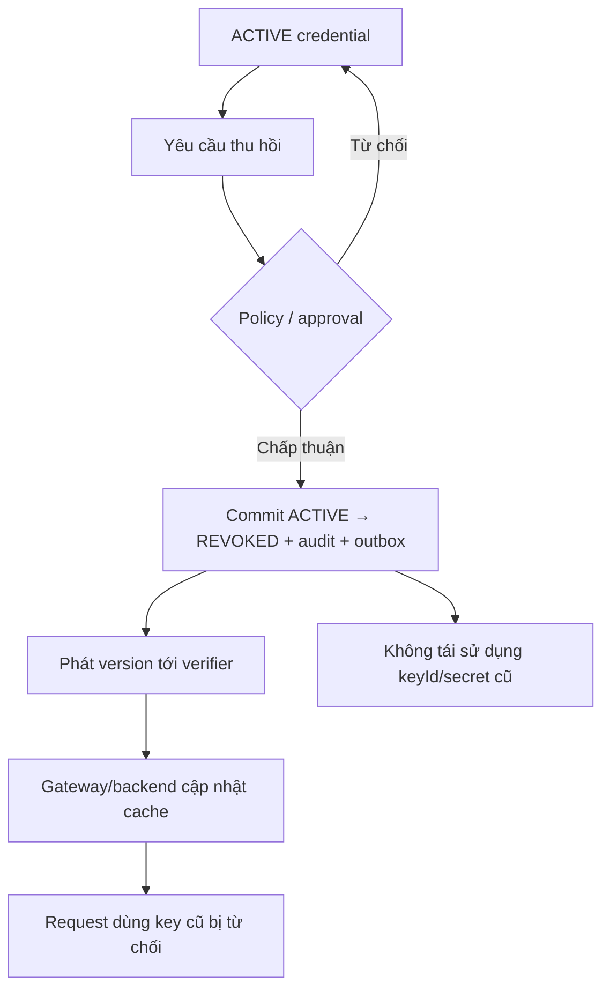
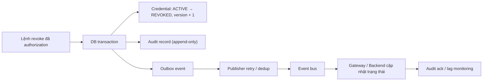
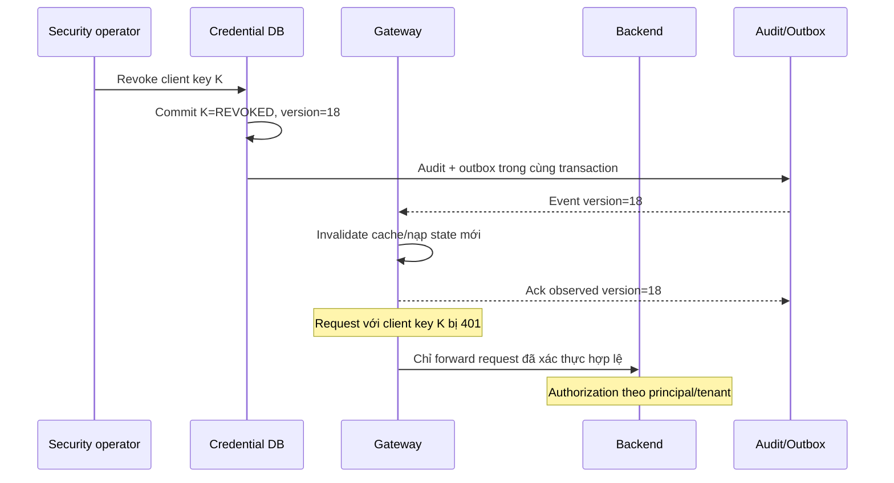

# Audit revocation: kiểm toán việc thu hồi credential HMAC

## Mục tiêu bài học

Bài học **Audit revocation** thuộc chương **Security logging**, nằm trong module **SECURITY_AUTHENTICATION_HMAC_REQUEST_AUTHENTICATION**. Module thiết kế xác thực HTTP request bằng HMAC với **shared secret** và **canonical request** bao gồm method, URI, header hoặc body theo hợp đồng ký. Người học phải xác minh chữ ký, chống replay bằng timestamp/nonce, xoay vòng khóa, kiểm thử gateway/proxy và phân biệt **authentication** với **authorization**.

Trong cơ chế HMAC, nếu shared secret bị lộ, một bên không được phép có thể tạo chữ ký hợp lệ cho request mới. **Revocation** (thu hồi credential) là quyết định của hệ thống rằng một key/credential cụ thể không còn được chấp nhận, ngay cả khi MAC tính bằng secret cũ vẫn đúng về mặt mật mã. **Audit revocation** là khả năng ghi lại và kiểm chứng *ai đã yêu cầu, ai đã phê duyệt, điều gì được thu hồi, khi nào quyết định có hiệu lực, quyết định đã đến các verifier nào và các request sau đó bị xử lý ra sao*.

Sau bài học, người học có thể:

1. Phân biệt lệnh thu hồi, thay đổi trạng thái credential, thông báo lan truyền và bản ghi từ chối request dùng key đã thu hồi.
2. Thiết kế audit event đầy đủ để truy vết thu hồi theo client, tenant, key ID và hop gateway/backend mà không ghi secret, signature hay body nhạy cảm.
3. Đặt thay đổi trạng thái và sự kiện audit vào **cùng một giao dịch bền vững**; dùng transactional outbox khi gửi sự kiện sang hệ thống khác.
4. Định nghĩa thời điểm thu hồi có hiệu lực, cửa sổ dữ liệu cache có thể cũ, hành vi fail-closed và các bằng chứng xác nhận verifier đã nhận trạng thái mới.
5. Giữ response công khai của authentication failure nhất quán (thường HTTP 401), còn nguyên nhân chi tiết chỉ xuất hiện trong audit/log có phân quyền.
6. Xây dựng cảnh báo, truy vấn kiểm toán và kiểm thử âm tính cho các trường hợp race condition, retry, key rotation và gateway rewrite.

## 1. Audit revocation khác gì application log thông thường?

Giả sử lúc 09:00 một operator được phép thu hồi key `partner-a-k3` vì nghi ngờ rò rỉ. Từ 09:01, một request mới ký bằng secret của key đó vẫn có thể tạo ra HMAC-SHA256 đúng. Nếu verifier chỉ kiểm tra MAC mà không đọc trạng thái key active/revoked, request sẽ được chấp nhận. Nếu verifier dùng credential cache chưa cập nhật, nó cũng có thể chấp nhận nhầm.

Một dòng log như `"key disabled"` chưa đủ để giải thích sự cố. Người kiểm toán cần nối được chuỗi bằng chứng:

- **Ý định:** ai đề xuất thu hồi, thuộc phạm vi tenant/client nào, với lý do và ticket nào?
- **Quyết định:** ai có quyền duyệt/thực hiện, policy nào được dùng, có cần hai người phê duyệt không?
- **Thực thi:** trạng thái authoritative thực sự đã đổi ở đâu, phiên bản trạng thái bao nhiêu, thời điểm commit nào?
- **Lan truyền:** các gateway, backend và cache verifier đã thấy phiên bản mới lúc nào, có node nào trễ hoặc lỗi?
- **Hậu kiểm:** request dùng key đã thu hồi sau mốc hiệu lực có bị từ chối không, còn authentication success bất thường nào cần điều tra?

| Bản ghi | Mục đích | Độ tin cậy và vòng đời |
|---|---|---|
| Application log | Debug lỗi ứng dụng, hiệu năng, xử lý request | Có thể bị sampling, rotate, mất vì quá tải |
| Security event/metric | Phát hiện tấn công, số lượng request bị từ chối | Thường tổng hợp/sampling; không đủ làm bằng chứng lệnh thu hồi |
| **Revocation audit record** | Chứng minh hành vi quản trị và thay đổi trạng thái credential | Phải bền vững, gắn actor/target/thời gian/phiên bản, chống sửa xóa ngoài quy trình |
| Propagation acknowledgment | Chứng minh một verifier đã tiếp nhận phiên bản trạng thái | Chứng minh mức độ đồng bộ tại một thời điểm; không tự chứng minh mọi request đều được xử lý đúng |
| Authentication decision record | Chứng minh quyết định allow/deny của một request tại điểm verify | Cần liên kết với credential, thời gian quyết định và phiên bản trạng thái đã dùng |

**Ranh giới quan trọng:** bản ghi `credential.revoked` là bằng chứng thay đổi trạng thái ở *source of truth*. Nó **không tự động chứng minh** rằng mọi gateway/backend đã dừng chấp nhận key đó vào cùng một thời điểm. Muốn khẳng định hiệu lực trên toàn hệ thống phải có thiết kế về cache, đồng bộ và kiểm thử phù hợp.

## 2. Những sự kiện nào cần kiểm toán?

HMAC credential có thể thuộc client, tenant hoặc gateway nội bộ. Một credential có `keyId` công khai để tra secret, nhưng shared secret không được xuất hiện trong audit. Nên dùng **credentialId nội bộ bất biến** để liên kết mọi sự kiện, còn key ID/tenant/owner chỉ được hiển thị cho người có quyền xem.

Bộ event mẫu:

| Event type | Khi ghi | Thông tin cần có |
|---|---|---|
| `credential.revocation.requested` | Có yêu cầu hợp lệ đi vào quy trình | Request ID, actor, target credential, reason code, ticket, thời gian |
| `credential.revocation.approved` | Chính sách yêu cầu approval và người có quyền duyệt | Approver, policy/role, target, request tương ứng |
| `credential.revocation.denied` | Yêu cầu bị từ chối trước khi thực thi | Actor, decision, mã lý do; không cập nhật key |
| **`credential.revoked`** | Trạng thái authoritative chuyển sang revoked và được commit | Credential, old/new state, old/new version, thời điểm có hiệu lực |
| `credential.revocation.publish_requested` | Outbox yêu cầu phát thay đổi ra hệ thống phân phối | Event ID, phiên bản, destination/topic |
| `credential.revocation.propagated` | Verifier xác nhận đã nạp phiên bản cần thiết | Node/hop, version, observedAt, result |
| `credential.revocation.propagation_failed` | Phát hoặc áp dụng sự kiện không thành công | Node/hop, retry count, error class an toàn |
| `hmac.authentication.rejected` | Verifier từ chối request theo chính sách credential | Route, hop, claimed key reference, internal reason, request ID |
| `hmac.authentication.accepted` | Verifier cho request đi tiếp sau khi xác thực | Verified credential ID, decisionAt, credential state/version (nếu có thể ghi an toàn) |

Không nhất thiết ghi **mọi** authentication attempt dưới dạng audit event bền vững với lưu trữ vô hạn: lưu lượng có thể rất lớn, và logging chi tiết có rủi ro dữ liệu cá nhân. Lệnh quản trị và thay đổi trạng thái phải có lưu trữ bền vững; request-level security logs có thể đi vào hệ thống quan sát riêng theo retention và mức độ đầy đủ đã công bố. Những hệ thống yêu cầu chứng cứ pháp lý cho mọi quyết định auth cần một kiến trúc lưu sự kiện tương ứng.

### 2.1. Phân biệt đối tượng được khai báo với đối tượng đã xác minh

Nếu request có header `X-Key-Id: partner-a-k3`, đó mới là **key ID do người gửi khai báo**. Trước khi MAC được xác minh, server chưa chứng minh được request do chủ sở hữu key đó tạo ra. Nếu key đã revoked và verifier từ chối ngay ở credential lookup, không được ghi sự kiện như:

```text
client=partner-a authenticated=true action=attempt_after_revocation
```

Một biểu diễn chính xác hơn:

```json
{
  "eventType": "hmac.authentication.rejected",
  "internalReason": "claimed_credential_revoked",
  "claimedKeyRef": "restricted-pseudonym",
  "authenticatedClientId": null,
  "authenticationSucceeded": false,
  "httpStatus": 401
}
```

Nếu chữ ký đã được xác minh với một credential còn active, lúc đó có thể ghi `verifiedCredentialId`, `verifiedClientId`, `verifiedTenantId` từ registry đáng tin. Không tự gán identity đã xác thực dựa trên header client tự khai, IP nguồn hoặc event text.

## 3. Vòng đời thu hồi, key rotation và thời điểm có hiệu lực

Một trạng thái credential đơn giản có thể gồm:

| Trạng thái | Có chấp nhận HMAC mới không? | Ghi chú |
|---|---|---|
| `ACTIVE` | Có, nếu MAC/timestamp/nonce và các policy khác hợp lệ | Secret được lưu ở kho credential được bảo vệ |
| `REVOKED` | **Không** | Trạng thái kết thúc của key ID này; không tái kích hoạt tùy tiện |
| `EXPIRED` | Không | Có thể được suy ra từ hạn sử dụng; cần log/audit khi thay đổi policy hoặc gia hạn |
| `DISABLED` hoặc `SUSPENDED` (nếu hệ thống có) | Không, theo policy riêng | Dừng tạm thời; khác với revoke vĩnh viễn |

Quy trình phê duyệt nên nằm ở **đối tượng request/approval riêng**, không để `PENDING_APPROVAL` vô tình được suy diễn như credential đã revoked. Trong mọi trạng thái, backend quyết định active dựa trên trường trạng thái và thời hạn của credential từ nguồn đáng tin.



### 3.1. Phải định nghĩa rõ `effectiveAt`

Có nhiều thời gian khác nhau không nên trộn lẫn:

- `requestedAt`: nhận đề nghị thu hồi.
- `approvedAt`: hoàn tất approval nếu có.
- **`effectiveAt` / `committedAt`**: thời điểm trạng thái nguồn đã được commit thành `REVOKED`.
- `publishedAt`: event được phát từ outbox ra bus.
- `observedAt`: một verifier đã nạp trạng thái mới hoặc đọc thành công phiên bản mới từ registry.
- `decisionAt`: thời điểm request được verifier quyết định pass/fail.

Ví dụ:

```text
09:00:00.000  Operator yêu cầu revoke key K
09:00:01.120  DB commit: K=REVOKED, version=18
09:00:01.400  Outbox event version=18 được publish
09:00:02.010  Gateway A ack version=18
09:00:03.600  Gateway B ack version=18
09:00:05.000  Dashboard thấy mọi node đang theo dõi đã ack
```

Nếu gateway B còn cho qua request đến 09:00:03.500 do cache chưa cập nhật, hệ thống **không đạt thu hồi tức thời** tính từ 09:00:01.120. Audit phải thể hiện rõ khoảng trễ đó; không sửa `effectiveAt` để làm đẹp kết quả. Muốn cam kết “không có authentication success nào từ sau lúc commit”, cần cơ chế xác minh trạng thái đủ mạnh như truy vấn trạng thái authoritative ở ranh giới quyết định hoặc đồng bộ hóa/epoch kiểm tra nghiêm ngặt và fail-closed khi không xác định được độ mới. Chỉ broadcast event bất đồng bộ không đủ để cam kết tuyệt đối.

### 3.2. Rotation không đồng nghĩa revocation

Trong key rotation, key cũ và mới có thể cùng **ACTIVE** trong khoảng chuyển tiếp:

```text
partner-a-k3  ACTIVE   (old, migration window)
partner-a-k4  ACTIVE   (new)
partner-a-k3  REVOKED  (sau khi client đã chuyển hoặc khi có sự cố)
partner-a-k4  ACTIVE
```

Audit phải chỉ rõ **key ID nào** đã revoked. Không ghi “client revoked” khi chỉ khóa một phiên bản key; không được làm tất cả key của tenant ngừng hoạt động ngoài chủ ý. Nếu thu hồi **mọi credential của client hoặc tenant**, đó là một thao tác có scope khác, cần log danh sách/snapshot mục tiêu hoặc batch ID để có thể chứng minh đã xử lý đủ.

Với key bị lộ, cần revoke ngay theo chính sách sự cố; không cần chờ rotation hoàn tất rồi mới từ chối chữ ký tạo bởi secret cũ. Key đã revoked không trở lại active chỉ vì client gửi một HMAC chính xác.

## 4. Schema audit event: có thể trả lời được câu hỏi kiểm toán

Một event đáng tin cần metadata đủ để nối với yêu cầu phê duyệt, trạng thái nguồn và các hop xác minh. Không nên nhồi tất cả vào một field `message` tùy ý.

| Nhóm dữ liệu | Trường gợi ý | Nguồn tin cậy |
|---|---|---|
| Identity sự kiện | `eventId`, `eventType`, `schemaVersion` | Dịch vụ audit sinh, không lấy từ request Internet |
| Credential mục tiêu | `credentialId` nội bộ, `credentialKind`, `tenantId`, `ownerId` | Kho credential được phân quyền |
| Trạng thái | `previousState`, `newState`, `previousVersion`, `newVersion` | Bản ghi DB trong transaction |
| Người thực hiện | `actorId`, `actorType`, `approvalId`, `policyId` | Authentication/authorization của control plane |
| Lý do & liên kết | `reasonCode` theo allowlist, `ticketRef` đã kiểm soát, `commandId` | Quy trình quản trị |
| Thời gian | `occurredAt`, `committedAt` hoặc `effectiveAt` | Clock của server/DB, UTC |
| Truy vết | `requestId`, `traceId`, `causationId`, `correlationId` | Phát tại ingress tin cậy và truyền qua hệ thống |
| Kết quả | `outcome`, `failureClass`, `nodeId`, `observedVersion` | Actor xử lý ở hop tương ứng |

Ví dụ bản ghi **sau khi commit**:

```json
{
  "schemaVersion": 1,
  "eventId": "9df1030f-b7f2-4a9e-8be9-0b4dfecc3a10",
  "eventType": "credential.revoked",
  "credentialId": "c-83a1",
  "credentialKind": "CLIENT_HMAC",
  "tenantId": "tenant-17",
  "previousState": "ACTIVE",
  "newState": "REVOKED",
  "previousVersion": 17,
  "newVersion": 18,
  "actorId": "ops-24",
  "actorType": "HUMAN_OPERATOR",
  "approvalId": "approval-550",
  "reasonCode": "SUSPECTED_SECRET_EXPOSURE",
  "ticketRef": "SEC-2041",
  "commandId": "53d62a86-96a7-4d31-9b8c-2fd64478195a",
  "committedAt": "2026-11-28T02:00:01.120Z",
  "outcome": "APPLIED",
  "requestId": "req-40b1"
}
```

Các ID, thời gian trong ví dụ đều giả định. `tenantId` và `actorId` có thể là dữ liệu cần kiểm soát truy cập: **được phép lưu trong audit store có phân quyền**, nhưng không đồng nghĩa được đưa ra public response, gửi lên metrics labels hay ghi vào log debug ở mọi môi trường.

### 4.1. Phân biệt event phát sinh và event đã được phân phối

`credential.revoked` được tạo khi thay đổi trạng thái đã **commit**. Event `credential.revocation.propagated` do từng verifier ghi khi nó đã áp dụng một phiên bản tối thiểu. Hai event có ý nghĩa khác nhau:

```json
{
  "eventType": "credential.revocation.propagated",
  "causationId": "9df1030f-b7f2-4a9e-8be9-0b4dfecc3a10",
  "credentialId": "c-83a1",
  "newVersion": 18,
  "verifierId": "gateway-b",
  "hop": "client-to-gateway",
  "observedVersion": 18,
  "observedAt": "2026-11-28T02:00:03.600Z",
  "result": "APPLIED"
}
```

Nếu một node chỉ nhận message nhưng chưa cập nhật cache, không được ghi `APPLIED`. Nếu node đọc lại từ DB ở mỗi request, bằng chứng là việc nó xác thực với source version phù hợp tại thời điểm quyết định; không nhất thiết có ack đẩy sự kiện. Dashboard phải mô tả đúng phương thức đo, phạm vi node đang được tính và giới hạn chứng minh của từng loại bằng chứng.

## 5. Ghi trạng thái và audit cùng giao dịch: tránh “đã revoke nhưng không có dấu vết”

Lỗi triển khai thường gặp:

```text
update credential set status='REVOKED'
commit
publish audit event
// Process crash ngay sau commit → audit event không được gửi
```

Hoặc đảo thứ tự:

```text
publish "credential.revoked"
update DB
// DB update thất bại → có event nói đã revoke nhưng trạng thái vẫn ACTIVE
```

Cần một **nguồn trạng thái authoritative** và cơ chế ghi audit có khả năng chống mất. Với một cơ sở dữ liệu quan hệ, có thể cập nhật credential, chèn audit record và chèn **transactional outbox** trong cùng một DB transaction. Worker đọc outbox sau commit để phát event với cơ chế retry/idempotent.



### 5.1. Thiết kế DB tối thiểu

Mẫu bảng minh họa theo cú pháp PostgreSQL; tên bảng và kiểu dữ liệu cần điều chỉnh theo dự án:

```sql
CREATE TABLE hmac_credential (
    id             UUID PRIMARY KEY,
    tenant_id      TEXT NOT NULL,
    key_id         TEXT NOT NULL UNIQUE,
    state          TEXT NOT NULL CHECK (state IN ('ACTIVE', 'REVOKED')),
    version        BIGINT NOT NULL DEFAULT 0,
    revoked_at     TIMESTAMPTZ,
    updated_at     TIMESTAMPTZ NOT NULL DEFAULT now()
);

CREATE TABLE security_audit_event (
    event_id       UUID PRIMARY KEY,
    event_type     TEXT NOT NULL,
    credential_id  UUID NOT NULL,
    actor_id       TEXT NOT NULL,
    reason_code    TEXT NOT NULL,
    command_id     UUID NOT NULL,
    old_state      TEXT NOT NULL,
    new_state      TEXT NOT NULL,
    old_version    BIGINT NOT NULL,
    new_version    BIGINT NOT NULL,
    committed_at   TIMESTAMPTZ NOT NULL,
    schema_version INTEGER NOT NULL DEFAULT 1
);

CREATE TABLE security_outbox (
    event_id       UUID PRIMARY KEY,
    event_type     TEXT NOT NULL,
    payload        JSONB NOT NULL,
    created_at     TIMESTAMPTZ NOT NULL DEFAULT now(),
    published_at   TIMESTAMPTZ
);
```

Bảng này không lưu shared secret. Kho secret thực phải có kiểm soát riêng; audit chứa metadata phiên bản và ID. Các ràng buộc bổ sung trong production thường gồm foreign key, unique key cho idempotency/command, partition và retention, chỉ mục truy vấn, quyền INSERT-only cho ứng dụng đối với audit table, và cơ chế chặn UPDATE/DELETE trái phép. Có thể dùng bảng event riêng để lưu yêu cầu phê duyệt/denial thay vì ép mọi loại sự kiện vào cùng schema thay đổi trạng thái.

### 5.2. Ví dụ transaction Spring (Java 17+)

Đoạn dưới tập trung vào **nhất quán trạng thái và audit**, dùng các interface trừu tượng để kết nối với repository cùng một database. Các lớp repository, policy và exception là thành phần ứng dụng cần triển khai; ví dụ không tự nhận là ứng dụng chạy độc lập.

```java
import java.time.Clock;
import java.time.Instant;
import java.util.Optional;
import java.util.UUID;

import org.springframework.stereotype.Service;
import org.springframework.transaction.annotation.Transactional;

enum CredentialState { ACTIVE, REVOKED }

record Credential(
        UUID id,
        String tenantId,
        CredentialState state,
        long version) {}

record AuthenticatedOperator(String operatorId, String tenantId) {}

record RevokeCommand(
        UUID commandId,
        UUID credentialId,
        String reasonCode,
        String approvalId) {}

record RevocationResult(
        UUID credentialId, long version, boolean changed) {}

record RevokedEvent(
        UUID eventId,
        UUID commandId,
        UUID credentialId,
        String actorId,
        String reasonCode,
        String approvalId,
        CredentialState oldState,
        CredentialState newState,
        long oldVersion,
        long newVersion,
        Instant committedAt) {}

interface CredentialRepository {
    // Khóa hàng bằng SELECT ... FOR UPDATE trong transaction hiện tại.
    Optional<Credential> lockForUpdate(UUID credentialId);

    // Update cùng DB transaction; phải kiểm tra row count bằng 1.
    void markRevoked(UUID id, long expectedVersion, long nextVersion, Instant at);
}

interface RevocationPolicy {
    // Phân quyền theo actor đã xác thực, tenant và credential thực trong DB.
    void requireCanRevoke(AuthenticatedOperator actor, Credential credential);

    // Kiểm tra reason code và approval theo policy; không echo dữ liệu nhạy cảm.
    void requireValidApproval(RevokeCommand command, Credential credential);
}

interface AuditEventRepository {
    void append(RevokedEvent event);
}

interface OutboxRepository {
    void add(RevokedEvent event);
}

@Service
public final class HmacCredentialRevocationService {
    private final CredentialRepository credentials;
    private final RevocationPolicy policy;
    private final AuditEventRepository audit;
    private final OutboxRepository outbox;
    private final Clock clock;

    public HmacCredentialRevocationService(
            CredentialRepository credentials,
            RevocationPolicy policy,
            AuditEventRepository audit,
            OutboxRepository outbox,
            Clock clock) {
        this.credentials = credentials;
        this.policy = policy;
        this.audit = audit;
        this.outbox = outbox;
        this.clock = clock;
    }

    @Transactional
    public RevocationResult revoke(
            RevokeCommand command,
            AuthenticatedOperator operator) {

        // Operator đến từ control-plane security context đã xác thực.
        // Không lấy actorId/tenantId từ header tùy ý của request.
        Credential current = credentials.lockForUpdate(command.credentialId())
                .orElseThrow(() -> new IllegalArgumentException(
                        "Credential is not accessible"));

        policy.requireCanRevoke(operator, current);
        policy.requireValidApproval(command, current);

        if (current.state() == CredentialState.REVOKED) {
            // Retry command: kết quả idempotent; không phát lại event chuyển
            // trạng thái ACTIVE -> REVOKED. Có thể audit nỗ lực lặp riêng.
            return new RevocationResult(
                    current.id(), current.version(), false);
        }

        Instant now = clock.instant();
        long nextVersion = Math.addExact(current.version(), 1);

        credentials.markRevoked(
                current.id(), current.version(), nextVersion, now);

        RevokedEvent event = new RevokedEvent(
                UUID.randomUUID(),
                command.commandId(),
                current.id(),
                operator.operatorId(),
                command.reasonCode(),
                command.approvalId(),
                current.state(),
                CredentialState.REVOKED,
                current.version(),
                nextVersion,
                now);

        audit.append(event);
        outbox.add(event);
        return new RevocationResult(current.id(), nextVersion, true);
    }
}
```

**Điều kiện để giao dịch đạt mục tiêu:**

- `CredentialRepository`, `AuditEventRepository` và `OutboxRepository` phải cùng tham gia **một transaction manager/DB transaction**. Đặt `@Transactional` không tự động khiến HTTP call sang một hệ thống audit bên ngoài trở thành nguyên tử.
- `lockForUpdate` hoặc kiểm tra version kiểu optimistic locking phải ngăn hai operator cùng ghi state/version không nhất quán. `markRevoked` nên bắt buộc row count = 1, báo lỗi nếu phiên bản không khớp.
- Phải cấu hình transaction rollback khi audit/outbox insert thất bại; không được công bố “revoke thành công” trước commit. Ngược lại, event chỉ được xem là committed sau transaction thực sự hoàn tất.
- Lặp lại lệnh sau network timeout cần idempotency dựa trên `commandId` (độc lập với key ID), nhất là khi cần audit mọi lần yêu cầu. `changed=false` chỉ nói credential đã revoked; không suy luận command trước là do cùng actor thực hiện.
- Thời gian Java `now` là metadata minh họa gần lúc commit, **không nhất thiết bằng thời điểm DB commit**. Với yêu cầu kiểm toán chặt, dùng commit timestamp hoặc cơ chế DB-generated authoritative timestamp và ghi rõ định nghĩa mốc hiệu lực.
- Chỉ actor đã qua authentication và policy authorization mới được gọi revoke; thay đổi secret ở vault, disable tenant hoặc chặn gateway key có thể cần quy trình độc lập, nhưng cũng phải có dấu vết tương ứng.

### 5.3. Outbox publisher cần xử lý at-least-once

Publisher thường đọc các outbox row chưa phát, gửi message, rồi đánh dấu `published_at`. Nếu crash sau gửi nhưng trước khi đánh dấu, cùng message sẽ gửi lại. Verifier cần **idempotent consumer** theo `eventId` hoặc `(credentialId, newVersion)`.

```text
Consumer nhận credential c-83a1 version=18:
  if localObservedVersion >= 18:
      ack idempotent; không áp dụng state cũ
  else:
      nạp trạng thái/source version mới
      cập nhật atomically trong cache
      ghi observedVersion=18 và observedAt
      gửi propagation ack
```

Nếu event version 19 đến trước version 18, không được ghi đè trạng thái mới bằng version thấp hơn. Tuy nhiên, **chỉ nhận event không đủ để chứng minh trạng thái authoritative**: consumer nên xác minh source/version, signature/ACL của event channel và policy phân quyền của source. Với nhiều tenant, không để event từ hệ thống ngoài tự cập nhật trạng thái bất kỳ credential nào.

## 6. Backend và gateway phải thực thi trạng thái revoke

Một HMAC verifier thường làm:

```text
Nhận HTTP request
  → kiểm tra kích thước và cú pháp header
  → tra credential theo keyId
  → xác minh credential ACTIVE + thời hạn hiệu lực
  → tạo canonical request theo hợp đồng ký đã công bố
  → so body digest, HMAC bằng so sánh an toàn
  → kiểm tra timestamp và claim nonce nguyên tử
  → tạo principal/authentication đã xác minh
  → authorization theo scope, tenant và resource
  → handler
```

Vị trí kiểm tra timestamp/đọc body/lookup có thể khác nhau để tối ưu; điều quan trọng là **không request nào được chấp nhận khi key không còn hiệu lực**, không claim nonce trước khi MAC hợp lệ và không bỏ qua kiểm tra revocation vì MAC đã đúng.

### 6.1. Log quyết định khi key đã bị thu hồi

Một event ở hop verifier có thể là:

```json
{
  "eventType": "hmac.authentication.rejected",
  "requestId": "req-51d8",
  "hop": "client-to-gateway",
  "routeTemplate": "/partner/orders/{id}",
  "claimedCredentialRef": "restricted-key-ref",
  "credentialStateVersion": 18,
  "internalReason": "claimed_credential_revoked",
  "decisionAt": "2026-11-28T02:00:06.000Z",
  "httpStatus": 401,
  "authenticated": false
}
```

Giá trị `claimedCredentialRef` chỉ là mã tham chiếu **không được dùng như bằng chứng về người gửi**. Nó có thể được sinh bằng HMAC riêng cho audit với một khóa giả danh độc lập, hoặc là credential ID nội bộ chỉ lưu ở kho có phân quyền. Không dùng plain SHA-256 của ID dễ đoán rồi tin rằng đã ẩn danh. Nếu phải điều tra cùng key qua nhiều hop, thống nhất cách tạo pseudonym có kiểm soát; tuyệt đối không đưa khóa audit pseudonym vào request hay log.

**Public HTTP response** cho request dùng credential đã revoked vẫn phải là lỗi xác thực chung theo contract, ví dụ:

```http
HTTP/1.1 401 Unauthorized
WWW-Authenticate: HMAC realm="partner-api"
Content-Type: application/problem+json
Cache-Control: no-store
X-Request-Id: req-51d8

{
  "type": "about:blank",
  "title": "Unauthorized",
  "status": 401,
  "detail": "Authentication is required or invalid."
}
```

`HMAC` ở `WWW-Authenticate` là ví dụ authentication scheme do API định nghĩa, cần tài liệu hóa cho client. Không công khai “key này tồn tại nhưng vừa bị revoke”, expected MAC, lịch rotation, thời gian hiệu lực nội bộ hoặc tên hệ thống secret store. Các lỗi khác như `unknown_key`, `invalid_mac` và `expired_timestamp` nên có public response **cùng ý nghĩa authentication failure**, nhưng có internal reason đủ để điều tra.

### 6.2. Không nhầm revocation với authorization và lỗi hạ tầng

| Tình huống | Kết quả chính | Audit/log thích hợp |
|---|---|---|
| Key không tồn tại, bị revoke hoặc MAC không hợp lệ | **401 Authentication failure** | Internal reason đã phân loại; không tiết lộ ngoài API |
| HMAC hợp lệ bằng key active nhưng client thiếu quyền tenant/resource | **403 Forbidden** (hoặc 404 theo policy che tài nguyên) | Authorization denied với verified principal |
| Registry/DB/KMS không trả lời nên không xác định key active | **503/5xx**, fail-closed | Dependency unavailable; không ghi nhầm “revoked” |
| Kho nonce bị lỗi/timeout | **503/5xx**, fail-closed | Replay check unavailable; không tự giả định nonce chưa dùng |
| Nonce đã ghi từ request hợp lệ trước đó | **401 Replay rejection** | Internal reason `nonce_replay` |
| Body vượt giới hạn an toàn | **413 Content Too Large** | Request-size policy, không đổ lỗi key |
| Gateway đang có credential cache stale | Sự cố enforcement cần xử lý/giám sát | Cache version/age, node và request decision |

**Revocation chỉ quyết định credential còn đủ điều kiện xác thực hay không.** Một key active + HMAC hợp lệ không tự cấp quyền vào mọi endpoint hoặc tenant; principal vẫn phải qua authorization. Ngược lại, từ chối vì key revoked không chứng minh người gửi thực sự là chủ sở hữu của key đó.

### 6.3. Request được xác thực trước thời điểm revoke

Race condition cần nêu trong hợp đồng:

```text
T1: Gateway đọc key K = ACTIVE, bắt đầu verify
T2: Control plane commit K = REVOKED
T3: Gateway hoàn tất verify dựa trên trạng thái đã đọc, cho request đi tiếp
```

Nếu hệ thống dùng snapshot cache và không có kiểm tra tính mới tại thời điểm cấp authentication, một request có thể thành công sau mốc commit. Audit phải ghi `decisionAt`, `credentialStateVersion` và mốc revoke để phát hiện. Muốn bảo đảm tuyệt đối không có request **mới được chấp nhận** sau revoke, cần định nghĩa điểm tuyến tính hóa giữa verify và revoke (ví dụ sử dụng cùng cơ chế trạng thái authoritative/lock hoặc kiểm tra version cuối cùng dưới một giao thức đồng bộ). Chỉ dùng timestamp HMAC hay Redis nonce không giải quyết vấn đề này.

Một request đã được cho đi tiếp **trước** khi revoke có thể vẫn đang chạy nghiệp vụ sau revoke. Hệ thống phải quy định rõ việc revoke có hủy yêu cầu đang xử lý hay chỉ áp dụng cho các authentication decision mới. Với giao dịch nhạy cảm, có thể kiểm tra quyền/credential một lần nữa trước khi commit nghiệp vụ. Điều này là chính sách ứng dụng, không phải thuộc tính tự có của HMAC.

## 7. Lan truyền revocation qua gateway, proxy và nhiều node

Khi có các hop:



Điểm cần kiểm tra theo từng mô hình:

- **Gateway xác minh HMAC client, backend chỉ tin gateway bằng chữ ký nội bộ:** revoke client key phải được gateway áp dụng. Nếu gateway còn dùng cache ACTIVE, backend có thể nhận request với gateway MAC hợp lệ dù client key đã revoked. Phải bảo đảm độ mới tại gateway hoặc backend kiểm tra thêm claim/credential version nếu threat model yêu cầu.
- **Backend trực tiếp xác minh HMAC client:** backend và mọi instance của nó phải nhận trạng thái revoke. Proxy rewrite method/raw URI/body có thể gây 401 do MAC mismatch; nguyên nhân này phải được phân loại riêng với `revoked_key` trong telemetry.
- **Gateway ký lại request:** key gateway → backend có trạng thái revocation riêng với key client → gateway. Nếu **gateway key** bị lộ hoặc revoked, backend phải từ chối ngay cả khi claim client/tenant mà request mang theo trông hợp lý.
- **Multi-tenant/multi-client:** không dùng header tenant từ Internet để quyết định key nào bị revoke; target được lấy từ registry đã kiểm tra và hành động control plane có phân quyền. Event cần ràng buộc owner/scope để tránh vô tình vô hiệu hóa credential của tenant khác.
- **Key rotation:** giữ log riêng cho old/new key ID; khi revoked old key, signed request mang old key phải bị từ chối, còn request từ new key active tiếp tục thành công nếu đạt các kiểm tra khác.

### 7.1. Cache TTL và freshness policy

Chỉ dùng TTL 5 phút nghĩa là có thể tồn tại cửa sổ tối đa gần 5 phút mà một verifier chưa biết revoke, tùy mô hình cache và thời điểm đi vào cache. Phát event invalidation có thể giảm độ trễ bình thường nhưng **không đảm bảo** khi consumer disconnected.

Có thể lựa chọn một trong các policy sau theo mức rủi ro:

| Policy | Đặc điểm | Giới hạn |
|---|---|---|
| Truy vấn authoritative registry ở mỗi authentication | Thuận lợi cho thu hồi mạnh nếu store và giao thức đồng bộ đáp ứng | Tăng latency, phụ thuộc availability |
| Cache ngắn + invalidation/version từ event | Độ trễ thấp, vận hành phổ biến | Có cửa sổ stale; phải đo, cảnh báo và xử lý khi event không đến |
| Cache có epoch/version freshness tối thiểu và fail-closed | Verifier từ chối nếu không chứng minh được độ mới cần thiết | Phải quản lý epoch/token/version đáng tin và chính sách khi mất kết nối |
| Gateway làm điểm xác minh duy nhất với backend tin cậy | Tập trung enforcement client key tại ingress | Gateway trở thành điểm trọng yếu; backend phải xác thực gateway và ràng buộc claim |

Với request cần đảm bảo revocation nhanh, không coi “event đã publish” hay “dashboard đã hiển thị xanh” là thay thế của kiểm tra phiên bản verifier đang sử dụng. Chọn mục tiêu SLO như độ trễ propagate P99 theo từng loại credential/hop, đo từ commit đến ack hợp lệ và cảnh báo khi một node vượt ngưỡng hoặc không liên lạc.

## 8. Bảo vệ độ tin cậy và tính toàn vẹn của audit

Audit revocation là dữ liệu bảo mật, nhưng bản thân hệ thống audit cũng có thể bị tấn công hoặc gặp lỗi. Thiết kế cần xem xét các tình huống:

- Operator có quyền revoke nhưng cố xóa audit event sau đó.
- Một ứng dụng bị xâm nhập chèn event `credential.revoked` giả hoặc sửa `actorId`.
- Event bus gửi trùng, đảo thứ tự hoặc làm rơi message.
- Đồng hồ giữa node lệch làm timeline có vẻ bất hợp lý.
- Audit backend quá tải khiến pipeline mất các bản ghi.
- Log tự do bị chèn CR/LF hoặc JSON field từ dữ liệu user.

**Biện pháp phù hợp:**

1. Giữ security audit store tách quyền khỏi account có quyền thao tác credential. App thường chỉ được **append/insert**, người vận hành có quyền đọc theo scope; thao tác sửa/xóa phải qua kiểm soát đặc biệt.
2. Dùng giao dịch nhất quán với outbox cho sự kiện quản trị quan trọng. Consumer hỗ trợ idempotency và từ chối version lùi.
3. Có thể dùng lưu trữ append-only/WORM, bản chụp/signed checkpoint hoặc **hash chaining**. Ví dụ `H_n = SHA-256(H_(n-1) || canonicalEventBytes_n)`. Cần định nghĩa canonical serialization và nơi giữ checkpoint độc lập. Hash chain đơn lẻ **không chứng minh bất biến tuyệt đối** nếu attacker có quyền sửa toàn bộ chuỗi và hash đầu cuối.
4. Đồng bộ giờ bằng cơ chế tin cậy, ghi timestamp ở nguồn DB/control plane và ghi rõ thời điểm quan sát ở node. Khi so mốc từ nhiều hệ thống, cân nhắc clock skew và thứ tự event/version thay vì chỉ dựa một timestamp.
5. Định nghĩa retention, quyền truy cập, mã hóa khi lưu/truyền, khả năng điều tra sự cố và quy trình xóa theo chính sách/quy định. Không giữ vô hạn request-level logs chỉ vì “audit”.
6. Cấu hình log JSON có trường cố định và sanitizer cho input không tin cậy; không ghép giá trị header chưa validate thành dòng log tự do. Với audit event có ý nghĩa quyết định, không ghi nhận event là thành công khi gửi thất bại hoặc chưa commit.

### 8.1. Khi hệ thống audit bị lỗi thì revoke có tiếp tục không?

Phân biệt hai pipeline:

- **Thay đổi trạng thái + audit/outbox bền vững:** là một đơn vị giao dịch. Nếu không thể lưu audit bắt buộc, giao dịch revoke **không được báo thành công**, và phải có quy trình khẩn cấp cho trường hợp cần chặn credential ngay khi hạ tầng audit gặp sự cố.
- **Đẩy log/event ra SIEM hoặc analytics sau commit:** có thể retry bất đồng bộ từ outbox; đứt kết nối SIEM không nên tự làm credential revoked trở lại ACTIVE. Cần cảnh báo backlog, độ trễ và chính sách xử lý khi dung lượng outbox gần đầy.
- **Request-level security telemetry:** khi sink log chậm có thể áp dụng queue có giới hạn, sampling có chính sách hoặc chuyển kênh, nhưng không được để lỗi logger khiến verifier bỏ qua kiểm tra revocation. Nếu tổ chức yêu cầu audit đầy đủ mọi authentication decision, thiết kế của hệ thống phải đáp ứng yêu cầu đó một cách tường minh.

Không biến mọi lỗi audit sink thành HTTP 401, vì đó không phải lỗi credential. Với lệnh quản trị revoke, lỗi commit DB nên là lỗi server và có trace nội bộ; với request HMAC, trạng thái credential không xác định thì **fail-closed**, không mặc định ACTIVE.

## 9. Không làm lộ secret và dữ liệu nhạy cảm qua audit

Bảng phân loại dữ liệu:

| Dữ liệu | Audit bền vững | Log/metric thông thường | Public response |
|---|---|---|---|
| Credential ID nội bộ | Có, với RBAC và retention | Nếu cần, dùng pseudonym | Không |
| `keyId` | Có thể, theo quyền truy cập | Ưu tiên ẩn/mã hóa hoặc pseudonym có khóa | Không tiết lộ tình trạng key |
| Tenant/client đã xác thực | Có thể trong kho phân quyền | Theo chính sách riêng, giới hạn cardinality | Không tự echo dữ liệu nhạy cảm |
| Actor revoke, approval, ticket, reason code | Có trong audit control plane | Thường chỉ trace/correlation | Không |
| Raw signature/expected HMAC | **Không** | **Không** | **Không** |
| Shared secret, secret hash dùng lại, API token | **Không** | **Không** | **Không** |
| Canonical request đầy đủ và body raw | Tránh lưu; nếu thật sự cần bằng chứng, dùng cơ chế riêng được kiểm soát | Không log dữ liệu nhạy cảm | Không |
| Nonce/timestamp request | Không cần raw nonce trong bản ghi revocation | Có thể log time bucket, không ghi raw nonce | Không |
| Event ID, decision outcome, state version | Có | Có thể | Request ID công khai nếu chính sách cho phép |

Với key ID ít entropy hoặc có cấu trúc dễ đoán, `SHA-256(keyId)` không phải giải pháp ẩn danh tốt vì có thể dò từ từ điển. Khi cần nối sự kiện qua nhiều hệ thống mà không lộ ID gốc, có thể dùng `HMAC(auditPseudonymKey, canonicalKeyId)` với khóa **riêng, được giữ an toàn**, đồng thời kiểm soát vòng đời khóa pseudonym và quyền truy cập bản ghi giải mã/liên kết.

Đảm bảo request ID được sinh hoặc kiểm soát ở ingress đáng tin. Nếu client tự gửi `X-Request-Id`, cần validate/ghi đè để tránh chèn log; correlation ID không phải thông tin xác thực.

## 10. Metrics, cảnh báo và truy vấn phát hiện khoảng trống

Metrics nên theo **mã reason có tập hữu hạn**, route template và hop; không đưa full key ID, nonce, tenant tự do hoặc request ID làm label dẫn tới cardinality lớn.

Ví dụ nhóm metric:

| Metric | Ý nghĩa | Tín hiệu cảnh báo |
|---|---|---|
| `hmac_credential_revocations_total{kind,outcome}` | Số yêu cầu thu hồi đã áp dụng/thất bại | Nhiều revoke bất thường hoặc thất bại kéo dài |
| `hmac_revocation_propagation_seconds{hop}` | Commit đến ack đủ điều kiện | P95/P99 vượt SLO |
| `hmac_revocation_unacked_nodes{hop}` | Verifier chưa áp dụng phiên bản yêu cầu | Có node stale hoặc mất heartbeat |
| `hmac_auth_rejected_total{reason,hop}` | Request bị từ chối khi xác thực | Bùng nổ claimed revoked key, replay, invalid MAC |
| `hmac_auth_accepted_stale_version_total{hop}` | Quyết định thành công với version đã cũ theo policy | **Mức ưu tiên cao**, cần điều tra enforcement |
| `hmac_revocation_outbox_backlog` | Event chưa phát/được ack | Nguy cơ propagation kéo dài |
| `security_audit_write_failures_total` | Ghi audit/transaction không thành công | Có mất bằng chứng hoặc chặn được lệnh revoke |

### 10.1. Truy vấn điều tra “key đã revoked nhưng vẫn có success?”

Giả sử authentication decision telemetry có `verifiedCredentialId` cho **request xác thực thành công**, `decisionAt` và `stateVersion`. Có thể đối chiếu với event `credential.revoked`:

```sql
-- SQL minh họa; thời gian từ các hệ thống phải được đồng bộ/đánh giá skew.
SELECT
    a.request_id,
    a.verifier_id,
    a.decision_at,
    a.state_version,
    r.committed_at AS revoked_at,
    r.new_version
FROM auth_decision_audit AS a
JOIN credential_revocation_audit AS r
  ON a.verified_credential_id = r.credential_id
WHERE a.decision = 'ACCEPTED'
  AND a.decision_at >= r.committed_at
  AND a.state_version < r.new_version;
```

Đây là truy vấn phát hiện **ứng viên cần điều tra**, không phải phép chứng minh đầy đủ: clock skew, batch ingest trễ, race đã được phép, request được xác thực trước commit nhưng log decision muộn, hoặc version semantics khác nhau có thể tạo false positive. Cần kiểm tra timestamp authoritative, tiêu chí “accepted” và chính sách xử lý request in-flight trước khi kết luận bị bypass.

Chính sách mạnh có thể yêu cầu **không có một kết quả ACCEPTED mới** dùng `stateVersion < revokedVersion` sau khi toàn bộ verifier đã ack. Khi đó audit phải ghi rõ tập verifier, mốc ack, deadline và trạng thái healthy. Đừng che tình trạng một node bị offline khỏi mẫu thống kê bằng cách chỉ xét các node còn báo heartbeat.

## 11. Kiểm thử audit revocation

Kiểm thử cả **tính đúng của lệnh revoke** lẫn **khả năng chứng minh sau đó**. Có thể dùng DB integration test, mock secret store, fake clock, nhiều verifier instance và một gateway/proxy test environment.

| Tình huống | Kết quả kỳ vọng | Bằng chứng audit cần có |
|---|---|---|
| Operator có quyền revoke key ACTIVE | DB chuyển `REVOKED`, version tăng đúng một lần | Một event `credential.revoked` liên kết actor, approval, target, version |
| Operator không có quyền tenant | Không thay đổi key | Denied admin request ở kênh bảo mật; không phát event `revoked` |
| Approval bắt buộc nhưng thiếu | Không thực thi | Audit yêu cầu/denial, không có committed revoke |
| Hai operator revoke đồng thời cùng key | Chỉ một transition ACTIVE → REVOKED | Một event chuyển trạng thái; lệnh lặp không làm version tăng bừa |
| Outbox insert thất bại trong transaction | DB rollback, không báo revoke thành công | Không có trạng thái REVOKED “mồ côi” |
| Publisher crash sau phát message, trước đánh dấu | Có thể phát lại, consumer idempotent | Không rollback/ghi đè version; ack đúng |
| Message version=18 đến sau version=19 | Không hồi trạng thái về version cũ | Audit phát hiện outdated event, local version vẫn 19 |
| Gateway B còn cache ACTIVE sau revoke | Policy phải từ chối/fail-closed nếu yêu cầu freshness mạnh | Stale-version metric, lag event hoặc test chứng minh không thể accept |
| Key revoke nhưng request có HMAC đúng từ secret cũ | 401 chung, không chạy handler | Internal reason `claimed_credential_revoked`, không gán client verified |
| Registry/Redis unavailable | 503/5xx, không fail-open | Dependency error, không ghi nhầm revoke/replay |
| Nonce replay với key active | 401, không chạy nghiệp vụ | Internal reason `nonce_replay`; không thay credential state |
| Client key revoke ở gateway, backend chỉ verify gateway MAC | Gateway từ chối trước khi forward | Event/decision tại đúng hop; không có request backend thành công mới |
| Gateway key revoke ở backend | Backend từ chối gateway MAC dù claim client hợp lệ bề ngoài | Đúng credentialKind và audience/hop |
| Rotate old/new key, revoke old | Old bị 401, new tiếp tục nếu có quyền | Hai credentialId riêng; không log “revoke cả tenant” |
| Response công khai với unknown/revoked/invalid MAC | Cùng status/challenge/error schema | Reason chỉ ở audit nội bộ |
| Lệnh revoke bị retry sau timeout | Idempotent, không tạo event transition giả | Command ID liên kết bản ghi ban đầu |
| User nhập newline vào reason/ticket | Không tạo log injection | Reason code allowlist, ticketRef được validate |
| SIEM hoặc audit shipping tạm mất kết nối | Outbox retry và alert; revoke không tự bị đảo | Backlog và recovery có thể truy vết |

### 11.1. Những assertion quan trọng

Bên cạnh HTTP status, cần kiểm chứng:

1. **Atomicity:** sau một giao dịch revoke thành công, DB chứa chính xác state/version và audit/outbox event tương ứng. Ép audit insert lỗi phải khiến transaction rollback.
2. **Immutability:** user vận hành thông thường không thể UPDATE/DELETE audit record; các thao tác sửa theo quy trình được ghi nhận riêng.
3. **Authorization:** actor tenant A không revoke được credential tenant B, kể cả biết credential ID.
4. **Freshness:** khi revoke được xác nhận tại version V, mọi verifier theo policy mạnh không chấp nhận key với version cũ; đo và kiểm tra cửa sổ lag nếu chọn policy eventual consistency.
5. **Secrecy:** scan test logs/response/audit JSON không xuất hiện shared secret, raw signature, expected MAC, canonical request đầy đủ hoặc raw body.
6. **Meaningful status:** key revoked → 401; thiếu quyền sau auth hợp lệ → 403; kho nonce/credential lỗi → 5xx. Chữ ký sai do proxy rewrite phải được phân loại khác với credential revoked trong telemetry.
7. **Concurrency:** request đang verify đồng thời với revoke phải có hành vi theo chính sách in-flight đã định, được thể hiện bằng timestamp/version/decision event.
8. **Durability:** hệ thống khởi động lại hoặc publisher retry không làm mất/lặp hiệu ứng revoke, còn audit chain/retention vẫn kiểm chứng được.

## 12. Bài thực hành: audit việc thu hồi key đối tác

Hệ thống giả định có client `partner-red` và `partner-blue`, mỗi client có key HMAC riêng; gateway xác minh chữ ký client trên canonical request chứa method, raw URI, header timestamp/nonce và SHA-256 body. Gateway sau đó ký lại request cho backend bằng gateway key khác. API dùng HTTPS, kho nonce dùng Redis chung và credential nằm trong DB.

**Yêu cầu thực hành:**

1. Tạo credential `partner-red-k1` ở trạng thái `ACTIVE` với version 7; gửi `POST /partner/orders` có HMAC hợp lệ, timestamp mới, nonce chưa dùng. Kiểm tra handler nhận principal của đúng client và policy tenant.
2. Tạo command revoke có `commandId`, reason code `SUSPECTED_SECRET_EXPOSURE` và approval tương ứng. Ghi trong một DB transaction: chuyển sang `REVOKED`, version 8, audit event và outbox event. Đối chiếu các ID/version/timestamp.
3. Cấu hình hai gateway instance, một instance có cache trạng thái key cũ. Kiểm thử propagation, ack version 8 và chính sách stale-cache đã chọn. Ghi `decisionAt`/`observedVersion` để truy vấn hiệu lực.
4. Dùng **secret cũ** ký một request mới với nonce khác. Kiểm tra 401 công khai chung (có challenge phù hợp), handler không chạy; log chỉ ghi `claimed_credential_revoked` vì chữ ký không được xác thực như principal hợp lệ.
5. Kiểm thử một lệnh revoke lặp, hai lệnh đồng thời và publisher crash sau khi phát event. Chứng minh version chỉ đổi một lần và consumer không áp dụng version lùi.
6. Thu hồi gateway key nội bộ ở backend nhưng giữ client key còn active; phân biệt audit ở hop client → gateway với gateway → backend và xác định phía nào phải từ chối request.
7. Gây lỗi registry hoặc Redis nonce store: xác nhận fail-closed, response thuộc nhóm hạ tầng phù hợp và không ghi ngộ nhận là “client key revoked”.

**Câu hỏi tự kiểm tra:**

- Một bản ghi `credential.revoked` chứng minh điều gì và chưa chứng minh điều gì?
- Tại sao `effectiveAt` và `observedAt` của từng gateway không nên bị nhập làm một?
- Vì sao request khai báo key đã revoke không được log như request của client đã **xác thực thành công**?
- Lý do nào khiến cùng một HMAC hợp lệ về mật mã vẫn phải bị 401 sau revoke?
- Tại sao transactional outbox cần deduplication/idempotent consumer?
- Khi nào cache TTL ngắn vẫn chưa đáp ứng yêu cầu thu hồi tức thời?
- Làm thế nào điều tra request `ACCEPTED` sau `committedAt` mà không kết luận sai do clock skew hoặc request in-flight?
- Vì sao audit chỉ ghi hash thường của key ID dễ đoán vẫn có thể để lộ danh tính qua dò từ điển?
- Khi một key bị thu hồi, ai có quyền xem actor, approval và tenant trong audit?

**Kết quả cần đạt:** người học thiết kế được một chuỗi bằng chứng **yêu cầu → phê duyệt → commit revoke → outbox/propagation → quyết định xác thực**, tách bạch request-level logging với audit bền vững; có thể truy vết sự kiện qua gateway và backend, chứng minh các giới hạn hiệu lực của revocation, phát hiện cache stale và giữ secret/claim nhạy cảm khỏi response hoặc log không được kiểm soát.
