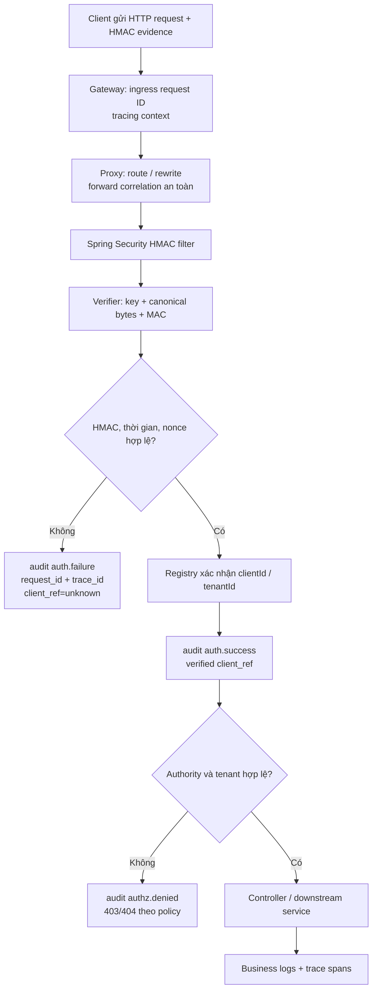

# Log correlation trong xác thực HTTP request bằng HMAC

## 1. Mục tiêu và bối cảnh

Trong hệ thống máy gọi máy, một HTTP request có thể đi qua API gateway, reverse proxy, bộ lọc bảo mật, HMAC verifier, bộ nhớ chống replay và nhiều dịch vụ nghiệp vụ. Một lỗi `401 Unauthorized` từ backend có thể liên quan đến chữ ký sai, canonical request không khớp sau khi gateway rewrite, key đã bị thu hồi, timestamp quá hạn hoặc nonce đã dùng. Nếu log ở mỗi hop không có cách **liên kết sự kiện** với nhau, đội vận hành khó xác định cùng một request đã đi qua những thành phần nào.

**Log correlation** là kỹ thuật gắn những sự kiện có liên quan vào một ngữ cảnh nhận diện nhất quán, thường gồm request ID, trace ID và span ID. Nó phục vụ **quan sát và điều tra**, không phải cơ chế xác thực hoặc phân quyền. Một trace ID do client tự cung cấp không chứng minh client có quyền thực hiện request; quyền ấy chỉ có được sau khi server xác minh HMAC và tra chính sách đáng tin cậy.

Bài thuộc chương **Security logging** của module `SECURITY_AUTHENTICATION_HMAC_REQUEST_AUTHENTICATION`. Module thiết kế xác thực HTTP request bằng shared secret và canonical request chứa method, URI, signed headers hoặc body theo hợp đồng ký; đồng thời kiểm tra timestamp/nonce chống replay, key rotation và những biến đổi qua proxy/gateway.

Sau bài học, bạn có thể:

- Phân biệt request ID, trace ID, span ID, client ID, key ID, nonce và idempotency key.
- Liên kết log xuyên gateway, Spring Security, HMAC verifier, nonce store và business service.
- Chọn nguồn tin cậy cho correlation fields, chống giả mạo/log injection từ header.
- Tích hợp request ID với `OncePerRequestFilter`, `MDC` trong Spring MVC và `WebFilter`, Reactor `Context` trong WebFlux.
- Thiết kế security audit events cho kết quả xác thực, replay, key rotation và từ chối phân quyền.
- Kiểm thử correlation trong cả trường hợp thành công, `401`, `403`, lỗi hạ tầng và request có nhiều hop.

## 2. Correlation ID không phải là danh tính client

Một request có thể mang nhiều loại định danh. Chúng có **vai trò và mức độ tin cậy khác nhau**:

| Trường | Đối tượng được nhận diện | Vòng đời điển hình | Có chứng minh danh tính HMAC không? |
| --- | --- | --- | --- |
| `request_id` | Một HTTP request hoặc một lần xử lý ở một boundary | Sinh khi nhận request; duy trì trong các log tương ứng | **Không** |
| `trace_id` | Một distributed trace liên kết nhiều dịch vụ | Có thể truyền xuyên các hop | **Không** |
| `span_id` | Một công việc/operation trong một trace | Thay đổi giữa các span | **Không** |
| `client_id` | Ứng dụng/đối tác đã xác thực | Ổn định theo registry, có thể qua nhiều key version | **Có**, nhưng chỉ sau verifier thành công |
| `key_id` | Mã định vị key version để tra secret | Thay đổi khi rotation | **Không** nếu mới chỉ đọc header |
| `nonce` | Giá trị dùng một lần để chống replay | Phải độc lập giữa các request được ký theo hợp đồng | **Không**; là bằng chứng freshness khi kết hợp với HMAC |
| `idempotency_key` | Nhận diện cùng một ý định nghiệp vụ qua retry | Theo hợp đồng API/business | **Không** |
| `tenant_id` | Phạm vi dữ liệu gắn với client được xác minh | Theo policy phía server | Không tự chứng minh danh tính; phục vụ phân quyền |

Ví dụ client `partner-reporting` dùng key `reporting-v2` gửi `GET /integrations/orders/O-17`. Gateway tạo `request_id=req-edge-01`; backend tạo `request_id=req-backend-17`; cả hai có thể thuộc cùng một `trace_id`. Nếu verifier thành công, server mới xác nhận `client_id=partner-reporting` và `tenant_id=tenant-a`.

**Không được đặt `client_id=request.getHeader("X-Client-Id")` vào security audit log trước khi xác minh.** Kẻ tấn công có thể tự điền client ID của đối tác khác, rồi khiến log trông giống như đối tác đó đang gửi request lỗi. Ngay cả `key_id` có thật trong registry cũng chỉ là tên khóa được khai báo; chữ ký sai không chứng minh ai đang cầm secret.

## 3. Hành trình correlation qua chuỗi xác thực HMAC



**Mấu chốt:** correlation context thường phải được thiết lập **sớm**, trước khi HMAC verifier có thể trả `401`. Nếu chỉ tạo request ID sau khi authentication thành công thì những request cần điều tra nhất — signature sai, replay, key revoked — lại thiếu mã liên kết.

Tuy vậy, correlation context tạo sớm **không được gán sẵn verified client ID**. Nên phân biệt hai pha:

1. **Pre-authentication:** request ID và tracing metadata do boundary tin cậy sinh hoặc chuẩn hóa; chưa có danh tính HMAC đã chứng minh.
2. **Post-authentication:** thêm `client_ref`/`tenant_ref` từ principal đã xác minh, rồi log kết quả authorization và nghiệp vụ.

## 4. Chọn nguồn request ID và trace context

### 4.1. Request ID tại điểm vào

Một thiết kế đơn giản và khó bị giả mạo:

- Tại điểm HTTP ingress mà tổ chức kiểm soát, **tạo một request ID mới** bằng bộ sinh ngẫu nhiên phù hợp hoặc ID duy nhất có chất lượng tương đương.
- Đưa nó vào log của gateway, có thể trả trong response `X-Request-Id` cho bên gọi hỗ trợ điều tra.
- Nếu có header `X-Request-Id` từ client, coi đó là **external correlation hint chưa xác thực**. Có thể từ chối, bỏ qua, hoặc giữ ở một trường riêng đã validate; không dùng làm ID nội bộ có giá trị audit.
- Các hop tiếp theo nhận request ID **từ gateway đáng tin** qua kênh nội bộ đã kiểm soát; nếu không xác định được nguồn, backend tự tạo một local ID.

Không có chuẩn HTTP toàn cầu bắt buộc mọi hệ thống phải dùng tên `X-Request-Id`. Một ứng dụng có thể chọn tên khác; vấn đề là **nguồn phát sinh, validation, cách truyền và ngữ nghĩa phải được tài liệu hóa**.

### 4.2. W3C Trace Context

Distributed tracing thường dùng các header `traceparent` và `tracestate`. Một giá trị `traceparent` hợp lệ ở phiên bản thông dụng có dạng:

```text
traceparent: 00-4bf92f3577b34da6a3ce929d0e0e4736-00f067aa0ba902b7-01
             |  |                                |                |
          version        16-byte trace ID        8-byte parent ID flags
```

Ví dụ này diễn tả một trace ID 16 byte và parent span ID 8 byte ở dạng hex. Các giá trị toàn số không không hợp lệ đối với các ID đó. Cần dùng thư viện tracing có hiểu đặc tả và version thay vì tự tách header bằng những phép substring thiếu kiểm tra.

Trace ID và span ID cho phép truy vấn mọi sự kiện của một cuộc gọi xuyên dịch vụ. Tuy nhiên:

- `traceparent` có thể xuất phát từ Internet và có thể được kẻ tấn công chọn; nó là **observability metadata**, không phải credential.
- `tracestate` có thể chứa metadata của tracing vendor; phải giới hạn kích thước và kiểm soát nội dung, không đưa secret hoặc thông tin nhạy cảm vào đây.
- `baggage` nếu được sử dụng để truyền ngữ cảnh có thể đi sang nhiều dịch vụ; **không đặt shared secret, full signature, client ID nhạy cảm hoặc quyền truy cập** vào baggage.
- Tại trust boundary, tổ chức quyết định có tiếp nhận trace context ngoài, tạo trace mới hay nối trace bằng link. Quy tắc này cần nhất quán giữa các gateway.

**Request ID và trace ID không bắt buộc giống nhau.** Một trace có thể chứa nhiều HTTP request tới các dịch vụ khác nhau, mỗi request có local request ID. Một request có thể có nhiều span (HMAC parse, key lookup, nonce claim, business query).

## 5. Quy tắc bảo mật cho correlation headers

HTTP client có thể gửi:

```http
POST /public-api/orders HTTP/1.1
Host: api.example.test
X-Request-Id: caller-provided-value
traceparent: 00-4bf92f3577b34da6a3ce929d0e0e4736-00f067aa0ba902b7-01
X-Key-Id: fulfillment-v2
X-Timestamp: 2026-11-28T03:15:00Z
X-Nonce: request-9c12
X-Signature: <base64-hmac>
Content-Type: application/json

{"orderId":"O-17","amount":125000}
```

Mặc định nên xem `X-Request-Id`, `traceparent` và các header forwarding từ Internet là **untrusted input**:

1. **Không tin để xác thực:** những trường này không chứng minh ai sở hữu shared secret, không cấp `GrantedAuthority` và không dùng làm tenant.
2. **Không cho header injection:** giới hạn độ dài, số lượng, character set, header duplicates; không phản chiếu CR/LF và ký tự điều khiển trực tiếp vào log hoặc response.
3. **Không thay thế bằng chứng HMAC:** thiếu `X-Signature` hoặc nonce sai vẫn phải trả lỗi xác thực dù request ID/traceparent trông hợp lệ.
4. **Không để client chiếm dụng namespace:** một external request ID không được ghi đè ID nội bộ hoặc trở thành khóa phân quyền.
5. **Tránh high-cardinality abuse:** không đưa request ID, trace ID, nonce hay client ID trực tiếp vào metric labels để hạn chế bùng nổ số lượng chuỗi thời gian.
6. **Chỉ tin trusted gateway:** nếu backend dùng một header correlation nội bộ do edge phát hành, phải xác nhận traffic đến từ edge qua kênh/identity đáng tin và gateway đã xóa các giá trị do client tự gửi.

Một correlation ID không nhất thiết là bí mật; nhưng nếu server cho phép mọi client tự quyết định correlation ID, chúng có thể cố gắng khiến các log không liên quan bị gom chung. **Sự duy nhất và tính toàn vẹn của audit** cần dựa trên ID do hệ thống kiểm soát và log schema rõ ràng.

## 6. Correlation có nằm trong canonical request HMAC không?

Đây là quyết định của **hợp đồng ký**, không có quy tắc “luôn ký” hoặc “không bao giờ ký” mọi header correlation.

| Cách thiết kế | Ưu điểm | Rủi ro và điều kiện |
| --- | --- | --- |
| Không ký `X-Request-Id`/`traceparent` | Gateway có thể sinh hoặc cập nhật ID phục vụ quan sát mà không phá MAC | Không được sử dụng chúng như dữ liệu có giá trị xác thực/phân quyền |
| Ký một correlation header ứng dụng | Ràng buộc giá trị đó với bytes được ký bởi client | Gateway phải giữ nguyên giá trị/định dạng; phải nằm trong required signed headers |
| Gateway xác minh HMAC trước rewrite và tự tạo correlation | Tách rõ dữ liệu ký từ client và metadata nội bộ | Backend phải tin kết quả xác minh từ gateway qua đường bảo vệ |
| Backend xác minh sau gateway | Verifier ở gần ứng dụng nghiệp vụ | Contract phải xác định rõ request-target/signed headers sau các biến đổi |

Ví dụ client ký một canonical request gồm:

```text
POST
/public-api/orders?source=partner
x-key-id:fulfillment-v2
x-timestamp:2026-11-28T03:15:00Z
x-nonce:request-9c12
sha256-body:<digest-of-raw-content-bytes>
```

Trong ví dụ này, `X-Request-Id` không nằm trong dữ liệu ký; gateway có thể sinh ID riêng mà HMAC của message **không đổi**, miễn các thành phần được ký vẫn giữ semantics đúng hợp đồng. Nhưng nếu gateway rewrite `/public-api/orders` thành `/integrations/orders`, backend phải biết điểm trust boundary nào dùng để dựng canonical path; chỉ giữ request ID không thể sửa mismatch chữ ký.

Nếu quy định request ID là trường bắt buộc được ký, phải ghi nó vào hợp đồng byte-level, cố định encoding/whitespace, xử lý duplicate headers và yêu cầu mọi proxy giữ nguyên. Không có lý do bảo mật để đưa các header phụ thuộc hop như `Connection`, `Transfer-Encoding` vào signed headers xuyên proxy.

Timestamp và nonce được dùng để chống replay **phải nằm trong phạm vi xác thực HMAC**, khác với request ID dùng cho observability. Không được bỏ timestamp/nonce khỏi chữ ký chỉ vì “đã có trace ID”.

## 7. Structured security events để dễ truy vấn xuyên hệ thống

Một log dạng câu tự do như `"Failed for partner A"` khó liên kết và dễ bị nhầm thành danh tính xác thực. Nên định nghĩa schema thống nhất, ít trường nhưng đúng nguồn.

| Trường sự kiện | Nguồn đáng tin | Ghi chú |
| --- | --- | --- |
| `event` | Tên do code quy định: `hmac.auth.success`, `hmac.auth.failure`, `hmac.authz.denied` | Không lấy từ raw header |
| `time` | Clock của server | Không lấy `X-Timestamp` làm thời gian ghi log |
| `request_id` | ID nội bộ được cấp ở ingress/local boundary | Luôn có, kể cả khi auth fail |
| `trace_id` / `span_id` | Tracing instrumentation được cấu hình | Hữu ích để tìm các span của cùng trace |
| `service` | Tên service cấu hình | Không phải dữ liệu client gửi |
| `route` | Route template/route key đã chuẩn hóa | Tránh log raw URI/query chứa PII |
| `auth_stage` | `parse`, `mac`, `freshness`, `key`, `authorization` | Enum nội bộ |
| `outcome` | `success`, `failure`, `denied`, `error` | Từ kết quả xử lý thực tế |
| `reason` | Reason code nội bộ allowlist | Không dùng nguyên `Exception.getMessage()` |
| `client_ref` | Principal đã xác thực từ registry | Trước đó: `unknown` |
| `status` | HTTP status thực trả ra | `401` khác `403` |

Một sự kiện xác thực thành công:

```json
{
  "time": "2026-11-28T03:15:00Z",
  "event": "hmac.auth.success",
  "service": "order-api",
  "request_id": "req-17b4",
  "trace_id": "4bf92f3577b34da6a3ce929d0e0e4736",
  "span_id": "00f067aa0ba902b7",
  "route": "integrations.orders.read",
  "client_ref": "partner-reporting",
  "auth_stage": "freshness",
  "outcome": "success"
}
```

Một sự kiện sai chữ ký:

```json
{
  "time": "2026-11-28T03:15:05Z",
  "event": "hmac.auth.failure",
  "service": "order-api",
  "request_id": "req-17b5",
  "trace_id": "4bf92f3577b34da6a3ce929d0e0e4736",
  "route": "integrations.orders.create",
  "client_ref": "unknown",
  "auth_stage": "mac",
  "outcome": "failure",
  "reason": "MAC_MISMATCH",
  "status": 401
}
```

`MAC_MISMATCH` là reason **nội bộ**. API có thể trả cùng một phản hồi công khai cho chữ ký sai, key không tồn tại hoặc timestamp/nonce lỗi, tránh cho bên ngoài dùng response làm oracle dò secret/key. Correlation ID giúp đội hỗ trợ tìm sự kiện nội bộ mà không buộc phải tiết lộ lý do chi tiết trong response.

`client_ref` ở đây có thể là ID đã được xác thực **hoặc pseudonym** theo chính sách bảo vệ dữ liệu. Nếu pseudonymize, sử dụng cơ chế có khóa audit riêng, không dùng shared secret ký HMAC để pseudonymize log.

## 8. Error semantics: cùng một trace nhưng khác quyết định

| Trạng thái | HTTP thường dùng | Security event | `client_ref` trong audit |
| --- | --- | --- | --- |
| Thiếu signature hoặc signature sai | `401 Unauthorized` | `hmac.auth.failure`, reason tương ứng | `unknown` |
| Timestamp quá hạn hoặc nonce replay | `401` | `hmac.auth.failure`, reason `TIMESTAMP_EXPIRED`/`NONCE_REPLAY` | Thường `unknown` hoặc tham chiếu hạn chế theo policy |
| Key bị thu hồi/chưa được phép dùng | `401` | `hmac.auth.failure`, reason `KEY_UNUSABLE` | `unknown` |
| HMAC đúng nhưng thiếu `ORDER_CREATE` | `403 Forbidden` | `hmac.authz.denied` | Đã xác thực |
| HMAC đúng nhưng truy cập dữ liệu tenant khác | `403` hoặc `404` theo chính sách | `hmac.authz.denied` hoặc domain denial | Đã xác thực |
| Key/nonce store không sẵn sàng | Lỗi server phù hợp, thường `503` | `hmac.auth.infrastructure_error` | Không khẳng định success |
| HMAC đúng, được phép và service thành công | `200/201` | `hmac.auth.success` và business event riêng | Đã xác thực |

Một trace có thể gồm một request tới gateway và một request khác tới backend; cả hai đều liên quan đến cùng một thất bại `401`. Trace ID hỗ trợ xem chuỗi chuyển tiếp, còn **request ID tại mỗi hop** cho biết sự kiện nào thuộc đúng HTTP request được xử lý tại hop đó.

**Không được biến tracing thành security decision:** thiếu `traceparent`, trace không sampled hoặc tracing backend bị lỗi không phải lý do bỏ qua HMAC. Tracing nên là chức năng quan sát có kiểm soát; việc thiếu span không khiến chữ ký từ không hợp lệ thành hợp lệ.

## 9. Spring MVC: thiết lập request ID trước HMAC filter

Trong Servlet stack, `OncePerRequestFilter` có thể cấp request ID và gắn vào `MDC` để các log đồng bộ cùng thread mang chung trường. Ví dụ Java sau dùng ID server phát sinh thay vì tin `X-Request-Id` từ client.

```java
import java.io.IOException;
import java.util.UUID;
import jakarta.servlet.FilterChain;
import jakarta.servlet.ServletException;
import jakarta.servlet.http.HttpServletRequest;
import jakarta.servlet.http.HttpServletResponse;
import org.slf4j.MDC;
import org.springframework.web.filter.OncePerRequestFilter;

public final class RequestCorrelationFilter extends OncePerRequestFilter {
    public static final String REQUEST_ID_ATTRIBUTE =
            RequestCorrelationFilter.class.getName() + ".requestId";

    @Override
    protected void doFilterInternal(
            HttpServletRequest request,
            HttpServletResponse response,
            FilterChain chain) throws ServletException, IOException {

        // Một ID local mới, kể cả khi client gửi X-Request-Id khác.
        String requestId = UUID.randomUUID().toString();
        request.setAttribute(REQUEST_ID_ATTRIBUTE, requestId);
        response.setHeader("X-Request-Id", requestId);

        try (MDC.MDCCloseable scope =
                     MDC.putCloseable("request_id", requestId)) {
            chain.doFilter(request, response);
        }
    }
}
```

`UUID.randomUUID()` ở đây là lựa chọn đơn giản để có ID với xác suất trùng rất thấp. Nếu hệ thống cần định dạng khác, hãy dùng thư viện ID phù hợp, không chọn số đếm dễ bị giả mạo làm định danh security audit toàn cụm.

**Vị trí filter quan trọng:** correlation filter phải chạy đủ sớm để ngay cả lỗi xác thực xảy ra trong `HmacAuthenticationFilter` vẫn có `request_id`. Một cách cấu hình Spring Boot là đăng ký correlation filter **một lần** ở servlet container trước Spring Security:

```java
@Bean
FilterRegistrationBean<RequestCorrelationFilter> correlationRegistration() {
    var registration = new FilterRegistrationBean<>(
            new RequestCorrelationFilter());
    registration.addUrlPatterns("/integrations/*");
    registration.setOrder(Ordered.HIGHEST_PRECEDENCE + 10);
    return registration;
}
```

Ví dụ giả định Spring Boot phiên bản dùng Jakarta Servlet. Phải xác minh thứ tự thực tế của `DelegatingFilterProxy`/`FilterChainProxy` trong ứng dụng; nếu security filter được đăng ký sớm hơn, cần điều chỉnh thứ tự. Đừng đồng thời đăng ký cùng correlation filter như servlet bean và `http.addFilterBefore(...)` nếu không có lý do rõ ràng — điều đó dễ gây double execution.

### 9.1. Ghi event ngay sau HMAC verifier thành công

Giả sử `AuthenticationManager` đã chạy verifier, kiểm tra signature, timestamp, nonce, key rotation và trả `Authentication` đáng tin cậy:

```java
Authentication candidate =
        HmacAuthenticationToken.unauthenticated(parser.parse(request));

Authentication verified;
try {
    verified = authenticationManager.authenticate(candidate);
    if (verified == null || !verified.isAuthenticated()) {
        throw new BadCredentialsException("Invalid HMAC credentials");
    }
} catch (AuthenticationException ex) {
    auditLogger.authFailure(
            request,
            "INVALID_REQUEST_AUTHENTICATION"); // mã nội bộ chuẩn hóa
    entryPoint.commence(request, response, ex);
    return;
}

// Chỉ sau khi verifier thành công mới được dùng principal làm client ID.
HmacPrincipal principal = (HmacPrincipal) verified.getPrincipal();
auditLogger.authSuccess(request, principal.clientId());
```

`HmacAuthenticationToken`, `HmacPrincipal` và `auditLogger` là thành phần ứng dụng phải tự xây dựng; đoạn code này không thể chạy độc lập nếu thiếu chúng. `auditLogger` cần lấy request ID từ `REQUEST_ID_ATTRIBUTE` hoặc observation context đáng tin cậy, dùng structured fields, không ghi nguyên `ex.getMessage()`, raw signed headers hoặc key material.

**Lưu ý về vòng đời MDC:** MDC thường gắn với thread. `try-with-resources` ở correlation filter dọn ngữ cảnh khi request đồng bộ kết thúc. Nếu Servlet async, thread pool hoặc `@Async` được sử dụng, cần cơ chế truyền ngữ cảnh phù hợp; đừng mặc định request ID của thread ban đầu tự có ở mọi thread khác.

## 10. Spring WebFlux: correlation trong Reactor Context

WebFlux dùng `WebFilter` nhận `ServerWebExchange` và trả `Mono<Void>`. Luồng xử lý có thể đổi scheduler/thread, nên không thể dựa vào một MDC `ThreadLocal` tự động theo request trên mọi operator.

Định nghĩa một giá trị correlation và filter:

```java
import java.util.UUID;
import org.springframework.web.server.ServerWebExchange;
import org.springframework.web.server.WebFilter;
import org.springframework.web.server.WebFilterChain;
import reactor.core.publisher.Mono;

public record RequestCorrelation(String requestId) {}

public final class ReactiveCorrelationWebFilter implements WebFilter {
    public static final String REQUEST_CORRELATION_ATTRIBUTE =
            "internal.requestCorrelation";

    @Override
    public Mono<Void> filter(
            ServerWebExchange exchange, WebFilterChain chain) {

        RequestCorrelation correlation =
                new RequestCorrelation(UUID.randomUUID().toString());

        exchange.getAttributes().put(
                REQUEST_CORRELATION_ATTRIBUTE, correlation);
        exchange.getResponse().getHeaders().set(
                "X-Request-Id", correlation.requestId());

        return chain.filter(exchange)
                .contextWrite(context ->
                        context.put(RequestCorrelation.class, correlation));
    }
}
```

Ở một reactive service nằm trong **cùng subscription**, đọc giá trị từ Reactor Context:

```java
Mono<String> requestId =
        Mono.deferContextual(context ->
                Mono.just(context.get(RequestCorrelation.class).requestId()));
```

Ví dụ giả định filter này được đăng ký **một lần** ở vị trí đủ sớm và downstream thực thi trong cùng reactive chain. `Mono.deferContextual` đọc context vào thời điểm subscription. Nếu code tự gọi `subscribe()` tạo một subscription tách rời, hoặc đưa công việc sang hệ thống không truyền Reactor Context, ngữ cảnh có thể mất.

Với WebFlux, nên dùng khả năng **tracing/observation instrumentation** của stack (ví dụ Micrometer Tracing với một exporter/bridge phù hợp) để tự liên kết trace/span và, khi đã cấu hình context propagation đúng, MDC cho log backend. Không tự gắn `trace_id` vào `MDC` rồi mặc định mọi thread reactive có cùng giá trị; điều đó dễ gây log của request A bị gán nhầm sang B.

Khi Security WebFilter xác thực thành công, lấy `client_ref` từ `Authentication` trong `ReactiveSecurityContextHolder`; không truyền client ID từ header chưa xác minh vào Reactor Context dưới nhãn “verified”. Nếu cần log event từ reactive manager, compose publisher bằng `flatMap`/`doOnNext` và quản lý vị trí phát event; **không gọi `subscribe()` thủ công trong filter**.

## 11. Ghép log tại gateway, backend và downstream

Giả sử client gọi đường dẫn ngoài `/public-api/orders`, gateway rewrite thành `/integrations/orders` rồi backend gọi service thanh toán.

```text
Gateway:
  edge_request_id = edge-abc
  trace_id        = 4bf92f3577b34da6a3ce929d0e0e4736
  route           = public.orders.create

Order API:
  request_id      = backend-def
  edge_request_id = edge-abc   # chỉ nhận từ gateway tin cậy
  trace_id        = 4bf92f3577b34da6a3ce929d0e0e4736
  route           = integrations.orders.create
  auth_outcome    = success
  client_ref      = partner-fulfillment

Payment service:
  request_id      = payment-ghi
  trace_id        = 4bf92f3577b34da6a3ce929d0e0e4736
  span_id         = <span-of-payment-operation>
```

Mỗi hop có thể dùng **local request ID riêng** nhưng liên kết qua `trace_id` và `edge_request_id` được bảo vệ. Nếu muốn một request ID duy nhất xuyên toàn bộ chuỗi, gateway phải phát hành và các downstream chỉ tin nó từ kênh nội bộ đáng tin; vẫn nên có cách nhận diện local attempts khi retry.

Các thay đổi do proxy cần được quan sát mà không lộ bí mật:

- Log **route template** hoặc route key, không log raw URI/query chứa token hay dữ liệu cá nhân.
- Có thể ghi `canonical_contract_version` (ví dụ `v2`) và vị trí verify (`gateway` hoặc `backend`) để giúp tìm mismatch giữa client và server.
- Không log nguyên canonical request, raw body, secret hoặc MAC phía server; đây có thể là dữ liệu nhạy cảm.
- Nếu có `Forwarded`, `X-Forwarded-*`, `X-Original-URI`, backend chỉ dùng chúng để xác định request-target khi chúng được thiết lập và làm sạch bởi proxy đáng tin theo contract.
- Chỉ chuyển `client_ref` đã xác thực giữa dịch vụ thông qua cơ chế bảo vệ, không dựa vào một header danh tính có thể được client trực tiếp điền.

Correlation ID **không sửa được sự khác biệt canonical bytes**. Khi gateway rewrite URI đã ký làm MAC sai, phải giải quyết ở hợp đồng ký và trust boundary, không “tắt kiểm tra HMAC cho request có cùng trace ID”.

## 12. Correlation cho replay, retry và key rotation

### 12.1. Replay: cùng nonce nhưng khác request ID

Client gửi hai HTTP request có cùng `X-Nonce` và signature trong cửa sổ thời gian. Gateway có thể tạo **hai request ID khác nhau** vì đó là hai lần HTTP request riêng biệt. Nonce store phải phát hiện replay bằng thao tác ghi nhận duy nhất **nguyên tử** theo client/key và scope của hợp đồng, không dựa vào việc request ID có trùng hay không.

```text
HTTP attempt A: request_id=req-101, nonce=N, auth=success
HTTP attempt B: request_id=req-102, nonce=N, auth=failure (NONCE_REPLAY)
```

Không ghi nguyên nonce, signature hoặc canonical request vào log chỉ để “nối” hai attempt. Nếu việc điều tra replay đòi hỏi correlation giữa nonce values, có thể dùng một **nonce fingerprint** được tạo bằng HMAC audit key **riêng**, với scope và TTL hạn chế:

```text
nonce_ref = truncate(
    HMAC-SHA256(audit_key, encode(client_ref, key_version, nonce))
)
```

`encode(...)` phải là cách mã hóa không mơ hồ, ví dụ length-prefix từng field; `audit_key` không được là shared secret client dùng ký HTTP. Fingerprint phải được kiểm soát truy cập, retention và tránh làm metric label. Với request chưa chứng minh MAC, đừng gắn fingerprint của key được khai báo thành bằng chứng client đó thực sự gửi request.

### 12.2. Retry không phải replay được phép

Một retry nghiệp vụ hợp lệ có thể là **HTTP request mới, timestamp/nonce mới, chữ ký mới**, trong khi dùng cùng idempotency key theo hợp đồng business. Cần phân biệt:

- `request_id`: một lần thử HTTP cụ thể.
- `idempotency_key`: cùng một ý định nghiệp vụ có thể được retry.
- `nonce`: giá trị chống tái sử dụng chữ ký/request.

Không dùng trace ID hoặc request ID để thay nonce store. Cũng không dùng nonce như idempotency key vì mục tiêu và chính sách TTL khác nhau.

### 12.3. Key rotation

`reporting-key-v1` và `reporting-key-v2` có thể đều ánh xạ tới `client_ref=partner-reporting` trong overlap window. Security audit nên liên kết theo client đã xác thực và, nếu có nhu cầu điều tra, thêm `key_version_ref` được phép ghi log. Khi key v1 bị thu hồi, request sử dụng nó phải thất bại theo policy, nhưng event thất bại **không tự khẳng định** client sở hữu key đó đã gửi request.

Truy vấn theo correlation ID có thể giúp trả lời: “Tại request ID nào bắt đầu tăng `KEY_UNUSABLE` sau rotation?”, còn nguồn danh tính phải tiếp tục đến từ bước HMAC verifier.

## 13. Bảo mật, riêng tư và chất lượng dữ liệu log

| Nguy cơ | Ví dụ | Biện pháp |
| --- | --- | --- |
| Log forging | Client gửi request ID có CR/LF để tạo log giả | Backend tạo ID mới; validate/escape mọi hint bên ngoài |
| Correlation poisoning | Nhiều client dùng cùng một ID tự chọn | Không coi external ID là internal audit ID |
| Lộ credential | In raw `X-Signature`/shared secret/canonical bytes | Redact hoặc không log ngay tại điểm thu thập |
| Rò danh tính | Log đầy đủ client ID/tenant ID khi không cần | Dùng pseudonym, RBAC, retention theo policy |
| Sai danh tính trước auth | Dùng `X-Key-Id` làm `client_id` | `client_ref=unknown` cho failure; phân biệt `presented_key_ref` |
| Lẫn MDC giữa request | Thread pool tái sử dụng thread | Dọn `MDC` trong `try/finally`/`MDCCloseable` |
| Lẫn reactive context | Tự dùng MDC thread-local trong WebFlux | Reactor Context hoặc tracing context propagation đúng |
| Cardinality quá cao | Metric label chứa request_id, nonce, trace_id | Chỉ dùng route, outcome, reason cho metrics |
| Mất audit event | Log sink quá tải hoặc exporter không sẵn sàng | Queue có giới hạn, alert, chính sách audit failover |
| Trace không đầy đủ | Sampling bỏ span của request lỗi | Thiết kế security audit độc lập với sampling của tracing |

**Audit log và distributed trace không hoàn toàn giống nhau.** Trace có thể được sampling và chịu TTL ngắn; security audit có thể cần lưu lâu hơn, chống sửa/xóa và quyền truy cập chặt chẽ hơn. Đừng chỉ dựa vào trace exporter để lưu bằng chứng vi phạm bảo mật; nên có audit sink và schema riêng theo yêu cầu tổ chức.

Time synchronization cũng quan trọng: log từ nhiều node phải dùng clock được quản lý để có thứ tự tương đối hợp lý. Nhưng không dùng thứ tự timestamp thay cho correlation ID vì clock skew giữa máy có thể làm đảo thứ tự sự kiện. Nếu có span duration, đó cũng không phải bằng chứng quyền truy cập.

## 14. Kiểm thử correlation bằng MockMvc và WebTestClient

### 14.1. Test tương quan HTTP response với audit

Giả sử ứng dụng có `CapturingAuditSink` là helper test lưu các event (không phải API Spring có sẵn):

```java
@SpringBootTest
@AutoConfigureMockMvc(addFilters = true)
class HmacCorrelationMvcTest {
    @Autowired MockMvc mockMvc;
    @Autowired CapturingAuditSink auditSink;

    @Test
    void invalidSignatureHasRequestIdButNoVerifiedClient() throws Exception {
        MvcResult result = mockMvc.perform(
                get("/integrations/orders/O-17")
                    .header("X-Client-Id", "victim-client")
                    .header("X-Key-Id", "reporting-v2")
                    .header("X-Timestamp", "2026-11-28T03:15:00Z")
                    .header("X-Nonce", "bad-nonce")
                    .header("X-Signature", "wrong-mac"))
                .andExpect(status().isUnauthorized())
                .andReturn();

        String requestId =
                result.getResponse().getHeader("X-Request-Id");
        assertThat(requestId).isNotBlank();

        assertThat(auditSink.events())
                .anySatisfy(event -> {
                    assertThat(event.requestId()).isEqualTo(requestId);
                    assertThat(event.type()).isEqualTo("hmac.auth.failure");
                    assertThat(event.clientRef()).isEqualTo("unknown");
                });
    }
}
```

Ví dụ cần test context có HMAC filter, authentication manager và audit sink thật hoặc test double đã cấu hình; test clock/nonce store phải được cô lập. Một HTTP status đúng `401` **chưa đủ**, vì yêu cầu của bài là log phải gắn đúng request ID mà **không tự tin header `X-Client-Id`**.

### 14.2. Test WebFlux và correlation context

Với `WebTestClient`, tạo request đã ký hoặc cố ý ký sai; kiểm tra response `X-Request-Id` và event từ audit sink có cùng request ID. Trong test reactive context, nên dùng một endpoint/test service đọc `Mono.deferContextual(...)` để khẳng định ID có sẵn trong **cùng subscription** dù pipeline dùng `publishOn(...)`.

```java
webTestClient.get()
        .uri("/integrations/orders/O-17")
        .header("X-Key-Id", "reporting-v2")
        .header("X-Signature", "invalid-mac")
        .exchange()
        .expectStatus().isUnauthorized()
        .expectHeader().exists("X-Request-Id");
```

Test mẫu cố ý thiếu các bằng chứng HMAC khác; mục tiêu của nó là **correlation trên error path**, không phải test độ chính xác thuật toán HMAC. Một test riêng phải gửi chữ ký đúng với timestamp/nonce và test vector xác nhận để chứng minh verifier thật sự hoạt động.

### 14.3. Ma trận kiểm thử đầy đủ

| Tình huống | Điều cần xác minh |
| --- | --- |
| HMAC hợp lệ | Response, audit success và business event mang request/trace correlation nhất quán |
| Signature sai | `401` có request ID, audit `client_ref=unknown`, không có side effect |
| Client tự khai `X-Client-Id: victim` | Không ghi victim như client đã xác thực |
| Client tự gửi request ID trùng với request khác | Internal request IDs vẫn độc lập |
| Client gửi ký tự điều khiển trong correlation header | Reject/sanitize; không tạo log giả |
| HMAC đúng nhưng thiếu authority | `403` có cùng request ID; `auth.success` và `authz.denied` phân biệt |
| Hai HTTP requests dùng cùng nonce | Có hai request IDs; nonce store chặn request lặp |
| Retry cùng ý định nghiệp vụ với nonce mới | Mỗi attempt có request ID riêng; idempotency key theo business contract |
| Key rotation v1 → v2 | Events vẫn liên kết đúng một verified client reference |
| Key v1 đã thu hồi | Auth failure không mạo nhận client; `401` |
| Gateway rewrite path/header | Trace liên kết các hop; HMAC xác minh đúng contract hoặc fail closed |
| Servlet thread được tái sử dụng | MDC request A không rò sang B |
| WebFlux đổi scheduler | Reactor Context giữ correlation trong subscription; không lẫn request |
| Tracing exporter bị lỗi hoặc sampling bỏ span | Security audit vẫn có request ID theo thiết kế |
| Key/nonce store mất kết nối | Lỗi server phù hợp; audit infrastructure event có request ID |
| Log chứa signature, secret hoặc raw body | Test redaction thất bại; phải sửa log emitter |

Các kiểm thử HTTP trong ứng dụng không chứng minh gateway thực sự làm sạch `traceparent`, `X-Request-Id` hay các header nội bộ. Cần bổ sung E2E đi qua gateway/proxy thật, nhất là khi có TLS termination, rewrite path và các hop HTTP/1.1 ↔ HTTP/2.

## 15. Bài thực hành: thiết kế correlation cho hai client HMAC

Xây hai endpoint:

- `GET /integrations/orders/{id}` yêu cầu `ORDER_READ`.
- `POST /integrations/orders` yêu cầu `ORDER_CREATE`.

Policy server:

- `partner-reporting` thuộc `tenant-a` có `ORDER_READ` và hai key trong thời kỳ rotation.
- `partner-fulfillment` thuộc `tenant-b` có `ORDER_READ`, `ORDER_CREATE`.

Thực hiện lần lượt:

1. Định nghĩa correlation contract: tên header request ID trả cho client, ai cấp phát, cách truyền qua gateway và cách tạo ID tại backend khi thiếu trusted upstream.
2. Định nghĩa structured audit schema với `request_id`, `trace_id`, `span_id`, `event`, `auth_stage`, `outcome`, `reason`, `route` và `client_ref`.
3. Ở MVC, viết correlation filter trước HMAC filter; gắn ID vào request attribute và MDC bằng scope có dọn dẹp. Ở WebFlux, dùng `WebFilter` và Reactor Context.
4. Chỉ ghi verified client reference sau khi HMAC, timestamp/nonce và key status hợp lệ; log thất bại có `client_ref=unknown`.
5. Test `401` sai MAC, `401` nonce replay, `403` thiếu quyền, `403/404` cross-tenant và `503` khi nonce store không sẵn sàng. Kiểm tra event có request ID, không có side effect sai.
6. Tạo hai HTTP attempts dùng cùng nonce nhưng có request IDs khác nhau; chứng minh correlation không phải anti-replay.
7. Mô phỏng key rotation v1/v2 trỏ cùng client; bảo đảm audit không nhầm key ID với client ID.
8. Gửi request qua gateway thật có rewrite path và tracing headers để kiểm chứng trust boundary, propagated context và canonical request.
9. Kiểm tra payload log không chứa shared secret, raw `X-Signature`, canonical request chứa PII hoặc raw body; kiểm tra retention, quyền truy cập và hành vi khi audit sink gián đoạn.

## 16. Câu hỏi tự kiểm tra

**1. Request ID và nonce đều gắn với request, vậy có thể dùng một giá trị cho cả hai không?** Không nên đồng nhất. Request ID phục vụ liên kết log, nonce là một phần freshness được bảo vệ bằng HMAC và kiểm tra duy nhất nguyên tử. Chúng có hợp đồng, nguồn tin cậy và vòng đời khác nhau.

**2. Nhận `traceparent` từ client có nghĩa đã biết client nào gửi request chưa?** Chưa. Tracing context có thể bị client tự chọn; xác thực HMAC mới cung cấp principal đáng tin.

**3. Vì sao tạo request ID trước HMAC verifier?** Vì request bị `401` do signature sai hoặc replay vẫn cần có log correlation để tìm nguyên nhân.

**4. Có thể dùng `X-Key-Id` làm `client_ref` khi signature sai không?** Không. Key ID chỉ là dữ liệu client khai; nó chưa chứng minh ai sở hữu key. Dùng `unknown` hoặc reference `unverified` tách biệt nếu chính sách điều tra yêu cầu.

**5. Tại sao MDC trong Spring MVC cần được dọn sau request?** Thread servlet có thể được tái sử dụng. Nếu bỏ quên MDC, log request mới có thể mang request ID/client của request trước.

**6. Có thể dùng MDC thread-local như nhau trong WebFlux không?** Không mặc định. Reactive execution có thể đổi thread; nên dùng Reactor Context hoặc hệ thống context propagation/tracing đã được cấu hình.

**7. Khi gateway rewrite path làm HMAC sai, thêm trace ID có sửa được không?** Không. Trace ID giúp điều tra các hop, nhưng canonical request và điểm xác minh vẫn phải khớp hợp đồng ký.

**8. Security audit có thể chỉ dựa vào tracing exporter không?** Không luôn đúng. Tracing có thể bị sampling hoặc lưu ngắn hạn; security audit có thể cần độ bền, retention và kiểm soát truy cập riêng.

## 17. Ghi nhớ

**Log correlation nối các bằng chứng vận hành, không thay thế bảo mật.** Hãy phát hành request ID từ boundary tin cậy, dùng trace/span ID để liên kết nhiều hop, gắn correlation vào cả đường thành công lẫn lỗi, và chỉ ghi **client reference đã xác minh** sau khi HMAC, timestamp/nonce và trạng thái key đạt yêu cầu. Trong Spring MVC, quản lý MDC theo vòng đời thread/request; trong Spring WebFlux, quản lý correlation theo Reactor Context và dùng tracing instrumentation phù hợp.

Để hệ thống HMAC an toàn và điều tra được, cần kết hợp canonical request chính xác qua gateway, nonce store chống replay, key rotation có kiểm soát, tách authentication với authorization, structured audit có redaction, và kiểm thử xuyên nhiều hop. Một `trace_id` hoặc `request_id` đẹp không thể biến chữ ký sai thành hợp lệ; nó chỉ giúp tìm **vì sao và ở đâu** request bị từ chối.
