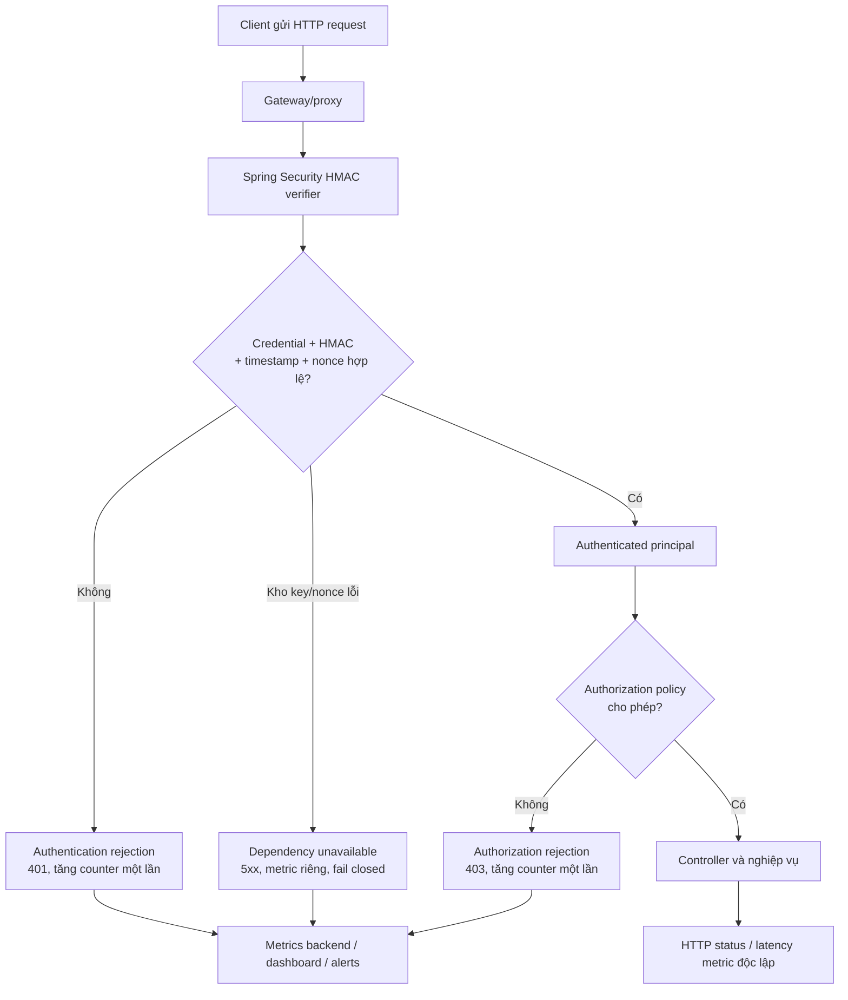

# Metric request bị từ chối khi xác thực HMAC: đo đúng, phân loại đúng và cảnh báo có ích

## 1. Bài toán: tại sao phải đo request bị từ chối?

Trong module `SECURITY_AUTHENTICATION_HMAC_REQUEST_AUTHENTICATION`, một HTTP client gửi request có chữ ký HMAC được tạo từ **shared secret** và **canonical request**. Hợp đồng ký có thể bao gồm HTTP method, URI, những header đã chọn và/hoặc hash của body. Server phải kiểm tra signature, timestamp, nonce chống replay, key version trong giai đoạn rotation; sau xác thực thành công, Spring Security mới kiểm tra quyền của principal.

Khi triển khai thật, các câu hỏi vận hành xuất hiện:

- Sau khi gateway thay đổi cách rewrite URI, tỷ lệ `401 Unauthorized` có tăng bất thường không?
- Có nhiều request bị chặn bởi nonce lặp hay timestamp ngoài khoảng chấp nhận không?
- Sau key rotation, client tiếp tục sử dụng key cũ hay gặp nhiều signature mismatch?
- Một đợt tăng `403 Forbidden` là lỗi phân quyền, hay bị nhầm với lỗi chữ ký?
- Khi key store hoặc nonce store bị lỗi, API có **fail closed** và vẫn báo cáo tình trạng hạ tầng đúng không?
- Một request bị từ chối có vô tình được đếm nhiều lần do cả filter, handler và interceptor cùng tăng counter không?

**Metric request bị từ chối** là bộ đo dùng để theo dõi các quyết định không cho request đi qua bước bảo mật. Metric này hỗ trợ phát hiện sự cố, phân biệt nguyên nhân và đánh giá hiệu quả chống replay. Nó **không thay thế** audit log, distributed tracing hay việc kiểm thử HMAC đúng chuẩn.

Bài học tập trung vào metric ở tầng ứng dụng Java/Spring Security, dùng **Micrometer** và hệ giám sát như **Prometheus**. Ví dụ có thể áp dụng cho Spring MVC (Servlet) hoặc WebFlux sau khi điều chỉnh API.

### Kết quả học tập

Người học cần:

1. Định nghĩa chính xác thế nào là request bị từ chối trong phạm vi xác thực HMAC.
2. Phân biệt lỗi xác thực, lỗi phân quyền, lỗi HTTP input và lỗi hạ tầng.
3. Thiết kế counter có nhãn hữu hạn, không dùng raw key ID, nonce, URI hoặc signature.
4. Chọn vị trí tăng metric **một lần cho mỗi quyết định**.
5. Truy vấn tỷ lệ và xu hướng bằng PromQL, đặt alert có baseline và ít báo động giả.
6. Viết kiểm thử cho signature sai, replay, key rotation, proxy rewrite và dependency outage.

## 2. Xác định ý nghĩa của từ “bị từ chối”

Trước khi viết code, phải công bố định nghĩa của metric. Nếu nhiều nhóm dùng một tên cho các loại lỗi khác nhau, biểu đồ tổng hợp sẽ gây hiểu nhầm.

### 2.1. Đề xuất phạm vi chính

Trong bài này, metric `hmac.requests.rejected` là **Counter** của quyết định bảo mật từ chối request trong hai nhóm:

- **Authentication rejection:** request cần HMAC nhưng không có credential hợp lệ, signature sai, timestamp không hợp lệ hoặc nonce bị phát lại. Phản hồi thường là `401` theo hợp đồng API.
- **Authorization rejection:** request đã xác thực nhưng principal không đủ authority hoặc bị policy truy cập từ chối. Phản hồi thường là `403`.

**Không gom mọi phản hồi HTTP không thành công vào metric này.** Ví dụ JSON sai sau khi đã xác thực có thể là `400`; body quá lớn có thể là `413`; rate limit là `429`; kho nonce không khả dụng có thể là `503`. Chúng cần được theo dõi, nhưng không đồng nghĩa “client đưa sai HMAC” hoặc “thiếu quyền”.

Bảng phân loại:

| Tình huống | Giai đoạn | HTTP thường dùng | Tính vào `hmac.requests.rejected`? | Giám sát khác |
| --- | --- | --- | --- | --- |
| Thiếu header chữ ký trên endpoint HMAC | Authentication | `401` | Có | `missing_credential` |
| Key ID sai, key bị revoke hoặc signature không khớp | Authentication | `401` | Có | `invalid_credential`; không công khai trạng thái key |
| Timestamp vượt cửa sổ | Authentication | Thường `401` | Có | `timestamp_out_of_window` |
| Nonce đã dùng | Authentication | Thường `401` | Có | `replay_detected` |
| HMAC đúng, client thiếu `orders:create` | Authorization | `403` | Có | `insufficient_authority` |
| HMAC đúng nhưng tài nguyên thuộc tenant khác | Authorization | `403` hoặc `404` theo policy | Theo định nghĩa chính sách, không tự suy từ status | Resource authorization event |
| JSON không hợp lệ sau khi HMAC thành công | Input/MVC | `400` | Không | HTTP server requests, validation metric |
| Body vượt giới hạn | HTTP/body policy | `413` | Không | Payload size rejection |
| Rate limit từ gateway | Traffic control | `429` | Không | Gateway/rate-limit metric |
| Key store hoặc nonce store mất khả dụng | Dependency | `503` hoặc `5xx` | **Không coi là credential bị từ chối** | Metric dependency failure riêng |
| Controller trả `500` | Nghiệp vụ/hạ tầng | `500` | Không | HTTP server requests |
| Endpoint `permitAll` không yêu cầu HMAC | Public | `2xx` | Không | Traffic bình thường |

Một service có thể muốn metric **“mọi request không được xử lý thành công”** rộng hơn. Khi đó hãy tạo metric hoặc dashboard khác, tên và scope rõ ràng; không đổi nghĩa `hmac.requests.rejected` tùy lúc.

### 2.2. Một request có thể qua nhiều quyết định

Một request có HMAC hợp lệ sẽ có kết quả **authentication accepted**, rồi mới đến **authorization allowed hoặc denied**. Nếu authorization trả `403`, chỉ ghi **một rejection event** ở authorization; không ghi request authentication “rejected” vì HMAC thực sự đã hợp lệ.

```text
HMAC hợp lệ -> authn accepted -> authz denied -> HTTP 403
                 ^                 ^
                 |                 |
           Không tăng reject    Tăng reject 1 lần
```

Ngược lại, request signature sai sẽ không được kiểm tra authorization dựa trên principal đã xác thực, và chỉ có authentication rejection. Nếu framework có các đường exception translation khác nhau, cần có cơ chế deduplication để cùng một HTTP request không bị đếm ở cả hai nơi.

## 3. Mô hình observability và vị trí đo metric

Một metric bảo mật chỉ hữu ích nếu nó được tăng ở **đúng điểm ra quyết định**, không phải đơn thuần sau khi nhìn thấy HTTP status.



Cần phân biệt ba lớp quan sát:

| Lớp | Dữ liệu điển hình | Mục đích |
| --- | --- | --- |
| **Security decision counter** | Số quyết định từ chối theo stage/reason/route | Chẩn đoán authentication và authorization |
| **HTTP server metric** | Tổng request, status, latency | Biết API có trả bao nhiêu `401`, `403`, `503` ở cuối pipeline |
| **Audit event / trace** | Request ID, reason code, key tag đã xác minh theo policy | Điều tra từng request, ghép dấu vết nhiều hop |

Hai metric có thể cho số liệu khác nhau mà không nhất thiết bị lỗi. Chẳng hạn gateway chặn `401` trước khi request đến ứng dụng thì **counter ứng dụng không tăng**, trong khi counter gateway tăng. Một HTTP `401` do controller tự trả vì logic riêng cũng không tự động được tính là HMAC rejection.

Không dùng `response.getStatus() >= 400` làm điều kiện duy nhất cho metric HMAC.

## 4. Thiết kế metric contract trước khi triển khai

Chọn một tên có thể export nhất quán:

```text
Micrometer meter name: hmac.requests.rejected
Prometheus (thường):   hmac_requests_rejected_total
Type:                  Counter
Unit:                  requests / security rejection decisions
Description:           Number of HMAC-protected requests rejected
                       by authentication or authorization policies
```

Tên Prometheus thực tế cần được kiểm tra trên `/actuator/prometheus` vì exporter, version và quy tắc chuyển tên có thể khác nhau. Counter là số tăng dần từ khi process bắt đầu; dashboard dùng `rate()` hoặc `increase()` thay vì so trực tiếp số tuyệt đối giữa các instance.

Nhãn (tags) đề xuất:

| Nhãn | Giá trị cho phép | Vì sao hữu ích |
| --- | --- | --- |
| `stage` | `authentication`, `authorization` | Phân biệt `401` và `403` theo quyết định |
| `reason` | `missing_credential`, `invalid_signature`, `timestamp_out_of_window`, `replay_detected`, `insufficient_authority`, `other_authentication` | Phát hiện nhóm lỗi, chống replay |
| `route` | `orders_create`, `orders_read`, `other_protected` | Biết endpoint nào bị ảnh hưởng nhưng giữ số nhãn hữu hạn |
| `status` | `401` hoặc `403` | Hỗ trợ dashboard, đối chiếu HTTP outcome dự kiến |

Một ví dụ exposition:

```text
hmac_requests_rejected_total{stage="authentication",reason="invalid_signature",route="orders_create",status="401"} 37
hmac_requests_rejected_total{stage="authentication",reason="replay_detected",route="orders_create",status="401"} 8
hmac_requests_rejected_total{stage="authorization",reason="insufficient_authority",route="orders_read",status="403"} 12
```

Đây là **số liệu giả để minh họa**, không phải đo lường từ hệ thống thật. Giá trị `status` ở đây là status **dự kiến của security handler**, không cam kết rằng client cuối cùng đã nhận đúng mã nếu network mất kết nối hay gateway ghi đè response.

### 4.1. Cardinality: nguyên tắc sống còn

Không đưa những giá trị tùy ý từ request vào nhãn metric:

- `keyId`, raw `Authorization`, signature hoặc HMAC digest.
- `nonce`, timestamp chính xác, request ID, trace ID.
- `/api/orders/123456` hoặc raw query string thay vì route template.
- IP client, hostname do client khai, `Forwarded` và `X-Forwarded-*` chưa tin cậy.
- Exception message hoặc raw body.
- Tên tenant/user có số lượng lớn, kể cả pseudonym.

Một attacker có thể tạo vô hạn key ID giả hoặc query path mới. Nếu những giá trị đó trở thành label, số time series của Prometheus tăng đột biến, gây tiêu tốn RAM/disk và làm chậm query.

**Nhãn phải xuất phát từ enum hoặc allowlist trong code**, không từ `getHeader(...)` hay `getRequestURI()` trực tiếp.

### 4.2. Tính toán ngân sách nhãn

Nếu dùng 2 stage, 6 reason, 3 route và 2 status thì tích lý thuyết là 2 × 6 × 3 × 2 = 72 combination cho mỗi instance; nhiều combination không hợp lệ theo nghiệp vụ nên thực tế ít hơn. Nếu thêm 100.000 key ID, ngân sách có thể bị nhân lên rất lớn.

Không tạo các combination vô nghĩa như `stage="authorization", reason="invalid_signature"`. Nên định nghĩa một bảng mapping cố định giữa reason, stage và status để tránh thay đổi schema tùy ý.

## 5. Java và Micrometer: counter có nhãn hữu hạn

### 5.1. Định nghĩa stage, route và lý do

Ví dụ Java 17/Spring Boot 3 dùng Micrometer:

```java
public enum ProtectedRoute {
    ORDERS_CREATE("orders_create"),
    ORDERS_READ("orders_read"),
    OTHER_PROTECTED("other_protected");

    private final String tag;

    ProtectedRoute(String tag) {
        this.tag = tag;
    }

    public String tag() {
        return tag;
    }
}

public enum RejectionReason {
    MISSING_CREDENTIAL("missing_credential", "authentication", 401),
    INVALID_SIGNATURE("invalid_signature", "authentication", 401),
    TIMESTAMP_OUT_OF_WINDOW(
            "timestamp_out_of_window", "authentication", 401),
    REPLAY_DETECTED("replay_detected", "authentication", 401),
    OTHER_AUTHENTICATION(
            "other_authentication", "authentication", 401),
    INSUFFICIENT_AUTHORITY(
            "insufficient_authority", "authorization", 403);

    private final String tag;
    private final String stage;
    private final int status;

    RejectionReason(String tag, String stage, int status) {
        this.tag = tag;
        this.stage = stage;
        this.status = status;
    }

    public String tag() { return tag; }
    public String stage() { return stage; }
    public int status() { return status; }
}
```

Bảng enum giúp giới hạn lý do. `INVALID_SIGNATURE` có thể gộp các lỗi key unknown, revoked và mismatch trong dashboard public; nếu cần phân tích chuyên sâu nội bộ, audit log có reason code riêng với quyền xem giới hạn.

### 5.2. Recorder ghi một counter

```java
import io.micrometer.core.instrument.Counter;
import io.micrometer.core.instrument.MeterRegistry;
import jakarta.servlet.http.HttpServletRequest;

public final class HmacRejectionMetrics {

    private static final String MARKER =
            HmacRejectionMetrics.class.getName() + ".recorded";

    private final MeterRegistry registry;

    public HmacRejectionMetrics(MeterRegistry registry) {
        this.registry = registry;
    }

    public void recordOnce(
            HttpServletRequest request,
            ProtectedRoute route,
            RejectionReason reason) {

        // Ví dụ dành cho một security execution đồng bộ.
        if (request.getAttribute(MARKER) != null) {
            return;
        }
        request.setAttribute(MARKER, Boolean.TRUE);

        Counter.builder("hmac.requests.rejected")
                .description("Security rejections for HMAC-protected API")
                .tags(
                        "stage", reason.stage(),
                        "reason", reason.tag(),
                        "route", route.tag(),
                        "status", Integer.toString(reason.status()))
                .register(registry)
                .increment();
    }
}
```

`Counter.builder(...).register(registry)` lấy hoặc đăng ký meter với cùng tên và tag set. Trong một hệ thống dùng nhiều route/reason cố định, Micrometer có thể cache meter theo tag; tránh tạo tên/tag tùy ý từ request.

`MARKER` trên request giúp ngăn **hai handler ở cùng luồng synchronous Servlet** ghi trùng event. Với async dispatch hoặc nhiều thread có thể vào cùng request, thao tác kiểm tra-đặt attribute không phải atomic; production phải quyết định một điểm owner duy nhất hoặc sử dụng state đồng bộ/atomic theo request nếu thực sự có concurrency.

Nếu recorder lỗi do bug hoặc registry không hoạt động, không được lấy lý do đó để cho một request HMAC sai đi tiếp. Metric là quan sát, không phải đầu vào quyết định xác thực.

### 5.3. Không ghi counter “thành công” bằng cách lấy 2xx

Trong một request HMAC đúng, endpoint vẫn có thể trả `400` do JSON không hợp lệ hoặc `500` do lỗi downstream. Nếu cần tính **tỷ lệ xác thực thành công**, hãy có một counter kết quả authentication riêng, được ghi ngay khi verifier quyết định:

```text
hmac.authentication.outcomes
  outcome = accepted | rejected | unavailable
  route = orders_create | orders_read | other_protected
```

Không lấy số HTTP `2xx` làm số “HMAC accepted”; đó là hai tầng semantics khác nhau. Counter outcomes này là **tùy chọn bổ sung**, không thay thế meter rejection chính.

## 6. Spring Security MVC: ghi ở đúng handler 401/403

Trong hệ Servlet, HMAC có thể được thực hiện bởi custom `OncePerRequestFilter` trước `AuthorizationFilter`. Một thiết kế thuận tiện là ghi counter tại **các handler quyết định security response**:

- `AuthenticationEntryPoint` khi trả `401`.
- `AccessDeniedHandler` khi trả `403`.
- Không đồng thời tăng counter ở verifier, filter catch, entry point và controller cho cùng sự kiện.

### 6.1. Exception mang reason code an toàn

```java
public final class HmacCredentialException
        extends AuthenticationException {

    private final RejectionReason rejectionReason;

    public HmacCredentialException(RejectionReason rejectionReason) {
        super("HMAC authentication rejected");
        if (!"authentication".equals(rejectionReason.stage())) {
            throw new IllegalArgumentException(
                    "Only authentication reasons are allowed");
        }
        this.rejectionReason = rejectionReason;
    }

    public RejectionReason rejectionReason() {
        return rejectionReason;
    }
}
```

Không đưa key ID, secret, supplied/expected signature, canonical request hoặc body vào exception message. Handler sử dụng enum để tăng metric.

Ví dụ các nhánh:

```java
// Thiếu credential:
throw new HmacCredentialException(
        RejectionReason.MISSING_CREDENTIAL);

// Signature sai/key không hợp lệ (thông điệp public giống nhau):
throw new HmacCredentialException(
        RejectionReason.INVALID_SIGNATURE);

// Timestamp ngoài cửa sổ:
throw new HmacCredentialException(
        RejectionReason.TIMESTAMP_OUT_OF_WINDOW);

// Nonce replay:
throw new HmacCredentialException(
        RejectionReason.REPLAY_DETECTED);
```

Verifier chỉ ném các exception này **sau khi đã kiểm tra điều kiện tương ứng**. Đối với nonce store bị lỗi không nên ném `REPLAY_DETECTED`; đây là outage cần fail closed và đi qua error handling riêng.

### 6.2. Entry point và denied handler

```java
@Bean
SecurityFilterChain signedApiSecurity(
        HttpSecurity http,
        HmacRequestVerifier verifier,
        HmacRejectionMetrics metrics) throws Exception {

    AuthenticationEntryPoint entryPoint = (request, response, ex) -> {
        RejectionReason reason =
                ex instanceof HmacCredentialException hmac
                        ? hmac.rejectionReason()
                        : RejectionReason.OTHER_AUTHENTICATION;

        metrics.recordOnce(
                request, resolveProtectedRoute(request), reason);

        response.setStatus(HttpServletResponse.SC_UNAUTHORIZED);
        response.setHeader(
                HttpHeaders.WWW_AUTHENTICATE,
                "HMAC realm=\"signed-api\"");
        response.setContentType(
                MediaType.APPLICATION_PROBLEM_JSON_VALUE);
        response.getWriter().write(
                "{\"title\":\"Unauthorized\",\"status\":401}");
    };

    AccessDeniedHandler deniedHandler = (request, response, ex) -> {
        metrics.recordOnce(
                request,
                resolveProtectedRoute(request),
                RejectionReason.INSUFFICIENT_AUTHORITY);

        response.setStatus(HttpServletResponse.SC_FORBIDDEN);
        response.setContentType(
                MediaType.APPLICATION_PROBLEM_JSON_VALUE);
        response.getWriter().write(
                "{\"title\":\"Forbidden\",\"status\":403}");
    };

    return http
            .securityMatcher("/api/**")
            .sessionManagement(session -> session
                    .sessionCreationPolicy(SessionCreationPolicy.STATELESS))
            .csrf(csrf -> csrf.disable())
            .requestCache(cache ->
                    cache.requestCache(new NullRequestCache()))
            .exceptionHandling(errors -> errors
                    .authenticationEntryPoint(entryPoint)
                    .accessDeniedHandler(deniedHandler))
            .authorizeHttpRequests(authz -> authz
                    .requestMatchers("/api/health").permitAll()
                    .requestMatchers(
                            HttpMethod.POST, "/api/orders")
                        .hasAuthority("orders:create")
                    .anyRequest().authenticated())
            .addFilterBefore(
                    new HmacAuthenticationFilter(verifier, entryPoint),
                    UsernamePasswordAuthenticationFilter.class)
            .build();
}
```

Đây là wiring minh họa với Spring Security 6; các import khác và implementation `HmacRequestVerifier`, `HmacAuthenticationFilter`, `resolveProtectedRoute` cần được dự án cung cấp. `resolveProtectedRoute` phải trả **một enum từ allowlist**, không trả raw path/query của client; có thể dùng matcher rõ ràng theo method và path.

Trong filter HMAC:

```java
try {
    VerifiedHmacRequest result = verifier.verify(request);
    // Thiết lập Authentication đáng tin cậy vào SecurityContext.
    // Nếu verifier đã đọc body, result.requestForChain() phát lại bytes.
    chain.doFilter(result.requestForChain(), response);
} catch (HmacCredentialException ex) {
    // Đừng để catch bao quanh chain.doFilter trong code production;
    // đoạn này chỉ minh họa hướng chuyển lỗi, xem mẫu bên dưới.
    entryPoint.commence(request, response, ex);
    return;
}
```

**Cần sửa phạm vi catch trong implementation thật:** chỉ bao `verifier.verify(...)`, rồi đặt `chain.doFilter(...)` **ngoài** catch. Nếu catch trùm downstream, lỗi authentication từ filter/handler khác có thể bị đếm sai hoặc response bị ghi hai lần.

```java
final VerifiedHmacRequest result;
try {
    result = verifier.verify(request);
} catch (HmacCredentialException ex) {
    SecurityContextHolder.clearContext();
    entryPoint.commence(request, response, ex);
    return;
}

// Validate result, tạo SecurityContext, rồi mới đi tiếp.
chain.doFilter(result.requestForChain(), response);
```

Nếu verifier trả result null, Authentication chưa được xác thực hoặc wrapper không hợp lệ, đó là lỗi contract nội bộ phải được xử lý fail closed, không tự cho request đi tiếp.

Một số hệ thống để authorization của anonymous request gọi `AuthenticationEntryPoint` khi thiếu credential thay vì để HMAC filter từ chối ngay. Hai đường này vẫn có thể dùng chung recorder, nhưng cần kiểm thử không đếm hai lần và không bỏ qua HMAC trên route protected.

### 6.3. Chỉ ghi rejection cho route thực sự cần bảo vệ

`permitAll` ở `/api/health` chỉ cho phép anonymous ở tầng authorization; custom HMAC filter phải skip endpoint đó rõ ràng nếu chính sách không yêu cầu HMAC. Nếu filter đòi credential ở health, counter có thể tăng `missing_credential` dù route vốn được định nghĩa public, làm nhiễu dashboard và gây `401` ngoài dự kiến.

Không đếm các `401` do security chain khác (ví dụ Bearer cho web app) vào counter HMAC chỉ vì chúng có cùng HTTP status. Nếu cần nhiều scheme, đặt matcher và metric contract riêng.

## 7. Spring WebFlux: metric rejection trong reactive authentication

Spring WebFlux dùng `SecurityWebFilterChain`, `AuthenticationWebFilter`, `ReactiveAuthenticationManager` và `ServerWebExchange`. Không dùng `HttpServletRequest` hoặc `ThreadLocal` như trong Servlet.

Có thể đặt metric tại:

- `ServerAuthenticationEntryPoint` khi HMAC authentication thất bại.
- `ServerAccessDeniedHandler` khi principal đã xác thực nhưng thiếu quyền.

Một recorder cho reactive exchange có thể dùng cùng enum, registry và marker ở phạm vi request:

```java
public void recordOnce(
        ServerWebExchange exchange,
        ProtectedRoute route,
        RejectionReason reason) {

    String marker = HmacRejectionMetrics.class.getName() + ".recorded";

    // Với mỗi exchange, phải có một owner logic của security decision.
    if (exchange.getAttribute(marker) != null) {
        return;
    }
    exchange.getAttributes().put(marker, Boolean.TRUE);

    registry.counter(
            "hmac.requests.rejected",
            "stage", reason.stage(),
            "reason", reason.tag(),
            "route", route.tag(),
            "status", Integer.toString(reason.status()))
            .increment();
}
```

Đây là method minh họa nằm trong class có `MeterRegistry registry`. Trường hợp exchange được xử lý đồng thời trên nhiều luồng cần cơ chế atomic/idempotency nếu nhiều nơi cùng có thể emit event; tốt hơn chọn **một owner duy nhất** thay vì đồng thời ghi từ converter, manager, WebFilter và entry point.

Ví dụ handler:

```java
ServerAuthenticationEntryPoint entryPoint = (exchange, ex) -> {
    RejectionReason reason =
            ex instanceof HmacCredentialException hmac
                    ? hmac.rejectionReason()
                    : RejectionReason.OTHER_AUTHENTICATION;

    metrics.recordOnce(
            exchange, resolveProtectedRoute(exchange), reason);

    ServerHttpResponse response = exchange.getResponse();
    response.setStatusCode(HttpStatus.UNAUTHORIZED);
    response.getHeaders().set(
            HttpHeaders.WWW_AUTHENTICATE,
            "HMAC realm=\"signed-api\"");
    return response.setComplete();
};

ServerAccessDeniedHandler deniedHandler = (exchange, ex) -> {
    metrics.recordOnce(
            exchange, resolveProtectedRoute(exchange),
            RejectionReason.INSUFFICIENT_AUTHORITY);

    exchange.getResponse().setStatusCode(HttpStatus.FORBIDDEN);
    return exchange.getResponse().setComplete();
};
```

Trong `AuthenticationWebFilter`, dùng `ServerAuthenticationEntryPointFailureHandler` tương ứng để route authentication exception đến entry point. Security context reactive được truyền qua **Reactor Context**, không phải `SecurityContextHolder` kiểu Servlet. Nếu HMAC ký body, verifier phải dùng `Flux<DataBuffer>` có giới hạn, release buffer phù hợp và phát lại đúng bytes xuống handler.

**Không gọi `block()` hoặc tự `subscribe()` để tăng metric.** `Counter.increment()` là thao tác đồng bộ rất ngắn của registry, có thể gọi trong đường xử lý quyết định bảo mật. Với tracing hoặc xuất metric qua I/O, hãy để registry/exporter xử lý theo cơ chế của nó thay vì chặn event loop chờ remote backend.

## 8. Đếm đúng một lần trong các tình huống khó

### 8.1. Nhiều filter/handler cùng quan sát một request

Một request có thể đi qua custom HMAC filter, `ExceptionTranslationFilter`, `AuthenticationEntryPoint`, `AccessDeniedHandler`, logging filter và MVC exception handler. Nếu mỗi nơi tăng counter theo `response.status`, metric có thể lớn hơn số request thực.

Chọn **một ranh giới sở hữu việc tăng metric**. Ví dụ:

- Authentication error: chỉ entry point ghi rejection.
- Authorization error: chỉ denied handler ghi rejection.
- Verifier, security context, controller và response logging **không tăng cùng counter**.
- Một request được marker để tránh lặp trong cùng dispatch hoặc retry nội bộ.

### 8.2. Async, error dispatch và retries

- Servlet `ERROR` dispatch có thể chạy lại filter chain. Không tạo event mới chỉ vì trang lỗi cũng đi qua security.
- Với WebFlux, một publisher có thể bị subscribe lại khi dùng `retry()` hoặc `repeat()`. Một thao tác ghi metric trong `doOnError` có thể lặp theo số attempt; cần quyết định đếm logical request hay mỗi authentication attempt.
- Gateway hoặc client có thể retry cả HTTP request. Đó thường là **request HTTP mới**, vì vậy mỗi request được server nhận và quyết định từ chối có thể được đếm; đừng nhầm với duplicate event nội bộ của cùng request.
- Anti-replay có thể từ chối một retry dùng lại nonce, trong khi retry với nonce mới có thể là request khác hợp lệ. Đừng lấy retry metric làm idempotency bảo đảm.

### 8.3. Kết quả của HMAC, authorization và network status

Nếu security entry point đã quyết định `401` rồi client đóng kết nối trước khi nhận response, counter vẫn có thể tăng vì **quyết định từ chối đã xảy ra**. HTTP server completion metric có thể ghi trạng thái khác hoặc không có observation hoàn chỉnh.

Cần mô tả rõ ở dashboard rằng `hmac.requests.rejected` là **security decisions**, không phải bằng chứng gói `401` đã được client nhận thành công.

### 8.4. Lỗi hạ tầng không biến thành signature mismatch

Nếu key store hoặc nonce store không khả dụng, không tăng `invalid_signature` hoặc `replay_detected` chỉ vì verifier không thể hoàn tất phép kiểm tra. Đây là sự cố hệ thống.

Ví dụ các metric riêng:

```text
hmac_dependency_failures_total{dependency="key_store",operation="lookup"}
hmac_dependency_failures_total{dependency="nonce_store",operation="reserve"}
```

Nhãn `dependency` và `operation` phải là enum từ code. Request cần **fail closed** và trả `503` hoặc `5xx` theo hợp đồng; tuyệt đối không cho qua để giữ tỷ lệ rejection thấp.

## 9. Chống replay và key rotation: biểu đồ phải phản ánh đúng thực tế

### 9.1. Replay detected

HMAC không tự ngăn tái sử dụng một request hợp lệ. Verifier thường kiểm tra timestamp trong cửa sổ, nonce duy nhất theo credential/client và đánh dấu nonce bằng thao tác **atomic** trong store dùng chung.

Với request sử dụng nonce đã có:

```text
reason="replay_detected", stage="authentication", status="401"
```

Metric này tăng khi server **thực sự xác định replay**, không phải khi nonce store bị timeout hoặc khóa không tồn tại. Lỗi atomic reserve/timeout cần metric hạ tầng riêng.

Nếu nhiều node cùng xử lý một nonce, chỉ một request được chấp nhận trong cửa sổ theo policy. Test song song cần kiểm tra số lần accepted, chứ không chỉ số `401`.

### 9.2. Timestamp ngoài cửa sổ

Nhóm `timestamp_out_of_window` có thể tăng khi đồng hồ client lệch, message bị giữ lâu ở proxy hoặc hệ thống retry request cũ. Ngoài rejected counter, có thể có histogram **clock skew theo bucket cố định**, nhưng không dùng raw timestamp hoặc IP/client ID làm tag.

Một đợt tăng timestamp error cùng lúc trên nhiều route có thể là vấn đề đồng bộ thời gian, không nhất thiết là tấn công.

### 9.3. Key rotation

Khi key rotation có overlap, verifier có thể chấp nhận key cũ và mới trong khoảng cho phép. Khi key cũ bị revoke, request với key đó phải từ chối; nhưng không nên công khai lý do phân biệt “key không tồn tại” và “key bị thu hồi”.

Metrics ở nhánh bị từ chối nên dùng nhóm `invalid_signature` hoặc `other_authentication` thay vì nhãn `key_id="client-secret-v1"`. Để đánh giá key cũ còn được sử dụng, có thể bổ sung metric aggregate với **version class hữu hạn** (`current`, `previous_allowed`) từ key record đã xác minh, không dùng raw key ID. Việc cần truy vết chính xác credential nào nên thực hiện qua audit log bảo vệ với verified key tag.

## 10. Proxy/gateway ảnh hưởng số liệu như thế nào?

Một API có thể nhận request qua CDN, gateway, reverse proxy hoặc service mesh. Proxy có thể thay đổi path, host, query, header hoặc body. Nếu client ký public URI nhưng server xác minh internal URI sau rewrite mà không có canonicalization hợp đồng, signature mismatch tăng.

Ví dụ:

```text
Client ký:      POST https://api.example.test/v1/orders?region=vn
Gateway gửi:    POST http://orders-service:8080/internal/orders?region=vn
HMAC verifier:  phải dùng đúng representation đã được hợp đồng công bố
```

Khi một metric `invalid_signature` tăng đột ngột:

1. Xem change/deployment của gateway và service trong khoảng thời gian.
2. So sánh contract version và route template ở các hệ thống.
3. Kiểm tra forwarding metadata có được trusted ingress kiểm soát hay không.
4. Kiểm tra signed header set, path/query normalization, content encoding và raw body hash theo **test vectors giả lập**, không dump request production.
5. Phân biệt request bị gateway chặn trước app với request đã đến HMAC verifier.

### 10.1. Không tin Forwarded header làm nhãn

`Forwarded` và `X-Forwarded-*` có thể do client giả mạo nếu gateway không lọc. Chúng cũng có thể chứa IP hoặc hostname nhạy cảm. **Không** lấy raw `X-Forwarded-For`, `X-Forwarded-Host`, `X-Original-URI` làm nhãn metric.

Nếu cần phân biệt vùng gateway, dùng `gateway_group` là enum nội bộ hoặc identity proxy lấy từ mTLS/network policy đáng tin cậy. Không dùng hostname tùy ý từ Internet.

### 10.2. Hai lớp số liệu không đồng nhất

Một request bị WAF/gateway chặn sẽ không xuất hiện trong metric `hmac.requests.rejected` của service nếu không đi đến nó. Bởi vậy dashboard end-to-end nên thể hiện:

- Gateway security rejection rate.
- Application HMAC authentication rejection rate.
- Application authorization rejection rate.
- HTTP response 4xx/5xx rate và request volume.

Không cộng cơ học gateway reject + app reject nếu một request có thể được quan sát ở hai hop; cần quy ước rõ “lượt xử lý tại hop” và “logical request” để tránh đếm trùng khi tổng hợp.

## 11. Prometheus và PromQL: truy vấn những gì?

Giả sử exporter xuất `hmac_requests_rejected_total` như phần trên. Khi chưa có exporter/Actuator thật, các câu query dưới đây là **mẫu**, cần chỉnh `job`, label và meter name theo hệ thống.

### 11.1. Tốc độ từ chối mỗi giây

```promql
sum(rate(hmac_requests_rejected_total[5m]))
```

`rate()` xử lý counter reset khi process restart và tính tốc độ trong khoảng quan sát. Không cộng trực tiếp giá trị counter raw từ các pod rồi xem đó là số request trong năm phút.

### 11.2. Phân tích theo giai đoạn

```promql
sum by (stage) (
  rate(hmac_requests_rejected_total[5m])
)
```

Nếu authentication tăng, xem lại canonicalization, key, nonce và gateway. Nếu authorization tăng nhưng authentication không tăng, tập trung vào policy, scope, tenant/ownership và thay đổi quyền.

### 11.3. Phân tích theo lý do

```promql
sum by (route, reason) (
  rate(hmac_requests_rejected_total[5m])
)
```

Giá trị `reason` từ allowlist cho biết lỗi tăng ở route nào. Tránh đưa raw URI vào label để có thể dùng biểu thức này an toàn.

### 11.4. Số lượt replay bị chặn trong mười phút

```promql
sum(increase(
  hmac_requests_rejected_total{reason="replay_detected"}[10m]
))
```

Đây là **số quyết định từ chối replay tại application**, không phải số attacker, số nonce duy nhất, hay số giao dịch trùng lặp. Client hợp lệ gửi lại nonce sau timeout cũng có thể làm metric tăng.

### 11.5. Tỷ lệ rejection so với request được xác thực

Để tính tỷ lệ thực sự, **mẫu số phải cùng phạm vi**: route bảo vệ HMAC, cùng stage và cùng khoảng thời gian. Một cách nhất quán là tạo counter `hmac.authentication.outcomes` ở mọi quyết định authentication, với `outcome="accepted"` hoặc `"rejected"`, và có `"unavailable"` cho lỗi dependency.

Mẫu truy vấn:

```promql
sum(rate(hmac_authentication_outcomes_total{outcome="rejected"}[5m]))
/
clamp_min(
  sum(rate(hmac_authentication_outcomes_total{
    outcome=~"accepted|rejected"
  }[5m])),
  1e-9
)
```

Đây là tỷ lệ **rejected trong số lần authentication có kết luận accepted hoặc rejected**, không gồm dependency unavailable; phải giải thích lựa chọn này trên dashboard. Nếu muốn tỷ lệ failed-to-serve tổng thể, cần một mẫu số khác và đưa outage vào phạm vi thích hợp.

Không lấy `hmac_requests_rejected_total / http_server_requests_seconds_count` một cách tự động nếu metric HTTP bao gồm public health check, gateway bị chặn, controller 4xx hoặc các security scheme khác. Nếu dùng HTTP denominator, phải lọc chính xác route và phạm vi cùng nguồn dữ liệu.

### 11.6. Kiểm tra exporter thực tế

Với Spring Boot Actuator và Micrometer Prometheus registry đã cấu hình, endpoint `/actuator/prometheus` thường xuất các counter và timer. Cần kiểm tra:

- Meter name thực tế sau đổi tên dấu chấm sang dấu gạch dưới.
- Sự hiện diện của suffix `_total` với counter.
- Label values hữu hạn và đúng tên.
- Counter tăng một lần cho test request.
- Metrics endpoint có được giới hạn truy cập theo policy vận hành không.

Không đưa secret, raw credential hoặc toàn bộ trace vào Prometheus exposition.

## 12. Dashboard: quan sát đủ cả bảo mật và tính sẵn sàng

Một dashboard hữu ích không chỉ có một số “401 toàn hệ thống”.

Có thể tổ chức:

| Biểu đồ | Nguồn dữ liệu | Câu hỏi trả lời |
| --- | --- | --- |
| HMAC rejects/s | `hmac.requests.rejected` | Tổng security rejection tăng hay giảm? |
| Authn vs authz | `stage` | Client ký sai hay thiếu quyền? |
| Reject by reason | `reason` | Replay, timestamp hay invalid signature? |
| Reject by route | `route` | Route nào bị ảnh hưởng sau deploy? |
| Authn success/reject/unavailable ratio | `hmac.authentication.outcomes` bổ sung | Có bao nhiêu lần xác thực cho kết quả? |
| Dependency errors | Key/nonce store failure metrics | Có fail closed do outage không? |
| HTTP 401/403/503 | `http.server.requests` hoặc gateway metrics | Client nhìn thấy status gì? |
| Request volume | HTTP request metrics | Rejection tăng do lưu lượng tăng hay tỷ lệ tăng? |
| Latency p95/p99 | HTTP timer | Verifier hoặc dependency có làm chậm request? |
| Gateway vs service | Metric từ cả hai hop | Request bị chặn ở đâu? |

Nên annotate các sự kiện deploy gateway, thay đổi canonical contract, key rotation và outage nonce store để phân tích tương quan theo thời gian.

Đừng tạo dashboard “top 100 key IDs bị reject” trực tiếp từ label Prometheus do client tự cung cấp. Nếu cần phân tích một credential cụ thể, dùng audit event đã được bảo vệ với **verified key tag** và cơ chế tìm kiếm có quyền hạn.

## 13. Alerting: ngưỡng nào có ý nghĩa?

Không có một ngưỡng rejection cố định phù hợp với mọi API. Hệ thống traffic thấp có thể tăng từ 0 lên 2 lỗi/phút vì một client cấu hình sai; hệ thống traffic lớn có vài trăm `401`/phút là bình thường nếu có quét Internet.

Nên kết hợp **tốc độ**, **tỷ lệ**, **baseline lịch sử**, **lưu lượng tối thiểu** và **thời gian duy trì**.

### 13.1. Ví dụ cảnh báo tăng signature mismatch

```yaml
groups:
  - name: hmac-security
    rules:
      - alert: HmacSignatureMismatchSpike
        expr: |
          sum(rate(hmac_requests_rejected_total{
            reason="invalid_signature"
          }[5m])) > 5
        for: 10m
        labels:
          severity: warning
        annotations:
          summary: "HMAC invalid-signature rejection rate is elevated"
          description: "Check gateway canonicalization and signer changes."
```

Giá trị **5 request/giây trong 10 phút chỉ là minh họa**, không phải ngưỡng production khuyến nghị. Hãy hiệu chỉnh dựa trên traffic thực, số khách hàng, từng route và mức độ ảnh hưởng.

### 13.2. Replay spike

```promql
sum(rate(
  hmac_requests_rejected_total{reason="replay_detected"}[5m]
))
```

Dùng kèm tổng số authentication attempts hoặc request volume để tránh đánh đồng traffic tăng với replay rate bất thường. Replay spike có thể xuất phát từ client retry sai hợp đồng, hoặc một hoạt động tấn công; cần điều tra theo request IDs và audit event đã được phép truy cập.

### 13.3. Dependency outage là alert khác

```promql
sum(rate(hmac_dependency_failures_total{
  dependency="nonce_store"
}[5m]))
```

Đây là tín hiệu có thể ảnh hưởng **availability** của toàn bộ HMAC API do chính sách fail closed. Nên đi kèm alert latency/error rate và runbook dependency; đừng chỉ nhìn rejection counter vì outage có thể làm `401` giảm còn `503` tăng.

### 13.4. Điều cần ghi trong runbook

Mỗi alert nên có ít nhất:

1. Ý nghĩa chính xác của metric và labels.
2. Nơi tìm request ID, tracing và log giảm nhạy cảm.
3. Những lần thay đổi gần đây của signer, gateway và key rotation.
4. Cách kiểm tra timestamp/nonce store một cách an toàn.
5. Cách phân biệt lỗi client, lỗi cấu hình và hoạt động tấn công.
6. Cách giảm tác động mà **không tắt HMAC hoặc bỏ qua anti-replay**.
7. Tiêu chí kết thúc sự cố và theo dõi recurrence.

## 14. Bảo vệ metrics, log và trace khỏi lộ dữ liệu

Dù `hmac.requests.rejected` không chứa secret, observability pipeline vẫn có thể rò rỉ dữ liệu nếu trộn raw header, body hoặc canonical request vào trace/log.

Các nguyên tắc:

- Không đưa shared secret, HMAC key bytes, supplied/expected signature, `Authorization`, cookie hoặc body thô vào metric, span attributes hay log.
- Không đưa timestamp chính xác, nonce hoặc request ID vào **metric labels**; request ID dành cho log/trace có policy bảo vệ.
- Khi muốn tương quan client sau khi xác thực, dùng alias hoặc pseudonym **từ key record đã xác minh**, không dùng raw `keyId` của request thất bại.
- Không dùng `ex.getMessage()` hay raw query string làm `reason`/`route`.
- Giới hạn quyền đọc `/actuator/prometheus`, dashboard và audit logs; metrics an ninh có thể tiết lộ tình trạng vận hành nếu công khai.
- Đặt retention và quota phù hợp để tránh log/metric flooding; bảo vệ exporter khỏi request không đáng tin.
- Dùng trace correlation theo ID đáng tin từ ingress hoặc do server tự sinh; không coi `X-Request-Id` tùy ý từ client là dữ liệu đã được tin.

Một metric tốt trả lời được **có bao nhiêu**, **xảy ra ở đâu** và **nhóm nguyên nhân gì** mà không cần hiển thị secret hoặc payload.

## 15. Kiểm thử metric request bị từ chối

Test phải chứng minh rằng đúng **một quyết định từ chối tạo ra đúng một increment**, không chỉ chứng minh HTTP trả mã lỗi phù hợp.

### 15.1. Unit test với SimpleMeterRegistry

Ví dụ dùng `MockHttpServletRequest` của Spring Test:

```java
@Test
void recordsAuthenticationRejectionExactlyOnce() {
    SimpleMeterRegistry registry = new SimpleMeterRegistry();
    HmacRejectionMetrics metrics = new HmacRejectionMetrics(registry);

    MockHttpServletRequest request = new MockHttpServletRequest();

    metrics.recordOnce(
            request,
            ProtectedRoute.ORDERS_CREATE,
            RejectionReason.MISSING_CREDENTIAL);

    // Nếu entry point vô tình chạy lại cho cùng request,
    // marker không được tạo double-count.
    metrics.recordOnce(
            request,
            ProtectedRoute.ORDERS_CREATE,
            RejectionReason.MISSING_CREDENTIAL);

    double total = registry.get("hmac.requests.rejected")
            .tag("stage", "authentication")
            .tag("reason", "missing_credential")
            .tag("route", "orders_create")
            .tag("status", "401")
            .counter()
            .count();

    assertEquals(1.0, total);
}
```

Đoạn test cần JUnit Jupiter, Micrometer `SimpleMeterRegistry` và Spring MockHttpServletRequest imports. Test `recordOnce` đồng bộ không chứng minh hành vi async multi-thread; với async hãy thêm test concurrency và state handling riêng.

### 15.2. Integration test qua Spring Security MVC

Dùng `MockMvc` có security filters thực, giả sử mock verifier nhận test fixtures và `HmacRejectionMetrics` được nối vào entry point/denied handler.

| Test | HTTP | Counter tăng | Điều không được xảy ra |
| --- | --- | --- | --- |
| Request thiếu HMAC credential | `401` | `missing_credential` +1 | Controller không chạy |
| Signature sai hoặc key revoked | `401` | `invalid_signature` +1 | Không tạo principal đã xác thực |
| Timestamp quá hạn | `401` | `timestamp_out_of_window` +1 | Không chấp nhận nonce cũ |
| Nonce lặp | `401` | `replay_detected` +1 | Không thực thi nghiệp vụ |
| HMAC hợp lệ nhưng quyền thiếu | `403` | `insufficient_authority` +1 | Không ghi authn rejected |
| HMAC hợp lệ, quyền đủ | `2xx` | Rejection counter không tăng | Không tự coi mọi success là 2xx nếu controller lỗi |
| JSON sai sau HMAC hợp lệ | `400` | Rejection counter không tăng | Không phân loại thành signature mismatch |
| Nonce/key store không hoạt động | `503`/`5xx` | Dependency failure tăng, **không** tăng invalid signature | Không fail open |
| Endpoint `/api/health` public | `2xx` | Không tăng | Không yêu cầu chữ ký |
| Gateway rewrite path/header/body | Theo hợp đồng | Đúng reason nếu không khớp | Không gán raw URI vào tags |

Ví dụ một assertion chung:

```java
mockMvc.perform(post("/api/orders")
                .contentType(MediaType.APPLICATION_JSON)
                .content("{\"sku\":\"A1\"}"))
        .andExpect(status().isUnauthorized());

assertEquals(1.0,
        meterRegistry.get("hmac.requests.rejected")
                .tag("reason", "missing_credential")
                .counter()
                .count());
```

Trong ứng dụng có nhiều tag bắt buộc, `registry.get(...).tag(...)` có thể match nhiều meter cùng reason và ném lỗi do không duy nhất; test thật nên chỉ định đầy đủ `stage`, `route` và `status` như unit test, hoặc tổng hợp `find(...)` có chủ ý. Đoạn trên chỉ minh họa hướng integration; không dựa vào sự mơ hồ trong production assertions.

### 15.3. Kiểm thử WebFlux với WebTestClient

Trong WebFlux, dùng `WebTestClient` chạy qua `SecurityWebFilterChain` thực. Gửi request thiếu HMAC và xác minh `401` cùng counter authentication tăng đúng một lần. Gửi request có HMAC hợp lệ nhưng thiếu authority và xác minh `403` cùng counter authorization tăng, không phải counter signature mismatch.

Khi có `Flux<DataBuffer>` body signing, kiểm tra body được phát lại đúng, giới hạn payload, cancellation và không double-count khi publisher bị retry/re-subscribe ngoài dự kiến.

### 15.4. Kiểm thử concurrency, key rotation và gateway

- Hai request đồng thời dùng cùng nonce: chỉ một request được authenticated theo policy; request bị chặn replay phải tăng `replay_detected` đúng một lần.
- Rotation overlap: key version còn cho phép phải xác thực bình thường; key đã revoke bị từ chối nhưng không lộ key ID trong metric.
- Proxy rewrite URI: nếu contract ký public path, test phải đưa request qua gateway thật hoặc mô phỏng forwarding metadata có trust boundary; mismatch phải được phân loại đúng.
- Dependency outage: key/nonce store mất kết nối dẫn tới fail closed và metric outage riêng; không “giả” thành credential sai.
- High-cardinality attack: fuzz key ID, nonce, path, query, `X-Forwarded-For`; số combination của metric rejection không được tăng theo số giá trị đầu vào.

## 16. Những sai lầm thường gặp

1. **Đếm mọi HTTP `401` là HMAC invalid signature.** HTTP 401 có thể phát sinh từ scheme khác, route khác hoặc header thiếu.
2. **Gộp `401` và `403` mà không có stage.** Làm khó phân biệt xác thực với phân quyền.
3. **Gán `503` do nonce store outage thành `invalid_signature`.** Che hạ tầng lỗi và làm sai dashboard bảo mật.
4. **Tăng counter ở cả verifier, filter catch, entry point và response logging.** Làm duplicate một quyết định.
5. **Dùng raw `keyId`, URI, nonce hoặc IP làm metric label.** Tạo cardinality bùng nổ và nguy cơ rò dữ liệu.
6. **Dùng status cuối cùng thay security decision.** Trộn các lỗi nghiệp vụ, gateway và validation vào HMAC.
7. **Dùng số counter raw để so giữa các pod mà không tính reset.** Counter restart làm dashboard khó hiểu; sử dụng `rate`/`increase`.
8. **Tính rejection ratio với toàn bộ public traffic.** Mẫu số sai sẽ che lỗi HMAC trên route protected.
9. **Tắt HMAC hoặc nonce check để kéo rejection rate xuống.** Làm mất kiểm soát bảo mật thay vì sửa root cause.
10. **Không test concurrency và retry.** Replay có thể bị đếm sai hoặc được cho qua khi store thiếu atomic operation.
11. **Không quan sát gateway riêng.** Request bị edge từ chối không xuất hiện trong metric tại service.
12. **Không có runbook.** Alert chỉ báo số tăng mà không chỉ ra nơi kiểm tra canonical contract, key rotation, proxy và time sync.

## 17. Bài thực hành: xây dashboard HMAC rejected requests

Giả sử service bảo vệ `POST /api/orders` và `GET /api/orders/{id}` bằng HMAC-SHA256. Hợp đồng ký method, canonical URI, một số header, hash body, timestamp và nonce. Service chạy sau gateway, có nhiều credential và đang thực hiện key rotation. `POST /api/orders` cần authority `orders:create`.

Thực hiện:

1. Xây enum cho stage/reason/route với số lượng hữu hạn, định nghĩa metric `hmac.requests.rejected` và tài liệu hóa rằng nó chỉ đo security decisions `401`/`403`.
2. Tạo `HmacRejectionMetrics` dùng Micrometer, gắn vào entry point/denied handler một lần; không ghi metric lần nữa ở verifier hay controller.
3. Viết verifier kiểm tra chữ ký, key version, timestamp, nonce atomic; lỗi dependency phải fail closed với metric hạ tầng riêng.
4. Bật actuator metrics/Prometheus exporter trong môi trường kiểm thử phù hợp và xác minh metric name, labels, giá trị thực sau mỗi request.
5. Tạo dashboard rejects/s, reason breakdown, authentication vs authorization, replay count, HTTP `401`/`403`/`503` và dependency errors.
6. Viết alert minh họa cho signature mismatch spike và nonce-store outage, hiệu chỉnh ngưỡng theo traffic/route thật.
7. Kiểm thử `MockMvc` hoặc `WebTestClient`: HMAC sai, nonce lặp, key revoked, quyền thiếu, body sai, retry, proxy rewrite và key rotation; so counter trước/sau và xác nhận controller không chạy khi bị chặn.
8. Fuzz key ID/path/query/nonce để chứng minh metric cardinality không phụ thuộc dữ liệu tùy ý từ client.
9. Định nghĩa runbook với request ID/trace, audit log an toàn, cách kiểm tra gateway và không tiết lộ shared secret/chữ ký kỳ vọng.

**Tiêu chí hoàn thành:** Counter tăng đúng một lần mỗi request bị authentication hoặc authorization từ chối theo phạm vi định nghĩa; nhãn metric được kiểm soát và không chứa dữ liệu nhạy cảm; replay/timestamp/signature/permission được phân loại nhất quán; lỗi key/nonce store được quan sát riêng và không mở đường fail-open; dashboard, alert và test có thể dùng để tìm sự cố HMAC hoặc proxy mà không nhầm lỗi bảo mật với lỗi nghiệp vụ.
