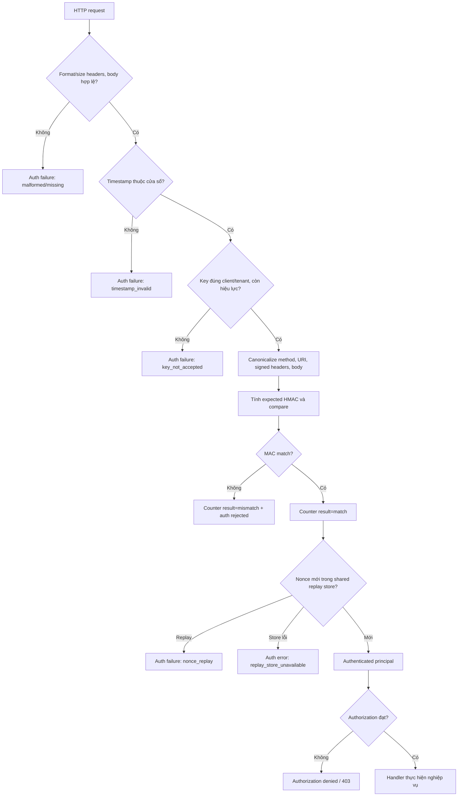

# Metric sai signature khi giám sát xác thực HMAC

## 1. Mục tiêu và phạm vi

Trong chương **Monitoring**, chủ đề **Metric sai signature** hướng dẫn cách đo và chẩn đoán những request có **chữ ký HMAC không khớp** trong hệ thống thực tế. Metric này giúp phát hiện client cấu hình sai, thay đổi ngoài ý muốn của proxy/gateway, lỗi canonicalization, sự cố triển khai và lưu lượng giả mạo. Để có ý nghĩa, metric phải được ghi ở **đúng bước kiểm MAC**, có mẫu số rõ ràng và không tiết lộ dữ liệu dùng để xác thực.

Bài áp dụng cho mô-đun `SECURITY_AUTHENTICATION_HMAC_REQUEST_AUTHENTICATION`: hai bên dùng **shared secret** để ký HTTP request theo **canonical request** gồm phương thức, URI, một số header và/hoặc body. Server xác minh MAC, kiểm timestamp/nonce để chống replay, xử lý key rotation, thử nghiệm qua gateway/proxy và phân biệt **authentication** với **authorization**. Một sai lệch signature có thể xuất phát từ nhiều nguyên nhân kỹ thuật, nhưng kết quả MAC không khớp là một sự kiện **có thể quan sát trực tiếp**; việc suy đoán nguyên nhân gốc cần thêm bằng chứng.

Sau bài học, người học có thể:

- Định nghĩa chính xác sự kiện `signature_mismatch` và phân biệt nó với signature thiếu/sai định dạng, key không tồn tại, timestamp quá hạn, nonce bị phát lại và thiếu quyền.
- Chọn counter, nhãn hữu hạn và mẫu số đúng để tính tỷ lệ signature sai.
- Gắn Micrometer vào verifier Spring Security mà không ghi shared secret, signature, nonce, raw URI/query, body hoặc canonical string.
- Dùng Prometheus/PromQL để quan sát volume, ratio, xu hướng theo route và xây cảnh báo có điều kiện về lưu lượng.
- Đặt metric đúng vị trí trong ứng dụng Spring MVC hoặc Spring WebFlux; tránh đếm trùng qua filter, exception handler, retry và gateway.
- Viết unit/integration test kiểm số đếm, phân loại nguyên nhân, cardinality và rò rỉ dữ liệu nhạy cảm.
- Điều tra đột biến metric một cách có hệ thống mà không vô hiệu hóa xác minh HMAC.

**Giới hạn:** cách đặt tên meter, code và ngưỡng cảnh báo dưới đây là **hợp đồng minh họa**. Tên Prometheus thực tế còn phụ thuộc registry và quy ước đặt tên; hãy kiểm tra output của exporter trong hệ thống đang vận hành.

## 2. “Sai signature” nghĩa là gì?

Giả sử client ký request bằng thuật toán `HmacSHA256`:

```text
bodyDigest      = SHA256(bodyBytes)
canonicalBytes  = UTF8(canonicalRequest)
expectedTag     = HMAC_SHA256(sharedSecretForKeyId, canonicalBytes)
receivedTag     = Base64Decode(X-Signature)
signatureMatch  = constantTimeEquals(expectedTag, receivedTag)
```

Trong bài này, một **lần so sánh chữ ký** được tính khi verifier đã có credential/key phù hợp, dựng được canonical bytes, giải mã được tag đúng định dạng và thực hiện phép so sánh MAC. Kết quả của bước đó là:

- `match`: MAC tính bởi server **trùng** tag client gửi.
- `mismatch`: MAC tính bởi server **khác** tag client gửi.

`mismatch` không tự chứng minh client đang tấn công. Cùng một biểu hiện có thể là client dùng secret cũ, khác cách encode URI, ký nhầm body, proxy đổi header được ký hoặc request thực sự bị chỉnh sửa. Ngược lại, **không phải mọi authentication failure đều là signature mismatch**.

### Bảng phân loại trước khi ghi metric

| Tình huống | Có thực hiện so sánh MAC hợp lệ? | Metric signature | Metric authentication |
| --- | --- | --- | --- |
| Request HMAC đầy đủ, MAC đúng, timestamp/nonce/key hợp lệ | Có | `match` | `accepted` |
| Request HMAC đầy đủ, MAC sai | Có | `mismatch` | `rejected / signature_invalid` |
| Thiếu `X-Signature` | Không | Không tăng counter so sánh | `rejected / missing_signature` |
| Signature không decode được Base64 hoặc sai độ dài tag | Không | Không tăng counter so sánh | `rejected / malformed_signature` |
| `keyId` không tồn tại trong phạm vi client/tenant | Không có key hợp lệ để tính MAC | Không tăng | `rejected / key_not_accepted` |
| Timestamp sai format hoặc hết cửa sổ và verifier từ chối sớm | Chưa | Không tăng | `rejected / timestamp_invalid` |
| MAC đúng nhưng nonce đã dùng | Có | `match` | `rejected / nonce_replay` |
| MAC đúng nhưng replay store lỗi | Có | `match` | `error / replay_store_unavailable` |
| HMAC đã xác thực nhưng không có authority cần thiết | Có | `match` | Authentication `accepted`; authorization `denied` riêng |
| Dữ liệu vượt giới hạn trước xác minh | Không | Không tăng | `rejected / body_too_large` hoặc metric HTTP tương ứng |
| Gateway từ chối request trước backend | Backend không thấy request | Không tăng metric ở backend | Quan sát riêng ở gateway |

**Bất biến quan trọng:** `signature_mismatch` chỉ được ghi khi thật sự so sánh một MAC đã giải mã hợp lệ với MAC kỳ vọng. Không suy diễn `mismatch` từ HTTP `401`, vì nhiều lý do khác cũng tạo 401.

Một hệ thống có thể chọn kiểm timestamp **sau** MAC; lúc đó request hết hạn vẫn có một kết quả `match/mismatch`. Phải tài liệu hóa thứ tự pipeline. Ví dụ và công thức trong bài giả định các kiểm tra format, key và freshness có thể từ chối sớm; chỉ các request thật sự tới bước compare mới đi vào mẫu số so sánh MAC.

## 3. Dữ liệu và điểm đo trong pipeline

Luồng khái niệm:



Trong ví dụ, các nhánh `format`, `timestamp` và `key` không tăng bộ đếm signature comparison; nhánh `HMAC match/mismatch` tăng **chính xác một lần** cho mỗi phép xác minh được thực hiện. Nếu request MAC đúng nhưng bị replay, counter `match` vẫn tăng vì MAC thực sự khớp, trong khi authentication result vẫn là `rejected`. Đây là lý do cần **hai lớp metric** thay vì dùng một bộ đếm 401 để suy ra tỷ lệ sai chữ ký.

Không dùng `clientId` từ header chưa được xác minh để gán danh tính vào metric hay cho quyền truy cập. Nếu ứng dụng cần xác thực multi-client/multi-tenant, verifier phải tra credential theo scope server-side, kiểm MAC rồi mới cấp principal và authorities. `key rotation` có thể cho phép key `VERIFY_ONLY` trong khoảng chuyển tiếp; key đã revoke phải bị từ chối trước khi cấp authentication.

## 4. Thiết kế metric: counter, mẫu số và nhãn

Để tách việc **so sánh chữ ký** khỏi **kết quả xác thực**, có thể dùng ba họ meter:

| Meter gợi ý (Micrometer) | Loại | Nhãn hữu hạn | Ý nghĩa |
| --- | --- | --- | --- |
| `hmac.signature.verifications` | Counter | `route`, `result=match/mismatch` | Số lần thực sự so sánh HMAC; mẫu số cho ratio sai chữ ký. |
| `hmac.authentication.requests` | Counter | `route`, `outcome`, `reason` | Kết quả xử lý authentication tổng thể, gồm lỗi không đến bước so sánh MAC. |
| `hmac.authentication.duration` | Timer | `route`, `outcome` | Độ trễ xử lý authentication; scope phải được định nghĩa thống nhất. |

Một hệ thống có thể bổ sung:

- `hmac.replay.store.errors` để theo dõi lỗi kho nonce có thể làm fail closed.
- `hmac.canonicalization.errors` cho format đầu vào/phiên bản hợp đồng không hỗ trợ, nhưng không được gắn giá trị do client tùy ý gửi vào label.
- Metric gateway cho số request bị WAF/rate limiting từ chối và thời gian TLS/upstream, **không trộn** với số request đã tới verifier backend.
- `http.server.requests`/HTTP server metrics để quan sát 401, 403, 5xx và lưu lượng tổng, nhưng không dùng chúng thay kết quả MAC comparison.

Tên `hmac.signature.verifications` được Micrometer Prometheus registry thường chuẩn hóa thành chuỗi thời gian kiểu `hmac_signature_verifications_total`. Tùy phiên bản exporter và naming convention, cần kiểm endpoint `/actuator/prometheus` thực tế trước khi viết dashboard/alert.

### Mẫu số phải có định nghĩa chặt

Đặt:

```text
M = số HMAC compare có kết quả mismatch
S = số HMAC compare có kết quả match

signature_mismatch_ratio = M / (M + S)
```

Nếu trong 5 phút có 1.400 compare `match` và 100 compare `mismatch`, tỷ lệ = `100 / 1.500 = 6,67%`. Giả sử còn 200 request thiếu header hoặc key không tồn tại, chúng **không thuộc mẫu số này** vì không so sánh được MAC hợp lệ.

Ngoài ratio, theo dõi thêm:

- **Mismatch volume:** số lần MAC compare sai mỗi phút/5 phút.
- **Authentication rejection ratio:** tổng số attempt bị từ chối chia tổng số attempt đi qua authentication path, có phân nhóm lý do.
- **Authorization denied:** request đã xác thực nhưng thiếu quyền, tách khỏi mismatch.
- **HTTP status distribution:** 401/403/429/5xx; giúp phát hiện gateway rejection hoặc lỗi hạ tầng trước verifier.
- **Request throughput:** nếu tổng request sụt gần 0, tỷ lệ mismatch có thể biến động dữ dội và không nên alert chỉ dựa vào phần trăm.

Không dùng tổng số HTTP 401 làm `M`: 401 có thể là timestamp expired, nonce replay, credential chưa tồn tại hoặc signature malformed.

### Nhãn phải thuộc tập giá trị nhỏ, do server kiểm soát

Ví dụ label hợp lý:

```text
route  = partner_orders_create | partner_balance_read
result = match | mismatch
outcome = accepted | rejected | error
reason = none | signature_invalid | missing_signature |
         malformed_signature | timestamp_invalid |
         key_not_accepted | nonce_replay |
         replay_store_unavailable | body_too_large
```

`route` nên là **route ID hoặc template nội bộ**, không phải raw URI `/orders/12345?token=...`. `reason` phải là enum trong mã ứng dụng, không được copy exception message. `canonical_version` chỉ được gắn nhãn nếu giá trị thuộc danh sách phiên bản server hỗ trợ, nhỏ và hữu hạn.

Các label **không được dùng**: shared secret, full signature, MAC kỳ vọng, nonce, timestamp raw, raw query/body/body hash, `clientId`/`tenantId`/`keyId` có cardinality lớn, request ID, giá trị `Forwarded` hay địa chỉ IP tùy ý. Ngay cả khi không phải “secret” trực tiếp, chúng có thể làm lộ metadata, hỗ trợ liên kết request hoặc làm nổ số time series.

## 5. Ví dụ triển khai Micrometer trong Spring Boot

Ví dụ sử dụng Java 17+, Spring Boot với Micrometer và một `MeterRegistry` đã được cấu hình. `HmacTelemetry` là **thành phần ứng dụng tự viết**, không phải API HMAC có sẵn của Spring Security.

```java
import io.micrometer.core.instrument.Counter;
import io.micrometer.core.instrument.MeterRegistry;

enum RouteId {
    PARTNER_ORDERS("partner_orders_create"),
    PARTNER_BALANCE("partner_balance_read");

    private final String tag;
    RouteId(String tag) { this.tag = tag; }
    String tag() { return tag; }
}

enum SignatureResult {
    MATCH("match"),
    MISMATCH("mismatch");

    private final String tag;
    SignatureResult(String tag) { this.tag = tag; }
    String tag() { return tag; }
}

enum AuthenticationOutcome {
    ACCEPTED("accepted"),
    REJECTED("rejected"),
    ERROR("error");

    private final String tag;
    AuthenticationOutcome(String tag) { this.tag = tag; }
    String tag() { return tag; }
}

enum AuthenticationReason {
    NONE("none"),
    SIGNATURE_INVALID("signature_invalid"),
    MISSING_SIGNATURE("missing_signature"),
    MALFORMED_SIGNATURE("malformed_signature"),
    TIMESTAMP_INVALID("timestamp_invalid"),
    KEY_NOT_ACCEPTED("key_not_accepted"),
    NONCE_REPLAY("nonce_replay"),
    REPLAY_STORE_UNAVAILABLE("replay_store_unavailable"),
    BODY_TOO_LARGE("body_too_large");

    private final String tag;
    AuthenticationReason(String tag) { this.tag = tag; }
    String tag() { return tag; }
}

final class HmacTelemetry {
    private final MeterRegistry registry;

    HmacTelemetry(MeterRegistry registry) {
        this.registry = registry;
    }

    void compared(RouteId route, SignatureResult result) {
        Counter.builder("hmac.signature.verifications")
            .description("Number of HMAC tag comparisons")
            .tag("route", route.tag())
            .tag("result", result.tag())
            .register(registry)
            .increment();
    }

    void authenticationFinished(
            RouteId route,
            AuthenticationOutcome outcome,
            AuthenticationReason reason) {

        Counter.builder("hmac.authentication.requests")
            .description("Completed HMAC authentication attempts")
            .tag("route", route.tag())
            .tag("outcome", outcome.tag())
            .tag("reason", reason.tag())
            .register(registry)
            .increment();
    }
}
```

Code chủ động nhận enum `RouteId` và `SignatureResult`, **không nhận raw string từ header** làm tag. Registry sử dụng cache meter theo tên/nhãn, vì vậy các lần gọi `register` với cùng tags sẽ lấy cùng meter tương ứng; khi lưu lượng cao, có thể pre-register/cache counter cho tất cả tổ hợp hữu hạn để giảm lookup overhead. Đảm bảo `NONE` chỉ được dùng khi authentication thành công; error/rejection phải có reason đúng enum theo quy ước.

Nếu hệ thống có nhiều service hoặc deployment, các nhãn `application`/`environment`/`region` có thể được gắn theo cấu hình observability; cần kiểm soát phạm vi của chúng. Tên môi trường hoặc instance là metadata hạ tầng, không phải client-provided value.

### 5.1. Ghi đúng một lần tại phép so sánh HMAC

Ví dụ khái niệm ở verifier; các API `lookupCredential`, `canonicalize`, `decodeSignature`, `reserveNonce` và `authenticatedClient` do ứng dụng tự triển khai:

```java
Authentication authenticate(
        SignedHttpRequest request,
        RouteId route) {

    // Parse, giới hạn kích thước và kiểm timestamp/key ở trước.
    // Không ghi signature comparison nếu không có MAC hợp lệ
    // để compare.
    Credential key = lookupCredential(request);
    byte[] receivedTag = decodeSignature(request.signature());

    // HmacSHA256 -> 32 bytes. Độ dài/định dạng sai là
    // MALFORMED_SIGNATURE, khác SIGNATURE_INVALID.
    if (receivedTag.length != 32) {
        telemetry.authenticationFinished(route,
            AuthenticationOutcome.REJECTED,
            AuthenticationReason.MALFORMED_SIGNATURE);
        throw new BadCredentialsException("Invalid HMAC request");
    }

    byte[] canonical = canonicalize(request);
    byte[] expectedTag = computeHmacSha256(key.secret(), canonical);

    // So sánh bytes bằng primitive phù hợp để hạn chế timing leak.
    boolean match = MessageDigest.isEqual(expectedTag, receivedTag);

    telemetry.compared(route, match
        ? SignatureResult.MATCH
        : SignatureResult.MISMATCH);

    if (!match) {
        telemetry.authenticationFinished(route,
            AuthenticationOutcome.REJECTED,
            AuthenticationReason.SIGNATURE_INVALID);
        throw new BadCredentialsException("Invalid HMAC request");
    }

    // Kiểm nonce atomically trong shared replay store.
    // Nếu replay -> REJECTED/NONCE_REPLAY;
    // nếu store lỗi -> ERROR/REPLAY_STORE_UNAVAILABLE,
    // fail closed, không biến lỗi hạ tầng thành chữ ký sai.
    reserveNonce(request, key);

    telemetry.authenticationFinished(route,
        AuthenticationOutcome.ACCEPTED,
        AuthenticationReason.NONE);

    return authenticatedClient(key);
}
```

Mã này nhằm minh họa **điểm ghi metric** và chưa thể chạy độc lập. Production phải xác nhận chính xác tất cả nhánh lỗi, không để một exception không được xử lý làm thiếu bộ đếm `authentication.requests` hoặc ghi kết quả thành công quá sớm. Thiết kế thường hợp lý là:

- Verifier trả kết quả phân loại kiểu `Success`, `Rejected` hoặc `InfrastructureError`; **một lớp điều phối** ghi `authenticationFinished` đúng một lần trong nhánh cuối.
- Phép so sánh MAC ghi `compared` đúng một lần ngay tại nơi có kết quả, không ghi lại ở `AuthenticationEntryPoint`, `AccessDeniedHandler` hoặc controller.
- `AuthenticationException` có thể được Spring Security chuyển thành 401; lỗi `IOException` hoặc Redis timeout cần ánh xạ hạ tầng theo hợp đồng và fail closed.
- Trạng thái đã xác thực chỉ được tạo sau MAC đúng, freshness/nonce hợp lệ và key state được chấp nhận. Authorities lấy từ nguồn server-side rồi authorization xử lý độc lập.

### 5.2. Bảo vệ chính phép xác minh

Metric chính xác không thay thế bảo mật:

- Dùng secret gắn với `keyId` và đúng client/tenant; không thử hết mọi secret của mọi tenant để tìm MAC trùng.
- Dùng `Mac.getInstance("HmacSHA256")` hoặc thuật toán được hợp đồng quy định, hash body **trên byte gốc** và dựng canonical URI/header nhất quán với client.
- Decode Base64/hex theo grammar nghiêm ngặt; sai định dạng không tính là `mismatch` theo định nghĩa trong bài.
- Dùng so sánh byte phù hợp chống rò rỉ thời gian, ví dụ `MessageDigest.isEqual` cho tag có độ dài cố định, và tránh tự viết vòng lặp trả về ngay khi phát hiện byte khác.
- Timestamp và nonce phải nằm trong chuỗi đã ký; nonce được ghi nguyên tử vào kho dùng chung với TTL bao phủ cửa sổ thời gian.
- Chữ ký đúng nhưng thiếu `orders:write` là **authorization denied**, không phải `signature_invalid`.

## 6. Prometheus và PromQL: kiểm volume và ratio

Giả sử registry xuất các counter:

```text
hmac_signature_verifications_total{
  route="partner_orders_create",
  result="match"
} 1400

hmac_signature_verifications_total{
  route="partner_orders_create",
  result="mismatch"
} 100
```

Các số là dữ liệu ví dụ, không phản ánh môi trường thật.

### 6.1. Số lần mismatch trong 5 phút

```promql
sum by (route) (
  increase(hmac_signature_verifications_total{result="mismatch"}[5m])
)
```

`increase` phù hợp counter, xử lý reset theo khả năng Prometheus phát hiện được và trả lượng tăng trong cửa sổ. Với chỉ số trên dashboard theo tốc độ mỗi giây, có thể dùng `rate(...[5m])`.

### 6.2. Tỷ lệ mismatch trong số phép MAC compare

```promql
sum by (route) (
  rate(hmac_signature_verifications_total{result="mismatch"}[5m])
)
/
clamp_min(
  sum by (route) (
    rate(hmac_signature_verifications_total[5m])
  ),
  0.001
)
```

`0.001` chỉ là giá trị chống chia cho 0 trong query minh họa. Với route gần như không có lưu lượng, ratio vẫn dễ gây hiểu nhầm; dashboard nên hiển thị `M+S` cùng ratio và có quy tắc “insufficient data” để không kết luận khi thiếu mẫu.

Tùy mục tiêu, có thể tính ratio toàn hệ thống thay vì từng route. Tuy nhiên nếu hai route có traffic rất khác nhau, ratio gộp toàn hệ thống có thể che việc một route bị lỗi nặng. Nên đồng thời quan sát ratio theo route và tổng volume.

### 6.3. Cảnh báo có điều kiện tối thiểu về traffic

Ví dụ phát cảnh báo khi tỷ lệ mismatch vượt **5%** trong 5 phút **và** đã có hơn **100 phép so sánh MAC** trong cửa sổ; yêu cầu điều kiện kéo dài 10 phút trong alerting rule:

```promql
(
  sum by (route) (
    rate(hmac_signature_verifications_total{result="mismatch"}[5m])
  )
  /
  clamp_min(
    sum by (route) (
      rate(hmac_signature_verifications_total[5m])
    ),
    0.001
  )
) > 0.05
and on (route)
(
  sum by (route) (
    increase(hmac_signature_verifications_total[5m])
  ) > 100
)
```

Trong Prometheus Alertmanager/Prometheus rule, đặt `for: 10m` cho biểu thức này khi chính sách muốn tránh alert thoáng qua. Đây **không phải SLO hay ngưỡng bắt buộc cho mọi dịch vụ**. Chọn threshold dựa vào baseline theo route, mức độ rủi ro, lỗi client dự kiến, retry traffic, giờ cao điểm và chi phí vận hành.

Với route ít request, ratio có thể bằng 100% chỉ vì một signature sai; thay vì alert cấp cao dựa vào ratio, dùng ngưỡng số lần sai theo cửa sổ dài hơn hoặc tập trung audit điều tra.

### 6.4. So sánh với các loại lỗi khác

```promql
sum by (route, reason) (
  rate(hmac_authentication_requests_total{outcome="rejected"}[5m])
)
```

Query này phân loại `signature_invalid`, `timestamp_invalid`, `nonce_replay`, `key_not_accepted` và các lỗi khác. Nếu `signature_invalid` tăng đồng thời với `key_not_accepted` sau rotation, khả năng client đang dùng key/secret cũ cao hơn; nếu `signature_invalid` tăng sau khi gateway rewrite path, nên kiểm canonicalization.

Tuy nhiên **correlation không chứng minh nguyên nhân**. Một mismatch không thể tự động quy về “proxy đã sửa URI”: MAC sai chỉ cho biết cặp tag/bytes/key không khớp theo verifier.

## 7. Dashboard cần trả lời được những câu hỏi nào?

Một dashboard gọn nhưng hữu ích thường có các phần sau:

| Panel | Dữ liệu | Câu hỏi vận hành |
| --- | --- | --- |
| Signature comparison rate | `match` và `mismatch`/giây | Verifier có đang được sử dụng và traffic thay đổi thế nào? |
| Signature mismatch ratio | `mismatch / (match + mismatch)` theo route | Route nào có mức MAC mismatch cao hơn baseline? |
| Authentication failure reasons | `missing_signature`, `malformed_signature`, `key_not_accepted`, `timestamp_invalid`, `nonce_replay` | Sai chữ ký có phải nguồn lỗi chính hay một loại lỗi khác? |
| HTTP status split | 401, 403, 429, 5xx | Có lỗi ở authorization/gateway hoặc hạ tầng ngoài bước MAC không? |
| Verifier latency | p50/p95/p99 theo route hoặc stage hữu hạn | Key lookup/body hashing/replay store có khiến auth chậm không? |
| Key rotation health | Số lần dùng key trạng thái `VERIFY_ONLY`/`REVOKED` theo nhóm hữu hạn | Có dấu hiệu rollout key mới chưa đồng bộ không? |
| Replay store health | Error rate, latency, timeout | Có mất khả năng ngăn replay hay phát sinh fail closed không? |
| Gateway/backend comparison | Request count ở từng tầng có cùng scope | Bao nhiêu request bị chặn tại gateway trước khi tới verifier? |
| Deployment annotations | Thời điểm deploy gateway/client/backend/canonical contract | Đột biến có trùng thời điểm thay đổi không? |

Không cần một dashboard với hàng trăm metric để phát hiện vấn đề HMAC. **Mẫu số, ranh giới đo và độ tin cậy của nhãn** quan trọng hơn số lượng panel.

### Một số cảnh báo cần tách riêng

- **Spike signature mismatch:** ratio/volume tăng có đủ số mẫu, thường ưu tiên điều tra canonicalization, client signer, sự cố release hoặc lưu lượng giả mạo.
- **Replay attack/race:** `nonce_replay` tăng; cần kiểm retry policy, atomicity, kho dùng chung và dấu hiệu tấn công.
- **Replay store unavailable:** lỗi hạ tầng và nguy cơ không thể bảo đảm anti-replay; cần alert riêng, có thể ưu tiên cao vì policy fail closed.
- **Timestamp skew:** nhiều `timestamp_invalid`, kiểm NTP/Clock, gateway latency và timestamp format.
- **Key rotation anomaly:** tăng `key_not_accepted` sau cutover, kiểm vòng đời credential và mapping client/tenant.
- **Authorization denial:** tăng 403 sau khi chính sách quyền thay đổi, không gọi đó là “HMAC sai”.

Không tạo một alert chung cho mọi 4xx rồi tự gắn nhãn “signature attack”, vì điều đó che mất sự cố vận hành hoặc sai phân quyền.

## 8. Đặt metric đúng chỗ trong Spring MVC và WebFlux

### 8.1. Spring MVC / Servlet

Trong Spring MVC, custom HMAC filter thường thuộc `SecurityFilterChain` và chạy trước `AuthorizationFilter`. Nó có thể dùng `OncePerRequestFilter` để thực hiện xác thực, hoặc gọi `AuthenticationManager/AuthenticationProvider` riêng.

Đặt metric MAC comparison ở verifier, nơi thật sự biết kết quả so sánh. `ExceptionTranslationFilter` có thể chuyển `BadCredentialsException` thành 401 nếu custom filter được đặt trong phần downstream của nó; nếu filter chạy sớm hơn, ứng dụng cần tự gọi `AuthenticationEntryPoint` hoặc failure handler phù hợp. **Vị trí gửi HTTP response không phải nơi lý tưởng để tính lại metric signature**, vì exception handler chỉ biết request thất bại chứ không chắc do MAC mismatch.

Kiểm soát đăng ký filter: một `Filter` bean được Spring Boot auto-register ở Servlet container **và** được `http.addFilterBefore(...)` thêm vào security chain có thể chạy ngoài vị trí mong muốn. Nếu cùng request bị verify hai lần, metric có thể tăng hai lần và nonce có thể bị đánh dấu lặp. Integration test cần phát hiện double registration và thứ tự filter thực.

### 8.2. Spring WebFlux / Reactive

Trong WebFlux, verifier thường được gọi từ `AuthenticationWebFilter` với `ReactiveAuthenticationManager` hoặc custom `WebFilter`. Authentication nằm trong Reactor Context, không dùng `SecurityContextHolder` ThreadLocal làm nguồn danh tính cho pipeline reactive.

Lưu ý:

- Một `Mono`/`Flux` có thể được subscribe lại nếu code vô ý lặp subscription, retry hoặc kết hợp operator không đúng. Metric `increment()` nằm trong đoạn được subscribe lặp có thể tăng nhiều lần cho cùng một request logic.
- Nên đo tại **một kết quả xác minh được thực hiện**, có định nghĩa rõ “attempt” và tránh ghi ở cả filter, reactive manager và error handler.
- Với body trong canonical request, `Flux<DataBuffer>` chỉ được đọc theo cách thiết kế có giới hạn; cache/decorator phải cho downstream đọc đúng byte và giải phóng pooled buffer theo quy tắc.
- Không dùng `block()` để chờ kho key/replay Redis trong event loop. Đo độ trễ theo reactive API phù hợp, kiểm failure/cancellation và không biến timeout thành signature mismatch.
- Nếu request bị hủy trước khi so sánh MAC, **không** tạo một sự kiện mismatch giả; cần metric cancellation riêng khi thật sự có nhu cầu.

### 8.3. Gateway verify và backend verify

Khi cả gateway và backend đều có HMAC verifier, một request có thể được so sánh MAC ở hai điểm. Không cộng số `mismatch` của cả hai tầng rồi gọi là “số request bị sai signature” nếu định nghĩa muốn đếm request duy nhất.

Có thể:

- Định nghĩa meter tại **điểm verifier có thẩm quyền** cho ứng dụng và dùng metric gateway bổ sung độc lập.
- Hoặc tách nhãn `verifier_location=edge/app` (giá trị hữu hạn do cấu hình đặt), rồi tính ratio theo điểm xác minh; không cộng như một mẫu số duy nhất.
- Nếu gateway chỉ terminate TLS và forward request còn backend xác minh, backend là nguồn số liệu signature comparison; số 401 phát sinh tại gateway không tự thuộc metric này.

Nếu gateway xác minh HMAC rồi chuyển principal đã được kiểm chứng tới backend, backend cần xác thực gateway và assertion qua trust boundary; backend authorization denied không được tính thành signature mismatch ở gateway.

## 9. Vì sao sai signature tăng đột biến sau thay đổi proxy?

HMAC phụ thuộc **chính xác dữ liệu ký**. Một số biến đổi thường xảy ra ở reverse proxy/API gateway:

| Biến đổi | Tác động khi field nằm trong canonical request | Cách điều tra an toàn |
| --- | --- | --- |
| Strip/add prefix: `/public/api` → `/api` | Raw path backend khác path client ký. | So sánh cấu hình route/rewrite và golden test vectors giả. |
| Decode/encode `%2F`, `+`, `%20` | Path/query bytes khác hợp đồng. | Test URI cố định qua gateway, kiểm giá trị canonical theo fixture giả. |
| Reorder query hoặc xử lý tham số trùng | Query string không giống chuỗi client dùng ký. | Test thứ tự query, duplicate parameter và quy tắc sort. |
| Rewrite `Host` hoặc scheme sau TLS termination | Header/scheme/authority đã ký có thể đổi. | Kiểm mapping host tin cậy, chính sách `Forwarded` và `X-Forwarded-*`. |
| Đổi `Content-Type` hoặc whitespace của signed headers | Canonical header khác sau proxy. | Kiểm hợp đồng normalize header, test thay giá trị trong môi trường giả. |
| Nén/giải nén hoặc serialize lại JSON | SHA-256 của body khác. | Test raw bytes, gzip, charset và payload có cùng JSON nhưng khác format. |
| Key rotation không đồng bộ với signer | Server chọn key khác hoặc key không còn hiệu lực. | Kiểm trạng thái credential server-side; không in secret/key ra log. |
| Thay thuật toán/phiên bản canonical request | Signer và verifier tính trên hai chuỗi khác nhau. | So golden vectors và rollout version đã được allowlist. |

**Không kết luận tự động “proxy làm sai signature” chỉ từ metric mismatch.** Cần đối chiếu thời điểm rollout, route nào tăng, phiên bản ký và các test có chữ ký chuẩn. Để debug an toàn, dùng request **giả** và shared secret **test**, thay vì bật log full canonical string/header/body ở production.

### Forwarded headers là dữ liệu phải kiểm soát

`Forwarded`, `X-Forwarded-Host`, `X-Forwarded-Proto`, `X-Original-URI` có thể giúp backend tái tạo URL công khai, nhưng client cũng có thể gửi những header này. Gateway phải xóa/ghi đè giá trị không tin cậy và backend chỉ sử dụng metadata từ proxy đã được xác thực. Nếu không, việc dùng forwarded header làm canonical input có thể tạo lỗi khác biệt cách diễn giải hoặc tạo đường bypass. Không gắn raw forwarded header vào nhãn metric.

## 10. Metric và bảo vệ secret: không đánh đổi khả năng quan sát

Không ghi hoặc gắn nhãn:

- Shared secret, khóa `Mac`, private key TLS, bearer token hoặc kết quả đọc secrets manager.
- Full `X-Signature`, expected tag, canonical request, chuỗi ký và body bytes.
- Raw URI/query, JSON payload, `X-Nonce`, timestamp raw, `X-Key-Id`/`X-Client-Id` có thể tăng cardinality hoặc lộ metadata.
- Exception message tùy ý, vì thư viện có thể đưa request value hoặc credential vào message.
- Client IP/User-Agent/forwarded header chưa kiểm soát như label.

Có thể dùng **log event an toàn** gắn `request_id` tin cậy, route ID, outcome/reason enum và độ trễ để điều tra theo từng request. Metric nên dùng nhãn ít giá trị; request ID có thể nằm trong tracing exemplar khi chính sách tracing cho phép, nhưng không được biến thành Prometheus time-series label.

Một số người muốn log hash của secret hoặc body để đối chiếu mismatch. Hash của secret **không được coi là giá trị an toàn để log mặc định**; hash body nhỏ có thể bị đoán từ tập nội dung ứng viên. Khi cần debug mật mã, dùng golden vectors và request fixture giả trong môi trường kiểm soát.

`TLS termination` cũng không làm dữ liệu an toàn để ghi log: gateway có thể nhìn thấy HTTP plaintext sau khi giải mã TLS. Logging policy phải bao phủ Spring Security, Spring MVC/WebFlux, access log NGINX/Envoy, APM, HTTP wiretap và collector.

## 11. Kiểm thử meter bằng Micrometer và integration test

### 11.1. Unit test bằng `SimpleMeterRegistry`

Với Micrometer và JUnit 5, tạo một registry trong bộ nhớ:

```java
import io.micrometer.core.instrument.simple.SimpleMeterRegistry;
import org.junit.jupiter.api.Test;

import static org.assertj.core.api.Assertions.assertThat;

final class HmacTelemetryTest {

    @Test
    void countsComparedTagsWithoutPerRequestLabels() {
        try (SimpleMeterRegistry registry = new SimpleMeterRegistry()) {
            HmacTelemetry telemetry = new HmacTelemetry(registry);

            telemetry.compared(
                RouteId.PARTNER_ORDERS, SignatureResult.MATCH);
            telemetry.compared(
                RouteId.PARTNER_ORDERS, SignatureResult.MISMATCH);
            telemetry.compared(
                RouteId.PARTNER_ORDERS, SignatureResult.MISMATCH);

            double matches = registry.get(
                    "hmac.signature.verifications")
                .tags("route", "partner_orders_create",
                      "result", "match")
                .counter()
                .count();

            double mismatches = registry.get(
                    "hmac.signature.verifications")
                .tags("route", "partner_orders_create",
                      "result", "mismatch")
                .counter()
                .count();

            assertThat(matches).isEqualTo(1.0);
            assertThat(mismatches).isEqualTo(2.0);

            registry.getMeters().forEach(meter -> {
                assertThat(meter.getId().getTags())
                    .allSatisfy(tag -> assertThat(tag.getKey())
                        .isIn("route", "result"));
            });
        }
    }
}
```

Test này chỉ khẳng định API `HmacTelemetry.compared` hoạt động và nhãn của meter **được tạo trong test đó** nằm trong allowlist. Nó chưa chứng minh filter HMAC được gọi đúng một lần, chưa bắt được secret trong các meter khác và chưa thay cho integration test.

### 11.2. Integration test theo ma trận lỗi

| Input / tình huống | Metric MAC comparison | Metric authentication | HTTP/handler |
| --- | --- | --- | --- |
| HMAC hợp lệ, nonce mới, quyền đúng | `match +1` | `accepted +1` | 2xx/handler chạy |
| Đổi một byte body **sau khi ký** | `mismatch +1` | `rejected/signature_invalid +1` | 401, handler không chạy |
| Đổi signed URI/header sau khi ký | `mismatch +1` nếu vào đúng cùng verifier | `rejected/signature_invalid +1` | 401 |
| Bỏ hẳn chữ ký | Không tăng | `rejected/missing_signature +1` | 401 |
| Chữ ký Base64 sai format | Không tăng | `rejected/malformed_signature +1` | 401 |
| Dùng key ID không được nhận diện | Không tăng | `rejected/key_not_accepted +1` | 401 |
| Timestamp expired, verifier kiểm sớm | Không tăng | `rejected/timestamp_invalid +1` | 401 |
| HMAC đúng, nonce được sử dụng lần thứ hai | `match +1` | `rejected/nonce_replay +1` | 401 |
| HMAC đúng, replay store timeout | `match +1` | `error/replay_store_unavailable +1` | fail closed |
| HMAC đúng, thiếu `orders:write` | `match +1` | `accepted +1`; authorization denied riêng | 403 |
| Request bị gateway chặn trước backend | Không tăng ở backend | Không tăng ở backend | Theo gateway policy |
| Body quá lớn và bị chặn trước MAC | Không tăng | `rejected/body_too_large` theo policy | 413 |

Trong test “body bị sửa”, signer phải ký **body gốc** rồi gửi **body đã thay đổi**. Nếu test dùng verifier production để tạo signature, một lỗi chung giữa signer và verifier có thể khiến kết quả xanh giả; nên có signer fixture độc lập và golden test vectors.

Để xác nhận không đếm hai lần, snapshot `SimpleMeterRegistry` hoặc `MeterRegistry` test trước/sau **một request** rồi so sánh delta đúng một đơn vị cho metric liên quan. Test cần bật đúng `SecurityFilterChain`/`SecurityWebFilterChain`:

- Spring MVC: dùng `MockMvc` với security filters hoặc HTTP integration test; tránh filter đăng ký hai lần ở Servlet container.
- Spring WebFlux: dùng `WebTestClient.bindToApplicationContext(...).apply(springSecurity())` hoặc server thật; `bindToController` đơn lẻ không xác minh security chain.
- Gateway: chạy HTTP test qua proxy thật khi hợp đồng ký liên quan tới path/query/header/body mà proxy có thể biến đổi.

### 11.3. Kiểm tra cardinality và dữ liệu bị lộ

Bơm các giá trị **canary giả** vào test HMAC client ID, nonce, URI query, body, signature và secret, sau đó kiểm tra tất cả meter IDs:

```java
String unsafeCanary = "TEST_SECRET_DO_NOT_EXPORT_62D8";

for (var meter : registry.getMeters()) {
    assertThat(meter.getId().getName())
        .doesNotContain(unsafeCanary);

    meter.getId().getTags().forEach(tag -> {
        assertThat(tag.getKey()).doesNotContain(unsafeCanary);
        assertThat(tag.getValue()).doesNotContain(unsafeCanary);
    });
}
```

Trong integration test, canary phải **thật sự đi qua request và verifier**; test chỉ tạo biến `unsafeCanary` rồi không đưa vào đầu vào thì chưa chứng minh không lộ. Nên kiểm thêm JSON/Prometheus exposition từ endpoint exporter và log/tracing sink (tách nhóm kiểm thử) vì không phải dữ liệu nào cũng nằm trong meter tags.

Cũng kiểm ngưỡng cardinality: với N route cố định, 2 kết quả compare, tổng số chuỗi cho họ `hmac.signature.verifications` tối đa khoảng `2N` trước khi tính thêm những nhãn hạ tầng hữu hạn. Nếu số time series tăng theo số client, nonce hoặc key ID, chính sách nhãn đã sai.

## 12. Kịch bản vận hành: sau triển khai gateway, mismatch ratio tăng

Giả sử một dịch vụ đang có ratio mismatch khoảng 0,2%, sau khi triển khai một route rewrite mới tỷ lệ tăng lên 12% trên `partner_orders_create`. Một quy trình điều tra hợp lý:

1. **Kiểm số mẫu:** xem counter `match`, `mismatch` và throughput; xác nhận ratio không tăng chỉ vì route gần như hết traffic.
2. **Phân biệt loại lỗi:** kiểm `signature_invalid` so với `missing_signature`, `key_not_accepted`, `timestamp_invalid`, `nonce_replay` và `replay_store_unavailable`. Điều này xác định liệu sự cố đang ở MAC compare hay bước khác.
3. **Xác định thời điểm:** so deploy marker cho gateway, backend, client signer, canonical contract, key rotation và TLS/forwarded header config.
4. **Khoanh phạm vi:** route nào, môi trường nào, verifier location nào tăng; tránh truy vấn theo raw client ID/nonce trong metrics.
5. **Tái hiện bằng dữ liệu giả:** dùng một request HMAC test với method, URI/query, header và byte body đã biết; đi qua gateway thật để so với golden vector.
6. **Kiểm thay đổi có thể làm sai canonicalization:** rewrite prefix, host/scheme sau TLS termination, percent-encoding, signed headers, body compression/chuyển đổi JSON.
7. **Sửa nguyên nhân:** điều chỉnh contract/route triển khai có kiểm soát, thêm integration test regression. Không tắt kiểm chữ ký hoặc tăng cửa sổ timestamp để “giảm metric”.
8. **Theo dõi phục hồi:** ratio mismatch, volume, 401/403, replay guard và latency trở về ngưỡng theo baseline; kiểm tra không xuất hiện sự cố khác.

Nếu không có rollout trùng thời điểm và mismatch tăng từ nhiều nguồn bất thường, cần xem xét hành vi quét API/giả mạo. Rate limiting ở gateway và quan sát an toàn có thể giảm tải, nhưng metric không tự xác định đó là một cuộc tấn công. Không tự động revoke toàn bộ credential chỉ vì `mismatch` tăng; cần bằng chứng cụ thể và quy trình xử lý sự cố phù hợp.

## 13. Những sai lầm thường gặp

| Sai lầm | Vì sao gây sai | Cách xử lý |
| --- | --- | --- |
| Đếm mọi 401 là `signature_invalid` | 401 có thể do key, timestamp, nonce, header thiếu. | Ghi tại bước MAC compare, phân loại auth failure riêng. |
| Tính ratio sai chữ ký trên tổng HTTP request | Request không dùng HMAC hoặc bị chặn trước verifier làm lệch mẫu số. | Mẫu số = `match + mismatch` của đúng verifier. |
| Ghi `mismatch` khi thiếu key | Không tính được MAC kỳ vọng bằng credential phù hợp. | `key_not_accepted` thuộc authentication rejection. |
| Ghi mismatch khi signature không decode | Chưa có tag byte hợp lệ để so sánh. | `malformed_signature` riêng. |
| Ghi ở verifier và entry point | Một lỗi bị đếm hai lần. | Một điểm đo authoritative cho MAC comparison. |
| Cộng số MAC compare ở gateway và backend | Một request có thể bị verify hai lần. | Tách verifier location hoặc chọn nguồn chuẩn. |
| Dùng raw path/query làm label | Cardinality cao, rò rỉ query token/PII. | Route ID/template từ server allowlist. |
| Dùng key ID/client ID/nonce/signature trong tags | Rò rỉ metadata và tạo hàng triệu time series. | Nhãn hữu hạn theo route/outcome/reason. |
| Alert ratio trên vài request | Một mismatch có thể thành 100%. | Thêm điều kiện traffic tối thiểu và thời gian duy trì. |
| Test sign và verify bằng cùng bug | Cả hai cùng sai nhưng integration test vẫn xanh. | Signer độc lập và golden vectors. |
| Debug bằng cách log secret/canonical request thật | Có thể lộ credential và body nhạy cảm. | Tái hiện bằng dữ liệu giả; event logging an toàn. |
| Gọi `signature_invalid` khi replay store timeout | Che lỗi hạ tầng nghiêm trọng, sai response. | `replay_store_unavailable` và fail closed. |
| Coi MAC match là đã có quyền | Xác thực khác phân quyền. | Theo dõi authorization denied riêng. |
| Bỏ kiểm thử proxy/gateway | Canonical request ở đường thật có thể khác test trực tiếp backend. | HTTP integration test qua route production-like. |

## 14. Checklist trước khi đưa metric vào production

- [ ] Có định nghĩa bằng văn bản: `mismatch` chỉ khi có MAC comparison thực, `match` và `mismatch` là hai kết quả của cùng phép đo.
- [ ] Tất cả lỗi trước MAC compare được phân loại riêng, không làm tăng mẫu số signature.
- [ ] Có họ metric cho kết quả authentication tổng thể và metric phân quyền tách biệt.
- [ ] Meter counter không reset do ứng dụng ngoài lifecycle thông thường; dashboard dùng `rate/increase` thay vì lấy raw cumulative counter làm lưu lượng.
- [ ] Label chỉ nhận enum/route ID đã được server kiểm soát; không có client ID, key ID, nonce, raw header/query/body/secret.
- [ ] Cấu hình Micrometer Prometheus được kiểm trên output thực tế của `/actuator/prometheus`; endpoint metrics được giới hạn truy cập phù hợp.
- [ ] Chỉ một điểm ghi MAC comparison cho mỗi phép xác minh; đã test double filter registration, reactive resubscribe và gateway/backend duplication.
- [ ] Test valid HMAC, tampered body/URI/header, malformed signature, missing signature, timestamp expired, nonce replay, key rotation, 403 và replay store lỗi.
- [ ] Có canary test chống rò rỉ vào meter tags, exposition, logs và tracing.
- [ ] Có dashboard volume + ratio theo route, failure reason, 401/403, replay store health và deployment markers.
- [ ] Alert có điều kiện traffic và thời gian duy trì; ngưỡng được điều chỉnh theo baseline thực tế.
- [ ] Có runbook chẩn đoán canonical mismatch qua TLS termination/proxy mà không cần log raw credential.
- [ ] Việc chống replay và phân quyền vẫn được thực thi ngay cả khi hệ thống metrics/collector không sẵn sàng.

## 15. Câu hỏi tự kiểm tra

1. Vì sao HTTP 401 không thể dùng trực tiếp làm bộ đếm signature mismatch?
2. Nếu MAC khớp nhưng nonce đã dùng, counter `match` có nên tăng không? Authentication outcome là gì?
3. Nếu signature sai Base64 và verifier không thể decode thành tag, nên tính là `mismatch` hay `malformed_signature`?
4. Vì sao `keyId` không tồn tại không tự động được tính là MAC mismatch?
5. Tỷ lệ mismatch nên chia cho tất cả HTTP request hay chỉ phép MAC comparison đã thực hiện? Vì sao?
6. Hãy thiết kế một metric có nhãn `route`, `result` mà không ghi client ID, key ID hoặc nonce.
7. Vì sao alert “mismatch ratio > 5%” có thể sai khi chỉ có một request trong năm phút?
8. Một request được kiểm ở gateway và backend: làm sao tránh đếm hai lần khi báo cáo?
9. Vì sao Spring WebFlux retry/resubscribe có thể làm một metric bị tăng nhiều lần?
10. Sau khi gateway đổi `/public/api/orders` thành `/api/orders`, dùng test gì để xác minh canonical bytes thay vì log toàn bộ request thật?
11. Nếu HMAC đúng nhưng principal thiếu quyền `orders:write`, nên ghi sự kiện chữ ký hay sự kiện phân quyền?
12. Vì sao test metric bằng canary phải đưa canary thật vào request/test fixture trước khi kiểm exporter?
13. Nếu replay store không sẵn sàng, vì sao không nên đẩy lỗi vào nhóm `signature_invalid`?
14. Metric mismatch tăng đột biến có chứng minh hệ thống đang bị tấn công không? Những nguyên nhân nào cần xem xét?

**Ghi nhớ:** Metric sai signature phải được đo ngay tại **phép so sánh HMAC**, với mẫu số là số so sánh `match + mismatch` thực sự đã diễn ra. Phân biệt lỗi định dạng/key/timestamp/replay/hạ tầng và lỗi phân quyền giúp dashboard chính xác, còn nhãn hữu hạn và logging theo allowlist bảo vệ shared secret cùng dữ liệu đã ký. Cảnh báo theo tỷ lệ có đủ lưu lượng, kết hợp test qua gateway/proxy và runbook an toàn giúp phát hiện và khắc phục sự cố xác thực HMAC đáng tin cậy.
