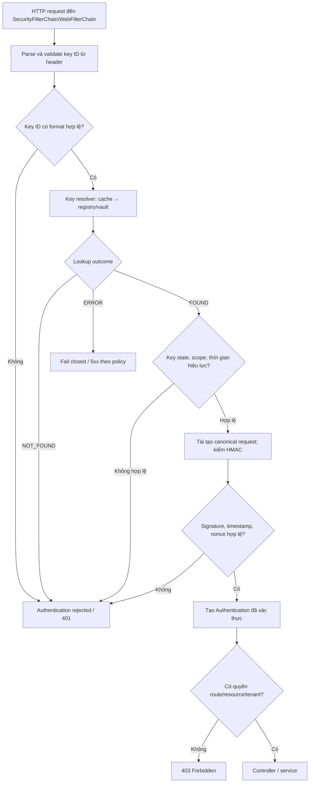

# Metric key lookup: giám sát tra cứu khóa HMAC an toàn và có ý nghĩa

## 1. Bối cảnh: vì sao phải đo key lookup?

Module `SECURITY_AUTHENTICATION_HMAC_REQUEST_AUTHENTICATION` tập trung vào xác thực HTTP request bằng **HMAC sử dụng shared secret**. Client và server thỏa thuận cách tạo **canonical request** từ method, URI/query, các header và/hoặc body digest; server phải kiểm tra chữ ký, timestamp/nonce chống replay, vòng đời/key rotation, hành vi proxy/gateway và cuối cùng tách **authentication** khỏi **authorization**.

Một bước quan trọng ở phía verifier là **key lookup**: dùng một key identifier do request cung cấp để tìm metadata/key material ứng viên trong registry, secret store hoặc cache. Sau bước tìm kiếm, verifier còn phải kiểm **key có được phép sử dụng ở thời điểm hiện tại không**, tính/chứng thực HMAC, kiểm freshness và nonce; chỉ khi tất cả hợp lệ mới tạo `Authentication` đã xác thực.

Nếu key lookup chậm hoặc lỗi, API HMAC có thể tăng latency, trả nhiều `401`/`503` hoặc không thể xác thực request. Nếu key lookup vẫn trả key đã bị thu hồi do cache cũ, hệ thống có thể chấp nhận chữ ký không còn được phép. Vì vậy cần giám sát key lookup **nhưng không được biến hệ thống metrics thành nơi lưu key ID, shared secret hoặc dữ liệu request**.

Bài thuộc chương **Monitoring**, với đề bài trực tiếp **Metric key lookup**. Sau bài học, người học có thể:

1. Định nghĩa rõ một lần tra khóa, kết quả lookup và những trạng thái **không** phải kết quả xác thực HMAC.
2. Thiết kế counter, timer/histogram, cache metric, policy-revision metric với nhãn có cardinality được kiểm soát.
3. Đo bằng Micrometer trong Spring Boot/Spring Security, gồm cách đo đồng bộ ở Servlet và bất đồng bộ ở WebFlux.
4. Viết truy vấn PromQL và cảnh báo cho lỗi registry, latency, cache, rotation hoặc key bị revoke nhưng vẫn được chấp nhận.
5. Phân biệt dấu hiệu lỗi key lookup với chữ ký sai, nonce replay, canonicalization lệch hoặc thiếu quyền.
6. Kiểm thử instrumentation, giới hạn dữ liệu nhạy cảm và tính đúng đắn khi retry/concurrency.

> Các tên metric và threshold trong bài là **hợp đồng quan sát minh họa**, không phải tên có sẵn bắt buộc của Spring Security. Micrometer và Prometheus có quy tắc chuyển đổi tên/đơn vị: phải kiểm tra đầu ra thực của registry/actuator ở phiên bản triển khai.

## 2. Key lookup nằm ở đâu trong authentication pipeline?



Các loại trạng thái này cần **được đếm riêng**:

| Thao tác | Kết quả có thể có | Chứng minh được điều gì? |
| --- | --- | --- |
| Parse key ID | `VALID_FORMAT` / `INVALID_FORMAT` | Chỉ chứng minh header có format được chấp nhận |
| Key lookup | `FOUND` / `NOT_FOUND` / `ERROR` | Có hoặc không có bản ghi metadata ứng viên; chưa có danh tính đã xác thực |
| Key policy | `ACCEPTABLE` / `REVOKED` / `EXPIRED` / `NOT_ACTIVE` / `SCOPE_DENIED` | Key có được phép dùng để verify request hiện tại không |
| HMAC signature | `VALID` / `INVALID` | Các thành phần **được ký** có khớp secret/canonical bytes không |
| Timestamp/nonce | `FRESH` / `REPLAY` / `OUT_OF_WINDOW` / `STORE_ERROR` | Request có thỏa điều kiện chống replay không |
| Authorization | `GRANTED` / `DENIED` | Client đã xác thực có được phép thao tác không |

**FOUND không có nghĩa HMAC thành công.** Verifier có thể tìm thấy key nhưng signature sai, key đã revoke, timestamp quá hạn hoặc nonce trùng. Một client có HMAC hợp lệ còn có thể bị từ chối **403** vì thiếu authority. Đừng dùng `key_lookup_found_total` làm tử số cho tỷ lệ authentication success.

### 2.1. Quy tắc an toàn về thông tin trước lookup

`X-Hmac-Key-Id` hoặc `X-Client-Id` trong HTTP request **chưa phải principal đáng tin**. Attacker cũng có thể gửi một key ID tùy ý. Hãy:

- Giới hạn độ dài, bảng ký tự và số lượng header key ID trước khi gọi registry.
- Từ chối duplicate/ambiguous security headers theo hợp đồng ký; không âm thầm dùng giá trị đầu tiên.
- Không log hoặc gắn **candidate key ID** trực tiếp vào metric label, trace span attribute hay request log.
- Không phân biệt công khai “key không tồn tại” với “key bị revoke” nếu sự khác biệt làm lộ registry; response lỗi xác thực nên đủ chung theo API contract.
- Cân nhắc rate limit và chi phí lookup trước request có signature sai, tránh cho người ngoài dùng registry như một dịch vụ enumeration/DoS.

## 3. Định nghĩa chuẩn cho metric key lookup

### 3.1. Một lần lookup được tính như thế nào?

Trước khi chọn metric, phải thống nhất đơn vị đo:

**Logical key lookup:** Một lần HMAC verifier yêu cầu resolver tìm một key candidate cho request. Resolver có thể trả ngay từ cache hoặc phải đọc registry. Nếu một request dùng nhiều key candidates theo hợp đồng versioned, có thể có nhiều lookup; cần kiểm đếm theo định nghĩa đã công bố.

**Physical store lookup:** Một lần gọi thật đến secret store/database/KMS, có thể bao gồm retry, cache miss hoặc fallback. Số physical calls có thể lớn hơn hoặc nhỏ hơn số logical lookup tùy caching/batching.

**Authentication attempt:** Một lần request đi vào quy trình xác thực HMAC. Nó có thể bị từ chối trước lookup (header malformed) hoặc có nhiều store calls. Không lấy tổng lookup làm mẫu số cho toàn bộ authentication attempts nếu hai loại đơn vị chưa được đối chiếu.

Ví dụ, 1.000 HTTP requests có thể gồm 100 request thiếu header, 900 logical lookup, 200 cache miss và 220 physical registry calls do một số retry. Đây là **bốn bộ đếm khác nhau**, không phải sự mâu thuẫn.

### 3.2. Bộ metric tối thiểu

| Tên metric logic | Loại | Ý nghĩa | Nhãn nên giới hạn |
| --- | --- | --- | --- |
| `hmac.key.lookup.attempts` | Counter | Số lần logical lookup có outcome cuối cùng | `outcome=found/not_found/error/cancelled`, `stage=logical` |
| `hmac.key.lookup.duration` | Timer/Histogram | Thời gian từ bắt đầu tới kết thúc một logical lookup | `outcome`, `stage` (nhãn bounded) |
| `hmac.key.store.calls` | Counter | Số lần gọi thật đến key registry/secret store | `backend`, `outcome` |
| `hmac.key.store.duration` | Timer | Độ trễ physical registry call | `backend`, `outcome` |
| `hmac.key.cache.accesses` | Counter | Cache hit/miss/negative-hit | `result=hit/miss/negative_hit`, `cache_tier` |
| `hmac.key.cache.evictions` | Counter | Eviction bởi TTL/size/invalidation | `reason` có allowlist |
| `hmac.key.state.rejections` | Counter | Lookup đã thấy key nhưng policy không cho dùng | `reason=revoked/expired/not_active/retiring_expired/scope_denied` |
| `hmac.key.policy.refresh.errors` | Counter | Không tải/áp dụng được key-policy revision | `source` cố định theo cấu hình |
| `hmac.key.policy.applied.revision` | Gauge | Revision hiện đang được verifier/gateway áp dụng | `component`, `region` low-cardinality |
| `hmac.key.policy.refresh.age` | Gauge | Số giây kể từ lần áp dụng policy thành công gần nhất | `component`, `region` |

**Đừng gắn tất cả mọi dimension cho mọi metric.** Một histogram có nhiều tổ hợp nhãn, bucket và replica có thể rất tốn tài nguyên. Với route/operation, chỉ thêm các route template đã xác định có số lượng hữu hạn, không thêm raw URI/query.

### 3.3. Ý nghĩa outcome

| `outcome` | Điều kiện kết thúc | HTTP cuối cùng không nhất thiết là |
| --- | --- | --- |
| `found` | Resolver trả một key metadata/material ứng viên | 200; HMAC/authorization còn có thể thất bại |
| `not_found` | Registry xác nhận không tìm thấy key candidate | 403; request thường chưa được xác thực, nên thường là 401 |
| `error` | Không thể lấy kết luận đáng tin do timeout/outage/lỗi hệ thống | 401 cho “invalid signature”; nên fail closed và phân loại hạ tầng |
| `cancelled` | Reactive subscription bị cancel trước khi hoàn tất kết luận | Không có HTTP status chắc chắn; có thể client disconnect |

`error` **không** phải “key bị revoke”: key có thể tìm thấy thành công nhưng bị từ chối bởi key-state policy. Tách hai trường hợp giúp phân biệt sự cố key registry với việc client sử dụng key cũ.

Nếu một hệ thống muốn giảm bớt nhãn, có thể dùng chỉ ba outcome trong synchronous resolver (`found/not_found/error`); reactive cancellation cần định nghĩa riêng. Không tạo label mới bằng cách gọi `exception.getMessage()` hoặc bất kỳ chuỗi nào do request gửi.

## 4. Cardinality và bí mật: cách chọn nhãn metric

### 4.1. Vì sao không dùng keyId làm tag?

Đây là đoạn instrumentation **không an toàn**:

```java
// KHÔNG LÀM: keyId lấy trực tiếp từ header do người gọi điều khiển.
registry.counter(
    "hmac.key.lookup.attempts",
    "key_id", request.getHeader("X-Hmac-Key-Id"),
    "outcome", "not_found"
).increment();
```

Một attacker có thể gửi hàng trăm nghìn key ID khác nhau, khiến time-series database tạo số lượng series lớn, tiêu tốn CPU/RAM/disk và làm dashboard/alert khó dùng. Ngoài vấn đề cardinality, tên key có thể tiết lộ cấu trúc tenant, client hoặc lịch key rotation.

**Hash key ID không phải cách giải quyết cardinality**: dù được băm, mỗi key ID mới thường vẫn tạo một label value mới. Việc dùng hash không có khóa còn có thể bị dò ngược đối với không gian key ID nhỏ. Nếu thật sự cần đối chiếu key version, dùng **audit event với quyền truy cập hạn chế**, opaque reference được kiểm soát và retention riêng; không nhét từng key vào Prometheus label.

### 4.2. Nhãn nên và không nên dùng

| Nhãn | Có nên dùng? | Giải thích |
| --- | --- | --- |
| `outcome` | Có | Enum hữu hạn từ server |
| `stage` | Có nếu thật cần | `logical` / `registry` / `cache` do code cấu hình |
| `backend` | Có ở quy mô nhỏ | `cache`, `database`, `vault`; không gắn hostname/URL bí mật |
| `region` | Có nếu danh sách cố định | Hữu ích khi so propagations/revision giữa vùng |
| `route_template` | Cân nhắc | Chỉ dùng các route đã công bố, không dùng raw path |
| `key_id` / `secret_ref` | **Không** | Có thể là dữ liệu nhạy cảm, cardinality lớn và do caller điều khiển |
| `client_id` / `tenant_id` | Tránh mặc định | Cardinality/nhạy cảm; chỉ dùng cohort cố định nếu được review |
| `nonce` / `signature` / `body_hash` | **Tuyệt đối không** | Dữ liệu xác thực, replay/correlation hoặc payload-derived |
| `http_request_uri` / `query` | **Không** | Chuỗi tùy ý, dữ liệu nhạy cảm, cardinality không giới hạn |
| `exception_message` | **Không** | Có thể chứa secret, endpoint, key và input tùy ý |
| `trace_id` / `request_id` | Không làm label | Mỗi request tạo series mới; dùng tracing/exemplar nếu được kiểm soát |

Tham số `clientId` trong object `Authentication` cũng không tự làm nó phù hợp làm metric label. Principal đã được xác thực có thể dùng trong audit có kiểm soát, nhưng không nên đưa nguyên dạng vào metrics công khai cho toàn bộ đội vận hành.

### 4.3. Giới hạn quyền truy cập metrics endpoint

`/actuator/prometheus` hoặc endpoint scrape tương đương không phải API public. Giới hạn mạng và quyền truy cập vào endpoint/collector, không đưa secret/key ID vào metric name/help/labels, và không biến việc expose endpoint thành đường đi bypass SecurityFilterChain của API HMAC.

Metrics không phải một kênh chứng thực client. Một kết quả `found` được ghi trong counter không bao giờ được dùng để tạo `Authentication` hoặc cấp `GrantedAuthority`.

## 5. Micrometer trong Spring MVC: đo lookup đúng phạm vi

Micrometer được Spring Boot dùng cho observability. Ví dụ sau đo **một logical lookup đồng bộ**, tương ứng Servlet/Spring MVC, với nhãn được sinh **chỉ từ các giá trị cố định của code**.

### 5.1. Hợp đồng key repository

```java
import java.util.Optional;

// Dự án định nghĩa class/interface riêng chứa metadata và material nội bộ.
// Không override toString() để in shared secret hoặc key material.
interface HmacKeyMaterial {}

interface HmacKeyRepository {
    // candidateKeyId là input chưa đáng tin: phải validate giới hạn trước đó.
    Optional<HmacKeyMaterial> findById(String candidateKeyId);
}
```

Repository có thể đọc cache/registry; chỉ caller đã qua validation mới được gọi method này. HmacKeyMaterial ở đây chỉ là một **interface placeholder** cho ví dụ, không phải API của Spring Security. Key material thực tế phải được giữ trong thành phần có quyền truy cập hạn chế và không đưa vào log, exception message hay meter tags.

### 5.2. Instrumented resolver

```java
import io.micrometer.core.instrument.MeterRegistry;
import io.micrometer.core.instrument.Timer;
import java.util.Optional;

public final class MeteredHmacKeyResolver {

    private final HmacKeyRepository repository;
    private final MeterRegistry meters;

    public MeteredHmacKeyResolver(
        HmacKeyRepository repository,
        MeterRegistry meters
    ) {
        this.repository = repository;
        this.meters = meters;
    }

    public Optional<HmacKeyMaterial> find(String candidateKeyId) {
        Timer.Sample sample = Timer.start(meters);
        String outcome = "error";

        try {
            Optional<HmacKeyMaterial> result =
                repository.findById(candidateKeyId);
            outcome = result.isPresent() ? "found" : "not_found";
            return result;
        } finally {
            meters.counter(
                "hmac.key.lookup.attempts",
                "stage", "logical",
                "outcome", outcome
            ).increment();

            sample.stop(
                Timer.builder("hmac.key.lookup.duration")
                    .description("Duration of a logical HMAC key lookup")
                    .tag("stage", "logical")
                    .tag("outcome", outcome)
                    .register(meters)
            );
        }
    }
}
```

Điểm thiết kế:

- `Timer.Sample` bắt đầu **trước** khi gọi repository, dừng trong `finally` nên bao gồm cả thời gian tìm thấy, không tìm thấy và lỗi.
- Biến `outcome` chỉ nhận `error/found/not_found` do code xác lập; không ghi `candidateKeyId`, secret hoặc exception message.
- Repository ném runtime exception thì `outcome=error`, exception được truyền tiếp cho tầng xử lý lỗi. Verifier **không được fallback “key không thấy” rồi cho qua** khi store lỗi.
- Đoạn này chỉ đo **lookup**; không bao gồm canonicalization, HMAC CPU, timestamp, nonce store và authorization. Các bước đó cần metric riêng.
- Nếu repository đã bao gồm cache, timer là độ trễ **resolver tổng thể**. Muốn biết cache và backing store riêng, instrument thêm từng tầng thay vì diễn giải timer này là thời gian database.

**Điểm cần chú ý:** Để metrics không gây exception ngoài ý muốn làm thay đổi logic xác thực, cần vận hành `MeterRegistry`/exporter đúng cách và có test cho instrumentation. Nếu metrics infrastructure không hoạt động, hệ thống không được chuyển thành “allow” hoặc bỏ qua bước xác minh HMAC.

### 5.3. Tách key-state rejection khỏi lookup outcome

Sau khi `find(...)` trả material, verifier có thể kiểm metadata:

```java
// Ví dụ thuật toán, các hàm/key metadata do ứng dụng tự định nghĩa.
Optional<HmacKeyMaterial> candidate = keyResolver.find(keyId);

if (candidate.isEmpty()) {
    throw new BadCredentialsException("Invalid HMAC credentials");
}

// keyPolicy là thành phần của ứng dụng đọc metadata tin cậy từ registry.
if (keyPolicy.isRevoked(candidate.get())) {
    meters.counter(
        "hmac.key.state.rejections",
        "reason", "revoked"
    ).increment();
    throw new BadCredentialsException("Invalid HMAC credentials");
}

// Nếu key chưa bị revoke, tiếp tục kiểm các trạng thái khác,
// canonical request, HMAC signature, timestamp và nonce.
```

Đoạn này chỉ minh họa **điểm phát metric khi key thật sự bị revoke**: trong chương trình đầy đủ, nhánh `revoked` phải được bao bởi điều kiện kiểm metadata. Không bao giờ tăng counter `revoked` cho mọi key tìm thấy hoặc vì chữ ký không khớp. Phân loại `revoked/expired/retiring_expired/not_active/scope_denied` cần dựa trên policy server chứ không phải header do client tuyên bố.

### 5.4. Histogram: phục vụ p95/p99 mà không tạo quá nhiều series

`Timer` thường xuất số lần đo và tổng duration; để Prometheus có `_bucket` dùng với `histogram_quantile`, phải **bật histogram/SLO buckets** một cách có chủ đích, ví dụ trên timer có số lượng tag hữu hạn:

```java
Timer.builder("hmac.key.lookup.duration")
    .description("Duration of a logical HMAC key lookup")
    .tag("stage", "logical")
    .tag("outcome", "found") // Ví dụ một tổ hợp tag.
    .publishPercentileHistogram()
    .register(meters);
```

Trong ứng dụng thật, cấu hình histogram bằng `MeterFilter` hoặc cấu hình Micrometer/Actuator dùng chung để tránh đăng ký cùng meter với histogram settings mâu thuẫn. Histogram làm tăng số series theo bucket × tag combinations × instances; dùng khi có nhu cầu p95/p99 hoặc alert latency thực sự.

## 6. Spring WebFlux: đo lookup không chặn event loop

Spring WebFlux dùng reactive pipeline; `ReactiveSecurityContextHolder` truyền authentication qua **Reactor Context**, không dựa vào `ThreadLocal` để giữ danh tính qua các thread. Key lookup nên dùng reactive driver/client khi có thể.

Nếu resolver gọi một SDK đồng bộ trên Netty event loop, ngay cả code có metric tốt cũng có thể gây latency toàn dịch vụ. Không gọi `block()` trong authentication `WebFilter`. Nếu không thể thay SDK blocking, cô lập bằng scheduler phù hợp, giới hạn concurrency và đo riêng thời gian queue/chờ nếu cần.

### 6.1. Instrument Mono theo từng subscription

```java
import io.micrometer.core.instrument.MeterRegistry;
import io.micrometer.core.instrument.Timer;
import java.util.concurrent.atomic.AtomicReference;
import reactor.core.publisher.Mono;

interface ReactiveHmacKeyRepository {
    // Mono.empty() nghĩa là không tìm thấy, Mono.error() là lỗi.
    Mono<HmacKeyMaterial> findById(String candidateKeyId);
}

public final class MeteredReactiveHmacKeyResolver {

    private final ReactiveHmacKeyRepository repository;
    private final MeterRegistry meters;

    public MeteredReactiveHmacKeyResolver(
        ReactiveHmacKeyRepository repository,
        MeterRegistry meters
    ) {
        this.repository = repository;
        this.meters = meters;
    }

    public Mono<HmacKeyMaterial> find(String candidateKeyId) {
        return Mono.defer(() -> {
            Timer.Sample sample = Timer.start(meters);
            AtomicReference<String> outcome =
                new AtomicReference<>("cancelled");

            return repository.findById(candidateKeyId)
                .doOnNext(key -> outcome.set("found"))
                .doOnSuccess(key -> {
                    if (key == null) {
                        outcome.set("not_found");
                    }
                })
                .doOnError(error -> outcome.set("error"))
                .doFinally(signalType -> {
                    String result = outcome.get();
                    meters.counter(
                        "hmac.key.lookup.attempts",
                        "stage", "logical",
                        "outcome", result
                    ).increment();

                    sample.stop(
                        Timer.builder("hmac.key.lookup.duration")
                            .tag("stage", "logical")
                            .tag("outcome", result)
                            .register(meters)
                    );
                });
        });
    }
}
```

`Mono.defer(...)` khởi tạo `Timer.Sample` **khi có subscription**. `doOnSuccess(null)` thể hiện Mono hoàn tất rỗng, còn `doOnError` là lỗi store. `doFinally` ghi metric một lần trên đường kết thúc, bao gồm **cancel** nếu client disconnect/đường downstream huỷ subscription.

Nếu có `retry(...)` hoặc nhiều subscription, mỗi lần subscription mới có thể tạo **một lần lookup thực tế** và được đếm thêm. Điều đó đúng khi metric được định nghĩa là *per lookup attempt*, nhưng khác với số HTTP requests. Không sử dụng `subscribe()` riêng trong WebFilter chỉ để cập nhật metric và không gọi `block()` để “đợi counter”.

Nhãn `cancelled` không đồng nghĩa lookup thất bại vì credentials. Khi đo latency và error ratio, có thể phân tích cancellation riêng hoặc sử dụng cửa sổ/nhóm kết quả được định nghĩa rõ.

### 6.2. Vì sao không lấy Reactive SecurityContext làm nguồn label?

Khi lookup diễn ra, request **chưa xác thực** và Reactor Context chưa chắc đã chứa principal đáng tin. Kể cả sau khi verifier tạo `Authentication`, không nên lấy principal/tenant làm tag vì cardinality và privacy. Reactive authentication chỉ dùng để quyết định quyền; metrics nên được phân loại bằng thông tin **hạ tầng và policy cố định**.

## 7. Đo cache hit/miss, negative caching và stale key

Key lookup thường có cache tại verifier hoặc gateway. Cache cải thiện độ trễ nhưng có thể kéo dài thời gian một key **REVOKED** vẫn được chấp nhận nếu invalidation không hoạt động.

### 7.1. Bộ metric cache

| Metric | Ý nghĩa | Cách diễn giải |
| --- | --- | --- |
| `hmac.key.cache.accesses{result="hit"}` | Request được trả từ cache tích cực | Hiệu quả caching; chưa chứng minh key còn hợp lệ |
| `hmac.key.cache.accesses{result="miss"}` | Phải truy backing store | Nếu tăng đột ngột có thể gây load registry |
| `hmac.key.cache.accesses{result="negative_hit"}` | Cache trả kết quả “không tồn tại” | Có thể là traffic probing hoặc negative cache còn lưu kết quả cũ |
| `hmac.key.cache.evictions{reason="ttl"}` | Cache entry hết hạn | Theo dõi TTL/invalidation |
| `hmac.key.cache.evictions{reason="revocation"}` | Xóa entry theo sự kiện revoke | Chứng tỏ có tín hiệu invalidate, chưa đủ chứng minh mọi node đã cập nhật |
| `hmac.key.policy.applied.revision` | Revision policy đã áp dụng | Dùng kiểm consistency giữa nodes/gateway |
| `hmac.key.policy.refresh.age` | Tuổi của lần áp dụng policy gần nhất | Cảnh báo stale policy / mất đồng bộ |

Lưu ý phân biệt **cache hit** với **lookup found**: cache có thể chứa negative entry; hoặc cache hit tìm thấy key record nhưng key-state policy vẫn từ chối.

### 7.2. Cache hit ratio đúng mẫu số

Giả sử chỉ có kết quả `hit`, `miss` và `negative_hit`, tỷ lệ positive cache hit có thể được định nghĩa:

```text
positive_hit_ratio =
  cache_accesses(result="hit") /
  (cache_accesses(result="hit") +
   cache_accesses(result="miss") +
   cache_accesses(result="negative_hit"))
```

Hãy ghi rõ **negative_hit** có được tính là hit hay không. Nếu mục đích là giảm call backing store, positive + negative hit đều là các lần không phải gọi store; nếu mục đích là tìm key hợp lệ, cần xem negative hit riêng. Không báo “cache hit 99%” mà không công bố định nghĩa.

### 7.3. Negative cache và key rotation

Một key vừa được stage/activate có thể từng bị tra khi chưa tồn tại. Nếu backend cache `not_found` quá lâu, client đã đổi sang key mới sẽ liên tục nhận 401 dù registry đã cập nhật. Ngược lại, cache chứa key cũ sau revoke có thể gây chấp nhận không đúng.

Biện pháp:

1. Có TTL/invalidations theo key-state policy; không giữ negative cache vô hạn.
2. Khi activation/revoke, phát revision/invalidation có thể theo dõi, hoặc chọn policy đọc lại registry đủ chặt.
3. Data plane phải **fail closed** nếu không thể xác định trạng thái key khi chính sách đòi thông tin mới nhất.
4. Có metric về **revision lag, refresh errors và old-key acceptance sau revoke**; chỉ nhìn cache hit ratio không phát hiện được lỗi bảo mật.
5. Không dùng reset toàn bộ cache một cách thiếu kiểm soát nếu nó gây “cache stampede” và quá tải key registry.

## 8. Metric key lookup trong key rotation

Key rotation thường có khoảng overlap được định nghĩa giữa key version cũ và mới. Key ID chỉ dùng để chọn secret ứng viên; mỗi version phải có trạng thái, owner/scope, thời điểm hiệu lực và thời hạn chấp nhận rõ.

### 8.1. Các kịch bản cần quan sát

| Thời điểm | Tín hiệu quan sát | Có thể diễn giải |
| --- | --- | --- |
| Trước activation | `not_found`/`not_active` cho key mới trong môi trường test | Client bắt đầu dùng key quá sớm, hoặc registry chưa phát hành |
| Ngay sau activation | `not_found` tăng trên một vùng | Negative cache cũ hoặc propagation lag |
| Trong overlap | Cả hai version được verifier chấp nhận theo policy | Thông thường nếu cùng key family/scope và chưa hết hạn |
| Khi bắt đầu retirement | Traffic client chưa chuyển hết | Cần rollout/nhắc client; không tự gia hạn khi vượt policy |
| Sau revoke | `revoked` rejection tăng | Client cũ tiếp tục sử dụng key; kết quả đúng nếu verifier từ chối |
| Sau revoke nhưng vẫn có authn success bằng key cũ | Tín hiệu nghiêm trọng | Cache/policy chưa áp dụng, đường bypass hoặc lỗi triển khai |
| Registry/secret store error | `outcome="error"` và store latency cao | Hạ tầng lookup gặp vấn đề, không nên quy cho client |

Một lần key lookup `found` cho một key đã revoke **không phải sự cố** nếu key-state policy từ chối sau đó; sự cố là verifier vẫn xác thực thành công bằng key bị revoke. Do đó cần kết hợp:

- Metric lookup và cache.
- Metric `hmac.key.state.rejections`.
- Event key lifecycle/audit với `rotation_id`/`config_revision`.
- Authentication success/rejection (không chứa raw key ID).
- Telemetry revision được áp dụng trên verifier/gateway.

### 8.2. Không đưa raw key ID vào metric để theo dõi rollout

Đội vận hành có thể muốn biết key v2/v3 đang được sử dụng bao nhiêu. Chỉ dùng nhãn **version cohort hữu hạn và được kiểm soát từ registry sau khi xác thực**, ví dụ `key_generation=current/retiring` nếu privacy và cardinality được review; không dùng `X-Hmac-Key-Id` do client gửi.

Với yêu cầu điều tra từng key version cụ thể, ưu tiên **audit stream riêng** có opaque reference, retention và quyền truy cập phù hợp. Không biến Prometheus thành kho nhật ký từng key.

### 8.3. Proxy/gateway làm thay đổi kết luận, không chỉ lookup

Gateway có thể rewrite path, normalize header hoặc body. Khi lookup `found` nhưng signature không khớp, nguyên nhân có thể là:

- Client ký external URI nhưng verifier dùng internal URI.
- Gateway gộp/loại signed headers.
- Body được decompress hoặc JSON reserialize.
- Canonicalization version giữa các bên lệch.

Lúc đó metric `key_lookup_found` vẫn bình thường, còn `hmac.authentication.rejected{reason="signature_invalid"}` tăng. Đừng kết luận registry lỗi hoặc rotation thất bại chỉ vì tổng 401 tăng. Cần test vectors ký theo hợp đồng qua proxy thật.

## 9. Prometheus/PromQL: dashboard và cảnh báo theo SLI

Giả sử dùng Prometheus registry và counter Micrometer `hmac.key.lookup.attempts` được xuất thành `hmac_key_lookup_attempts_total`; timer `hmac.key.lookup.duration` được xuất thành `hmac_key_lookup_duration_seconds_count`, `_sum` và khi bật histogram là `_bucket`. Hãy **xác nhận tên thực ở endpoint scrape** trước khi đưa truy vấn vào production.

### 9.1. Tốc độ lookup theo kết quả

```promql
sum by (outcome) (
  rate(hmac_key_lookup_attempts_total{stage="logical"}[5m])
)
```

Dashboard hiển thị `found`, `not_found`, `error` và `cancelled` riêng. `not_found` tăng có thể là client dùng key ID cũ, negative-cache issue hoặc probing — không tự kết luận là key registry outage.

### 9.2. Error ratio của lookup

```promql
sum(increase(hmac_key_lookup_attempts_total{
  stage="logical",outcome="error"
}[5m]))
/
clamp_min(
  sum(increase(hmac_key_lookup_attempts_total{stage="logical"}[5m])),
  1
)
```

Đây là tỷ lệ **lỗi hạ tầng lookup**, khác tỷ lệ 401 hoặc `not_found`. Với traffic thấp, một lỗi có thể khiến tỷ lệ cao; nên đi kèm điều kiện lượng mẫu tối thiểu để tránh cảnh báo nhiễu.

Ví dụ điều kiện alert minh họa (ngưỡng phải được hiệu chỉnh theo SLO):

```promql
(
  sum(increase(hmac_key_lookup_attempts_total{
    stage="logical",outcome="error"
  }[5m]))
  /
  clamp_min(
    sum(increase(hmac_key_lookup_attempts_total{stage="logical"}[5m])),
    1
  )
) > 0.02
and
sum(increase(hmac_key_lookup_attempts_total{stage="logical"}[5m])) > 100
```

Khi phân vùng theo region/service, tính tử và mẫu số cùng bộ nhãn, không lấy error count của một region chia toàn bộ requests của mọi region. Nên dùng alert `for` phù hợp và kết hợp tình trạng secret store.

### 9.3. Latency p95

Chỉ dùng được khi timer đã bật Prometheus histogram buckets:

```promql
histogram_quantile(
  0.95,
  sum by (le) (
    rate(hmac_key_lookup_duration_seconds_bucket{stage="logical"}[5m])
  )
)
```

Đơn vị của metric Prometheus timer thường là **giây**. Đừng nhập ngưỡng millisecond trực tiếp cho giá trị bằng giây; ví dụ 0,050 tương ứng 50 ms. P95 tại tổng cụm là lượng đo đã gộp theo bucket, **không phải trung bình của p95 từng instance**.

Nếu lookup có phân phối hai đỉnh do cache hit rất nhanh và miss rất chậm, cần xem histogram/timer của **physical store call** và cache miss riêng, không chỉ một p95 logical tổng thể.

### 9.4. Cache hit ratio

Với metrics `hmac_key_cache_accesses_total` và các giá trị `result` cố định:

```promql
sum(rate(hmac_key_cache_accesses_total{result="hit"}[5m]))
/
clamp_min(
  sum(rate(hmac_key_cache_accesses_total[5m])),
  0.000001
)
```

Truy vấn này đo **positive-hit fraction** nếu `result` chỉ gồm hit/miss/negative_hit và counter chỉ tăng một lần trên một cache access. Nếu cache có nhiều tier, chọn tier cần đo thay vì cộng nhiều lần cùng request từ L1 và L2.

### 9.5. Một dashboard hữu ích nên có gì?

| Panel | Giá trị vận hành |
| --- | --- |
| Key lookup QPS theo outcome | Nhận biết khối lượng và sự thay đổi hành vi client |
| Lookup error ratio + dependency health | Phát hiện key registry/secret store outage |
| Logical lookup p50/p95/p99 | Phát hiện slowdown ảnh hưởng xác thực |
| Physical store p95, timeouts, retries | Tìm nguyên nhân nằm ở registry/vault |
| Cache hit/miss/eviction/negative-hit | Hiểu hiệu suất và rủi ro stale cache |
| Key-policy applied revision + age | Phát hiện node/gateway cập nhật chậm khi rotation |
| Authentication 401 theo reason, authz 403 riêng | Phân biệt lỗi xác thực và thiếu quyền |
| Rotation audit timeline | Đối chiếu deploy, activation, revoke với biến động metric |

## 10. Alert playbook: phát hiện và xử lý đúng nguyên nhân

### 10.1. Key lookup errors tăng

**Tín hiệu:** `outcome=error` và latency store tăng; có thể kèm HTTP 5xx. Kiểm dependency saturation, DNS/TLS, pool connection, circuit breaker, retry storm và lỗi secret store.

**Hành động:** Bảo đảm verifier **fail closed**, không biến store outage thành `Optional.empty()` rồi gắn nhãn `not_found`, và không tắt kiểm chữ ký để giữ availability. Giảm retry đồng loạt, cô lập vùng lỗi và kiểm điều kiện hồi phục trước khi mở lại traffic.

### 10.2. Not found tăng ngay sau rotation

**Tín hiệu:** `not_found` hoặc `negative_hit` tăng ở một region, trong khi registry có key mới ACTIVE.

**Hành động:** Kiểm distribution/activation revision, negative cache TTL, key ID mapping và gateway/edge có forward đúng header hay không. Xác minh bằng test fixture với secret giả; không dump raw key ID và signature vào metrics/log.

### 10.3. Rejected key state tăng sau revoke

**Tín hiệu:** `hmac.key.state.rejections{reason="revoked"}` hoặc `retiring_expired` tăng; authn 401 tăng.

**Hành động:** Đối chiếu thời điểm key transition với lịch rollout client; nếu request thực sự dùng key cũ sau deadline, đây là từ chối **đúng**. Không vội nới cửa sổ chấp nhận vì loạt 401, đặc biệt khi revoke do nghi compromise.

### 10.4. Key bị revoke vẫn có request xác thực thành công

**Tín hiệu:** Authentication success từ key version đã revoke theo dữ liệu tin cậy, revision của node cũ hơn control plane.

**Hành động:** Ưu tiên như một sự cố bảo mật; kiểm stale cache và policy propagation, key registry truth, các gateway tự xác minh HMAC, đường truy cập bypass, clock/effective time và hiệu lực của cơ chế revoke. Metric lookup `found` tự nó **không chứng minh** đã có authn success bằng key cấm.

### 10.5. Lookup bình thường nhưng 401 tăng

**Tín hiệu:** `found` ổn định, store latency thấp, signature/timestamp/nonce rejection tăng.

**Hành động:** Kiểm canonical request giữa client/gateway/backend, clock skew, duplicate headers, raw body digest, nonce store và phiên bản giao thức. Đừng thay key hoặc bật debug log secret chỉ vì lookup metrics không giải thích được 401.

### 10.6. HMAC thành công nhưng 403 tăng

**Tín hiệu:** Authentication success vẫn cao, authorization denial tăng.

**Hành động:** Kiểm thay đổi authorities, tenant scopes, policy deploy và mapping client→role. Đây không phải `key lookup error`. Một key đang ACTIVE và chữ ký hợp lệ **không** tự cấp quyền tạo/xóa resource.

## 11. Kiểm thử instrumentation và dữ liệu riêng tư

### 11.1. Unit test với SimpleMeterRegistry

Ví dụ dưới đây dựa trên `MeteredHmacKeyResolver` ở mục 5 và các interface giả đã khai báo:

```java
import io.micrometer.core.instrument.simple.SimpleMeterRegistry;
import java.util.Optional;
import org.junit.jupiter.api.Test;
import static org.junit.jupiter.api.Assertions.*;

class MeteredHmacKeyResolverTest {

    @Test
    void recordsFoundAndNotFoundWithoutKeyIdLabel() {
        var meters = new SimpleMeterRegistry();

        HmacKeyRepository repository = candidateId ->
            "allowed-test-key".equals(candidateId)
                ? Optional.of(new HmacKeyMaterial() {})
                : Optional.empty();

        var resolver = new MeteredHmacKeyResolver(
            repository, meters
        );
        resolver.find("allowed-test-key");
        resolver.find("UNTRUSTED_KEY_ID_SENTINEL");

        assertEquals(
            1.0,
            meters.get("hmac.key.lookup.attempts")
                .tags("stage", "logical", "outcome", "found")
                .counter().count()
        );
        assertEquals(
            1.0,
            meters.get("hmac.key.lookup.attempts")
                .tags("stage", "logical", "outcome", "not_found")
                .counter().count()
        );

        boolean secretLabelPresent = meters.getMeters().stream()
            .flatMap(meter -> meter.getId().getTags().stream())
            .anyMatch(tag -> tag.getValue().contains(
                "UNTRUSTED_KEY_ID_SENTINEL"
            ));
        assertFalse(secretLabelPresent);
    }
}
```

Test này xác nhận counter/labels trong một resolver giả, **không** chứng minh HMAC signature đúng. Test integration phải kiểm verifier dùng key material thật từ fixture, tính HMAC trên canonical request và áp nonce/key-state policy.

### 11.2. Ma trận kiểm thử metric

| Tình huống | Metric lookup | Metric liên quan | Kỳ vọng bảo mật |
| --- | --- | --- | --- |
| Key tìm thấy, chữ ký hợp lệ | `found +1` | Authn success, authorization tùy quyền | Chỉ xác thực khi mọi điều kiện qua |
| Key không tồn tại | `not_found +1` | Authn rejected | Không gắn principal từ key ID tự khai báo |
| Key ID sai format | Không gọi lookup nếu chặn từ parser | Header-validation rejection | Không tạo series theo input |
| Key tìm thấy nhưng đã revoke | `found +1` | `state_rejections{revoked} +1` | Không cho key bị revoke xác thực |
| Key đang RETIRING nhưng quá deadline | `found +1` | `retiring_expired +1` | Từ chối ngoài overlap |
| Signature sai nhưng key tìm thấy | `found +1` | `signature_invalid +1` | Không tạo Authentication |
| Timestamp quá hạn/nonce replay | Lookup tùy thứ tự verifier | Timestamp/replay rejection | 401, không authn success |
| Registry timeout/network error | `error +1`, timer kết thúc | Dependency error/5xx | Fail closed |
| Reactive publisher bị cancel | `cancelled +1` | HTTP client disconnect | Không tự coi là 401 |
| Cache hit | `found` hoặc `not_found` theo result | `cache hit/negative_hit` | Cache không bypass key-state check |
| Cache miss với retry store | Một logical lookup | Nhiều physical calls | Không nhầm attempt và HTTP request |
| Activation key mới | `found` theo policy mới | Policy revision, audit activation | Client dùng key mới khi hợp lệ |
| Revoke key cũ trên 2 instance | Lookup có thể `found` | Revision/applied và state rejection | Cả hai node từ chối key cũ |
| Proxy đổi URI/header đã ký | Lookup có thể `found` | Signature rejection | Không tự sửa key để bỏ qua mismatch |
| HMAC hợp lệ nhưng thiếu authority | Lookup `found` | Authn success + authz denied | 403, không ghi lookup error |
| Thử hàng nghìn key ID khác nhau | `not_found` tăng, số label vẫn hữu hạn | Rate limit/security alert | Không bùng cardinality |

### 11.3. Test histogram, Prometheus và cardinality

Ngoài `SimpleMeterRegistry`, cần có test môi trường thật với Prometheus registry:

1. Khởi tạo hàng nghìn candidate key IDs khác nhau và xác nhận **số lượng time series không tăng theo key ID**; chỉ các nhãn thuộc allowlist được xuất.
2. Kiểm `hmac_key_lookup_attempts_total`, `hmac_key_lookup_duration_seconds_count`/`_sum` và `_bucket` (khi đã bật histogram) xuất đúng tên/đơn vị.
3. Gây lỗi store và xác nhận `outcome=error`, timer vẫn ghi; không biến lỗi store thành `not_found`.
4. Kiểm việc retry store tạo đúng **số physical calls** và một logical outcome cuối theo instrumentation đã quy định.
5. Gửi reactive cancellation và bảo đảm `doFinally` ghi đúng một lần per subscription.
6. Kiểm disabled/exporter-down không làm cho verifier cho qua signature hoặc làm lộ secret.
7. Kiểm metric labels, HELP strings, exemplars, exception logs và trace attributes không chứa `SECRET_SENTINEL_DO_NOT_EXPORT`, `KEY_ID_SENTINEL`, nonce hoặc raw body.

### 11.4. Kiểm thử end-to-end với Spring Security

Với Servlet dùng `MockMvc`, WebFlux dùng `WebTestClient`, nên dựng HMAC test vector có fixed secret giả, timestamp kiểm soát, nonce store kiểm thử và quyền rõ ràng. Gửi request ký chính xác qua filter chain rồi assert:

- Key lookup `found`, verifier signature/timestamp/nonce PASS, principal đúng và `hasAuthority(...)` hoạt động.
- Signature sai, key hết hạn hoặc nonce lặp trả lỗi xác thực (thường 401); **không** ghi authn success.
- HMAC đúng nhưng thiếu quyền trả **403**, không tăng `outcome=error` của lookup.
- Key registry outage trả lỗi fail-closed theo policy; không được thay bằng `permitAll()` hoặc tạo Authentication giả.
- Cùng request đi qua gateway có thể đổi path, header hoặc body; test tách lỗi canonicalization khỏi key lookup.

Không chỉ dùng `@WithMockUser` vì nó có thể dựng authentication test mà không qua key lookup hoặc HMAC verifier.

## 12. Quy trình triển khai và checklist vận hành

1. **Chốt phạm vi metric:** Một logical lookup, một physical store call và một authentication attempt là ba đơn vị khác nhau.
2. **Định nghĩa outcome hữu hạn:** `found`, `not_found`, `error` và `cancelled` nếu reactive; đừng biến status key/replay/authority thành lookup outcome mơ hồ.
3. **Giới hạn input trước lookup:** Key ID/header format, độ dài, duplicate values và rate limit; không gọi registry với input vô hạn.
4. **Instrument ranh giới resolver:** Counter + timer cho từng lookup, thể hiện lỗi trong `finally`/`doFinally`; không catch rồi nuốt lỗi store.
5. **Instrument cache/store riêng:** Hit/miss/negative-hit, store latency, timeout, retry, evictions và chính sách invalidation.
6. **Không dùng nhãn nhạy cảm hoặc không giới hạn:** Không key ID, secret, client ID do request khai báo, nonce, signature, raw URI/query/body, exception message.
7. **Đo key-state và propagation:** Revoke/expire/retiring policy, revision/age tại verifier và gateway; nhất là trong rotation hoặc emergency revoke.
8. **Tách authentication và authorization:** Lookup `found` không chứng minh HMAC hợp lệ; HMAC hợp lệ chưa bảo đảm client có quyền resource/tenant.
9. **Bật histogram có cân nhắc:** Kiểm đơn vị, label cardinality, memory của bucket và truy vấn p95/p99; hiệu chỉnh ngưỡng theo SLO.
10. **Bảo vệ kênh metrics:** Giới hạn truy cập scrape endpoint, telemetry pipeline, retention và sự an toàn của trace/log liên quan.
11. **Kiểm thử từ unit đến gateway:** Từ `SimpleMeterRegistry` đến Prometheus và HTTP integration, gồm replay, cache cũ, rotation, proxy rewrite, lỗi registry và concurrent load.
12. **Xây alert gắn với playbook:** Error ratio cao khác not_found cao; 401 do HMAC sai khác 403 do thiếu quyền; kiểm rollout revision trước khi đổi key thêm lần nữa.

**Điểm cần nhớ:** **Metric key lookup** đo **khả năng tìm và lấy key ứng viên**, chứ không chứng minh một request đã được xác thực hoặc được cấp quyền. Một hệ thống HMAC an toàn phải đo được tốc độ, latency, cache và lỗi key registry mà không lộ key ID/shared secret; đồng thời liên hệ các tín hiệu đó với key rotation, trạng thái revoke, canonical request, timestamp/nonce và authorization. Chỉ khi hiểu rõ ranh giới từng phép đo, dashboard và alert mới phản ánh đúng rủi ro bảo mật thay vì tạo nhiễu vận hành.
