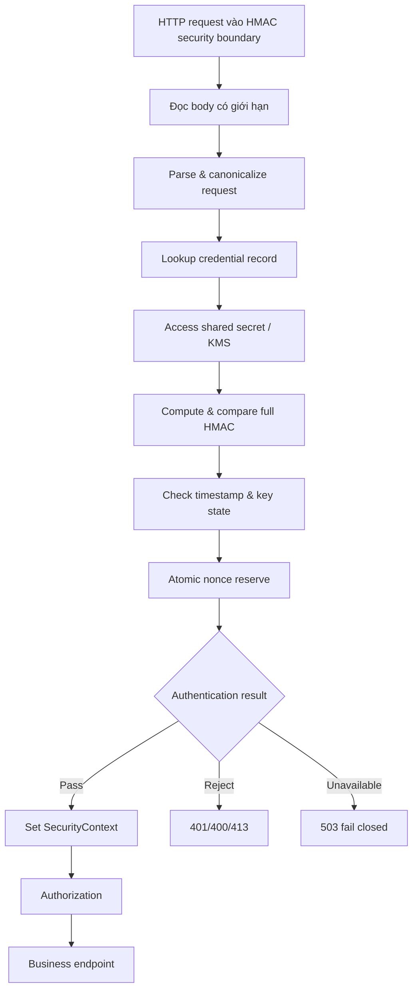

# Metric latency HMAC

## 1. Vì sao phải đo latency HMAC authentication?

Xác thực một HTTP request bằng **HMAC (Hash-based Message Authentication Code)** chứng minh phía gửi biết shared secret và dữ liệu được ký không bị sửa. Trong mô-đun **`SECURITY_AUTHENTICATION_HMAC_REQUEST_AUTHENTICATION`**, hợp đồng ký có thể bao gồm HTTP method, URI, signed headers và SHA-256 của body. Bên nhận còn cần kiểm key ownership/lifecycle, timestamp, nonce chống replay và tách authentication khỏi authorization.

**Phép `Mac.doFinal` không nhất thiết là nguyên nhân chậm nhất.** Một request có thể mất vài chục microseconds để tính HMAC-SHA-256 nhưng hàng chục milliseconds để tra key catalog, Vault/KMS hoặc Redis replay store. Nếu dashboard chỉ ghi `http.server.requests`, cũng khó biết latency nằm ở xác thực hay business database.

Ví dụ:

```text
Client → Gateway → API HMAC Filter → Controller → Database
                    |    65 ms     |      380 ms    |
                    |              HTTP request ~445 ms
                    |
              body read:       8 ms
              canonicalize:   1 ms
              key lookup:    35 ms
              secret access:  9 ms
              MAC verify:   0.1 ms
              freshness:    0.1 ms
              nonce reserve:  9 ms
              overhead:     2.8 ms
```

Số liệu chỉ là **minh họa**, không phải performance benchmark. Nếu báo `HMAC latency = 0.1 ms`, bạn mới đo **cryptographic primitive**, chưa đo toàn bộ request authentication. Nếu báo `HMAC latency = 445 ms`, bạn lại lẫn cả xử lý nghiệp vụ.

Bài **“Metric latency HMAC”** thuộc chương **Monitoring**. Sau bài này người học có thể định nghĩa ranh giới đo, ghi Micrometer `Timer` và histogram, phân tích p50/p95/p99, xây PromQL dashboard/alerts, đo Spring MVC và WebFlux đúng lifecycle, tránh leak secret qua metric labels và kiểm thử giả lập KMS/Redis timeout, key rotation, proxy/gateway và replay.

**Quy tắc tối quan trọng:** phép đo không được thay đổi kết quả xác thực. Khi key, MAC, timestamp hoặc nonce chưa được xác minh, **không cấp authenticated principal**, kể cả metrics backend lỗi.

## 2. Định nghĩa `auth_total` và các stage latency



Định nghĩa metric contract **trước khi viết code**:

| Metric/stage | Bắt đầu | Kết thúc | Không bao gồm |
| --- | --- | --- | --- |
| `auth_total` | HMAC boundary thực sự bắt đầu đọc/kiểm request | Biết chắc verified/rejected/unavailable | Authorization, controller, business |
| `body_read` | Bắt đầu đọc `Flux<DataBuffer>` hoặc servlet body | Có đủ body bytes hoặc lỗi/over limit | JSON decode cho nghiệp vụ |
| `canonicalize` | Parse signed fields/canonical input | Có canonical byte sequence và body digest | Remote key lookup |
| `key_lookup` | Tra scoped key record | Found/not found/error | MAC operation |
| `secret_access` | Đọc Vault/KMS/HSM hoặc cache | Có owned key/material/result | Body upload |
| `mac_verify` | Đã có canonical bytes và key | Full tag + strict decode/constant-time compare xong | Vault network RTT |
| `freshness` | Parse/check timestamp/key applicability | Pass/reject | Redis |
| `nonce_reserve` | Gửi atomic insert-if-absent | Trả true/false/error | Business idempotency ledger |

`auth_total` là **một sample trên một authentication attempt**, kể cả những attempt thất bại trong security boundary. Các request bị CDN chặn trước backend **không có `auth_total` ở backend**; phải có ingress metrics riêng.

### 2.1. Các stage có thể chồng lắp

Nếu implementation chạy lookup và một thao tác khác song song, `sum(stage duration)` có thể **lớn hơn** hoặc **nhỏ hơn** elapsed `auth_total` vì scheduling, retries và overlap. Ngay cả tuần tự, **p95(A) + p95(B) không bằng p95(A+B)**: percentiles là các quan sát khác nhau.

### 2.2. HMAC thành công nhưng HTTP 403

Nếu principal đã được HMAC xác thực mà không có quyền `payments:create`, ghi `auth_total{outcome="success"}`. Tầng authorization ghi deny và trả **403**. Không đổi success của authentication thành rejected chỉ vì HTTP status.

### 2.3. HMAC bị reject nhanh vẫn là lỗi

Một đợt BAD_MAC do proxy rewrite path có thể khiến p95 authentication **giảm** (reject sớm), trong khi người dùng không thực hiện được request nào. Latency phải xem cùng **accepted rate, rejected rate, unavailable rate và HTTP 5xx**.

## 3. Dùng đồng hồ nào?

**Đo duration:** `System.nanoTime()` hoặc Micrometer `Timer.Sample` với monotonic clock abstraction.

```java
long start = System.nanoTime();
try {
    verifySignedRequest();
} finally {
    long elapsedNanos = System.nanoTime() - start;
    // Unit: nanoseconds; không phải epoch time.
}
```

**Kiểm signed timestamp:** `Instant.now(clock)` hoặc `Clock.instant()` để so Unix epoch seconds theo freshness window.

```java
java.time.Instant now = serverClock.instant();
long timestampSeconds = Long.parseLong(signedTimestamp);
java.time.Instant signedAt =
    java.time.Instant.ofEpochSecond(timestampSeconds);
boolean fresh =
    !signedAt.isBefore(now.minusSeconds(300))
    && !signedAt.isAfter(now.plusSeconds(60));
// Ví dụ: tối đa 300 s quá khứ, 60 s tương lai.
// Parser vẫn phải reject timestamp ngoài grammar/overflow.
```

Không lấy `timestampSeconds` do caller cung cấp làm thời gian bắt đầu đo latency. Nó có thể lệch 30 giây hoặc bị attacker giả mạo.

**Không dùng `System.currentTimeMillis()` tính elapsed** vì NTP/cập nhật wall clock có thể khiến duration sai hoặc âm. `System.nanoTime()` không dùng làm ký timestamp, vì không biểu diễn UTC epoch.

### 3.1. Clock skew là metric khác

Nếu client timestamp lệch server 40 giây, đó là **signed timestamp skew/request age**, không phải độ trễ tính MAC. Có thể quan sát absolute skew bằng `DistributionSummary` và fixed reason counters cho `STALE_TIMESTAMP`. Cần định rõ units và tránh lấy raw timestamp/nonce làm label.

### 3.2. Latency đo trên hệ thống nào?

- Server `auth_total`: thời gian security boundary tiêu tốn.
- Gateway duration: routing, TLS, WAF, rewrites, queuing.
- Client observed latency: network + gateway + backend auth/business.
- Per dependency duration: Vault/KMS, catalog, Redis.

Không cộng các duration chồng lắp mà không nhìn trace spans tương quan.

## 4. Micrometer: nên dùng meter nào?

| Meter | Dùng để làm gì | Cảnh báo |
| --- | --- | --- |
| `Timer` | Auth total và stage durations; count/sum/histogram | Chọn boundaries và units thống nhất |
| `Counter` | BAD_MAC, STALE, REPLAY, KEY_REVOKED, DEPENDENCY_DOWN | Labels là fixed enums |
| `DistributionSummary` | Body bytes, absolute clock skew | Không nhầm milliseconds với seconds |
| `Gauge` | In-flight verifications, queue depth, pool saturation | Giá trị tức thời, không dùng thay Counter |
| `LongTaskTimer` | Long-lived streamed/spooled uploads | Không cần cho một MAC ngắn |
| HTTP server observations | End-to-end HTTP status/latency | Không đồng nghĩa với HMAC latency |
| Tracing spans | Điều tra slow request có correlation | Sampling, scrubbing; không thay histogram |

Trong bài, tập tên Micrometer logical:

```text
hmac.auth.duration
hmac.auth.stage.duration
hmac.auth.rejections
hmac.auth.backend.unavailable
hmac.auth.inflight
hmac.auth.body.bytes
```

Khi xuất qua Prometheus, `Timer` tên `hmac.auth.duration` thường tạo các series dạng:

```text
hmac_auth_duration_seconds_bucket
hmac_auth_duration_seconds_count
hmac_auth_duration_seconds_sum
```

Tên/labels cụ thể tùy registry và Micrometer version; cần kiểm series thực trên endpoint Prometheus của môi trường dự án.

## 5. Labels phải hữu hạn và không chứa credentials

Một đề xuất **allowlist**:

| Label | Giá trị cho phép | Không dùng |
| --- | --- | --- |
| `route` | `payments_create`, `webhook_ingest`, `other` | Raw URI chứa tenant/order ID |
| `stage` | `body_read`, `canonicalize`, `key_lookup`, `secret_access`, `mac_verify`, `freshness`, `nonce_reserve` | Tên function tự động theo stacktrace |
| `outcome` | `success`, `rejected`, `unavailable`, `error`, `cancelled` | `Throwable.getMessage()` |
| `dependency` | `catalog`, `secret_store`, `replay_store` | Redis/Vault URL/host/token |
| `profile` | `v1`, `v2` từ server config | Giá trị signed header raw |

**Tuyệt đối không đưa** `sharedSecret`, key bytes/Base64/hex, `expectedMac`, supplied `X-Signature`, `Authorization`, nonce, raw body, `X-Client-Id` hoặc `X-Key-Id` vào metric labels.

### 5.1. Vì sao tenant/client/keyId không phù hợp label mặc định?

Chúng có thể có hàng triệu giá trị và còn là **untrusted lookup hints** trước MAC. Attacker có thể tạo tùy ý `X-Client-Id` gây **high-cardinality DoS** trên metrics backend, đồng thời lộ credential inventory ở dashboards.

Dùng **server-controlled route enums**. Nếu cần điều tra theo client, dùng restricted audit/tracing với authenticated identity và retention/ACL riêng, không cho mỗi khách hàng một histogram không giới hạn.

### 5.2. Route label phải lấy từ trusted matcher

```java
enum HmacRouteV1 {
    PAYMENTS_CREATE("payments_create"),
    WEBHOOK_INGEST("webhook_ingest"),
    OTHER("other");

    final String label;

    HmacRouteV1(String label) {
        this.label = label;
    }
}
```

Không làm:

```java
// SAI: raw path và keyId từ HTTP request
registry.timer(
    "hmac.auth.duration",
    "path", request.getRequestURI(),
    "keyId", request.getHeader("X-Key-Id"));
```

### 5.3. Labels hữu hạn vẫn phải tính ngân sách histogram

Số series có thể gần bằng `routes × outcomes × buckets × pods × regions`. Một cấu hình 3 routes × 5 outcomes × 30 buckets × 50 pods đã có hàng chục nghìn series cho metric này. Cần capacity review và `MeterFilter.maximumAllowableTags`/resource controls theo version thực tế.

## 6. SLO: đo đúng phân phối và mẫu đủ lớn

Một **SLI** latency là phép đo có contract; **SLO** là mục tiêu của nó trong cửa sổ cụ thể. Ví dụ **giả định, không phải ngưỡng chuẩn**:

```text
Route class: payments_create
Eligible observations: successful HMAC authentication attempts
SLO: 99% auth_total <= 100 ms trong rolling 30 ngày
Secondary:
  HMAC rejection/unavailable rate
  all-attempt p95/p99
  key_lookup/nonce_reserve p95
  HTTP end-to-end latency và 5xx
```

Cần báo song song **availability**: nếu mọi attempt thất bại rất nhanh thì latency có vẻ đẹp nhưng service không làm được việc gì.

### 6.1. Các percentile

- p50: trung vị.
- p95: 95% samples không vượt mức ước tính.
- p99: 99% samples không vượt mức ước tính.

Một p99 của 20 samples rất dễ nhiễu. Kết hợp **sample count** và time window; đừng đưa ra cam kết độ chính xác khi lưu lượng ít.

### 6.2. Không trung bình p99 giữa pods

`(p99_A + p99_B) / 2` **không bằng p99 toàn service**. Dùng histogram buckets tổng hợp và `histogram_quantile` trên tốc độ tăng buckets qua các pods.

### 6.3. Bucket quanh SLO và unit

Khi SLO 100 ms, các boundaries 10, 25, 50, 75, 100, 200, 500 ms và 1 s có giá trị hơn các bucket toàn ở 5–30 giây. Classic histogram trả seconds cho `le`, ví dụ `le="0.1"` là 100 ms. Histogram quantile là **ước lượng có sai số phụ thuộc độ rộng buckets**.

## 7. Java 17 + Micrometer: metric helper đơn giản, dễ audit

Lớp dưới chỉ chấp nhận **enum route/stage/outcome**, không nhận client/key/raw path.

```java
import java.time.Duration;
import java.util.Objects;
import io.micrometer.core.instrument.MeterRegistry;
import io.micrometer.core.instrument.Timer;

public final class HmacLatencyMetricsV1 {

    public enum Route {
        PAYMENTS_CREATE("payments_create"),
        WEBHOOK_INGEST("webhook_ingest"),
        OTHER("other");
        final String label;
        Route(String s) { label = s; }
    }

    public enum Stage {
        BODY_READ("body_read"),
        CANONICALIZE("canonicalize"),
        KEY_LOOKUP("key_lookup"),
        SECRET_ACCESS("secret_access"),
        MAC_VERIFY("mac_verify"),
        FRESHNESS("freshness"),
        NONCE_RESERVE("nonce_reserve");
        final String label;
        Stage(String s) { label = s; }
    }

    public enum Outcome {
        SUCCESS("success"),
        REJECTED("rejected"),
        UNAVAILABLE("unavailable"),
        ERROR("error"),
        CANCELLED("cancelled");
        final String label;
        Outcome(String s) { label = s; }
    }

    private final MeterRegistry registry;

    public HmacLatencyMetricsV1(MeterRegistry registry) {
        this.registry = Objects.requireNonNull(registry);
    }

    public Timer.Sample start() {
        try {
            return Timer.start(registry);
        } catch (RuntimeException telemetryError) {
            // Monitoring lỗi không được thay kết quả HMAC.
            // Theo dõi registry health bằng kênh riêng.
            return null;
        }
    }

    public long stopTotal(
            Timer.Sample sample, Route route, Outcome outcome) {
        if (sample == null) return 0L;
        try {
            return sample.stop(totalTimer(route, outcome));
        } catch (RuntimeException telemetryError) {
            return 0L; // Best effort observability only.
        }
    }

    public long stopStage(
            Timer.Sample sample, Route route, Stage stage) {
        if (sample == null) return 0L;
        try {
            return sample.stop(stageTimer(route, stage));
        } catch (RuntimeException telemetryError) {
            return 0L; // Never change verification decision.
        }
    }

    public Timer totalTimer(Route route, Outcome outcome) {
        return Timer.builder("hmac.auth.duration")
            .description("One HMAC authentication attempt")
            .tags("route", route.label,
                  "outcome", outcome.label)
            .publishPercentileHistogram()
            .serviceLevelObjectives(
                Duration.ofMillis(10),
                Duration.ofMillis(25),
                Duration.ofMillis(50),
                Duration.ofMillis(75),
                Duration.ofMillis(100),
                Duration.ofMillis(200),
                Duration.ofMillis(500),
                Duration.ofSeconds(1))
            .register(registry);
    }

    public Timer stageTimer(Route route, Stage stage) {
        return Timer.builder("hmac.auth.stage.duration")
            .description("Duration of one HMAC verifier stage")
            .tags("route", route.label,
                  "stage", stage.label)
            .publishPercentileHistogram()
            .serviceLevelObjectives(
                Duration.ofMillis(1),
                Duration.ofMillis(2),
                Duration.ofMillis(5),
                Duration.ofMillis(10),
                Duration.ofMillis(25),
                Duration.ofMillis(50),
                Duration.ofMillis(100),
                Duration.ofMillis(250),
                Duration.ofSeconds(1))
            .register(registry);
    }
}
```

### 7.1. `Timer.Sample.stop` phải thực hiện đúng một lần

Nếu gọi `stop` ở cả catch và finally, count tăng hai lần cho cùng attempt. Chọn **một điểm dừng duy nhất**; với Servlet thường ở `finally` của verifier; với Reactor là `doFinally` trong subscription.

### 7.2. Timer units

`Timer` tự quản lý units trong registry. Nếu ghi bằng `Timer.record(5, TimeUnit.MILLISECONDS)` khác với `record(5, TimeUnit.NANOSECONDS)` đến một triệu lần. Ưu tiên `Timer.Sample` để tránh nhầm millisecond/nanosecond.

### 7.3. Histograms có overhead

`Timer.builder(...).register(registry)` cùng meter ID trả về meter đã đăng ký, nhưng lookup/tags/histogram vẫn có overhead. Với hot paths có thể cache timers theo các enum combinations đã xác định và benchmark; không dùng request ID làm meter name hoặc tag.

## 8. Đo từng stage đồng bộ bằng `try/finally`

```java
import java.util.Objects;
import java.util.concurrent.Callable;
import io.micrometer.core.instrument.Timer;

public final class HmacStageTimingV1 {
    private final HmacLatencyMetricsV1 metrics;

    public HmacStageTimingV1(
            HmacLatencyMetricsV1 metrics) {
        this.metrics = Objects.requireNonNull(metrics);
    }

    public <T> T timed(
            HmacLatencyMetricsV1.Route route,
            HmacLatencyMetricsV1.Stage stage,
            Callable<T> operation) throws Exception {

        Timer.Sample sample = metrics.start();
        try {
            return operation.call();
        } finally {
            metrics.stopStage(sample, route, stage);
        }
    }
}
```

Áp dụng vào verifier:

```java
var keyRecord = timing.timed(route,
    HmacLatencyMetricsV1.Stage.KEY_LOOKUP,
    () -> keyCatalog.lookup(scopedClient, keyId));

byte[] expectedTag = timing.timed(route,
    HmacLatencyMetricsV1.Stage.MAC_VERIFY,
    () -> hmac.compute(keyRecord, canonicalBytes));

// Chưa được return authenticated principal lúc này:
// phải kiểm key state, timestamp, full tag và atomic nonce.
```

Stage bị exception vẫn có duration do `finally`. Một lần `Vault timeout` có thể làm `secret_access` mất 2 giây rồi fail closed; nếu chỉ đo success, sự cố này bị ẩn.

**Cảnh báo với reactive code:** nếu `operation.call()` chỉ trả một `Mono` lazy, timer sẽ đo **thời gian tạo publisher**, không phải thời gian I/O. Instrument Reactor theo subscription ở phần sau.

## 9. Phân loại outcome: success, rejected, unavailable, error, cancelled

Một authentication attempt cần được phân loại **một lần duy nhất**:

| Outcome | Điều kiện | HTTP có thể thấy | Authenticated? |
| --- | --- | --- | --- |
| `success` | Full MAC, key policy, timestamp, nonce pass | 2xx, 403 hoặc downstream 5xx | Có |
| `rejected` | Invalid signature, revoked key, stale timestamp, replay | 401; 400/413 theo input policy | Không |
| `unavailable` | Vault/KMS/catalog/Redis timeout | 503 | Không |
| `error` | Unexpected verifier bug/config invalid | 500 | Không được cấp |
| `cancelled` | Reactive subscription hủy trước quyết định | Có thể không có response | Không |

Nếu HMAC đúng nhưng `@PreAuthorize` trả 403, `auth_total{outcome="success"}` **vẫn là success**. Authorization denied là một meter khác. Nếu backend reject rất nhanh do proxy rewrite URI hoặc attack BAD_MAC flood, p95 có thể đẹp bất thường nhưng acceptance rate giảm. Theo dõi đồng thời **counts, outcomes và latency**.

### 9.1. Stage chưa chạy không có sample

Một request sai Base64 signature có thể bị reject trước `key_lookup` hoặc `nonce_reserve`. Không có sample stage đó **không có nghĩa stage lỗi**. Hãy dùng `auth_total` counts làm denominator attempts đi vào boundary.

### 9.2. Lỗi hạ tầng khác bad MAC

Redis timeout khi reserve nonce không xác nhận được replay uniqueness. Không fallback local `HashSet` trong môi trường nhiều nodes; ghi `unavailable`, trả **503/fail closed**. Metrics không được cấp quyền authenticate nếu storage không trả kết quả.

## 10. Đo total ở Servlet filter mà không tính controller

Một verifier contract:

```java
import java.security.Principal;
import java.util.List;
import jakarta.servlet.http.HttpServletRequest;
import org.springframework.security.core.GrantedAuthority;

public interface HmacRequestVerifierV1 {
    record Verified(
            Principal principal,
            List<GrantedAuthority> authorities,
            HttpServletRequest replayableRequest) {

        public Verified {
            if (principal == null || authorities == null
                    || replayableRequest == null) {
                throw new IllegalArgumentException(
                    "Incomplete verified identity");
            }
            authorities = List.copyOf(authorities);
        }
    }

    // Only return after verified credential/key lifecycle,
    // full HMAC, timestamp and atomic nonce reservation.
    Verified verify(HttpServletRequest request);
}
```

Exceptions an toàn, không chứa raw secret hoặc tag:

```java
public final class HmacVerifierFailuresV1 {
    private HmacVerifierFailuresV1() {}

    public static final class Rejected
            extends org.springframework.security.core.AuthenticationException {
        public Rejected() {
            super("HMAC authentication rejected");
        }
    }

    public static final class Unavailable
            extends RuntimeException {
        public Unavailable() {
            super("HMAC verifier backend unavailable");
        }
    }
}
```

Filter Java 17 đo **chính xác block verifier**:

```java
import java.io.IOException;
import jakarta.servlet.FilterChain;
import jakarta.servlet.ServletException;
import jakarta.servlet.http.HttpServletRequest;
import jakarta.servlet.http.HttpServletResponse;
import org.springframework.security.authentication.UsernamePasswordAuthenticationToken;
import org.springframework.security.core.context.SecurityContextHolder;
import org.springframework.security.web.AuthenticationEntryPoint;
import org.springframework.web.filter.OncePerRequestFilter;
import io.micrometer.core.instrument.Timer;

public final class TimedHmacFilterV1
        extends OncePerRequestFilter {

    private final HmacRequestVerifierV1 verifier;
    private final HmacLatencyMetricsV1 metrics;
    private final AuthenticationEntryPoint entryPoint;

    public TimedHmacFilterV1(
            HmacRequestVerifierV1 verifier,
            HmacLatencyMetricsV1 metrics,
            AuthenticationEntryPoint entryPoint) {
        this.verifier = verifier;
        this.metrics = metrics;
        this.entryPoint = entryPoint;
    }

    @Override
    protected void doFilterInternal(
            HttpServletRequest req,
            HttpServletResponse res,
            FilterChain chain)
            throws ServletException, IOException {

        SecurityContextHolder.clearContext();
        try {
            var route =
                HmacLatencyMetricsV1.Route.PAYMENTS_CREATE;

            Timer.Sample sample = metrics.start();
            var outcome = HmacLatencyMetricsV1.Outcome.ERROR;
            HmacRequestVerifierV1.Verified verified = null;
            HmacVerifierFailuresV1.Rejected rejected = null;
            HmacVerifierFailuresV1.Unavailable unavailable = null;

            // Timer includes verifier (body, catalog, MAC,
            // timestamp, nonce) but NOT controller/writer.
            try {
                verified = verifier.verify(req);
                if (verified == null) {
                    throw new IllegalStateException(
                        "Verifier returned null");
                }
                outcome = HmacLatencyMetricsV1.Outcome.SUCCESS;
            } catch (HmacVerifierFailuresV1.Rejected e) {
                rejected = e;
                outcome = HmacLatencyMetricsV1.Outcome.REJECTED;
            } catch (HmacVerifierFailuresV1.Unavailable e) {
                unavailable = e;
                outcome = HmacLatencyMetricsV1.Outcome.UNAVAILABLE;
            } finally {
                metrics.stopTotal(sample, route, outcome);
            }

            if (rejected != null) {
                // Public 401 generic, no key/exact MAC details.
                entryPoint.commence(req, res, rejected);
                return;
            }

            if (unavailable != null) {
                res.setStatus(503);
                res.setHeader("Cache-Control", "no-store");
                return;
            }

            var token =
                UsernamePasswordAuthenticationToken.authenticated(
                    verified.principal(),
                    null, // Never keep raw HMAC secret/tag.
                    verified.authorities());

            var context =
                SecurityContextHolder.createEmptyContext();
            context.setAuthentication(token);
            SecurityContextHolder.setContext(context);

            // Downstream authz/business is OUTSIDE auth timer.
            chain.doFilter(verified.replayableRequest(), res);
        } finally {
            SecurityContextHolder.clearContext();
        }
    }
}
```

### 10.1. Ranh giới và giới hạn

- `Timer.Sample` dừng sau authentication decision, **trước** `entryPoint.commence`, `chain.doFilter` và response streaming.
- Nếu verifier đã consume body, `Verified.replayableRequest()` phải giữ đúng raw bytes cho MVC controller. Không để filter ký body A rồi controller nhận B.
- Unknown/revoked key, bad MAC, timestamp stale, nonce replay là reject 401; body size quá lớn có thể trả **413** bằng exception mapping bổ sung, vẫn không set context.
- Lỗi `AccessDeniedException` từ downstream phải là 403 qua Spring Security, không catch thành BAD_MAC.
- `SecurityContextHolder` được clear trong `finally` để servlet thread tái sử dụng không rò principal.
- Mẫu giả định một dedicated HMAC chain, không browser cookie-based authentication. Không đăng ký filter hai lần ở servlet container và security chain.

### 10.2. Instrumentation phải best-effort

Ví dụ tối giản giả định Micrometer recorder không throw. **Production instrumentation phải không thay đổi authentication result**. Một registry/custom exporter lỗi không được biến request HMAC hợp lệ thành HTTP 500 hoặc che mất exception của verifier. Bọc `metrics.start/stop` trong safe best-effort adapter, chỉ log một **fixed instrumentation category** nếu recorder lỗi (không log secret).

Điều này **khác** với key catalog/Vault/nonce store unavailable: đó là dependency bảo mật thiết yếu và phải **fail closed**, không bị coi như monitoring outage.

## 11. Đo reactive latency theo subscription thay vì tạo `Mono`

Spring WebFlux/Reactor là lazy. Đo như sau sẽ sai:

```java
long started = System.nanoTime();
Mono<VerifiedCaller> mono = verifier.verify(exchange);
long duration = System.nanoTime() - started;
// Chỉ đo assembly, không tính thời gian I/O khi subscribe.
```

Cũng không được tự gọi `subscribe()` để chạy verifier rồi lập tức `chain.filter`; downstream có thể xử lý business trước MAC check.

### 11.1. Instrument bằng `Mono.defer` + `doFinally`

```java
import java.util.Objects;
import java.util.concurrent.atomic.AtomicReference;
import java.util.function.Supplier;
import io.micrometer.core.instrument.Timer;
import reactor.core.publisher.Mono;
import reactor.core.publisher.SignalType;

public final class ReactiveHmacTimingV1 {
    private final HmacLatencyMetricsV1 metrics;

    public ReactiveHmacTimingV1(HmacLatencyMetricsV1 metrics) {
        this.metrics = Objects.requireNonNull(metrics);
    }

    public <T> Mono<T> authAttempt(
            HmacLatencyMetricsV1.Route route,
            Supplier<Mono<T>> work) {

        return Mono.defer(() -> {
            Timer.Sample sample = metrics.start();
            var outcome = new AtomicReference<>(
                HmacLatencyMetricsV1.Outcome.ERROR);

            return Mono.defer(work)
                .switchIfEmpty(Mono.error(
                    new HmacVerifierFailuresV1.Rejected()))
                .doOnNext(value -> outcome.set(
                    HmacLatencyMetricsV1.Outcome.SUCCESS))
                .doOnError(error -> {
                    if (error instanceof
                            HmacVerifierFailuresV1.Rejected) {
                        outcome.set(
                            HmacLatencyMetricsV1.Outcome.REJECTED);
                    } else if (error instanceof
                            HmacVerifierFailuresV1.Unavailable) {
                        outcome.set(
                            HmacLatencyMetricsV1.Outcome.UNAVAILABLE);
                    } else {
                        outcome.set(
                            HmacLatencyMetricsV1.Outcome.ERROR);
                    }
                })
                .doFinally(signal -> {
                    if (signal == SignalType.CANCEL) {
                        outcome.set(
                            HmacLatencyMetricsV1.Outcome.CANCELLED);
                    }
                    metrics.stopTotal(
                        sample, route, outcome.get());
                });
        });
    }

    public <T> Mono<T> stage(
            HmacLatencyMetricsV1.Route route,
            HmacLatencyMetricsV1.Stage stage,
            Supplier<Mono<T>> work) {

        return Mono.defer(() -> {
            Timer.Sample sample = metrics.start();
            return Mono.defer(work).doFinally(signal ->
                metrics.stopStage(sample, route, stage));
        });
    }
}
```

### 11.2. Vì sao dùng Supplier?

`Mono.just(blockingVaultLookup())` đã thực hiện blocking call trước khi tạo `Mono`. `Supplier<Mono<T>>` + `defer` trì hoãn việc tạo publisher tới subscription, nhưng **không tự biến blocking client thành nonblocking**. Với Vault/Redis/JDBC blocking, phải chọn reactive client hoặc offload có giới hạn qua `boundedElastic` cùng timeout/bulkhead.

### 11.3. Vì sao `doFinally` thay vì chỉ `doOnNext`?

- `doOnNext` không chạy khi lỗi hoặc cancel.
- `doFinally` chạy khi complete, error hoặc cancel.
- `Mono.empty()` từ verifier là **contract violation**, được chuyển thành reject thay vì coi là authentication success.
- Mỗi subscription tạo sample/AtomicReference riêng, không dùng global mutable state.

### 11.4. Không tính thời gian downstream trong auth timer

Trong custom WebFilter, chỉ bọc **verification publisher**:

```java
return timing.authAttempt(
    HmacLatencyMetricsV1.Route.PAYMENTS_CREATE,
    () -> verifier.verify(exchange))
  .flatMap(verified -> {
      // VerifiedCaller đã đủ HMAC + nonce checks.
      // Adapter tạo Authentication từ trusted principal.
      return chain.filter(verified.decoratedExchange())
          .contextWrite(
              ReactiveSecurityContextHolder
                  .withAuthentication(
                      makeAuthentication(verified)));
  });
```

`verified.decoratedExchange()` và `makeAuthentication(...)` là **application adapter pseudo-API**, không phải methods có sẵn của Spring. Downstream được compose sau verifier, không ở trong `authAttempt`. Body decorator phải phát lại exact bytes đã verify.

### 11.5. Meter errors trong reactive hooks

`doFinally` đo được cancellation nhưng một exception của metrics recorder cần được bắt/sanitize để không che error chính; kiểm instrumentation health riêng. Không đặt `onErrorResume(Throwable.class, e -> 401)` quanh cả `chain.filter` vì sẽ đổi authorization/business errors thành HMAC failures.

## 12. WebFlux: body-read duration và total boundary

Nếu HMAC ký raw-body digest, thời gian nhận `Flux<DataBuffer>` có thể lớn hơn nhiều so với `Mac.doFinal`. Muốn `auth_total` tính cả body, **bọc toàn bộ body read + verify**:

```java
return timing.authAttempt(
    HmacLatencyMetricsV1.Route.PAYMENTS_CREATE,
    () -> timing.stage(
        HmacLatencyMetricsV1.Route.PAYMENTS_CREATE,
        HmacLatencyMetricsV1.Stage.BODY_READ,
        () -> boundedBodyReader.read(exchange.getRequest()))
      .flatMap(bytes ->
        verifier.verify(exchange, bytes)));
```

`boundedBodyReader`, `verifier` là **application ports minh họa**. Nếu chỉ đặt `authAttempt` **bên trong `flatMap(bytes -> ...)`**, body read không nằm trong total — một contract khác, không phù hợp nếu SLO nói “xác thực toàn request”.

**Bắt buộc**:
- Body size bound toàn bytes, không chỉ mỗi chunk; over-limit được reject **413** trước business.
- `DataBufferUtils.join(...,maxByteCount)` phải release joined buffer khi đã copy và cleanup accumulated buffers trên error/cancel theo operator semantics.
- Không tái subscribe source body; downstream nhận `ServerHttpRequestDecorator` phát lại exact raw bytes.
- Không gửi body tới controller trước full MAC/freshness/nonce pass.
- Nếu upload lớn, dùng quota-protected spool/storage + streaming digest + verify-before-business barrier, không nâng in-memory limit vô hạn.

Metric stage có thể đo thời gian **network upload** chứ không chỉ CPU hashing; đặt `body_read` cạnh body-size histogram, gateway latency và client/network diagnostics.

## 13. PromQL: p50, p95, p99 trên toàn service

Giả định exporter có classic histogram `hmac_auth_duration_seconds_bucket`, labels `route`, `outcome` và bucket boundary `le`.

**p95 successful authentication trên route payment, gộp mọi pods:**

```promql
histogram_quantile(
  0.95,
  sum by (le) (
    rate(hmac_auth_duration_seconds_bucket{
      route="payments_create",
      outcome="success"
    }[5m])
  )
)
```

**p99:**

```promql
histogram_quantile(
  0.99,
  sum by (le) (
    rate(hmac_auth_duration_seconds_bucket{
      route="payments_create",
      outcome="success"
    }[5m])
  )
)
```

**p50:** thay argument đầu của `histogram_quantile` bằng `0.50`.

**Không** tính `avg(p99_pod)`. Percentiles không cộng tuyến tính; muốn tính toàn service thì **sum bucket rates theo `le` trước khi chạy histogram_quantile**.

### 13.1. Kết quả là ước lượng

Prometheus classic histogram nội suy trong buckets. Nếu bucket quanh SLO quá thưa, độ chính xác p95/p99 giảm. Với native histogram hoặc backend khác, schema và query có thể khác. Kiểm actual series/units ở môi trường mục tiêu.

### 13.2. Số samples quan trọng

Một p99 dựa trên vài requests có phương sai lớn. Dashboard cần hiển thị request count/rate bên cạnh percentile, thêm minimum traffic guard cho alerts.

## 14. PromQL: SLO dưới 100 ms, throughput, unavailable rate

**Tỷ lệ successful authentications ≤100 ms** trong 30 phút (giả định có bucket `le="0.1"`):

```promql
sum(rate(hmac_auth_duration_seconds_bucket{
  route="payments_create",
  outcome="success",
  le="0.1"
}[30m]))
/
sum(rate(hmac_auth_duration_seconds_count{
  route="payments_create",
  outcome="success"
}[30m]))
```

Nếu không có success samples thì **không coi denominator zero là 100% đạt SLO**; dùng availability SLI khác.

**Attempts/sec theo outcome:**

```promql
sum by (outcome) (
  rate(hmac_auth_duration_seconds_count{
    route="payments_create"
  }[5m])
)
```

**Unavailable ratio:**

```promql
sum(rate(hmac_auth_duration_seconds_count{
  route="payments_create",
  outcome="unavailable"
}[5m]))
/
sum(rate(hmac_auth_duration_seconds_count{
  route="payments_create"
}[5m]))
```

**Mean latency** (khác p95):

```promql
sum(rate(hmac_auth_duration_seconds_sum{
  route="payments_create",
  outcome="success"
}[5m]))
/
sum(rate(hmac_auth_duration_seconds_count{
  route="payments_create",
  outcome="success"
}[5m]))
```

**p95 cho từng stage:**

```promql
histogram_quantile(
  0.95,
  sum by (le, stage) (
    rate(hmac_auth_stage_duration_seconds_bucket{
      route="payments_create"
    }[10m])
  )
)
```

**Không** dùng `sum(stage p95)` để ước lượng p95 total: mỗi stage có subset requests khác, và stages có thể overlap.

## 15. Dashboard: phải đặt latency cạnh outcome và dependency

| Panel | Chỉ số | Câu hỏi |
| --- | --- | --- |
| Auth total p50/p95/p99 success | `auth_total` by route | Request hợp lệ chậm không? |
| Auth total all outcomes | p95 và counts | Có BAD_MAC flood/timeout? |
| Attempts/sec theo outcome | `_count` rates | Success/reject/unavailable thay đổi? |
| Stage latency p95/p99 | body, key, secret, MAC, nonce | Cổ chai ở đâu? |
| Key catalog/cache | Lookup timing + hit/miss fixed labels | Cache warmup/DB slow? |
| Vault/KMS | Client RTT, timeout, quota | Key access bị nghẽn? |
| Redis replay | Reserve RTT/errors | Network/atomic store bận? |
| Body bytes vs body-read | Summary/timer | Payload/client upload lớn hơn? |
| Key revocation consistency | Propagation lag | Node vẫn verify revoked key? |
| Timestamp reject/skew | Fixed error counters | Server/client clock drift? |
| In-flight requests | Gauge/pool saturation | Backpressure, queueing? |
| HTTP p95/5xx | Built-in metrics | Business bottleneck sau auth? |

**Không dùng `requestId` làm metric label.** Request ID phù hợp hơn với restricted logs/traces được sampling. Không đẩy toàn bộ client/tenant inventory vào public Prometheus label sets.

## 16. Alerts: latency, failed auth và khả năng phục vụ

Các threshold sau **chỉ minh họa**, phải điều chỉnh theo SLO/baseline và traffic thực:

| Signal | Ngưỡng tham khảo | Hành động |
| --- | --- | --- |
| Success auth p95 | >100 ms 10 phút với đủ samples | Tách stage p95 và dependencies |
| Success auth p99 | >250 ms 15 phút | Kiểm tail, pool/queue/Vault/Redis |
| Unavailable ratio | >1% với đủ attempts | Dependency outage, fail closed |
| Traffic có mà success gần 0 | Kéo dài >5 phút | Kiểm auth outage/rotation/clock |
| Nonce reserve p95 | >3× baseline | Redis/network/capacity |
| Secret access p95 | >3× baseline | Vault/KMS quota/cache |
| BAD_MAC/replay spike | Vượt baseline | Attack, gateway rewrite hoặc client bug |
| In-flight/queue saturation | Gần/beyond capacity | Backpressure, timeouts |
| Key revoked vẫn được accept | Bất kỳ confirmed event | Security incident ngay |

### 16.1. Không hy sinh bảo mật để cứu latency

Không tự động tắt HMAC, bỏ Redis nonce reserve, bỏ key revocation check hoặc mở timestamp window vô hạn để làm dashboard xanh. Một verifier không xác minh được → **fail closed**, metrics ghi `unavailable`.

### 16.2. Availability và latency SLO phải tách

Một service 503 toàn bộ requests trong 1 ms có latency bị reject rất nhanh, nhưng availability = 0. Nếu SLO latency chỉ tính success, cần availability/throughput alerts bổ sung và dashboard show counts.

### 16.3. Time windows và sample thresholds

Một p99 từ 4 requests không tương đương 4.000 requests. Dùng minimum volume, alert cooldown và đánh giá ratio + absolute rates, tránh cảnh báo sai khi low traffic.
## 17. Các metric phụ: body size, failure reason và in-flight

### 17.1. HMAC rejection counters dùng fixed enum

Latencies chỉ cho biết request mất bao lâu, không biết **vì sao reject**. Tách một counter:

```java
import io.micrometer.core.instrument.Counter;
import io.micrometer.core.instrument.MeterRegistry;

public final class HmacReasonMetricsV1 {
    public enum Reason {
        BAD_MAC("bad_mac"),
        INVALID_CREDENTIAL("invalid_credential"),
        KEY_NOT_ELIGIBLE("key_not_eligible"),
        STALE_TIMESTAMP("stale_timestamp"),
        NONCE_REPLAY("nonce_replay"),
        MALFORMED("malformed");

        final String label;
        Reason(String s) { label = s; }
    }

    private final MeterRegistry registry;

    public HmacReasonMetricsV1(MeterRegistry registry) {
        this.registry = registry;
    }

    public void rejected(
            HmacLatencyMetricsV1.Route route,
            Reason reason) {

        Counter.builder("hmac.auth.rejections")
            .description("HMAC authentication rejection count")
            .tags("route", route.label,
                  "reason", reason.label)
            .register(registry)
            .increment();
    }
}
```

**Không chuyển raw `exception.getMessage()` thành label.** Unknown credential, revoked, bad MAC có thể dùng generic public HTTP 401 để chống enumeration; internal reason counters cần bảo vệ bằng ACL, không expose cho khách hàng bên ngoài.

### 17.2. Body bytes không phải duration

`DistributionSummary` phù hợp ghi size và total counts, nhưng không thêm raw body payload, signature, body digest vào label:

```java
io.micrometer.core.instrument.DistributionSummary.builder(
        "hmac.auth.body.bytes")
    .baseUnit("bytes")
    .tags("route", "payments_create")
    .register(registry)
    .record(rawBodyByteLength);
```

Cần xác định recorder nên chỉ ghi **non-negative sizes**, tránh cộng một body nhiều lần khi filter bị register trùng.

### 17.3. In-flight verifier gauge

Gauge có thể gắn vào một `AtomicInteger` sống lâu hơn request:

```java
java.util.concurrent.atomic.AtomicInteger inFlight =
    new java.util.concurrent.atomic.AtomicInteger();

io.micrometer.core.instrument.Gauge.builder(
        "hmac.auth.inflight",
        inFlight,
        java.util.concurrent.atomic.AtomicInteger::get)
    .register(registry);

// Tại boundary:
inFlight.incrementAndGet();
try {
    verify();
} finally {
    inFlight.decrementAndGet();
}
```

Production nên giữ **strong reference** đến gauge-state object, tránh gauge mất nguồn quan sát vì GC. Với reactive phải increment/decrement **trong subscription/doFinally**, không ở publisher assembly. Gauge là số đang thực hiện, không phải cumulative request count.

### 17.4. Phân loại backend unavailable

Một fixed enum `dependency=key_catalog|secret_store|replay_store` giúp tách Vault/KMS và Redis. Không đưa internal hostname, port, key locator hoặc Vault token vào label, log hoặc trace.

## 18. HMAC latency dưới key rotation

Một client có thể dùng hai versions của cùng credential trong planned rotation:

```text
tenant-42/client-api
  key A -> VERIFY_ONLY (grace chưa hết)
  key B -> CURRENT_SIGNER

HMAC A hợp lệ + key A còn verify-eligible -> authenticate
HMAC B hợp lệ + key B còn verify-eligible -> authenticate
HMAC A đúng toán học nhưng A REVOKED -> 401
```

**Không đo** rotation bằng cách mở rộng `auth_total` để chờ cả một job rotate key. Đo riêng:

- Key catalog lookup latency.
- Secret cache hit/miss và load latency.
- Vault/KMS key provisioning/refresh durations (background ops).
- Revocation propagation lag giữa regions.
- Success/rejection rates **trước, trong và sau cutover**.
- Query timeouts/fallback logic của verifier.

### 18.1. Tránh tags `keyId` trong latency histogram

Khi client liên tục rotate, mỗi key ID thành label mới sẽ làm tăng time series. Để kiểm điều gì đang chậm, dùng fixed `key_phase=current|verify_only|unknown` **chỉ nếu privacy/cardinality policy cho phép và lấy từ trusted catalog**, hoặc sử dụng restricted audit/tracing.

### 18.2. Một key cũ bị revoke vẫn có thể tính MAC nhanh

HMAC tính ra tag đúng nhưng key A bị revoke là **authentication reject**, không phải success. `mac_verify` latency thấp **không làm revocation thành công**. Một incident khi key revoked vẫn được accept đòi kiểm state consistency, không chỉ tune performance.

### 18.3. Cache warmup làm thay đổi latency distribution

Trong rollout, cold caches khiến `secret_access` tăng, rồi giảm khi cache warm. Dashboard nên hiển thị deployment/restart annotations và baseline trước/sau, không kết luận thuật toán HMAC thay đổi chỉ vì p99 giảm sau vài phút.

### 18.4. Key rotation có thể thay principal không?

Nếu A và B cùng client principal, `Authentication` business principal ổn định; retry dùng key B, timestamp/nonce/signature mới nhưng giữ business `Idempotency-Key`. Đừng dựa trên key ID để scope business idempotency ledger hoặc nonce replay keys theo mặc định khi policy nonce single-use per-principal.

## 19. Replay store là nguồn latency và security correctness

Anti-replay đòi **atomic insert-if-absent** (ví dụ Redis `SET key value NX EX ...`) trên tất cả verifier nodes. Đo công đoạn `nonce_reserve` từ lúc gửi tới lúc có kết quả:

| Store result | Nghĩa | HMAC authentication | Monitoring |
| --- | --- | --- | --- |
| `true` | Nonce chưa dùng, reserve thành công | Có thể tiếp tục xác thực | Stage latency + success |
| `false` | Duplicate/replay | Reject 401 | Stage latency + replay counter |
| Timeout/error | Không chắc nonce đã được ghi chưa | Fail closed 503 | Stage latency + unavailable |
| Local fallback allow | Không chứng minh uniqueness đa node | **Không được triển khai** | Không coi success |

### 19.1. Vì sao timeout vẫn phải có timer sample?

Nếu `nonce_reserve` chạy 2 giây rồi timeout, đó là một sample tail quan trọng. Nếu chỉ ghi duration ở successful `reserveOnce`, dashboard bỏ lỡ tình huống nghiêm trọng nhất.

### 19.2. Nonce TTL không phải latency

TTL được xác định từ timestamp freshness window + margin theo contract, không từ `auth_total p99`. Một nonce có thể cần giữ hàng trăm giây dù HMAC authentication chỉ mất vài chục ms.

### 19.3. Replay spike và retry storm

Client retry **nguyên signed request** do timeout → nonce cũ → nhiều 401 replay. Client đúng phải tạo **timestamp/nonce/signature mới** khi retry; giữ `Idempotency-Key` cho cùng business intent.

Nếu retry storm làm Redis chậm, dashboard có thể thấy `nonce_reserve p99` tăng đồng thời `replay rejection rate` tăng. Đừng vô hiệu hóa nonce store để khắc phục latency.

### 19.4. Tránh tag theo nonce

Nonce thường khác mỗi request. Một metric label theo nonce có thể làm cardinality gần bằng số requests, phá monitoring backend và tiết lộ authentication attempts.

## 20. Timestamp validation và nhận diện clock-skew incident

Timestamp signed bảo vệ chống replay, nhưng `timestamp_age_seconds` và `auth_duration_seconds` có ý nghĩa hoàn toàn khác:

```text
Server current Unix epoch: T
Signed timestamp: T - 250 seconds
Elapsed MAC verification: 0.08 milliseconds
Elapsed full authentication: 42 milliseconds
```

Một request gần hết freshness window có thể được chấp nhận nếu trong policy. Nếu client clock lệch và quá cửa sổ, rejection rate tăng nhưng `mac_verify` vẫn nhanh.

### 20.1. Signed timestamp là attacker-controlled trước MAC

Không ghi client raw `X-Timestamp` vào labels; parser phải kiểm canonical numeric form và giới hạn range/overflow. Chỉ sau MAC mới diễn giải signed timestamp như authenticated data; trước đó có thể dùng nó làm **untrusted format hint** nhưng không gán authenticated identity.

### 20.2. Metric clock skew nên có bounds

Có thể đo **absolute skew** (non-negative) ở các bucket hữu hạn, thêm direction fixed label `future|past|on_time` nếu cần. Tránh việc một malformed value như `999999999999999999999` làm overflow hoặc ghi giá trị âm không hợp lệ vào summary.

### 20.3. Multi-region server clock

Khi node region A và B lệch đồng hồ, cùng request có thể accepted/rejected khác nhau. Theo dõi server clock sync service metrics và freshness rejections theo region, không tăng timestamp window vô hạn để “sửa p99”.

## 21. Gateway/proxy: HMAC latency ở đâu và signed target là gì?

Reverse proxy có thể rewrite:

```text
Client signed:
  POST /v1/payments?merchantId=m-42

Gateway forwards:
  POST /internal/payments?merchantId=m-42
```

Nếu canonical contract ký **public raw path** nhưng verifier đọc **rewritten internal path**, tag mismatch. Backend có thể trả 401 rất nhanh và `auth_total` trông “tốt” dù toàn bộ traffic hỏng.

### 21.1. Cần tách metric gateway và backend

| Component | Đo | Cần kiểm |
| --- | --- | --- |
| CDN/WAF | TLS, body read, rate limits, 413/429 | Headers/URI/body transformation |
| API Gateway | Routing/rewrite, upstream RTT | Raw canonical target / signed headers |
| Backend HMAC filter | Verify/auth_total stages | HMAC policy/secret/nonce |
| Authorization | Rights/resource ownership | 403/404 sau auth |
| Business | DB, payment, idempotency | Latency sau auth |

### 21.2. Không dùng untrusted gateway metadata làm metric label

`X-Forwarded-For`, `X-Original-URI` hoặc `X-Authenticated-Principal` do client Internet khai không tự đáng tin. Gateway phải strip inbound assertion headers và bảo vệ internal metadata. Trong metrics chỉ dùng server-owned route class/region, không raw forwarded headers.

### 21.3. Double verification làm giả replay incident

Nếu gateway đã verify HMAC **và reserve nonce**, backend không được reserve cùng nonce lần thứ hai như thể đó là một attempt mới. Lần thứ hai sẽ bị xem là replay, làm 401 và khiến `nonce_reserve p95` có thể tăng. Chọn **một trust boundary** hoặc dùng protected internal assertion sau gateway verify.

### 21.4. HTTP/1.1 và HTTP/2

Header name case-insensitivity, duplicate signed headers, chunking, content encoding và query percent-encoding có thể ảnh hưởng canonical bytes. Negative tests cần gửi qua ingress thực; chỉ test trực tiếp WebFilter không thể phát hiện mọi transformation phía trước.

## 22. Một synthetic golden fixture để tách crypto correctness khỏi latency

**Không dùng production key để benchmark hoặc viết test outputs.** Với một **test-only HMAC-SHA-256 V1 profile**, có thể cung cấp raw key và canonical bytes cố định để kiểm đúng MAC sau đó mới đo performance.

Fixture giả định:

- Method: `POST`.
- Path: `/v1/payments`.
- Query: `merchantId=m-42`.
- Signed headers: Content-Type, client ID, key ID, timestamp, nonce.
- Body raw bytes: UTF-8 JSON **không có LF cuối**.
- Full HMAC-SHA-256 32 bytes, Base64 Basic padded 44 ASCII chars.

Body **56 UTF-8 bytes**:

```json
{"orderId":"O-42","amountMinor":250000,"currency":"VND"}
```

SHA-256 raw body:

```text
eaeb86c57439a64c80d023bc882535c45ebfcabb7617add8d2a628637faab41a
```

Test key **32 raw bytes**, dưới dạng hex:

```text
00112233445566778899aabbccddeeff00112233445566778899aabbccddeeff
```

Canonical **10 dòng, LF giữa dòng, không LF cuối, 236 UTF-8 bytes**:

```text
HMAC-LATENCY-V1
POST
/v1/payments
merchantId=m-42
content-type:application/json
client-id:client-api
key-id:k-test-01
x-timestamp:1795856400
x-nonce:AAAAAAAAAAAAAAAAAAAAAA
eaeb86c57439a64c80d023bc882535c45ebfcabb7617add8d2a628637faab41a
```

Expected HMAC:

```text
Raw tag hex:
61bb54dbe85684069ad189d9d589e7550f83b1641d4e4d103f86fcf14bfd5e83

Base64 Basic padded:
YbtU2+hWhAaa0YnZ1YnnVQ+DsWQdTk0QP4b88Uv9XoM=
```

Nếu chỉ sửa `amountMinor: 250000 → 250001`, body hash sẽ là:

```text
db14082abf9cce1c093d31baca5cb661e24b54afe5650eb13f5bef67bb217d28
```

Với canonical mới, expected tag:

```text
QGykiLsO7gLNyocC2J6SJ3tIeEtAG9d5rwip7WhELjY=
```

Các giá trị được **tính độc lập bằng SHA-256 và HMAC-SHA-256 trên raw bytes**. Trong production, **không** dùng test secret, timestamp hoặc nonce cố định.

### 22.1. Golden fixture không phải benchmark

Golden vector kiểm **correctness**; thời gian chạy trên một developer laptop, CI runner hoặc emulated clock không phải latency p99 production. Không ghi thời gian một lần chạy `Mac.doFinal` rồi khẳng định SLO.

### 22.2. Vì sao dùng fixture trong bài Monitoring?

Nếu tối ưu canonicalization/cache khiến `mac_verify p95` giảm nhưng full tag sai, đó là **security regression**. Performance testing phải chạy **sau khi** correctness/golden tests đã pass.

## 23. JUnit 5: golden HMAC fixture, không phụ thuộc production secrets

```java
import static org.junit.jupiter.api.Assertions.*;
import java.nio.charset.StandardCharsets;
import java.security.MessageDigest;
import java.util.Base64;
import java.util.HexFormat;
import javax.crypto.Mac;
import javax.crypto.spec.SecretKeySpec;
import org.junit.jupiter.api.Test;

class HmacLatencyGoldenV1Test {

    static byte[] rawBody(long amountMinor) {
        return ("{\"orderId\":\"O-42\",\"amountMinor\":"
            + amountMinor + ",\"currency\":\"VND\"}")
            .getBytes(StandardCharsets.UTF_8);
    }

    static byte[] canonical(byte[] body) throws Exception {
        String hash = HexFormat.of().formatHex(
            MessageDigest.getInstance("SHA-256").digest(body));

        return String.join("\n",
            "HMAC-LATENCY-V1",
            "POST",
            "/v1/payments",
            "merchantId=m-42",
            "content-type:application/json",
            "client-id:client-api",
            "key-id:k-test-01",
            "x-timestamp:1795856400",
            "x-nonce:AAAAAAAAAAAAAAAAAAAAAA",
            hash).getBytes(StandardCharsets.UTF_8);
    }

    static String tagB64(byte[] canonical) throws Exception {
        byte[] key = HexFormat.of().parseHex(
            "00112233445566778899aabbccddeeff"
          + "00112233445566778899aabbccddeeff");

        Mac mac = Mac.getInstance("HmacSHA256");
        mac.init(new SecretKeySpec(key, "HmacSHA256"));

        return Base64.getEncoder().encodeToString(
            mac.doFinal(canonical));
    }

    @Test
    void originalMatchesIndependentGoldenVector()
            throws Exception {

        byte[] body = rawBody(250000);
        assertEquals(56, body.length);
        assertEquals(236, canonical(body).length);

        assertEquals(
            "eaeb86c57439a64c80d023bc882535c45ebfcabb7617add8d2a628637faab41a",
            HexFormat.of().formatHex(
                MessageDigest.getInstance("SHA-256").digest(body)));

        assertEquals(
            "YbtU2+hWhAaa0YnZ1YnnVQ+DsWQdTk0QP4b88Uv9XoM=",
            tagB64(canonical(body)));
    }

    @Test
    void bodyTamperChangesExpectedMac() throws Exception {
        assertEquals(
            "QGykiLsO7gLNyocC2J6SJ3tIeEtAG9d5rwip7WhELjY=",
            tagB64(canonical(rawBody(250001))));
        assertNotEquals(
            tagB64(canonical(rawBody(250000))),
            tagB64(canonical(rawBody(250001))));
    }
}
```

Đây là kiểm tra chữ ký đúng, không đo `Timer`. Để kiểm monitoring, cần thêm `MockClock` và integration tests ở mục kế.

## 24. JUnit 5 + Micrometer `MockClock`: test duration không phải sleep thật

Thay vì gọi `Thread.sleep(100)` rồi assert timing, dùng clock giả của Micrometer để kiểm việc ghi đúng timer/count/units một cách deterministic:

```java
import static org.junit.jupiter.api.Assertions.*;
import java.time.Duration;
import java.util.concurrent.TimeUnit;
import io.micrometer.core.instrument.MockClock;
import io.micrometer.core.instrument.Timer;
import io.micrometer.core.instrument.simple.SimpleConfig;
import io.micrometer.core.instrument.simple.SimpleMeterRegistry;
import org.junit.jupiter.api.Test;

class HmacLatencyMetricsV1Test {

    @Test
    void aSuccessfulAttemptRecordsExactlyOneSample() {

        MockClock clock = new MockClock();
        var registry = new SimpleMeterRegistry(
            SimpleConfig.DEFAULT, clock);
        var metrics = new HmacLatencyMetricsV1(registry);

        var sample = metrics.start();
        clock.add(Duration.ofMillis(45));

        metrics.stopTotal(sample,
            HmacLatencyMetricsV1.Route.PAYMENTS_CREATE,
            HmacLatencyMetricsV1.Outcome.SUCCESS);

        Timer timer = registry.get("hmac.auth.duration")
            .tags("route", "payments_create",
                  "outcome", "success")
            .timer();

        assertEquals(1, timer.count());
        assertEquals(45.0,
            timer.totalTime(TimeUnit.MILLISECONDS),
            0.0001);
    }

    @Test
    void nonceStageAndAuthTotalHaveDifferentDurations() {

        MockClock clock = new MockClock();
        var registry = new SimpleMeterRegistry(
            SimpleConfig.DEFAULT, clock);
        var metrics = new HmacLatencyMetricsV1(registry);

        var auth = metrics.start();
        clock.add(Duration.ofMillis(12));

        var nonceStage = metrics.start();
        clock.add(Duration.ofMillis(8));
        metrics.stopStage(nonceStage,
            HmacLatencyMetricsV1.Route.PAYMENTS_CREATE,
            HmacLatencyMetricsV1.Stage.NONCE_RESERVE);

        clock.add(Duration.ofMillis(5));
        metrics.stopTotal(auth,
            HmacLatencyMetricsV1.Route.PAYMENTS_CREATE,
            HmacLatencyMetricsV1.Outcome.SUCCESS);

        var stage = registry.get("hmac.auth.stage.duration")
            .tags("route", "payments_create",
                  "stage", "nonce_reserve")
            .timer();

        var total = registry.get("hmac.auth.duration")
            .tags("route", "payments_create",
                  "outcome", "success")
            .timer();

        assertEquals(8.0,
            stage.totalTime(TimeUnit.MILLISECONDS),
            0.0001);
        assertEquals(25.0,
            total.totalTime(TimeUnit.MILLISECONDS),
            0.0001);
        assertEquals(1L, total.count());
    }
}
```

**Ý nghĩa:** timer stage 8 ms và total 25 ms có scope khác nhau. Test không nói rằng production Redis luôn tốn 8 ms hoặc SLO chắc chắn đạt.

### 24.1. Vì sao `MockClock` quan trọng?

Trong unit test, `Thread.sleep` phụ thuộc scheduler/CI load; assertions kiểu `latency == 100ms` dễ flake. `MockClock` kiểm logic instrumentation, còn performance thật cần benchmark/load tests.

### 24.2. Hạn chế của `SimpleMeterRegistry`

`SimpleMeterRegistry` tiện kiểm counts và recorded durations, nhưng không chứng minh Prometheus buckets đã được exporter phát theo tên/units dự kiến. Cần **Prometheus registry integration test** hoặc kiểm HTTP metrics endpoint tương ứng.

## 25. Không lộ secret qua tags, meter names, traces và exemplars

Một metric không được chứa raw secret ngay cả khi dashboard “chỉ nội bộ”.

### 25.1. Test canary để phát hiện high-risk labels

```java
import static org.junit.jupiter.api.Assertions.*;
import java.time.Duration;
import io.micrometer.core.instrument.simple.SimpleMeterRegistry;
import org.junit.jupiter.api.Test;

class HmacMetricLeakV1Test {

    private static final String TEST_ONLY_SENTINEL =
        "TEST_ONLY_HMAC_SECRET_CANARY_BC72D4";

    @Test
    void hmacMeterNamesAndTagsNeverContainSecret() {

        var registry = new SimpleMeterRegistry();
        var metrics = new HmacLatencyMetricsV1(registry);

        var sample = metrics.start();
        metrics.stopTotal(sample,
            HmacLatencyMetricsV1.Route.OTHER,
            HmacLatencyMetricsV1.Outcome.REJECTED);

        registry.getMeters().forEach(meter -> {
            String name = meter.getId().getName();
            assertFalse(name.contains(TEST_ONLY_SENTINEL));

            meter.getId().getTags().forEach(tag -> {
                assertFalse(tag.getKey()
                    .contains(TEST_ONLY_SENTINEL));
                assertFalse(tag.getValue()
                    .contains(TEST_ONLY_SENTINEL));
                assertNotEquals("keyId", tag.getKey());
                assertNotEquals("signature", tag.getKey());
                assertNotEquals("nonce", tag.getKey());
                assertNotEquals("secret", tag.getKey());
            });
        });
    }
}
```

**Giới hạn:** test giúp bảo vệ schema của helper; sentinel phải được inject vào **HTTP request, exception cause, secret store adapter** trong integration tests nữa. Nếu instrumentation khác ghi raw signed headers, test riêng helper không phát hiện.

### 25.2. Tracing/exemplars nên dùng thông tin nào?

Một trace có thể gắn `traceId`/`spanId` để drill down sampled request, nhưng **không** gắn:

```text
hmac.secret.raw
hmac.secret.base64
hmac.signature.actual
hmac.signature.expected
hmac.canonical_request
hmac.nonce
http.request.body
vault.secret_path
```

Ngay cả `X-Client-Id` hoặc `X-Key-Id` có thể là metadata nhạy cảm và không nên được thu thập tự động. Traces cần **sampling, redaction, ACL và retention**.

### 25.3. Không dùng client timestamp làm trace duration

`http.request.header.x-timestamp` là signed request metadata, không phải monotonic clock. Trace spans phải dùng server-side start/end measurements; nếu hai services lệch wall clocks, cần xem span causal chain và đồng bộ clock.
## 26. Test reactive `Mono.defer`, cancellation và outcome với StepVerifier

Với WebFlux, lỗi phổ biến là **start timer khi tạo publisher**, không phải khi subscribe. Một unit test nên kiểm publisher chưa chạy trước subscription, sau đó đúng một `Timer.Sample` được stop.

```java
import static org.junit.jupiter.api.Assertions.*;
import java.time.Duration;
import java.util.concurrent.TimeUnit;
import java.util.concurrent.atomic.AtomicInteger;
import io.micrometer.core.instrument.MockClock;
import io.micrometer.core.instrument.simple.SimpleConfig;
import io.micrometer.core.instrument.simple.SimpleMeterRegistry;
import org.junit.jupiter.api.Test;
import reactor.core.publisher.Mono;
import reactor.test.StepVerifier;

class ReactiveHmacTimingV1Test {

    @Test
    void measuresActualSubscriptionNotMonoAssembly() {
        var clock = new MockClock();
        var registry = new SimpleMeterRegistry(
            SimpleConfig.DEFAULT, clock);
        var metrics = new HmacLatencyMetricsV1(registry);
        var timing = new ReactiveHmacTimingV1(metrics);
        var subscriptions = new AtomicInteger();

        Mono<String> authPublisher = timing.authAttempt(
            HmacLatencyMetricsV1.Route.PAYMENTS_CREATE,
            () -> Mono.defer(() -> {
                subscriptions.incrementAndGet();
                clock.add(Duration.ofMillis(30));
                return Mono.just("verified");
            }));

        // Assembly chưa kích hoạt source.
        assertEquals(0, subscriptions.get());

        StepVerifier.create(authPublisher)
            .expectNext("verified")
            .verifyComplete();

        assertEquals(1, subscriptions.get());

        var timer = registry.get("hmac.auth.duration")
            .tags("route", "payments_create",
                  "outcome", "success")
            .timer();

        assertEquals(1L, timer.count());
        assertEquals(30.0,
            timer.totalTime(TimeUnit.MILLISECONDS),
            0.0001);
    }

    @Test
    void emptyVerifierIsRejectedInsteadOfSuccess() {
        var registry = new SimpleMeterRegistry();
        var timing = new ReactiveHmacTimingV1(
            new HmacLatencyMetricsV1(registry));

        StepVerifier.create(timing.authAttempt(
            HmacLatencyMetricsV1.Route.PAYMENTS_CREATE,
            Mono::<String>empty))
            .expectError(
                HmacVerifierFailuresV1.Rejected.class)
            .verify();

        var rejected = registry.get("hmac.auth.duration")
            .tags("route", "payments_create",
                  "outcome", "rejected")
            .timer();
        assertEquals(1L, rejected.count());
    }

    @Test
    void cancellationDoesNotBecomeSuccess() {
        var registry = new SimpleMeterRegistry();
        var timing = new ReactiveHmacTimingV1(
            new HmacLatencyMetricsV1(registry));

        StepVerifier.create(timing.authAttempt(
            HmacLatencyMetricsV1.Route.PAYMENTS_CREATE,
            Mono::<String>never))
            .thenCancel()
            .verify();

        var cancelled = registry.get("hmac.auth.duration")
            .tags("route", "payments_create",
                  "outcome", "cancelled")
            .timer();
        assertEquals(1L, cancelled.count());
    }
}
```

**Giới hạn:** `SimpleMeterRegistry` kiểm counts/durations, không xác nhận WebFlux HTTP security chain hoặc Prometheus exporter. Với async schedulers thật, callback `doFinally` có thể chạy sát thời điểm verifier hoàn tất; test cần đồng bộ đúng tín hiệu thay vì dựa vào `Thread.sleep`.

### 26.1. Test về `@WithMockUser`

`@WithMockUser` có thể hỗ trợ authorization tests, nhưng **không** chứng minh HMAC MAC/freshness/nonce checks hoạt động hoặc được đo đúng. Tách:
- HMAC integration tests gửi request ký thật với test-only secret và deterministic clock.
- Authorization tests cấp trusted principal qua test security context để kiểm quyền.
- Metrics tests đo number of attempts/outcomes/stages độc lập.

### 26.2. Test lỗi upstream sau khi body đã đọc một phần

Cho `Flux<DataBuffer>` phát vài chunks rồi ném `RuntimeException` hoặc cancel. Kiểm `body_read` có duration, pooled buffers được release, **không phát authenticated principal** và không có business side effects.

## 27. Test Spring Security filter order và phạm vi Timer

Có thể test filter trực tiếp với `MockHttpServletRequest`/`MockHttpServletResponse` để chứng minh:

1. Verifier chạy đúng một lần.
2. Sau verify thành công, `SecurityContextHolder.getContext().getAuthentication()` có principal trong downstream chain.
3. Timer `auth_total` dừng **trước** khi downstream bắt đầu.
4. Khi verifier reject, downstream không được gọi và outcome = `rejected`.
5. Khi verifier unavailable, downstream không được gọi, HTTP 503 và outcome = `unavailable`.
6. Downstream ném `AccessDeniedException`/`ServletException` **không** tạo thêm HMAC timer sample.
7. `SecurityContextHolder` không rò giữa hai requests trên cùng thread.

### 27.1. Test verifier success và downstream delay

Pseudo-test ý tưởng:

```text
MockClock = 0 ms
Filter starts auth_timer
Fake verifier advances MockClock +20 ms -> Verified
Filter stops auth_timer (20 ms)
Fake downstream advances MockClock +300 ms
Filter completes

Expected:
  hmac.auth.duration success count = 1
  hmac.auth.duration totalTime = 20 ms
  http end-to-end duration ~320 ms (nếu HTTP metric được cấu hình)
```

Đây là test hữu ích vì nó chứng minh **không lẫn authentication với controller latency**.

### 27.2. Test failed auth và zero side effects

```text
Fake verifier throws Rejected after 11 ms
EntryPoint returns 401 generic
Controller must NOT run
Metric: outcome=rejected, 11 ms, count=1
SecurityContext authentication = null
```

Không nên assert 401 chỉ dựa trên `response.getStatus()` mà bỏ qua việc chain đã được gọi hay chưa.

### 27.3. Test secret-manager timeout

```text
Fake verifier waits/advances 2s, throws Unavailable
HTTP 503, no Authentication
Metric: auth_total unavailable ~2s
Stage: secret_access ~2s
No fallback key/no business side effect
```

Không biến outage thành `rejected BAD_MAC`, vì incident cần đúng phân loại và response.

### 27.4. Test actual Spring Security filter chain

Dùng `@SpringBootTest` + `@AutoConfigureMockMvc` hoặc `MockMvcBuilders.webAppContextSetup(...).apply(springSecurity())` để kiểm:
- HMAC filter được đăng ký đúng một lần.
- `ExceptionTranslationFilter` xử lý 403 downstream.
- Không thể truy cập API bằng session/cookie cũ khi thiếu HMAC của request hiện tại.
- Các routes HMAC mới không bị bỏ sót bởi security matcher.
- HTTP metrics không tự ghi raw header/signature/key ID làm tags.

## 28. Đo performance thực: benchmark MAC và load test toàn pipeline

### 28.1. Unit test duration không phải performance benchmark

`MockClock` có thể kiểm `count=1` và `duration=45ms` một cách deterministic, nhưng duration 45ms là **giả lập**. Nó không cho biết JCA `Mac` thật tiêu tốn bao lâu trên CPU production.

### 28.2. Microbenchmark crypto

Nếu thật sự cần xác định chi phí HMAC SHA-256:
- Dùng **JMH** hoặc benchmark harness tương đương để có warmup/fork/measurement rõ.
- Dùng test-only key và body fixtures, các kích thước payload điển hình.
- Đảm bảo JIT không loại bỏ phép tính; consume result.
- Đo `Mac.getInstance/init` tách biệt với `doFinal` nếu implementation tái dùng per-thread instances có kiểm soát.
- Không tái sử dụng chung một mutable `Mac` instance giữa threads; `Mac` không bảo đảm thread-safe.
- Không log raw HMAC output/key trong benchmark results.
- Không đưa p99 microbenchmark vào API SLO trực tiếp.

Đây là **hướng dẫn**, không phải tuyên bố đã chạy JMH. STEP 4 chỉ soạn tài liệu.

### 28.3. Load test toàn security pipeline

Chạy signed requests hợp lệ ở nhiều concurrency levels qua đúng gateway, verifier, KMS/cache và Redis replay backend. Đo:
- p50/p95/p99 `auth_total`.
- Throughput, reject/unavailable counts và stages.
- Heap/direct-memory, event-loop blocked time, GC, connection pools.
- Tài nguyên KMS/Vault quotas, Redis latency.
- New nonce/timestamp cho mỗi attempt (không vô tình tạo replay storm của load generator).
- Business idempotency cho retries (không charge thật hoặc có sandbox ledger).
- Độ trễ khi cache cold, key rotation và multi-region.

**Không** dùng production shared secrets trong benchmark fixtures hoặc công bố authentication proof thật qua logs.

### 28.4. Đo overhead của instrumentation

So load test bật/tắt histogram với cùng workload để biết overhead. Giảm bucket counts/labels hợp lý nếu chi phí lớn; **không tắt xác thực** để đạt latency goal. Nếu cần sampling cho tracing, histograms aggregate nên vẫn ghi đủ observations theo khả năng registry.

## 29. Ma trận kiểm thử Monitoring HMAC

### 29.1. Unit tests cho metric contract

| ID | Tình huống | Kỳ vọng |
| --- | --- | --- |
| U01 | Một auth thành công | Một `auth_total success` sample |
| U02 | Auth BAD_MAC reject | Một `rejected` sample, không success |
| U03 | Unknown credential reject | Generic auth rejection, fixed reason |
| U04 | Key revoked | Reject dù MAC đúng |
| U05 | Timestamp stale | Reject và timestamp reason counter |
| U06 | Nonce replay | Reject và replay reason counter |
| U07 | Redis reserve timeout | `unavailable`, không success |
| U08 | Vault timeout | `unavailable`, không success |
| U09 | Verifier unexpected exception | `error`, không authenticated |
| U10 | Verifier trả null trong Servlet | Error/fail closed, timer stop |
| U11 | `Mono.empty()` từ reactive verifier | Reject/fail closed |
| U12 | Reactor subscriber cancel | `cancelled` sample, không success |
| U13 | Mono assembly không subscribe | Không có latency sample |
| U14 | Mono subscribe một lần | Một sample |
| U15 | Downstream controller chậm 300 ms | Không cộng 300 ms vào auth_total |
| U16 | MAC stage 1 ms, Vault 50 ms | Stage metrics phân biệt |
| U17 | Body read 200 ms, MAC 0.1 ms | Auth_total gồm body nếu contract yêu cầu |
| U18 | Body quá MAX | 413/no auth, metric theo policy |
| U19 | Exact body limit | Đọc/verify hoặc reject policy đúng |
| U20 | Request chứa signed body tampered | Bad MAC, no business |
| U21 | Golden original fixture | Full tag khớp |
| U22 | Golden changed amount | Tag mới khác |
| U23 | `MockClock` tiến 45 ms | Total timer 45 ms |
| U24 | `MockClock` stage 8 ms, total 25 ms | Hai timers độc lập |
| U25 | Timer sample bị double stop | Test phát hiện count>1 |
| U26 | Timer unit ms vs ns | Tránh sai 1e6 |
| U27 | Metric labels chứa raw key/signature | Test phải fail |
| U28 | Meter route unknown | Gắn fixed `other` |
| U29 | `X-Client-Id` random flood | Không tạo labels mới |
| U30 | Exception.getMessage() chứa Vault URL | Không gắn vào label |
| U31 | Auth success, authz denied 403 | Auth outcome vẫn success |
| U32 | Http business 500 sau auth pass | Không ghi auth error lần hai |
| U33 | Sample count = 0 | Không coi percentile/ratio là đạt SLO |
| U34 | Registry instrumentation throw | Không đổi authentication decision |
| U35 | `inflight` sau exception | Gauge trở về mức cũ |
| U36 | `DataBuffer` cancellation | Release đúng, metric cancelled |

### 29.2. Integration/operations tests

| ID | Tình huống | Kỳ vọng |
| --- | --- | --- |
| I01 | Signed request thực qua MockMvc | Auth timer + HTTP metric đúng boundaries |
| I02 | Signed request thực qua WebTestClient | Timing bắt đầu trên subscribe |
| I03 | HMAC filter đăng ký hai lần | Detect double count/double nonce reserve |
| I04 | Cookie request A, unsigned request B | B 401, auth metric rejected |
| I05 | Two pods same nonce | Chỉ một authenticated, replay metrics |
| I06 | Redis p99 degraded | `nonce_reserve` và total p99 tăng |
| I07 | Secret-store cold cache | `secret_access` stage tăng |
| I08 | Key rotation A→B | Outcome ổn định khi cả hai verify-eligible |
| I09 | A bị emergency revoked | Rejected + revocation consistency alert |
| I10 | Key cache stale ở một region | SLO propagation test, không bypass |
| I11 | Cross-tenant keyId text trùng | Lookup scope an toàn, metrics không leak |
| I12 | Gateway rewrite signed path | 401 spike, backend auth latency có thể giảm |
| I13 | Gateway 413/429 trước HMAC | Backend không có auth sample; ingress có count |
| I14 | HTTP/2 duplicate signed header | Reject ở ingress, generic response |
| I15 | Client retry nguyên nonce | Replay count tăng, không business duplication |
| I16 | Retry fresh nonce cùng Idempotency-Key | Không double payment |
| I17 | Vault timeout/circuit breaker | 503, metrics unavailable, no auth |
| I18 | Redis timeout sau MAC pass | 503 fail closed |
| I19 | Client cancel mid-body | No auth/business, buffer cleanup |
| I20 | Client cancel after nonce reserve | Retry semantics đúng, không xóa nonce mù |
| I21 | High request concurrency | Memory/CPU/bulkhead trong SLO |
| I22 | HMAC metrics exporter outage | Không ảnh hưởng decision |
| I23 | External APM auto-capture headers | Không lộ signature/secret |
| I24 | Prometheus classic bucket schema | PromQL trả đúng units/labels |
| I25 | Multi-pod percentile aggregation | Sum buckets trước histogram_quantile |
| I26 | Low sample count | Alerts có volume guard |
| I27 | Deployment/cache warmup | Dashboard nhận diện restart/cold cache |
| I28 | Network degraded gateway→backend | Gateway/server timers khác nhau có lý |
| I29 | Authorization 403 wave | Không báo nhầm HMAC verification failure |
| I30 | Full load test with test-only credentials | p95/p99 + throughput + error ratios |

### 29.3. Fault injection có giá trị

```text
F1. Vault read timeout 2 seconds.
F2. KMS quota exceeded.
F3. Key catalog database slow query.
F4. Redis insert-if-absent timeout (unknown commit).
F5. Redis returns nonce already present.
F6. HMAC key revoked but one region cache stale.
F7. Client timestamp outside freshness window.
F8. Gateway rewrites signed public path.
F9. Gateway removes/sorts signed headers differently.
F10. Body upload becomes slow; MAC CPU remains fast.
F11. Body exceeds MAX by exactly 1 byte.
F12. Reactor subscription cancelled mid-body.
F13. Verifier throws unexpected RuntimeException.
F14. Micrometer registry throws at start/stop.
F15. App filter is registered twice.
F16. HMAC tag is truncated or malformed Base64.
F17. Attack sends unique X-Client-Id per request.
F18. Error cause contains a test-only secret canary.
F19. Controller database takes 3 seconds after auth.
F20. One region's server clock drifts.
F21. Monitoring backend drops histogram buckets.
F22. Query averages p99 across pods accidentally.
F23. JVM heap/direct-memory pressure during burst.
F24. KMS/Redis connection-pool exhaustion.
```

Mỗi injection cần đối chiếu **HMAC correctness, HTTP status, SecurityContext, auth_total/stage latency, resource usage và leak-free labels/logs**. Không dựa riêng vào p99 để khẳng định hệ thống an toàn.

## 30. Runbook: p99 HMAC tăng đột biến

### 30.1. Phân loại nguồn trước

1. Kiểm `auth_total success p95/p99`, window, sample volume và deployment annotations.
2. Kiểm `outcome` success/rejected/unavailable/cancelled counts.
3. So với `http.server.requests` và gateway durations để biết vấn đề auth hay business/network.
4. Xem p95/p99 các stage `body_read`, `key_lookup`, `secret_access`, `mac_verify`, `nonce_reserve`.
5. Kiểm cache hit/miss, KMS quota, Redis latency, connection pools và queue/in-flight.
6. Xem traffic mix: body size, route class, multi-region, retries/clock skew.
7. Sử dụng sampled trace/approved audit correlation để drill-down, không cần log raw key/signature.

### 30.2. Nếu `secret_access` chậm

- Kiểm Vault/KMS health, quotas, network, IAM/RBAC backend và client connection pool.
- Tách cache misses do rollout/rotation với outage thực.
- Cân nhắc warmed trusted cache với **revocation SLA/TTL** rõ ràng; không giữ key revoked verify-eligible vô hạn.
- Giới hạn concurrent KMS calls; không mở retry loop vô hạn gây thundering herd.
- Nếu không xác minh được key, **503 fail closed**, không fallback secret khác.

### 30.3. Nếu `nonce_reserve` chậm

- Kiểm Redis latency, CPU, memory, network, cluster redirects, connection pool, blocked clients.
- Đảm bảo atomic insert-if-absent, TTL phù hợp signed timestamp window.
- Nếu timeout, không suy rằng nonce chưa tồn tại; không accept request.
- Kiểm retry storm: client phải dùng **fresh timestamp/nonce/signature**, giữ business Idempotency-Key.
- Kiểm hai tầng gateway/backend có đang **cùng reserve nonce** không.

### 30.4. Nếu `mac_verify` chậm

- Kiểm body digest/canonical bytes size và CPU/GC.
- Benchmark primitive với test-only key và representative body sizes.
- Kiểm tạo `Mac`/`SecretKeySpec` trên mỗi request, overhead của JCA provider và serialization.
- Không chia một mutable `Mac` instance giữa threads để “tối ưu”.
- Không đổi sang truncated MAC tag không có contract, không bỏ constant-time compare.
- Kiểm full-tag length và canonical Base64 strict parse.

### 30.5. Nếu `body_read` chậm

- Kiểm client network, gateway buffer settings, compression/decompression rules, body size distribution.
- Bật body limit, read timeouts và backpressure; dùng spool-to-storage cho uploads lớn.
- WebFlux pooled `DataBuffer` leak, direct memory và event-loop blocking có thể kéo latency dài.
- HMAC chỉ được xác thực khi đã có **full raw body bytes** theo contract, không phát business side effect trước đó.

### 30.6. Nếu p99 giảm nhưng success rate giảm mạnh

Đây là tín hiệu rất đáng chú ý. Có thể:
- Gateway rewrite URI, làm HMAC mismatch nhanh.
- Key A vừa revoke hoặc rotation rollout sai.
- Timestamp skew khiến nhiều request bị reject sớm.
- Attacker spam invalid requests làm phân phối all-attempt khác đi.
- CDN chặn traffic trước backend, khiến auth histogram chỉ còn requests nhanh.

Không kết luận “đã khắc phục latency” nếu authenticated success/HTTP business success giảm.

## 31. Checklist review code và dashboard

### 31.1. Đo đúng

- [ ] `auth_total` có start/end boundary rõ, không bao controller/business.
- [ ] Nếu contract nói auth gồm body, body read nằm trong total.
- [ ] Từng stage có timer riêng; lỗi/timeout/cancel không mất sample.
- [ ] Dùng `System.nanoTime`/Micrometer, không dùng client timestamp làm duration.
- [ ] Server `Clock` cho timestamp freshness độc lập với monotonic latency clock.
- [ ] Một attempt có tối đa một total outcome; không double `stop`.
- [ ] `Mono.defer` start timer trên subscription; `doFinally` xử lý error/cancel.
- [ ] Servlet filter stop timer trước `chain.doFilter`.
- [ ] Body reader và pooled buffer cleanup đúng semantics.
- [ ] Signed request full tag/nonce/key lifecycle vẫn được kiểm đầy đủ.
- [ ] Metrics backend outage không thay đổi authentication decision.

### 31.2. An toàn dữ liệu

- [ ] Meter names/labels không chứa secret, signature, nonce, raw body, expected MAC.
- [ ] `route`/`outcome`/`stage`/`dependency` lấy từ trusted fixed enums.
- [ ] Không lấy raw `X-Client-Id`/`X-Key-Id`/`X-Original-URI` làm metric label.
- [ ] Không gắn `exception.getMessage()` hoặc Vault paths vào tags.
- [ ] Prometheus/APM/traces có ACL, retention và scrubbing.
- [ ] Server-generated requestId chỉ nằm trong traces/logs phù hợp, không là metric label.
- [ ] Canary test kiểm exporter, gateway, logs không lộ key material.

### 31.3. SLO và vận hành

- [ ] Histogram buckets bao quanh latency SLO và query đúng đơn vị seconds.
- [ ] p95/p99 được aggregate theo buckets, không average per-pod quantiles.
- [ ] Có minimum sample guard/cửa sổ phù hợp traffic.
- [ ] Latency SLO và auth availability SLO độc lập.
- [ ] Dashboard hiển thị success/rejected/unavailable rates cùng latency.
- [ ] Stage p99 không bị hiểu nhầm là total p99 hoặc sum(stage p99).
- [ ] Có metrics ingress cho requests bị WAF/gateway reject trước backend.
- [ ] Theo dõi Vault/KMS/Redis quotas, queue depth, cache hit/miss, retries.
- [ ] Key rotation/revocation propagation được kiểm multi-region.
- [ ] Runbook rõ khi `nonce_reserve`/`secret_access` chậm hoặc outage.

## 32. Bài tập thực hành: thiết kế dashboard latency HMAC

Một hệ thống payment Java 17 có Spring Security, Redis replay store, Vault secret manager, API gateway và 3 regions. Client ký request trên method/URI/headers/SHA-256(raw body). Mỗi authenticated request phải vượt full HMAC verification, timestamp freshness, nonce reserve và quyền `payments:create`.

**Câu hỏi:**

1. `Mac.doFinal` latency khác `auth_total` như thế nào?
2. Vì sao HTTP endpoint latency không phải HMAC latency?
3. `auth_total` nên dừng trước hay sau controller?
4. Một request HMAC hợp lệ nhưng thiếu quyền nên có `outcome` nào?
5. Một request Vault timeout nên map `outcome` và HTTP status nào?
6. Redis reserve false khác Redis timeout ra sao?
7. Dùng `System.nanoTime()` để làm gì? Dùng `Clock` cho mục đích nào?
8. Vì sao không đo elapsed bằng signed `X-Timestamp`?
9. Timer vs Counter vs Gauge khác nhau thế nào?
10. Vì sao `body_read` là latency dù chưa tính MAC?
11. Khi body bị chia chunks, stage body đo thế nào?
12. Vì sao không gọi `subscribe()` thủ công để verifier chạy song song?
13. `Mono.defer`/`doFinally` giúp đo stage trong WebFlux ra sao?
14. Vì sao `Mono.empty()` từ verifier phải bị reject?
15. Những outcome nào nên có trên auth_total?
16. Vì sao `X-Client-Id` và `X-Key-Id` không nên là metric labels?
17. Percentiles p50/p95/p99 biểu diễn điều gì?
18. Vì sao không lấy average p99 của các pods?
19. Khi SLO ≤100 ms, bucket `le="0.1"` có nghĩa gì?
20. Nếu không có samples trong 30 phút, SLO ratio có coi đạt 100% được không?
21. Một service 503 toàn bộ nhưng p95 reject thấp có đang khỏe không?
22. Tại sao cần stage `key_lookup` tách khỏi `secret_access`?
23. Khi key A VERIFY_ONLY và B CURRENT_SIGNER, có thể tăng latency vì điều gì?
24. Key A đã REVOKED nhưng MAC đúng, server có được cấp principal không?
25. Khi `nonce_reserve` p99 tăng, nên kiểm các thành phần nào?
26. Tại sao `Idempotency-Key` không thay thế nonce?
27. Gateway rewrite path khiến 401 tăng nhanh và latency giảm, cần chẩn đoán thế nào?
28. Vì sao dùng JMH cho MAC microbenchmark nhưng MockClock cho timer unit test?
29. Golden HMAC fixture cần dùng production key không?
30. Một sentinel secret xuất hiện trong Prometheus label là lỗi gì?
31. Nếu instrumentation recorder throw, có nên thay đổi authentication result không?
32. Hãy nêu 5 negative/fault-injection tests cho monitoring HMAC.

### Gợi ý đáp án

1. `Mac.doFinal` chỉ crypto; `auth_total` còn body, catalog, secret, timestamp và nonce.
2. HTTP còn gateway/authorization/controller/DB.
3. Trước controller, khi có authentication decision.
4. `success`; authorization 403 riêng.
5. `unavailable`/503 fail closed.
6. False là duplicate biết chắc; timeout không chứng minh uniqueness.
7. NanoTime đo elapsed; Clock xác minh signed epoch timestamp.
8. Là dữ liệu client có thể khai, không phải monotonic duration.
9. Timer đo duration; Counter đếm occurrences; Gauge đo giá trị tức thời.
10. HMAC ký body phải đọc đủ bytes trước verify.
11. Đo từ subscription/read start đến full bytes/error/cancel; giới hạn tổng bytes.
12. Downstream có thể chạy trước verification, tạo authentication bypass.
13. Start trên subscribe; stop trên complete/error/cancel.
14. Empty không có proof of verification.
15. Success, rejected, unavailable, error, cancelled.
16. High cardinality và lộ metadata/untrusted input.
17. Các percentiles của duration distribution.
18. Percentiles không cộng tuyến tính; aggregate histogram buckets.
19. Bucket cho duration ≤0.1 seconds =100 ms.
20. Không; denominator 0 là không có quan sát.
21. Không, availability bằng 0.
22. Phân biệt catalog lookup và Vault/KMS/cache latency.
23. Cache cold, key-store calls, catalog version checks, revoked state propagation.
24. Không; key state thắng dù tag toán học đúng.
25. Redis, network, cluster redirects, connection pools, queue, retry storm.
26. Nonce chặn HTTP replay; idempotency chặn business duplicate.
27. So canonical public target với backend view, gateway metrics và BAD_MAC rate.
28. JMH đo performance thật; MockClock kiểm instrumentation deterministic.
29. Không; chỉ dùng test-only key.
30. Secret leak và metric-cardinality/privacy breach; revoke nếu raw production key lộ.
31. Không; instrumentation best-effort, auth quyết định độc lập.
32. Vault timeout, Redis timeout, duplicate nonce, body too large, subscriber cancel, gateway rewrite, metric recorder throw.

## 33. Tổng kết

**Metric latency HMAC** phải nói rõ nó đang đo **phép MAC thuần, một stage, toàn authentication boundary hay cả HTTP endpoint**. Không có ranh giới rõ, p95/p99 dễ đẹp giả khi reject nhanh hoặc bị phóng đại do controller chậm.

Dùng **monotonic `Timer`** cho duration, **server `Clock`** cho signed timestamp freshness, histogram buckets để tổng hợp percentiles trên pods, và fixed enum labels để không làm lộ shared secret, full HMAC tag, client/key IDs hoặc nonce. Đo cả **success, rejected, unavailable, error và cancellation**; giữ latency SLO đi kèm **availability và security correctness**.

Trong Spring MVC, stop timer khi verifier hoàn thành **trước authorization/controller**. Trong WebFlux, start timer tại **subscription bằng `Mono.defer`** và stop trên termination bằng `doFinally`; body-read latency phải được bao gồm nếu contract `auth_total` nói vậy. Khi Vault/KMS/Redis timeout, **fail closed** không tạo authenticated principal, bất kể tác động lên p99.

Một hệ thống production tốt kết hợp **JCA golden vectors, Micrometer MockClock unit tests, Servlet/WebFlux integration tests, Prometheus/trace dashboards, multi-region key rotation/replay/concurrency fault injection và runbook**. Thành công là **request được xác thực an toàn, latency đo đúng, telemetry không rò secret và các quyết định vận hành dựa trên dữ liệu đáng tin**.


