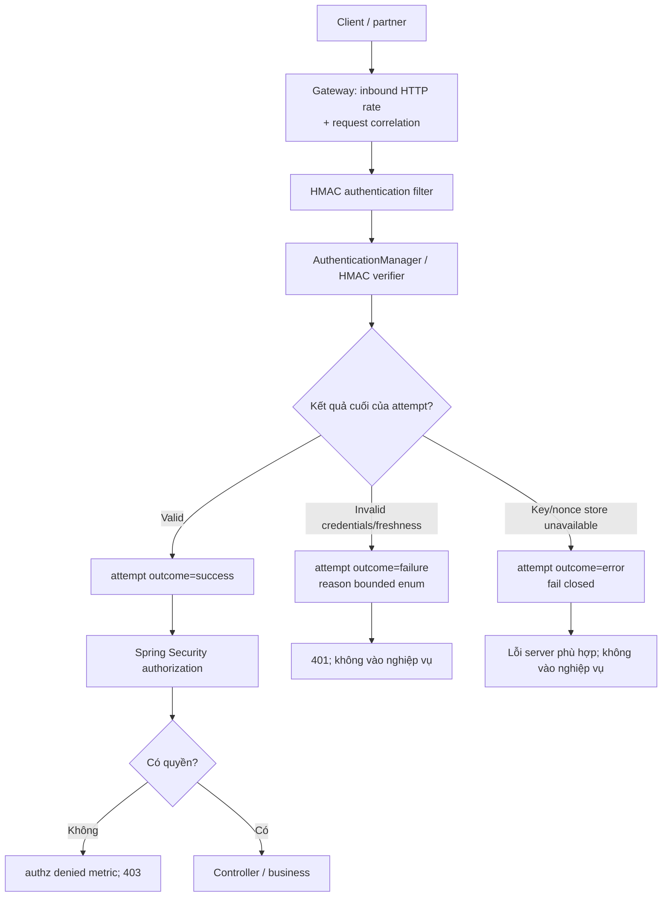

# Alert authentication spike: phát hiện và xử lý đột biến xác thực HMAC

## 1. Tại sao phải cảnh báo đột biến authentication?

Trong module `SECURITY_AUTHENTICATION_HMAC_REQUEST_AUTHENTICATION`, HTTP request được xác thực bằng HMAC với shared secret và **canonical request** đã thỏa thuận. Canonical request có thể bảo vệ method, URI/query, signed headers và body digest. Server còn phải kiểm tra timestamp, nonce chống replay, trạng thái key trong quá trình rotation, rồi mới tạo danh tính đã xác thực và thực hiện **authorization**.

Khi hàng nghìn request bất ngờ xuất hiện, nhiều tình huống có thể tạo ra những biểu hiện gần giống nhau:

- Một đối tác tăng lưu lượng hợp lệ sau đợt đồng bộ dữ liệu.
- SDK phía client được phát hành với canonicalization sai, gây hàng loạt `401` vì `MAC_MISMATCH`.
- Gateway vừa đổi cách rewrite path/header hoặc giải nén body, khiến chữ ký từng hợp lệ thành sai.
- Client retry sai cách, phát lại cùng timestamp/nonce, làm tăng `NONCE_REPLAY`.
- Key vừa bị thu hồi hoặc hết overlap window, trong khi một số client vẫn ký bằng key cũ.
- Có cuộc tấn công gửi hàng loạt request không có hoặc có chữ ký giả.
- Kho tra key hoặc nonce store mất kết nối, gây lỗi hạ tầng thay vì sai credentials.

**Alert authentication spike** là việc phát hiện đột biến về **số lượt xác thực, số lượt bị từ chối hoặc tỷ lệ thất bại** so với mức bình thường, rồi chuyển kết quả thành tín hiệu có thể điều tra và hành động. Một lần `401` riêng lẻ thường không đủ để cảnh báo; quan trọng là xu hướng, khối lượng, nguyên nhân và ảnh hưởng nghiệp vụ.

Sau bài học, người học có thể xây metric và cảnh báo cho HMAC, phân biệt `401/403/429/503`, dùng Prometheus/Micrometer không làm nổ cardinality, thiết kế ngưỡng hạn chế false positive, tạo runbook và kiểm thử khi có key rotation, gateway hoặc replay attack.

## 2. Phải xác định rõ “authentication spike” đang nói tới điều gì

| Dạng tăng đột biến | Tín hiệu chính | Có luôn là sự cố bảo mật? | Hành động ban đầu |
| --- | --- | --- | --- |
| Tăng tổng **authentication attempts** | Request/s đi vào vùng API HMAC | Không; có thể là peak hợp lệ | Đối chiếu lịch đồng bộ, chiến dịch, capacity |
| Tăng **authentication failures** | `401` hoặc outcome `failure` tại verifier | Không; có thể là SDK/gateway đổi contract | Phân tích reason code nội bộ và thời điểm deploy |
| Tăng **failure ratio** | Failures / total attempts | Không; tỷ lệ cao với mẫu rất nhỏ có thể là nhiễu | Kiểm tra mẫu tối thiểu, cửa sổ thời gian |
| Tăng **nonce replay** | Nonce claim đã tồn tại | Có thể là retry lỗi hoặc hành vi đáng ngờ | Kiểm tra SDK retry, đồng thời kiểm soát abuse |
| Tăng **timestamp invalid** | Timestamp ngoài khoảng cho phép | Có thể là clock drift | Kiểm tra đồng hồ client/server, NTP |
| Tăng **key unusable** | Key hết hạn, revoked hoặc sai lifecycle | Có thể là rotation không đồng bộ | Kiểm tra lịch thu hồi, cache, triển khai client |
| Tăng **infrastructure errors** | Lỗi key registry, nonce store, timeout | Thường là vấn đề availability | Điều tra dependency và cơ chế fail closed |
| Tăng **authorization denied** | `403` sau khi HMAC hợp lệ | **Không phải** signature failure | Kiểm tra quyền client, tenant, policy |

Sai lầm phổ biến là gom tất cả response không phải `2xx` thành “authentication failure”. `403` nghĩa là danh tính có thể đã xác thực nhưng không đủ quyền; `429` nghĩa là rate limiting; `503` có thể phản ánh một dependency không khả dụng. Các nhóm này nên có **metric và runbook khác nhau**.

**Lưu ý:** status HTTP là tín hiệu bổ trợ, nhưng nguồn sự thật tốt nhất cho nguyên nhân xác thực là **kết quả quyết định của HMAC verifier/AuthenticationManager**. Một request `401` do cơ chế khác không nên tự động bị đếm là lỗi HMAC.

## 3. Vị trí đặt measurement point và một lần đếm duy nhất



Chọn một **ranh giới đếm attempt** rõ ràng. Ví dụ, mỗi HTTP request vào endpoint yêu cầu HMAC tạo một attempt; sau khi kết thúc xác thực, attempt đó nhận đúng **một outcome**:

- `success`: MAC, timestamp/nonce, key status và các yêu cầu xác thực đã đạt.
- `failure`: thiếu/sai credentials, signature sai, replay, timestamp không đạt, key không được phép.
- `error`: không thể xác thực vì lỗi hệ thống như vault/key store hoặc nonce store bị gián đoạn; fail closed.

Không đếm một request hai lần ở `OncePerRequestFilter` **và** `AuthenticationProvider`. Nếu filter chạy thêm trên async/error dispatch hoặc bị đăng ký trùng ở servlet/security chain, cần bảo đảm measurement point vẫn có semantics mỗi attempt duy nhất. Với Spring WebFlux, không gọi `subscribe()` độc lập để tăng counter: việc xác thực phải là một publisher trong luồng request.

Nếu một request bị gateway chặn trước khi đến backend, backend không thể đếm nó. Vì vậy **gateway inbound metrics** và **HMAC verification metrics** đo hai tập request khác nhau; nên hiển thị cả hai thay vì kỳ vọng các counter luôn bằng nhau.

## 4. Metric schema đề xuất

Một schema mẫu cho API `order-api`, sử dụng Micrometer và Prometheus:

| Metric | Type | Labels nên dùng | Ý nghĩa |
| --- | --- | --- | --- |
| `hmac_auth_attempts_total` | Counter | `environment`, `service`, `route`, `outcome` | Mỗi attempt đúng một kết quả |
| `hmac_auth_failures_total` | Counter | `environment`, `service`, `route`, `reason` | Chi tiết nội bộ, chỉ đếm `failure` |
| `hmac_auth_verification_seconds` | Histogram/Timer | `environment`, `service`, `route`, `outcome` | Latency parser, key lookup, MAC, nonce claim |
| `hmac_auth_dependency_errors_total` | Counter | `environment`, `service`, `dependency` | Lỗi `key_store`, `nonce_store`, `policy_store` |
| `hmac_authorization_denied_total` | Counter | `environment`, `service`, `route`, `policy_class` | HMAC thành công nhưng thiếu quyền |
| `http_server_requests_seconds` | Histogram/Timer tùy instrumentation | `service`, `route`, `status` | Tác động tới HTTP toàn hệ thống |

Trong Prometheus, các tên metric xuất ra phụ thuộc naming convention/exporter. Với Micrometer dùng tên `hmac.auth.attempts`, Prometheus thường nhận `hmac_auth_attempts_total`; cần **xác minh chính xác tên series được exporter cung cấp** trước khi viết PromQL hoặc alert rule.

### 4.1. Những label tuyệt đối không nên đưa vào counter

Không gắn `request_id`, `trace_id`, `nonce`, raw signature, raw URL/query, raw user agent, `key_id` không giới hạn hoặc `client_id` của mọi đối tác vào Prometheus label. Những giá trị này có thể có độ phân biệt cực lớn, làm tăng chi phí lưu trữ, query và nguy cơ lộ danh tính.

Thay vào đó:

- `route` dùng route **template/route key** cố định, ví dụ `integrations.orders.create`, không phải `/orders/O-948251`.
- `reason` lấy từ enum có kích thước hữu hạn như `mac_mismatch`, `nonce_replay`, `timestamp_invalid`, `key_unusable`, `missing_evidence`.
- `environment`, `service` và `outcome` có danh sách giá trị đã kiểm soát.
- Nếu cần điều tra theo client hoặc key version, dùng **audit log có phân quyền** với client reference đã xác minh; metric tổng hợp không thay thế audit log.

### 4.2. Failure reason là nội bộ

`reason="mac_mismatch"` hữu ích để biết liệu một đợt `401` đến từ canonicalization hay credentials. Nhưng response gửi client không nhất thiết tiết lộ reason chi tiết: đối với API HMAC-only có thể trả `401 Unauthorized` với một lỗi công khai như `INVALID_REQUEST_AUTHENTICATION` nhằm hạn chế key enumeration/oracle.

Ngay cả khi key ID có trong registry, **không** gắn `client_id` đã xác thực nếu MAC sai. Kẻ tấn công có thể tự chọn key ID của một đối tác thật. Một `Authentication` và authorities chỉ đáng tin sau khi verifier hoàn thành các bước bắt buộc.

## 5. Ví dụ instrumentation bằng Micrometer trong Java

Định nghĩa outcome và reason có tập giá trị hữu hạn:

```java
public enum AuthOutcome {
    SUCCESS, FAILURE, ERROR
}

public enum AuthFailureReason {
    MISSING_EVIDENCE,
    MAC_MISMATCH,
    TIMESTAMP_INVALID,
    NONCE_REPLAY,
    KEY_UNUSABLE
}
```

Một recorder đơn giản:

```java
import io.micrometer.core.instrument.MeterRegistry;
import java.util.Locale;

public final class HmacAuthMetrics {
    private final MeterRegistry registry;
    private final String environment;
    private final String service;

    public HmacAuthMetrics(
            MeterRegistry registry, String environment, String service) {
        this.registry = registry;
        this.environment = environment;
        this.service = service;
    }

    public void record(
            String routeKey,
            AuthOutcome outcome,
            AuthFailureReason reason) {

        // routeKey PHẢI được tra từ allowlist route nội bộ,
        // không được lấy từ raw URI do client gửi.
        String safeRoute = KnownHmacRoutes.requireKnown(routeKey);
        String outcomeLabel =
                outcome.name().toLowerCase(Locale.ROOT);

        registry.counter("hmac.auth.attempts",
                "environment", environment,
                "service", service,
                "route", safeRoute,
                "outcome", outcomeLabel)
                .increment();

        if (outcome == AuthOutcome.FAILURE && reason != null) {
            registry.counter("hmac.auth.failures",
                    "environment", environment,
                    "service", service,
                    "route", safeRoute,
                    "reason", reason.name().toLowerCase(Locale.ROOT))
                    .increment();
        }
    }
}
```

`KnownHmacRoutes` là helper do ứng dụng định nghĩa, ví dụ ánh xạ request tới `integrations.orders.read` hoặc `integrations.orders.create`. Các giá trị `environment`/`service` là cấu hình server có tập hữu hạn. Không dùng `request.getRequestURI()` trực tiếp làm label.

Tại một điểm điều phối xác thực duy nhất, gọi `record(...)` **một lần** sau khi outcome đã xác định. Tránh tăng counter thêm ở filter, provider, exception handler và controller cho cùng attempt. Các exceptions hạ tầng nên vào `ERROR`; lỗi xác thực của client vào `FAILURE`. `AUTHORIZATION_DENIED` là sự kiện riêng sau `SUCCESS`, không làm đổi outcome của attempt HMAC.

Trong ứng dụng có hiệu năng cao, có thể đăng ký/cached các meters theo tổ hợp label hữu hạn để giảm overhead. Cần kiểm tra endpoint xuất metrics thực tế, cấu hình Actuator/Micrometer và quyền truy cập; không để metrics chứa thông tin nhạy cảm truy cập công khai.

## 6. Cảnh báo cơ bản: volume, failure rate và failure ratio

Giả định exporter cung cấp:

```text
hmac_auth_attempts_total{
    environment="prod",
    service="order-api",
    route="integrations.orders.create",
    outcome="failure"
}
```

### 6.1. Số lượt authentication mỗi giây

```promql
sum by (service, environment) (
  rate(hmac_auth_attempts_total{environment="prod"}[5m])
)
```

`rate(...[5m])` tính tốc độ trung bình trên cửa sổ 5 phút của counter, có xử lý counter reset theo semantics Prometheus. Dùng `sum by` để tổng hợp các instance và route mà vẫn giữ nhãn nhận diện service/environment. Nếu hệ thống có nhiều nhóm API với đặc tính lưu lượng khác nhau, cân nhắc group thêm bằng **route key hữu hạn**.

### 6.2. Số lượt authentication thất bại mỗi giây

```promql
sum by (service, environment) (
  rate(hmac_auth_attempts_total{
    environment="prod", outcome="failure"
  }[5m])
)
```

Đây là **lưu lượng lỗi tuyệt đối**. Nó có thể tăng khi traffic hợp lệ tăng, dù tỷ lệ lỗi vẫn không thay đổi. Vì vậy cảnh báo nên kết hợp thêm failure ratio và ngữ cảnh capacity.

### 6.3. Tỷ lệ lỗi xác thực

```promql
sum by (service, environment) (
  rate(hmac_auth_attempts_total{
    environment="prod", outcome="failure"
  }[5m])
)
/
clamp_min(
  sum by (service, environment) (
    rate(hmac_auth_attempts_total{environment="prod"}[5m])
  ),
  0.001
)
```

`clamp_min` tránh phép chia với mẫu số bằng 0 hoặc quá nhỏ. Nhưng **nó không giải quyết hoàn toàn nhiễu từ traffic thấp**: nếu chỉ có một request và request đó sai chữ ký, tỷ lệ có thể thành 100%. Cần một điều kiện **minimum attempts** trong cửa sổ.

### 6.4. Số attempts trong 5 phút

```promql
sum by (service, environment) (
  increase(hmac_auth_attempts_total{environment="prod"}[5m])
)
```

`increase` ước lượng mức tăng của counter trong 5 phút; giá trị có thể không phải số nguyên tuyệt đối vì cách ngoại suy của Prometheus. Trong bài này dùng nó để kiểm tra cỡ mẫu, không dùng làm bằng chứng tài chính hay đếm request chính xác tuyệt đối.

## 7. Ví dụ Prometheus alert rules

Đây là **ngưỡng minh họa để học và thử nghiệm**, không phải cấu hình production áp dụng nguyên xi. Trước khi dùng thật, phải dựa vào baseline của từng service, chu kỳ traffic, năng lực xử lý, error budget và độ ưu tiên nghiệp vụ.

```yaml
groups:
  - name: hmac-authentication-alerts
    rules:
      - alert: HmacAuthenticationTrafficSpike
        expr: |
          (
            sum by (service, environment) (
              rate(hmac_auth_attempts_total{environment="prod"}[5m])
            )
            >
            3 * clamp_min(
              sum by (service, environment) (
                rate(hmac_auth_attempts_total{environment="prod"}[1h])
              ), 0.1
            )
          )
          and
          sum by (service, environment) (
            rate(hmac_auth_attempts_total{environment="prod"}[5m])
          ) > 10
        for: 10m
        labels:
          severity: warning
          team: identity-platform
        annotations:
          summary: "HMAC authentication traffic tăng bất thường"
          description: "Service {{ $labels.service }} có attempt rate vượt baseline."

      - alert: HmacAuthenticationFailureRatioHigh
        expr: |
          (
            sum by (service, environment) (
              rate(hmac_auth_attempts_total{
                environment="prod", outcome="failure"
              }[5m])
            )
            /
            clamp_min(
              sum by (service, environment) (
                rate(hmac_auth_attempts_total{environment="prod"}[5m])
              ), 0.001
            )
          ) > 0.20
          and
          sum by (service, environment) (
            increase(hmac_auth_attempts_total{environment="prod"}[5m])
          ) > 200
        for: 5m
        labels:
          severity: warning
          team: identity-platform
        annotations:
          summary: "Tỷ lệ lỗi xác thực HMAC vượt 20%"
          description: "Service {{ $labels.service }} có failure ratio cao với đủ traffic."

      - alert: HmacAuthenticationReplayBurst
        expr: |
          sum by (service, environment) (
            rate(hmac_auth_failures_total{
              environment="prod", reason="nonce_replay"
            }[5m])
          ) > 1
        for: 3m
        labels:
          severity: warning
          team: identity-platform
        annotations:
          summary: "Nonce replay tăng đột biến trong HMAC verifier"
          description: "Kiểm tra retry policy và dấu hiệu replay trên {{ $labels.service }}."

      - alert: HmacAuthenticationDependencyError
        expr: |
          sum by (service, environment) (
            rate(hmac_auth_attempts_total{
              environment="prod", outcome="error"
            }[5m])
          ) > 0.1
        for: 5m
        labels:
          severity: critical
          team: identity-platform
        annotations:
          summary: "Lỗi hạ tầng trong quá trình xác thực HMAC"
          description: "Kiểm tra key registry, nonce store và timeout."
```

**Đọc quy tắc:**

1. `TrafficSpike` phát hiện attempt rate 5 phút vượt 3 lần tốc độ trung bình 1 giờ **và** lớn hơn 10 request/s liên tục theo `for`. Cửa sổ 1 giờ có chứa 5 phút gần đây nên chỉ là baseline đơn giản, không phải mô hình anomaly detection đầy đủ.
2. `FailureRatioHigh` yêu cầu tỷ lệ trên 20% **và** ít nhất khoảng 200 attempts trong 5 phút, để hạn chế alert từ traffic ít.
3. `ReplayBurst` quan tâm riêng reason `nonce_replay`. Không tự kết luận đây là tấn công: retry sai cách có thể có cùng hình dạng.
4. `DependencyError` phân biệt sự cố kho key/nonce với việc client cung cấp MAC sai; trong trường hợp này verifier phải **fail closed**.

Điều kiện `and` trong ví dụ được kết hợp theo cặp label `service,environment` tương ứng. Nếu metric labels giữa các nhóm không đồng nhất, alert có thể không hoạt động đúng. `for` làm điều kiện phải kéo dài qua nhiều lần evaluate, không có nghĩa Prometheus sẽ đợi thêm chính xác từng giây nếu evaluation interval thay đổi.

**Quan trọng:** Một metric không được scrape hoặc một series hoàn toàn vắng mặt có thể khiến expression không có kết quả chứ không tự báo “0 lỗi”. Cần có alert riêng cho scrape target down, metric absent hoặc dữ liệu telemetry thiếu; không coi im lặng là bảo mật tốt.

## 8. Chọn ngưỡng: tránh cả báo động giả lẫn bỏ lọt

Một ngưỡng cố định như “hơn 100 `401`/phút” có thể quá cao với endpoint chỉ có 10 request/phút và quá thấp với dịch vụ có hàng chục nghìn request/phút.

Nên phối hợp các tín hiệu:

- **Absolute failure rate:** bao nhiêu request lỗi mỗi giây/phút, ảnh hưởng tổng thể thế nào?
- **Failure ratio:** phần trăm lỗi trên tất cả attempts, đã loại nhiễu mẫu nhỏ?
- **Traffic anomaly:** tổng attempts tăng bao nhiêu so với baseline phù hợp?
- **Reason composition:** lỗi tập trung ở `MAC_MISMATCH`, `NONCE_REPLAY`, `TIMESTAMP_INVALID` hay `KEY_UNUSABLE`?
- **Dependency health:** p95/p99 verification latency, timeout nonce store/key registry, saturation pool/CPU/memory.
- **Customer impact:** số request hợp lệ thành công giảm hay không, business API có bị ảnh hưởng không?

### 8.1. Cửa sổ ngắn và cửa sổ dài

`[1m]` hoặc `[5m]` phát hiện nhanh nhưng dễ nhiễu. `[30m]` hoặc `[1h]` nhìn xu hướng ổn định hơn nhưng trễ. Có thể dùng nhiều cửa sổ, `for`, baseline theo giờ trong ngày/ngày trong tuần hoặc alert nhiều cấp nếu workload có mùa vụ rõ.

Ví dụ không nên đánh đồng 200 lỗi trong giờ có 100.000 attempts với 200 lỗi trong giờ có 220 attempts. Tỷ lệ phản ánh tình huống khác nhau dù tuyệt đối giống nhau.

### 8.2. Không lấy tỷ lệ 100% từ một request làm sự cố lớn

Một service ít traffic nhận đúng một request sai signature trong 5 phút sẽ có tỷ lệ lỗi 100%. Điều kiện minimum attempts và `for` giúp giới hạn false positive. Với hệ thống rất ít requests nhưng mỗi request quan trọng, dùng alert theo **sự kiện khách hàng quan trọng** hoặc mức độ ảnh hưởng riêng, thay vì cố áp tỷ lệ chung.

### 8.3. Đặt cảnh báo theo route hoặc nhóm đối tác khi cần

Một route cập nhật đơn hàng có độ nhạy hơn endpoint đọc dữ liệu. Có thể tách theo `route` cố định để phát hiện vấn đề riêng endpoint. Không đưa hàng chục nghìn `client_id` vào metric label; nếu cần biết ai bị ảnh hưởng, truy vấn **audit logs có phân quyền** dựa trên request ID/client reference đã được xác thực, hoặc nhóm đối tác hữu hạn được phê duyệt.

## 9. Phân biệt lỗi xác thực với lỗi phân quyền trong dashboard

HMAC verifier quyết định **authentication**; Spring Security và service quyết định **authorization**. Dashboard nên tách chúng:

| Phép đo | Event/metric | HTTP thường gặp | Ý nghĩa |
| --- | --- | --- | --- |
| Sai signature | `reason=mac_mismatch` | `401` | MAC hoặc canonical bytes không khớp |
| Thiếu HMAC evidence | `reason=missing_evidence` | `401` | Request chưa cung cấp bằng chứng hợp lệ |
| Timestamp sai | `reason=timestamp_invalid` | `401` | Clock skew, delay, replay window |
| Nonce replay | `reason=nonce_replay` | `401` | Đã dùng nonce trong scope bảo vệ |
| Key hết hiệu lực | `reason=key_unusable` | `401` | Rotation/revocation/registry policy |
| Thiếu quyền `ORDER_CREATE` | `hmac_authorization_denied_total` | `403` | Chữ ký có thể đúng nhưng không đủ authority |
| Đọc chéo tenant | Event `authz.denied` hoặc domain denial | `403/404` | Ownership/tenant không cho phép |
| Kho xác thực unavailable | `outcome=error`, dependency errors | Thường `503` | Hạ tầng không thể hoàn tất xác minh |

Không cấp quyền chỉ vì key ID có tồn tại. Đối với các lỗi MAC, key và freshness, client có thể nhận **cùng một error code công khai**, trong khi reason chi tiết chỉ tồn tại trong log/metrics nội bộ.

`401` trên dashboard cần được lọc tới **security chain HMAC**; một ứng dụng có thêm Basic Auth/Bearer có thể sinh `401` vì nguyên nhân khác. Nếu có error handler không nhất quán, status HTTP và outcome metric có thể lệch; hãy điều tra thay vì cộng cả hai như thể là hai lỗi.

## 10. Kết nối metrics với logs và distributed tracing

Một metric báo `MAC_MISMATCH` tăng đột biến sẽ hữu ích hơn nếu có request correlation:

```text
Monitoring alert:
    service=order-api
    environment=prod
    reason=mac_mismatch
    window=5m

Security audit event:
    event=hmac.auth.failure
    request_id=req-751a
    trace_id=4bf92f3577b34da6a3ce929d0e0e4736
    route=integrations.orders.create
    client_ref=unknown
    reason=MAC_MISMATCH
    status=401
```

Trong metric **không** đưa `request_id`/`trace_id` làm label. Trong audit log, dùng hai ID này để định vị một request cụ thể; chỉ thêm `client_ref` sau khi verifier tạo principal đáng tin. Nếu signature sai, log `client_ref=unknown`, tránh suy danh tính từ `X-Key-Id` hoặc `X-Client-Id` do Internet tự gửi.

Không đưa shared secret, raw signature, canonical request có body nhạy cảm, raw URI/query hoặc nonce vào logs/trace spans. Các reason code là enum hữu hạn; không dùng raw `Exception.getMessage()` làm reason label. Metrics/traces cũng phải có giới hạn truy cập, retention và redaction phù hợp.

Với HMAC request bị chặn ở gateway, backend có thể không có trace span. Nên có **metrics tại gateway** với ingress request count và denial classes riêng, rồi nối bằng trusted request ID hoặc tracing context đã sanitize.

## 11. HMAC spike qua gateway/proxy: tìm nguyên nhân theo lớp

Một đợt tăng `401` đột ngột sau khi deploy gateway có thể xuất phát từ **canonical mismatch**, không phải client đổi secret:

```text
Client ký:
    POST /public-api/orders?source=partner

Gateway rewrite:
    POST /integrations/orders?source=partner

Backend verifier dựng canonical request từ internal path:
    MAC_MISMATCH -> 401
```

Cũng cần kiểm tra:

- Gateway thay `Host`, percent-encoding, thứ tự query hoặc signed headers.
- Header bị loại khi `Connection` nêu `X-Signature` hoặc `X-Timestamp`, hoặc qua chuyển đổi HTTP/1.1 → HTTP/2/3.
- Body bị giải nén, chuẩn hóa JSON hoặc biến đổi bytes trước khi verifier hash.
- Có request smuggling/framing inconsistency giữa proxy và backend cần được xử lý tại edge.
- Gateway xác thực HMAC trước rewrite hay backend xác thực sau rewrite, và ai chịu trách nhiệm quản lý nonce.

Không “khắc phục” tỷ lệ lỗi bằng cách bỏ method, URI hoặc body khỏi chữ ký hay tăng cửa sổ timestamp vô hạn. Phải sửa contract canonicalization, trust boundary hoặc cấu hình gateway rồi kiểm thử cả happy path lẫn tamper case.

## 12. Phân tích spike do nonce, timestamp và key rotation

### 12.1. Nonce replay tăng

Một hệ thống retry có thể gửi **cùng request đã ký** nhiều lần sau timeout. Mỗi attempt tới server là một HTTP request mới, dù `OncePerRequestFilter` chỉ xử lý một lần trong phạm vi dispatch. Nonce store chia sẻ phải dùng **insert-if-absent nguyên tử** với TTL phù hợp.

Khi spike `nonce_replay`:

1. Xác nhận store hoạt động đúng, scope nonce theo client/key và TTL đáp ứng cửa sổ thời gian.
2. Kiểm tra SDK retry: khi hợp đồng yêu cầu, retry phải tạo timestamp/nonce và chữ ký mới; việc replay vô điều kiện không được chấp nhận.
3. Đối chiếu số request thành công và side effect để biết có chạy nghiệp vụ lặp không.
4. Kiểm tra có nhiều instance dùng nonce store riêng hoặc bị cache split-brain không.

Không dùng `requestId` hoặc `traceId` để thay thế nonce vì chúng không được thiết kế cho replay protection.

### 12.2. Timestamp invalid tăng

Kiểm tra đồng bộ NTP, định dạng epoch/ISO-8601, đơn vị giây/millisecond, timezone, độ trễ gateway và clock skew của client. Chỉ điều chỉnh allowed skew theo chính sách bảo mật có căn cứ: cửa sổ quá lớn làm tăng khả năng replay.

### 12.3. Key unusable tăng sau rotation

Kiểm tra key ID/version đang active, overlap window, thời điểm revoke và cache invalidation. Nếu key cũ bị thu hồi, server phải tiếp tục từ chối request, kể cả khi tăng `401`. Việc rollback sai có thể mở lại credential đã bị thu hồi; cần theo quy trình quản lý khóa và đánh giá nguy cơ trước mọi thay đổi.

Key v1/v2 có thể cùng ánh xạ tới một client đã xác thực, nhưng **không tự coi request MAC sai bằng v1 là request của client đó**. Dùng key reference hạn chế trong audit log nếu chính sách điều tra cần, không dùng nó làm metric label không kiểm soát.

## 13. Runbook khi cảnh báo kích hoạt

Một alert tốt phải dẫn tới hành động cụ thể:

| Bước | Việc làm | Câu hỏi cần trả lời |
| --- | --- | --- |
| 1. Xác nhận | Mở dashboard và so với traffic baseline | Metric có đang được scrape đầy đủ không? Chênh lệch từ khi nào? |
| 2. Phân nhóm | So failure, success, error, `403`, `429` | Spike thực sự thuộc xác thực hay vấn đề khác? |
| 3. Kiểm tra reason | Xem tỷ trọng `mac_mismatch`, `nonce_replay`, `timestamp_invalid`, `key_unusable` | Nhóm nào chi phối? |
| 4. Khoanh vùng | Tách theo service, route, environment và deploy window | Có một endpoint/gateway hay toàn hệ thống? |
| 5. Kiểm tra dependency | Key registry, nonce store, latency và lỗi kết nối | Có phải lỗi hạ tầng làm mất khả năng xác minh? |
| 6. Đối chiếu thay đổi | Release SDK, key rotation, gateway rewrite, rule bảo mật | Điều gì vừa thay đổi trước thời điểm spike? |
| 7. Xem audit có kiểm soát | Request ID/trace ID, mã nguyên nhân và client ref đã xác minh | Có dấu hiệu replay/abuse hay triển khai lỗi? |
| 8. Khắc phục an toàn | Rollback cấu hình lỗi hoặc sửa client/proxy, giới hạn lưu lượng theo policy | Có thể khôi phục mà không bỏ xác thực/chống replay? |
| 9. Xác minh | Quan sát ratio/latency và chạy request ký đúng/sai | Có còn false acceptance hay side effect ngoài ý muốn? |
| 10. Tổng kết | Incident timeline, nguyên nhân gốc, alert tuning | Cần sửa test, contract hay runbook nào? |

**Không khuyến nghị:** tắt HMAC filter, bỏ nonce check, chấp nhận mọi signature, hoặc ghi shared secret ra log để tìm lỗi. Nếu có tấn công lưu lượng cao, biện pháp giảm tải nên đặt tại edge/rate limiter và được kiểm soát để không cắt nhầm client hợp lệ.

### 13.1. Phân loại severity theo tác động, không chỉ theo phần trăm

Một failure ratio 60% ở endpoint ít traffic chưa chắc cần đánh thức trực đêm. Một outage nonce store khiến **100% request hợp lệ không thể xác thực** lại đáng báo critical dù traffic nhỏ. Severity nên dựa vào SLO, số client bị ảnh hưởng, endpoint quan trọng, tốc độ lỗi, khả năng bypass hay nguy cơ replay.

Với hạ tầng xác thực **fail closed**, outage có thể biến thành lỗi `503` tăng thay vì `401`. Do vậy cần cảnh báo riêng về dependency error và thành công xác thực giảm, không chỉ quan sát thất bại từ client.

## 14. Dashboard tối thiểu để triage

Một dashboard HMAC monitoring nên có:

1. Attempts/s, successes/s, failures/s, errors/s theo service và route.
2. Failure ratio 5 phút và 1 giờ, kèm tổng attempts của từng cửa sổ.
3. Breakdown reason `mac_mismatch`, `missing_evidence`, `timestamp_invalid`, `nonce_replay`, `key_unusable`.
4. p50/p95/p99 verification latency và độ trễ key store/nonce store.
5. Gateway inbound request rate, gateway denial, backend HMAC attempts và `5xx`.
6. `403`/authorization denied **riêng** với `401`/authentication failures.
7. Deployment markers, lịch key rotation/revocation và thay đổi gateway contract.
8. Liên kết tới audit logs/traces theo service, route và khoảng thời gian cảnh báo.

Với biểu đồ ratio, nên hiển thị cả **numerator và denominator** để không hiểu nhầm trường hợp traffic sụt mạnh. Với endpoint không có traffic, nên hiển thị “no data” hoặc trạng thái được xác định rõ, không mặc định là “0% failure” nếu scrape target không hoạt động.

Nếu lưu lượng có tính chu kỳ theo giờ/ngày, so sánh `rate[5m]` với baseline 1 giờ đơn giản có thể báo giả vào đầu đợt đồng bộ. Cần cải thiện baseline theo mô hình traffic thực tế và dùng maintenance windows/silences có kiểm soát khi biết trước thay đổi.

## 15. Kiểm thử metrics và alert rules

Một bộ test HMAC tốt phải kiểm tra cả response, side effect và telemetry:

| Ca kiểm thử | HTTP/logic | Counter cần thay đổi |
| --- | --- | --- |
| Chữ ký đúng, nonce mới, key active | Được xác thực; qua authorization | `attempts{outcome=success}` tăng một |
| Signature sai | `401`, không tới nghiệp vụ | `attempts{failure}` và `failures{mac_mismatch}` tăng một |
| Thiếu signature | `401` | `failure` và `missing_evidence` |
| Timestamp hết hạn | `401` | `failure` và `timestamp_invalid` |
| Hai HTTP requests cùng nonce | Request sau bị chặn | Một success và một `nonce_replay` theo scenario |
| Key bị thu hồi | `401` | `failure` và `key_unusable` |
| HMAC đúng nhưng thiếu `ORDER_CREATE` | `403`, không tạo đơn | `attempts{success}` tăng, `authorization_denied` tăng |
| Key registry/nonce store mất kết nối | `503` hoặc lỗi server phù hợp | `attempts{error}` và dependency error tăng |
| Filter bị đăng ký trùng hoặc async dispatch | Không xác thực lặp ngoài chủ đích | Một logical attempt chỉ tăng counter một lần |
| Gateway chặn request trước backend | Backend không thấy request | Chỉ gateway counter tăng, không đòi backend count tăng |
| Request có key ID/nonce không giới hạn | Không lộ dữ liệu | Không sinh series nhãn `key_id`/`nonce` |

Ví dụ kiểm tra bộ đếm Micrometer bằng `SimpleMeterRegistry`:

```java
import static org.assertj.core.api.Assertions.assertThat;
import io.micrometer.core.instrument.simple.SimpleMeterRegistry;

@Test
void failedSignatureHasOneAttemptAndOneReason() {
    try (SimpleMeterRegistry registry = new SimpleMeterRegistry()) {
        HmacAuthMetrics metrics =
                new HmacAuthMetrics(registry, "test", "order-api");

        metrics.record(
                "integrations.orders.create",
                AuthOutcome.FAILURE,
                AuthFailureReason.MAC_MISMATCH);

        double attempts = registry.get("hmac.auth.attempts")
                .tag("environment", "test")
                .tag("service", "order-api")
                .tag("route", "integrations.orders.create")
                .tag("outcome", "failure")
                .counter().count();

        double failures = registry.get("hmac.auth.failures")
                .tag("reason", "mac_mismatch")
                .counter().count();

        assertThat(attempts).isEqualTo(1.0);
        assertThat(failures).isEqualTo(1.0);
    }
}
```

Test phụ thuộc việc helper `KnownHmacRoutes` chấp nhận route key này. Với application integration test, sử dụng `MockMvc` (Spring MVC) hoặc `WebTestClient` (WebFlux) để xác nhận request thật đi qua filter, provider và policy; đừng mock HMAC verifier thành luôn thành công nếu mục tiêu là test failure semantics.

### 15.1. Kiểm thử Prometheus rules và ngưỡng

Nên kiểm tra các biểu thức alert trên dữ liệu tổng hợp theo các scenario: traffic ổn định, traffic tăng hợp lệ, lỗi tăng đột biến, chỉ một request lỗi, scrape target biến mất, counter reset và một instance mới scale lên.

Có thể dùng cơ chế **Prometheus rule unit testing** (ví dụ công cụ `promtool test rules` trong quy trình CI) để xác minh rule chuyển sang firing khi dữ liệu đúng ngưỡng, và không firing khi volume quá thấp. Bài STEP 4 chỉ mô tả workflow; chưa chạy script hoặc Content QA.

Không dựa vào tổng `401` do mọi security chain tạo ra. Trong test tích hợp, assert counter đến từ đúng **HMAC authentication decision** và metric labels đều thuộc allowlist.

## 16. Bài thực hành: thiết kế alert cho hệ thống nhiều client

Giả sử API có:

- `GET /integrations/orders/{id}` cần `ORDER_READ`.
- `POST /integrations/orders` cần `ORDER_CREATE`.
- `reporting-client` thuộc `tenant-a`, có quyền đọc; `fulfillment-client` thuộc `tenant-b`, có quyền đọc và tạo.
- Mỗi client có các key version phục vụ rotation, timestamp/nonce được ký cùng method, URI và body digest.

Hãy thực hiện:

1. Định nghĩa **measurement point duy nhất** cho mỗi attempt xác thực trên protected endpoint, gồm ba outcome `success/failure/error`.
2. Bổ sung bounded reason counters cho `mac_mismatch`, `nonce_replay`, `timestamp_invalid`, `key_unusable` và `missing_evidence`.
3. Viết dashboard rates, failure ratio, denominator và breakdown theo route, nhưng không dùng client ID, key ID, nonce hay signature làm metric label.
4. Đặt cảnh báo traffic spike và failure ratio với cửa sổ, minimum attempts, `for` và ngưỡng rút ra từ baseline thực tế.
5. Viết test gửi request ký đúng, sửa body sau ký, replay nonce, key revoked và authz denied để chứng minh counter/status đúng.
6. Mô phỏng một phiên key rotation sai cấu hình, xác định alert `key_unusable` tăng và đề xuất xử lý không tái kích hoạt key đã thu hồi một cách tùy tiện.
7. Mô phỏng gateway rewrite path khiến chữ ký sai; dùng request ID, trace ID và contract version để khoanh vùng, không log secret hoặc canonical body nhạy cảm.
8. Tạo một runbook một trang: severity, dashboard link, người phụ trách, kiểm tra đầu tiên, rollback an toàn và tiêu chí xác nhận sự cố được xử lý.

### Câu hỏi tự kiểm tra

**1. “Authentication spike” có luôn nghĩa là tấn công không?** Không. Nó có thể là lưu lượng hợp lệ, SDK deploy lỗi, gateway rewrite sai, replay từ retry, key rotation hoặc hạ tầng gián đoạn.

**2. Vì sao phải kết hợp failure ratio với số attempts tối thiểu?** Một vài request lỗi có thể tạo ratio gần 100% dù mức độ ảnh hưởng rất nhỏ; minimum volume và `for` giúp giảm nhiễu.

**3. Có nên thêm `nonce` hoặc `client_id` vào Prometheus label để biết nguồn request lỗi?** Không; chúng có thể làm nổ cardinality hoặc lộ thông tin. Dùng audit log có kiểm soát để điều tra.

**4. HMAC hợp lệ nhưng thiếu `ORDER_CREATE` có nên tăng `hmac_auth_failures_total` không?** Không. Authentication thành công, authorization từ chối; ghi metric `authz denied` riêng.

**5. Nếu nonce store không hoạt động, nên trả `401` hay cho request qua?** Không được cho qua. Đây là lỗi hạ tầng, thường trả lỗi server phù hợp và ghi `outcome=error`; verifier phải fail closed.

**6. Gateway tự chặn request trước backend thì metric backend có thấy không?** Không nhất thiết. Muốn giám sát toàn đường phải có metric tại gateway và tại backend, với semantics rõ.

**7. Trong key rotation, nhiều key ID có nghĩa nhiều client ID khác nhau?** Không. Hai key có thể cùng ánh xạ một client đã xác thực; key version và client identity là khái niệm riêng.

**8. Vì sao có `request_id` trong log nhưng không có trong metric labels?** Request ID giúp truy vết từng sự kiện, nhưng cardinality rất cao; metric chỉ nên có nhãn hữu hạn để tổng hợp và cảnh báo.

## 17. Ghi nhớ

**Alert authentication spike phải đo đúng thứ đang tăng**: tổng attempts, absolute failure rate, failure ratio, replay, key lifecycle hay lỗi phụ thuộc hạ tầng. Thiết kế counter theo một measurement point duy nhất, labels hữu hạn, phân loại `401` khác `403` và `503`, đồng thời đặt ngưỡng theo baseline và cỡ mẫu thực.

Cảnh báo chỉ có giá trị khi kèm dashboard, audit correlation và runbook để xử lý. Trong hệ thống HMAC, không bao giờ đổi sự an toàn lấy việc giảm số alert: **không bỏ xác minh MAC, timestamp/nonce, key revocation hoặc phân quyền**. Hãy dùng telemetry để tìm sự cố ở client, gateway, verifier hay kho dữ liệu, sau đó sửa đúng ranh giới tin cậy và kiểm thử lại cả request hợp lệ lẫn request bị giả mạo.
