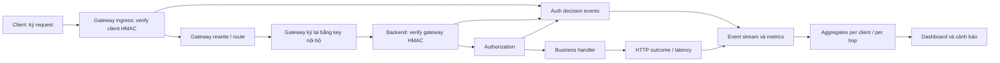
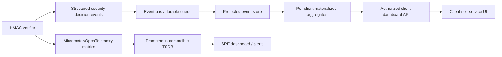

# Dashboard client: giám sát xác thực HMAC theo từng client

## 1. Mục tiêu và bối cảnh

Bài học **Dashboard client** thuộc chương **Monitoring** của module **SECURITY_AUTHENTICATION_HMAC_REQUEST_AUTHENTICATION**. Trong module này, một client ký HTTP request bằng HMAC với **shared secret**. Gateway hoặc backend dùng hợp đồng **canonical request** (method, URI, header và/hoặc body) để xác minh chữ ký, kiểm tra **timestamp/nonce** nhằm chống replay, quản lý **key rotation**, theo dõi proxy/gateway và phân biệt **authentication** với **authorization**.

Khi hệ thống có nhiều client đối tác, số lượng request lớn và nhiều gateway/backend instance, chỉ xem tổng số HTTP 401 sẽ không trả lời được: client nào đang gặp sự cố, lỗi bắt đầu sau thay đổi nào, có phải clock skew hay canonical mismatch, việc chuyển sang key mới diễn ra đến đâu và hạ tầng kiểm tra nonce có đang gây từ chối giả hay không. **Dashboard client** biến các tín hiệu này thành số liệu có nghĩa và hành động được, với giới hạn rõ ràng về danh tính và dữ liệu bảo mật.

Sau bài học, người học có thể:

- Xác định **đối tượng xem dashboard**: đội vận hành có quyền giám sát nhiều client và client tự xem dữ liệu của chính mình.
- Thiết kế các chỉ số cho xác thực HMAC, nonce replay, clock skew, key rotation, lỗi phân quyền, độ trễ và sự cố gateway/backend.
- Phân biệt sự kiện **đã xác minh danh tính**, **chỉ biết key ID do request khai báo** và **không thể quy thuộc** để tránh báo cáo sai hoặc cho kẻ tấn công thao túng dashboard.
- Định nghĩa cách tổng hợp và truy vấn per-client có kiểm soát, không gắn hàng triệu client ID/nonce/request ID trực tiếp vào metrics label.
- Xây dựng sơ đồ dữ liệu từ verifier → metrics/event pipeline → kho tổng hợp → dashboard và cảnh báo.
- Kiểm thử độ chính xác của số liệu, quyền truy cập theo tenant, hành vi multi-hop và những trường hợp hạ tầng lỗi.

## 2. Dashboard phục vụ quyết định nào?

Trước khi chọn biểu đồ, cần hiểu **ai dùng số liệu và họ sẽ hành động ra sao**.

| Người dùng | Câu hỏi thường gặp | Quyền dữ liệu |
|---|---|---|
| Chủ tích hợp của client/đối tác | Request HMAC của tôi có hoạt động không? Khi nào nên chuyển key? | Chỉ dữ liệu thuộc client/tenant mà họ được cấp quyền |
| Nhóm hỗ trợ tích hợp | Client đang lỗi ký, sai giờ hay gặp vấn đề proxy? | Phạm vi các client được phân công hỗ trợ |
| Security/SRE | Có mẫu tấn công, nonce replay, key compromise, Redis downtime hoặc cache credential stale không? | Dữ liệu nội bộ theo RBAC, audit và quy định bảo mật |
| Chủ API/backend | Độ trễ verify, 401, 403 và 5xx ảnh hưởng các route thế nào? | Số liệu theo dịch vụ, route template và quyền truy cập |

**Hai loại dashboard không nhất thiết giống nhau:**

1. **Dashboard self-service cho client** chỉ hiển thị số liệu đã được gắn với client một cách đáng tin, trạng thái credential được phép xem, kết quả API được phép công bố và một số request ID hỗ trợ tra cứu. Nó không cho xem danh sách key của client khác, expected MAC, raw body, nguồn IP của bên thứ ba hoặc nguyên nhân chi tiết có thể tạo oracle.
2. **Dashboard vận hành nội bộ** có thể hiển thị thêm nhóm lỗi như `invalid_mac`, `unknown_key`, `claimed_revoked_key`, tình trạng node, vị trí gateway/proxy, propagation lag và nghi vấn tấn công. Các dữ liệu này cần phân quyền, retention và nhật ký truy cập thích hợp.

Với lỗi HMAC chưa xác thực được, điều quan trọng là **không coi giá trị `X-Key-Id` do người gửi khai báo là bằng chứng người gửi thuộc client có ID đó**. Kẻ tấn công có thể chủ động gửi nhiều request sai chữ ký mang key ID của đối tác để làm bẩn dashboard.

## 3. Mô hình theo dõi một request HMAC

Trong kiến trúc có gateway, request có thể qua hai lần xác minh khác nhau:



Một request có thể tạo ra nhiều **sự kiện theo hop**, nhưng chỉ có **một lượt request đi vào hệ thống tại ingress**. Không cộng số lượt xác thực tại gateway và backend để báo cáo “tổng số request client” vì sẽ đếm đôi.

Ví dụ:

- Ingress gateway xác minh đúng client `partner-a` → `AUTH_SUCCESS` tại hop `client-to-gateway`.
- Backend xác minh chữ ký do gateway tạo → `AUTH_SUCCESS` tại hop `gateway-to-backend`. Đây là xác thực **gateway**, không phải lần client tạo chữ ký thứ hai.
- Backend xác định client không được sửa đơn thuộc tenant khác → `AUTHORIZATION_DENIED` / HTTP 403.

Nếu dashboard đơn giản cộng mọi `AUTH_SUCCESS`, nó có thể báo **hai lần thành công** dù chỉ có một request từ client. Cần phân biệt các lớp đo:

| Lớp đo | Đơn vị đếm | Ví dụ |
|---|---|---|
| **Ingress request** | Một HTTP attempt tới điểm vào đã quy định | 1 request từ client đến gateway |
| **Authentication decision** | Một quyết định xác minh tại một hop | Gateway verify client; backend verify gateway |
| **Authorization decision** | Một quyết định quyền trên tài nguyên | Cho phép / từ chối cập nhật order |
| **Business operation** | Một hành động nghiệp vụ được thực thi hoặc bị loại bằng idempotency | Một payment được tạo |
| **Outbound attempt** | Một lần gateway thực sự gửi tới backend, có thể retry | Lần gửi 1 timeout; lần gửi 2 ký lại |

Dashboard phải nêu rõ **đơn vị đếm và phạm vi hop** của từng biểu đồ.

## 4. Ba mức độ quy thuộc danh tính (attribution)

Đây là quyết định quan trọng nhất khi tạo dashboard theo client.

### 4.1. `UNATTRIBUTED`: chưa chứng minh ai gửi

Request thiếu key ID, key không tồn tại hoặc có MAC sai. `X-Key-Id`, `X-Tenant-Id`, IP, User-Agent đều có thể được người gửi giả mạo. Hệ thống được phép dùng chúng ở log an toàn nhằm điều tra, nhưng **không được gắn request thành công của client thật** và không được tính như lỗi do client đó gây ra trong self-service dashboard.

### 4.2. `MAC_VERIFIED_CREDENTIAL`: chứng minh MAC gắn với một credential

Server đã xác minh MAC bằng secret của credential xác định, nhưng có thể **chưa hoàn tất authentication** vì timestamp quá cũ hoặc nonce đã dùng. Có thể thống kê attempt liên quan đến credential theo quyền owner, ví dụ **replay phát hiện trên credential này**. Tuy nhiên, request replay có thể do kẻ thu được request cũ thực hiện; không thể khẳng định chính chủ client đã gửi lại.

Chú ý: cần quyết định thứ tự validate chính xác. Nếu verifier trả lỗi timestamp **trước khi tính MAC**, sự kiện chỉ có key được khai báo; không được ghi `MAC_VERIFIED_CREDENTIAL`. Dashboard nên chỉ hiển thị nguyên nhân đã được xác nhận, không “nâng cấp” danh tính sau khi đã từ chối.

### 4.3. `AUTHENTICATED_CLIENT`: toàn bộ kiểm tra hoàn tất

Key active, canonical/body digest/MAC hợp lệ, timestamp trong cửa sổ, nonce claim thành công; principal được tạo từ credential/tenant/scope đáng tin. Chỉ từ đây các số liệu theo **authenticated client** như successful authentication, authorization denial hay route usage mới có nghĩa.

| Mức attribution | Điều kiện | Có dùng để quy lỗi cho client? |
|---|---|---|
| `UNATTRIBUTED` | Chưa có đủ bằng chứng MAC | Không; dữ liệu được xem ở góc nhìn security nội bộ |
| `MAC_VERIFIED_CREDENTIAL` | MAC hợp lệ nhưng freshness/replay có thể lỗi | Có thể hiển thị theo credential với nhãn “attempt liên quan”, không khẳng định actor |
| `AUTHENTICATED_CLIENT` | Đủ toàn bộ kiểm tra và principal đã được tạo | Có; giới hạn theo chủ sở hữu đã xác thực và chính sách quyền xem |

Nếu một credential đã revoked, verifier thường từ chối **trước khi tạo principal**. Việc request gửi key ID trùng với key revoked chỉ là **claimed key**, trừ khi hệ thống có quy trình kiểm chứng thêm bằng chứng. Không ghi một request chưa xác thực như “client X đã sử dụng key revoked”.

### 4.4. Mẫu sự kiện có attribution tường minh

Ví dụ sự kiện xác thực thành công, ở ingress:

```json
{
  "schemaVersion": 1,
  "eventId": "ev-98c1",
  "requestId": "req-7af0",
  "observedAt": "2026-11-28T04:00:15.250Z",
  "hop": "client-to-gateway",
  "routeTemplate": "/partner/orders/{id}",
  "attribution": "AUTHENTICATED_CLIENT",
  "verifiedClientId": "partner-a",
  "verifiedTenantId": "tenant-a",
  "verifiedCredentialRef": "cred-072",
  "decision": "AUTH_SUCCESS",
  "internalReason": "ok",
  "credentialVersion": 12,
  "latencyMs": 7
}
```

Ví dụ lỗi MAC, **không** tự gán client:

```json
{
  "schemaVersion": 1,
  "eventId": "ev-98c2",
  "requestId": "req-7af1",
  "observedAt": "2026-11-28T04:00:16.120Z",
  "hop": "client-to-gateway",
  "routeTemplate": "/partner/orders/{id}",
  "attribution": "UNATTRIBUTED",
  "verifiedClientId": null,
  "verifiedTenantId": null,
  "verifiedCredentialRef": null,
  "decision": "AUTH_FAILURE",
  "internalReason": "invalid_mac",
  "httpStatus": 401
}
```

Không đưa shared secret, raw signature, expected HMAC, canonical request đầy đủ hay body nhạy cảm vào event. Nếu cần phân tích key ID người gửi khai báo, dùng trường riêng `claimedKeyRef` đã hạn chế truy cập và có kiểm soát độ dài/format; **không trộn với `verifiedCredentialRef`**.

## 5. Chọn các chỉ số có thể hành động

### 5.1. Trạng thái xác thực

| KPI/biểu đồ | Định nghĩa | Cách đọc |
|---|---|---|
| Ingress request attempts | Số attempt tại edge theo khoảng thời gian | Tổng tải đến hệ thống; bao gồm traffic chưa xác thực |
| Auth success count/rate | Số lượt verify thành công và tỷ lệ theo mẫu số đã công bố | Tình trạng tầng HMAC, cần chọn đúng hop |
| Auth failure theo reason | `missing_credentials`, `invalid_mac`, `timestamp_outside_window`, `nonce_replay`... | Tìm lỗi tích hợp hoặc tín hiệu tấn công |
| Authentication dependency errors | Redis nonce store, secret/credential lookup timeout | Lỗi hạ tầng, thường 503/5xx, không nên gán thành invalid signature |
| 401 theo route template và hop | Response public 401; không đồng nghĩa mọi 401 do cùng nguyên nhân | Phát hiện sự cố sau deploy hoặc thay route |
| Authorization denied | Số 403 sau HMAC thành công | Khác với signature invalid; liên quan scope/tenant/resource |
| Rate limiting | 429 theo route/client đã xác minh hoặc ingress policy | Biểu thị quota/chống abuse, không coi là chữ ký sai |

Công thức nên được mô tả rõ. Ví dụ **tỷ lệ thành công tại hop client→gateway**:

```text
auth_success_rate =
  AUTH_SUCCESS /
  (AUTH_SUCCESS + AUTH_FAILURE + AUTH_DEPENDENCY_ERROR)
```

Công thức này chỉ áp dụng nếu ba nhóm trên được ghi **đúng một lần cho mỗi verification attempt** và bao phủ đầy đủ các attempt được xét. Cần nêu rõ liệu request bị chặn bởi body limit/rate limit **trước khi chạy verifier** có được đưa vào mẫu số hay không. Không dùng kết quả authorization 403 để làm thay đổi số `AUTH_SUCCESS`: HMAC có thể đã thành công và phân quyền vẫn từ chối.

Tương tự, **availability của dịch vụ xác thực** nên được định nghĩa riêng để không nhầm lỗi do client sai chữ ký với sự cố server:

```text
auth_dependency_availability =
  (eligible_verify_attempts - dependency_failures) /
  eligible_verify_attempts
```

Đây là chỉ số minh họa có ranh giới: `eligible_verify_attempts` là những attempt đi tới bước xác minh cần dependency; phải định nghĩa chính xác các dependency và điểm đếm. Không tính chữ ký client sai thành downtime của dịch vụ.

### 5.2. Chống replay và thời gian

**Nonce replay rate** có thể tăng vì client retry sai (gửi lại nguyên request với cùng nonce), vì việc ghi nonce store không đồng bộ hoặc vì request bị kẻ thứ ba phát lại. Số lần replay **không tự chứng minh có tấn công**.

**Timestamp reject rate** có thể tăng sau thay đổi môi trường chạy client, lệch clock trên node, nhầm epoch milliseconds với seconds hoặc đặt ngưỡng clock skew quá chặt. Khi hiển thị clock skew, phân biệt:

- `rawTimestampDifference` chỉ là dữ liệu chưa đáng tin nếu MAC chưa hợp lệ.
- `verifiedTimestampDifference` có ý nghĩa điều tra tốt hơn khi MAC đã được xác minh. Chỉ ghi dưới dạng **bucket/summary an toàn** (ví dụ `<-5m`, `-5m..-1m`, `±1m`, `1m..5m`, `>5m`); hạn chế giá trị chính xác nếu có thể lộ thông tin thời gian/thiết bị.

Nếu server kiểm tra timestamp trước MAC vì tối ưu, chart không được tự gắn mọi timestamp reject cho client qua `X-Key-Id`. Có thể chọn verify MAC trước khi quyết định attribution nếu chi phí và threat model cho phép, hoặc chỉ hiển thị aggregate **unattributed timestamp rejects** trên dashboard vận hành.

### 5.3. Key rotation và revocation

| KPI | Ý nghĩa | Cảnh báo/phản ứng |
|---|---|---|
| Active credential versions | Những key ID được phép dùng, theo registry có phân quyền | Phát hiện thiếu key mới/ghi nhận vòng đời |
| Verified traffic theo key version | Tỷ lệ request đã xác minh dùng old/new key | Theo dõi tiến độ di chuyển client |
| Last verified use of old key | Lần cuối thấy MAC đúng + authentication thành công với old key | Quyết định thời điểm có thể revoke theo policy |
| Time to adoption | Thời gian từ khi key mới active đến khi client có traffic hợp lệ với key mới | Hỗ trợ tích hợp nếu chậm |
| Revocation propagation lag | Commit revoke đến thời điểm verifier áp dụng version tương ứng | Phát hiện stale cache, gateway chưa nhận event |
| Success using stale credential state | Tín hiệu điều tra khi verifier thành công với version đã cũ | Cảnh báo security ưu tiên cao |

Cần phân biệt **credential key ID** và **rotation group/client**. Nếu một client có nhiều key active trong khoảng chuyển đổi, tỷ lệ dùng key mới có thể là:

```text
new_key_share =
  successful_ingress_verifications_with_new_key /
  successful_ingress_verifications_with_old_or_new_key
```

Mẫu số phải loại bỏ traffic của gateway key nội bộ và những request chưa xác thực. **Last verified use** không bảo đảm client đã xóa secret cũ ở tất cả hệ thống; trước revoke cần xác nhận lịch chuyển đổi và dự phòng của client. Key đã revoked không tự được chấp nhận chỉ vì MAC vẫn khớp.

### 5.4. Hiệu năng verify và tác động nghiệp vụ

Phân tách:

- **Verification latency:** thời gian tra credential, kiểm tra canonical/body digest/MAC và claim nonce. Đo từ lúc bắt đầu bước verify đến quyết định auth, không bao gồm thời gian chờ response cuối của API.
- **Dependency latency:** Redis, cache/DB credential, KMS hoặc vault nếu có; tách để chẩn đoán.
- **End-to-end request latency:** từ gateway ingress đến trả HTTP response; bao gồm routing, authz và nghiệp vụ.
- **Business success/error:** 2xx/4xx/5xx thuộc API sau auth; không gộp 500 của business handler thành “HMAC failure”.

Nên dùng histogram để nhìn P50/P95/P99 **với điều kiện có đủ số mẫu**; không lấy trung bình đơn giản của P95 từng instance làm P95 toàn cụm. Dashboard phải cho biết số mẫu và cửa sổ tính để tránh kết luận từ 1–2 request lẻ.

## 6. Bố cục dashboard đề xuất

Một dashboard theo client nên trả lời được: **Có vấn đề gì? Bắt đầu khi nào? Phạm vi ra sao? Cần làm gì tiếp?**

```text
┌──────────────────────────────────────────────────────────────────┐
│ Dashboard client: partner-a                                      │
│ Thời gian: 24h gần nhất  | Time zone: UTC+7 | Ingress only       │
├─────────────────────┬─────────────────────┬──────────────────────┤
│ HMAC verified       │ Auth failures       │ Dependency errors    │
│ Số lượt / tỷ lệ     │ Theo nguyên nhân    │ 503 và latency       │
├─────────────────────┴─────────────────────┴──────────────────────┤
│ Timeline: auth success / 401 / 403 / 429 / 5xx theo phút          │
├───────────────────────────────┬──────────────────────────────────┤
│ Rotation old/new share        │ Clock skew / nonce replay trend  │
├───────────────────────────────┴──────────────────────────────────┤
│ Route breakdown / P95 verify latency / gateway release markers   │
├──────────────────────────────────────────────────────────────────┤
│ Support request IDs + tình trạng credential được phép hiển thị   │
└──────────────────────────────────────────────────────────────────┘
```

Đây là wireframe bằng văn bản; số liệu mẫu trong bài được **giả định để luyện tập**, không phải dữ liệu hệ thống thực.

### 6.1. Các thành phần ở mức tổng quan

**Thẻ KPI:** hiển thị số tuyệt đối, mẫu số/tỷ lệ nếu có, phạm vi thời gian, hop và mức attribution. Ví dụ “HMAC success (client→gateway, authenticated)” rõ nghĩa hơn “Success”.

**Đồ thị thời gian:** chồng các nhóm outcome hoặc trình bày từng tuyến riêng. Có thể bật đánh dấu thời điểm deploy gateway, thay phiên bản client SDK, thay route, key rotation/revocation, sự cố Redis. Tương quan thời gian giúp tìm đầu mối nhưng chưa chứng minh nguyên nhân.

**Bảng route:** dùng route **template**, ví dụ `/partner/orders/{id}`. Không dùng raw URI chứa user ID, query token hoặc dữ liệu cá nhân làm nhãn/hàng trong dashboard phổ biến.

**Phần credential:** chỉ với người xem đủ quyền; hiển thị `keyId` đã kiểm soát, trạng thái ACTIVE/REVOKED, thời điểm kế hoạch rotate và lần cuối có traffic hợp lệ. Không bao giờ hiển thị shared secret, expected MAC hoặc raw body.

**Phần hành động:** cảnh báo sai đồng hồ, link tài liệu ký request, quy trình yêu cầu rotate và request ID để hỗ trợ. Một biểu đồ không nên tự kích hoạt revoke key chỉ vì một lần 401 hoặc replay; revocation là hành động có policy và audit riêng.

### 6.2. Bộ lọc phải có nghĩa rõ ràng

Có thể lọc theo:

| Bộ lọc | Quy tắc |
|---|---|
| Khoảng thời gian | Ghi timezone hiển thị; lưu timestamp UTC; hỗ trợ so 1h/24h/7d |
| Client / tenant | Được giới hạn server-side theo danh tính người xem |
| Hop | `client-to-gateway` hoặc `gateway-to-backend`; mặc định không cộng gộp |
| Route | Route template do server xác định |
| Outcome | `auth_success`, `auth_failure`, `dependency_error`, `authorization_denied`... |
| Key version | Chỉ cho user có quyền xem credential của chính họ |
| Gateway release / region | Chỉ khi phạm vi này được phép công bố và đủ số mẫu |

Tính năng “Compare previous period” phải so hai khoảng cùng độ dài, cùng timezone/hop/attribution và cách đo. Nếu bản phát hành mới thay đổi logic instrument, hiển thị **điểm thay đổi định nghĩa metric** hoặc thông báo để tránh suy diễn nhầm là lưu lượng tăng đột biến.

## 7. Thiết kế kiến trúc dữ liệu: metrics cho toàn hệ thống, events cho client

Một nguyên tắc vận hành hữu ích: **metrics có label cardinality thấp** dùng cho sức khỏe toàn hệ thống; **event/aggregate theo client có quyền truy cập** dùng cho phân tích chi tiết.



**Vì sao không cho `clientId` làm label ở mọi metric?**

Giả sử có 100.000 client × 20 route × 8 reason × 3 hop × 10 status/region combinations. Số time series có thể tăng khổng lồ, tốn bộ nhớ và làm truy vấn chậm; hơn nữa ID client có thể chứa thông tin nhạy cảm. `nonce`, `signature`, `requestId`, raw path/query thậm chí có cardinality gần bằng số request nên **không bao giờ** dùng làm metrics tag.

Một hệ thống nhỏ có tập client cố định và đã giới hạn chặt có thể dùng label client theo policy, nhưng phải có ngân sách cardinality được đo và cảnh báo. Kiến trúc tổng quát trong bài chọn **không đưa clientId vào Prometheus metrics**.

### 7.1. Metric dimensions được phép

Ví dụ bộ nhãn hữu hạn:

```text
hmac_auth_decisions_total{
  hop="client_to_gateway",
  outcome="success|failure|dependency_error",
  reason="ok|missing_credentials|invalid_mac|timestamp_window|nonce_replay|unknown_key|registry_unavailable|nonce_store_unavailable",
  route="/partner/orders/{id}",
  region="ap-southeast"
}

hmac_verify_duration_seconds_bucket{
  hop="client_to_gateway",
  route="/partner/orders/{id}",
  le="..."
}

hmac_nonce_store_operations_total{
  result="claimed|replayed|error",
  hop="client_to_gateway"
}

hmac_revocation_propagation_seconds_bucket{
  credential_kind="client|gateway",
  hop="client_to_gateway",
  le="..."
}
```

Đây là **tên và nhãn minh họa**; Prometheus dùng tên chuẩn hóa từ instrument. Cần giới hạn tập `route` bằng các route template đã khai báo, không tự chuyển mọi raw path của request lỗi thành label. Nếu sự cố diễn ra trước routing, dùng `route="unmatched"` hoặc tập nhãn an toàn khác.

### 7.2. Java/Micrometer: ghi nhận kết quả đúng một lần

Một instrument đơn giản nằm tại **điểm quyết định cuối của verifier**:

```java
import io.micrometer.core.instrument.Counter;
import io.micrometer.core.instrument.MeterRegistry;
import io.micrometer.core.instrument.Timer;

import java.time.Duration;
import java.util.Set;

enum AuthOutcome { SUCCESS, FAILURE, DEPENDENCY_ERROR }

record AuthObservation(
        String hop,
        String routeTemplate,
        AuthOutcome outcome,
        String reason,
        Duration verifyDuration) {}

final class HmacAuthMetrics {
    private static final Set<String> SAFE_REASONS = Set.of(
            "ok",
            "missing_credentials",
            "invalid_mac",
            "timestamp_window",
            "nonce_replay",
            "unknown_key",
            "registry_unavailable",
            "nonce_store_unavailable",
            "other");

    private final MeterRegistry registry;

    HmacAuthMetrics(MeterRegistry registry) {
        this.registry = registry;
    }

    void record(AuthObservation observation) {
        // Chỉ các route template/hop đã được allowlist ở application config.
        String route = allowedRoute(observation.routeTemplate());
        String hop = allowedHop(observation.hop());
        String reason = SAFE_REASONS.contains(observation.reason())
                ? observation.reason()
                : "other";

        Counter.builder("hmac.auth.decisions")
                .tag("hop", hop)
                .tag("route", route)
                .tag("outcome", observation.outcome().name().toLowerCase())
                .tag("reason", reason)
                .register(registry)
                .increment();

        Timer.builder("hmac.verify.duration")
                .tag("hop", hop)
                .tag("route", route)
                .register(registry)
                .record(observation.verifyDuration());
    }

    private String allowedRoute(String route) {
        // Ví dụ tối giản: trong sản xuất dùng tập route đã cấu hình.
        return "/partner/orders/{id}".equals(route)
                ? route : "other";
    }

    private String allowedHop(String hop) {
        return "client_to_gateway".equals(hop)
                || "gateway_to_backend".equals(hop)
                ? hop : "other";
    }
}
```

Đoạn mã tập trung vào **đếm và thời gian xác minh**, không phải toàn bộ HMAC verifier. Bộ đếm cần được gọi **chính xác một lần trên mỗi authentication decision đã kết thúc**; không vừa ghi trong nhánh verify success vừa ghi lần thứ hai trong global error handler. Khi request bị hủy trước khi có quyết định, ghi `cancelled`/`incomplete` theo một contract riêng; không tự xem là invalid MAC.

Để histogram hỗ trợ truy vấn percentile, cần cấu hình phân phối `Timer` (ví dụ bật histogram hoặc SLO buckets theo nền tảng dùng). Với WebFlux, đặt phép đo trong pipeline bằng `doOnSuccess`/`doOnError`/`doFinally` có cấu trúc trạng thái rõ ràng; không gọi `block()` hay `subscribe()` thủ công và tránh phát hai event do retry/resubscribe nếu đơn vị đo là một outbound attempt.

### 7.3. PromQL: nhìn toàn cảnh

Ví dụ PromQL theo tên đã được chuẩn hóa, với điều kiện exporter đang phát các metric tương ứng:

```promql
# Tỷ lệ auth failure tại ingress trong 5 phút, tất cả route.
sum(rate(hmac_auth_decisions_total{
  hop="client_to_gateway",outcome="failure"
}[5m]))
/
clamp_min(
  sum(rate(hmac_auth_decisions_total{
    hop="client_to_gateway"
  }[5m])),
  1e-9
)
```

```promql
# P95 thời gian verify cho ingress, trên tất cả instance/route.
histogram_quantile(
  0.95,
  sum by (le) (
    rate(hmac_verify_duration_seconds_bucket{
      hop="client_to_gateway"
    }[5m])
  )
)
```

```promql
# Tỷ lệ lỗi dependency của bước xác thực.
sum(rate(hmac_auth_decisions_total{
  outcome="dependency_error",hop="client_to_gateway"
}[5m]))
```

Đây là các truy vấn **mức toàn hệ thống/hop**. Đừng sửa bằng cách thêm label `clientId` vào mọi metric rồi hy vọng áp dụng RBAC chỉ ở Grafana; dashboard self-service cần phân quyền tại **API/truy vấn dữ liệu** và mô hình lưu trữ ngay từ đầu.

## 8. Kho event và bảng tổng hợp theo client

Lựa chọn phù hợp cho per-client thường là một bảng event có quyền truy cập chặt và bảng tổng hợp theo từng khoảng thời gian. Một event nên chứa:

| Trường | Mục đích | Kiểm soát |
|---|---|---|
| `eventId` | Dedup, kiểm tra at-least-once delivery | Sinh ở hệ thống tin cậy |
| `requestId` | Correlate một ingress request | Không là authentication token |
| `observedAt` | Sắp xếp time window | UTC, có cơ chế xử lý late events |
| `hop` | Không đếm nhầm gateway/backend | Enum |
| `routeTemplate` | Drilldown theo API | Allowlist |
| `attribution` | Mức tin cậy của quy thuộc | Enum, lấy từ verifier |
| `credentialOwnerClientId` | Tổng hợp được theo client khi MAC hợp lệ | Không lấy từ header request |
| `verifiedClientId` | Principal khi auth hoàn tất | Có thể null |
| `tenantId` | Ràng buộc truy cập dữ liệu | Lấy từ registry đáng tin |
| `credentialRef` / `credentialVersion` | Rotation và kiểm toán | Cần phân quyền |
| `decision`, `reason` | Auth success/failure/dependency | Enum, public vs internal tách biệt |
| `durationMs`, `httpStatus` | Đo độ trễ và response | HTTP response có thể được ghi ở lớp khác |

Nếu chưa xác minh MAC, `credentialOwnerClientId` phải **null** trong event được dùng cho client dashboard. Với nonce replay, sau khi MAC hợp lệ có thể liên kết credential owner dù `verifiedClientId` vẫn null vì authentication thất bại ở bước freshness. Tên trường phải giúp người đọc không coi “MAC-verified” đồng nghĩa “authenticated caller”.

### 8.1. SQL tổng hợp trên dữ liệu đã quy thuộc

Giả sử có bảng nội bộ `hmac_auth_event` với các trường chuẩn hóa. Ví dụ PostgreSQL sau tính bảng theo phút cho **credential đã được xác minh MAC**; các record chưa có bằng chứng không được đưa vào biểu đồ lỗi per-client:

```sql
-- Giả sử auth_event được dedup theo event_id trước hoặc trong ingest.
-- Các field client/tenant ở đây đến từ registry sau khi MAC đã verify.
SELECT
    date_trunc('minute', observed_at) AS bucket_start_utc,
    credential_owner_client_id AS client_id,
    tenant_id,
    route_template,
    COUNT(*) FILTER (
        WHERE decision = 'AUTH_SUCCESS'
    ) AS auth_success,
    COUNT(*) FILTER (
        WHERE reason = 'NONCE_REPLAY'
    ) AS replay_attempts_with_valid_mac,
    COUNT(*) FILTER (
        WHERE reason = 'TIMESTAMP_WINDOW'
    ) AS timestamp_rejections_with_valid_mac,
    COUNT(*) AS mac_verified_attempts
FROM hmac_auth_event
WHERE hop = 'client_to_gateway'
  AND attribution IN ('MAC_VERIFIED_CREDENTIAL', 'AUTHENTICATED_CLIENT')
  AND credential_owner_client_id IS NOT NULL
  AND observed_at >= :from_utc
  AND observed_at < :to_utc
GROUP BY 1, 2, 3, 4;
```

**Ý nghĩa kết quả:** số `mac_verified_attempts` bao gồm cả request có MAC hợp lệ nhưng freshness/replay không pass; **không gọi đây là tổng số request client thực sự đã gửi**, vì request bị replay bởi bên khác cũng có thể nằm trong đó. `AUTH_SUCCESS` chỉ đếm authentication hoàn tất.

Trong production, nên dùng bảng materialized/aggregate theo time bucket hoặc pipeline stream có dedup/version, thay vì quét toàn bộ event với mỗi refresh. Quản lý **late events** và chốt time window: số liệu 5 phút cuối có thể còn tăng khi queue chậm. Dashboard cần thông báo thời điểm `lastUpdatedAt` và độ trễ ingest.

### 8.2. API dashboard bắt buộc phân quyền tại server

Không tin `clientId` do browser gửi làm nguồn quyền truy cập. Một API có thể nhận tham số:

```http
GET /dashboard/hmac/clients/partner-a?from=2026-11-27T00:00:00Z&to=2026-11-28T00:00:00Z
Authorization: Bearer <access-token-cho-dashboard>
```

Đây là **API dashboard dành cho người xem**, tách khỏi HMAC API mà đối tác đang ký. Lớp authentication của dashboard có thể dùng cơ chế người dùng/ứng dụng phù hợp; không dùng secret HMAC của client làm mật khẩu truy cập bảng điều khiển. Tại server:

1. Xác thực người xem và tra **allowed client/tenant IDs** từ hệ thống quyền quản trị đáng tin.
2. Kiểm tra requested client nằm trong scope; nếu không, trả 403 (hoặc 404 theo chính sách che dữ liệu).
3. Ràng buộc query theo `tenant_id` và `client_id` đã xác minh ở server; không chỉ lọc kết quả ở frontend.
4. Giới hạn time range, kích thước trang, tần suất truy vấn và drilldown để tránh khai thác dữ liệu hoặc quá tải.
5. Ẩn danh/loại bỏ event không đủ attribution; credential state chỉ hiển thị nếu principal có quyền quản lý key.
6. Ghi audit cho hành động xem/xuất dữ liệu nhạy cảm theo chính sách.

Nếu DB hỗ trợ row-level security, có thể dùng như lớp phòng vệ thứ hai; vẫn phải kiểm tra quyền ở API. Không để người dùng tự sửa URL `clientId` rồi xem dữ liệu của tenant khác.

## 9. Từ chart đến cảnh báo hành động được

Một dashboard chỉ hữu ích khi định nghĩa rõ **điều kiện cảnh báo**, người nhận và bước chẩn đoán. Không đặt ngưỡng cố định chỉ dựa trên một request 401.

| Cảnh báo | Điều kiện minh họa | Hành động ban đầu |
|---|---|---|
| Auth failures tăng đột biến | 401 tăng nhiều lần baseline, kèm ngưỡng số lượng tối thiểu | Kiểm tra release SDK, proxy rewrite, key rotation và loại reason |
| Nonce replay tăng | Replay rate vượt ngưỡng và có nhiều MAC-verified attempts | Kiểm tra retry của client, nonce generator, replay store, dấu hiệu request bị phát lại |
| Clock skew rejection tăng | Nhiều timestamp rejects có MAC được xác minh | Kiểm tra NTP/clock server-client, đơn vị seconds/milliseconds, timezone |
| Dependency availability suy giảm | `nonce_store_unavailable`/`registry_unavailable` tăng | Khắc phục Redis/credential store; xác nhận fail-closed |
| Key rotation chậm | Tỷ lệ dùng key cũ không giảm gần deadline | Thông báo chủ tích hợp, kiểm tra SDK còn dùng key cũ |
| Revocation propagation lag | Một số gateway/backend chưa áp dụng state version | Kiểm tra event consumer, cache invalidation và bảo đảm freshness |
| 403 tăng sau thay đổi policy | HMAC success không đổi, authorization denied tăng | Kiểm tra scope/tenant policy; không yêu cầu đổi secret |
| Gateway/backend mismatch | Ingress auth success nhưng hop backend verify failure tăng | Kiểm tra ký lại, audience, URI rewrite, Content-Encoding và body bytes |

Ngưỡng trong bảng là ví dụ về **kiểu điều kiện**, không phải SLO chuẩn chung. Cần hiệu chỉnh theo lưu lượng, ngày trong tuần, giờ hoạt động của đối tác và mức độ quan trọng của API.

**Đặt guardrail thống kê:** một client gửi hai request, một request fail sẽ có “failure rate 50%” nhưng chưa chắc đáng báo động. Có thể yêu cầu ít nhất N attempts trong cửa sổ và so với baseline; với client ít lưu lượng, dùng tổng hợp theo ngày hoặc “last successful verification” thay vì percentile nhiễu.

### 9.1. Runbook cho một đợt 401 tăng

Thứ tự kiểm tra thực tế:

1. **Xác định điểm phát lỗi:** gateway ingress hay backend sau khi gateway ký lại? Kiểm tra `hop` và release markers.
2. **Phân loại reason nội bộ:** unknown key, invalid MAC, timestamp window, nonce replay, malformed credential, body digest mismatch. Những reason này không phải mã lỗi public dành cho client.
3. **Kiểm tra phạm vi:** mọi client hay chỉ một client/route/region? Nếu tất cả client lỗi ngay sau deploy, ưu tiên kiểm tra gateway/canonicalization.
4. **Đối chiếu hợp đồng ký:** method, raw path/query, header nằm trong canonical, body digest. Xem xét proxy rewrite, chuẩn hóa percent-encoding, giải nén, thay JSON whitespace.
5. **Kiểm tra vòng đời credential:** keyId mới/cũ, trạng thái active/revoked, thời hạn, key được phép dùng cho audience nào.
6. **Kiểm tra timestamp/nonce:** server clock, cửa sổ skew, nonce uniqueness, Redis atomic claim và multi-instance state.
7. **Đối chiếu hạ tầng:** nếu Redis/KMS lỗi, response phù hợp thường là 5xx và phải xử lý như sự cố availability.
8. **Đưa ra hành động:** liên hệ đối tác với request ID/số liệu đã ẩn nhạy cảm, rollback cấu hình sai hoặc khắc phục dependency; không gửi secret/expected MAC vào ticket.

Không giả định `401` luôn là lỗi phía client: proxy có thể thay đổi URI/body sau khi client ký đúng. Audit log riêng cho sự cố credential/key revocation cần có quyền xem cao hơn dashboard chung.

## 10. Replay, retry và cách đếm cho đúng

Giả sử client gửi `POST /partner/payments` với nonce `N1`. Backend xử lý thành công nhưng response qua gateway bị timeout. Client retry **nguyên chữ ký và nonce N1**: replay guard có thể từ chối 401. Nếu client tạo timestamp/nonce mới và ký lại, request có thể vượt qua authentication lần nữa và tạo **payment thứ hai** trừ khi ứng dụng có idempotency key nghiệp vụ.

Dashboard nên có ba loại số liệu tách biệt:

| Số liệu | Đơn vị | Ý nghĩa |
|---|---|---|
| Authentication attempts | Mỗi lần verify tại một hop | Có thể tăng do retry hoặc replay |
| Business requests | Mỗi ingress attempt đã đến nghiệp vụ | Chỉ đếm khi vượt qua security |
| Distinct business operations | Mỗi idempotency key hoặc transaction business hợp lệ theo policy | Theo dõi tác động thực tế, không suy ra từ nonce |

Để chống replay ở nhiều node, nonce store cần thao tác nguyên tử, ví dụ `SET namespace:keyId:nonce 1 NX EX ttl`. `NX` thành công lần đầu, thất bại khi nonce đã có; Redis timeout phải là lỗi hạ tầng, **không tự coi là replay**.

Nếu dashboard phát hiện nhiều `nonce_replay` ngay sau khi bật HTTP retry tự động tại gateway, cần xem gateway có ký lại mỗi **outbound attempt** hay đang gửi lại cùng bộ nonce/signature. Retry tại hop gateway→backend không nên được tính như số HMAC retry do client tạo; cần label `hop` rõ ràng.

## 11. Bảo mật dashboard và pipeline

Một dashboard về bảo mật chứa dữ liệu có thể giúp tấn công nếu để lộ trạng thái key hoặc ranh giới kiểm tra. Thực hiện các kiểm soát:

- **RBAC/ABAC theo client/tenant:** principal của người xem được kiểm tra ở backend API; support user chỉ xem client được phân công, admin có quyền tách biệt.
- **Không lộ bí mật:** tuyệt đối không lưu/show shared secret, raw HMAC signature, expected signature, full canonical request, raw request body nhạy cảm, raw nonce hoặc thông tin KMS.
- **Tách dữ liệu nội bộ và public:** reason `unknown_key`, `revoked_key`, `invalid_mac` có thể dùng trong vận hành nhưng public response HMAC nên dùng thông báo xác thực chung.
- **Chống IDOR:** kiểm tra ownership khi truy vấn client ID, credential version hoặc request ID, kể cả ở API export và deep link.
- **Chống truy vấn tùy ý:** client không được tự truyền SQL/PromQL hoặc label selector không kiểm soát để đọc metric toàn cluster.
- **Rate limit + pagination:** giới hạn nhiều bảng lọc/drilldown; không cho kéo hết log thô theo một request.
- **Retention và mục đích:** lưu aggregation lâu hơn raw request events nếu cần, nhưng định nghĩa thời hạn cụ thể theo policy, mức độ nhạy cảm và quy định.
- **Dữ liệu không đáng tin:** validate request ID, URI/filter, escape nội dung khi render, giới hạn độ dài chuỗi để tránh log injection và cross-site scripting.
- **Audit truy cập:** ghi ai đã xem/xuất dữ liệu nhạy cảm và lúc nào, nhưng không ghi chính dữ liệu đã xuất vào audit log.

Bảo vệ **integrity** của pipeline: các event nguồn phải gắn với service identity, có chính sách publish, schema version, dedup bằng `eventId` và log khi consumer lag/drop. Nếu kẻ tấn công có thể tự phát event `AUTH_SUCCESS`, dashboard sẽ tạo niềm tin giả về mức độ thành công.

### 11.1. Sampling và những con số không đầy đủ

Có thể sampling log chi tiết để tiết kiệm chi phí, nhưng khi đó:

- Không lấy raw sampled event count làm số **toàn bộ** attempt nếu không có trọng số/sampling semantics phù hợp.
- Số liệu chống replay/security có thể đòi hỏi counter **không sampling** hoặc audit bền vững theo threat model.
- Nên trình bày nhãn “sampled” với sample rate nếu sử dụng.
- Phân biệt **0 event** với **không có telemetry** do mất kết nối, queue backlog hoặc quyền truy cập sai.

Một dashboard hiển thị “0 auth failures” khi pipeline event đã chết là rủi ro vận hành. Thêm health panel về `events_ingest_lag`, `events_dropped_total`, `metrics_scrape_up` và thời điểm cập nhật gần nhất.

## 12. Kiểm thử dashboard client

Đừng chỉ kiểm tra UI vẽ được biểu đồ. Cần dùng dữ liệu test có chủ đích để chứng minh phép đếm, phạm vi quyền và attribution đúng.

| Test case | Kết quả mong đợi |
|---|---|
| Request HMAC hợp lệ, nonce mới, key active | Một `AUTH_SUCCESS` tại ingress và dữ liệu được quy đúng client |
| Cùng request qua gateway rồi backend | Hai decision events khác `hop`; ingress request count không bị nhân đôi |
| Một request MAC sai nhưng khai báo keyId của client A | Không làm tăng “lỗi do client A” trong self-service dashboard |
| MAC hợp lệ nhưng nonce replay | Ghi nhóm attempt `MAC_VERIFIED_CREDENTIAL`; không gán actor đã xác thực; 401 theo contract |
| Timestamp sai trước bước verify MAC | Chỉ ghi `UNATTRIBUTED`, không bịa client identity |
| HMAC hợp lệ nhưng thiếu quyền tài nguyên | `AUTH_SUCCESS` và `AUTHORIZATION_DENIED` riêng, không đổi thành invalid MAC |
| Redis/credential store không khả dụng | `DEPENDENCY_ERROR` tăng, public error là 5xx phù hợp; không đánh dấu key bị revoke |
| Body digest không khớp do proxy rewrite | Ingress/backend diagnostic theo hop; không nhầm thành lỗi key rotation |
| Chuyển sang key mới, revoke key cũ | Verified usage by version phản ánh chính xác; old key không còn được accept |
| Hai gateway instance dùng cache revoke khác version | Dashboard nội bộ phát hiện lag/stale và theo dõi SLO propagation |
| Retry đồng bộ/mất response | Các attempt được đếm riêng, business operation không bị suy ra trùng từ nonce |
| Event bus phát lại cùng `eventId` | Client aggregate không tăng gấp đôi |
| Event đến trễ sau khi time bucket chốt | Có quy tắc update/watermark rõ ràng; không silently bỏ hay đếm hai lần |
| Client A yêu cầu API dashboard của client B | Server từ chối dù sửa URL hoặc export/filter |
| Client có 2 attempts, 1 thất bại | Biểu đồ hiển thị số mẫu; alert không kích hoạt chỉ do tỷ lệ 50% |
| Raw URI chứa token/ID động | Không trở thành metric label hoặc lộ dữ liệu ở dashboard |
| Pipeline metrics/event ngừng hoạt động | Hiển thị trạng thái dữ liệu stale/unavailable, không hiển thị “0 lỗi” giả |
| Response authentication 401 từ gateway | Challenge và public error hợp đồng được giữ; không lộ internal reason |
| Key ID/client ID ngẫu nhiên liên tục | Cardinality TSDB không tăng theo input không tin cậy |

### 12.1. Ví dụ kiểm thử attribution với dữ liệu tổng hợp

Một tập fixture được xây dựng như sau:

```text
A1: key=partner-a-k1, MAC valid, timestamp valid, nonce new
    hop=client_to_gateway → AUTH_SUCCESS, AUTHENTICATED_CLIENT A

A2: key=partner-a-k1, MAC invalid
    → AUTH_FAILURE, UNATTRIBUTED (không gắn vào A)

A3: key=partner-a-k1, MAC valid, nonce replay
    → AUTH_FAILURE, MAC_VERIFIED_CREDENTIAL (associated credential A)

A4: key=partner-b-k1, MAC valid, nonce new
    → AUTH_SUCCESS, AUTHENTICATED_CLIENT B

A5: gateway key MAC invalid ở hop backend
    → AUTH_FAILURE tại gateway_to_backend, không phải client ký HMAC sai
```

Kết quả dashboard self-service của **client A**:

- **Successful ingress authentication:** 1 (`A1`).
- **MAC-verified replay attempts gắn với credential A:** 1 (`A3`), chú thích không chứng minh ai phát lại.
- **Unverified invalid-MAC requests của A:** không có phép đếm hợp lệ để khẳng định; `A2` chỉ xuất hiện ở security dashboard dưới `UNATTRIBUTED`.
- **Backend gateway-key failure:** không được quy là chữ ký HMAC của client A bị sai, dù có thể ảnh hưởng request của A ở góc nhìn availability.

Kết quả này sẽ khác nếu implementation gán owner từ `keyId` trước khi verify MAC; đó là một **lỗi mô hình attribution**, cần kiểm tra bằng unit/integration test ngay từ đầu.

### 12.2. Tiêu chí chấp nhận

Một dashboard client đạt yêu cầu khi chứng minh được:

1. Mỗi widget có định nghĩa numerator/denominator, scope hop, phạm vi thời gian và attribution.
2. Metrics không tạo label cardinality tùy ý từ request; route dùng template.
3. Self-service API chỉ trả dữ liệu client/tenant đã được phép xem, kể cả export/drilldown.
4. Lỗi auth, authorization, replay và hạ tầng được phân loại đúng; nonce chưa dùng không bị tự suy đoán khi Redis lỗi.
5. Số liệu qua gateway/backend không đếm hai lần, retry business có ngữ nghĩa rõ.
6. Dashboard cho thấy dữ liệu bị stale, ingest lag và sample count; không ngụy trang mất telemetry thành “hệ thống khỏe”.
7. Key rotation và revocation có số liệu version/propagation phù hợp với chính sách, không hiển thị secret.
8. Contract test có thể phát hiện khi metric schema, tên reason hoặc đường ghi event thay đổi.

## 13. Bài thực hành

Hãy thiết kế dashboard cho một hệ thống gồm ba client `partner-a`, `partner-b`, `partner-c`. Các client gọi `POST /partner/orders` và `GET /partner/orders/{id}`; gateway xác minh HMAC-SHA256 trên canonical request, kiểm tra timestamp/nonce và ký lại request cho backend. Backend xác minh HMAC của gateway rồi phân quyền theo tenant.

**Bước 1 — Định nghĩa sự kiện:** tạo `AuthDecisionEvent` có `requestId`, `eventId`, `hop`, `routeTemplate`, `attribution`, `verifiedClientId`, `credentialOwnerClientId`, `credentialVersion`, `decision`, `internalReason` và `durationMs`. Giải thích khi nào field client có giá trị, khi nào bắt buộc null.

**Bước 2 — Instrument:** tại điểm ra quyết định xác thực, tăng counter đúng một lần và ghi latency histogram với label hữu hạn. Gửi structured event qua queue tới kho có kiểm soát. Định nghĩa cách dedup event khi consumer retry.

**Bước 3 — Tổng hợp:** viết query tạo bucket theo phút cho `AUTH_SUCCESS`, `MAC_VERIFIED_CREDENTIAL + NONCE_REPLAY`, tỷ lệ key mới/cũ; đảm bảo filter tenant/client được áp dụng ở server-side trước khi trả API.

**Bước 4 — Trực quan:** tạo hàng KPI, timeline 401/403/5xx, bảng route, panel clock-skew/replay, trạng thái rotation và cảnh báo pipeline lag. Mỗi chart ghi phạm vi hop và time window.

**Bước 5 — Giả lập sự cố:** một client đổi SDK khiến timestamp gửi milliseconds; proxy rewrite `%2F` thành `/`; Redis nonce store bị timeout; một operator revoke key cũ trong giai đoạn rotation. Quan sát từng tình huống qua metric/event, kiểm tra alert và phân loại public status 401/403/5xx.

**Bước 6 — Kiểm thử bảo mật:** dùng một request MAC sai khai báo key ID của client B nhưng do người khác gửi; xác minh dashboard B không ghi đó là lỗi do B thực hiện. Thử truy cập data/export của tenant khác và kiểm tra không có secret, nonce, signature hay raw body trong dữ liệu trả về.

### Câu hỏi tự đánh giá

- Vì sao không thể gắn mọi request mang `X-Key-Id: partner-a` vào dashboard của `partner-a`?
- Khác biệt giữa `MAC_VERIFIED_CREDENTIAL` và `AUTHENTICATED_CLIENT` có ý nghĩa gì khi phát hiện nonce replay?
- Vì sao `401` tăng sau gateway deploy không chứng minh key client bị lộ?
- Vì sao không nên sử dụng `clientId`, raw URI và request ID làm tag của mọi Prometheus counter?
- Khi backend xác minh gateway key nội bộ, vì sao không cộng thêm một “client authentication success”?
- Tại sao retry bằng nonce mới có thể qua HMAC nhưng vẫn phải có idempotency key nghiệp vụ?
- Khi nào sự cố Redis là `503` thay vì một `401 nonce replay`?
- Làm sao dashboard chứng minh số liệu chính xác khi event bus gửi trùng hoặc đến trễ?
- Vì sao việc đã publish sự kiện revoke chưa chứng minh mọi verifier áp dụng trạng thái mới?
- Client A có quyền xem metric nào, còn security operator cần metric nào khác?

**Kết quả cần đạt:** người học xây dựng được dashboard giám sát HMAC có định nghĩa KPI rõ ràng, tránh đếm đôi qua gateway/backend, phân loại thất bại xác thực/phân quyền/hạ tầng, theo dõi nonce replay, clock skew và key rotation, bảo vệ dữ liệu từng client/tenant, kiểm soát metric cardinality và cung cấp số liệu đáng tin để điều tra sự cố mà không tiết lộ shared secret hoặc thông tin xác thực nhạy cảm.
