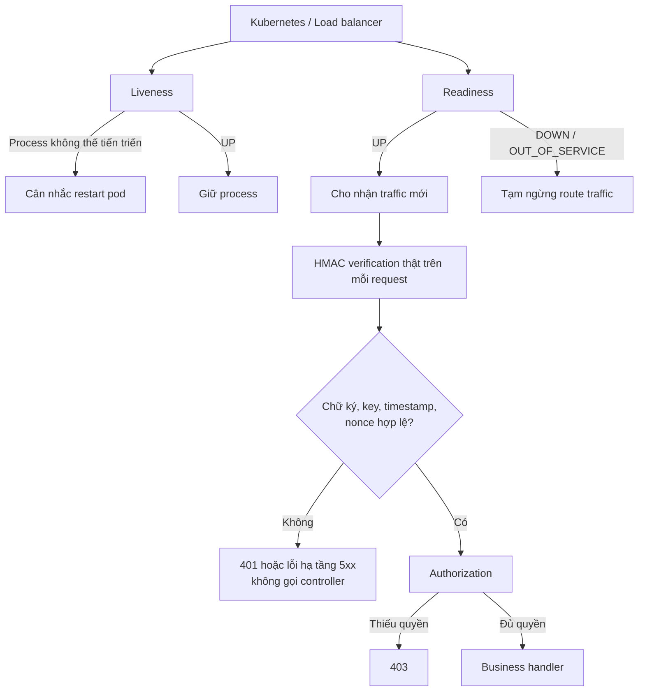
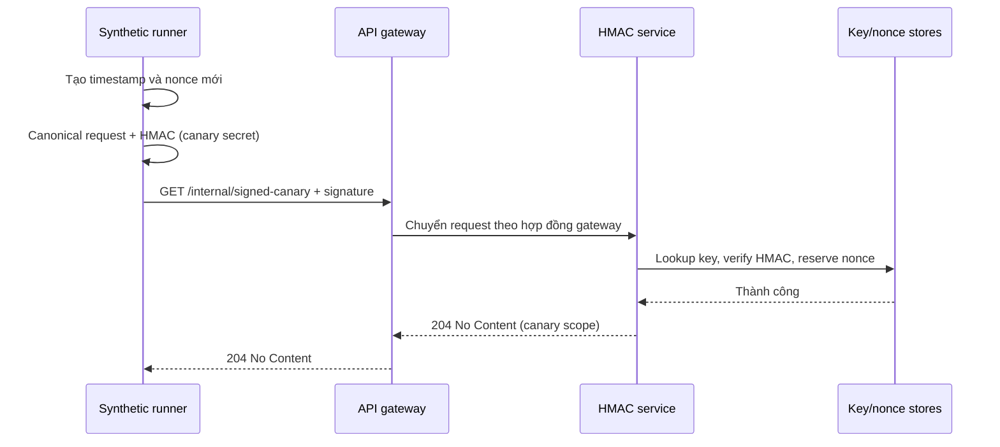

# Theo dõi health của dịch vụ xác thực HMAC: liveness, readiness và phụ thuộc bảo mật

## 1. Vì sao health monitoring đặc biệt quan trọng với HMAC?

Trong module `SECURITY_AUTHENTICATION_HMAC_REQUEST_AUTHENTICATION`, một HTTP request được xác thực bằng HMAC với **shared secret**. Client và server thống nhất **canonical request** có thể bao gồm method, URI, một tập header đã chọn hoặc hash body. Server xác minh chữ ký, kiểm tra timestamp và nonce chống replay, áp dụng key rotation, rồi đưa principal đã xác thực cho tầng **authorization**.

Một service có thể vẫn trả `200 OK` từ endpoint health đơn giản trong khi API chính lại không thể xác thực bất kỳ request nào: kho khóa bị mất kết nối, nonce store dừng hoạt động, cấu hình canonicalization sai sau cập nhật gateway, hoặc key version đang được sử dụng đã bị revoke ngoài ý muốn. Trong trường hợp ngược lại, service còn khả năng xác thực nhờ cache khóa hợp lệ, nhưng một health probe được viết quá chặt lại đánh dấu mọi instance `DOWN` và khiến hệ thống bị loại hết khỏi load balancer.

**Theo dõi health** không chỉ là gọi một URL và nhìn thấy chữ `UP`. Cần trả lời ba câu hỏi khác nhau:

1. **Process còn sống và có khả năng tiến triển không?** Đây là *liveness*.
2. **Instance hiện có sẵn sàng nhận request HMAC theo chính sách đã công bố không?** Đây là *readiness*.
3. **Một request ký thực sự có đi qua gateway, bộ xác minh HMAC, chống replay và authorization đúng không?** Đây là *end-to-end synthetic check*, không thể suy ra chỉ từ việc key store trả `PING`.

Bài học thuộc chương **Monitoring** sẽ xây dựng mô hình health cho Spring Boot 3 / Spring Security 6 trên cả Servlet MVC và WebFlux; kết hợp Spring Boot Actuator, Kubernetes probes, metric, cảnh báo, key rotation và xử lý sự cố.

**Nguyên tắc bảo mật:** health có thể cho biết dịch vụ đang sẵn sàng, nhưng **không thay thế HMAC verification**. Khi dependency không cho phép kiểm tra chữ ký hoặc chống replay, request được bảo vệ phải *fail closed*; không được bỏ qua authentication chỉ để đạt health `UP`.

## 2. Phân biệt health, metrics, tracing và audit

Mỗi loại tín hiệu quan sát trả lời một câu hỏi khác nhau:

| Tín hiệu | Câu hỏi | Ví dụ |
| --- | --- | --- |
| Liveness probe | Process có cần được khởi động lại? | `GET /actuator/health/liveness` |
| Readiness probe | Instance có thể tiếp nhận traffic mới? | `GET /actuator/health/readiness` |
| Health contributor | Phụ thuộc thiết yếu có đáp ứng điều kiện sẵn sàng? | `hmacKeyStore`, `hmacNonceStore` |
| Synthetic request | Luồng ký HMAC thật từ client đến service có hoạt động? | Ký một request canary rồi kiểm tra response |
| Metric | Bao nhiêu request bị từ chối, trễ hoặc gặp outage? | `401`, `403`, `503`, signature mismatch, replay |
| Distributed trace | Request cụ thể đi qua hop và component nào? | Trace ID qua gateway và verifier |
| Security audit | Credential đã xác thực, policy nào cho phép/từ chối? | `auth_accepted`, `authz_denied` với key tag an toàn |

Một `HealthIndicator` trả `UP` không chứng minh mọi canonical path, thuật toán, client key version và nonce đều đúng. Ngược lại, một request trả `403` có thể cho thấy **authentication đã thành công nhưng authorization từ chối**, không có nghĩa health của bộ xác minh HMAC bị hỏng.

Vì vậy không nên tính health bằng điều kiện “trong 5 phút không có `401`”. Chữ ký sai hoặc replay bị từ chối là **hành vi bảo mật mong muốn**, không phải lỗi hệ thống.

## 3. Liveness, readiness, startup và trạng thái health

### 3.1. Liveness: tiến trình còn hoạt động

Liveness nên trả lời: instance có bị kẹt đến mức khởi động lại có thể giúp nó phục hồi không? Trong Spring Boot, `LivenessState` phản ánh vòng đời ứng dụng, thông thường `CORRECT` sau khi khởi động.

**Không nên đặt việc truy cập Redis nonce store hoặc Vault/key store bên trong liveness.** Nếu Redis mất mạng trong vài giây và liveness của mọi pod đều `DOWN`, Kubernetes có thể liên tục restart ứng dụng. Điều này không khôi phục Redis mà còn gây thêm tải, mất cache ấm và kéo dài sự cố.

### 3.2. Readiness: có nhận request HMAC mới không?

Readiness trả lời instance có nên nằm trong tập endpoint nhận lưu lượng của load balancer hay không. Khi app chưa nạp cấu hình ký hợp lệ, chưa sẵn sàng lấy key hoặc không thể bảo đảm anti-replay, readiness có thể trả `OUT_OF_SERVICE`/`DOWN` theo chính sách.

Tuy nhiên, **đừng tự động đưa mọi dependency vào readiness**. Nếu tất cả pod dùng chung nonce store và store cùng mất, đánh `DOWN` toàn bộ pod có thể làm Kubernetes không còn endpoint nào, thay vì trả `503` có kiểm soát. Thiết kế readiness phải cân nhắc kiến trúc, cache, phạm vi ảnh hưởng và failover.

Một chính sách hợp lý cho API HMAC bắt buộc chống replay là: nếu nonce store lỗi liên tục và không có phương án bảo đảm an toàn thay thế, các request protected bị fail closed; readiness có thể chuyển `DOWN` sau ngưỡng xác định, hoặc vẫn giữ `UP` để API trả lỗi `503` rõ ràng trong một sự cố dependency chung. **Điều bất biến là không bỏ qua kiểm tra nonce.**

### 3.3. Startup probe

Khi app cần thời gian nạp policy, kết nối key store hoặc làm ấm dữ liệu, Kubernetes `startupProbe` có thể cho thêm thời gian khởi động trước khi liveness/readiness được đánh giá như thường lệ. Startup probe không phải cơ chế chứng thực HMAC và không thay thế startup validation.

### 3.4. Các trạng thái health

| Spring Boot health status | Ý nghĩa thông dụng | HTTP mặc định thường gặp |
| --- | --- | --- |
| `UP` | Đang hoạt động theo điều kiện của contributor/group | `200` |
| `DOWN` | Không hoạt động theo điều kiện health | `503` |
| `OUT_OF_SERVICE` | Tạm không phục vụ | `503` |
| `UNKNOWN` | Chưa xác định | Thường `200` nếu chưa cấu hình mapping riêng |

Spring Boot có thể cấu hình thứ tự tổng hợp status và HTTP mapping; không suy rằng mọi custom status đều luôn trả cùng HTTP code. Kiểm tra response thực từ `/actuator/health/readiness` trong môi trường triển khai.



Sơ đồ thể hiện hành vi chính; liveness failure không đảm bảo restart sẽ giải quyết lỗi, và readiness endpoint chỉ là một trong nhiều tín hiệu được Kubernetes sử dụng.

## 4. Health model cho những phụ thuộc của HMAC

Việc chọn contributor phải dựa trên **năng lực bắt buộc** của dịch vụ, không chỉ tên thành phần.

| Thành phần | Vai trò trong HMAC | Health check an toàn | Không nên làm |
| --- | --- | --- | --- |
| Kho khóa/credential registry | Chọn secret theo key ID và key version | Kiểm tra truy cập metadata nhỏ hoặc operation được thiết kế sẵn | Dump secret, thử toàn bộ key, quét danh sách client |
| Secret manager / KMS | Cấp hoặc bảo vệ key material | Kiểm tra khả năng truy cập khi phụ thuộc thực sự thiết yếu | In secret nhận được hoặc buộc unwrap mọi key mỗi probe |
| Nonce/replay store | Reserve nonce nguyên tử, dùng chung giữa instance | Cheap connectivity + khả năng ghi khi thích hợp; synthetic reserve riêng | Dùng nonce thật của client, `exists` rồi `set` như test atomic |
| Clock/time synchronization | Đánh giá timestamp và clock skew | Monitor đồng hồ/offset qua hệ thống vận hành, thống kê skew bucket | Phát warning cho mỗi request lệch 1 giây |
| Canonicalization policy | Cùng hợp đồng ký ở client/server | Startup validation, version check, test vectors/synthetic | “Thử nhiều canonical form” cho đến khi chữ ký khớp |
| Key rotation state | Bản key nào đang active/revoked | Kiểm tra metadata/version chính sách | In secret cũ/mới hoặc log toàn bộ credential registry |
| Gateway/ingress | Giữ đúng URI/header/body theo hợp đồng | Synthetic qua edge, proxy availability metrics | Tin header `Forwarded` do client tự khai |
| Authorization policy | Quyết định quyền sau xác thực | Rule/policy load status, synthetic client scope tối thiểu | Đồng nhất `403` với lỗi chữ ký |
| HMAC implementation | Hash/MAC đúng thuật toán và encoding | Known-answer test lúc khởi động/CI; canary có kiểm soát | Ký bằng production secret rồi log chữ ký/kết quả thô |

### Health connectivity chưa chắc là health correctness

Giả sử key store trả lời `PING` bình thường nhưng một bản ghi key version bị sai cấu hình. Probe kết nối vẫn `UP`; chỉ request sử dụng version đó mới thất bại. Ngược lại, cache local có thể chứa key hợp lệ trong khoảng cho phép dù API secret manager tạm chậm.

Do vậy nên có **hai lớp**:

- Probe thường xuyên, rẻ và an toàn để đánh giá readiness của instance.
- Synthetic/integration test sâu hơn để kiểm tra luồng HMAC thực tế, key rotation, canonicalization và replay, với tần suất thấp hơn, timeout và tài khoản kiểm thử chuyên biệt.

## 5. Chính sách fail closed và health phải tách biệt

Đối với request protected, verifier thường thực hiện:

1. Kiểm tra có credential/header chữ ký đúng hợp đồng; validate grammar, giới hạn độ dài, thuật toán được phép.
2. Tra key theo ID/version và kiểm tra trạng thái key bằng dữ liệu tin cậy.
3. Tạo canonical request từ method, URI, các signed headers và hash raw body theo hợp đồng.
4. Kiểm tra HMAC signature; không tiết lộ expected signature hoặc secret.
5. Kiểm tra timestamp trong cửa sổ cho phép, với policy clock skew.
6. Reserve nonce theo thao tác **atomic**, tránh hai request đồng thời cùng vượt qua.
7. Tạo principal/authorities tin cậy; sau đó authorization vẫn có thể từ chối.

Những kết quả không được nhầm:

| Kết quả | HTTP thường dùng | Hệ quả đối với health |
| --- | --- | --- |
| Thiếu hoặc sai chữ ký | `401 Unauthorized` | Không phải health DOWN |
| Nonce đã dùng, timestamp quá hạn | Thường `401` theo contract | Không phải health DOWN nếu store hoạt động tốt |
| HMAC hợp lệ, thiếu authority | `403 Forbidden` | Không phải health DOWN |
| Key/nonce store timeout, không thể xác minh | `503`/`5xx` thích hợp | Có thể ảnh hưởng readiness; bắt buộc fail closed |
| Body quá lớn | `413 Content Too Large` | Lỗi đầu vào, không phải health DOWN |
| JSON malformed sau HMAC hợp lệ | `400 Bad Request` | Lỗi input, không phải health DOWN |
| Key rotation cấu hình sai diện rộng | Nhiều `401` hoặc `5xx` tùy nguyên nhân | Health check rẻ có thể bỏ sót; dùng metrics/synthetic |

**Không bao giờ làm như sau:**

```java
// SAI: bỏ qua nonce khi hệ thống chống replay mất kết nối.
if (!nonceStoreAvailable) {
    return authenticatedClient;  // Fail open!
}
```

Health không được phép trực tiếp vô hiệu hóa authentication hoặc authorization. Nếu một instance không an toàn để xử lý HMAC, từ chối request; readiness và routing traffic được quyết định theo chính sách availability riêng.

## 6. Spring Boot Actuator: bật health endpoints có kiểm soát

Spring Boot Actuator cung cấp `/actuator/health`; khi bật probes, có các health group `/actuator/health/liveness` và `/actuator/health/readiness`.

Cấu hình tham khảo cho Spring Boot 3:

```yaml
management:
  endpoint:
    health:
      probes:
        enabled: true
      show-details: never
      show-components: never
      group:
        readiness:
          include: readinessState,hmacKeyStore,hmacNonceStore
  endpoints:
    web:
      exposure:
        include: health,prometheus
```

Giải thích:

- `probes.enabled: true` kích hoạt các health groups phục vụ probe ngay cả khi không tự nhận diện môi trường Kubernetes.
- `show-details: never` và `show-components: never` giảm bề mặt thông tin công khai của health endpoint. Đây không thay thế việc giới hạn truy cập mạng.
- `readinessState` là contributor thể hiện trạng thái readiness của ứng dụng do Spring Boot quản lý.
- `hmacKeyStore` và `hmacNonceStore` là **tên contributor mẫu** mà ứng dụng phải tự cung cấp; nếu chưa có bean tương ứng, cấu hình group có thể gây lỗi startup do member không tồn tại.
- `prometheus` cần dependency registry/exporter và chính sách bảo vệ endpoint phù hợp; nếu không sử dụng Prometheus, chỉ expose `health`. Không công khai tất cả Actuator endpoints.
- `/actuator/health` tổng thể có thể chứa nhiều contributor hơn readiness. Điều quan trọng là **endpoint mà Kubernetes thực sự gọi** và membership của health group.

Đối với hệ có dependency chia sẻ, cần đánh giá kỹ trước khi đưa `hmacKeyStore`/`hmacNonceStore` vào readiness. Ví dụ này minh họa chính sách **strict readiness**: cả hai phải đáp ứng điều kiện mới nhận traffic. Nếu hoạt động thực tế cho phép dùng key cache an toàn khi key store mất kết nối, contributor phải phản ánh *khả năng xác thực còn hợp lệ* thay vì chỉ kiểm tra remote store.

### 6.1. Nếu sử dụng management port riêng

`management.server.port` có thể tách Actuator khỏi cổng ứng dụng. Điều đó giúp cô lập quyền truy cập, nhưng health trên cổng riêng có thể vẫn `UP` khi cổng ứng dụng chính không nhận request. Cần thêm kiểm tra đường truyền/port chính hoặc cấu hình probe trên cổng phục vụ traffic theo kiến trúc.

Một endpoint Actuator accessible qua management port **không** có nghĩa public edge có thể gọi tới nó. Kiểm tra policy mạng, load balancer target và container port trước khi thiết lập Kubernetes probe.

### 6.2. Không đặt `show-details: always` công khai

Thông tin về Vault, Redis, hostname, cluster ID hoặc nguyên nhân exception trong response health có thể hỗ trợ attacker dựng bản đồ hệ thống. Health public thường chỉ cần status tóm tắt; chi tiết chuyên sâu nên đưa vào log/metric/audit có phân quyền.

## 7. Tạo HealthIndicator cho Spring MVC / Servlet

Với stack blocking, Spring Boot Actuator hỗ trợ `HealthIndicator`. Một contributor có thể kiểm tra **khả năng thực hiện thao tác cần thiết** của dependency, nhưng phải rẻ và có timeout.

Ví dụ định nghĩa giao diện probe để tách logic truy cập hạ tầng khỏi Actuator:

```java
public interface KeyMetadataProbe {
    // true nếu có đủ năng lực tra metadata/key theo chính sách.
    // Implementation có timeout và không trả secret.
    boolean availableWithin(Duration timeout);
}

public interface NonceStoreProbe {
    // Kiểm tra trạng thái cần thiết để reserve nonce an toàn.
    // Implementation phải có timeout; không đụng nonce của request thật.
    boolean availableWithin(Duration timeout);
}
```

Các bean health contributor:

```java
@Configuration
public class HmacHealthConfiguration {

    private static final Duration CHECK_TIMEOUT =
            Duration.ofMillis(300);

    @Bean("hmacKeyStoreHealthIndicator")
    HealthIndicator keyStoreHealth(KeyMetadataProbe probe) {
        return () -> {
            try {
                return probe.availableWithin(CHECK_TIMEOUT)
                        ? Health.up().build()
                        : Health.down().build();
            } catch (RuntimeException ex) {
                // Không thêm ex.getMessage(), URI hay secret vào details.
                return Health.down().build();
            }
        };
    }

    @Bean("hmacNonceStoreHealthIndicator")
    HealthIndicator nonceStoreHealth(NonceStoreProbe probe) {
        return () -> {
            try {
                return probe.availableWithin(CHECK_TIMEOUT)
                        ? Health.up().build()
                        : Health.down().build();
            } catch (RuntimeException ex) {
                return Health.down().build();
            }
        };
    }
}
```

Ví dụ dùng `org.springframework.boot.actuate.health.Health`, `HealthIndicator`, `org.springframework.context.annotation.Bean`/`Configuration` và `java.time.Duration`. Các implementor `KeyMetadataProbe` và `NonceStoreProbe` do ứng dụng cung cấp.

Trong Spring Boot, bean tên `hmacKeyStoreHealthIndicator` thường được hiển thị dưới contributor ID `hmacKeyStore`, và tương tự `hmacNonceStore`; cần kiểm tra tên hiện ra thực tế bằng một integration test khi cấu hình group. Đừng nhầm tên bean với tên metric.

**Yêu cầu cho implementation:**

- Kết nối/đọc metadata nhỏ với timeout rõ ràng; không thực hiện scan key store và không lấy toàn bộ secret.
- Không đưa exception cause hoặc cấu hình kết nối nhạy cảm vào response health.
- Không để probe tiêu tốn nhiều CPU, thread hoặc gọi vô hạn khi service đã quá tải.
- Nếu cần kiểm tra thao tác ghi nonce, dùng key canary riêng với TTL ngắn, namespace dành cho probe và limit tần suất, không thay đổi nonce của người dùng.
- Probe nên trả kết quả cho khả năng bắt buộc để xác minh, không đơn thuần là “socket mở”.

### 7.1. Vì sao kiểm tra nonce bằng PING chưa đủ?

`PING` chứng minh một phần kết nối tới Redis, nhưng không chứng minh rằng thao tác `SET key value NX EX ttl` dùng để reserve nonce còn chạy đúng, dữ liệu đang được chia sẻ giữa các instance, hay TTL/policy có đúng.

Giải pháp là kết hợp:

- Readiness probe rẻ: kết nối + operation đủ nhẹ và đã kiểm soát.
- Metrics về lỗi thực của `reserveOnce`, latency, timeout và conflict.
- Synthetic/check tích hợp định kỳ để chứng minh reserve atomic và phát hiện replay, không chạy đồng thời trên mỗi request health.

Cần giới hạn timeout ở driver/repository; truyền một tham số `Duration` vào interface **không tự làm lời gọi blocking có timeout** nếu implementation bỏ qua.

## 8. ReactiveHealthIndicator cho Spring WebFlux

Trong WebFlux, một probe gọi driver blocking ngay trên event-loop có thể làm nghẽn request. Khi có API reactive, dùng `ReactiveHealthIndicator`.

Ví dụ minh họa cho nonce store reactive:

```java
public interface ReactiveNonceProbe {
    // Trả true khi thao tác kiểm tra an toàn thành công.
    Mono<Boolean> available();
}

@Configuration
class ReactiveHmacHealthConfiguration {

    @Bean("hmacNonceStoreHealthIndicator")
    ReactiveHealthIndicator nonceStoreHealth(
            ReactiveNonceProbe probe) {

        return () -> probe.available()
                .timeout(Duration.ofMillis(300))
                .map(ok -> Boolean.TRUE.equals(ok)
                        ? Health.up().build()
                        : Health.down().build())
                .defaultIfEmpty(Health.down().build())
                .onErrorReturn(Health.down().build());
    }
}
```

Cần import Reactor `Mono`, `Duration` và Actuator health types. Ví dụ trên chỉ triển khai **nonce store**; nếu readiness group còn chỉ định `hmacKeyStore`, phải có contributor key store tương ứng, và nếu cần theo dõi cả hai thì triển khai cả hai. Không đăng ký đồng thời ví dụ blocking/Reactive cho cùng tên bean trong một ứng dụng.

Đặc điểm quan trọng:

- `timeout` hạn chế thời gian chờ kết quả publisher; driver thật phải hỗ trợ cancellation/timeout phù hợp.
- `onErrorReturn(DOWN)` ở đây dành cho **health probe**, không được sao chép nguyên sang bộ xác thực rồi biến lỗi nonce thành HMAC hợp lệ.
- Nếu repository dùng API blocking, ưu tiên thay bằng client reactive. Nếu chưa thể, cô lập lời gọi blocking trên scheduler thích hợp với concurrency limit; không dùng `block()` trong health endpoint.
- Không tự gọi `subscribe()`; Actuator sẽ subscribe publisher của contributor.
- Dữ liệu raw `DataBuffer`, HTTP body hoặc shared secret không liên quan tới health của nonce store và không nên xuất hiện trong check.

## 9. Bảo vệ health endpoints trong Spring Security

Có hai nguy cơ ngược nhau:

1. Toàn bộ health bị custom HMAC filter chặn `401` vì probe không mang signature.
2. Developer sửa bằng cách cho `/actuator/**` `permitAll` và vô tình công khai nhiều endpoint quản trị.

Giải pháp là tách phạm vi health probe **chính xác** khỏi API business bắt buộc HMAC.

### 9.1. SecurityFilterChain cho Servlet / MVC

Ví dụ khi Actuator được phục vụ trên cùng cổng và base path mặc định:

```java
@Bean
@Order(1)
SecurityFilterChain healthProbeSecurity(HttpSecurity http) throws Exception {
    return http
            .securityMatcher(
                    "/actuator/health/liveness",
                    "/actuator/health/readiness")
            .authorizeHttpRequests(auth -> auth.anyRequest().permitAll())
            .build();
}

@Bean
@Order(2)
SecurityFilterChain hmacApiSecurity(
        HttpSecurity http,
        HmacRequestVerifier verifier) throws Exception {

    return http
            .securityMatcher("/api/**")
            .sessionManagement(session -> session
                    .sessionCreationPolicy(SessionCreationPolicy.STATELESS))
            .authorizeHttpRequests(auth -> auth
                    .anyRequest().authenticated())
            // Thêm filter HMAC đúng thứ tự trong chain này.
            .addFilterBefore(
                    new HmacAuthenticationFilter(verifier),
                    UsernamePasswordAuthenticationFilter.class)
            .build();
}
```

Đây là đoạn wiring minh họa: các lớp `HmacRequestVerifier`, `HmacAuthenticationFilter` do ứng dụng định nghĩa và constructor/signature phải phù hợp implementation. Ví dụ cũng chưa thể hiện các tùy chọn CSRF/session/entry point cụ thể của API; ứng dụng production phải cấu hình đầy đủ theo scheme và route.

**Điểm đáng chú ý:** rule `permitAll` ở chain health không tự bảo vệ endpoint khỏi một `Filter` được đăng ký **toàn cục** tại Servlet container. Nếu HMAC filter bị đăng ký ngoài Spring Security chain, nó vẫn có thể chạy trước health. Tránh đăng ký trùng filter và kiểm thử thực tế.

Một `SecurityFilterChain` khác hoặc cơ chế bảo mật mạng nên bảo vệ các Actuator endpoints không thuộc hai route probe. Không để các route unmatched mặc nhiên mở nếu policy hệ thống đòi xác thực.

### 9.2. SecurityWebFilterChain cho WebFlux

Ví dụ phân tách route probe với `SecurityWebFilterChain`:

```java
@Bean
@Order(1)
SecurityWebFilterChain healthProbeSecurity(ServerHttpSecurity http) {
    return http
            .securityMatcher(ServerWebExchangeMatchers.pathMatchers(
                    "/actuator/health/liveness",
                    "/actuator/health/readiness"))
            .authorizeExchange(auth -> auth.anyExchange().permitAll())
            .build();
}
```

Chain API business tiếp tục gắn `AuthenticationWebFilter`, `ReactiveAuthenticationManager` và `AuthorizationWebFilter` theo contract HMAC. Nếu có WebFilter tùy chỉnh được đăng ký toàn cục, cần kiểm tra nó không áp HMAC cho probe bằng matcher sai.

### 9.3. Public probe không có nghĩa public Internet

`permitAll` trong một chain chỉ nói về HTTP authorization trong ứng dụng. Endpoint probe vẫn nên bị giới hạn bằng network policy, firewall, service mesh hoặc management interface. Liveness/readiness thường dành cho kubelet hoặc load balancer nội bộ, không phải API công khai trên Internet.

Không gửi shared secret hoặc một `Authorization` của client thật vào readiness probe. Probe không phải authentication flow và không nên tiêu thụ nonce business.

## 10. Kubernetes probes và hành vi rollout

Ví dụ Kubernetes deployment dùng cổng ứng dụng `8080` cho Actuator health:

```yaml
containers:
  - name: hmac-api
    image: example/hmac-api:1.0
    ports:
      - name: http
        containerPort: 8080
    startupProbe:
      httpGet:
        path: /actuator/health/liveness
        port: http
      periodSeconds: 5
      timeoutSeconds: 2
      failureThreshold: 24
    livenessProbe:
      httpGet:
        path: /actuator/health/liveness
        port: http
      periodSeconds: 10
      timeoutSeconds: 2
      failureThreshold: 3
    readinessProbe:
      httpGet:
        path: /actuator/health/readiness
        port: http
      periodSeconds: 5
      timeoutSeconds: 2
      failureThreshold: 3
      successThreshold: 1
```

Các số liệu là **ví dụ**, không phải cấu hình tiêu chuẩn cho mọi tải hệ thống. Cần điều chỉnh theo thời gian warm-up, CPU, ngân sách độ trễ, tốc độ phục hồi dependency và chính sách rollout.

Nếu Actuator chạy cổng quản trị riêng, phải đổi port và cân nhắc rằng probe riêng có thể không phản ánh đường HTTP chính. Không dùng readiness có hàng chục phép kiểm tra hạ tầng tốn kém mỗi 5 giây trên mỗi pod.

### 10.1. Tránh hiệu ứng dây chuyền

Nếu shared nonce store bị lỗi, nhiều replica có thể cùng trả `DOWN` readiness. Khi toàn bộ pod bị rút khỏi endpoint, caller có thể thấy lỗi kết nối/gateway thay vì nhận HTTP `503` từ app, khiến debugging khó hơn.

Có thể chọn chiến lược:

- **Strict readiness:** đánh `DOWN` khi không bảo đảm HMAC; phù hợp khi routing còn alternative healthy backend.
- **Traffic-retaining readiness:** giữ `UP` cho lỗi shared dependency nhất thời, nhưng từng request protected phải trả `503`/fail closed; metric và alert vận hành phải báo chính xác.
- **Graceful degradation:** chỉ cho phép nếu có một đường xác minh an toàn thay thế **đã được định nghĩa trước**, ví dụ cache key hợp lệ nhưng vẫn có nonce store bảo đảm atomic; không được tắt anti-replay.

Quyết định này phải dựa vào kiến trúc/availability objective chứ không chỉ vì muốn tất cả probe chuyển xanh.

### 10.2. Readiness lúc shutdown

Khi rolling update, ứng dụng có thể chuyển readiness sang không sẵn sàng trước khi đóng listener, giúp load balancer ngừng gửi request mới. Điều đó không đảm bảo mọi in-flight request đã xong; cần kết hợp graceful shutdown, timeout và idempotency.

Đối với request HMAC đang xử lý, đừng bỏ qua bước reserve nonce hay xác minh signature vì instance chuẩn bị tắt.

## 11. Synthetic HMAC health check: thử đường đi thật mà không gây side effect

Readiness kết nối chỉ kiểm tra năng lực hạ tầng. Một synthetic check được thiết kế riêng mới trả lời câu hỏi: “Client ký đúng, đi qua gateway, verify HMAC, chống replay, gắn principal và authorization có hoạt động không?”.

Một ví dụ luồng:



### 11.1. Thiết kế canary an toàn

- Dùng **credential riêng** với authority tối thiểu, không dùng shared secret của client production.
- Endpoint canary nên là thao tác read-only/no-op có kiểm soát, không tạo đơn hàng, chuyển tiền hoặc sửa dữ liệu khách hàng.
- Sinh timestamp và nonce mới **mỗi lần check**; nếu tái sử dụng nonce, việc bị chặn replay là đúng chứ không chứng minh API hỏng.
- Canary đi qua đúng gateway/route/HMAC verifier cần kiểm tra; nếu bypass security, kết quả chỉ là health HTTP thông thường.
- Bảo vệ canary endpoint bằng authentication và policy mạng; không biến nó thành một `permitAll` đặc biệt.
- Không gửi credential trong query string và không log signature/shared secret.
- Giới hạn tần suất, timeout, retry và nguồn gọi. Dùng request ID để liên kết kết quả với trace đã được phép truy cập.
- Phân biệt canary traffic trong metric tổng hợp bằng route enum cố định, không dùng tag chứa secret hoặc raw key ID.

### 11.2. Kiểm tra negative path

Một synthetic chỉ kỳ vọng `204` chưa chứng minh server chống replay hay từ chối signature sai. Có thể chạy thêm định kỳ trong môi trường kiểm soát:

1. Gửi request ký hợp lệ với nonce mới → response canary thành công.
2. Gửi lại đúng request đó và nonce cũ → phải bị từ chối replay.
3. Đổi một byte trong canonical path/body/header nhưng giữ chữ ký cũ → phải bị từ chối HMAC.
4. Dùng credential hợp lệ nhưng thiếu authority cho canary resource → `403`, không phải `401`.
5. Qua gateway có rewrite/forwarded metadata → canonical request vẫn được xác minh theo hợp đồng.

Không thực hiện negative probes ở tần suất cao gây tăng tải, chiếm nhiều nonce keys hoặc tạo false alarm. Mỗi phép thử phải có expected result, giới hạn và bộ phận sở hữu.

### 11.3. Synthetic không nên điều khiển Kubernetes liveness trực tiếp

Nếu một check HMAC qua gateway thất bại do chính gateway hoặc key store, restart mọi pod của service không giúp hệ thống phục hồi. Dùng synthetic cho **alert, SLO và phân tích nguyên nhân**, không gắn máy móc vào liveness.

## 12. Theo dõi key rotation và khả năng xác thực

Key rotation khiến health dễ bị hiểu nhầm. Có thể có một số trạng thái:

| Tình huống | Health connectivity | Authentication thực tế | Hướng theo dõi |
| --- | --- | --- | --- |
| Key store `UP`, key v2 còn active | `UP` | Thành công nếu chữ ký đúng | Canary v2 + accepted metric |
| Key store `UP`, client vẫn dùng v1 trong overlap | `UP` | Được phép nếu policy chấp nhận v1 | Theo dõi tỷ lệ dùng key class `previous_allowed` |
| Key store `UP`, v1 đã revoke | `UP` | Request v1 phải `401` | Theo dõi rejected metric, không bật lại v1 tùy tiện |
| Key registry cập nhật thiếu record v2 | Probe PING có thể `UP` | Client v2 lỗi | Config validation và canary version mới |
| Secret manager tạm chậm, cache key vẫn hợp lệ | Có thể `DOWN` theo probe kết nối | Có thể xác thực an toàn trong TTL nếu policy cho phép | Readiness dựa năng lực thực, không chỉ remote PING |
| Key material hoặc policy bị lộ/sai | Probe kết nối có thể `UP` | Nguy cơ bảo mật | Audit, rotate/revoke, không phụ thuộc health HTTP |

Không in secret/expected HMAC để giải thích tại sao key rotation làm tăng `401`. Metric nên dùng enum `current`, `previous_allowed`, `revoked_rejected` từ dữ liệu tin cậy; nếu cần truy vết credential cụ thể thì dùng verified key tag trong audit log có bảo vệ, **không đưa raw key ID vào metric label**.

Một bài test startup có thể dùng known-answer test HMAC-SHA256 với **test vectors công khai/không nhạy cảm** để phát hiện thuật toán, encoding hoặc canonicalizer bị cấu hình sai. Điều này không thay thế verification với key store thật.

## 13. Metrics, alert và dashboard kết hợp health

Chỉ nhìn trạng thái `UP`/`DOWN` hiện tại sẽ bỏ lỡ sự cố ngắn và khó biết nguyên nhân. Nên kết hợp:

| Nhóm metric | Ví dụ | Tín hiệu cần quan sát |
| --- | --- | --- |
| Readiness | Probe success/failure hoặc health group status | Instance nào không nhận traffic? |
| Authentication outcomes | `hmac_authentication_outcomes_total` (meter tự định nghĩa) | Accepted/rejected/unavailable biến đổi ra sao? |
| Rejections | `hmac_requests_rejected_total` (meter tự định nghĩa) | `401` do chữ ký/replay hoặc `403` do quyền |
| Dependency failures | `hmac_dependency_failures_total` | Key store, nonce store timeout hoặc outage |
| Dependency latency | Timer/histogram với name và tag hữu hạn | Key lookup / nonce reserve chậm bất thường? |
| HTTP | `http.server.requests` từ Micrometer | `401`, `403`, `503`, latency p95/p99 |
| Synthetic | `hmac_canary_success` / duration | End-to-end có thất bại sau deploy không? |
| Gateway | Gateway 4xx/5xx, route errors | Có lỗi trước khi request tới service? |
| Clock skew | Histogram bucket | Nhiều client gửi timestamp ngoài cửa sổ? |
| Key rotation | Accepted by bounded version class | Bao nhiêu traffic còn dùng key cũ hợp lệ? |

Tên meter trừ các metric tiêu chuẩn là **gợi ý do ứng dụng tự định nghĩa**, không mặc định có sẵn trong Spring Boot.

### 13.1. Ví dụ PromQL

Nếu ứng dụng thực sự export metric `hmac_dependency_failures_total` với tag `dependency` hữu hạn:

```promql
sum by (dependency) (
  rate(hmac_dependency_failures_total[5m])
)
```

Để theo dõi rejected auth traffic:

```promql
sum by (stage, reason) (
  rate(hmac_requests_rejected_total[5m])
)
```

Để theo dõi synthetic canary (nếu exporter của runner có Gauge `hmac_canary_success` bằng 0/1):

```promql
min_over_time(hmac_canary_success[5m]) == 0
```

Phần diễn giải phụ thuộc cách runner export metric và tần suất chạy. Nếu canary không xuất sample trong 5 phút, biểu thức trên không tự báo “không có dữ liệu”; phải có alert riêng cho absent/missing samples. Tương tự `up` của Prometheus chỉ xác nhận exporter scrape thành công, không chứng minh HMAC endpoint đang sẵn sàng.

### 13.2. Alert cần phân biệt sự cố bảo mật và sự cố hệ thống

- Nhiều `invalid_signature` có thể do gateway canonicalization bị thay, signer client lỗi hoặc tấn công.
- Nhiều `replay_detected` có thể do retry sử dụng nonce cũ hoặc hành vi replay thật.
- Nhiều `403` thường liên quan quyền/tenant, không nên gộp thành “HMAC verification down”.
- Nhiều `503` cùng `nonce_store_unavailable` cho thấy availability của anti-replay store, **không phải client ký sai**.
- Readiness down hàng loạt cùng lúc có thể là sự cố dependency chung hoặc readiness policy quá khắt khe.

Threshold phải dựa lưu lượng thực tế, baseline theo route, error budget và mức ảnh hưởng. Đừng đặt cảnh báo “bất kỳ `401` nào cũng nguy cấp” cho endpoint công khai trên Internet.

### 13.3. Quan sát nhưng không rò rỉ bí mật

Không đưa `keyId`, raw `Authorization`, signature, nonce, raw URI/query, client IP chưa tin cậy hoặc body vào metric labels. Không log shared secret, expected HMAC, canonical request nguyên vẹn hoặc key material.

Dùng request ID/trace ID đáng tin, route template và reason code allowlist trong log/trace được bảo vệ; metric chỉ dùng nhãn cardinality thấp như `stage`, `dependency`, `route_class`, `reason_group`.

## 14. Gateway, proxy và health endpoint

Health có thể bị ảnh hưởng bởi cách đặt gateway:

- Probe trực tiếp tới pod báo `UP`, nhưng client không gọi được public hostname vì gateway routing sai.
- Proxy rewrite `/v1/orders` thành `/internal/orders` làm HMAC mismatch, trong khi health không ký vẫn `UP`.
- Header `Forwarded`/`X-Forwarded-*` giả mạo hoặc bị ghi đè khiến canonical host/scheme sai.
- Gateway chặn `Authorization` hoặc biến đổi body/Content-Encoding khiến verifier không còn nhận request đã được ký đúng.
- Actuator bị yêu cầu HMAC vì security matcher quá rộng, khiến kubelet nhận `401` và đánh pod không sẵn sàng dù API thật đang chạy.

Để phân biệt, đặt **hai vị trí kiểm tra**:

1. **Instance-local health** cho liveness/readiness của pod và phụ thuộc thiết yếu.
2. **End-to-end signed synthetic** đi qua public/trusted gateway đến endpoint kiểm tra có HMAC thật.

Cần hợp đồng rõ về canonical URI: client ký public path hay upstream path; nơi nào được phép thay đổi path, query, signed headers và body; server lấy metadata tin cậy từ đâu. Không dựa trên `X-Original-URI` do client tự gửi để “làm cho canary xanh”.

## 15. Runbook khi health chuyển đỏ

Khi kubelet, gateway hoặc synthetic báo lỗi, hãy phân biệt loại lỗi **trước khi** thay đổi chính sách bảo mật.

### 15.1. Readiness DOWN, liveness UP

1. Kiểm tra readiness health group đang gồm những contributor nào: `readinessState`, key store, nonce store?
2. Kiểm tra lỗi có đồng thời trên nhiều pod không; nếu cùng lúc nhiều instance, nghi dependency chia sẻ.
3. Kiểm tra metric timeout/latency key lookup và nonce reserve, trạng thái key cache/secret manager và network.
4. Kiểm tra các request protected bị fail closed với `5xx` phù hợp khi không thể xác minh; **không tắt anti-replay**.
5. Đánh giá chính sách rút pod khỏi load balancer có làm hết healthy endpoints không. Chỉ thay đổi readiness policy theo phương án đã phê duyệt.

### 15.2. Liveness DOWN

Kiểm tra process, deadlock, OOM, event-loop blocking, thread starvation và những thay đổi startup. Không kết luận key store down là lý do nên restart pod nếu dependency không thuộc liveness.

### 15.3. Health UP nhưng 401 tăng

1. Phân nhóm `missing_credential`, `invalid_signature`, `timestamp_out_of_window`, `replay_detected`.
2. So sánh deploy gateway, version canonicalization, signed header set và path/query rewrite.
3. Kiểm tra thời gian đồng hồ/clock skew, key rotation overlap, client signer và nonce retry.
4. Dùng test vectors/canary với dữ liệu giả; không dump secret hay expected signature vào log.
5. Xác minh controller không chạy sau request bị từ chối.

### 15.4. Health UP nhưng 403 tăng

HMAC có thể đã xác thực thành công. Kiểm tra authority mapping, principal, tenant/resource ownership, policy thay đổi và route matcher. Không sửa `403` bằng cách bỏ signature check hoặc cấp quyền rộng hơn ngoài quy trình.

### 15.5. Synthetic đỏ, local readiness xanh

Kiểm tra gateway/TLS/DNS/route/Forwarded headers và full signing contract. Synthetic nên cung cấp request ID, route, error category và thời điểm, nhưng không công khai credential.

## 16. Kiểm thử health: không chỉ assert status UP

Unit test và integration test cần kiểm tra cả mặt **đúng khi khỏe** và **đúng khi phụ thuộc lỗi**.

### 16.1. Unit test contributor

Với `KeyMetadataProbe` fake:

```java
KeyMetadataProbe healthy = timeout -> true;
KeyMetadataProbe unavailable = timeout -> false;

// Tạo HealthIndicator tương ứng từ factory/config fixture.
assertEquals(Status.UP, healthyIndicator.health().getStatus());
assertEquals(Status.DOWN, unavailableIndicator.health().getStatus());
```

`healthyIndicator`/`unavailableIndicator` là biến fixture do test dựng từ cấu hình ở mục trước. Bổ sung test khi dependency ném exception, timeout và phản hồi quá chậm; contributor không trả details chứa credential.

### 16.2. Integration test MVC với MockMvc

Khi ứng dụng có Actuator, các health contributor đã đăng ký và security chain phù hợp:

```java
mockMvc.perform(get("/actuator/health/liveness"))
        .andExpect(status().isOk())
        .andExpect(jsonPath("$.status").value("UP"));

// Nếu readiness contributor key/nonce đang DOWN:
mockMvc.perform(get("/actuator/health/readiness"))
        .andExpect(status().isServiceUnavailable())
        .andExpect(jsonPath("$.status").value("DOWN"));
```

Đây là các assertion **có điều kiện** theo fixture: muốn readiness `DOWN` phải đưa dependency giả vào trạng thái lỗi và bảo đảm group membership, status aggregator và HTTP mapping của môi trường test tương ứng. Không mong `DOWN` trong test mặc định khỏe.

Kiểm tra thêm rằng probe không cần header HMAC, trong khi `POST /api/orders` thiếu credential vẫn trả `401`. Tránh `@AutoConfigureMockMvc(addFilters = false)` vì nó che lỗi security filter chặn probe.

### 16.3. Integration test WebFlux với WebTestClient

```java
webTestClient.get()
        .uri("/actuator/health/readiness")
        .exchange()
        .expectStatus().isOk()
        .expectBody()
        .jsonPath("$.status").isEqualTo("UP");
```

Test đảm bảo `ReactiveHealthIndicator` hoạt động, timeout đúng khi nonce store bị treo và event-loop không bị block. Với port riêng hoặc base path khác, sửa URI tương ứng.

### 16.4. Ma trận test end-to-end

| Tình huống | Health/probe | Request HMAC thật |
| --- | --- | --- |
| App khởi động xong, key/nonce sẵn sàng | Liveness UP, readiness UP | Request đúng được xử lý |
| Key store mất kết nối | Liveness vẫn UP; readiness theo policy | Không xác thực bừa; fail closed |
| Nonce store mất kết nối | Liveness UP; readiness theo policy | Không bỏ replay check, trả `5xx` phù hợp |
| Key cache hợp lệ, store tạm down | Readiness theo năng lực xác thực an toàn | Chỉ được tiếp tục nếu policy thực sự bảo đảm |
| Credential thiếu/sai | Probe không nên DOWN | `401`, handler không chạy |
| Nonce lặp | Probe không nên DOWN | Từ chối replay |
| HMAC đúng, quyền thiếu | Probe không nên DOWN | `403` |
| JSON sai sau HMAC đúng | Probe không nên DOWN | `400` |
| Key rotation overlap | Probe ổn nếu dependency đủ | Key version được phép vẫn xác minh đúng |
| Key bị revoke | Probe connectivity có thể UP | Request dùng key bị từ chối |
| Gateway rewrite path sai | Local probe UP; signed canary có thể fail | Signature mismatch trước business |
| Health endpoint bị custom HMAC filter chặn | Kubelet nhận `401` → fail | Cần sửa matcher, không mở API protected |
| Hạ tầng log/metrics lỗi | Health tùy policy audit bắt buộc | Không bypass HMAC/anti-replay |
| Cùng nonce trên hai instance | Probe không phản ánh race | Tối đa một request qua reserve atomic |
| Startup chậm | Startup probe cho thời gian warm-up | Không nhận business traffic trước readiness |

## 17. Những sai lầm thường gặp

1. **Đặt Redis/Vault trong liveness.** Mất dependency chung làm pod restart hàng loạt mà không sửa được nguyên nhân.
2. **Coi health UP là HMAC chắc chắn đúng.** Kết nối khỏe không chứng minh canonicalization, key version hay replay semantics đúng.
3. **Thử key production trong probe và log chữ ký.** Probe trở thành nơi tiêu thụ/tiết lộ credential.
4. **Dùng nonce của request thật làm health canary.** Gây replay false positive và side effect dữ liệu.
5. **Không giới hạn timeout/tải health check.** Nhiều pod gọi probe quá thường xuyên làm store quá tải.
6. **Đưa tất cả Actuator endpoints ra Internet.** Có thể lộ topology, cấu hình và bề mặt quản trị.
7. **Chỉ tạo một security chain HMAC áp cho health.** Kubelet không ký request, liên tục nhận `401`.
8. **Đổi thành `permitAll("/actuator/**")` để sửa nhanh.** Vô tình mở endpoints quản trị khác.
9. **Khi nonce store lỗi cho request đi tiếp.** Health hay availability không được phép làm fail open.
10. **Coi nhiều `401` là health down.** Từ chối chữ ký sai hoặc replay là hành vi bảo mật đúng.
11. **Coi `403` là lỗi xác thực.** Principal đã xác minh nhưng thiếu quyền cần được theo dõi riêng.
12. **Dùng raw key ID/URI/nonce làm metric label.** Tăng cardinality và rủi ro rò rỉ.
13. **Không thử probe qua cổng/routing thực.** Health port riêng có thể xanh trong khi public ingress hỏng.
14. **Thêm mọi dependency vào readiness không phân tích tác động.** Một outage chung có thể rút sạch endpoints.
15. **Dùng canary có side effect nghiệp vụ.** Health check không được tạo thanh toán/đơn hàng thật.
16. **Không phân biệt lỗi store với sai signature.** Dẫn đến `401` giả và khó xử lý outage.

## 18. Bài thực hành: xây health và synthetic monitoring cho HMAC API

Giả sử hệ thống có hai endpoint protected: `POST /api/orders` cần `orders:create` và `GET /api/orders/{id}` cần `orders:read`. Client ký HMAC-SHA256 trên method, canonical URI/query, tập header và SHA-256 raw body; mỗi request dùng timestamp/nonce mới. Service chạy sau gateway, tra key version từ credential registry và dùng Redis làm nonce store.

Hãy thực hiện:

1. **Định nghĩa health contract:** liveness chỉ phản ánh tiến trình; readiness dựa trạng thái app và các năng lực hạ tầng thật sự cần thiết. Công bố rõ strict hoặc traffic-retaining readiness.
2. **Cấu hình Actuator:** bật liveness/readiness, giới hạn `show-details`, chỉ expose endpoint cần thiết, ràng buộc quyền truy cập quản trị.
3. **Viết health contributors:** kiểm tra key metadata và nonce operation có timeout, không lấy/log secret; nếu dùng WebFlux, triển khai `ReactiveHealthIndicator` không blocking.
4. **Tách security chains:** probes có matcher chính xác, API business phải đi qua HMAC authentication, timestamp/nonce và authorization.
5. **Tạo Kubernetes probes:** startup, liveness, readiness trên đúng port/path, điều chỉnh timeout và threshold theo môi trường thực.
6. **Xây synthetic runner:** dùng canary key riêng, nonce duy nhất, endpoint không side effect, đi qua gateway thật; kiểm tra success, replay rejection và signature tampering ở tần suất có kiểm soát.
7. **Ghi metrics:** readiness state, dependency error/latency, HMAC accepted/rejected/unavailable, `401`/`403`/`503`, canary success và gateway error.
8. **Tạo alert/runbook:** phân biệt signed canary fail với readiness down, nonce outage, key rotation hoặc gateway canonical mismatch. Không dùng việc bỏ signature check làm phương án xử lý.
9. **Viết test:** Mockito/unit health, `MockMvc` hoặc `WebTestClient` qua security chain, synthetic end-to-end, concurrency nonce, key rotation và sự cố dependency.

**Tiêu chí hoàn thành:** Health probe được bảo vệ và phản ánh đúng điều kiện sẵn sàng; lỗi kho khóa/nonce không làm HMAC fail open; request sai chữ ký, replay hoặc thiếu authority không bị coi là process down; synthetic test chứng minh luồng ký và xác minh qua proxy/gateway vẫn đúng; metrics/alerts và runbook giúp phân biệt lỗi authentication, authorization, dependency và routing mà không lộ shared secret hoặc dữ liệu nhạy cảm.
