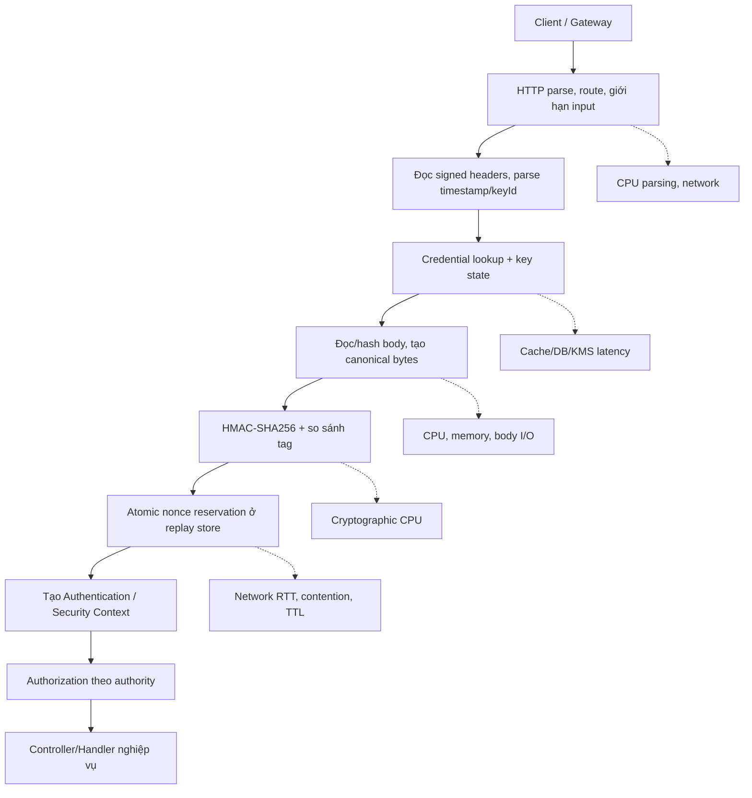

# Chi phí HMAC khi xác thực HTTP request

## 1. Bối cảnh bài học

Trong chương **Performance**, chủ đề **Chi phí HMAC** nghiên cứu chi phí CPU, bộ nhớ, I/O và độ trễ của việc xác thực từng HTTP request bằng **HMAC với shared secret**. Không nên đánh giá hiệu năng chỉ bằng thời gian thực hiện một lệnh `Mac.doFinal()`: trong thực tế, request còn đi qua proxy/gateway, được chuẩn hóa thành canonical request, có thể phải hash và đệm body, tra credential/key, kiểm timestamp, ghi nonce để chống replay, tạo principal và áp dụng chính sách phân quyền.

Bài thuộc mô-đun `SECURITY_AUTHENTICATION_HMAC_REQUEST_AUTHENTICATION`. Client và server thống nhất những thành phần được ký như method, URI, signed headers và/hoặc body; server phải xác minh chữ ký, chống replay bằng timestamp/nonce, hỗ trợ key rotation, tương thích các thay đổi của proxy/gateway và **phân biệt authentication với authorization**.

Các kết quả học tập:

- Phân rã chi phí xử lý HMAC request thành các bước và nhận diện bottleneck từ phép đo thay vì giả định.
- Hiểu độ phức tạp của HMAC-SHA256, body digest và canonicalization theo kích thước request.
- Dự toán chi phí buffer body, heap/GC, độ đồng thời, streaming và backpressure.
- Thiết kế tra khóa, kiểm timestamp/nonce và kho chống replay có hiệu năng hợp lý **mà vẫn fail closed**.
- Sử dụng Java/JMH cho microbenchmark và Micrometer/Prometheus cho đo lường end-to-end.
- Kiểm thử trường hợp hợp lệ, chữ ký sai, replay, key rotation, body lớn và proxy rewrite.
- Tránh các “tối ưu” khiến hệ thống yếu đi: bỏ nonce, giảm độ dài tag, bỏ header/body khỏi chữ ký, dùng secret sai scope hoặc ngừng so sánh MAC an toàn.

**Nguyên tắc xuyên suốt:** phải đo **độ trễ toàn bộ authentication path** (và độ trễ đầu cuối), cùng throughput và tài nguyên hệ thống. Thời gian tính MAC đơn lẻ chỉ là một phần của ngân sách.

## 2. HMAC tốn những gì?

Giả sử client gửi `POST /api/orders?channel=partner` và đã ký một canonical request:

```text
HMAC-V1
POST
/api/orders?channel=partner
content-type:application/json
x-client-id:partner-a
x-key-id:key-2026-11
x-timestamp:2026-11-28T03:00:00Z
x-nonce:8f247364-7d4b-479e-8c36-b640f1ad39a0
body-sha256:<hex SHA-256 của byte body gốc>
```

Hợp đồng này **chỉ mang tính minh họa**, không phải format được Spring Security cung cấp sẵn. Server có thể dùng HMAC-SHA256:

```text
bodyDigest  = SHA256(bodyBytes)
canonical   = UTF8(method + "\n" + target + "\n" + signedHeaders + ...)
expectedMac = HMAC_SHA256(sharedSecret, canonical)
isValid     = constantTimeEquals(expectedMac, receivedMac)
```

Một phép xác minh thành công thường có các bước:



Thời gian quan sát được có thể diễn đạt:

```text
T_auth = T_parse + T_key_lookup + T_canonicalize
       + T_body_digest + T_hmac_compare + T_replay_store
       + T_security_context + T_overhead

T_request = T_gateway + T_auth + T_authorization
          + T_handler + T_downstream + T_transport
```

Đây là mô hình phân tích, **không nhất thiết các thành phần cộng đúng tuyệt đối trên mọi pipeline reactive**: có thể có overlap, queueing hoặc I/O bất đồng bộ. Trong trường hợp thực thi tuần tự, phép cộng gần đúng giúp tìm nơi tiêu tốn thời gian; với sự đồng thời và backpressure, cần đo critical path thực tế.

### Bảng phân loại chi phí

| Thành phần | Tài nguyên chi phối | Đặc điểm và chú ý |
| --- | --- | --- |
| Parse header, canonical URI/query | CPU, allocation | Tăng theo số lượng/độ dài trường cần chuẩn hóa; có thể bị khai thác bằng input quá dài hoặc nhập nhằng. |
| Tra `keyId`, tenant/client và trạng thái key | Cache hit/miss, DB/secret manager | Có thể bị chi phối bởi network RTT; phải hỗ trợ revoke/rotation và scope đúng. |
| Đọc toàn bộ body để kiểm MAC | I/O, heap/direct memory, GC | Có thể tốn hơn phép MAC với request lớn; yêu cầu giới hạn kích thước. |
| SHA-256 body | CPU theo byte đầu vào | Khi canonical request chứa digest thay vì full body, chi phí SHA-256 body là tuyến tính theo kích thước body. |
| HMAC-SHA256 canonical bytes | CPU theo byte được MAC | Canonical string thường nhỏ nếu chỉ chứa body digest; không tự suy ra chi phí luôn nhỏ. |
| Decode MAC và so sánh | CPU, allocation nhỏ | Cần kiểm grammar, độ dài và so sánh byte phù hợp; không hy sinh an toàn vì tối ưu vi mô. |
| Kiểm timestamp | CPU rất nhỏ trong nhiều workload | Parse strict và đọc clock; rủi ro chính là sai policy/clock chứ không phải tính toán nặng. |
| Ghi nonce nguyên tử | Network I/O, store contention, memory | Cần kho chung, atomic insert-if-absent và TTL; không thay bằng cache local không an toàn. |
| Xây principal/authorities | CPU, allocation và có thể I/O | Quyền lấy từ nguồn server-side; tránh gọi DB nhiều lần không cần thiết. |
| Spring Security filters/WebFilters | Framework overhead, scheduling | Phụ thuộc chain, body wrapper, context propagation và số lượng filter. |
| Logging, tracing, metrics | CPU, allocation, I/O | Nhãn/log phải hữu hạn, không chứa secret, raw body, signature hoặc nonce. |

Điều quan trọng: **HMAC-SHA256 có thể nhanh nhưng endpoint HMAC vẫn chậm** nếu mỗi request phải đợi credential store, đọc body nhiều lần hoặc ghi replay store qua mạng. Ngược lại, khi cần hash hàng chục MiB body với lưu lượng cao, CPU và memory bandwidth có thể trở thành giới hạn thật sự. Không kết luận trước khi đo.

## 3. Độ phức tạp của HMAC và hash body

### 3.1. HMAC không phải một phép so sánh chuỗi

HMAC dùng hàm hash mật mã cùng khóa bí mật theo một cấu trúc đã định nghĩa. Về khái niệm với SHA-256:

```text
HMAC(K, m) =
    SHA256((K' xor opad) ||
           SHA256((K' xor ipad) || m))
```

`K'` là dạng khóa sau khi xử lý theo block size của hash. Đối với một thông điệp có `n` byte, công việc hash tăng theo độ dài thông điệp: **O(n)**, cộng chi phí khởi tạo/đệm khóa và xử lý block. Chi phí thật phụ thuộc JDK, provider JCA, CPU instruction support, kích thước input, allocation và cách gọi API.

Nếu canonical request chỉ chứa method, URI, header có giới hạn và **body digest** thì:

- Tính `SHA256(bodyBytes)` có chi phí **O(B)** với `B` là số byte body.
- Tính `HMAC_SHA256(canonicalBytes)` có chi phí **O(C)** với `C` là số byte canonical string, thường nhỏ hơn `B` khi body lớn.
- Cần đọc body và dựng canonical bytes, có thể phải buffer hoặc lưu tạm theo kiến trúc.

Nếu hợp đồng HMAC ký trực tiếp **toàn bộ body** cùng prefix/header:

- Tính HMAC có chi phí **O(C + B)**.
- Không nhất thiết cần một vòng SHA-256 body **riêng**, nhưng vẫn phải xử lý đủ body bytes và giữ khả năng controller đọc nội dung sau xác thực.
- Không được tự ý đổi định dạng từ “HMAC trên full body” sang “HMAC trên body hash” chỉ vì performance; đây là thay đổi protocol/signature contract.

**Không có quy tắc phổ quát rằng ký hash body luôn nhanh hơn ký trực tiếp body.** Ký body hash thường hỗ trợ canonicalization và cố định kích thước phần body trong string-to-sign, nhưng có thể phải thực hiện SHA-256 body rồi HMAC trên canonical bytes; lợi ích/cost phụ thuộc kiến trúc, provider và đường đi dữ liệu. Cần benchmark cả hai **với cùng mức bảo vệ được định nghĩa rõ**.

### 3.2. Phân biệt số byte xử lý với số lần sao chép

Một JSON body 1 MiB có thể được:

1. Đọc từ mạng vào buffer của server.
2. Sao chép vào mảng byte của HMAC filter để tính digest.
3. Sao chép thêm khi wrapper phát lại body cho controller.
4. Deserialize thành object graph Java với các allocation khác.

HMAC có thể chỉ hash 1 MiB một lần, nhưng **allocation/copying và GC** vẫn đáng kể. Để tối ưu, đo tổng số byte allocated mỗi request, GC pause, heap/direct memory, throughput và p95/p99, không chỉ nanoseconds của `Mac.doFinal()`.

### 3.3. Kiểm tra tag an toàn

Giả sử HMAC-SHA256 tạo tag 32 byte. Sau khi decode đúng định dạng, nên kiểm độ dài và so sánh byte MAC bằng primitive phù hợp, ví dụ:

```java
boolean valid = MessageDigest.isEqual(expectedTag, receivedTag);
```

Đừng dùng `Arrays.equals` hoặc tự viết vòng lặp có thể kết thúc sớm theo nội dung nếu threat model yêu cầu hạn chế timing leak. Không cắt ngắn tag để giảm vài byte network hoặc vài thao tác CPU mà không có đánh giá mật mã và thỏa thuận protocol chặt chẽ. Cũng đừng cache kết quả “signature valid” chỉ theo URL: authentication phải gắn với đúng method, URI, signed headers, body, timestamp, nonce và key.

## 4. Body lớn: CPU, bộ nhớ và khả năng phát lại cho ứng dụng

### 4.1. Vì sao xác thực trước handler có thể đòi hỏi buffer?

Nếu HMAC bao gồm body và server chỉ cho phép handler chạy **sau khi đã xác minh toàn bộ body**, verifier phải đọc body đầy đủ trước khi kết luận MAC hợp lệ. Trong Spring MVC, `ServletInputStream` của request gốc thường bị tiêu thụ sau lần đọc; nếu filter đọc body rồi truyền request gốc cho controller, `@RequestBody` có thể không còn dữ liệu.

Một thiết kế JSON đồng bộ với hạn mức nhỏ có thể:

1. Kiểm `Content-Length` như một tín hiệu ban đầu, **nhưng không tin đây là giới hạn duy nhất**.
2. Đọc tối đa `MAX_BYTES + 1` để phát hiện vượt hạn mức trên byte thực tế.
3. Cache byte body trong wrapper có thể phát lại `getInputStream()` và `getReader()` phù hợp.
4. Tính body digest trực tiếp trên byte đã cache.
5. Xác minh MAC, timestamp, key và nonce; chỉ sau đó cho controller đọc body từ wrapper.

`ContentCachingRequestWrapper` của Spring MVC **không tự bảo đảm phát lại** một input stream đã bị filter đọc hết; nó cache dữ liệu đã đọc để quan sát, không thay thế một replayable-body wrapper được thiết kế đúng. Nếu dùng JSON streaming/large file, cần chiến lược khác.

### 4.2. Công thức ước tính bộ nhớ đệm

Nếu tại một thời điểm có `N` request đang giữ body có kích thước trung bình `B` và số bản sao hoặc hệ số overhead hiệu dụng là `A`:

```text
M_body ≈ N × B × A
```

Ví dụ **minh họa**, 500 request đồng thời, body 1 MiB, chỉ một bản sao byte array đã tiêu tốn khoảng 500 MiB; nếu có thêm các buffer và object allocation, mức sử dụng còn cao hơn. Đó chưa tính các request khác, heap của application, TLS/Netty buffers, database objects hoặc bộ nhớ dành cho GC.

Vì vậy, tăng giới hạn body từ 1 MiB lên 16 MiB có thể ảnh hưởng lớn đến khả năng chịu tải dù thời gian tính HMAC trên một request có vẻ vẫn chấp nhận được. **Giới hạn kích thước, giới hạn concurrency, timeout và backpressure** thường mang lại hiệu quả lớn hơn tối ưu vài microsecond HMAC.

### 4.3. Streaming và upload không có nghĩa được bỏ xác thực

Đối với upload/file lớn:

- Hash body theo luồng để không cần giữ toàn bộ dữ liệu trong heap; có thể lưu tạm trong disk/object store cách ly và giới hạn kích thước/ổ đĩa.
- **Không chuyển nội dung chưa hoàn tất xác minh sang một nghiệp vụ có side effect không thể hoàn tác.** Nếu cho downstream xử lý trước khi MAC của toàn bộ body được xác minh, ranh giới trust đã thay đổi.
- Có thể dùng cơ chế chunk signing/streaming MAC được thiết kế riêng, nhưng đó là **hợp đồng ký mới** với quy tắc thứ tự chunk, checksum, length, kết thúc stream và chống replay. Không tự ghép các tag độc lập mà thiếu threat model.
- Kiểm tra việc proxy/gateway nén/giải nén/chuyển đổi body. Verifier phải hash đúng **byte mà client đã ký** theo hợp đồng.
- Đặt quota cho disk spool, body size, request time, số lượng luồng và phương án cleanup khi client hủy kết nối.

Với Spring WebFlux, body là `Flux<DataBuffer>`; việc đọc và cache phải quản lý pooled `DataBuffer` đúng cách và tái cung cấp body cho downstream nếu đã tiêu thụ. Không `block()` trên event loop; cũng không dùng `DataBufferUtils.join(...)` vô giới hạn làm giải pháp phổ quát cho upload lớn.

## 5. Canonicalization: tối ưu đúng chỗ, không giảm những trường được ký

Một phần chi phí HMAC request thực chất là dựng **canonical bytes**. Ví dụ:

```text
canonical = version + "\n"
          + method + "\n"
          + canonicalPathAndQuery + "\n"
          + canonicalSignedHeaders + "\n"
          + sha256Hex(bodyBytes)
```

Các thao tác có thể gồm:

- Parse và chuẩn hóa path/query theo quy tắc percent-encoding, thứ tự tham số, duplicate keys và empty values.
- Chuẩn hóa tên header, whitespace và thứ tự signed headers.
- Chuyển dữ liệu dạng ký tự sang UTF-8; tránh parse/serialize body JSON nếu hợp đồng ký raw bytes.
- Cấp phát `StringBuilder`, chuỗi trung gian, byte arrays, digest và MAC tag.

Cách tối ưu hợp lý:

1. **Công bố đặc tả canonical request rõ ràng.** Hạn chế ambiguity giúp code đơn giản và giảm trường hợp phải thử nhiều cách normalization.
2. **Giới hạn kích thước/số lượng header và query parameters** trước khi canonicalize; từ chối header trùng gây nhập nhằng.
3. **Tránh tạo nhiều chuỗi trung gian không cần thiết** nếu profiling chứng minh allocation đáng kể; có thể ghi theo byte vào bộ đệm có giới hạn.
4. **Dùng cùng canonicalizer trong verifier theo một phiên bản** và golden test vectors độc lập giữa client/server; không fallback thử hàng loạt biến thể canonicalization.
5. **Không bỏ signed headers, method, URI hay body digest** chỉ để làm canonical string ngắn hơn. Việc thay đổi phạm vi dữ liệu được ký là thay đổi bảo mật và protocol.

Ví dụ của lỗi “tối ưu” nguy hiểm: khi API bắt buộc ký `POST /orders/123` cùng body, bỏ body digest khỏi chữ ký có thể cho phép sửa nội dung mà MAC vẫn hợp lệ. Không có lợi ích hiệu năng nào cho phép phá vỡ cam kết toàn vẹn của request.

## 6. Tra key, key rotation và tối ưu cache có điều kiện

Mỗi request HMAC cần xác định shared secret **đúng với client/tenant/key ID**. Nếu credential lookup qua database, remote KMS hoặc secret manager mỗi request, độ trễ network có thể chiếm nhiều hơn phần cryptographic CPU. Cache có thể hữu ích, nhưng kéo theo rủi ro stale credential khi revoke/rotate.

### 6.1. Nguyên tắc cache credential

- Cache theo khóa định danh có scope rõ, ví dụ tenant/client/key ID **đã được giới hạn/chuẩn hóa**, không cache một secret chung toàn hệ thống.
- Cache entry mang theo trạng thái key, `validFrom`, `validTo`, version/revocation metadata; kiểm lại policy theo thời gian.
- TTL/cache invalidation phải phục vụ yêu cầu **thu hồi khóa**. Một key bị revoke không được tiếp tục xác thực mãi do một instance còn cache.
- Giới hạn cache size, memory retention, concurrency và negative cache. Nếu negative caching được dùng để giảm load khi key ID không tồn tại, phải tránh làm lộ trạng thái key và có TTL hợp lý.
- Không log giá trị key material, `SecretKeySpec`, `Mac` object, bản sao `byte[]` secret hoặc cả credential record.
- Trong multi-tenant, không cho client A tìm secret B bằng cách cung cấp key ID lạ hoặc header tenant chưa được MAC bảo vệ; tra cứu trước xác thực chỉ mang tính **ứng viên credential**, chưa cấp danh tính.

### 6.2. Cache `Mac` có an toàn không?

`javax.crypto.Mac` là object **có trạng thái và không được giả định thread-safe**. Dùng một `static Mac` dùng chung rồi gọi `update/doFinal` đồng thời là sai. Mỗi request có thể tạo và `init` một `Mac` riêng, hoặc chỉ dùng reuse per-thread/per-execution nếu đã kiểm chứng an toàn với provider và lifecycle secret.

Việc preinitialize/reuse có thể giảm chi phí khởi tạo trên một số JVM/provider, nhưng cũng có bất lợi:

- Giữ secret trong object sống lâu hơn, cần chính sách memory/key lifecycle.
- `ThreadLocal<Mac>` có thể giữ **key cũ sau rotation**, nhất là ở thread pool dài hạn.
- Trong WebFlux, một reactive request có thể chạy trên nhiều thread; không nên xây correctness dựa vào sự đồng nhất thread và Mac đang giữ trạng thái.
- Object pooling/locking có thể tạo contention và tail latency cao hơn lợi ích.

**Khuyến nghị kỹ thuật:** mặc định dùng instance `Mac` độc lập cho một phép xác minh. Chỉ tối ưu vòng đời `Mac` sau khi benchmark chứng minh `getInstance/init` là bottleneck, kèm test concurrency, rotation và thread-safety.

## 7. Replay store có thể là bottleneck thực tế

Kiểm timestamp thường là phép parse/so sánh local; **chống replay nonce** mới là phần cần lưu trạng thái dùng chung. Với nhiều node và nhiều gateway, các verifier phải sử dụng cùng semantics chống replay.

Một thao tác nguyên tử điển hình khi dùng Redis:

```text
SET replay:<scope>:<keyId>:<nonce> 1 NX PX <ttlMillis>
```

`SET NX` chỉ thành công nếu nonce chưa tồn tại. `PX` đặt TTL. Key namespace phải phân biệt client/tenant/key ID theo mô hình đã xác minh; dữ liệu nonce cần được quản lý đúng chính sách lưu trữ và không log giá trị raw.

### 7.1. Mục tiêu của tối ưu replay store

| Biện pháp | Hợp lý khi | Điều không được đánh đổi |
| --- | --- | --- |
| Kết nối pool và cấu hình timeout | Có nhiều round-trip hoặc request bị chờ connection | Không tăng timeout vô hạn làm treo authentication. |
| Dùng một lệnh atomic insert-if-absent | Tránh cặp “exists rồi insert” có race | Không thay bằng check-then-set để tiết kiệm chi phí. |
| Chia shard theo namespace phù hợp | Load lớn, replay store hỗ trợ phân phối | Không để cùng một nonce được chấp nhận trên các shard khác nhau. |
| Đo latency/p99 và số timeout | Cần biết ảnh hưởng của store lên tail latency | Store lỗi phải **fail closed** nếu API yêu cầu chống replay. |
| TTL hữu hạn theo cửa sổ timestamp | Cần giải phóng key cũ | Không cho key hết TTL khi cùng timestamp vẫn có thể hợp lệ. |
| Chặn request rõ ràng sai format/time trước store | Giảm ghi vô ích | Không reserve nonce của request chưa được xác minh MAC. |

Nếu cửa sổ nhận timestamp là 5 phút quá khứ và 30 giây tương lai, TTL nonce phải tính cả độ lệch tương lai và margin giữa các node. Chỉ đặt TTL 5 phút kể từ lần nhận đầu có thể **không đủ** cho một request có timestamp tương lai vẫn còn được chấp nhận sau khi nonce đã bị xóa.

### 7.2. Thứ tự xác minh và chi phí dưới traffic xấu

Một pipeline có thể từ chối request thiếu header, body vượt limit, timestamp sai format/quá cũ **trước** MAC để tiết kiệm CPU. Tuy nhiên:

- Không cấp `Authentication`, không ghi “nonce đã dùng hợp lệ” và không cho nghiệp vụ chạy trước khi xác minh MAC.
- Nếu lookup key tốn network, cần hạn chế lượng traffic với key ID tùy ý, timeout, rate limit và cache có kiểm soát.
- Không làm lộ sự tồn tại của key hoặc secret thông qua thông báo công khai khác nhau; timing differences cần đánh giá theo threat model.
- Không bỏ MAC trước khi ghi nonce chỉ để giảm latency; request giả mạo có thể chiếm không gian replay store.
- Không cho qua khi replay store timeout: tăng availability bằng cách tắt anti-replay làm thay đổi mô hình bảo mật.

**Nonce chống replay không phải idempotency key.** Hai request hợp lệ dùng hai nonce khác nhau vẫn có thể tạo hai đơn hàng; thao tác có side effect cần chính sách idempotency nghiệp vụ riêng, kể cả khi có gateway retry.

## 8. Dự toán throughput, CPU và queueing

Khi tăng request rate, chi phí trung bình nhỏ có thể tích lũy thành bottleneck. Nếu `C_cpu` là số giây CPU cần cho authentication một request và có `K` core CPU tương đương dành cho công việc đó, cận trên giản lược:

```text
authentication_cpu_capacity ≈ K / C_cpu    (requests/second)
```

Đây **không phải dự đoán throughput production**: các phần I/O, lock contention, heap/GC, store latency và scheduling có thể làm throughput thấp hơn nhiều; các request cũng chia CPU với nghiệp vụ và runtime khác.

Theo Little's Law trong hệ thống ổn định:

```text
in_flight_requests ≈ arrival_rate × mean_response_time
```

Nếu traffic đến nhanh hơn khả năng xử lý, queue và số request in-flight tăng; khi mỗi request giữ body buffer, memory tăng theo. Vì thế cần quan sát **p95/p99** thay vì chỉ p50 hoặc mean. Độ trễ nonce store hoặc một cache miss bất thường có thể làm p99 tăng dù đa số request có MAC rất nhanh.

### Tình huống tính toán minh họa

Giả sử một service nhận 1.000 request/giây và mỗi request giữ **trung bình** một bản sao body 256 KiB trong 100 ms. Dùng Little's Law theo dữ liệu giả định: khoảng 100 request đang xử lý đồng thời, tương đương khoảng **25 MiB** riêng cho một lớp buffer đó, chưa tính các đối tượng khác. Nếu response time tăng lên 1 giây ở cùng arrival rate, có thể có khoảng 1.000 request in-flight và khoảng **250 MiB** buffer, nếu chưa có cơ chế giới hạn concurrency/backpressure.

Mục đích của ví dụ là cho thấy **tail latency có thể tạo áp lực bộ nhớ**. Con số đo thực tế phải tính kích thước body phân phối không đồng nhất, overhead mỗi request, mức concurrency tối đa, reject/throttle và sự khác nhau giữa heap với direct memory.

## 9. Microbenchmark HMAC bằng JMH

Muốn biết phần `Mac.getInstance/init/doFinal` và `SHA-256(body)` tốn bao nhiêu CPU, có thể dùng **Java Microbenchmark Harness (JMH)**. Không dùng một vòng `for` trong `main()` rồi lấy `System.nanoTime()` tổng cộng làm benchmark chuẩn: JIT warmup, dead-code elimination, GC, allocation, CPU frequency và scheduling có thể làm kết quả sai.

### 9.1. Ví dụ JMH độc lập về phép toán

Đoạn code minh họa ba phép đo: SHA-256 body, HMAC với `Mac` tạo mới mỗi lần, và HMAC với `Mac` được khởi tạo riêng cho **mỗi JMH worker thread**. Nó dùng **key giả cho benchmark**, không bao giờ dùng production secret.

```java
import java.nio.charset.StandardCharsets;
import java.security.GeneralSecurityException;
import java.security.MessageDigest;
import java.util.Arrays;
import javax.crypto.Mac;
import javax.crypto.spec.SecretKeySpec;

import org.openjdk.jmh.annotations.*;
import org.openjdk.jmh.infra.Blackhole;

@BenchmarkMode(Mode.AverageTime)
@OutputTimeUnit(java.util.concurrent.TimeUnit.MICROSECONDS)
@Warmup(iterations = 5)
@Measurement(iterations = 5)
@Fork(2)
@State(Scope.Thread)
public class HmacCostBenchmark {

    @Param({"0", "1024", "65536", "1048576"})
    public int bodySize;

    private byte[] body;
    private SecretKeySpec key;
    private Mac reusableMac;

    @Setup(Level.Trial)
    public void setup() throws GeneralSecurityException {
        body = new byte[bodySize];
        Arrays.fill(body, (byte) 0x5a);
        byte[] fakeSecret = new byte[32];
        Arrays.fill(fakeSecret, (byte) 0x32);
        key = new SecretKeySpec(fakeSecret, "HmacSHA256");

        reusableMac = Mac.getInstance("HmacSHA256");
        reusableMac.init(key);
    }

    @Benchmark
    public void bodySha256(Blackhole bh)
            throws GeneralSecurityException {
        MessageDigest sha256 = MessageDigest.getInstance("SHA-256");
        bh.consume(sha256.digest(body));
    }

    @Benchmark
    public void hmacNewInstance(Blackhole bh)
            throws GeneralSecurityException {
        Mac mac = Mac.getInstance("HmacSHA256");
        mac.init(key);
        bh.consume(mac.doFinal(body));
    }

    @Benchmark
    public void hmacReusedPerBenchmarkThread(Blackhole bh) {
        // Mac.doFinal resets the object to its initialized state.
        // @State(Scope.Thread) prevents concurrent use of this Mac.
        bh.consume(reusableMac.doFinal(body));
    }
}
```

**Giới hạn của benchmark:**

- Phép `hmacNewInstance` và `hmacReusedPerBenchmarkThread` đo HMAC **trực tiếp trên body bytes**, không đo đủ canonicalization, SHA-256 body digest, body buffering, Redis, key lookup hoặc Spring Security chain.
- `bodySha256` mỗi lần tạo `MessageDigest` mới, nên đo cả setup; nếu muốn tách riêng cost của việc tạo instance, cần thêm benchmark riêng và giải thích chính xác biến thể.
- `Mac.doFinal` resets state về trạng thái đã khởi tạo với cùng key theo JCA API; mẫu reuse ở đây chỉ an toàn trong **scope thread của JMH**. Không từ kết quả này suy ra nên dùng `ThreadLocal<Mac>` trong production, nhất là với key rotation/WebFlux.
- Benchmark dùng input mảng byte cố định để so sánh phép toán; không phản ánh network read hoặc chi phí cấp phát body khi request đến.
- Tham số 0, 1 KiB, 64 KiB và 1 MiB chỉ là bộ kích thước ví dụ; hãy thay bằng phân phối kích thước thực tế.
- Cần chạy trên JDK/CPU/provider và cấu hình gần production, kiểm soát tiến trình nền, bộ nhớ và số luồng. Báo cáo kết quả theo đơn vị, error interval và thông số runtime; **không tự suy hiệu năng từ máy khác**.

### 9.2. Benchmark toàn bộ HMAC canonical contract

Nếu hợp đồng ký `body-sha256`, thêm phép thử gồm:

1. Tạo `SHA256(bodyBytes)`.
2. Encode digest theo hợp đồng (hex hoặc base64) và dựng canonical bytes.
3. `Mac.init(secret)`, `Mac.doFinal(canonicalBytes)`.
4. So sánh tag byte với một tag fixture hợp lệ.

Đo riêng từng bước và tổng pipeline để thấy allocation của chuyển đổi hex/UTF-8, không chỉ cryptographic primitive. Cần kiểm chứng output bằng golden test vector; không dùng phép tối ưu khiến byte canonical thay đổi. Đo sai dấu hoặc thứ tự header làm thay đổi chữ ký chứ không phải tăng tốc.

## 10. Đo thời gian thực ở Spring Security với Micrometer

### 10.1. Metric nên có

| Metric | Kiểu | Phạm vi |
| --- | --- | --- |
| `hmac.authentication.duration` | Timer | Toàn bộ authentication path từ lúc verifier bắt đầu tới kết quả cuối cùng. |
| `hmac.stage.duration` | Timer | Các stage hữu hạn: `parse`, `key_lookup`, `body_digest`, `mac_verify`, `replay_store`. |
| `hmac.authentication.requests` | Counter | `outcome=accepted/rejected/error` và reason enum hữu hạn. |
| `hmac.signature.verifications` | Counter | `result=match/mismatch` ở đúng phép MAC compare. |
| `hmac.replay.store.errors` | Counter | Timeout/unavailable từ replay store. |
| HTTP request latency | Framework timer | Độ trễ toàn endpoint để đặt authentication vào bối cảnh nghiệp vụ. |
| JVM/Runtime metrics | Gauges, histograms | CPU, heap/direct memory, allocation, GC, thread/connection pressure. |

Nhãn phải có số giá trị hữu hạn: route ID/template server-side, stage, result/outcome/reason enum, region/environment do cấu hình quyết định. Không gắn **shared secret, key ID có cardinality cao, client ID thô, signature, nonce, body hash, raw URI/query hoặc request ID** vào time series.

### 10.2. Mẫu đo end-to-end tại verifier

Ví dụ Java với Micrometer cho một lớp điều phối authentication đồng bộ. Các kiểu `HmacPrincipal`, `HmacRequest` và `HmacVerifier` là phần ứng dụng tự triển khai.

```java
final class MeteredHmacAuthentication {
    private final MeterRegistry meterRegistry;
    private final HmacVerifier verifier;

    MeteredHmacAuthentication(
            MeterRegistry registry,
            HmacVerifier verifier) {
        this.meterRegistry = registry;
        this.verifier = verifier;
    }

    HmacPrincipal authenticate(
            HmacRequest request,
            String trustedRouteId) {

        // Route phải là ID server-side trong danh sách cho phép,
        // không lấy raw URI hoặc routeId từ header client.
        Timer.Sample timer = Timer.start(meterRegistry);
        String outcome = "error";

        try {
            HmacPrincipal principal = verifier.verify(request);
            outcome = "accepted";
            return principal;
        } catch (BadCredentialsException expected) {
            outcome = "rejected";
            throw expected;
        } finally {
            timer.stop(
                Timer.builder("hmac.authentication.duration")
                    .tag("route", trustedRouteId)
                    .tag("outcome", outcome)
                    .register(meterRegistry));
        }
    }
}
```

Ví dụ trên đo thời gian bao quanh `verifier.verify(...)`. Nếu verifier chưa bao gồm replay store/key lookup, timer không phản ánh các phần đó. Trên request có body, chọn điểm bắt đầu/kết thúc đủ bao quanh chi phí đọc/hash body thực tế, nhưng đừng đo trùng cùng khoảng thời gian trong nhiều filter.

Khi cần phân loại lỗi hạ tầng, hãy bổ sung catch riêng cho `ReplayStoreUnavailableException`/`CredentialStoreUnavailableException` để tăng metric `error` tương ứng và **fail closed** theo hợp đồng API. Không dùng `exception.getMessage()` làm tag. Việc code mẫu đặt `outcome=error` cho exception không được phân loại là lựa chọn bảo thủ phục vụ observability.

Trong WebFlux, timer phải bao quanh vòng đời subscription/reactive completion bằng operator thích hợp; một `try/finally` bao quanh lúc **tạo `Mono`** không đo được thời gian bất đồng bộ thực thi sau đó. Phải xét `onError`, `doFinally`, cancellation và khả năng `retry/resubscribe`; không dùng `block()` trong event loop để lấy số đo.

## 11. Đọc p95/p99, throughput và cảnh báo đúng cách

Thời gian trung bình có thể thấp dù một phần nhỏ request chờ Redis lâu. Nên xem:

- **p50:** trải nghiệm trung vị; hữu ích nhưng không thay cho tail.
- **p95/p99:** phát hiện latency bất thường do cache miss, stop-the-world GC, queueing, Redis/network tail.
- **Throughput (RPS)** và tỷ lệ request bị reject/throttle: phân biệt thời gian nhanh do đã từ chối phần lớn request với khả năng xử lý request hợp lệ.
- **CPU utilization, allocation/GC và memory pressure:** thấy giới hạn tài nguyên.
- **Replay store p95/p99, timeout và error rate:** chẩn đoán tail latency từ dependency.
- **Body size distribution:** bucket kích thước body có liên quan trực tiếp đến hash/đệm dữ liệu.

Với Micrometer Prometheus registry, tên `hmac.authentication.duration` thường được xuất thành các time series theo convention của exporter. Tên bucket/count/sum cụ thể và sự có mặt của histogram phụ thuộc cấu hình meter distribution; cần kiểm endpoint metrics thực tế.

Ví dụ nếu histogram với đơn vị giây được bật:

```promql
histogram_quantile(
  0.99,
  sum by (le, route) (
    rate(hmac_authentication_duration_seconds_bucket[5m])
  )
)
```

**Điều kiện:** query trên chỉ đúng khi exporter thực sự phát series `hmac_authentication_duration_seconds_bucket` và label `route`. Nếu timer chỉ xuất count/sum/max mà không có bucket, cần cấu hình histogram tương ứng; không “tự suy” p99 từ `sum/count` vì đó chỉ là trung bình.

Để nhìn throughput của authentication path:

```promql
sum by (route, outcome) (
  rate(hmac_authentication_requests_total[5m])
)
```

Nếu dùng latency SLO hoặc alert, hãy đặt mục tiêu từ yêu cầu dịch vụ và baseline, **không gán ngưỡng p99 tùy ý**. Một alert performance có ích nên đi kèm replay store errors, saturation, body size mix và deployment markers.

## 12. Tối ưu chống DoS: giới hạn đầu vào trước tính toán nặng

HMAC verifier là một điểm tiêu thụ tài nguyên có thể bị gọi bởi traffic chưa xác thực. Kẻ tấn công không cần biết shared secret để gửi body lớn hoặc tạo vô số key ID lạ, buộc ứng dụng parse và truy vấn credential.

Các lớp bảo vệ cần cân nhắc:

| Hành vi đầu vào | Nguy cơ | Kiểm soát phù hợp |
| --- | --- | --- |
| Body lớn hoặc upload không giới hạn | OOM, direct memory pressure, bandwidth/CPU hash | Body size limit tại gateway/container/filter, spool có quota và timeout. |
| Header/query rất dài hoặc trùng | Canonicalizer tốn CPU, parser ambiguity | Giới hạn byte/số lượng trường, strict validation và từ chối duplicate signed header. |
| Key ID ngẫu nhiên liên tục | Cache miss, DB/secret manager load | Rate limit/connection quota, timeout, bounded negative cache khi phù hợp. |
| Signature sai liên tiếp | Tiêu tốn phép MAC và log event | Rate limiting, event logging hạn chế tốc độ, metrics tổng hợp. |
| Nhiều nonce hợp lệ với MAC thật | Tăng số key trong replay store | Quota theo client đã xác thực, TTL và capacity planning. |
| Kết nối chậm/chưa gửi đủ body | Giữ connection/buffer lâu | Header/body read timeout, giới hạn in-flight, slow-client protection. |
| Request replay đồng thời | Race/chi phí Redis store | Atomic reservation trên kho chung và backpressure; không bỏ anti-replay. |
| Request bị gateway retry không kiểm soát | Duplicate body/hash/nonce work, nghiệp vụ lặp | Retry policy và idempotency key nghiệp vụ. |

Ưu tiên **từ chối sớm những input chắc chắn sai** theo hợp đồng, nhưng vẫn giữ nguyên tính đúng đắn bảo mật. Ví dụ giới hạn số header, định dạng timestamp và body size không yêu cầu tin identity trước; ngược lại không được gán authority từ `X-Client-Id` chưa xác minh.

Cần thiết kế public error semantics rõ ràng:

- `401 Unauthorized`: chữ ký sai, timestamp/nonce không hợp lệ, key không được chấp nhận.
- `403 Forbidden`: client đã xác thực nhưng thiếu authority.
- `413 Content Too Large`: body vượt giới hạn.
- `429 Too Many Requests`: rate limiting theo chính sách đã định.
- `503 Service Unavailable` hoặc lỗi hạ tầng phù hợp: replay store không sẵn sàng, **fail closed**.

Các mã là ví dụ API contract, ngoại trừ semantics HTTP căn bản; không biến lỗi Redis thành `signature_invalid` để che độ trễ/đứt kết nối.

## 13. So sánh hiệu năng giữa Spring MVC và Spring WebFlux

Cả hai stack đều cần xác minh **cùng canonical bytes**, key, timestamp, nonce và policy phân quyền. Khác nhau chủ yếu ở mô hình I/O, concurrency và quản lý buffer.

| Khía cạnh | Spring MVC / Servlet | Spring WebFlux / Reactive |
| --- | --- | --- |
| Body | `ServletInputStream`, wrapper có thể đọc lại cho `@RequestBody` | `Flux<DataBuffer>`, decorator/cache có giới hạn để downstream subscribe. |
| Scheduling | Thường gắn với servlet request threads, có thể async | Event loop/reactive scheduling; không block network operations trên event loop. |
| Replay store | Redis/JDBC client đồng bộ nếu kiến trúc dùng thread blocking | Client reactive phù hợp; blocking call cần được đưa ra scheduler thích hợp có kiểm soát. |
| Context | `SecurityContextHolder` được Spring quản lý trong request lifecycle | `ReactiveSecurityContextHolder` và Reactor Context. |
| Performance pitfall | Buffer body nhiều lần, GC, thread pool saturation | `block()`, pooled `DataBuffer` leak, subscribe/retry lặp, không áp backpressure. |
| Đo latency | Around synchronous verifier/filter và HTTP timer | Đo trong reactive signal lifecycle, phân biệt cancel/error/complete. |

**Không mặc định WebFlux luôn nhanh hơn MVC** hoặc ngược lại. Hiệu năng phụ thuộc workload thực, số downstream blocking, kích thước body, runtime, gateway và replay store. Chọn stack theo kiến trúc ứng dụng; microbenchmark HMAC không đủ cơ sở để quyết định chuyển nền tảng.

## 14. Benchmark toàn tuyến qua proxy/gateway

Kiểm HMAC trực tiếp trong unit test bỏ qua nhiều overhead:

- TLS termination, TLS re-encryption/mTLS và certificate validation ở upstream.
- Path prefix rewrite, percent-encoding, query normalization và signed header forwarding.
- Body compression, chunked transfer, buffering hoặc giới hạn ở gateway.
- Connection pooling, keep-alive, HTTP/2 ↔ HTTP/1.1, ingress rate limiting.
- Chia sẻ kho nonce giữa nhiều verifier/node và key lookup cache miss.
- Security filter chain, authorization, JSON decode/validation và handler.

Cần thiết kế **hai lớp benchmark bổ sung**:

1. **In-process integration test:** request đi qua Spring Security chain, verifier, body wrapper/decorator và controller; đo stage và tính đúng kết quả. Dùng `MockMvc` hoặc `WebTestClient` với đúng cấu hình security, không chỉ bind controller rồi kết luận xác thực đã chạy.
2. **HTTP end-to-end load test:** client ký request độc lập, gửi qua gateway/TLS và nhiều backend tới replay store gần production. Theo dõi CPU, p95/p99, error/status distribution, cache hit rate, nonce store latency và memory.

Một test tải HMAC hợp lệ phải sinh **nonce mới và chữ ký mới trên đúng canonical body** cho mỗi request. Nếu tái sử dụng một signed request, những request sau sẽ bị replay guard từ chối; benchmark có thể đo luồng 401 rất nhanh rồi báo throughput “cao”, nhưng đó không phải năng lực xử lý request hợp lệ.

### Ma trận tải đề xuất

| Trục | Giá trị thử minh họa | Mục tiêu |
| --- | --- | --- |
| Kích thước body | 0 B, 1 KiB, 64 KiB, 1 MiB, gần giới hạn | Tách chi phí hash, buffer, GC và gateway. |
| Loại request | HMAC đúng; signature sai; format sai; expired; replay; 403 | Phân biệt nhánh đi qua MAC/replay/authorization. |
| Credential | Cache hit, cache miss, verify-only key, revoked key | Đo latency lookup và key rotation behavior. |
| Concurrency | Tăng tải từng bước trong giới hạn lab | Tìm throughput tối đa bền vững, saturation, p99. |
| Replay store | Healthy, latency injected, timeout, cluster failover | Kiểm tail latency và fail-closed semantics. |
| Proxy mode | Direct backend, TLS gateway, path rewrite, mTLS upstream | Đo overhead/tính đúng canonicalization. |
| Runtime | JDK/provider/CPU, heap size, GC config | Phát hiện regression sau upgrade. |
| Body/content | Raw JSON bytes, gzip nếu contract cho phép, duplicate header/query | Chứng minh tối ưu không làm sai chữ ký. |

Cần **tách tải hợp lệ khỏi tải độc hại** và đánh giá rate limiter: nếu 80% traffic bị reject sớm, CPU thấp có thể là điều tốt cho bảo vệ hạ tầng, nhưng không nói lên năng lực xử lý business request.

### Quy trình đo lường thực nghiệm

1. Xác định mục tiêu chức năng và security invariants: MAC đúng, freshness, nonce atomic, 401/403 và không leak secret.
2. Chọn môi trường gần production và kiểm soát JDK, CPU, container limits, gateway, replay store, vùng network.
3. Chuẩn bị bộ request fixture có golden vectors; dùng signer độc lập để tạo chữ ký cho mỗi request.
4. Warm up JVM, connection pools, JIT và caches theo kịch bản; phân biệt cold-start với steady state.
5. Ghi baseline dưới tải thấp, sau đó tăng RPS/concurrency có kiểm soát và quan sát độ trễ, saturation.
6. Chạy lần lượt một thay đổi nhỏ: canonical buffer allocation, credential cache, batching I/O hoặc body strategy.
7. So sánh p50/p95/p99, throughput, allocation, GC, Redis RTT và error rate, không chỉ thời gian MAC.
8. Kiểm lại test security/regression; chỉ giữ tối ưu nếu không đổi signed bytes, không tạo đường bypass hoặc rủi ro stale key.

Đừng benchmark trên production bằng khóa thật, raw body nhạy cảm hoặc tắt nonce guard để tăng request count. Trong lab có thể đo riêng một hàm crypto thuần, nhưng **không lấy số từ môi trường đã vô hiệu hóa security làm bằng chứng năng lực bảo vệ toàn tuyến**.

## 15. Một runbook khi p99 HMAC tăng

Giả sử sau triển khai p99 request HMAC tăng rõ rệt. Cách khoanh vùng:

1. **Xác định điểm tăng:** HTTP server p99, authentication timer hay upstream gateway latency? Nếu chỉ gateway tăng, kiểm TLS/upstream routing trước.
2. **Kiểm phân phối body:** body size, content encoding và số lần buffer/copy có thay đổi không?
3. **Đo từng stage:** `key_lookup`, `body_digest`, `mac_verify`, `replay_store`; dùng profiler nếu CPU/alloc tăng.
4. **Kiểm cache/key rotation:** credential miss rate, nhiều key `VERIFY_ONLY`, trạng thái revoke hoặc DB/network có thay đổi?
5. **Kiểm kho nonce:** p99 round-trip, connection pool, timeout, hot shard và số key/TTL; không bỏ nonce để chữa p99.
6. **Kiểm tài nguyên:** CPU throttling, thread pool/event loop saturation, heap/direct memory, GC, socket exhaustion.
7. **Kiểm thay đổi proxy:** URI rewrite, signed header normalization, body decompression có khiến reject/retry tăng?
8. **Kiểm mix traffic:** tỷ lệ chữ ký sai, expired, replay, malformed và 403; tránh so một benchmark tải hợp lệ với production đầy traffic bị reject.
9. **Tái hiện bằng dữ liệu giả:** run same test vectors trên version trước và sau, cùng JDK/hardware/policy.
10. **Xác nhận regression tests:** hiệu năng tốt hơn không đủ; chữ ký, nonce, key lifecycle và quyền truy cập vẫn phải đúng.

Không log shared secret, full signature, raw canonical request, nonce, raw URI/query hoặc body để tìm “chỗ chậm”. Dùng timer stage, correlation ID do hệ thống tin cậy tạo, route ID hữu hạn và traffic fixtures giả.

## 16. Các lỗi tối ưu phổ biến

| “Tối ưu” | Rủi ro | Hướng đúng |
| --- | --- | --- |
| Bỏ `body-sha256` khỏi canonical request | Body có thể bị sửa mà MAC vẫn hợp lệ. | Giữ hợp đồng ký, tối ưu buffering/streaming có kiểm soát. |
| Bỏ timestamp/nonce hoặc lưu nonce riêng từng node | Replay request hợp lệ qua nhiều node. | Kho replay chia sẻ, atomic insert-if-absent, TTL đủ dài. |
| Fail open khi Redis timeout | Vô hiệu hóa chống replay khi hạ tầng lỗi. | Fail closed, error code/alert phù hợp. |
| Dùng `static Mac` chung nhiều thread | Race và kết quả MAC sai, rủi ro secret state. | Mỗi phép xác minh/worker có state riêng và rotation đúng. |
| Cache key vô hạn | Revoke không có hiệu lực nhanh, rò rỉ credential trong memory. | Bounded cache, expiry/invalidation và quyền đọc secret. |
| Cắt ngắn tag để giảm CPU | Giảm khả năng chống giả mạo tùy mức cắt, sai protocol. | Tag đủ độ mạnh theo thiết kế, tránh tự ý thay đổi. |
| Bỏ kiểm strict URI/header để “đỡ parse” | Parser ambiguity và request signing confusion. | Canonical grammar rõ, giới hạn input, golden tests. |
| Ghi raw body/secret khi profiler/debug | Lộ dữ liệu nhạy cảm ra log/APM. | Stage metrics và fixtures giả, không dump credential. |
| Benchmark chỉ `Mac.doFinal()` rồi suy throughput API | Bỏ qua key lookup, Redis, body, proxy, framework. | Kết hợp JMH và full-path load testing. |
| Dùng request ký sẵn lặp lại để load test | Hầu hết bị replay reject, số throughput sai mục tiêu. | Sinh nonce/signature mới cho request hợp lệ. |
| Nhầm 403 với HMAC failure | Đo sai chi phí authentication và authorization. | Phân loại response/outcome riêng. |
| Tăng body limit vô hạn để “không 413” | OOM, GC và DoS. | Có quota body/concurrency/timeouts theo loại endpoint. |
| Gọi blocking Redis trên WebFlux event loop | Event loop bị giữ, tail latency tăng. | Reactive client hoặc bounded scheduler phù hợp. |
| Tối ưu mọi thứ cùng lúc | Không biết thay đổi nào mang lại lợi ích hay gây regression. | Đo baseline, thay đổi từng bước, test correctness. |

## 17. Checklist trước production

- [ ] Có canonical request contract phiên bản rõ ràng, test vectors cho method, URI/query, header và body bytes.
- [ ] HMAC-SHA256/thuật toán đã chọn và MAC comparison được triển khai đúng; không giảm signed fields để tối ưu.
- [ ] Đã đo CPU của SHA body, HMAC và canonicalization theo nhiều body size trên JDK/CPU gần production.
- [ ] Đã đo key lookup cache hit/miss, key rotation và revoke behavior mà không làm lộ secret.
- [ ] Replay store dùng chung mọi verifier, có atomic nonce reservation, TTL phù hợp và fail closed.
- [ ] Có body-size limit, header/query limits, timeout, connection/concurrency limit và streaming/spooling policy.
- [ ] MVC body wrapper hoặc WebFlux body decorator giữ đúng byte để controller đọc lại; không đệm vô hạn.
- [ ] Không dùng `static Mac` chung, không blocking I/O trên event loop WebFlux, không giữ key cũ quá lâu sau rotation.
- [ ] Micrometer metrics có route/stage/outcome enum hữu hạn, không có secret, key ID, raw nonce/signature/body.
- [ ] Quan sát p50/p95/p99, RPS, memory/GC, replay store RTT và request body size; biết khác nhau giữa success/reject/error.
- [ ] Đã chạy load test qua Spring Security chain và proxy/gateway production-like, có signed request mới cho mỗi attempt.
- [ ] Đã kiểm 401 (auth thất bại), 403 (thiếu quyền), 413, 429, fail-closed khi store lỗi, key rotation và multi-tenant isolation.
- [ ] Có runbook phân biệt CPU HMAC, Redis latency, body buffering, proxy rewrite và lỗi signature mismatch.
- [ ] Sau mọi tối ưu đã chạy lại integration/regression tests bảo mật.

## 18. Câu hỏi tự đánh giá

1. Vì sao chỉ đo thời gian `Mac.doFinal()` không đủ để dự báo p99 HTTP request có xác thực HMAC?
2. Nếu canonical request chứa `SHA256(body)`, những phần nào có chi phí tỷ lệ với kích thước body?
3. Khi ký trực tiếp body và khi ký body digest, sự khác nhau về protocol và chi phí tính toán là gì?
4. Với 500 request đồng thời và body 1 MiB, tại sao việc buffer một bản sao đã có thể tạo áp lực heap?
5. Vì sao `ContentCachingRequestWrapper` không được mặc định coi là wrapper có thể phát lại body sau khi filter tiêu thụ stream?
6. Có nên dùng một `static Mac` duy nhất cho mọi request để giảm `getInstance()` overhead? Vì sao?
7. Cache credential cải thiện latency nhưng có thể làm hỏng key revocation như thế nào?
8. Tại sao một thao tác Redis `SET NX` nguyên tử phù hợp hơn hai thao tác “kiểm tồn tại rồi ghi”?
9. Nếu replay store timeout, hệ thống có nên cho request đi tiếp để giữ throughput không?
10. Vì sao test tải liên tục gửi cùng timestamp/nonce/signature không đại diện năng lực xử lý request hợp lệ?
11. Làm sao phân biệt chi phí HMAC CPU với chi phí buffer body, key lookup và nonce store bằng metrics?
12. Vì sao p50 tốt nhưng p99 cao có thể cho biết vấn đề ở contention hoặc dependency tail?
13. Một gateway đổi `Host` và path đã ký, tác động nào xuất hiện ở accuracy của chữ ký và chi phí xử lý?
14. Trong WebFlux, điều gì xảy ra khi gọi `block()` ở event loop để tra key hoặc lưu nonce?
15. Vì sao HMAC match không đồng nghĩa request được cấp authority nghiệp vụ?
16. Hãy đề xuất một bài benchmark có đủ các case: HMAC đúng, MAC sai, replay, revoked key, body lớn và gateway TLS termination.

**Ghi nhớ:** Hiệu năng HMAC request authentication không chỉ là tốc độ thuật toán HMAC-SHA256. Chi phí thực thường đến từ **body hashing/buffering, canonicalization, credential lookup, replay-store round-trip, concurrency và gateway**. Hãy đo bằng JMH *và* load test toàn tuyến, tối ưu sau khi biết bottleneck, giữ nguyên canonical contract, chống replay nguyên tử, key rotation đúng và quy tắc phân quyền tách biệt. Một tối ưu làm suy yếu tính toàn vẹn hoặc cho request đi qua khi chưa xác minh không phải tối ưu hợp lệ.
