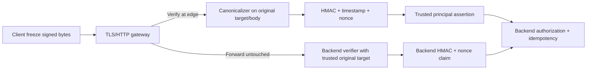
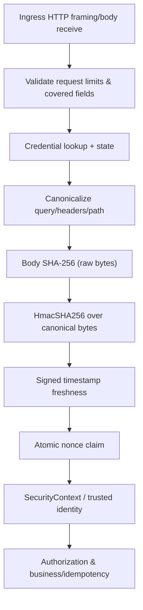
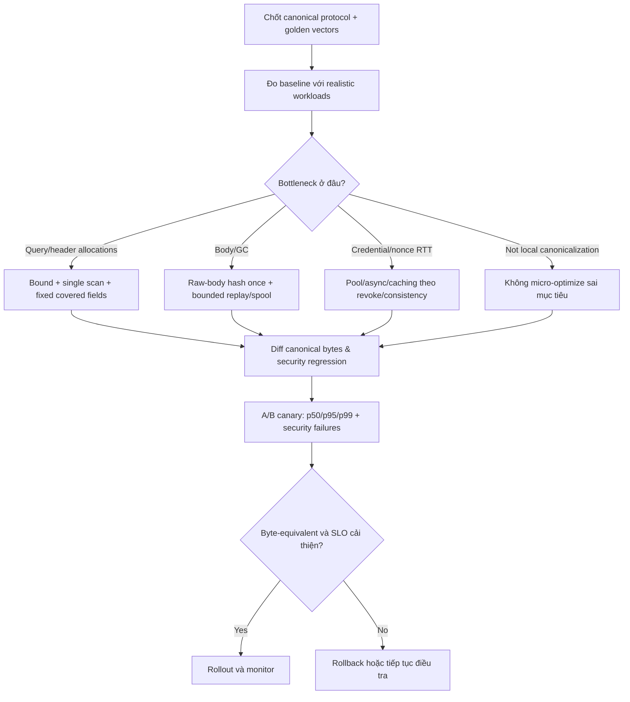

# Chi phí canonicalization trong xác thực HTTP HMAC: đo đúng, tối ưu đúng và giữ nguyên tính toàn vẹn request

> **Chương:** Performance  
> **Bài học:** Chi phí canonicalization  
> **Module:** `SECURITY_AUTHENTICATION_HMAC_REQUEST_AUTHENTICATION`  
> **Phạm vi:** Xác thực HTTP request bằng HMAC với shared secret và canonical request bao phủ method, URI, headers và/hoặc body; chống replay bằng timestamp/nonce, quản lý vòng đời/rotation của key, kiểm thử gateway/proxy và phân biệt authentication với authorization.

Bài sử dụng Java 17+, HTTP/1.1–HTTP/2 và hai ngữ cảnh triển khai **Spring MVC (Servlet)** / **Spring Cloud Gateway (WebFlux)**. Những con số ở ví dụ kích thước, ngưỡng và thời gian là **giá trị đầu vào minh họa**, không phải số đo benchmark của một hệ thống cụ thể. Khi muốn khẳng định “nhanh hơn x%” hoặc đặt SLO, phải đo trên request mix, JDK, phần cứng, network path, credential store và gateway thực tế.

## 1. Vấn đề: vì sao một HMAC-SHA256 ngắn có thể đi kèm p99 rất cao?

Một request thanh toán đi qua gateway:

```http
POST /v1/tenants/merchant-a/payments?currency=VND&orderId=42 HTTP/1.1
Host: api.example.test
Content-Type: application/json
Idempotency-Key: pay-order-42
X-Key-Id: merchant-a-k2
X-Timestamp: 1767225600
X-Nonce: 87a3d56ea72d40af89f5b68cb3e831d4
X-Signature: v1=<BASE64URL_NO_PADDING_HMAC_TAG>

{"amount":100000,"currency":"VND"}
```

Verifier phải trả lời: “Dòng byte nào **đã được ký**, và chữ ký có đúng với secret của credential được chọn không?” Để xây dòng byte này, nó thường phải:

1. Lấy HTTP method, external authority và raw path/query từ đúng trust boundary.
2. Kiểm grammar, percent-encoding/normalization policy và giới hạn độ dài.
3. Trích xuất covered headers, xử lý tên chữ hoa/thường, duplicate/OWS theo hợp đồng.
4. Chuẩn hóa/sắp xếp query parameters hoặc signed headers **theo thuật toán xác định**.
5. Đọc/tính `SHA-256` của **raw body bytes** nếu body được ký.
6. Ghép canonical representation, mã hóa UTF-8 và tính `HMAC-SHA256`.
7. Strict-decode signature/Base64URL và so tag.
8. Kiểm signed timestamp và atomic claim nonce trước khi cho request đi tiếp.
9. Gắn verified identity; Spring Security/backend kiểm quyền tenant/resource.

**HMAC primitive có thể chỉ xử lý vài trăm byte** của canonical request, trong khi hệ thống đã phải đọc nhiều KiB/MiB body, tạo object tạm, sort query, chờ secret manager và replay database. Vì vậy “HMAC-SHA256 tốn CPU” chưa chắc là giả thuyết đúng về latency.

### Tình huống thực tế

Một đội thấy API p99 tăng sau khi phát hành gateway mới. Người trực vận hành phát hiện code mới:

- Parse query bằng URL decoder nhiều lần.
- Tạo nhiều `String.split` / `Map` / `Stream` chỉ để sắp xếp 3 tham số.
- Deserialize JSON body để “canonicalize” trước HMAC, rồi serialize lại để forward.
- Đọc hết body thành String, encode lại UTF-8 và tính digest.
- Tạo body buffer thứ hai ở Spring MVC để `@RequestBody` còn đọc được.
- Lookup Vault secret và Redis nonce qua network cho từng request.
- Ghi raw canonical strings vào DEBUG logs khi 401.

Một số việc gây **allocation, GC, I/O hoặc lỗi tính toàn vẹn**, chứ không nằm trong HMAC crypto. Bài này hướng dẫn tách chúng và ưu tiên những tối ưu **không thay đổi signing semantics**.

### Sau bài này, người học có thể

- Lập cost model cho canonical method/path/query/headers/body, SHA-256/HMAC và các remote dependencies.
- Nhận ra các nguồn overhead: decode/re-encode, sort, map/string allocation, duplicate header handling, body buffering, GC và event-loop blocking.
- Tối ưu input representation, streaming digest và immutable request snapshot mà không giảm phạm vi dữ liệu ký.
- Đặt giới hạn độ dài/số lượng query/header/body để bảo vệ CPU và bộ nhớ trước traffic chưa xác thực.
- Viết một **Java 17 strict canonicalizer** có complexity dự đoán được.
- Thiết kế benchmark JMH tách chi phí canonicalization khỏi crypto, body reading và network.
- Đọc JFR/GC traces, xác định p50/p95/p99, tail amplification và năng lực phục vụ.
- Kiểm correctness bằng golden bytes, tampering tests, proxy HTTP/2 fixtures và race tests.
- Hiểu vì sao cache canonical request theo raw keyId, tắt nonce hoặc bỏ ký body/path **không** phải tối ưu an toàn.
- Chọn một kế hoạch tối ưu hóa dựa trên số đo và thử nghiệm có thể tái lập.

## 2. Canonicalization là công việc gì?

**Canonicalization** là phép biến đổi một HTTP request thành chuỗi byte **xác định, không nhập nhằng** theo một hợp đồng ký đã version hóa. Hai implementations độc lập nhìn cùng request được chấp nhận phải tạo ra **cùng các byte**; nếu khác bytes, verifier phải từ chối, không “đoán xem client có ý gì”.

Ví dụ hợp đồng custom `PERF-HMAC-V1` (không phải chuẩn mặc định của Spring Security):

```text
POST
api.example.test
/v1/tenants/merchant-a/payments
currency=VND&orderId=42
content-type:application/json
idempotency-key:pay-order-42
x-key-id:merchant-a-k2
x-nonce:87a3d56ea72d40af89f5b68cb3e831d4
x-timestamp:1767225600
content-type;idempotency-key;x-key-id;x-nonce;x-timestamp
<SHA256_LOWERCASE_HEX_OF_EXACT_RAW_BODY>
```

Những dòng được nối bằng **LF (0x0A)**, UTF-8, không có LF cuối. Prefix và tag:

```text
bytesToSign = UTF8("HMAC-SHA256/PERF-HMAC-V1\n" + canonical)
tag         = HMAC-SHA256(secretBytesForKeyId, bytesToSign)
wire        = "v1=" + Base64URLNoPadding(tag)
```

**Lưu ý về protocol:** Đây là custom contract trong bài. `RFC 9421` định nghĩa HTTP Message Signatures theo conventions khác; không coi `PERF-HMAC-V1` là RFC implementation.

### 2.1. Cùng một HTTP action có thể có nhiều byte representations

| Biểu diễn A | Biểu diễn B | Cần chốt trước khi tối ưu |
| --- | --- | --- |
| `POST` | `post` | HTTP method case-sensitive; ví dụ chỉ chấp nhận `POST`, không tự uppercase bất kỳ input. |
| `/a/%7E/b` | `/a/~/b` | Có cho phép percent-encoding canonicalization không? Ví dụ strict chỉ nhận safe literal subset. |
| `b=2&a=1` | `a=1&b=2` | Query order có canonical-sort không? Phải thống nhất cả hai phía. |
| `a=1&a=2` | `a=2&a=1` | Duplicate key semantics; ví dụ strict reject duplicate keys. |
| `Content-Type` | `content-type` | Header **name** case-insensitive; lowercase ASCII. |
| `application/json` | `application/json; charset=utf-8` | Header **value** có khác không? Ví dụ strict yêu cầu exact `application/json`. |
| `{"a":1,"b":2}` | `{ "b": 2, "a": 1 }` | JSON semantics có thể giống, nhưng raw body bytes khác; ví dụ ký raw bytes. |
| LF `\n` | CRLF `\r\n` | Canonical output chỉ LF; không dựa vào OS line endings. |

**“Tối ưu” bằng cách tự normalize thêm trường** chỉ an toàn khi đó là **một protocol version mới**, đã cập nhật signer, verifier, fixtures và gateway semantics. Không thay đổi cách canonicalize trên một phía rồi mong các bên vẫn interoperable.

### 2.2. Trust boundary trước khi có performance number

Gateway có thể terminate TLS và đổi public Host/path/query trước khi backend verify. Nếu signature ký external target nhưng verifier tính internal target, cost model chạy nhanh tới đâu cũng **không đúng**.



**Một authoritative nonce claim point**: nếu gateway đã verify và claim nonce, backend nên verify **internal trusted assertion** và authorization, không claim lại cùng external nonce. Nếu backend verify, gateway phải preserve covered bytes hoặc truyền original target qua channel đã xác thực.

## 3. Lập mô hình chi phí theo kích thước request

Đặt:

- `M`: số byte của HTTP method.
- `P`: số byte của canonical path/authority.
- `Q`: tổng byte query; `q`: số query parameters.
- `H`: tổng byte các covered header names/values; `h`: số covered header occurrences.
- `B`: số byte raw request body phải băm.
- `C`: tổng byte canonical request sau ghép.
- `K`: chi phí tra secret/key state trong credential directory (có thể remote).
- `R`: chi phí atomic nonce claim (có thể remote).
- `A`: chi phí downstream authorization/business (không phải canonicalization nhưng góp latency).

Nếu dùng strict parsing + sorting:

\[
T_{\mathrm{local}} = T_{\mathrm{parse}}
  + T_{\mathrm{sort\ query}}
  + T_{\mathrm{normalize\ headers}}
  + T_{\mathrm{body\ digest}}
  + T_{\mathrm{serialize}}
  + T_{\mathrm{HMAC}}
  + T_{\mathrm{compare}}
\]

Ước lượng độ phức tạp:

\[
T_{\mathrm{local}} \in
 O\big(M+P+Q+q\log q+H+h\log h+B+C\big)
\]

Vì `C` thường chứa các field ngắn và digest body cố định 64 hex chars, trong đa số requests nhỏ, **body digest O(B)** và **parse/sort/allocations O(Q+H)** có thể quan trọng hơn `HMAC(O(C))`. Đây là *phân tích chi phí*, không phải số đo thực tế.

Thời gian end-to-end:

\[
T_{\mathrm{request}} =
 T_{\mathrm{edge}}
 + T_{\mathrm{body\ receive}}
 + T_{\mathrm{local}}
 + T_{\mathrm{credential\ lookup}}
 + T_{\mathrm{replay\ claim}}
 + T_{\mathrm{authz}}
 + T_{\mathrm{business}}
 + T_{\mathrm{network/queue}}
\]

Đây là phép cộng **conceptual critical-path phases**; trong implementation thực, các bước có thể overlap/async, một phần `T_local` nằm trong `T_body_receive`, và p99 **không được tính bằng cách cộng các p99 riêng lẻ**. Phải đo latency request trace thực tế và các histograms/phases riêng.

### 3.1. Bảng CPU, memory và I/O

| Thành phần | Công việc | Chi phí tính toán | Allocation/I/O đáng chú ý |
| --- | --- | --- | --- |
| Read method | Validate ASCII, exact method. | `O(M)` | Rất nhỏ nếu không copy String. |
| Authority/path | Validate grammar và canonical target. | `O(P)` | URL decode/re-encode có thể tạo Strings và khác proxy semantics. |
| Query | Split/validate/sort q pairs. | `O(Q + q log q)` | Arrays, strings, maps; duplicates + oversize chống DoS. |
| Covered headers | Enumerate h occurrences, lowercase names, validate values, sort fixed fields. | `O(H + h log h)` | Framework may materialize collections; copy/GC. |
| Raw body digest | SHA-256 trên đúng body bytes. | `O(B)` | Buffering, copies, spool, GC; **không** cần JSON object. |
| Canonical serialization | Append fixed lines + digest hex. | `O(C)` | `StringBuilder`, UTF-8 output bytes, intermediate Strings. |
| HMAC-SHA256 | MAC trên canonical bytes. | `O(C)` | `Mac` creation/init/SecretKeySpec, per-request state. |
| Base64URL & compare | Strict decode tag và `MessageDigest.isEqual` raw bytes. | `O(tag length)` | Thường cố định 32 bytes, rất nhỏ. |
| Secret lookup | KeyId→credential state/secretRef. | Phụ thuộc store/cache | DNS, TLS, DB/Vault RTT và cache misses. |
| Nonce claim | Shared atomic `SET NX`/unique DB insert. | Phụ thuộc store | Network RTT, partitions, locks/IO, cluster consistency. |

### 3.2. Cảnh báo về “O(n)” và thực tế CPU

Big-O giúp tránh thuật toán sai, nhưng chưa đủ để quyết định:

- `String.split` dùng regex và allocations; nhiều chuỗi ngắn có overhead khác vòng scan dùng chỉ số.
- `Map` cho 3 headers có thể tốn allocations hơn mảng 3 entries, nhưng giữ code dễ đọc/correct có thể đáng giá.
- `TreeMap` giúp sort `O(q log q)`, nhưng nếu q nhỏ, `ArrayList.sort` có thể nhanh hơn do locality; phải đo.
- `StringBuilder` với append lặp là amortized linear; `String += value` trong vòng lặp có thể tăng copies bất lợi.
- Java `String` là UTF-16 logical characters; encoded UTF-8 bytes phụ thuộc ký tự. Giới hạn **bytes** phải enforce tại HTTP boundary, không chỉ giới hạn `String.length()`.
- `MessageDigest.digest(body)` tạo 32-byte output, nhưng **đọc body** thường đòi buffering/streaming/lifecycle quan trọng hơn 32 bytes này.
- Bất kỳ tối ưu nào bỏ reject duplicates/overlong inputs có thể tăng throughput benign nhưng tạo **parser differential hoặc CPU DoS**.

### 3.3. Memory theo đồng thời (concurrency)

Nếu gateway buffer raw body `B` bytes và tạo `k` bản sao cùng lúc, số byte body còn sống xấp xỉ:

\[
M_{\mathrm{body}} \approx N_{\mathrm{in\ flight}}\times B\times k
\]

Với các body giới hạn 64 KiB và 5.000 requests đang xử lý, **một** bản raw body đã tiêu thụ khoảng 327,68 MB (312,5 MiB), chưa tính Netty pooled buffers, Java objects, String duplicates, network buffers, heap metadata hoặc GC overhead. Nếu thêm nhiều bản sao, áp lực bộ nhớ tăng tương ứng.

Đây là phép tính dung lượng đơn giản (64 KiB × 5.000 = 320.000 KiB ≈ 312,5 MiB), **không phải một benchmark heap thực tế**. Khi thiết kế production cần đo allocation rate, peak in-flight bytes và backpressure.

## 4. Đâu là nút thắt cổ chai? Không nhầm crypto với I/O

Một timeline request HMAC điển hình:



**Đường đi và thứ tự được minh họa**, không bắt buộc mọi implementation lookup credential trước khi digest body hoặc nhận đủ body trước khi parse metadata. Thứ tự tối ưu phải giữ bất biến: **không claim nonce trước khi kiểm proof**; không cho business side effect trước authentication/authorization; không tìm secrets tùy ý từ input; và không tiêu tốn tài nguyên vô giới hạn trước khi reject.

### 4.1. Phân biệt 6 nhóm triệu chứng

| Triệu chứng | Ưu tiên kiểm tra |
| --- | --- |
| CPU tăng, `queryParamCount` cao | Parsing/sorting query, duplicate handling, regex và allocations. |
| GC pauses, young-gen allocation rate tăng | `String.split`, decode/re-encode, JSON serialize, raw-body copies. |
| p99 tăng dù CPU thấp | Remote credential/replay store latency, connection pools, thread/event-loop contention. |
| Throughput giảm theo body size | Body receipt, SHA-256, memory buffering, transport backpressure. |
| Chỉ gateway release mới tăng 401 | Canonical mismatch do authority/path/query/header/body transformation, **không** “performance regression” đơn thuần. |
| Chỉ một region chậm | Clock skew, key cache cold/miss, store partition, network path hoặc topology. |

### 4.2. Tách authentication time khỏi business time

Với HMAC API, không đo một `request_duration` rồi mặc định mọi ms thuộc canonicalizer. Bản ghi metric/trace nên có các phase riêng, ví dụ:

```text
request_received
hmac_metadata_parse_completed
credential_lookup_completed
body_digest_completed
canonical_bytes_completed
hmac_verification_completed
nonce_claim_completed
authorization_completed
business_completed
response_sent
```

Dùng monotonic `System.nanoTime()` cho duration nội bộ, không lấy `System.currentTimeMillis()` để đo time elapsed. Không thêm request ID/nonce/full keyId làm Prometheus labels; ghi chúng trong logs/traces có phân quyền khi cần correlation.

### 4.3. Nút thắt không được “giải quyết” bằng fail-open

- **Replay store chậm:** Có thể tối ưu connection pooling/batching operation không đổi semantics, hoặc scale store. Không fallback local in-memory map nhiều pods hay bỏ claim.
- **Vault/registry chậm:** Cache credential theo policy/revision/hard expiry, nhưng không resurrect REVOKED key hoặc trộn tenants.
- **Body lớn:** Giới hạn kích thước/signed payload contract hoặc hỗ trợ streaming/spool đúng; không bỏ body integrity.
- **Gateway rewrite gây mismatch:** Sửa signed-target provenance hoặc verify boundary, không loại path/Host khỏi canonical request.
- **Signature invalid gây CPU load:** Reject malformed/size/duplicate trước crypto và rate-limit anonymous traffic; không trả expected tag.

## 5. Giới hạn trước khi canonicalize: công cụ hiệu quả nhất chống CPU DoS

Input của client **chưa xác thực** cho tới khi verifier hoàn tất. Với malicious callers, chi phí cũng là bề mặt tấn công.

Bảng **policy minh họa**, cần điều chỉnh theo API contract và workload:

| Thành phần | Ví dụ limit | Mục đích |
| --- | --- | --- |
| HTTP request target (path + query) | 4 KiB | Chặn parsing/percent-encoding quá lớn; gateway/nginx/servlet limit phải tương thích. |
| Query parameter count | 32 | Chặn sort/duplicate-key explosion. |
| Query key bytes | 64 | Chặn tên key cực dài. |
| Query value bytes | 256 | Chặn giá trị cực dài, DoS/logging. |
| Covered security header occurrences | Đúng 1 mỗi field | Tránh first/last/coalescing ambiguity. |
| Signed header value bytes | Theo field, 64–1024 | Giảm memory và parser overhead. |
| Request body | 64 KiB | Tránh quá nhiều buffered bytes với endpoint thanh toán đơn giản. |
| Signature | `v1=` + 43 Base64URL chars | Full HMAC-SHA256, không nhận truncated tags. |
| Nonce | 32 lowercase hex chars | Đại diện 128-bit random nonce theo client contract. |
| Timestamp | Unix epoch seconds, grammar chặt | Tránh parsers chấp nhận mili-giây/Unicode/overflow. |
| Route/HTTP method | Explicit allowlist | Tránh nhiều interpretations và route bypass. |
| Outstanding request bodies | Bounded concurrency | Kiểm memory/CPU trước authn. |

### 5.1. Cách xử lý khi vượt limit

- `414 URI Too Long` hoặc `400`: request target/query malformed/too long tùy gateway contract.
- `431 Request Header Fields Too Large` hoặc `400`: quá nhiều/ quá dài header fields, tùy nơi reject.
- `413 Content Too Large`: body vượt limit.
- `401`: thiếu proof/invalid HMAC theo authentication contract.
- `503`: dependency key/nonce unavailable, **fail closed**.
- `403`: HMAC đúng nhưng quyền truy cập không đủ.

**Không** lấy status 401 cho mọi failure để đơn giản metrics: quota, parser errors và infrastructure outages cần phân loại vận hành, nhưng response không được tiết lộ secret/key existence.

### 5.2. Reject trước sort có giảm complexity?

Có. Nếu q/h/body không bị giới hạn, attacker có thể tạo request có rất nhiều parameters/headers. Enforce số lượng/bytes **trong quá trình scan**, trước sort hoặc giữ full intermediate arrays. Ví dụ parser đọc `q+1` thì reject, không cần hoàn tất một danh sách hàng triệu entries.

Tuy nhiên, **không normalize bằng cách loại bỏ duplicate keys rồi tiếp tục**. Nếu client ký một interpretation còn Spring MVC parse interpretation khác, tối ưu đã tạo signature confusion.

### 5.3. Header parsing ở reverse proxy

Một Servlet `HttpServletRequest.getHeaders("X-Nonce")` có thể đã nhận header sau khi proxy gộp occurrences. Không thể bảo đảm phát hiện duplicate **raw wire headers** ở backend nếu ingress đã coalesce trước đó. Đặt duplicate rejection tại **edge trước merge**, kết hợp test HTTP/1.1/HTTP/2. Tối ưu Java parser không khắc phục được mất thông tin ở gateway.

---

## 6. Các nguồn chi phí thường bị bỏ sót

### 6.1. URI path: đừng decode và encode nhiều lần

Một pipeline ngây thơ có thể gọi URL decoder, tách path, xóa dot segments, normalize Unicode, rồi percent-encode lại trước khi tạo canonical request. Nó phát sinh chuỗi trung gian và quan trọng hơn: **có thể khiến signer, gateway và backend xử lý khác target**.

```text
/v1/tenants/A/payments
/v1/tenants/%41/payments
/v1/tenants/A/../B/payments
/v1/tenants/A%2FB/payments
```

Nếu protocol chỉ cho phép tenant slug ASCII lowercase và path literal, chính sách nhanh và an toàn là **reject các path ngoài grammar**, không decode/re-encode linh hoạt. Nếu bắt buộc hỗ trợ percent-encoding, phải chốt version, trusted original target, normalization và golden vectors. Một “optimization” thay đổi path semantics không còn tương thích.

### 6.2. Query: parse một lần, sort theo contract

Nếu hợp đồng canonical-sort query, ví dụ `orderId=42&currency=VND` thành `currency=VND&orderId=42`:

1. Giới hạn raw query bytes và số pairs từ trước.
2. Scan các dấu `&` và `=` **một lần**, validate grammar.
3. Reject duplicate keys hoặc định nghĩa duplicate semantics có test độc lập; đừng mặc định `Map.put` ghi đè an toàn.
4. Chỉ sort các phần tử cần sort, không tái parse bằng nhiều frameworks.
5. Ghép bằng `StringBuilder`, encode UTF-8 đúng một lần.

Các forms `a=1&a=2`, `a=1%26role%3Dadmin`, `x=a+b` và `x=a%20b` phải có policy rõ. Khác biệt về plus-as-space/percent-encoding có thể tạo **signature confusion**. Không được bỏ bước reject duplicate để tiết kiệm CPU.

### 6.3. Header canonicalization: chỉ cần covered fields

Nếu request chứa hàng chục headers nhưng HMAC contract chỉ ký `Content-Type`, `Idempotency-Key`, `X-Key-Id`, `X-Nonce`, `X-Timestamp`, verifier có thể scan fields một lượt, xác minh đúng một occurrence và append theo **mảng tên đã sort cố định**. Không nhất thiết sort toàn bộ HTTP fields cho mỗi request.

**Nhưng:** Gateway vẫn phải reject duplicate security fields **trước coalescing**. HTTP field names case-insensitive; values không được tự normalize ngoài signing contract. Không ký hop-by-hop transport fields tùy tiện, nhưng cũng không bỏ ký `Idempotency-Key` hay `X-Key-Id` nếu chúng ảnh hưởng request semantics.

### 6.4. Body: SHA-256 trên raw bytes, không hash JSON object

**Không đúng với hợp đồng raw-body:**

```java
PaymentDto dto = objectMapper.readValue(body, PaymentDto.class);
byte[] reserialized = objectMapper.writeValueAsBytes(dto);
byte[] digest = MessageDigest.getInstance("SHA-256")
    .digest(reserialized);
```

JSON parsing có thể đổi whitespace, key order, numeric representation hoặc Unicode escapes. Cùng object semantics **không đồng nghĩa cùng bytes**. Cách đúng: hash **raw body bytes một lần**, kiểm HMAC/freshness/nonce, rồi replay **chính bytes đã ký** cho controller.

Streaming `MessageDigest.update` với buffer nhỏ giúp tránh **hash-buffer copy bổ sung**, nhưng HTTP gateway vẫn phải bảo đảm downstream nhận đúng body, không có business side effect trước authn. Nếu body lớn và cần replay, phải có bounded spool/immutable bytes và admission policy tương ứng.

### 6.5. StringBuilder, UTF-8, JCA và GC

```java
StringBuilder sb = new StringBuilder(512);
sb.append(method).append('\n')
  .append(authority).append('\n')
  .append(path).append('\n')
  .append(query).append('\n');
// Append the remaining canonical fields in protocol order.
byte[] canonical = sb.toString()
    .getBytes(StandardCharsets.UTF_8);
```

Tránh `String += value` trong vòng lặp với input nhiều trường nếu profiler cho thấy copy cost cao. `StringBuilder` là lựa chọn baseline dễ review. Trực tiếp ghi vào `ByteArrayOutputStream` có thể bỏ intermediate String nhưng đổi cách append LF/encoding; chỉ làm sau golden tests.

Java `String.length()` đếm UTF-16 units, không phải UTF-8 bytes. Enforce byte limits ở HTTP ingress; với strict ASCII-only policy, kích thước char sau validation trùng byte count. Không chia sẻ một `Mac` mutable giữa các threads; pool/`ThreadLocal<Mac>` phức tạp vì credential mix, rotation và secret retention. HMAC primitive thường xử lý canonical bytes ngắn; **đo trước khi micro-optimize JCA**.

### 6.6. Không cache canonical string theo unauthenticated headers

Dùng `X-Key-Id`, `X-Request-ID` hay raw query làm unbounded cache key có thể gây memory abuse và cache confusion. Nếu một body/URI thay đổi sau khi cache lookup mà verifier dùng canonical bytes cũ, kiểm tra integrity sai.

Tối ưu an toàn: **trong một immutable request snapshot**, tái sử dụng parsed target/body SHA-256 giữa các function của cùng verifier. Không chia sẻ cache “auth success” giữa requests thay cho HMAC/timestamp/nonce.

## 7. Ba lớp tối ưu hóa: đừng thay giao thức trong một refactor

| Lớp | Tác động | Điều kiện |
| --- | --- | --- |
| Baseline correctness | Strict parse, sort có quy tắc, một body digest, một HMAC, atomic nonce store. | Golden bytes, negative tests và metrics phải tồn tại trước. |
| Safe implementation optimization | Giới hạn sớm, scan một lần, pre-sized buffers, mảng fixed headers, không reserialize body, streaming hash. | Byte output **identical** cho mọi accepted requests. |
| Protocol change | Thay URI/query/header normalization, field coverage, body representation hoặc signature encoding. | Version mới, migration, security review, independent interop tests. |

### 7.1. Có thể tối ưu

- Parse và validate HTTP signing metadata một lần trong ranh giới request.
- Giới hạn header/query/body/trạng thái concurrent từ ingress.
- Tiền khai báo covered headers theo thứ tự fixed, không sort lại.
- Tính `SHA-256` body một lần, không serialize lại JSON.
- Reuse per-request trusted immutable digest/fields, không sử dụng global mutable signer state.
- Sử dụng connection pool/nonblocking client đúng cho registry/replay store và đo riêng remote RTT.
- Chọn byte buffer lifecycle phù hợp với Servlet/WebFlux và đảm bảo replay chính bytes đã verify.
- Giảm logging raw input và allocations của debug formatting.

### 7.2. Tuyệt đối không coi là tối ưu

- Bỏ ký method/path/query/amount/body hoặc `Idempotency-Key` khi chúng ảnh hưởng tính toàn vẹn.
- Chấp nhận duplicate header/query interpretations khác nhau giữa client/gateway/backend.
- Bỏ replay store, giảm nonce TTL không đủ `T+P+margin`, fallback per-pod map khi Redis lỗi.
- Thử mọi secrets/key versions thay vì đúng một selected credential.
- Chấp nhận credential REVOKED vì key material còn cache.
- Tin raw `Forwarded`, raw tenant header hoặc unauthenticated keyId làm quyền.
- Trả idempotency response trước authentication và resource authorization.
- Truyền expected tag/secret trong logs để debug nhanh hơn.
- Dùng fail-open trên Vault/nonce/issuer outage để giảm p99.

---

## 8. Java 17: một strict canonicalizer làm baseline hiệu năng

Ví dụ `PERF-HMAC-V1` dưới đây dùng hợp đồng minh họa: chỉ nhận method `POST`, authority `api.example.test`, path `/v1/tenants/{ascii-lowercase-tenant}/payments`, query ASCII unreserved và các covered headers cố định. Query pairs được sort theo key, duplicate keys bị reject. Body được băm **riêng**, canonicalizer nhận digest SHA-256 32 bytes. Contract này **không hỗ trợ** percent-encoding, Unicode query, gzip hay arbitrary URI; không thay thế RFC 9421.

### 8.1. `StrictCanonicalizer.java`

```java
package com.example.hmacperf;

import java.nio.charset.StandardCharsets;
import java.util.ArrayList;
import java.util.Comparator;
import java.util.HashMap;
import java.util.HashSet;
import java.util.HexFormat;
import java.util.List;
import java.util.Locale;
import java.util.Map;
import java.util.Objects;
import java.util.Set;
import java.util.regex.Pattern;

public final class StrictCanonicalizer {
    private static final int MAX_QUERY_CHARS = 4096;
    private static final int MAX_QUERY_PAIRS = 32;
    private static final int MAX_HEADERS = 64;
    private static final int MAX_VALUE_CHARS = 1024;

    private static final Pattern PATH = Pattern.compile(
        "^/v1/tenants/[a-z0-9](?:[a-z0-9-]{0,30}[a-z0-9])?"
        + "/payments$");
    private static final Pattern KEY = Pattern.compile(
        "[A-Za-z0-9._~-]{1,64}");
    private static final Pattern VALUE = Pattern.compile(
        "[A-Za-z0-9._~-]{0,256}");

    private static final List<String> COVERED = List.of(
        "content-type", "idempotency-key",
        "x-key-id", "x-nonce", "x-timestamp");
    private static final String SIGNED_NAMES =
        String.join(";", COVERED);
    private static final HexFormat HEX = HexFormat.of();

    private StrictCanonicalizer() {}

    public record Field(String name, String value) {}

    public record Parts(
            String method, String externalAuthority,
            String rawPath, String rawQuery,
            List<Field> headerOccurrences) {
        public Parts {
            Objects.requireNonNull(method);
            Objects.requireNonNull(externalAuthority);
            Objects.requireNonNull(rawPath);
            headerOccurrences = List.copyOf(headerOccurrences);
        }
    }

    private record Pair(String key, String value) {}

    public static byte[] build(Parts p, byte[] bodyDigest) {
        if (bodyDigest == null || bodyDigest.length != 32) {
            throw new IllegalArgumentException(
                "Expected 32-byte SHA-256 digest");
        }
        if (!"POST".equals(p.method())
                || !"api.example.test".equals(
                    p.externalAuthority())
                || !PATH.matcher(p.rawPath()).matches()) {
            throw new IllegalArgumentException(
                "Unsupported signed target");
        }
        String query = canonicalQuery(p.rawQuery());
        Map<String, String> headers =
            coveredHeaders(p.headerOccurrences());

        StringBuilder sb = new StringBuilder(
            400 + query.length() + p.rawPath().length());
        sb.append("POST").append('\n')
          .append("api.example.test").append('\n')
          .append(p.rawPath()).append('\n')
          .append(query).append('\n');

        // Stable order: no sort of all HTTP headers per request.
        for (String name : COVERED) {
            sb.append(name).append(':')
              .append(headers.get(name)).append('\n');
        }
        sb.append(SIGNED_NAMES).append('\n')
          .append(HEX.formatHex(bodyDigest));
        return sb.toString().getBytes(StandardCharsets.UTF_8);
    }

    public static String canonicalQuery(String raw) {
        if (raw == null || raw.isEmpty()) return "";
        if (raw.length() > MAX_QUERY_CHARS) {
            throw new IllegalArgumentException("Query too long");
        }

        List<Pair> pairs = new ArrayList<>(8);
        Set<String> unique = new HashSet<>();
        int start = 0;
        while (start < raw.length()) {
            if (pairs.size() >= MAX_QUERY_PAIRS) {
                throw new IllegalArgumentException(
                    "Too many query parameters");
            }
            int end = raw.indexOf('&', start);
            if (end < 0) end = raw.length();
            if (end == start) {
                throw new IllegalArgumentException(
                    "Empty query parameter");
            }

            int separator = -1;
            for (int i = start; i < end; i++) {
                if (raw.charAt(i) == '=') {
                    if (separator != -1) {
                        throw new IllegalArgumentException(
                            "Multiple '=' in query component");
                    }
                    separator = i;
                }
            }
            if (separator <= start) {
                throw new IllegalArgumentException(
                    "Expected query key=value");
            }

            String key = raw.substring(start, separator);
            String value = raw.substring(separator + 1, end);
            if (!KEY.matcher(key).matches()
                    || !VALUE.matcher(value).matches()
                    || !unique.add(key)) {
                throw new IllegalArgumentException(
                    "Invalid or duplicate query key");
            }
            pairs.add(new Pair(key, value));

            if (end == raw.length()) break;
            start = end + 1;
            if (start == raw.length()) {
                throw new IllegalArgumentException(
                    "Trailing '&' in query");
            }
        }

        pairs.sort(Comparator.comparing(Pair::key));
        StringBuilder out = new StringBuilder(raw.length());
        for (int i = 0; i < pairs.size(); i++) {
            if (i > 0) out.append('&');
            Pair pair = pairs.get(i);
            out.append(pair.key()).append('=')
               .append(pair.value());
        }
        return out.toString();
    }

    private static Map<String, String> coveredHeaders(
            List<Field> fields) {
        if (fields.size() > MAX_HEADERS) {
            throw new IllegalArgumentException("Too many headers");
        }
        Map<String, String> found = new HashMap<>();
        for (Field f : fields) {
            String rawName = f.name();
            if (rawName == null || rawName.isEmpty()
                    || !rawName.matches("[A-Za-z0-9-]+")) {
                throw new IllegalArgumentException(
                    "Invalid header name");
            }
            String name = rawName.toLowerCase(Locale.ROOT);
            if (!COVERED.contains(name)) continue;

            String value = f.value();
            if (value == null || value.isEmpty()
                    || value.length() > MAX_VALUE_CHARS
                    || !value.equals(value.strip())) {
                throw new IllegalArgumentException(
                    "Invalid signed value");
            }
            for (int i = 0; i < value.length(); i++) {
                char c = value.charAt(i);
                if (c < 0x21 || c > 0x7e) {
                    throw new IllegalArgumentException(
                        "Noncanonical signed value");
                }
            }
            if (found.putIfAbsent(name, value) != null) {
                throw new IllegalArgumentException(
                    "Duplicate signed header");
            }
        }

        if (found.size() != COVERED.size()
                || !"application/json".equals(
                    found.get("content-type"))
                || !found.get("idempotency-key")
                    .matches("[A-Za-z0-9._-]{1,64}")
                || !found.get("x-key-id")
                    .matches("[A-Za-z0-9._-]{1,64}")
                || !found.get("x-nonce")
                    .matches("[0-9a-f]{32}")
                || !found.get("x-timestamp")
                    .matches("[1-9][0-9]{9,10}")) {
            throw new IllegalArgumentException(
                "Missing/invalid covered field");
        }
        return found;
    }
}
```

### 8.2. Vì sao code này phù hợp làm baseline?

- `Parts` chứa immutable snapshot của danh sách fields; external authority/path phải lấy ở **trusted ingress**. Không tự tin `X-Forwarded-Host` của caller.
- `canonicalQuery` giới hạn số pairs **trước sorting**, scan query một lần và reject duplicate keys. Các ký tự được phép là ASCII, nên độ dài ký tự accepted query bằng độ dài UTF-8 bytes.
- `coveredHeaders` duyệt tối đa 64 occurrences, chọn 5 signed fields; `COVERED` cố định **đã sorted**, không phải sort lại mỗi request.
- StringBuilder append theo order cố định và UTF-8 encode một lần; SHA-256 digest 32 bytes đã được tính riêng.
- Không log raw canonical bytes, không cache authentication result theo key ID/request ID và không thay đổi signed method/target/body.

**Giới hạn:** Java adapter không thể phát hiện raw duplicates mà gateway đã coalesce trước khi tạo `List<Field>`. Route/gateway integration vẫn phải đảm bảo original target, body integrity, duplicate rejection và HTTP/1.1↔HTTP/2 mapping. Code **chưa thực thi trong bài STEP 4**; sau này cần compile, test và benchmark thật.

---

## 9. Java 17: body SHA-256 giới hạn dung lượng và full HMAC tag

### 9.1. `BoundedSha256.java`

Có thể tính body digest theo chunks, nhưng **Servlet request body thường đọc một lần**. Hàm dưới đây minh họa phần digest và giới hạn, **không** bao gồm việc lưu/replay bytes cho downstream:

```java
package com.example.hmacperf;

import java.io.IOException;
import java.io.InputStream;
import java.security.MessageDigest;
import java.security.NoSuchAlgorithmException;
import java.util.Objects;

public final class BoundedSha256 {
    private static final int BUFFER_BYTES = 8192;

    private BoundedSha256() {}

    public static byte[] of(
            InputStream input, long maxBytes) throws IOException {
        Objects.requireNonNull(input);
        if (maxBytes < 0 || maxBytes > Integer.MAX_VALUE) {
            throw new IllegalArgumentException(
                "Unsupported body size limit");
        }

        MessageDigest sha;
        try {
            sha = MessageDigest.getInstance("SHA-256");
        } catch (NoSuchAlgorithmException unavailable) {
            throw new IllegalStateException(
                "SHA-256 unavailable in this JVM", unavailable);
        }

        long total = 0;
        byte[] buffer = new byte[BUFFER_BYTES];
        while (true) {
            // At most (limit + 1) bytes are read from the
            // stream before the over-limit decision.
            int toRead = (int) Math.min(
                BUFFER_BYTES, maxBytes - total + 1);
            int count = input.read(buffer, 0, toRead);
            if (count == -1) break;
            if (count == 0) {
                throw new IOException(
                    "Unexpected non-progressing input stream");
            }
            total += count;
            if (total > maxBytes) {
                throw new BodyTooLarge(
                    "HMAC request body exceeds configured limit");
            }
            sha.update(buffer, 0, count);
        }

        return sha.digest();
    }

    public static final class BodyTooLarge
            extends IOException {
        public BodyTooLarge(String message) {
            super(message);
        }
    }
}
```

Nếu `maxBytes=65536`, hàm chấp nhận body 0–65536 bytes và phát hiện vượt bằng byte thứ `65537`. Trong một synchronous Servlet filter, body đã bị tiêu thụ nên cần **bounded replayable request wrapper** hoặc verified temporary spool; nếu không, `@RequestBody` sẽ nhận EOF. Không chọn `ContentCachingRequestWrapper` rồi mặc định input stream tự reset: class đó cache bytes đã đọc nhưng không mặc nhiên replay phần đã bị filter tiêu thụ.

**Không áp loop blocking này vào Netty/WebFlux event-loop.** WebFlux dùng `Flux<DataBuffer>`, `DataBufferUtils.join(..., limit)` khi body nhỏ, release pooled buffers đúng, recreate publisher downstream, hoặc thiết kế streaming verification riêng. Phải chốt behavior cancellation/backpressure trước khi production.

### 9.2. `HmacTagVerifier.java`

Verifier có thể tránh thêm một `String` lớn bằng cách `Mac.update` với prefix bytes và `Mac.doFinal` với canonical bytes; output vẫn **byte-for-byte tương đương** hợp đồng ký:

```java
package com.example.hmacperf;

import java.nio.charset.StandardCharsets;
import java.security.GeneralSecurityException;
import java.security.MessageDigest;
import java.util.Base64;
import javax.crypto.Mac;
import javax.crypto.spec.SecretKeySpec;

public final class HmacTagVerifier {
    private static final byte[] DOMAIN =
        "HMAC-SHA256/PERF-HMAC-V1\n"
            .getBytes(StandardCharsets.UTF_8);

    private HmacTagVerifier() {}

    // secret must be a trusted, per-credential key, not a keyId
    // header. Caller owns its secure lifecycle and cleanup.
    public static boolean matches(
            byte[] secret, byte[] canonical,
            String wireSignature)
            throws GeneralSecurityException {

        if (secret == null || secret.length != 32
                || canonical == null || wireSignature == null
                || !wireSignature.matches(
                    "v1=[A-Za-z0-9_-]{43}")) {
            return false;
        }

        String encoded = wireSignature.substring(3);
        byte[] supplied;
        try {
            supplied = Base64.getUrlDecoder().decode(encoded);
        } catch (IllegalArgumentException malformed) {
            return false;
        }

        if (supplied.length != 32
                || !encoded.equals(
                    Base64.getUrlEncoder().withoutPadding()
                        .encodeToString(supplied))) {
            return false;
        }

        Mac mac = Mac.getInstance("HmacSHA256");
        mac.init(new SecretKeySpec(secret, "HmacSHA256"));
        mac.update(DOMAIN);
        byte[] expected = mac.doFinal(canonical);

        return MessageDigest.isEqual(expected, supplied);
    }

    public static String signTestFixture(
            byte[] secret, byte[] canonical)
            throws GeneralSecurityException {
        if (secret == null || secret.length != 32) {
            throw new IllegalArgumentException(
                "Expected a 32-byte test key");
        }
        Mac mac = Mac.getInstance("HmacSHA256");
        mac.init(new SecretKeySpec(secret, "HmacSHA256"));
        mac.update(DOMAIN);
        byte[] tag = mac.doFinal(canonical);
        return "v1=" + Base64.getUrlEncoder()
            .withoutPadding().encodeToString(tag);
    }
}
```

**Security invariants ngoài class này:**

1. `secret` đến từ trusted registry được chọn bởi **một** global-unique key ID, không từ user input trộn Vault paths.
2. Credential phải `ACTIVE` hoặc `VERIFY_ONLY` còn deadline; `REVOKED/PREPARED` reject ngay cả khi raw tag match.
3. Canonicalizer phải đọc **chính HTTP request representation** được gateway/Servlet validate và body digest đã chốt.
4. `MessageDigest.isEqual` dùng trên hai raw 32-byte tags; grammar/decode/re-encode chặt trước khi compare.
5. Signed timestamp còn freshness window, sau đó **atomic nonce claim** trong store chia sẻ, TTL ≥ `T + pastWindow + margin`.
6. Chỉ sau tất cả điều kiện này mới tạo `Authentication`/verified principal; resource authorization riêng.
7. Lỗi crypto provider/registry/nonce store **fail closed**, không fallback secret cũ hoặc trả expected tag.
8. Không log `secret`, `canonical`, `supplied`, `expected` hoặc payment body từ production.

### 9.3. So sánh kỹ thuật ghép prefix

Hai lối làm tương đương khi đầu vào giống nhau:

```java
// A: one combined array (may allocate one more buffer).
byte[] toSign = concat(domainBytes, canonicalBytes);
byte[] tagA = mac.doFinal(toSign);

// B: streaming Mac API; does not need concatenation.
mac.update(domainBytes);
byte[] tagB = mac.doFinal(canonicalBytes);
```

`tagA` và `tagB` chỉ có thể so sau khi `Mac` được **init lại bằng cùng key và algorithm** giữa hai lần. HMAC và `Mac` là stateful; không gọi cả hai trên cùng instance chưa reset rồi hiểu là tương đương.

**Tối ưu B** bỏ một copy của canonical input, nhưng canonical bytes thường ngắn. Trước khi đổi implementation, cần benchmark và known-answer vectors độc lập để không đổi prefix LF/encoding/order.

### 9.4. Xác minh toàn bộ request mà không trộn từng loại chi phí

```text
HTTP adapter:
  - reject ambiguous framing/duplicate signed headers
  - freeze trusted method, external authority, raw URI/query
  - bound body bytes / memory
  - extract exactly one keyId/timestamp/nonce/signature

Credential policy:
  - trusted directory resolves exactly one keyId
  - ACTIVE / VERIFY_ONLY deadline / REVOKED checks
  - secret copy under controlled lifecycle

Local verification:
  - sha256(rawBody), bounded, once
  - canonicalBytes(fields, digest), once
  - HmacTagVerifier.matches(...), once
  - freshness check on SIGNED timestamp

Distributed anti-replay:
  - atomic claim (stableCredentialId, nonce)
  - TTL based on signed T+P+margin
  - fail closed on unavailable/ambiguous store result

Application:
  - trusted principal + authorities
  - resource/tenant authorization
  - durable business idempotency
```

Tối ưu canonicalization không đồng nghĩa tối ưu mọi bước của pipeline. Chỉ đo local building khi muốn biết chi phí building; đo end-to-end khi muốn biết latency khách hàng.

## 10. Tại sao một parser rất nhanh vẫn có thể sai bảo mật?

### 10.1. First/last duplicate-key confusion

```http
X-Key-Id: merchant-a-k2
x-key-id: merchant-b-k1
```

Nếu gateway canonicalizer lấy first nhưng backend routing/controller lấy last, chữ ký có thể được verify cho credential A trong khi một tầng xử lý theo B. Tối ưu `Map.putIfAbsent` hoặc `Map.put` mà không biết raw occurrences **không an toàn**. Hợp đồng bài reject duplicate signed headers, và edge phải reject trước proxy coalescing.

### 10.2. Cache collision giữa tenants/keys

Giả sử cache key chỉ là `rawQuery` hoặc `X-Request-ID`:

```text
Merchant A: query=orderId=42, body=A, principal=A
Merchant B: query=orderId=42, body=B, principal=B
```

Không được reuse canonical bytes hoặc verified identity của A cho B. Request ID có thể client-controlled ở một số hệ thống, và ngay cả server-issued ID cũng **không** chứng minh body/credential/nonce equivalence.

### 10.3. Replay store là chi phí bắt buộc trong threat model

Chữ ký HMAC đúng không ngăn attacker gửi lại **cùng request** trong freshness window. Shared atomic nonce store làm tăng latency nhưng là một requirement. Không thể thay bằng UUID request ID hay `ThreadLocal` cache.

### 10.4. Multi-tenant authorization không biến thành cache của HMAC

Client A sở hữu K_A có thể tự ký một request hợp lệ nhắm tenant B. HMAC pass vẫn không được tạo operation cho tenant B. Không cache “allowed” chỉ theo key ID: quyền theo resource, tenant và thời gian có thể thay đổi. Business authorization và durable idempotency là các lớp khác.

---

## 11. Benchmark canonicalization bằng JMH thay vì đo `System.nanoTime` một lần

JVM có JIT compilation, escape analysis, GC, CPU frequency scaling, thread scheduling và warmup. Đo một lần bằng `System.nanoTime()` có thể bị noise hoặc bị optimizer loại bỏ work. **JMH** là công cụ microbenchmark của OpenJDK phù hợp cho phần code **thuần CPU**, với warmup, forks, measurement, tránh dead-code elimination.

Tuy nhiên JMH **không đo đầy đủ latency của HTTP gateway**: nó không có TLS termination, HTTP parsing, body upload, Redis RTT, Vault, Netty backpressure hoặc GC do application thực tế. Dùng JMH để trả lời câu hỏi nhỏ như “thời gian dựng canonical bytes”, rồi dùng load tests/JFR/tracing để trả lời end-to-end.

### 11.1. Chia benchmark thành bốn phép đo

| Benchmark | Input cố định | Bao gồm | Cố ý loại bỏ |
| --- | --- | --- | --- |
| `bodySha256` | Raw body bytes `B`. | SHA-256 body và digest allocation. | Query/header parse, HMAC và remote stores. |
| `canonicalOnly` | `Parts` đã parse + digest 32 bytes. | Query sort, covered headers, StringBuilder, UTF-8 conversion. | Body read/hash, HMAC, network. |
| `verifyOnly` | Canonical bytes + HMAC tag fixture có sẵn. | Strict Base64URL decode, Mac init, HMAC và compare. | Canonicalization/body, key lookup/nonce. |
| `fullLocalProof` | Body + parts + tag fixture. | SHA-256, canonicalization, tag verification. | HTTP/gateway/credential/replay I/O và authorization. |

Nhờ vậy, nếu `canonicalOnly` chậm còn `verifyOnly` ổn, tối ưu JCA `Mac` không giải quyết đúng chỗ. Nếu `fullLocalProof` tăng theo `B`, cần điều tra SHA, copies và body ingestion. Nếu HTTP p99 vẫn lớn nhưng cả bốn microbenchmarks nhỏ, chuyển sang remote store/network/queues.

### 11.2. `CanonicalizationBenchmark.java`

Ví dụ dành cho JMH (cần dependencies `jmh-core` và `jmh-generator-annprocess` trong một module benchmark riêng). Đoạn mã **chưa được chạy** khi viết bài này.

```java
package com.example.hmacperf;

import java.nio.charset.StandardCharsets;
import java.security.MessageDigest;
import java.util.Arrays;
import java.util.List;
import java.util.concurrent.TimeUnit;
import org.openjdk.jmh.annotations.Benchmark;
import org.openjdk.jmh.annotations.BenchmarkMode;
import org.openjdk.jmh.annotations.Fork;
import org.openjdk.jmh.annotations.Level;
import org.openjdk.jmh.annotations.Measurement;
import org.openjdk.jmh.annotations.Mode;
import org.openjdk.jmh.annotations.OutputTimeUnit;
import org.openjdk.jmh.annotations.Param;
import org.openjdk.jmh.annotations.Scope;
import org.openjdk.jmh.annotations.Setup;
import org.openjdk.jmh.annotations.State;
import org.openjdk.jmh.annotations.Warmup;

@BenchmarkMode(Mode.AverageTime)
@OutputTimeUnit(TimeUnit.MICROSECONDS)
@Warmup(iterations = 5)
@Measurement(iterations = 5)
@Fork(2)
@State(Scope.Thread)
public class CanonicalizationBenchmark {
    @Param({"0", "512", "8192", "65536"})
    public int bodyBytes;

    private byte[] rawBody;
    private byte[] bodyDigest;
    private byte[] canonical;
    private byte[] key;
    private String signature;
    private StrictCanonicalizer.Parts fields;

    @Setup(Level.Trial)
    public void setup() throws Exception {
        rawBody = new byte[bodyBytes];
        Arrays.fill(rawBody, (byte) 'x');
        bodyDigest = MessageDigest.getInstance("SHA-256")
            .digest(rawBody);
        key = new byte[32];
        Arrays.fill(key, (byte) 0x6a);

        fields = new StrictCanonicalizer.Parts(
            "POST", "api.example.test",
            "/v1/tenants/merchant-a/payments",
            "orderId=42&currency=VND",
            List.of(
                new StrictCanonicalizer.Field(
                    "X-Key-Id", "merchant-a-k2"),
                new StrictCanonicalizer.Field(
                    "Content-Type", "application/json"),
                new StrictCanonicalizer.Field(
                    "X-Timestamp", "1767225600"),
                new StrictCanonicalizer.Field(
                    "Idempotency-Key", "pay-order-42"),
                new StrictCanonicalizer.Field(
                    "X-Nonce",
                    "87a3d56ea72d40af89f5b68cb3e831d4")));

        canonical = StrictCanonicalizer.build(
            fields, bodyDigest);
        signature = HmacTagVerifier.signTestFixture(
            key, canonical);
    }

    @Benchmark
    public byte[] bodySha256() throws Exception {
        return MessageDigest.getInstance("SHA-256")
            .digest(rawBody);
    }

    @Benchmark
    public byte[] canonicalOnly() {
        return StrictCanonicalizer.build(
            fields, bodyDigest);
    }

    @Benchmark
    public boolean verifyOnly() throws Exception {
        return HmacTagVerifier.matches(
            key, canonical, signature);
    }

    @Benchmark
    public boolean fullLocalProof() throws Exception {
        byte[] digest = MessageDigest.getInstance("SHA-256")
            .digest(rawBody);
        byte[] bytes = StrictCanonicalizer.build(
            fields, digest);
        return HmacTagVerifier.matches(
            key, bytes, signature);
    }
}
```

**Cách đọc kết quả khi chạy thật:**

- `canonicalOnly` gần như không phụ thuộc `bodyBytes` vì dùng digest đã precompute. Nếu nó biến thiên mạnh theo body size trong JMH, xem lại benchmark setup/measurement noise.
- `bodySha256` và `fullLocalProof` thường phụ thuộc kích thước body theo lượng bytes; đường cong thực tế có thể chịu hardware/JIT effects.
- `verifyOnly` kiểm full 32-byte tag, không dùng incorrect shorter signature hay cache bypass.
- `fullLocalProof` **không phải throughput một HTTP server**, vì payload nằm trong memory, không deserialize/replay body, không qua network.
- Cần thêm benchmarks cho `q=0,1,8,32` và `h=5,32,64` để nhìn chi phí số parameters/fields; chỉ đổi `@Param` trong benchmark module và giữ hợp đồng canonical bytes.
- `@State(Scope.Thread)` tạo state per benchmark thread; không share mutable `Mac` giữa threads.

### 11.3. Vì sao benchmark cả negative cases?

Requests không hợp lệ cũng tiêu CPU. Nếu HMAC-mismatch chiếm phần lớn traffic, API có thể bị DoS qua signed-looking bodies và random key IDs.

Bench riêng:

- Missing signature/rejected grammar **trước lookup/crypto**.
- Unknown key ID (registry lookup/caching behavior).
- Body đúng limit nhưng tag sai (SHA+HMAC vẫn làm việc).
- Stale timestamp và nonce replay (tránh claim nếu invalid HMAC).
- Duplicate signed headers (reject trước sorting).
- Worst-case q=32, header count=64.
- Credential store cache hit vs miss (đo bằng integration test, **không** cho JMH gọi remote Vault tùy tiện).
- `verifyOnly` với wrong tag 32 bytes để đảm bảo negative path không có accidental fast-success/caching.

Tối ưu negative-path không được tiết lộ secret/state qua error message hoặc timing oracle dễ khai thác. Trả generic authn rejection; rate-limit và resource caps ở ingress.

### 11.4. Sai lầm benchmark

- So một request lạnh với một request nóng rồi khẳng định tăng x%.
- Đọc file/network bên trong JMH mà không tách I/O.
- Dùng `@Benchmark public void test(){ compute(); }` và để JIT eliminate unused results.
- Đổi protocol/skip validations trong phương án “optimized” nhưng vẫn gọi là equivalent benchmark.
- Benchmark `StringBuilder` riêng lẻ rồi kết luận HMAC latency p99 thấp hơn.
- Chạy JMH trên máy bận/nhiệt độ không ổn định, CPU throttling hoặc thiếu forks.
- Không báo JVM/JDK flags, GC, CPU, data shapes, q/h/B distributions và confidence.
- Cộng `p99` của các microbenchmarks thành p99 của request tổng: **không đúng thống kê**.

## 12. Production measurement: Java Flight Recorder, metrics và traces

### 12.1. Phân tách độ trễ theo phase

Đề xuất ghi timers/histograms theo các phase sau, với labels giới hạn và không chứa secrets:

| Phase | Ý nghĩa | Metric label hợp lệ |
| --- | --- | --- |
| `ingress_body_receive` | Đợi HTTP body đến đủ hoặc tới timeout. | route_template, size_bucket. |
| `hmac_metadata_parse` | Validate target/query/header grammar, duplicate controls. | route_template, outcome category. |
| `credential_lookup` | Truy vấn trusted registry/cache, kiểm key state. | dependency type, cache_hit boolean, outcome. |
| `body_sha256` | Tính hash raw-body bytes, **không bao gồm** network receive nếu tách được. | body_size_bucket. |
| `canonical_build` | Sort query, canonicalize headers, UTF-8 encode. | query_count_bucket, route_template. |
| `hmac_crypto` | JCA MAC init/update/doFinal, strict tag decode/compare. | algorithm/version, outcome category. |
| `nonce_claim` | Shared atomic replay decision, gồm RTT. | backend type, outcome, region (bounded). |
| `authorization` | Action/resource/tenant policy. | route_template, decision. |
| `business_idempotency` | Durable reservation/result retrieval. | operation class, state. |
| `request_total` | Thời gian từ ingress tới response/abort. | route_template, status_class. |

**Không đặt** `request_id`, full keyId, nonce, raw tenant header, raw URI/query hoặc signature làm Prometheus/OTel aggregate metric labels. Chúng có thể gây high cardinality, privacy leaks và monitoring DoS. Dùng request ID trong logs/traces có RBAC và retention.

### 12.2. Monotonic time cho synchronous Java

```java
long start = System.nanoTime();
try {
    byte[] canonical = StrictCanonicalizer.build(
        parts, bodySha256);
    // Forward canonical only to the verifier.
} finally {
    long durationNanos = System.nanoTime() - start;
    // Record in a low-cardinality histogram.
    // Never log the canonical bytes or shared secret.
}
```

Đây là **đo một phase**, không phải JMH benchmark. Recording mọi phase trên mọi request có overhead; chọn instrumentation/sampling policy phù hợp và đo chính nó. `System.nanoTime()` cho elapsed time, còn `Clock/Instant` cho signed timestamp freshness và audit wall time; đừng lấy signed client timestamp làm nguồn đo latency.

### 12.3. JFR và GC/allocations

Java Flight Recorder hữu ích để quan sát:

- Java object allocation rate và allocation hot spots.
- GC events, pause time và heap pressure.
- CPU samples và hot methods (URL decoding, regex, `StringBuilder`, JSON parsing, `MessageDigest`).
- Thread scheduling, blocked/waiting events, socket I/O.
- Lock contention của credential cache/local replay adapters.
- JVM/JIT behavior và safepoints under load.

So sánh trước/sau thay đổi **trên cùng workload** với recorded request mix, JDK/vendor, GC, instance CPU/memory, gateway configuration, dependency RTT và security policy. Không khẳng định tăng nhanh chỉ dựa vào “số allocations giảm” nếu throughput/p99 và error rates không cải thiện.

### 12.4. CPU profile ≠ wall-clock profile

Nếu span `nonce_claim` mất nhiều wall time nhưng ít CPU, có thể Redis RTT/queue là nguyên nhân. Nếu CPU flamegraph cho `java.util.regex.Pattern` nhiều, precompile patterns hoặc scan parser có thể đáng thử. Nếu `String.getBytes` chiếm allocations, trực tiếp serialize UTF-8 bytes có thể có lợi nhưng phải bảo toàn canonical byte output.

### 12.5. Tail latency và queueing

Khi serving capacity gần bão hòa, một ít CPU bổ sung cho canonicalization có thể làm tăng queueing và p99 **không tuyến tính**. Ngược lại, tối ưu một function nhanh hơn chút không nhất thiết giảm end-to-end p99 nếu remote store là bottleneck.

Đặt mục tiêu theo request mix:

```text
p50/p95/p99 end-to-end (valid / invalid classes)
authn_local_cpu distribution
body_size / query_count / header_count histograms
credential lookup latency + cache-hit rate
shared nonce claim RTT and error rate
GC allocation rate, pause distribution
concurrency/in-flight buffered bytes
throughput and rejection/timeout rates
```

Không dùng số trung bình `avg` thay p99 cho SLO, nhưng cũng không chỉ tối ưu p99 mà bỏ accuracy/availability/DoS safety.

## 13. Kế hoạch thử nghiệm tối ưu theo giả thuyết

### 13.1. Baseline → change → verify



### 13.2. Bảng giả thuyết thử nghiệm

| Giả thuyết | Thay đổi có thể thử | Chỉ số cần quan sát | Invariant không được vi phạm |
| --- | --- | --- | --- |
| `String.split` allocations nhiều | Bounded index scan. | `canonical_build` CPU/alloc/op, p99. | Duplicate/query bytes rules giữ nguyên. |
| Sort cả HTTP headers quá tốn | Dùng fixed sorted covered names. | Headers normalization CPU/alloc. | Ký đúng fields, reject duplicates. |
| JSON reserialization lãng phí | Hash raw body bytes trực tiếp. | Body CPU, GC, signature success rates. | Body integrity và downstream bytes match. |
| Nhiều body copies | Bounded buffer/spool, reuse immutable bytes per request. | Peak memory, allocation, p99. | Không forward trước verify, no released-buffer reuse. |
| Repeated SHA-256 trong filter layers | Compute once per immutable request snapshot. | `body_sha256` count/request, CPU. | Digest đúng **same raw body**. |
| Repeated UTF-8 encoding | One canonical builder, one conversion. | allocations, CPU. | Canonical LF, exact covered values. |
| JCA initialization chiếm profile | Benchmark alternative init strategy. | `hmac_crypto` allocations/latency. | No shared mutable `Mac` races/secret leakage. |
| Vault cache misses cao | Bounded credential cache with revision/fencing. | Lookup p99, cache hit, revocation lag. | REVOKED reject đúng SLA. |
| Redis RTT/lock contention cao | Tune pool/replicas/partitioning **with atomic consistency**. | Nonce RTT, claim contention/failures. | Một credential+nonce chỉ accept một lần. |
| Logs tạo nhiều Strings | Structured fixed fields, avoid raw bytes. | Allocation and logging latency. | Request ID/audit coverage; no secret leakage. |

### 13.3. Kết quả tối ưu được chấp nhận khi nào?

Một thay đổi performance **đạt** nếu tất cả điều kiện cùng đúng:

- Byte-for-byte canonical output và signature verify semantics **không đổi** cho mọi inputs được contract chấp nhận.
- Mọi input mơ hồ/duplicate/oversized bị reject như trước hoặc nghiêm ngặt hơn theo policy đã công bố.
- Key state, rotation, replay và authorization regressions đều pass.
- Cùng workload, có cải thiện statistically meaningful ở metric/phase mục tiêu.
- Không làm tăng bất thường GC pressure, error rates, timeout/503, memory hoặc out-of-order downstream effects.
- Không tạo side channel đáng kể qua logs/errors/timing/key enumeration.
- Có rollback và canary monitoring rõ.

**Một optimization đổi byte output phải được coi là protocol migration**, không còn là “refactor không thay hành vi”.

---

## 14. Gateway, Servlet, WebFlux và memory pressure

### 14.1. Đo memory theo concurrency, không chỉ allocation/op

Nếu gateway cần buffer raw body để verify rồi forward, chi phí thực gồm transport buffers, copy sang bounded body store, SHA-256 digest, canonical request, HMAC và downstream replay. Chỉ tối ưu `MessageDigest.update` không giảm được lượng body bytes đang in-flight nếu hệ thống vẫn giữ nhiều bản sao.

```text
HTTP ingress body
  -> pooled transport buffer
  -> bounded immutable body snapshot / spool
  -> SHA-256 once
  -> HMAC verification + nonce claim
  -> forward/replay exactly verified bytes
  -> JSON parse after authentication
```

Đặt giới hạn body, tổng buffered bytes/concurrent requests, timeout và backpressure. Với body 64 KiB và 5.000 in-flight, một copy raw bytes đã khoảng **327,68 MB (312,5 MiB)**; 3–4 copies tăng tương ứng, chưa tính overhead khác.

### 14.2. Servlet MVC: controller phải đọc lại được exact body

Nếu `OncePerRequestFilter` đã đọc `HttpServletRequest.getInputStream()`, controller `@RequestBody` có thể nhận EOF. Dùng bounded replayable wrapper `getInputStream`/`getReader` phát lại cùng bytes hoặc verified spool. `ContentCachingRequestWrapper` **không mặc nhiên reset input stream** sau khi filter tiêu thụ nó.

Với Servlet async/`ReadListener`, multipart hoặc streaming uploads, wrapper synchronous đơn giản không đủ. Đo body buffer lifecycle và bảo đảm business không thực thi trước HMAC, timestamp, nonce/authorization.

### 14.3. WebFlux Gateway: pooled buffers và event-loop

- `DataBufferUtils.join(publisher, maxByteCount)` dùng bounded aggregation cho payload nhỏ; release pooled buffer sau khi copy/consume.
- `ServerHttpRequestDecorator.getBody()` cần publisher phát lại bytes đã verify; không reuse `DataBuffer` đã release cho subscriber khác.
- Không block Netty event loop bằng JDBC/Vault/Redis synchronous calls; dùng reactive driver hoặc bounded scheduler có backpressure.
- `GlobalFilter` ordering so với rewrite filters phải được kiểm bằng gateway thực tế. Nếu verifier thấy original path/authority, backend vẫn cần authenticated assertion để dùng trusted original target.
- Client-supplied `Forwarded`/`X-Verified-*` không phải provenance. Strip ở ingress; không gán principal từ raw header.
- Một authoritative nonce claim point: gateway đã claim thì backend verify internal assertion, không claim lại.

### 14.4. Client SDK phải ký khi request đã “đóng băng”

```text
Business DTO
  -> JSON serialize ONCE
  -> finalize method/URI/query/covered headers
  -> SHA256(EXACT serialized body) ONCE
  -> canonicalize ONCE
  -> HMAC sign ONCE
  -> send unchanged request representation
```

Nếu HTTP interceptor tự thêm Content-Type, gzip body, reorder/encode query hoặc sửa Host **sau khi ký**, signature có thể mismatch. Đừng giải quyết bằng cách bỏ các trường đó khỏi HMAC: sửa signing contract/trust boundary hoặc freeze send-ready representation.

### 14.5. Throughput, CPU và p99 là những đại lượng khác nhau

| Metric | Ý nghĩa |
| --- | --- |
| CPU time per request | Canonicalization thật sự dùng bao nhiêu CPU? |
| Wall p50/p95/p99 | Chậm ở parser, queue, remote lookup, body receive hay business? |
| Allocated bytes/request | Có tạo nhiều Strings/maps/body copies không? |
| Peak in-flight memory | Có bao nhiêu payload bytes sống đồng thời? |
| GC pause/allocation rate | Overhead có gây tail latency? |
| Credential lookup cache miss | Có đang bị Vault/DB RTT chi phối không? |
| Shared nonce claim RTT/errors | Store có đủ capacity và atomic consistency không? |
| Security acceptance criteria | Có false accept, replay, revoked key hoặc cross-tenant bypass không? |

Một cải thiện `canonicalOnly` trong JMH **không** tự chứng minh HTTP p99 hoặc throughput production cải thiện tương ứng; chỉ có canary/load test cùng security regressions mới chứng minh điều đó.

---

## 15. Ma trận kiểm thử canonicalization, performance và security (90 tình huống)

Ma trận này kết hợp **golden-byte tests**, JMH/JFR, HTTP/gateway integration và multi-node/chaos tests. Mỗi test phải xác minh **đúng signing bytes + đúng security decision**, không chỉ đo số microseconds. Kết quả phụ thuộc vào protocol `PERF-HMAC-V1` hoặc hợp đồng thực tế đã chốt.

### 15.1. Method, URI, query, headers và body (1–45)

| # | Tình huống | Kết quả kỳ vọng |
| --- | --- | --- |
| 1 | POST đúng method/authority/path. | Canonical bytes khớp golden fixture. |
| 2 | Thay POST thành PUT sau ký. | Reject, không lowercase/uppercase để “cứu” signature. |
| 3 | Gửi method lowercase `post`. | Reject theo contract. |
| 4 | External authority `api.example.test` đúng. | Chỉ trust authority từ ingress boundary. |
| 5 | Gateway đổi Host thành internal backend Host. | Verify trên original target hoặc trusted metadata; không bỏ ký authority. |
| 6 | Caller gửi `X-Forwarded-Host` giả. | Không thay external signing authority đáng tin. |
| 7 | Path tenant ASCII lowercase hợp lệ. | Strict match, không decode/re-encode. |
| 8 | Path chứa trailing slash. | Reject/route deny, không bypass HMAC. |
| 9 | Path chứa `..` hoặc dot segments. | Reject ambiguity. |
| 10 | Path chứa `%2F` encoded slash. | Reject theo contract strict ASCII literal. |
| 11 | Path chứa percent-encoded `%41`. | Reject percent escape trong demo. |
| 12 | Path chứa Unicode slug/homoglyph. | Reject; không normalize thành tenant khác. |
| 13 | Query `orderId=42&currency=VND`. | Sort ra `currency=VND&orderId=42`. |
| 14 | Query đã ở thứ tự chuẩn. | Tạo bytes giống case 13. |
| 15 | Một query pair duy nhất. | Parse đúng, không extra delimiters. |
| 16 | Query rỗng. | Canonical line rỗng; business route policy kiểm tiếp. |
| 17 | Duplicate query key `a=1&a=2`. | Reject trước map overwrite. |
| 18 | Query `a=1&&b=2`. | Reject empty component. |
| 19 | Query `a=1&`. | Reject trailing delimiter. |
| 20 | Query `=1`. | Reject empty key. |
| 21 | Query một pair có hai dấu `=`. | Reject ambiguity. |
| 22 | Query có `%` percent escape. | Reject theo demo. |
| 23 | Query có `+`, space hoặc tab. | Reject; không guess plus-as-space. |
| 24 | Query chứa Unicode và nhiều UTF-8 bytes/char. | Reject theo ASCII contract; no char/byte confusion. |
| 25 | 32 query pairs hợp lệ. | Bounded sort, canonical bytes deterministic. |
| 26 | 33 query pairs. | Reject trước sort/large materialization. |
| 27 | Query value 256 ASCII chars. | Boundary accept nếu tổng query trong limit. |
| 28 | Query value 257 chars. | Reject. |
| 29 | Query dài trên 4096 chars. | Reject trước unbounded allocation/sort. |
| 30 | Mixed-case header field names. | Lowercase names, same canonical bytes. |
| 31 | Exactly five covered fields đúng. | Fixed output order, no whole-header sorting. |
| 32 | Thêm unsigned innocuous header. | Covered bytes không đổi; ingress cap vẫn enforced. |
| 33 | Tổng 64 HTTP header occurrences. | Scan bounded, không sort toàn bộ headers. |
| 34 | Tổng 65 headers. | Reject theo demo cap. |
| 35 | Duplicate `X-Key-Id` khác case. | Reject, không first/last selection. |
| 36 | Duplicate `X-Signature` tại ingress. | Reject trước coalescing, dù signature không nằm trong covered headers. |
| 37 | Duplicate `X-Nonce` hoặc `X-Timestamp`. | Reject before replay state mutation. |
| 38 | Duplicate `Idempotency-Key`. | Reject business namespace confusion. |
| 39 | Header value chứa CRLF/control. | Reject, không log injection. |
| 40 | Header value có leading/trailing spaces. | Reject theo exact-value contract. |
| 41 | Content-Type đổi sau signing. | Signature mismatch, không bỏ covered field. |
| 42 | Empty raw body. | SHA-256 empty bytes đúng; business schema có thể từ chối. |
| 43 | Body 512 bytes. | Exact digest, size bucket cho benchmark. |
| 44 | Body 8 KiB. | Exact digest, benchmark body-size scaling. |
| 45 | Body đúng 64 KiB. | Hash bounded pass; các checks còn lại vẫn áp dụng. |

| 46 | Body 64 KiB+1. | 413, không forward tới business. |
| 47 | Không có Content-Length nhưng body vượt limit. | Bounded stream reader vẫn phát hiện 413. |
| 48 | Content-Length mâu thuẫn actual framing. | Edge reject theo HTTP framing policy. |
| 49 | Sửa JSON whitespace sau signing. | Raw-body SHA-256 mismatch. |
| 50 | Đổi thứ tự JSON fields sau signing. | Raw-byte digest mismatch. |
| 51 | Đổi numeric representation/Unicode escaping. | Raw digest mismatch hoặc chính sách representation rõ. |
| 52 | Gateway gzip/decompress không theo contract. | Reject/mismatch, không silently accept. |
| 53 | Hai filters cùng băm lại body. | Profile phát hiện redundant SHA/copies; một digest per immutable request. |
| 54 | Filter consume body, controller đọc EOF. | Regression test fail; cần replay wrapper. |
| 55 | `ContentCachingRequestWrapper` dùng như auto-reset stream. | Detect missing downstream bytes, sửa wrapper. |
| 56 | WebFlux pooled DataBuffer không release. | Resource leak test fail; release đúng lifecycle. |
| 57 | WebFlux publisher bị subscribe nhiều lần. | Publisher tạo buffer mới, không reuse released data. |
| 58 | 5.000 concurrent requests có body lớn. | Bounded memory/concurrency/backpressure, không OOM. |
| 59 | Slow client/partial uploads. | Timeouts, quotas và cancellation cleanup. |
| 60 | Client ngắt kết nối đang hash body. | Không tạo authenticated principal hoặc giữ stale buffer. |
| 61 | Full 32-byte HMAC tag, 43 Base64URL chars. | Strict decode/re-encode và byte comparison. |
| 62 | Signature có `=` padding hoặc `+`/`/`. | Reject noncanonical signature encoding. |
| 63 | HMAC-SHA256 đúng trên canonical bytes. | Match tag; còn key state/time/nonce/authz checks. |
| 64 | Tag sai một byte dù grammar đúng. | Reject; không bỏ so full tag để tăng tốc. |
| 65 | Key ID thay sau signing. | Reject, không thử mọi secrets. |
| 66 | Credential `PREPARED` với tag đúng. | Reject lifecycle policy. |
| 67 | Credential `VERIFY_ONLY` còn overlap deadline. | Verify theo key rotation policy. |
| 68 | Credential `VERIFY_ONLY` quá hạn. | Reject, không dùng stale key cache. |
| 69 | Credential `REVOKED` nhưng secret còn cache. | Reject, revoked state là authoritative. |
| 70 | Credential directory/Vault cache miss hoặc timeout. | Đo RTT; fail closed 503 khi không thể verify. |
| 71 | Timestamp stale với signature đúng. | Reject freshness, không claim nonce. |
| 72 | Timestamp tương lai ngoài acceptance window. | Reject freshness. |
| 73 | Nonce sửa sau signing. | HMAC mismatch, không ghi replay store. |
| 74 | Lặp nguyên same signed request. | Shared atomic replay store reject lần hai. |
| 75 | Hai gateway nodes cùng claim nonce đồng thời. | Chỉ một accept trong authoritative store. |
| 76 | Nonce TTL sai `now+P` khi request đến sớm. | Test phát hiện record hết hạn quá sớm; dùng `T+P+margin`. |
| 77 | Replay store timeout/partition. | 503/fail closed, không local-map fallback. |
| 78 | Gateway và backend cùng claim external nonce. | Test phát hiện false replay; chọn one authority. |
| 79 | Key rotation k1→k2 giữa business retries. | New timestamp/nonce/tag; stable principal/idem scope. |
| 80 | Retry same Idempotency-Key nhưng amount đổi. | 409 fingerprint conflict, no side effect. |
| 81 | Key tenant A ký target tenant B hợp lệ. | HMAC có thể pass, resource authorization deny. |
| 82 | JMH `canonicalOnly` qua body sizes 0/512/8192/65536. | Canonical phase dùng digest precomputed, tách body cost. |
| 83 | JMH `bodySha256` qua nhiều body sizes. | Đo scaling; không suy p99 HTTP từ microbenchmark. |
| 84 | Baseline parser so optimized parser. | Golden bytes + rejection semantics identical. |
| 85 | Query counts 1/8/32 với tổng bytes cố định. | Đo sorting/allocations riêng so với raw byte count. |
| 86 | Header count 5/32/64 với covered fields giữ nguyên. | Đo scan cost; không sort mọi headers. |
| 87 | CPU profile cho regex/getBytes allocations cao. | Precompile/byte-output thử nghiệm kèm golden tests. |
| 88 | HTTP p99 tăng khi Redis claim RTT tăng. | Trace xác định remote bottleneck, tránh tối ưu sai JCA. |
| 89 | Metrics có `request_id`/nonce/full keyId labels. | Cardinality audit fail; đổi sang bounded labels. |
| 90 | Upgrade JVM/Spring Security/gateway. | Golden bytes, replay, authorization và latency tests đều pass. |

### 15.2. Security assertions quan trọng hơn HTTP status

```text
invalid HMAC    -> 401, nonce claims=0, payments=0
stale timestamp -> reject, payments=0
same nonce      -> replay reject, no second payment
REVOKED key     -> reject despite mathematically correct tag
nonce store down -> 503, fail closed, payments=0
tenant A signs for B -> authentication may pass,
                       authorization denies, payments=0
valid first attempt -> one durable business operation
valid retry new nonce + same Idempotency-Key -> same operation
```

Một thay đổi chỉ pass khi **mọi acceptance/rejection behavior đúng** và measurable performance benefit có thể lặp lại. Không chấp nhận false accept để giảm microseconds.

### 15.3. Worst-case performance tests

- Query nhiều pairs nhưng tổng bytes ít, và query ít pairs với value dài: phân tách complexity do q và Q.
- 64 headers nhưng chỉ 5 covered; đo scan/allocations và memory cap.
- Invalid signature trên body tới 64 KiB, high-rate unknown key IDs: kiểm CPU quota trước authentication.
- Malformed Base64URL dài, duplicate security headers và percent-encoded paths: reject bounded nhanh.
- 5.000 concurrent small-body requests, slow clients, cancellation và partial body streams.
- Credential cache churn khi caller sinh random key IDs: không tạo unbounded cache entries.
- Vault outage/Redis latency spikes trong khi nhiều legitimate requests đang chờ.
- Key rotation/revoke đồng thời load test: không accept revoked keys do stale cache.
- HTTP/1.1/HTTP/2 proxy rewrite/field coalescing: byte-equivalence hoặc reject chính xác.
- Logging/tracing pipeline overload: không log raw secret/tag/body, không dùng high-cardinality labels.

---

## 16. Runbook khi chi phí xác thực HMAC tăng

### 16.1. Điều tra p99 sau gateway release

```text
1. Tách request success, invalid signature, stale, replay,
   revoked key, store unavailable và authz denied.
2. So p50/p95/p99 end-to-end và các phase metrics.
3. Đọc JFR/GC CPU samples, allocations và heap pressure.
4. So body size, query count, header count distributions.
5. Kiểm external authority/path/query trước và sau rewrite.
6. So independent public golden canonical bytes/SDK fixtures.
7. Xem Redis/SQL atomic nonce claim p99, timeouts/partitions.
8. Xem credential registry/Vault RTT, key state/cache revision.
9. Kiểm HTTP/1.1, HTTP/2, duplicate headers, content coding.
10. Canary rollback nếu security/latency regression xuất hiện.
11. Không bỏ signed body/path, không tắt nonce hoặc fail-open.
12. Chỉ rollout khi byte-equivalence và security tests PASS.
```

### 16.2. Bảng triệu chứng

| Triệu chứng | Giả thuyết cần đo | Khắc phục phù hợp |
| --- | --- | --- |
| CPU cao với q lớn | Repeated split/sort/regex allocations. | Bounded scan + one sort, giữ exact query rules. |
| GC nhiều ở POST body lớn | JSON reserialization, body copies. | Raw SHA once, bounded replay/spool. |
| HTTP p99 cao nhưng CPU thấp | Redis/Vault RTT, connection pools, queueing. | Tối ưu dependency path, không bỏ verification. |
| Gateway update làm 401 tăng | Original target/header/body đã bị rewrite. | Sửa trust boundary và canonical fixtures. |
| Cache-hit cao nhưng REVOKED key vẫn được nhận | Stale state/revision. | Invalidation/fencing theo revoke SLA. |
| Replay vẫn pass ở hai pods | Local maps/eventual write conflict. | Shared atomic nonce store, tests đa node. |
| JMH tốt hơn nhưng p99 không đổi | Canonicalization không là bottleneck. | Dừng micro-optimization, đo critical path. |
| Logs quá tải và metric cardinality cao | Raw IDs/body/signature trong labels/events. | Bounded labels, protected structured audit. |

**Đừng nhầm 403 với 401:** HMAC valid nhưng principal không có quyền resource/tenant là authorization deny, không phải canonicalization bị lỗi. **Đừng nhầm 503 với optimization opportunity:** Nếu nonce store không thể đưa ra quyết định an toàn, fail closed là đúng.

## 17. Checklist triển khai an toàn

### Signing contract và parser

- [ ] Chốt method, external authority, raw path, query, covered headers, body representation và protocol version.
- [ ] Có independent golden vectors, không chỉ signer/tester dùng chung canonicalizer.
- [ ] Giới hạn URI/query/header/body trước sort và allocations lớn.
- [ ] Reject duplicate security fields tại edge trước proxy coalescing.
- [ ] Enforce Unicode/UTF-8/percent-encoding/delimiter grammar rõ ràng.
- [ ] Không nhầm query canonicalization với parser semantics ở backend.
- [ ] Không thay covered fields/canonical bytes khi “refactor performance”.

### Java, body và concurrency

- [ ] Một raw-body SHA-256 digest per immutable request snapshot.
- [ ] Bounded input/body buffering, exact downstream replay.
- [ ] Servlet wrapper phát lại body sau HMAC, không coi ContentCachingRequestWrapper là auto-reset.
- [ ] WebFlux giải phóng pooled DataBuffer đúng và không block Netty event loop.
- [ ] `StringBuilder`/UTF-8 serialization có golden byte tests.
- [ ] Không share mutable `Mac` giữa threads, không giữ stale credential secret trong ThreadLocal.
- [ ] Concurrency/memory/GC/CPU quotas có load tests với malicious traffic.

### Credential, replay và authorization

- [ ] KeyId chọn đúng một trusted credential/secret/state/revision.
- [ ] PREPARED/REVOKED không verify; VERIFY_ONLY có deadline.
- [ ] Credential cache tuân thủ revoke consistency, không hồi sinh key cũ.
- [ ] Full HmacSHA256 tag 32 bytes, Base64URL strict unpadded, raw byte comparison.
- [ ] Timestamp/nonce được ký và freshness window được test ở biên.
- [ ] Atomic nonce claim sau proof/freshness, TTL ≥ `T+P+margin`.
- [ ] Không fail-open trên registry/nonce store outage.
- [ ] Authorization tenant/action/resource và idempotency business là lớp riêng.
- [ ] Retry dùng nonce mới, giữ Idempotency-Key và business intent.

### Đo lường và rollout

- [ ] JMH tách `bodySha256`, `canonicalOnly`, `verifyOnly`, `fullLocalProof`.
- [ ] JFR/GC và production traces phân biệt CPU, memory, remote RTT và queueing.
- [ ] Có baseline cùng JDK/CPU/GC/request mix/concurrency trước thay đổi.
- [ ] Không đưa request ID/full keyId/nonce/signature làm metric labels.
- [ ] Compare p50/p95/p99, allocations, throughput, error/replay/503 rates.
- [ ] Test gateway HTTP/1.1/HTTP/2, Host/path/body rewrites, mixed case headers.
- [ ] Load + key rotation/revoke + nonce store outage chạy negative regressions.
- [ ] Có canary rollback và production incident runbook.
- [ ] Không log raw payment body, shared secret, expected tag, Vault tokens.

---

## 18. Bài tập thực hành

### Bài tập A — Tách chi phí của một request HMAC

Một request có method 4 bytes, path 48 bytes, query 120 bytes/8 pairs, covered headers 240 bytes/5 fields và body 8 KiB. Lập biểu thức theo `M,P,Q,q,H,h,B,C`.

**Yêu cầu:** Xác định bước nào `O(B)`, `O(q log q)`, `O(C)` và bước nào phụ thuộc network RTT. Không được tự suy ra số microseconds từ Big-O.

**Tiêu chí đạt:** Mô hình tách body digest, canonical build, HMAC primitive, credential lookup và nonce claim, đồng thời chỉ ra memory allocations/copies.

### Bài tập B — Canonical query golden vectors

Viết unit tests cho `StrictCanonicalizer.canonicalQuery` với `orderId=42&currency=VND`, input đã sort, 32 pairs, duplicate keys, trailing `&`, Unicode, percent-encoding, nhiều dấu `=`.

**Tiêu chí đạt:** Các inputs được chấp nhận tạo **exact same canonical UTF-8 bytes** như independent fixtures; malformed inputs bị reject có kiểm soát.

### Bài tập C — Đổi parser mà không đổi protocol

Thử thay `ArrayList`/`HashSet` bằng fixed-size structures hoặc precompiled patterns, không thay các quy tắc duplicate/query/header grammar.

**Tiêu chí đạt:** Golden vectors, property-based tests và negative cases đều cho kết quả y hệt; benchmark chỉ báo cải thiện khi đo JMH/JFR thực, không suy từ code ngắn hơn.

### Bài tập D — SHA-256 raw body và replay wrapper

Tạo một Servlet HMAC filter đọc body bounded, tính SHA-256 trên raw bytes và controller `@RequestBody byte[]` đọc lại cùng bytes. Gửi body có Unicode, whitespace, LF cuối, body rỗng, size 64 KiB và 64 KiB+1.

**Tiêu chí đạt:** Controller nhận chính bytes đã verify, 64 KiB+1 bị 413, không log payload nhạy cảm và không claim nonce cho body invalid.

### Bài tập E — JMH phân tách bốn phase

Viết JMH `@Benchmark` cho body digest, canonical only, verify only và full-local path; `@Param` body 0/512/8192/65536 bytes, query count 1/8/32 và header count 5/32/64.

**Tiêu chí đạt:** Kết quả có JDK/CPU/GC/forks/warmup/thời gian và allocation/op; không trộn network RTT vào microbench, không claim kết quả trước khi chạy.

### Bài tập F — Xác định p99 bottleneck

Dựng một mock credential directory và shared replay store có latency có điều khiển, so request traces khi tăng body size so với khi tăng nonce-store RTT.

**Tiêu chí đạt:** Phân biệt local CPU/allocations với remote wall latency; không tính tổng p99 bằng cách cộng p99 thành phần.

### Bài tập G — Gateway rewrite boundary

Client ký public authority `api.example.test` và path `/v1/tenants/A/payments`. Gateway rewrite path/Host thành internal target. Thử hai thiết kế: verify tại gateway và verify tại backend với original target metadata có chứng thực.

**Tiêu chí đạt:** Không bỏ ký target để “fix 401”; backend chỉ chấp nhận identity assertion/trusted original target từ gateway đã xác thực.

### Bài tập H — Replay TTL và key rotation dưới tải

Giả lập signed timestamp `T`, acceptance windows `P=F=300`, request đến sớm `N=T-F`, và rotation k1→k2 giữa retries. Test hai gateway instances claim cùng nonce concurrently.

**Tiêu chí đạt:** TTL ≥ `T+P+margin`, một nonce claim accept, REVOKED key reject, retry dùng nonce mới và stable Idempotency-Key.

### Bài tập I — Tìm lỗi tối ưu cache

Cài một cache thử nghiệm chỉ keyed by `X-Key-Id` hoặc request ID, rồi mô phỏng hai tenants và hai bodies khác nhau; trình bày lỗi security/memory.

**Tiêu chí đạt:** Phát hiện cross-request confusion/memory DoS; chỉ reuse immutable per-request intermediate state, không cache authenticated success thay nonce.

### Bài tập J — WebFlux bounded body và Netty

Viết gateway `GlobalFilter` dùng `DataBufferUtils.join(..., limit)`, `ServerHttpRequestDecorator` và reactive credential/nonce clients. Tạo load test slow clients và concurrent POSTs.

**Tiêu chí đạt:** Không block event loop, release pooled buffers, không forwarding trước verification, giữ original signing bytes và bounded in-flight memory.

### Bài tập K — Negative performance tests

Tạo traffic invalid signatures, unknown key IDs, duplicate signed headers, oversized bodies, malformed Base64URL và random query keys.

**Tiêu chí đạt:** Resources bounded, rate limits hoạt động, không tạo business side effects, và error responses không tiết lộ credential existence/expected tag.

### Bài tập L — Tối ưu có canary và rollback

Lập kế hoạch thay thế `StringBuilder` bằng direct byte serialization hoặc thay query parser. Gắn independent golden vectors, JMH, JFR, p99 SLO, error/replay/authorization metrics và canary rollback.

**Tiêu chí đạt:** Chỉ rollout khi canonical bytes/negative behavior **không đổi**, latency cải thiện thật và security invariants pass.

---

## 19. Câu hỏi tự kiểm tra

**Câu 1.** Canonicalization khác HMAC primitive thế nào?

*Đáp án:* Canonicalization dựng bytes xác định từ HTTP method, target, headers/body digest; HMAC-SHA256 dùng secret tính tag trên bytes đó. Canonicalization sai có thể làm HMAC đúng về toán học nhưng sai request semantics.

**Câu 2.** Vì sao không thể nhìn p99 HTTP rồi quy hết cho HmacSHA256?

*Đáp án:* p99 bao gồm HTTP body receive, parsing, allocations/GC, credential/Vault lookup, nonce-store RTT, authorization, business và queueing. Phải đo các phases riêng.

**Câu 3.** Complexity của query sorting với q parameters là gì?

*Đáp án:* Scan `O(Q)` theo bytes và sort `O(q log q)` theo phép so chuỗi; tổng cost thực còn phụ thuộc length keys, allocations và bounds.

**Câu 4.** `O(n)` có nghĩa implementation không thể gây CPU DoS không?

*Đáp án:* Không. Nếu input n không bị giới hạn, dù linear vẫn có thể tiêu tài nguyên lớn; còn memory copies, GC và network cost. Limit sớm rất quan trọng.

**Câu 5.** Vì sao không dùng `String.split("&")` vô điều kiện?

*Đáp án:* Nó có thể tạo nhiều Strings/array entries và regex overhead. Với untrusted query, bounded single scan giúp reject count/size sớm, nhưng chỉ tối ưu khi giữ nguyên grammar.

**Câu 6.** Có nên bỏ duplicate query keys để giảm parsing cost?

*Đáp án:* Không. Nếu signer, gateway, backend chọn first/last khác nhau sẽ tạo signature confusion. Reject hoặc định nghĩa quy tắc chuẩn có tests.

**Câu 7.** Header names và values có thể normalize như nhau không?

*Đáp án:* Không. HTTP header **names** case-insensitive, nhưng **values** có semantics theo field và signing contract; không tự sửa values ngoài policy.

**Câu 8.** Vì sao chỉ sort các covered headers?

*Đáp án:* HMAC chỉ dùng danh sách fields đã ký; nếu danh sách cố định đã sorted, không cần sort toàn bộ header set. Tuy nhiên ingress vẫn phải reject raw duplicate security fields và giới hạn tổng headers.

**Câu 9.** Tại sao raw body hash không nên tính từ JSON object đã parse?

*Đáp án:* JSON reserialization có thể đổi whitespace, field order, number/Unicode encoding. Contract ký raw bytes phải hash chính representation sender gửi và backend xử lý.

**Câu 10.** Tính SHA-256 body theo chunks có luôn tiết kiệm toàn bộ body memory không?

*Đáp án:* Không. Digest state có thể nhỏ, nhưng downstream cần lại exact body bytes; gateway/Servlet vẫn phải buffer/spool/replay và có concurrency limits.

**Câu 11.** `ContentCachingRequestWrapper` có tự động reset ServletInputStream sau filter đọc không?

*Đáp án:* Không mặc nhiên. Nó cache bytes đã đọc, không bảo đảm downstream `@RequestBody` đọc lại nguyên body nếu stream bị tiêu thụ.

**Câu 12.** Sao không dùng một `Mac` instance static cho mọi requests?

*Đáp án:* `Mac` mutable/stateful, không mặc định thread-safe. Shared state còn có nguy cơ trộn secrets của nhiều credentials và sai key rotation lifecycle.

**Câu 13.** Full HMAC-SHA256 tag dài bao nhiêu?

*Đáp án:* 32 bytes, mã hóa Base64URL không padding thành 43 ký tự; ví dụ có thêm prefix `v1=`. Không tự accept truncated tags để tăng tốc.

**Câu 14.** Vì sao prefix `HMAC-SHA256/PERF-HMAC-V1` cần nằm trong string-to-sign?

*Đáp án:* Domain separation/version binding theo custom contract, tránh áp nhầm cùng canonical bytes cho scheme khác. Sender/verifier phải tạo exact prefix bytes (bao gồm LF nếu quy định).

**Câu 15.** Thay `StringBuilder` bằng `ByteArrayOutputStream` có tự nhanh hơn không?

*Đáp án:* Không thể khẳng định trước. Có thể giảm intermediate String nhưng tăng complexity/bugs. Dùng JMH/JFR và independent golden vectors để quyết định.

**Câu 16.** Tối ưu `Map`→array có được đổi thứ tự fields không?

*Đáp án:* Không. Field order và canonical LF/UTF-8 bytes là giao thức; chỉ đổi data structure nếu output giống byte-for-byte.

**Câu 17.** Tại sao request ID hoặc key ID không đủ làm global canonicalization cache key?

*Đáp án:* Chúng không chứng minh cùng method/URI/headers/body/time/secret; untrusted caller có thể tạo collisions/cache explosion. Reuse chỉ trong immutable per-request snapshot là an toàn hơn.

**Câu 18.** Có thể đưa signed request qua proxy rewrite và vẫn HMAC pass không?

*Đáp án:* Có khi verifier dùng đúng original target đã được ký tại trust boundary đáng tin, hoặc verify ở gateway trước rewrite. Không đơn giản bỏ path/Host khỏi signature cho qua lỗi.

---

**Câu 19.** JMH khác `System.nanoTime()` trong một request thế nào?

*Đáp án:* JMH điều khiển warmup, forks, measurement, JIT/optimizer và benchmark state cho CPU microbenchmark. `System.nanoTime()` trong service đo elapsed time của phase, phù hợp telemetry nhưng không thay JMH.

**Câu 20.** JMH nhanh hơn có chứng minh HTTP p99 giảm không?

*Đáp án:* Không. JMH thường loại transport/remote I/O, body uploads, queues, key lookup và nonce store. Cần load test và canary với thực tế request mix.

**Câu 21.** Java Flight Recorder giúp xem điều gì?

*Đáp án:* CPU hot methods, allocations, GC pauses, lock contention, thread waits/safepoints và một số I/O events; dùng để tìm bottleneck đã đo, không để suy đoán signing semantics.

**Câu 22.** Tại sao không cộng p99 của canonicalization với p99 Redis để ra request p99?

*Đáp án:* Percentiles của các distributions khác nhau không cộng tuyến tính; correlation, overlap, scheduling/queueing thay đổi tail latency. Đo end-to-end critical path thực.

**Câu 23.** Tại sao không đặt request ID/nonce trong metrics labels?

*Đáp án:* Chúng gần như unique, làm nổ high-cardinality time series, ảnh hưởng monitoring performance và privacy. Dùng route, outcome, size bucket, dependency labels cố định.

**Câu 24.** Timestamp freshness và nonce TTL quan hệ thế nào?

*Đáp án:* Nếu signed timestamp `T` chấp nhận khi server time `N-P ≤ T ≤ N+F`, replay record cần giữ ít nhất đến `T+P+margin`. Dùng TTL `now+P` ở request đến sớm có thể mở replay window.

**Câu 25.** Nếu key k1 đang `VERIFY_ONLY` và k2 `ACTIVE`, có thể cache “auth good” theo principal để tránh HMAC mỗi lần không?

*Đáp án:* Không. Từng request có signed bytes/timestamp/nonce/key ID riêng. Key rotation/revoke và request integrity vẫn phải enforce theo attempt.

**Câu 26.** HMAC hợp lệ của tenant A có cấp quyền thanh toán tenant B không?

*Đáp án:* Không. Authentication chứng minh possession K_A và integrity request; authorization kiểm tenant grants/resource ownership độc lập.

**Câu 27.** Retry POST sau timeout nên giữ và thay gì?

*Đáp án:* Giữ business intent, body/Idempotency-Key đúng contract; thay timestamp/nonce và tính lại signature bằng credential hiện còn hiệu lực. Business idempotency trả prior result, không double charge.

**Câu 28.** Nonce store 503 làm p99 xấu đi; có được fail-open không?

*Đáp án:* Không. Khi không xác thực single-use an toàn, phải fail closed theo policy, tối ưu store/network/capacity thay vì bỏ anti-replay.

**Câu 29.** Bounded body hash trong Servlet có tự bảo đảm controller thấy đúng body không?

*Đáp án:* Không. Filter tiêu thụ input stream; cần replayable wrapper/spool. Trong WebFlux cần tái phát publisher và release pooled buffers đúng.

**Câu 30.** Vì sao blocking Redis/JDBC trong WebFlux Netty event-loop rất nguy hiểm?

*Đáp án:* Nó khóa event-loop thread, gây head-of-line blocking và tăng tail latency trên nhiều requests, có thể gây DoS. Dùng async/reactive client hoặc bounded scheduler có quota.

**Câu 31.** Khi gateway tự verify HMAC, backend có cần tự claim cùng nonce không?

*Đáp án:* Không mặc định. Chọn một authoritative claim. Backend xác thực assertion được gateway phát qua kênh đáng tin, rồi kiểm resource authorization và idempotency.

**Câu 32.** Nếu tối ưu thay đổi canonical bytes nhưng tất cả 200 tests vẫn pass thì có được rollout âm thầm không?

*Đáp án:* Không. Có thể signer/tests cùng mắc bug; cần independent golden vectors, cross-language tests và protocol version migration nếu behavior/bytes đổi.

**Câu 33.** Vì sao 64 KiB × 5.000 requests không có nghĩa heap chỉ cần 312,5 MiB?

*Đáp án:* Đó chỉ là **một copy body bytes**. Còn transport buffers, multiple copies, JVM objects, parsing/GC, concurrency spikes và các allocations khác.

**Câu 34.** Input limits có liên quan trực tiếp đến performance không?

*Đáp án:* Có. Chúng giới hạn work trước authentication và ngăn malicious query/header/body growth. Enforce đúng byte/count limit mà không làm mất covered fields/duplicate checks.

**Câu 35.** Bất biến tối ưu hóa quan trọng nhất là gì?

*Đáp án:* **Cùng request được phép phải tạo cùng canonical bytes và verification result; request không được phép vẫn phải bị từ chối**, kể cả ở edge cases. Cải thiện CPU/memory/p99 chỉ được công nhận khi không phá HMAC integrity, freshness/nonce, credential lifecycle, authorization và business idempotency.

---

## Tài liệu tham khảo

Các nguồn sau phục vụ đối chiếu khi lập trình và đánh giá hiệu năng. `PERF-HMAC-V1` là **custom teaching contract**, không phải protocol chuẩn của Spring Security hoặc RFC 9421.

- [RFC 2104 — HMAC: Keyed-Hashing for Message Authentication](https://www.rfc-editor.org/rfc/rfc2104): nguyên lý HMAC.
- [RFC 4231 — HMAC-SHA-2 Test Vectors](https://www.rfc-editor.org/rfc/rfc4231): known-answer tests độc lập cho HmacSHA256.
- [RFC 9110 — HTTP Semantics](https://www.rfc-editor.org/rfc/rfc9110): method, fields, target và HTTP authentication semantics.
- [RFC 9112 — HTTP/1.1](https://www.rfc-editor.org/rfc/rfc9112): HTTP message framing và request-target.
- [RFC 9113 — HTTP/2](https://www.rfc-editor.org/rfc/rfc9113): pseudo-headers, field semantics và protocol mapping.
- [RFC 3986 — URI Generic Syntax](https://www.rfc-editor.org/rfc/rfc3986): URI, authority, query, percent-encoding.
- [RFC 4648 — Base-N Encodings](https://www.rfc-editor.org/rfc/rfc4648): Base64URL, canonical encoding.
- [RFC 9421 — HTTP Message Signatures](https://www.rfc-editor.org/rfc/rfc9421): chuẩn signing HTTP covered components, khác custom scheme trong bài.
- [Java SE 17 — Mac API](https://docs.oracle.com/en/java/javase/17/docs/api/java.base/javax/crypto/Mac.html): HmacSHA256, `update/doFinal` và stateful MAC.
- [Java SE 17 — MessageDigest API](https://docs.oracle.com/en/java/javase/17/docs/api/java.base/java/security/MessageDigest.html): SHA-256, `update/digest` và `isEqual`.
- [Java SE 17 — StandardCharsets](https://docs.oracle.com/en/java/javase/17/docs/api/java.base/java/nio/charset/StandardCharsets.html): UTF-8/ASCII byte representation.
- [Java SE 17 — Base64](https://docs.oracle.com/en/java/javase/17/docs/api/java.base/java/util/Base64.html): Base64URL encoding và decoding.
- [Java SE 17 — StringBuilder](https://docs.oracle.com/en/java/javase/17/docs/api/java.base/java/lang/StringBuilder.html): mutable concatenation và capacity.
- [Java SE 17 — HexFormat](https://docs.oracle.com/en/java/javase/17/docs/api/java.base/java/util/HexFormat.html): lower-case SHA-256 hex.
- [Java SE 17 — JFR Tool](https://docs.oracle.com/en/java/javase/17/docs/specs/man/jfr.html): Java Flight Recorder recording/profile tooling.
- [OpenJDK JMH](https://github.com/openjdk/jmh): Java microbenchmark harness, warmup/forks/profilers.
- [Spring Framework — OncePerRequestFilter Javadoc](https://docs.spring.io/spring-framework/docs/current/javadoc-api/org/springframework/web/filter/OncePerRequestFilter.html): Servlet filter lifecycle.
- [Spring Framework — ContentCachingRequestWrapper Javadoc](https://docs.spring.io/spring-framework/docs/current/javadoc-api/org/springframework/web/util/ContentCachingRequestWrapper.html): caching read bytes, không mặc định replay.
- [Spring Framework — DataBufferUtils Javadoc](https://docs.spring.io/spring-framework/docs/current/javadoc-api/org/springframework/core/io/buffer/DataBufferUtils.html): bounded reactive body join/release.
- [Spring Cloud Gateway Reference](https://docs.spring.io/spring-cloud-gateway/reference/): gateway routing/filter ordering/rewrite.
- [Spring Security — Servlet Architecture](https://docs.spring.io/spring-security/reference/servlet/architecture.html): `SecurityFilterChain`, filter order.
- [Spring Security — Reactive Architecture](https://docs.spring.io/spring-security/reference/reactive/architecture.html): `SecurityWebFilterChain` trên WebFlux.
- [Micrometer Observability](https://docs.micrometer.io/micrometer/reference/observation.html): metrics/traces/observations trong Java.
- [OpenTelemetry — Metrics Data Model](https://opentelemetry.io/docs/specs/otel/metrics/data-model/): instrument types và metric aggregation semantics.
- [OWASP — REST Security Cheat Sheet](https://cheatsheetseries.owasp.org/cheatsheets/REST_Security_Cheat_Sheet.html): API security, authentication, request bounds.
- [OWASP — Authorization Cheat Sheet](https://cheatsheetseries.owasp.org/cheatsheets/Authorization_Cheat_Sheet.html): least privilege và resource-level authz.
- [OWASP — Logging Cheat Sheet](https://cheatsheetseries.owasp.org/cheatsheets/Logging_Cheat_Sheet.html): không log secrets và chống log injection.
- [Redis — SET command](https://redis.io/docs/latest/commands/set/): atomic `NX` và expiry options cho replay store.
- [PostgreSQL — INSERT](https://www.postgresql.org/docs/current/sql-insert.html): unique constraint/`ON CONFLICT` support cho atomic nonce claim.

**Ghi nhớ:** **Chi phí canonicalization không chỉ là một phép HMAC-SHA256.** Nó gồm parse/validate HTTP method, trusted authority, path/query, covered headers, UTF-8 serialization, raw-body SHA-256, buffers/copies, GC và đôi khi latency credential/nonce stores xung quanh. Hãy chốt signing contract và independent golden bytes trước, giới hạn query/header/body từ ingress, hash body **một lần trên exact bytes**, dùng bounded parsing/streaming và đo riêng bằng JMH/JFR lẫn end-to-end p99. Chỉ tối ưu implementation khi canonical output **không đổi**; mọi thay đổi normalized URI/query/header/body là **protocol migration** cần version/security review. Không tăng hiệu năng bằng cách bỏ ký request target/body, bỏ nonce/replay store, tin raw forwarded headers, chấp nhận REVOKED key, trộn tenant authorization với HMAC hay fail-open lúc dependency outage.
