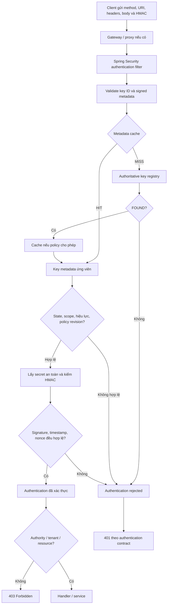
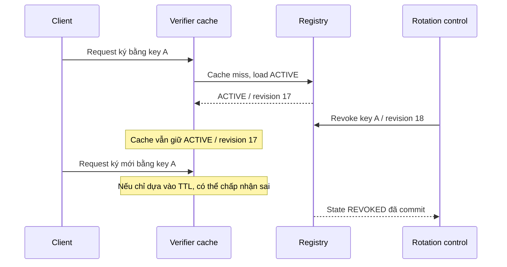

# Cache key metadata: tối ưu HMAC key lookup mà không làm yếu bảo mật

## 1. Bối cảnh và mục tiêu

Module `SECURITY_AUTHENTICATION_HMAC_REQUEST_AUTHENTICATION` hướng dẫn xác thực HTTP request bằng **HMAC với shared secret**. Client và server thống nhất một **canonical request** bao gồm phương thức HTTP, URI/query, các header và/hoặc body theo hợp đồng ký. Server tìm khóa phù hợp, xác minh signature, kiểm tra timestamp/nonce chống replay, quản lý key rotation, xử lý các biến đổi do proxy/gateway và sau cùng mới quyết định quyền truy cập.

Trong quy trình này, key lookup có thể trở thành điểm nghẽn. Nếu mỗi HTTP request đều truy vấn database hoặc secret registry từ xa để lấy metadata của HMAC key, thời gian xác thực tăng theo độ trễ mạng, pool kết nối và tải hệ thống. **Cache key metadata** giúp giảm số lần lookup đắt đỏ, nhưng dữ liệu cache bị cũ cũng có thể khiến một key đã bị thu hồi vẫn được chấp nhận hoặc một key mới được kích hoạt vẫn bị xem là không tồn tại.

Bài thuộc chương **Performance**, với chủ đề trực tiếp **Cache key metadata**. Nội dung tập trung vào **cache metadata quản lý khóa HMAC**, không phải “mã cache key” dùng để khóa một đối tượng bất kỳ. Sau bài học, người học có thể:

1. Phân biệt metadata, secret material, key identifier, authentication result và nonce state.
2. Chọn phạm vi cache, cache key, TTL, negative caching và eviction phù hợp với key rotation.
3. Hiểu chính xác những gì TTL và invalidation **không bảo đảm**, nhất là khi cần emergency revoke.
4. Áp dụng Caffeine/Spring để giảm lookup đồng bộ và thiết kế cache bất đồng bộ cho WebFlux.
5. Tránh cache stampede, rò dữ liệu nhạy cảm, nhầm tenant và mở rộng cardinality vô hạn.
6. Đo hit/miss/latency, kiểm thử race giữa refresh/revoke và xác minh lại 401/403.

> Ví dụ dùng Java 17+, Spring Security 6.x, Spring Boot 3.x và thư viện Caffeine. Giá trị TTL, giới hạn bộ nhớ và khoảng overlap chỉ là **tham số minh họa**, không phải chuẩn bắt buộc cho production. Chính sách độ mới phải xuất phát từ yêu cầu thu hồi key thực tế.

## 2. Key lookup nằm ở đâu trong luồng HMAC?



Một kết quả `metadata cache HIT` chỉ nói rằng resolver tìm được **bản ghi ứng viên**. Nó **không chứng minh**:

- Key hiện còn được phép sử dụng.
- Client thực sự biết shared secret tương ứng.
- Canonical request và chữ ký HMAC hợp lệ.
- Timestamp còn trong cửa sổ cho phép và nonce chưa bị dùng.
- Client có quyền thực hiện thao tác trên endpoint/tenant/resource.

Hệ thống không được tạo `Authentication` chỉ từ `keyId` hoặc từ việc cache trả một bản ghi. Key ID đến từ HTTP header là **input chưa đáng tin**, kể cả khi gateway chuyển tiếp nguyên vẹn.

## 3. Dữ liệu nào được cache, dữ liệu nào không?

### 3.1. Phân loại dữ liệu

| Dữ liệu | Ví dụ | Có nên cache trong key-metadata cache? |
| --- | --- | --- |
| **Opaque key reference** | `key_version_004` | Có, dùng nội bộ; kiểm scope và hạn mức |
| **Client/key family reference** | `client_35a`, `family_b7` | Có, dưới dạng metadata được quản lý |
| **Key lifecycle state** | `ACTIVE`, `RETIRING`, `REVOKED` | Có nhưng **rất nhạy với độ mới** |
| **Thời gian hiệu lực** | `notBefore`, `acceptUntil` | Có, phải kiểm với đồng hồ server cho từng request |
| **Policy/config revision** | `revision=187` | Có, dùng để phát hiện cache lạc hậu |
| **Quyền hoặc scope đã được registry cấp** | `ORDER_READ`, tenant scope | Có thể cache ngắn, nhưng cần invalidation riêng khi quyền đổi |
| **Secret reference tới vault** | Opaque vault identifier | Có thể, với quyền truy cập phù hợp; không log giá trị nhạy cảm |
| **Shared secret plaintext** | HMAC signing bytes | **Không đưa vào metadata cache theo mặc định** |
| **HMAC signature / expected signature** | Hex/base64 MAC | Không; phải tính/kiểm cho từng request |
| **Full canonical request / raw body** | Method + URI + signed data | Không; có thể chứa dữ liệu nhạy cảm |
| **Nonce đã sử dụng** | Nonce của request trước | Không; dùng replay store với atomic check-and-record |
| **SecurityContext/Authentication của request** | Principal đã xác thực | Không; phải xác thực từng HTTP request |

**Điểm mấu chốt:** Key metadata cache và secret-material cache có ranh giới rủi ro khác nhau. Bài này ưu tiên lưu **metadata và reference**, không lưu shared secret. Nếu yêu cầu hiệu năng buộc phải cache secret trong memory, đó là một quyết định bảo mật riêng: giới hạn quyền/process, TTL, mã hóa/kiểm soát hạ tầng, xóa hoặc thay reference khi revoke, core dump/swap/heap dump policy, GC và kiểm thử rò rỉ. Không nhầm `byte[]` có thể bị overwrite với một cơ chế xóa sạch bộ nhớ JVM được bảo đảm.

### 3.2. Vì sao chỉ cache metadata chưa giải quyết toàn bộ latency?

Độ trễ một request HMAC có thể được mô hình hóa:

```text
T_authn =
    T_parse_and_canonicalize
  + T_metadata_lookup
  + T_secret_resolution
  + T_HMAC_and_compare
  + T_timestamp_validation
  + T_nonce_check_and_record
  + T_context_setup
```

Chỉ `T_metadata_lookup` được giảm trực tiếp khi áp dụng metadata cache. Nếu secret vẫn được lấy từ vault từ xa ở **mọi request**, `T_secret_resolution` có thể tiếp tục chi phối latency. Nếu nonce store hoặc HMAC canonicalization mới là bottleneck, tăng cache TTL sẽ không giải quyết được nguyên nhân và còn tăng rủi ro stale key.

### 3.3. Không cache authentication decision

Hai request có thể có cùng `keyId` nhưng method, path, body, signature, timestamp và nonce khác nhau. Vì vậy:

```text
cache[keyId] -> KeyMetadata             // Có thể, nếu policy cho phép
cache[signature] -> "authenticated"     // Không
cache[clientId] -> SecurityContext      // Không
cache[nonce] -> "safe to replay"        // Không
```

Một key metadata `ACTIVE` không miễn kiểm tra HMAC hoặc replay. Caching kết quả `Authentication` theo key ID sẽ phá ý nghĩa “mỗi request phải được ký” và có thể cấp quyền từ request trước cho request khác.

## 4. Mô hình hiệu năng: lợi ích và chi phí của cache

Giả sử một resolver có:

- `L_hit`: thời gian đọc metadata từ local cache.
- `L_miss`: thời gian đọc metadata qua registry, bao gồm network/decode.
- `h`: xác suất cache hit, trong khoảng `[0, 1]`.

Khi không tính biến động concurrency, thời gian lookup trung bình xấp xỉ:

\[
E[T_{\text{lookup}}] \approx h\,L_{\text{hit}} + (1-h)\,L_{\text{miss}}
\]

Ví dụ **chỉ để minh họa**: cache lookup 0,1 ms, registry lookup 20 ms và hit ratio 95% sẽ cho:

\[
0{,}95 \times 0{,}1 + 0{,}05 \times 20 = 1{,}095\ \text{ms}
\]

Đó không phải dự báo cố định cho mọi hệ thống. P95/P99 có thể vẫn tăng mạnh trong những đợt cache miss đồng thời; một lượng nhỏ miss đắt đỏ có thể khiến tail latency, connection pool và timeout trở thành vấn đề lớn. Cần đo cả **logical lookup** (cache + store) lẫn **physical store call**.

Cache còn có chi phí:

| Lợi ích | Chi phí/rủi ro |
| --- | --- |
| Giảm round trip đến key registry | Metadata có thể lạc hậu khi revoke hoặc thay quyền |
| Giảm tải database/vault | Memory footprint và GC pressure |
| Giảm latency xác thực trong giờ cao điểm | Cache stampede sau eviction/TTL hàng loạt |
| Chống quá tải registry khi client traffic tăng | Negative cache có thể từ chối key mới sau activation |
| Tăng tính sẵn sàng khi registry chập chờn trong phạm vi policy | Không được coi cache cũ là bằng chứng key vẫn an toàn |

**Performance là bài toán có ràng buộc bảo mật:** lựa chọn TTL phải cân bằng cache hit ratio với **maximum revocation staleness** mà hệ thống chấp nhận, thay vì chỉ tối ưu throughput.

## 5. Cache key, phân vùng tenant và chống nhập nhằng danh tính

### 5.1. Key ID là một identifier, không phải principal

Client có thể gửi:

```http
X-Hmac-Key-Id: billing-2026-b
X-Hmac-Timestamp: 2026-11-28T03:00:00Z
X-Hmac-Nonce: 4a896d64-1af5-4d9e-a31c-00e46f3bc2cf
X-Hmac-Signature: <base64-signature>
```

Key ID chỉ giúp chọn secret ứng viên; request vẫn có thể do attacker gửi. Resolver phải validate format/độ dài/duplicate header trước khi dùng identifier làm cache key, và **không gắn raw key ID vào metric tags**.

### 5.2. Cache key phải phản ánh namespace có thẩm quyền

Nếu registry bảo đảm `keyId` **duy nhất toàn hệ thống**, cache có thể dùng identifier đã chuẩn hóa. Nếu identifier chỉ duy nhất **trong một tenant**, cache key phải chứa tenant namespace **được xác lập từ ranh giới tin cậy**, ví dụ:

```text
(trusted_tenant_namespace, key_id, protocol_version)
```

Không dùng `X-Tenant-Id` do client tự gửi làm namespace đáng tin rồi mặc định kết quả lookup đó là quyền truy cập tenant. Nếu tenant là input cho lookup, bước xác minh HMAC vẫn phải ràng buộc tenant, client và key owner theo metadata registry/route policy. Không bao giờ cho key của tenant A trở thành key của tenant B do cache collision.

Tránh những lỗi sau:

- Chuyển key ID về lowercase nếu hệ thống định nghĩa ID **case-sensitive**; normalization chỉ được thực hiện theo hợp đồng của registry.
- Xây cache key từ đường dẫn chứa raw query hoặc signature; vừa không ổn định vừa tạo cardinality lớn.
- Ghép nhiều trường bằng dấu phân cách không có escaping, khiến hai bộ giá trị khác nhau có thể cho cùng chuỗi.
- Dùng `HashMap` hoặc singleton mutable field không thread-safe để lưu metadata theo key.
- Ghi toàn bộ cache key vào log khi nó chứa client/tenant ID nhạy cảm.

### 5.3. Giới hạn không gian key do client điều khiển

Một attacker có thể gửi hàng loạt key ID chưa tồn tại để tạo miss và làm quá tải registry/cache. Cần có:

1. Giới hạn số bytes/format của header key ID ngay ở ingress và backend.
2. Giới hạn memory/size và policy eviction cho cache.
3. Rate limit theo nguồn/route đã được xác minh hợp lý ở gateway, không coi IP là danh tính HMAC.
4. Timeout, concurrency limit và circuit breaker cho registry.
5. Theo dõi `not_found`, `cache_miss` và `store_error` với nhãn hữu hạn.

## 6. TTL, độ mới và revocation: điểm khó nhất

### 6.1. TTL giúp giảm stale nhưng không bảo đảm thu hồi tức thời

Giả sử key A được cache với trạng thái `ACTIVE` lúc 10:00:00, có `expireAfterWrite=30s`. Ở authoritative registry, operator revoke key A lúc 10:00:05. Nếu cache local chưa được invalidate, verifier có thể vẫn đọc bản `ACTIVE` cũ tới lúc cache hết hạn.



Vì vậy `expireAfterWrite` **chỉ giới hạn tuổi của bản ghi cache trong điều kiện bình thường**, không tự đồng bộ với thời điểm revoke. Với key compromise nghiêm trọng, 30 giây chấp nhận key bị revoke có thể không đáp ứng chính sách.

### 6.2. Những mức bảo đảm khác nhau

| Cách thiết kế | Tính chất | Hạn chế |
| --- | --- | --- |
| TTL cục bộ ngắn | Đơn giản, giảm số lần registry lookup | Có cửa sổ stale khi revoke; không biết event đã đến mọi node |
| TTL + invalidation event | Phản ứng nhanh hơn khi state đổi | Event mất/trễ và race với lookup đang chạy |
| TTL + revision watermark | Phát hiện metadata cũ hơn revision đã biết | Chỉ tốt nếu watermark có nguồn đáng tin và cập nhật kịp |
| Cache + authoritative revocation check | Thu hồi mạnh hơn nếu kiểm tra đủ mới trên mỗi request | Thêm độ trễ/độ phụ thuộc vào store, cần xử lý outage |
| Cache + đồng bộ có barrier/ack trước khi tuyên bố revoke hiệu lực | Có thể đáp ứng policy nghiêm ngặt khi triển khai đúng | Phức tạp, phải xử lý node không phản hồi, mạng phân vùng, đường bypass |

Không mô tả “cache có invalidation pub/sub” như một **bảo đảm** rằng mọi verifier ngừng chấp nhận key tức thì. Event có thể bị mất, tới không theo thứ tự, hoặc một `load` bắt đầu trước invalidate rồi hoàn thành sau, ghi lại snapshot cũ.

### 6.3. Thiết kế fail-closed khi metadata không đủ mới

Nếu chính sách yêu cầu **revocation freshness bắt buộc**, verifier phải có một điều kiện được xác minh từ nguồn có thẩm quyền hoặc trạng thái đã được đồng bộ đủ mạnh:

```text
candidate metadata found in cache
    |
    v
is metadata revision/freshness acceptable under current policy?
    |---- NO or UNKNOWN ---> refuse authentication / fail closed
    |
   YES
    |
    v
check key state + effective times + client scope
    |
    v
verify HMAC + timestamp + nonce atomically
```

**Không fallback sang “dùng cache cũ để cho qua”** khi hệ thống không xác định được trạng thái revoke mà policy yêu cầu kiểm tra tức thời. Phân biệt lỗi credential (thường 401) với outage của registry/revocation check (thường 5xx theo API contract) để vận hành xử lý đúng, nhưng cả hai đều **không được tạo Authentication**.

### 6.4. Kiểm thời gian hiệu lực ở mỗi request

Ngay cả khi bản ghi metadata còn trong cache, verifier phải so với **đồng hồ server ở request hiện tại**:

- `notBefore`: key chưa đến thời điểm hiệu lực thì chưa được dùng.
- `acceptUntil`: key hết hạn chấp nhận phải bị từ chối, dù cache entry chưa expire.
- `REVOKED`: luôn từ chối, không được “kích hoạt lại” do một cache load cũ.
- `RETIRING`: chỉ có thể chấp nhận trong overlap được xác định rõ.

Không đồng nhất `cache TTL` với thời gian chấp nhận key. TTL là **thời gian lưu bản ghi**, còn lifecycle policy là **quyết định bảo mật** độc lập.

## 7. Rotation và invalidation qua nhiều instance/gateway

### 7.1. Quy trình thay khóa có kiểm soát

Một rotation có thể diễn ra qua các bước:

1. Sinh key version mới, lưu trong vault/secret store; metadata bắt đầu ở `STAGED`.
2. Phân phối secret mới cho client qua kênh riêng an toàn.
3. Đổi state new key thành `ACTIVE` và old key thành `RETIRING` với overlap có thời hạn, commit revision mới.
4. Phát event policy/invalidation **sau khi transaction commit**, hoặc dùng outbox đáng tin.
5. Kiểm tra các verifier node và gateway đã áp dụng revision mới; theo dõi traffic còn dùng key cũ.
6. Đến deadline hoặc khi cần emergency, chuyển old key thành `REVOKED`; invalidation và xác nhận phạm vi hiệu lực theo policy.

Trong overlap, old và new key có thể được chấp nhận theo policy nhưng **mỗi HTTP request vẫn phải được ký và chống replay**. Việc key mới dùng cùng client identity không cho phép bỏ kiểm nonce, không thay thế idempotency cho request ghi dữ liệu.

### 7.2. Cache các trạng thái khác nhau

| Registry transition | Rủi ro của cache cũ | Hành động |
| --- | --- | --- |
| `STAGED` → `ACTIVE` | Cache lưu `STAGED`/negative entry gây 401 giả | Invalidate entry hoặc xác minh revision trước khi từ chối lâu dài |
| `ACTIVE` → `RETIRING` | Cache chưa biết deadline/overlap mới | Invalidate/refetch; kiểm `acceptUntil` trên mỗi request |
| `RETIRING` → `REVOKED` | Cache cũ chấp nhận key đã bị revoke | Cơ chế revocation freshness và fail-closed theo policy |
| Thay client scope/authorities | Cache có quyền cũ | Invalidate scope/permission metadata hoặc tra policy đủ mới |
| Đổi `secretRef`/key version | Nhầm key material nếu dùng cache key không chứa version | Chọn version mới độc lập; xóa snapshot cũ đúng scope |

### 7.3. Race giữa load, invalidate và event out-of-order

Một tình huống khó:

```text
T1: Node bắt đầu load metadata revision=41
T2: Registry commit revoke revision=42
T3: Node nhận invalidate/revision=42
T4: Tác vụ load T1 hoàn thành và ghi revision=41 vào cache
T5: Request mới đọc cache revision=41
```

Chỉ gọi `cache.invalidate(keyId)` tại T3 **chưa đủ**. Để giảm race, có thể dùng policy watermark/revision tăng đơn điệu và kiểm tra loaded revision trước khi dùng/cài lại cache. Với yêu cầu mạnh, những quyết định không đủ fresh phải được chặn thay vì xem revision thấp là hợp lệ.

Một watermark chỉ có ý nghĩa khi **nguồn và độ mới của watermark** đáng tin. Nếu node đã mất kết nối với control plane, nó không thể suy ra chắc chắn “không có revoke mới”. Cần xác định thời gian được phép chạy offline và hành vi fail-closed trong incident.

### 7.4. Multi-region và điểm verify tại gateway

Nếu gateway tự xác minh HMAC, metadata cache có thể nằm **ở cả gateway và backend**. Mỗi nơi có revision, TTL và trust boundary riêng. Một key bị revoke tại backend nhưng gateway còn cache ACTIVE có thể là đường bypass nếu backend tin `X-Verified-Client` do gateway gửi mà không kiểm gateway identity và propagation.

Thiết kế phải xác định **ai là nguồn sự thật của key state**, điểm nào verify signature, và ai chịu trách nhiệm revoke/invalidation. Log/audit nên ghi key rotation ID, revision được áp dụng và trạng thái propagation, không log shared secret hay raw key ID không cần thiết.

## 8. Cache stampede, negative caching và circuit breaker

### 8.1. Cache stampede khi key nóng hết hạn

Một key thường dùng có thể đại diện hàng nghìn request/giây. Nếu 1.000 request cùng phát hiện cache miss và cùng truy registry, một lần TTL expiry có thể gây **thundering herd**.

Cách giảm tải:

- Dùng **single-flight per key**: chỉ một load đang chạy cho một cache key trong một instance, các request khác cùng chờ kết quả.
- Giới hạn concurrency/pool connection đối với registry.
- Áp bounded timeout/retry với jitter; không retry vô hạn.
- Tránh expire đồng loạt bằng phân bố thời điểm refresh/TTL phù hợp.
- Cân nhắc `refreshAfterWrite`/stale-while-revalidate **chỉ khi** chính sách chấp nhận metadata stale; tuyệt đối không dùng như đường bỏ qua revoke.
- Theo dõi physical registry calls, cache load duration và timeouts, không chỉ hit ratio.

Single-flight **cục bộ** không bảo đảm chỉ một load trên toàn cụm. Nếu 100 instance cùng cold-start, registry vẫn có thể chịu 100 loads cho một key; cần công suất, rate limit và startup warmup được thiết kế phù hợp.

### 8.2. Negative caching

Một key ID chưa tồn tại có thể được trả `NOT_FOUND`. Cache ngắn kết quả âm giúp giảm lặp truy vấn khi attacker hoặc client lỗi liên tục gọi cùng ID, nhưng có rủi ro:

1. Key mới được stage/activate sau khi kết quả `NOT_FOUND` đã cache có thể bị từ chối cho tới hết TTL.
2. Attacker tạo vô hạn key IDs khác nhau khiến negative cache bị lấp đầy.
3. Caching key ID sai format thay vì reject trước lookup làm tăng nguy cơ bị khai thác.
4. Nhầm timeout/registry error với not-found rồi cache lỗi như “không tồn tại” có thể che giấu outage.

Chính sách an toàn thường là **không negative-cache lúc đầu**, đo tải `not_found` trước, rồi chỉ bổ sung TTL ngắn, capacity riêng và invalidation khi activation thực sự có nhu cầu. Không cache `ERROR` thành `NOT_FOUND`.

### 8.3. Circuit breaker và fail closed

Khi registry bị outage, circuit breaker có thể ngăn thêm calls gây quá tải. Tuy nhiên:

- Không nên trả một key `ACTIVE` cũ vô thời hạn chỉ vì circuit đang open.
- Nếu metadata freshness bắt buộc và không thể xác định trạng thái hiện tại, từ chối xác thực an toàn, trả 5xx theo policy nếu đó là lỗi dependency.
- Không cho phép request không có signature đi tiếp chỉ vì cache/store lỗi.
- Log reason ở mức đã che dữ liệu và metric `store_unavailable` để phân biệt với credential invalid.

## 9. Ví dụ Java: cache metadata bằng Caffeine

Ví dụ này chỉ cache **metadata**, không chứa shared secret. Một `KeySecretProvider` riêng (không triển khai ở đây) vẫn chịu trách nhiệm cung cấp key material an toàn cho HMAC verifier sau bước policy.

### 9.1. Model metadata bất biến

```java
import java.time.Instant;

enum KeyState {
    STAGED, ACTIVE, RETIRING, REVOKED
}

record HmacKeyMetadata(
    String keyId,
    String principalRef,
    String tenantRef,
    KeyState state,
    Instant notBefore,
    Instant acceptUntil,
    long policyRevision
) {}
```

`record` làm việc truyền snapshot trong JVM rõ ràng hơn nhưng **không tự làm dữ liệu an toàn để log**. Không gọi `log.info("{}", metadata)` trong production; reference của client/tenant vẫn có thể thuộc phạm vi dữ liệu nhạy cảm. Các giá trị phải đến từ registry đáng tin và được validate trước khi đưa vào quyết định bảo mật.

### 9.2. Cache bounded, TTL ngắn và không cache lỗi

```java
import com.github.benmanes.caffeine.cache.Cache;
import com.github.benmanes.caffeine.cache.Caffeine;
import java.time.Duration;
import java.util.Optional;
import java.util.regex.Pattern;
import org.springframework.security.authentication.BadCredentialsException;

interface HmacKeyMetadataRepository {
    Optional<HmacKeyMetadata> findById(String candidateKeyId);
}

public final class CachedKeyMetadataResolver {
    private static final Pattern KEY_ID =
        Pattern.compile("[A-Za-z0-9._-]{1,80}");

    private final HmacKeyMetadataRepository repository;
    private final Cache<String, HmacKeyMetadata> cache;

    public CachedKeyMetadataResolver(
        HmacKeyMetadataRepository repository
    ) {
        this.repository = repository;
        this.cache = Caffeine.newBuilder()
            .maximumSize(10_000)
            .expireAfterWrite(Duration.ofSeconds(15))
            .recordStats()
            .build();
    }

    public HmacKeyMetadata resolve(String candidateKeyId) {
        if (candidateKeyId == null ||
            !KEY_ID.matcher(candidateKeyId).matches()) {
            throw new BadCredentialsException(
                "Invalid HMAC credentials"
            );
        }

        HmacKeyMetadata metadata = cache.get(
            candidateKeyId,
            id -> repository.findById(id).orElse(null)
        );

        if (metadata == null) {
            throw new BadCredentialsException(
                "Invalid HMAC credentials"
            );
        }
        return metadata;
    }

    public void invalidateKey(String keyId) {
        cache.invalidate(keyId);
    }

    Cache<String, HmacKeyMetadata> cacheForMetrics() {
        return cache;
    }
}
```

Ở đây:

- `maximumSize` giới hạn số entry, không phải tổng heap bytes chính xác.
- `expireAfterWrite` đặt tuổi cache theo thời điểm load/write, không theo timestamp HMAC của client.
- `recordStats` phục vụ hit/miss/eviction statistics với chi phí quan sát cần được đo.
- `cache.get(key, mappingFunction)` có khả năng phối hợp concurrent loads cho cùng cache key trong **một cache instance**, giúp giảm stampede cục bộ.
- Khi repository trả `Optional.empty()`, mapping function trả `null`; trong ví dụ này **không giữ negative entry**.
- Nếu repository ném exception, code không đổi exception thành `null`/not-found; caller phải phân loại dependency failure và fail closed.

**Giới hạn bảo mật của snippet:** Resolver chỉ cho một **metadata candidate snapshot**. Nó **chưa bảo đảm revocation freshness**. Khi triển khai phải có cơ chế kiểm state, effective time, policy revision/invalidation đủ mạnh theo yêu cầu thu hồi; không coi `invalidateKey` đơn lẻ là đủ chống race hoặc mất event.

### 9.3. Kiểm state và deadline trên mọi request

Ví dụ helper kiểm các điều kiện thời gian **sau khi đã xác định snapshot đủ mới**:

```java
import java.time.Clock;
import java.time.Instant;

final class HmacKeyLifecyclePolicy {
    private final Clock clock;

    HmacKeyLifecyclePolicy(Clock clock) {
        this.clock = clock;
    }

    boolean canUse(HmacKeyMetadata metadata) {
        Instant now = clock.instant();

        if (metadata.notBefore() != null &&
            now.isBefore(metadata.notBefore())) {
            return false;
        }
        if (metadata.state() == KeyState.REVOKED ||
            metadata.state() == KeyState.STAGED) {
            return false;
        }
        if (metadata.state() == KeyState.RETIRING) {
            return metadata.acceptUntil() != null &&
                now.isBefore(metadata.acceptUntil());
        }
        return metadata.state() == KeyState.ACTIVE &&
            (metadata.acceptUntil() == null ||
             now.isBefore(metadata.acceptUntil()));
    }
}
```

Điểm này tách **điều kiện time/state** khỏi **tính mới của snapshot**. Nếu metadata `ACTIVE` đang cache nhưng authoritative registry đã revoke, helper vẫn có thể trả `true`. Vì vậy phải kiểm **freshness/revocation policy trước khi tin state**. Không dùng helper như cơ chế bảo vệ hoàn chỉnh trong môi trường yêu cầu revoke tức thời.

Một verifier có thể thực hiện theo thứ tự:

```text
1. Match route/method cần HMAC.
2. Parse và validate signed metadata, key ID, signature format.
3. Resolve HmacKeyMetadata candidate (cache hoặc registry).
4. Đảm bảo metadata revision/freshness đạt yêu cầu bảo mật.
5. Kiểm lifecycle, time window, key owner/tenant/scope.
6. Resolve secret an toàn; dựng canonical request và kiểm HMAC.
7. Kiểm timestamp và atomic check-and-record nonce.
8. Xây Authentication từ registry-side principal/authorities.
9. Authorization kiểm quyền route và resource/tenant.
```

Một số hệ thống chọn kiểm signature trước freshness hoặc timestamp trước lookup để giảm chi phí tấn công; thứ tự có thể khác theo threat model. Nhưng **không bước nào được bỏ qua**, và không công khai chi tiết key tồn tại hay đã revoke trong response khi điều đó có thể giúp enumeration.

## 10. WebFlux: cache async, không block event loop

Trong Spring WebFlux, key lookup thực hiện trong `WebFilter`/`ReactiveAuthenticationManager` nên phải **compose** publisher với request pipeline. Không dùng `.block()` trên Netty event loop và không gọi `.subscribe()` độc lập để điền cache rồi cho request đi tiếp.

### 10.1. Dùng AsyncCache cho repository bất đồng bộ

Nếu key registry có Java `CompletableFuture` API, Caffeine hỗ trợ `AsyncCache`:

```java
import com.github.benmanes.caffeine.cache.AsyncCache;
import com.github.benmanes.caffeine.cache.Caffeine;
import java.time.Duration;
import java.util.concurrent.CompletableFuture;
import org.springframework.security.authentication.BadCredentialsException;
import reactor.core.publisher.Mono;

interface AsyncHmacKeyRegistry {
    // null biểu thị not found, exception biểu thị dependency error.
    CompletableFuture<HmacKeyMetadata> findById(String keyId);
}

public final class ReactiveCachedKeyMetadataResolver {
    private final AsyncHmacKeyRegistry registry;
    private final AsyncCache<String, HmacKeyMetadata> cache;

    ReactiveCachedKeyMetadataResolver(AsyncHmacKeyRegistry registry) {
        this.registry = registry;
        this.cache = Caffeine.newBuilder()
            .maximumSize(10_000)
            .expireAfterWrite(Duration.ofSeconds(15))
            .buildAsync();
    }

    Mono<HmacKeyMetadata> resolve(String candidateKeyId) {
        // Phải validate candidateKeyId bằng cùng format/length policy
        // trước khi gọi method này.
        return Mono.defer(() -> Mono.fromFuture(
            cache.get(candidateKeyId,
                (keyId, executor) -> registry.findById(keyId))
        )).switchIfEmpty(Mono.error(
            new BadCredentialsException("Invalid HMAC credentials")
        ));
    }
}
```

Ví dụ chỉ minh họa **cache async theo key**; không xử lý vòng đời, phân quyền hay cách body được ký. `AsyncCache` có thể chia sẻ in-flight load cho cùng key trên một instance, giúp giảm số calls. Với `null` result, Caffeine không giữ một positive entry; lỗi future không được biến thành “key không tồn tại”.

**Lưu ý cancellation:** Khi nhiều subscriber dùng chung một `CompletableFuture` từ async cache, hành vi cancellation của adapter Reactor có thể tác động future chung tùy phiên bản/operator. Cần dùng cách bọc future/adapter có chính sách **không hủy shared load vì một request disconnect** và kiểm thử điều đó; nếu dùng phiên bản Reactor hỗ trợ, cân nhắc overload `Mono.fromFuture(future, true)` để suppress cancellation tới future. Không để một client cancel làm hỏng lookup đang được các request hợp lệ khác chờ.

Nếu registry có sẵn `Mono<HmacKeyMetadata>` thay vì Future, không chuyển nó thành blocking API. Thiết kế một adapter bất đồng bộ hoặc per-key coalescing bằng các primitive phù hợp với framework, kiểm soát cancel/retry và eviction rõ ràng.

### 10.2. Reactor Context không được cache theo key

Sau khi xác minh HMAC thành công, Spring Security WebFlux đặt danh tính vào Reactor Context:

```java
return chain.filter(exchange)
    .contextWrite(
        ReactiveSecurityContextHolder.withAuthentication(authentication)
    );
```

Đây là scope của **request subscription hiện tại**, không phải một dữ liệu cache theo key ID. Hai request dùng cùng HMAC key vẫn cần signature/timestamp/nonce riêng. Không lưu `Authentication` hay `SecurityContext` trong `AsyncCache` để tái sử dụng giữa nhiều request.

## 11. Giám sát cache: metric và log nào hữu ích?

### 11.1. Định nghĩa những phép đo khác nhau

| Metric | Ý nghĩa | Lưu ý |
| --- | --- | --- |
| `hmac_key_metadata_cache_hit_total` | Cache trả metadata ứng viên | Chưa chứng minh key được phép dùng |
| `hmac_key_metadata_cache_miss_total` | Không có entry hợp lệ trong local cache | Có thể dẫn tới registry call |
| `hmac_key_metadata_cache_eviction_total` | Eviction bởi size/TTL/policy | Không đồng nghĩa revoke |
| `hmac_key_metadata_cache_load_duration_seconds` | Thời gian load từ registry cho miss | Đo riêng physical store latency |
| `hmac_key_registry_errors_total` | Lỗi registry/vault | Không trộn với not-found |
| `hmac_key_policy_revision_applied` | Revision policy node đang dùng | Theo dõi stale nodes/gateway |
| `hmac_key_policy_refresh_age_seconds` | Thời gian kể từ lần policy refresh thành công | Giúp alert mất đồng bộ |
| `hmac_key_state_rejections_total` | Từ chối `revoked/expired/not_active` | Phát hiện client key cũ, không nói lỗi cache |
| `hmac_authentication_total` | Signature/timestamp/nonce thành công hoặc thất bại | Phân biệt với cache hit |
| `hmac_authorization_denied_total` | HMAC đã xác thực nhưng thiếu quyền | Thường liên quan 403, không phải lookup error |

Micrometer có binder cho Caffeine:

```java
import io.micrometer.core.instrument.MeterRegistry;
import io.micrometer.core.instrument.binder.cache.CaffeineCacheMetrics;

// Gọi sau khi tạo cache và bật recordStats().
CaffeineCacheMetrics.monitor(
    meterRegistry,
    cachedResolver.cacheForMetrics(),
    "hmac_key_metadata"
);
```

Đoạn này là fragment trong nơi có `meterRegistry` và `cachedResolver` đã khởi tạo. Tên series Prometheus thực sự phụ thuộc Micrometer exporter, version và cấu hình. Không mặc định một bộ counter có nhãn `keyId` xuất hiện hoặc cần thiết.

### 11.2. Tỷ lệ cache hit và lookup error

Tỷ lệ hit định nghĩa theo window:

\[
\text{hit ratio} =
\frac{\text{cache hits}}{\text{cache hits} + \text{cache misses}}
\]

Nếu hệ thống có negative cache hoặc nhiều tầng L1/L2, cần xác định có tính negative hit và mỗi tier riêng hay không. Một “hit ratio 99%” có thể vẫn che lỗi **old key được accept sau revoke**.

Khi có Prometheus metrics `hmac_key_lookup_attempts_total` do ứng dụng định nghĩa, có thể xem error ratio:

```promql
sum(rate(hmac_key_lookup_attempts_total{outcome="error"}[5m]))
/
clamp_min(
  sum(rate(hmac_key_lookup_attempts_total[5m])),
  0.000001
)
```

Đây là **lỗi lookup hạ tầng**, không phải authentication failure ratio; `not_found`, `signature_invalid` và `nonce_replay` cần metric riêng. Truy vấn phải được điều chỉnh theo metric names thực và các nhãn `stage` khi ứng dụng đo cả logical và physical lookups.

### 11.3. Không tạo cardinality vô hạn hoặc làm lộ secret

Các nhãn an toàn thường có thể là `cache_tier=L1`, `outcome=hit/miss/error`, `region` cố định và `policy_state` thuộc enum. Tránh nhãn:

```text
keyId, clientId chưa xác thực, tenantId tùy ý, nonce,
signature, bodyDigest, rawUri, requestId, exceptionMessage
```

Ngay cả khi hash key ID, cardinality vẫn có thể tăng theo số key khác nhau mà attacker gửi. Hãy dùng audit log có kiểm soát/opaque reference khi cần truy tìm key cụ thể; metrics dành cho thống kê tổng hợp có nhãn hữu hạn.

## 12. Kiểm thử cache: đúng hiệu năng và không bỏ qua revoke

### 12.1. Ma trận kiểm thử

| Tình huống | Cache/lookup mong đợi | Bảo mật mong đợi |
| --- | --- | --- |
| Key `ACTIVE` lần đầu, metadata hợp lệ | MISS → registry load | Vẫn kiểm HMAC + timestamp + nonce |
| Cùng key, request mới hợp lệ | HIT | Không tái sử dụng Authentication của request trước |
| Key ID không tồn tại | MISS → not-found; không positive cache | 401 theo contract, không tiết lộ key tồn tại |
| Key ID dài/bất thường/duplicate header | Từ chối trước lookup | Không tạo cache entry hoặc metric tag theo input |
| Registry timeout | Lookup error, không lưu như not-found | Fail closed; 5xx theo policy |
| Key `STAGED` còn trong cache nhưng vừa ACTIVE | Invalidation/refetch hoặc freshness barrier | Chấp nhận key mới đúng thời điểm policy cho phép |
| Key `ACTIVE` trong cache nhưng registry đã REVOKED | Snapshot stale phải bị phát hiện theo guarantee đã chọn | Không xác thực bằng key bị thu hồi ngoài freshness budget |
| Key `RETIRING` quá `acceptUntil` | Cache có thể HIT | Vẫn từ chối theo đồng hồ hiện tại |
| Thay authorities/client scope | Refetch/invalidation theo policy | Không giữ quyền cũ sau thời hạn cho phép |
| Hai tenant có cùng local key ID | Namespace/cache key không collision | Tenant A không dùng nhầm metadata tenant B |
| Nhiều request cùng miss một hot key | Coalesce per-key, store calls được giới hạn | Không fallback cho qua vì quá tải |
| Một nghìn key ID không tồn tại khác nhau | Bounded cache, cardinality hữu hạn | Không gây memory/metrics DoS |
| Load cũ hoàn thành sau revoke event | Revision guard phát hiện snapshot cũ | Không “hồi sinh” key đã bị revoke |
| Gateway verify và backend verify cùng key | Policy revision được quan sát ở cả hai | Không còn một hop dùng key cũ ngoài policy |
| Request HMAC đúng nhưng thiếu authority | Metadata HIT/FOUND | 403 sau authorization, không coi cache lỗi |
| WebFlux request bị cancel khi shared async load | Shared load khác không bị hỏng | Không làm ảnh hưởng request đồng thời |

### 12.2. Test TTL không dùng sleep

Caffeine cho phép custom `Ticker` để điều khiển đồng hồ TTL trong test. Ví dụ:

```java
import com.github.benmanes.caffeine.cache.Cache;
import com.github.benmanes.caffeine.cache.Caffeine;
import java.time.Duration;
import java.util.concurrent.TimeUnit;
import java.util.concurrent.atomic.AtomicLong;

AtomicLong elapsedNanos = new AtomicLong();

Cache<String, String> cache = Caffeine.newBuilder()
    .ticker(elapsedNanos::get)
    .expireAfterWrite(Duration.ofSeconds(5))
    .build();

cache.put("key-version-a", "metadata-revision-1");
assertThat(cache.getIfPresent("key-version-a"))
    .isEqualTo("metadata-revision-1");

elapsedNanos.addAndGet(TimeUnit.SECONDS.toNanos(6));
assertThat(cache.getIfPresent("key-version-a"))
    .isNull();
```

Đoạn trên là fragment trong một test class dùng AssertJ. Nó chỉ chứng minh **TTL eviction semantics**, không chứng minh toàn bộ cơ chế revoke. Muốn kiểm `notBefore`/`acceptUntil`, dùng `Clock.fixed`/clock điều khiển riêng cho lifecycle policy; đừng dùng cache ticker thay cho thời gian thực của key.

### 12.3. Kiểm thử race và key revocation

Để tái hiện race có chủ đích:

1. Registry trả revision 10 và giữ một async load chưa hoàn thành.
2. Control plane commit revoke revision 11.
3. Node nhận invalidation/revision watermark 11.
4. Cho async load cũ revision 10 hoàn thành sau event.
5. Gửi request HMAC mới và xác minh policy **không chấp nhận** snapshot revision 10 theo guarantee.

Nếu chỉ gọi `cache.invalidate(...)` mà test vẫn cho request bằng key cũ thành công, thiết kế chưa đáp ứng yêu cầu revocation freshness. Cần sửa policy/revision gate, chứ không chỉ giảm TTL để che race trong test.

### 12.4. Load test và latency

Một bài benchmark hữu ích phải giữ cân bằng những biến:

- Cùng phân bố key IDs và số request/giây giữa các cấu hình.
- Tỷ lệ cache hit/miss/negative-hit và tỉ lệ lỗi registry.
- Kích thước metadata, concurrency, số instance và giới hạn memory.
- Separate latency của metadata cache, secret provider, HMAC CPU và nonce store.
- Thời điểm rotate/revoke và cách event propagation diễn ra.
- P50/P95/P99 của authentication pipeline, HTTP error ratio và throughput.

Không coi “tăng throughput” là thành công nếu test phát hiện key `REVOKED` vẫn được chấp nhận. Hiệu năng chỉ hợp lệ khi **các invariant bảo mật giữ nguyên**.

## 13. Checklist triển khai Cache key metadata

1. **Chọn dữ liệu cache:** chỉ metadata/reference được phép; tách secret material, nonce store và per-request Authentication.
2. **Định nghĩa cache key đúng scope:** key ID unique hay tenant-scoped, protocol version, không tin tenant/client header trước xác thực.
3. **Validate input trước lookup:** giới hạn độ dài/format/duplicate header, không dùng raw input làm metric label.
4. **Thiết lập capacity và TTL:** có maximum size, đo memory/GC và cache hit/miss; TTL không phải thời hạn key.
5. **Chốt revocation freshness guarantee:** TTL-only hay cần invalidation/revision/barrier/authoritative check; fail closed khi không đủ độ mới theo policy.
6. **Kiểm lifecycle mỗi request:** `STAGED`, `ACTIVE`, `RETIRING`, `REVOKED`, `notBefore` và `acceptUntil` từ dữ liệu tin cậy.
7. **Thiết kế rotation và invalidate an toàn:** commit state, phát event đáng tin, theo dõi revision trên mọi verifier/gateway và xử lý race load-after-invalidate.
8. **Giảm stampede:** single-flight per key, registry concurrency limit, timeout/backoff và kiểm cold-start toàn cụm.
9. **Cân nhắc negative caching:** không cache lỗi hạ tầng thành not-found; giới hạn TTL/capacity và làm mới khi activation.
10. **Giữ xác thực theo từng request:** vẫn kiểm canonical request/HMAC, timestamp/nonce nguyên tử, key owner/scope và authorization 401/403 rõ ràng.
11. **Instrument vừa đủ:** cache metrics, store latency, revocation propagation, authn/authz outcomes; không log hoặc export secret/keyId/nonce/signature.
12. **Kiểm thử security và performance cùng nhau:** TTL, stale snapshot, revoke tức thời theo policy, concurrency, WebFlux cancellation, gateway rewrite và load test.

**Điểm cần nhớ:** **Cache key metadata** tối ưu một bước của xác thực HMAC: tìm **metadata ứng viên** của shared-secret key. Cache hit không phải bằng chứng request đã xác thực; TTL không phải bảo đảm thu hồi key; còn secret, timestamp/nonce và quyền của client vẫn phải được kiểm tra theo từng request. Một thiết kế tốt cải thiện latency nhưng vẫn giới hạn dữ liệu nhạy cảm, giữ độ mới của key policy trong mức được phép và **từ chối an toàn** khi không thể xác nhận trạng thái key.
