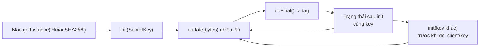

# Reuse Mac an toàn trong xác thực HTTP request bằng HMAC

## 1. Bài toán: tối ưu HMAC mà không phá ranh giới bảo mật

Trong module `SECURITY_AUTHENTICATION_HMAC_REQUEST_AUTHENTICATION`, một hệ thống nhận HTTP request được ký bằng HMAC và **shared secret**. Client và server phải dùng cùng một hợp đồng **canonical request**, thường bao gồm method, URI/query, những header được chọn và body hoặc body digest. Server xác minh MAC, timestamp/nonce chống replay, key ID và trạng thái key khi rotation, rồi mới xác lập danh tính client để phân quyền.

Khi lưu lượng cao, nhóm phát triển thường hỏi: **Có nên tạo một `javax.crypto.Mac` mới cho từng request, hay tái sử dụng object để giảm allocation và chi phí khởi tạo?** Câu hỏi tưởng như thuần hiệu năng nhưng chạm trực tiếp tới bí mật HMAC: `Mac` là object **có trạng thái**, nắm giữ key đã khởi tạo và dữ liệu đang được `update`. Tái sử dụng sai có thể trộn dữ liệu hai request, dùng nhầm secret của client khác hoặc tiếp tục chấp nhận key đã bị thu hồi.

Bài thuộc chương **Performance**, chủ đề trực tiếp **Reuse Mac an toàn**. Người học sẽ:

- Hiểu vòng đời `Mac.getInstance` → `init` → `update` → `doFinal`/`reset`.
- Phân biệt **reuse trong phạm vi một request/owner** với chia sẻ `Mac` giữa những request đồng thời.
- Đánh giá `ThreadLocal<Mac>`, object pool và `Mac.clone()` theo cả hiệu năng lẫn key lifecycle.
- Viết Java verifier khởi tạo đúng key theo key ID, so MAC an toàn, không bỏ qua nonce/authorization.
- Tổ chức benchmark và stress test để chứng minh tối ưu hóa thực sự có ích và không làm lẫn chữ ký.

**Kết luận áp dụng trước:** trong đa số hệ thống HMAC request authentication, cách mặc định an toàn, rõ ràng nhất là **mỗi phép xác minh tạo một `Mac` riêng, `init` bằng key đã được registry chấp nhận, sử dụng rồi bỏ object**. Chỉ cân nhắc reuse phức tạp khi đo đạc xác nhận đây là điểm nghẽn đáng kể.

## 2. `javax.crypto.Mac` là một state machine

API Java Cryptography Architecture (JCA/JCE) cung cấp `javax.crypto.Mac` để tạo Message Authentication Code như `HmacSHA256`. Một vòng đời thông dụng:



Các phương thức quan trọng:

| Thao tác | Tác dụng | Điều cần lưu ý |
| --- | --- | --- |
| `Mac.getInstance("HmacSHA256")` | Lấy object từ crypto provider hỗ trợ thuật toán | Có chi phí tra provider/tạo instance; chưa chọn secret |
| `mac.init(key)` | Khởi tạo lại bằng secret key | Phải thực hiện với **đúng key đang có hiệu lực** |
| `mac.update(bytes)` | Bổ sung bytes vào phép MAC đang tính | Tích lũy trạng thái; hai request không được xen kẽ |
| `mac.doFinal()` | Tính MAC từ bytes đã đưa vào | Sau khi hoàn thành, object được reset về trạng thái **sau lần init gần nhất**, còn key |
| `mac.reset()` | Đưa phép tính về trạng thái sau lần init gần nhất | **Không xóa key** và không chọn key mới |
| `mac.getMacLength()` | Độ dài output MAC theo implementation | Dùng cùng hợp đồng signature encoding/length |
| `mac.clone()` | Sao chép object nếu provider hỗ trợ clone | Có thể ném `CloneNotSupportedException`; cần xem rủi ro sao chép trạng thái/key |

**Hai sự thật dễ nhầm:**

1. `doFinal()` hoặc `reset()` **không hủy bí mật**. Chúng cho phép dùng lại trạng thái đã khởi tạo với **cùng key**; object hoặc provider vẫn có thể giữ key material.
2. `Mac` **không được API bảo đảm thread-safe**. Không được xem một instance mutable là shared service để các thread `update` và `doFinal` đồng thời.

Không có gì trong mô hình HMAC bắt buộc server phải giữ nguyên một object `Mac` xuyên các HTTP requests. Phép tính HMAC là thuật toán; `Mac` chỉ là một implementation có trạng thái của thuật toán đó.

## 3. Hệ quả khi dùng một `Mac` chung cho nhiều request

Ví dụ phản diện: một Spring singleton có trường `Mac` mutable:

```java
// SAI: shared Mac là mutable state dùng đồng thời bởi nhiều request.
@Component
final class UnsafeHmacService {
    private final Mac mac;

    UnsafeHmacService() throws GeneralSecurityException {
        this.mac = Mac.getInstance("HmacSHA256");
    }

    byte[] compute(SecretKey key, byte[] canonicalBytes)
            throws GeneralSecurityException {
        mac.init(key);
        mac.update(canonicalBytes);
        return mac.doFinal();
    }
}
```

Giả sử thread A cần xác minh request của `partner-a` dùng secret A, còn thread B cần xác minh request của `partner-b` dùng secret B. Trình tự có thể xen kẽ:

```text
Thread A: mac.init(keyA)
Thread A: mac.update(firstHalfOfRequestA)
Thread B: mac.init(keyB)               <-- thay trạng thái/key đang dùng
Thread B: mac.update(requestB)
Thread A: mac.update(secondHalfOfRequestA)
Thread A: mac.doFinal()                <-- không còn là HMAC của request A
```

Không được dựa vào một thứ tự thực thi tình cờ hay hy vọng provider tự bảo vệ instance. Kết quả có thể sai, ném exception hoặc phụ thuộc vào race condition. Ngay cả khi tất cả client dùng cùng một secret, các lần `update` vẫn có thể trộn dữ liệu.

### 3.1. Có nên bọc `synchronized` quanh object?

```java
synchronized (mac) {
    mac.init(key);
    mac.update(canonicalBytes);
    return mac.doFinal();
}
```

Đoạn này có thể loại bỏ race **nếu mọi** đường truy cập vào cùng object đều tuân thủ cùng lock và key được chọn đúng. Nhưng nó **tuần tự hóa toàn bộ xác minh**, làm giảm concurrency, đưa nhiều client/key vào cùng một trạng thái nhạy cảm và dễ bị sửa sai khi code lớn lên. Nó không giải quyết vòng đời secret khi key rotation hoặc việc dùng key đã bị thu hồi do cache.

Do đó, `synchronized` không nên được coi là chiến lược tối ưu hiệu năng mặc định. Một `Mac` cục bộ cho mỗi lần tính thường đơn giản hơn và tránh tranh chấp khóa.

## 4. Cách mặc định an toàn: tạo `Mac` cục bộ cho từng phép tính

Một bộ tính HMAC tối giản:

```java
import javax.crypto.Mac;
import javax.crypto.spec.SecretKeySpec;
import java.security.GeneralSecurityException;

public final class HmacSha256 {
    private HmacSha256() {}

    public static byte[] compute(
            byte[] secretCopy, byte[] canonicalBytes)
            throws GeneralSecurityException {

        Mac mac = Mac.getInstance("HmacSHA256");
        mac.init(new SecretKeySpec(secretCopy, "HmacSHA256"));
        return mac.doFinal(canonicalBytes);
    }
}
```

`secretCopy` trong ví dụ là secret lấy **sau khi** server xác định key hợp lệ qua registry; key ID từ request chỉ là input chưa đáng tin để lookup. API này không tự kiểm tra key revocation, timestamp, nonce hay quyền.

Để quản lý secret ở phạm vi code gọi:

```java
byte[] secretCopy = activeKey.materialCopy();
try {
    byte[] expectedMac =
            HmacSha256.compute(secretCopy, canonicalBytes);
    // So sánh expectedMac với MAC đã decode từ request.
} finally {
    java.util.Arrays.fill(secretCopy, (byte) 0);
}
```

Trong đó `activeKey.materialCopy()` là API giả định của kho key phía server, trả bản sao byte array; không phải API của Spring. Xóa bản sao bằng `Arrays.fill` là một biện pháp giảm lưu dữ liệu nhạy cảm trong vùng nhớ do ứng dụng quản lý, **không bảo đảm** JVM/provider đã xóa mọi bản sao secret trong `SecretKeySpec` hoặc trạng thái `Mac`. Object `Mac` kết thúc vòng đời tự nhiên sau khi tính; đừng giữ trong trường của singleton.

### Vì sao cách này thường đủ nhanh?

HMAC-SHA-256 trên canonical request nhỏ thường không phải nguồn latency lớn nhất. Với xác thực HTTP thực tế, chi phí tra secret, nonce store nguyên tử, parse/copy body, authorization, network I/O và gateway có thể đáng kể hơn. Cần **đo** thay vì giả định object allocation là bottleneck.

Chi phí `Mac.getInstance`/`init` thay đổi theo provider, JDK, CPU và cách quản lý key. Tránh tuyên bố “reuse chắc chắn nhanh hơn N lần” nếu chưa có benchmark và profiling trên môi trường tương đương production.

## 5. Reuse an toàn trong **một** phép tính HMAC bằng `update`

Reuse hữu ích nhất là **dùng một instance cho nhiều phần bytes thuộc cùng một canonical request**, thay vì tạo MAC mới cho mỗi field. Điều này vẫn không chia sẻ state giữa các HTTP requests.

Giả sử hợp đồng ký ví dụ định nghĩa chính xác sáu dòng UTF-8, nối bằng LF, không có newline ở cuối:

```text
UPPERCASE_METHOD
RAW_PATH_AND_QUERY
KEY_ID
TIMESTAMP_ISO_8601
NONCE
LOWERCASE_HEX_SHA256_OF_BODY_BYTES
```

Các trường có nghĩa:

- Method là cách biểu diễn uppercase theo contract.
- `RAW_PATH_AND_QUERY` được lấy tại **trust boundary** đã thỏa thuận; không tự sắp xếp query hay decode/encode lại khi contract không cho phép.
- Key ID, timestamp và nonce nằm **trong dữ liệu được ký**.
- Body hash lấy từ **body bytes đã định nghĩa**, không phải object JSON đã serialize tùy ý.
- Nếu có header nghiệp vụ quan trọng khác như `Content-Type` hoặc tenant routing, hợp đồng ký phải mở rộng có version để bảo vệ chúng.

Mẫu Java sau chia các dòng canonical thành nhiều lần `update` trên **cùng instance cục bộ**:

```java
import java.nio.charset.StandardCharsets;
import java.security.GeneralSecurityException;
import java.util.HexFormat;
import javax.crypto.Mac;
import javax.crypto.spec.SecretKeySpec;

public final class StreamingCanonicalHmac {
    private StreamingCanonicalHmac() {}

    public record CanonicalParts(
            String method,
            String rawPathAndQuery,
            String keyId,
            String timestamp,
            String nonce,
            byte[] bodySha256
    ) {
        public CanonicalParts {
            bodySha256 = bodySha256.clone();
            if (bodySha256.length != 32) {
                throw new IllegalArgumentException("SHA-256 length");
            }
        }

        @Override
        public byte[] bodySha256() {
            return bodySha256.clone();
        }
    }

    public static byte[] compute(
            byte[] secretCopy, CanonicalParts p)
            throws GeneralSecurityException {

        Mac mac = Mac.getInstance("HmacSHA256");
        mac.init(new SecretKeySpec(secretCopy, "HmacSHA256"));

        String[] fields = {
                p.method(),
                p.rawPathAndQuery(),
                p.keyId(),
                p.timestamp(),
                p.nonce(),
                HexFormat.of().formatHex(p.bodySha256())
        };

        for (int index = 0; index < fields.length; index++) {
            if (index != 0) {
                mac.update((byte) '\n'); // LF, không thêm LF cuối
            }
            mac.update(fields[index].getBytes(StandardCharsets.UTF_8));
        }
        return mac.doFinal();
    }
}
```

Đây là **hợp đồng minh họa**, không phải chuẩn HMAC phổ quát. Để tránh canonical ambiguity, parser phải validate field format, ký tự xuống dòng không được phép trong những trường này, percent-encoding, query parameters trùng và giới hạn kích thước. Nếu header được ký có nhiều giá trị, phải quy định canonicalization chính xác.

Lợi ích chính của `update` là không phải ghép một chuỗi canonical dài rồi tạo thêm một mảng byte lớn. Tuy nhiên, trường hợp canonical chỉ vài dòng ngắn có thể không tạo khác biệt đáng kể. Đừng bỏ hash body hoặc thay nội dung được ký chỉ để tiết kiệm allocation.

## 6. Hash body theo luồng trước khi ký canonical request

Khi hợp đồng dùng `SHA-256(rawBodyBytes)` thay vì đưa toàn body vào chuỗi HMAC, có thể hash body theo từng chunk để tiết kiệm bộ nhớ tại phần tính digest:

```java
import java.security.MessageDigest;
import java.security.NoSuchAlgorithmException;

static byte[] sha256FromChunks(
        Iterable<byte[]> chunks) throws NoSuchAlgorithmException {

    MessageDigest digest = MessageDigest.getInstance("SHA-256");
    for (byte[] chunk : chunks) {
        digest.update(chunk);
    }
    return digest.digest();
}
```

Trong ứng dụng thật, dữ liệu thường đến từ Servlet `InputStream` hoặc WebFlux `Flux<DataBuffer>`, không phải `Iterable<byte[]>` như ví dụ. Hai việc cần phân biệt:

1. **Tính digest theo luồng:** cho phép xử lý một chuỗi chunk mà không phải ghép tất cả chunk thành một mảng lớn chỉ để hash.
2. **Đưa body tới controller:** nếu filter đã tiêu thụ stream mà controller còn cần đọc body, phải thiết kế buffering/replay có giới hạn, hoặc hợp đồng streaming có cách chuyển nội dung tới handler an toàn.

`ContentCachingRequestWrapper` trong Spring MVC không tự bảo đảm replay stream sau khi filter đã đọc hết body. Với WebFlux, `DataBuffer` có vòng đời release và backpressure; không `block()`/`subscribe()` tùy tiện để đọc body. Đừng dùng `DataBufferUtils.join` không giới hạn cho upload lớn.

**Ranh giới performance/security:** chỉ hash đúng các bytes thực tế được hợp đồng bảo vệ. Proxy/gateway có thể rewrite path, headers, `Content-Encoding` hoặc chuyển HTTP/1.1 chunked sang HTTP/2 DATA frames; ký raw transfer framing không phải thiết kế bền vững qua các hop.

## 7. `doFinal`/`reset`: reuse có điều kiện nhưng vẫn giữ key

Sau khi `mac.init(key)`, bạn có thể tính nhiều MAC **độc lập** trên cùng key trong một phạm vi single-thread/single-owner được kiểm soát:

```java
Mac mac = Mac.getInstance("HmacSHA256");
mac.init(new SecretKeySpec(batchKey, "HmacSHA256"));

byte[] tagFirst = mac.doFinal(firstMessage);
// doFinal() đưa Mac về trạng thái sau init, còn batchKey.
byte[] tagSecond = mac.doFinal(secondMessage);
```

Hai `doFinal` tạo hai MAC riêng, không nối message nếu provider tuân thủ contract. Có thể dùng cách này cho **một batch cố định thuộc cùng miền tin cậy và cùng key version**, trong một thread, khi thời gian sống của batch được giới hạn rõ.

**Không áp dụng mẫu này vô điều kiện cho các HTTP request độc lập:**

- Key có thể khác theo `keyId`, client hoặc tenant.
- Key có thể bị revoke ngay trong khoảng thời gian batch đang chạy.
- `Mac` giữ secret sau `doFinal`; `reset` không xóa secret.
- Nếu exception xảy ra giữa các lần `update`, phải bảo đảm không đưa bytes cũ sang phép tính kế tiếp; `reset` chỉ khôi phục trạng thái đã init, không hủy secret.
- Không chia sẻ object cho các thread ngay cả khi tất cả đang dùng cùng key.

Khi cần đổi key từ A sang B, **phải gọi `mac.init(keyB)` trước phép tính với B**; không dùng `reset()` với hy vọng nó chọn key mới.

## 8. `ThreadLocal<Mac>`: nhìn có vẻ nhanh nhưng nhiều bẫy

Một ý tưởng tối ưu thường gặp:

```java
// Không khuyến nghị đưa thẳng vào production.
static final ThreadLocal<Mac> MACS = ThreadLocal.withInitial(() -> {
    try {
        return Mac.getInstance("HmacSHA256");
    } catch (GeneralSecurityException e) {
        throw new IllegalStateException(e);
    }
});
```

Mỗi thread nhận một `Mac` riêng nên giảm nguy cơ hai thread trực tiếp sửa cùng object. Nhưng **thread-local không đồng nghĩa đúng key, đúng request hoặc an toàn về lifecycle**:

| Rủi ro | Vì sao xuất hiện | Hệ quả |
| --- | --- | --- |
| Bỏ quên `init` | Object từ request trước vẫn giữ key cũ | Dùng nhầm secret hoặc chữ ký sai |
| Key rotation/revocation | Thread pool sống lâu hơn key version | Key cũ có thể bị giữ trong RAM; cache policy có thể lỗi |
| Servlet thread pool | Một thread phục vụ nhiều client qua thời gian | Rủi ro cross-client state nếu re-init không chặt |
| Reactive execution | Reactor có thể đổi thread/scheduler trong pipeline | `ThreadLocal` không theo subscription |
| Java virtual threads | Mỗi virtual thread có local map riêng; số thread lớn | Có thể tăng overhead/khả năng giữ secret |
| Redeploy/classloader lifecycle | Thread pool/ThreadLocal sống lâu | Nguy cơ retention, khó dọn toàn bộ instance |
| Logging/debugging | Keyed state ẩn trong thread-local | Khó kiểm toán credential lifecycle |

Nếu vẫn benchmark chiến lược per-thread vì yêu cầu đặc thù, tối thiểu phải:

1. Gọi `init(activeKey)` **cho mỗi phép xác minh**, không tin key từ lần trước.
2. Dựng canonical bytes cho đúng request hiện tại; không để state update trước đó đi vào phép tính.
3. Xác định cách xử lý exception, hủy cache khi đổi cấu hình/provider và khi thread kết thúc.
4. Không giữ secret lâu quá policy; lưu ý `ThreadLocal.remove()` chỉ loại giá trị của **thread đang gọi**, không xóa đồng loạt giá trị trên mọi worker threads.
5. Thực hiện concurrency/stress tests và key-rotation tests trên cùng execution model với production.
6. Chỉ giữ chiến lược này nếu benchmark cho thấy cải thiện end-to-end đủ lớn so với chi phí bảo trì và rủi ro.

**Điểm then chốt:** gọi `MACS.remove()` sau mỗi request giúp giảm lưu giữ key trên thread nhưng cũng làm mất phần lớn lợi ích reuse object; không thể vừa giữ keyed object vô hạn trong thread pool vừa tuyên bố đã xóa hoàn toàn key khỏi memory sau request.

Với Spring WebFlux, ưu tiên object `Mac` cục bộ bên trong phép tính theo subscription. Nếu phải tra secret hoặc claim nonce qua Redis, dùng client reactive/non-blocking; tạo Mac nhanh hay chậm không biện minh cho gọi `block()` trên event-loop.

## 9. Object pool và `Mac.clone()`: trường hợp chuyên biệt

### 9.1. Pool keyed Mac có thể làm lộ key cũ

Một pool chứa các `Mac` đã init theo `keyId` hoặc `clientId` giảm số lần init nhưng tạo **credential cache trong heap**. Khi một key bị revoke, pool có thể vẫn giữ object có key cũ và một đường code sai có thể tiếp tục tính/kiểm chứng MAC với nó.

Ngay cả với pool chỉ cache `Mac` chưa gắn key, sau mỗi `init` object vẫn giữ keyed state; `reset` không có chức năng “unkey”. Trả object về pool dùng chung dễ làm tăng rủi ro cross-client, trừ khi mọi lần checkout đều reinit và lifecycle được kiểm soát chặt chẽ.

Nếu hệ thống có yêu cầu đặc biệt đòi pool, cần thiết kế ownership, exclusive checkout, bounded pool, invalidation theo key version, zero-retention policy, exception path, observability và concurrency tests. Đây là phức tạp đáng kể cho một tối ưu chưa chắc mang lại lợi ích.

### 9.2. `Mac.clone()` không phải giải pháp mặc định

Một số JCA provider cho phép clone `Mac`; provider khác có thể ném `CloneNotSupportedException`. Clone một object đã init có thể sao chép **keyed state**, vì vậy:

- Không coi `clone()` là API portable luôn được hỗ trợ.
- Không clone object đang bị thread khác `update` hoặc đổi key.
- Không dùng template Mac đã khởi tạo bằng key bị revoked chỉ vì clone nhanh.
- Nếu provider hỗ trợ và đã benchmark, phải ghi rõ phiên bản/provider, cách invalidation, thời hạn key và phạm vi đồng bộ.

Đối với ứng dụng đa tenant dùng key theo từng client, việc tạo `Mac` mới rồi `init` đúng key từ registry thường rõ ràng và ít nguy cơ hơn clone/pool.

## 10. Key rotation đặt giới hạn cho mọi tối ưu reuse

Một credential registry có thể chứa:

```text
partner-reporting:
  tenant: tenant-a
  keys:
    reporting-v1: retiring (còn hiệu lực trong overlap, nếu policy cho phép)
    reporting-v2: active

partner-fulfillment:
  tenant: tenant-b
  keys:
    fulfillment-v1: active
```

Khi client gửi `X-Key-Id: reporting-v2`, verifier không nên “thử mọi secret” trong pool. Luồng an toàn là:

1. Parse và validate key ID với giới hạn chiều dài/ký tự.
2. Tra registry đáng tin cậy để lấy **key version đang được phép dùng**, client/tenant mapping và chính sách.
3. Dựng canonical request đúng contract từ method, URI/query, signed headers và body bytes/digest.
4. Khởi tạo `Mac` với secret của **đúng version vừa tra**, tính expected MAC.
5. Decode và so MAC an toàn; nếu đúng mới kiểm tra cửa sổ timestamp và claim nonce nguyên tử (hoặc thứ tự chính xác được contract/threat model quy định).
6. Tạo principal đã xác thực và authorities từ policy server; phân quyền riêng theo endpoint và tenant.

Các quy tắc quan trọng:

- Key ID được gửi trong request **chưa phải danh tính client**; không ghi `verifiedClientId` hay cấp quyền trước khi MAC hợp lệ.
- Hai key trong overlap có thể ánh xạ cùng client nhưng key bị thu hồi phải **ngừng được chấp nhận** khi revocation policy có hiệu lực.
- Object `Mac` đang giữ key cũ **không được bypass** kiểm tra trạng thái key ở registry.
- Cache secret/policy (nếu có) phải có TTL/invalidation phù hợp, độc lập với chiến lược reuse `Mac`.
- Thông điệp lỗi công khai nên không để lộ key có tồn tại; sai MAC/key không hợp lệ thường thành `401`.

Đặc biệt, **đừng cache kết quả `Authentication` theo key ID mà bỏ qua HMAC trên request mới**. Mỗi HTTP request vẫn phải kiểm tra method, URI, body integrity, timestamp và nonce để không tạo lỗ hổng replay hoặc giả mạo.

## 11. So signature bằng bytes và giữ error semantics đúng

Ví dụ verifier phần MAC dùng key version đã được chấp nhận:

```java
import java.security.GeneralSecurityException;
import java.security.MessageDigest;
import java.util.Base64;
import javax.crypto.Mac;
import javax.crypto.spec.SecretKeySpec;
import org.springframework.security.authentication.BadCredentialsException;

public final class HmacSignatureVerifier {
    public boolean matches(
            byte[] usableSecretCopy,
            byte[] canonicalBytes,
            String signatureBase64) {

        byte[] received;
        try {
            received = Base64.getDecoder().decode(signatureBase64);
        } catch (IllegalArgumentException ex) {
            throw new BadCredentialsException("Invalid HMAC credentials");
        }

        if (received.length != 32) {
            throw new BadCredentialsException("Invalid HMAC credentials");
        }

        try {
            Mac mac = Mac.getInstance("HmacSHA256");
            mac.init(new SecretKeySpec(usableSecretCopy, "HmacSHA256"));
            byte[] expected = mac.doFinal(canonicalBytes);
            return MessageDigest.isEqual(expected, received);
        } catch (GeneralSecurityException ex) {
            throw new IllegalStateException("HMAC provider unavailable", ex);
        }
    }
}
```

Đoạn code minh họa **chỉ** phép so chữ ký. Caller phải xử lý `false` như lỗi xác thực, kiểm tra key status, timestamp/nonce, policy, giới hạn payload và quyền riêng biệt. `usableSecretCopy` phải là bản sao secret được giữ an toàn trong phạm vi caller; không đưa vào log. Nên validate null/độ dài input trước phép tính theo contract.

Với HMAC-SHA-256 **đầy đủ**, output dài 32 byte; nếu hợp đồng ký quy định truncation, cần thiết kế độ dài và cách verify riêng, không chấp nhận độ dài tùy ý. Khi so MAC, dùng `MessageDigest.isEqual` trên byte arrays thay vì so chuỗi bằng `String.equals` hoặc tự lặp rồi dừng ngay khi thấy byte khác.

| Tình huống | Kết quả thường dùng | Phải làm gì |
| --- | --- | --- |
| MAC sai, signature không decode được, key không được phép dùng | `401 Unauthorized` | Không tạo authenticated principal, không vào controller |
| Timestamp ngoài cửa sổ hoặc nonce đã dùng | `401` theo contract HMAC | Không cho replay, không bỏ kiểm tra để tăng throughput |
| MAC đúng nhưng client thiếu `ORDER_CREATE` | `403 Forbidden` | Không thực hiện thao tác nghiệp vụ |
| HMAC đúng nhưng truy cập tài nguyên tenant khác | `403` hoặc `404` theo policy | Không lộ dữ liệu chéo tenant |
| Body lớn hơn giới hạn bảo vệ | `413 Content Too Large` hoặc lỗi giới hạn theo API | Không cache toàn bộ body vô hạn |
| Key registry/nonce store không khả dụng | Lỗi server phù hợp, thường `503` | Fail closed, không giả làm MAC success |

Lỗi cấu hình crypto provider khác với “client ký sai”: không nên biến mọi exception của provider thành `BadCredentialsException` nếu điều đó che sự cố hạ tầng. Response không được tiết lộ shared secret hoặc expected MAC.

## 12. Spring MVC và WebFlux khác nhau ở chỗ nào?

| Khía cạnh | Spring MVC | Spring WebFlux |
| --- | --- | --- |
| Luồng xử lý | Servlet filter, thường một thread phục vụ request | Reactive publisher, có thể đổi thread/scheduler |
| Điểm xác minh HMAC | `OncePerRequestFilter`, `AuthenticationManager`/`AuthenticationProvider` | `WebFilter`/`AuthenticationWebFilter`, `ReactiveAuthenticationManager` |
| Dùng `Mac` an toàn | Tạo local cho mỗi phép xác minh | Tạo local trong operator/khối tính tương ứng |
| Nguy cơ khi cache `Mac` | Servlet worker thread tái sử dụng cho nhiều client | `ThreadLocal` không gắn với subscription, event-loop dùng chung |
| Đọc body | Servlet `InputStream`, cần wrapper replayable | `Flux<DataBuffer>`, quản lý release/backpressure/replay |
| Tra key và nonce store | Blocking I/O cần timeout, pool phù hợp | Ưu tiên reactive/non-blocking I/O; không gọi `block()` trên event-loop |
| Security context | `SecurityContextHolder` theo lifecycle Servlet | `ReactiveSecurityContextHolder` theo Reactor Context |
| Test tích hợp | `MockMvc` với security filters thật | `WebTestClient` với reactive security chain |

Trong WebFlux, `Mac` là phép tính CPU cục bộ; nó không phải API reactive, và **không cần** tạo `Mono.fromCallable` chỉ để gọi một HMAC ngắn. Tuy nhiên, nếu cần hash một body rất lớn, CPU work hoặc thư viện crypto provider gây latency lớn, phải đo tác động lên event-loop và có chiến lược scheduling có kiểm soát. Đặc biệt, key lookup/nonce claim qua API blocking là vấn đề riêng cần giải quyết, không thể tối ưu bằng cách cache `Mac`.

Đối với Spring MVC, việc dùng `ThreadLocal` của servlet worker vẫn đòi hỏi `init` lại theo đúng key mỗi request và chiến lược cleanup; giữ một `Mac` trong Spring singleton không trở nên thread-safe chỉ vì chạy qua một security filter.

## 13. Benchmark reuse: phải đo đúng và không đoán

Trước khi đầu tư vào pool hoặc `ThreadLocal<Mac>`, lập một giả thuyết có thể đo:

> “Chi phí tạo và init `Mac` chiếm tỷ lệ đủ lớn trong p95/p99 HMAC verification latency dưới tải sản xuất; reuse đúng ngữ cảnh giúp cải thiện latency/CPU mà không tăng memory retention hoặc độ phức tạp.”

### 13.1. Phân tách các phần latency

```text
HTTP request
  -> parse signed headers, validate format
  -> read/hash body bytes
  -> key lookup + key status
  -> canonical request construction
  -> Mac.getInstance + init + update + doFinal
  -> constant-time comparison
  -> timestamp check + atomic nonce claim
  -> load authorities + authorization
  -> business handler
```

Nếu key store qua network mất nhiều milliseconds mà HMAC chỉ dùng một phần rất nhỏ, tối ưu object `Mac` có thể không làm thay đổi đáng kể end-to-end latency. Phân tách metrics cho `crypto_compute`, `key_lookup`, `nonce_claim`, `body_hash` và tổng `authentication_latency`; không đưa key ID, secret hoặc nonce vào metric labels.

### 13.2. Các phương án cần so sánh công bằng

| Phương án | Cách thực hiện | Điều phải đo |
| --- | --- | --- |
| **Baseline** | `Mac.getInstance` + `init` + `doFinal` cho từng request | Throughput, p50/p95/p99, allocation, GC |
| Chia canonical bytes bằng `update` | Vẫn local Mac, giảm intermediate allocations | Allocation và CPU không làm sai contract |
| Reuse theo batch owner | Cùng key, cùng thread, lifetime giới hạn | Có thực sự giúp workload hợp lệ này không? |
| `ThreadLocal` có `init` mỗi attempt | Không chia sẻ Mac giữa threads nhưng giữ object/keyed state | Hiệu năng **và** retention/lifecycle |
| Pool/clone chuyên biệt | Bounded, version-aware, có invalidation | Lợi ích so với chi phí/rủi ro |

Không nên thử phương án shared singleton không đồng bộ như một “candidate production”; nó là lỗi race ngay từ thiết kế.

### 13.3. Dùng JMH thay vì vòng lặp tự tính thời gian

JIT compilation, warmup, dead-code elimination, provider initialization, allocation và GC có thể khiến benchmark naïve sai lệch. **JMH** là công cụ phù hợp để đánh giá microbenchmark Java. Cần có warmup, nhiều lần đo/fork, môi trường CPU/JDK/provider được ghi lại, dữ liệu cố định lẫn random hợp lý và cơ chế consume output để JVM không bỏ phép tính.

Một phép thử JMH ở mức ý tưởng:

```java
@State(Scope.Thread)
public class HmacBenchmarkState {
    byte[] secret = "benchmark-secret-only".getBytes(StandardCharsets.UTF_8);
    byte[] canonicalBytes = "GET\n/integrations/orders/O-17\n..."
            .getBytes(StandardCharsets.UTF_8);
}

@Benchmark
public byte[] freshMac(HmacBenchmarkState state)
        throws GeneralSecurityException {
    Mac mac = Mac.getInstance("HmacSHA256");
    mac.init(new SecretKeySpec(state.secret, "HmacSHA256"));
    return mac.doFinal(state.canonicalBytes);
}
```

Đây là **đoạn minh họa JMH**, yêu cầu khai báo dependencies/imports JMH và benchmark runner trong một project riêng; không phải cấu hình production. JMH có thể xử lý return value để tránh loại bỏ toàn bộ computation, nhưng vẫn cần thiết kế benchmark phản ánh trường hợp sử dụng thực.

Benchmark micro chỉ giúp biết chi phí `Mac`; phải bổ sung **load test HTTP end-to-end** qua Spring Security, key registry, nonce store và gateway. So sánh cả memory retention sau key rotation và hành vi dưới concurrency thay vì chỉ nhìn ops/s.

## 14. Test correctness trước khi chấp nhận tối ưu reuse

### 14.1. Test vector HMAC độc lập

Test MAC thuần có thể dùng test vector HMAC-SHA-256 đã biết để kiểm chứng implementation:

```java
import static org.junit.jupiter.api.Assertions.assertEquals;
import java.nio.charset.StandardCharsets;
import java.util.Arrays;
import java.util.HexFormat;
import org.junit.jupiter.api.Test;

@Test
void hmacSha256MatchesKnownVector() throws Exception {
    byte[] key = new byte[20];
    Arrays.fill(key, (byte) 0x0b);
    byte[] input = "Hi There".getBytes(StandardCharsets.US_ASCII);

    byte[] actual = HmacSha256.compute(key, input);
    String actualHex = HexFormat.of().formatHex(actual);

    assertEquals(
            "b0344c61d8db38535ca8afceaf0bf12b" +
            "881dc200c9833da726e9376c2e32cff7",
            actualHex);
}
```

Vector này kiểm tra phép HMAC-SHA-256 độc lập, **không** chứng minh canonical request HMAC của API đã đúng. Cần thêm vector riêng có method, raw URI/query, signed headers, body digest, timestamp/nonce và encoding theo contract.

### 14.2. Test đổi key giữa hai phép tính trên cùng thread

Nếu code có reuse object trong một phạm vi cho phép, test phải chứng minh không dùng lẫn key:

```java
@Test
void reinitializeMacWhenKeyChanges() throws Exception {
    byte[] message = "canonical-request".getBytes(StandardCharsets.UTF_8);
    SecretKeySpec a = new SecretKeySpec(
            "key-A-for-tests".getBytes(StandardCharsets.UTF_8), "HmacSHA256");
    SecretKeySpec b = new SecretKeySpec(
            "key-B-for-tests".getBytes(StandardCharsets.UTF_8), "HmacSHA256");

    Mac reused = Mac.getInstance("HmacSHA256");
    reused.init(a);
    byte[] tagA = reused.doFinal(message);
    reused.init(b); // Bắt buộc: reset() không chọn key B.
    byte[] tagB = reused.doFinal(message);

    Mac fresh = Mac.getInstance("HmacSHA256");
    fresh.init(b);
    byte[] freshTagB = fresh.doFinal(message);

    assertArrayEquals(freshTagB, tagB);
    assertFalse(MessageDigest.isEqual(tagA, tagB));
}
```

Các assertion dùng JUnit 5; cần static imports tương ứng. Test chỉ chứng minh `init` lại key mới cho phép tính tuần tự, không cho phép dùng `Mac` chung giữa threads.

### 14.3. Test song song và vòng đời key

| Test | Thiết kế | Điều cần khẳng định |
| --- | --- | --- |
| 100 request song song, nhiều client/key | Mỗi request có MAC và canonical bytes khác nhau | Kết quả chỉ khớp đúng key/request; không race |
| Request A và B dùng cùng key | Chạy đồng thời nhưng riêng `Mac` | Kết quả bằng baseline deterministic |
| Key A và B xen kẽ trên cùng worker | Dùng test concurrency/ThreadLocal nếu có | Không leak key A sang B |
| Key rotation v1 → v2 | Hai key hợp lệ trong overlap | Cả hai đúng theo policy, cùng client/tenant mapping |
| Key v1 bị revoke | Gửi request mới ký bằng v1 | `401` ngay khi policy revocation có hiệu lực |
| Nonce bị dùng lại | Gửi hai request có cùng MAC/nonce | Request thứ hai bị chặn, không có side effect |
| MAC đúng, thiếu quyền | Client chỉ có `ORDER_READ` gửi POST | `403`, không tạo dữ liệu |
| Body bị sửa sau ký | Đổi một byte trong JSON | `401`, không gọi controller |
| Proxy rewrite path/header | HTTP request qua gateway thật | Contract đúng hoặc reject an toàn |
| Nonce store/key registry unavailable | Mô phỏng timeout/mất kết nối | Fail closed, lỗi server phù hợp |

Với `MockMvc` hoặc `WebTestClient`, dùng verifier thật thay vì bypass bằng `@WithMockUser`. Kiểm tra status **và** side effect. Nếu custom filter đọc body để hash, controller phải nhận lại đúng bytes sau khi xác thực; việc giảm allocation không được tạo ra khác biệt giữa bytes được ký và bytes được xử lý.

## 15. Những lỗi tối ưu hóa cần tránh

| Anti-pattern | Vì sao nguy hiểm | Phương án an toàn |
| --- | --- | --- |
| `static final Mac` dùng cho mọi request | Shared mutable state không thread-safe | Per-request Mac |
| `synchronized` toàn verifier và dùng chung Mac | Serialize mọi request, tăng contention | Per-request Mac; profile trước khi tối ưu |
| `ThreadLocal` không `init` mỗi lần | Giữ key cũ hoặc trạng thái cũ | Re-init đúng key; ưu tiên bỏ cache |
| Pool `Mac` đã init cho key cũ | Retain secret và có nguy cơ sau revocation | Giới hạn lifetime; ưu tiên local Mac |
| Cho rằng `reset()` xóa secret | `reset` vẫn giữ keyed state | Không giữ object lâu; quản lý key riêng |
| Clone template Mac đã init | Copy key và state, phụ thuộc provider | Chỉ dùng nếu hỗ trợ/benchmark và lifecycle chặt |
| Cắt bớt bytes canonical để nhanh hơn | Làm yếu integrity contract | Giữ method, URI, signed headers và body digest đúng thiết kế |
| Bỏ timestamp/nonce do tốn Redis I/O | Mở đường replay | Nonce store atomic, tối ưu hạ tầng đúng cách |
| Cache `Authentication` theo key ID | Bypass HMAC trên request mới | Mỗi request phải xác minh signature/freshness |
| So signature bằng `String.equals` | Có thể có timing side-channel | Decode strict; `MessageDigest.isEqual` |
| Log secret hoặc expected MAC để benchmark | Lộ credentials | Metrics latency/allocations, dữ liệu test giả |
| Tối ưu crypto trong khi I/O mới là bottleneck | Ít cải thiện tổng latency | Profile end-to-end trước |

## 16. Bài thực hành

Giả sử một hệ thống có:

- `GET /integrations/orders/{id}` cần authority `ORDER_READ`.
- `POST /integrations/orders` cần `ORDER_CREATE`.
- `partner-reporting` (tenant A) có hai key đang overlap khi rotation nhưng chỉ có `ORDER_READ`.
- `partner-fulfillment` (tenant B) có `ORDER_READ` và `ORDER_CREATE`.

Thực hành theo trình tự:

1. Viết canonical request contract đầy đủ gồm method, URI/query, signed headers, timestamp, nonce và body digest. Tạo test vectors để client/server cùng kiểm chứng.
2. Triển khai verifier **baseline** với `Mac.getInstance("HmacSHA256")`, `init` đúng secret và `doFinal` cho từng request; dùng `MessageDigest.isEqual` khi so MAC.
3. Dùng `Mac.update` để hash các phần canonical liên tiếp mà không ghép tất cả thành chuỗi lớn; so outputs với baseline và test vectors.
4. Viết test song song trên hai key, test key rotation/revocation, timestamp/nonce replay và 401/403 trước khi benchmark.
5. Đo với JMH độ trễ riêng của `getInstance`/`init` và tính MAC, sau đó đo HTTP end-to-end qua Spring MVC hoặc WebFlux.
6. So sánh kết quả baseline với phương án reuse trong batch có phạm vi và key ổn định. Chỉ nghiên cứu `ThreadLocal`/pool nếu số liệu cho thấy lợi ích đủ lớn và có phương án dọn secret/invalidating key.
7. Kiểm tra gateway có rewrite path/header hay transform body làm sai canonical request không; không thay contract bảo mật chỉ để làm benchmark đẹp.
8. Ghi lại quyết định kỹ thuật: throughput, p95/p99, CPU, GC, memory retention, độ phức tạp, ảnh hưởng tới key rotation và rollback plan.

### Câu hỏi tự kiểm tra

**1. Vì sao không thể dùng chung một `Mac` giữa các thread?** Vì instance có trạng thái `init/update/doFinal` và API không bảo đảm thread-safe; hai request có thể xen kẽ key lẫn bytes.

**2. `doFinal()` xong thì secret bị xóa khỏi object chưa?** Chưa. Object trở về trạng thái đã init với cùng key, và `reset()` cũng không chọn key mới hoặc bảo đảm xóa key material.

**3. Khi key rotation từ v1 sang v2, gọi `reset()` có đủ không?** Không. Phải tra key version còn hiệu lực và `init` bằng đúng key mới; trạng thái key/revocation cần được kiểm tra theo policy.

**4. `ThreadLocal<Mac>` có tự bảo đảm an toàn không?** Không. Nó tách object giữa threads nhưng vẫn có rủi ro giữ key cũ, retention, thiếu `init` và không phù hợp nếu giả định reactive subscription gắn một thread.

**5. Nếu HMAC computation chỉ chiếm một phần rất nhỏ của latency, có nên tạo pool Mac?** Thường không. Tối ưu các phần chiếm thời gian thực theo profiling; pool thêm rủi ro và complexity.

**6. Có thể bỏ digest body hoặc nonce để tăng tốc không?** Không. Điều đó thay hợp đồng bảo vệ và có thể làm mất tính toàn vẹn hoặc replay protection; tối ưu không được giảm mức an toàn đã yêu cầu.

**7. HMAC đúng có chắc được phép tạo đơn hàng không?** Không. Xác thực chỉ tạo danh tính đáng tin; phân quyền theo authority và tenant vẫn phải quyết định riêng, có thể trả `403`.

**8. Tại sao phải test qua gateway?** Vì proxy có thể rewrite URI, query, header hoặc body. Một `Mac` chạy nhanh và tạo bytes đúng trong unit test vẫn không chứng minh hai phía ký cùng canonical request ở đường triển khai thật.

## 17. Ghi nhớ

**Reuse `Mac` an toàn trước hết là quản lý state và key đúng.** `javax.crypto.Mac` có trạng thái, không được coi là thread-safe, và `doFinal`/`reset` không xóa secret. Dùng một `Mac` cục bộ cho mỗi lần xác minh là lựa chọn mặc định dễ kiểm toán; `update` nhiều phần của cùng canonical request giúp tránh intermediate buffers mà không mở rộng lifetime của key. Reuse giữa nhiều message chỉ nên diễn ra khi có single owner, cùng key được phép dùng và vòng đời giới hạn.

Mọi tối ưu hóa HMAC phải được chứng minh bằng **correctness tests, concurrency tests, key-rotation/revocation tests và benchmark end-to-end**. Dù crypto nhanh hơn, server vẫn phải kiểm tra đủ canonical method/URI/signed headers/body, timestamp/nonce, key status, authorization và trust boundary qua proxy/gateway. Không chấp nhận hiệu năng cao hơn bằng cách cho request sai MAC hoặc replay lọt qua bảo mật.
