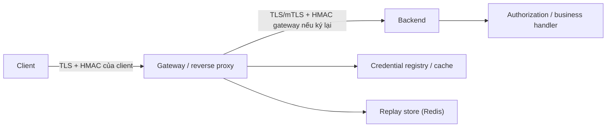

# Connection handling: quản lý kết nối hiệu quả khi xác thực HMAC

## 1. Mục tiêu và phạm vi bài học

Bài **Connection handling** thuộc chương **Performance**, trong module **SECURITY_AUTHENTICATION_HMAC_REQUEST_AUTHENTICATION**. Module thiết kế xác thực HTTP request bằng **HMAC với shared secret** và **canonical request** gồm HTTP method, URI, header hoặc body theo hợp đồng ký. Người học thực hành xác minh MAC, chống phát lại (*replay*) bằng timestamp/nonce, quản lý key rotation, kiểm thử qua proxy/gateway và tách riêng **authentication** với **authorization**.

Ở môi trường production, một request đi qua nhiều tầng: thiết lập kết nối TCP, bắt tay TLS, gateway, bộ kiểm tra HMAC, kho secret và nonce, connection pool tới backend, sau đó nhận response. Dù phép tính HMAC-SHA256 tương đối nhẹ, hệ thống vẫn có thể chậm hoặc quá tải do **quản lý connection**, bộ nhớ đệm body, tài nguyên event loop, hàng chờ pool, retry và thao tác mạng với credential/Redis.

Bài này tập trung vào **vòng đời kết nối HTTP trong hệ thống dùng HMAC**, không thay thế các bài về thuật toán HMAC. Sau bài học, người học có thể:

1. Phân biệt kết nối TCP/TLS, HTTP request, phiên xác thực HMAC và quyết định phân quyền.
2. Giải thích keep-alive, connection pooling, HTTP/2 multiplexing, TLS reuse và tác động tới thông lượng/độ trễ.
3. Xử lý body trong Spring WebFlux một cách có giới hạn, non-blocking và tôn trọng backpressure; biết điểm cần chú ý khi dùng Spring MVC.
4. Thiết kế phản hồi sớm cho request không đủ credential, body lớn, nonce replay hoặc rate limit mà không gây cạn kết nối.
5. Cấu hình timeout, pool, retry và giới hạn concurrency theo từng hop; giữ nguyên bất biến bảo mật **xác minh HMAC trên từng request**.
6. Theo dõi các metric về connection, queue, latency và lỗi auth để phân biệt nghẽn tài nguyên với chữ ký không hợp lệ.
7. Lập kế hoạch benchmark trước/sau khi thay đổi connection handling và kiểm thử an toàn qua gateway/proxy.

## 2. Một kết nối có thể mang nhiều request, nhưng không tạo “phiên HMAC”

Cần phân biệt ba khái niệm:

| Khái niệm | Nó chứng minh hoặc cung cấp điều gì? | Không được suy ra điều gì? |
|---|---|---|
| **TCP/TLS connection** | Kênh vận chuyển dữ liệu; TLS bảo vệ tính bí mật/toàn vẹn của dữ liệu khi truyền giữa hai đầu kết nối | Không chứng minh mọi HTTP request sau đó đều có HMAC hợp lệ |
| **mTLS peer identity** (nếu dùng) | Danh tính thực thể giữ private key của chứng chỉ TLS trong một kết nối | Không tự chứng minh client nghiệp vụ, tenant, quyền và byte body của từng request HMAC |
| **HMAC authentication decision** | Bằng chứng MAC hợp lệ cho **một request/canonical request**, credential và điều kiện freshness tại thời điểm verify | Không chứng minh những request khác trên cùng kết nối và không tự trao quyền truy cập resource |

Trong HTTP/1.1 keep-alive, một TCP connection có thể phục vụ lần lượt nhiều request. Trong HTTP/2, nhiều stream/request có thể dùng **đồng thời** một TLS connection; các request có thể thuộc các principal khác nhau khi gateway/backend hỗ trợ cơ chế nhiều client. Vì vậy **không cache kết quả authenticated=true theo socket/channel/connection ID**.

Ví dụ:

```text
Connection C1 (HTTPS keep-alive)
  Request R1: X-Key-Id=partner-a-k2; MAC hợp lệ, nonce N1 → principal A
  Request R2: X-Key-Id=partner-b-k1; MAC hợp lệ, nonce N2 → principal B
  Request R3: X-Key-Id=partner-a-k2; MAC sai                     → 401

Cả R1, R2 và R3 dùng C1, nhưng có BA quyết định xác thực độc lập.
```

Một shared secret bị revoke trong lúc connection còn sống phải khiến **request mới** dùng key đó bị từ chối theo freshness policy của hệ thống. Không chờ đóng TCP connection mới áp dụng key rotation/revocation. Kết nối chỉ là tài nguyên truyền tải; identity của request phải được lưu trong **request-scoped security context** (ví dụ `SecurityContext` của Servlet hoặc Reactor Context của WebFlux) sau khi xác thực thành công.

### 2.1. Các hop có kết nối và khóa khác nhau



Các connection pool ở gateway → backend và gateway → Redis là **tài nguyên nội bộ**. Chúng không được nhầm với các client connection ở phía ngoài. Khi gateway ký lại request sau khi thay method, raw URI hoặc body, backend xác minh chữ ký gateway trên bytes/URI **thực nhận** và vẫn kiểm tra chính sách client/tenant được gateway xác nhận.

## 3. Vòng đời request và chi phí tạo kết nối

Một request qua HTTPS có thể trải qua các giai đoạn sau:

```text
DNS (khi cần)
  → TCP connect (kết nối mới)
  → TLS handshake (kết nối mới hoặc resumption tùy cấu hình)
  → Gửi/nhận HTTP headers
  → Gửi/nhận body dưới giới hạn và flow control
  → Parse credential HMAC, đọc body nếu body nằm trong chữ ký
  → Lookup key, xác minh body digest/canonical/MAC
  → Kiểm tra timestamp, nonce atomic claim
  → Authorization
  → Gateway nhận/đợi connection pool và gọi backend
  → Backend xử lý, response stream
  → Giữ lại hoặc đóng connection theo giao thức/chính sách
```

Không phải request nào cũng lặp lại cả DNS/TCP/TLS: **keep-alive và connection pool** giúp tái sử dụng kết nối đã thiết lập. TLS session resumption giúp giảm một phần chi phí khi vẫn phải kết nối mới; khả năng và mức lợi ích phụ thuộc TLS version, cấu hình, network và chính sách bảo mật.

Nhưng reuse không phải “càng lâu càng tốt”: kết nối idle bị NAT/firewall đóng, backend triển khai phiên bản mới, cert rotation, giới hạn pool hoặc connection không còn khỏe có thể khiến request thất bại. Cần đặt thời hạn sử dụng tối đa, idle timeout, health/eviction hợp lý và cách retry có kiểm soát.

Một mô hình độ trễ thô giúp định vị bottleneck:

```text
T_request ≈ T_queue_or_pool_acquire
          + T_new_connect_and_TLS_if_needed
          + T_body_receive
          + T_authentication
          + T_authorization
          + T_backend_and_response
```

Các giai đoạn có thể **chồng lấp** trong pipeline streaming, HTTP/2 hoặc proxy buffering; công thức chỉ là sơ đồ chẩn đoán, không phải phép cộng luôn đúng với mọi request. Cần đo riêng các giai đoạn để xác định đúng nguyên nhân, thay vì giả định HMAC-SHA256 là nút thắt.

### 3.1. Keep-alive và connection reuse

HTTP/1.1 mặc định hỗ trợ kết nối lâu dài trong những điều kiện phù hợp. Pool lưu kết nối outbound để gửi nhiều request lần lượt; HTTP/2 cho phép multiplex nhiều stream đồng thời trên một connection. Lợi ích gồm giảm chi phí TCP/TLS handshake, giảm socket churn và cải thiện độ trễ khi kết nối có RTT cao.

Tuy nhiên, keep-alive chỉ an toàn khi:

- HTTP message boundaries được parse nhất quán; body của request trước được tiêu thụ/xử lý theo quy định trước khi reuse.
- Request-scoped attributes và security context không bị rò sang request tiếp theo.
- Timeout/đóng connection khi client hoặc upstream gửi dữ liệu chậm/bất thường.
- Pool không tái sử dụng connection sai protocol/authority/TLS identity.
- Credential/key ID được xác minh **theo request**, không mặc định request tiếp theo cùng connection “cùng người gửi”.

### 3.2. HTTP/2 multiplexing và giới hạn stream

HTTP/2 gom nhiều request vào các stream độc lập. Kết nối có flow control ở cấp connection và stream; một stream gửi body lớn hoặc chậm có thể tạo áp lực lên tài nguyên chung nếu server/gateway xử lý không đúng.

Bởi vậy cần giới hạn số **concurrent streams**, kích thước header, số request chưa xử lý và memory budget; đừng chỉ đặt max TCP connections rồi nghĩ đã giới hạn đủ workload. Khi backend/gateway có khả năng connection coalescing hoặc đổi authority, phải ràng buộc HMAC bằng request-target/audience theo hợp đồng và xác thực tại đúng hop. Cùng connection không đồng nghĩa cùng service hoặc cùng principal.

## 4. HMAC theo request: những bất biến bảo mật khi tối ưu hiệu năng

### 4.1. Không cache “pass HMAC” theo connection

Một optimization nguy hiểm:

```java
// SAI: ví dụ ý tưởng để nhận biết antipattern.
if (channelAttributes.get("hmacAuthenticated") == Boolean.TRUE) {
    return chain.filter(exchange); // Bỏ qua verify những request tiếp theo!
}
```

Khi R1 có MAC hợp lệ, việc bỏ qua verify R2/R3 cho phép gửi request chưa ký, sửa body, đổi tenant hoặc gọi route khác chỉ vì connection được reuse. Với HTTP/2, nhiều stream đồng thời có thể nhận principal sai hoặc chia sẻ trạng thái nếu lưu nó trong mutable channel attributes.

Mỗi request mới phải kiểm tra credential active, canonical request, body digest/MAC, timestamp và nonce theo chính sách. Có thể **cache dữ liệu tra cứu credential** theo key ID/version với TTL/invalidation và bảo vệ secret, nhưng không cache kết luận “request đã authenticated”. Revocation phải được thực thi theo freshness guarantee đã cam kết; cache stale có thể khiến key revoked vẫn được chấp nhận.

### 4.2. Tách resource-level authorization

HMAC chứng minh client sở hữu credential được phép dùng để ký request; **không tự cấp quyền** vào mọi tenant, API hoặc tài nguyên. Khi verifier trả về principal, Spring Security hoặc nghiệp vụ vẫn kiểm tra scope/tenant/resource. Một request có MAC đúng nhưng thiếu quyền thường trả **403 Forbidden** hoặc 404 theo chính sách che tài nguyên, không biến thành 401 và cũng không được reuse kết quả authorization từ request trước.

### 4.3. Không bỏ nonce để tăng throughput

Nonce kết hợp timestamp ngăn request đã ký hợp lệ bị gửi lại trong cửa sổ thời gian. Kho nonce phân tán nên dùng claim **atomic** (ví dụ Redis `SET key value NX EX ttl`); kiểm tra `GET` rồi `SET` là race. Không dùng cấu trúc dữ liệu cục bộ cho gateway đa instance rồi cho phép cùng nonce qua node khác.

Có thể tối ưu kết nối tới Redis bằng pooling hợp lý, giới hạn queue và timeout, nhưng không được chuyển lỗi Redis timeout thành “nonce chưa dùng”. Khi không thể xác minh freshness theo chính sách, phải **fail-closed** với lỗi hạ tầng phù hợp (ví dụ 503), không tự coi là chữ ký sai hoặc bỏ qua anti-replay.

## 5. Xử lý request body và backpressure

Nếu canonical request ký cả SHA-256 body, verifier phải tính digest trên **byte body thực tế** ở điểm xác minh. Điều này có ảnh hưởng lớn tới connection handling: không thể kết luận MAC toàn body hợp lệ khi chưa nhận đủ body, trừ khi giao thức ký có phương án streaming/chunked riêng được thống nhất.

### 5.1. Body framing khác nội dung body được ký

Một request HTTP/1.1 dùng `Transfer-Encoding: chunked` có framing dạng chunk length; framework HTTP thường tách framing và đưa nội dung body lên API. HTTP/2 có frame DATA và các cơ chế flow control riêng. Hợp đồng HMAC cần nói rõ **bytes ở tầng nào** được dùng để tính digest: ví dụ “bytes mà HTTP application nhận được sau khi loại bỏ transport framing, trước khi tự parse/serialize JSON”.

Nếu proxy giải nén `Content-Encoding: gzip`, đổi line ending, rewrite JSON hoặc chuẩn hóa text, bytes ở gateway và backend có thể khác nhau. Cần chốt **điểm ký và điểm verify**. Nếu gateway thay body, có thể xác minh chữ ký client ở ingress rồi ký lại request outbound bằng secret gateway/backend sau biến đổi. Đừng kỳ vọng chữ ký client gốc còn đúng trên bytes mới.

### 5.2. Không gom body vô hạn vào RAM

Một phép tính SHA-256 có thể xử lý body theo stream với bộ nhớ nhỏ, nhưng việc **vừa verify rồi vừa cho handler đọc lại body** không tự đơn giản: body ở WebFlux là stream dùng một lần. Nếu phải đợi verify xong mới cho handler thấy body, một phương án là buffer trong giới hạn rõ ràng, replay body sau khi xác minh.

Cần chọn **maximum signed body size** theo API, chẳng hạn 1 MiB cho JSON thông thường, và từ chối body vượt ngưỡng với **413 Content Too Large**. Đây là ngưỡng ví dụ để thực hành, không phải giá trị khuyến nghị chung cho mọi sản phẩm. Body lớn/video/file cần thiết kế streaming signature, signed digest đã ràng buộc mạnh với body hoặc upload protocol riêng.

### 5.3. Spring WebFlux: đọc có giới hạn, giải phóng buffer

Ví dụ Java/Spring WebFlux dưới đây chỉ minh họa **thu body an toàn theo giới hạn và trang trí request để downstream đọc tiếp**; giả định filter đã parse header, có policy payload size và sẽ verify HMAC **trước khi gọi chain**.

```java
import java.util.Arrays;

import org.springframework.core.io.buffer.DataBuffer;
import org.springframework.core.io.buffer.DataBufferUtils;
import org.springframework.core.io.buffer.DataBufferLimitException;
import org.springframework.http.server.reactive.ServerHttpRequest;
import org.springframework.http.server.reactive.ServerHttpRequestDecorator;
import org.springframework.web.server.ServerWebExchange;

import reactor.core.publisher.Flux;
import reactor.core.publisher.Mono;

public final class BoundedHmacBody {
    private static final int MAX_BODY_BYTES = 1_048_576;

    // subscribe theo vòng đời request; không tự gọi block()/subscribe().
    public static Mono<byte[]> readBytes(ServerHttpRequest request) {
        return DataBufferUtils.join(request.getBody(), MAX_BODY_BYTES)
                .map(buffer -> {
                    try {
                        byte[] bytes = new byte[buffer.readableByteCount()];
                        buffer.read(bytes);
                        return bytes;
                    } finally {
                        // Quan trọng khi DataBuffer là pooled/ref-counted.
                        DataBufferUtils.release(buffer);
                    }
                })
                .defaultIfEmpty(new byte[0]);
    }

    // Chỉ gọi sau khi đã verify HMAC thành công.
    public static ServerWebExchange withReplayableBody(
            ServerWebExchange exchange, byte[] verifiedBody) {

        // Snapshot riêng, không giữ tham chiếu tới byte[] mutable từ bên ngoài.
        byte[] snapshot = Arrays.copyOf(verifiedBody, verifiedBody.length);

        ServerHttpRequest decorated = new ServerHttpRequestDecorator(
                exchange.getRequest()) {
            @Override
            public Flux<DataBuffer> getBody() {
                // DataBuffer mới mỗi lần subscribe để tránh reuse pooled buffer đã release.
                return Flux.defer(() -> Flux.just(
                        exchange.getResponse()
                                .bufferFactory()
                                .wrap(Arrays.copyOf(snapshot, snapshot.length))));
            }
        };

        return exchange.mutate().request(decorated).build();
    }
}
```

Cách sử dụng ở mức luồng:

```text
WebFilter:
  validate header/canonical metadata sớm
  → BoundedHmacBody.readBytes(request)
  → SHA-256 body + HMAC verify + timestamp + nonce atomic claim
  → nếu fail: trả error theo mapping, không chạy handler
  → nếu pass: withReplayableBody(exchange, verifiedBody)
  → chain.filter(decoratedExchange) kèm reactive SecurityContext
```

Các lưu ý bắt buộc:

- `DataBufferUtils.join(..., limit)` trả lỗi `DataBufferLimitException` khi vượt ngưỡng; ánh xạ thành **413** theo contract. Đảm bảo đường lỗi/cancel được kiểm tra về giải phóng pooled buffer. Không dùng `DataBufferUtils.join` không giới hạn cho input từ Internet.
- `getBody()` là stream reactive; không gọi `block()` hay `subscribe()` bên trong WebFilter. Nếu secret/nonce lookup có blocking I/O, cần chuyển sang driver reactive hoặc cô lập phần blocking trên scheduler riêng với concurrency được giới hạn; không làm nghẽn Netty event loop.
- Khi dùng decorator, downstream phải nhìn thấy body/các header nhất quán. Nếu gateway có thay đổi body length/encoding, điều chỉnh `Content-Length`/`Transfer-Encoding` và content headers theo quy tắc HTTP; đừng tự giữ header cũ nếu body đã bị thay.
- Ví dụ sử dụng một bản sao `byte[]` và mỗi lần phát body thêm một bản sao để cô lập vòng đời buffer. Đây là **chi phí bộ nhớ** cần đưa vào capacity planning; production nên chọn phương án caching/replay phù hợp framework và threat model.
- Với HMAC body, không đưa request đến handler trước khi verify xong nếu handler có side effect. Không chấp nhận kết quả MAC chỉ từ header digest do client tự khai khi chưa kiểm tra body bytes.
- Trên WebFlux, `Mono<Void>` từ `chain.filter(...)` phải được trả về để framework subscribe; đừng tự quản lý subscription khiến context/cancel/backpressure sai.

### 5.4. Servlet MVC và thread-per-request

Với Spring MVC trên Servlet stack, body thường được đọc qua `ServletInputStream`; một filter muốn đọc trước rồi cho controller đọc lại phải dùng request wrapper/caching phù hợp. Cần giới hạn kích thước và **không mặc định mọi caching wrapper trả lại body cho downstream**. Một số wrapper chỉ quan sát bytes mà handler đã đọc chứ không cung cấp lần đọc thứ hai.

Thread-per-request có thể chờ I/O làm cạn worker thread khi nhiều client gửi body chậm hoặc kho nonce chậm. Cần cấu hình connector/thread pool, request timeout, giới hạn body và async processing phù hợp. Khác biệt nền tảng không làm thay đổi nguyên tắc: mỗi request phải xác minh đầy đủ và không giữ stream/buffer/socket quá thời gian cho phép.

## 6. Early rejection: khi nào nên trả lỗi trước khi đọc hết body?

Một API HMAC nên kiểm tra nhanh những gì **chưa cần body**: route có yêu cầu xác thực hay không, giới hạn header, định dạng key ID/timestamp/nonce/chữ ký, Content-Length quá ngưỡng (nếu có và đáng tin ở tầng parser), request target và rate limit ban đầu. Request thiếu credential hoặc header sai định dạng có thể bị từ chối sớm.

Tuy nhiên, nếu chữ ký bao gồm **body**, không thể đánh giá MAC cuối cùng trước khi có body bytes cần ký. Các ràng buộc về *khả năng trả response sớm* cũng phải tính tới connection reuse.

| Trường hợp | Có thể phát hiện sớm? | HTTP điển hình | Rủi ro về connection |
|---|---|---|---|
| Thiếu header xác thực bắt buộc | Có, sau parse header | 401 + challenge phù hợp | Client có thể vẫn tiếp tục gửi body lớn |
| `Content-Length` vượt policy | Có nếu metadata hợp lệ | 413 | Cần xử lý body chưa đọc và trạng thái connection |
| Header quá lớn / request line sai | Ở connector/gateway | 400/431 hoặc lỗi parser phù hợp | Có thể buộc đóng connection |
| Rate limit ở ingress | Có trước HMAC nếu policy áp dụng | 429 | Tránh giữ stream/connection chờ không cần thiết |
| MAC sai khi có body | Thường phải đọc đủ bytes cần verify | 401 | Chi phí nhận body trước khi reject |
| Nonce replay có MAC hợp lệ | Sau verify MAC rồi claim nonce | 401 | Không claim trước MAC chỉ để tối ưu |
| Kho credential/nonce không khả dụng | Tại bước truy vấn | 503/5xx, fail-closed | Giới hạn queue, timeout để tránh treo connection |

### 6.1. Request body chưa đọc và keep-alive

Với HTTP/1.1, để tái sử dụng an toàn connection cho request tiếp theo, server phải xử lý đúng ranh giới của request hiện tại. Nếu từ chối chỉ sau header mà body chưa đọc, không được tùy ý cho các bytes còn lại trở thành đầu request mới. Tùy framework/protocol, server có thể **drain/discard body với giới hạn**, yêu cầu client ngừng gửi (ví dụ xử lý `Expect: 100-continue` phù hợp), hoặc **đóng connection** để bảo toàn parser state. Không tự hứa rằng `response.setComplete()` luôn khiến socket lập tức có thể reuse.

**Trade-off:** drain body lớn của kẻ tấn công giúp giữ connection nhưng tốn băng thông, thời gian và bộ nhớ; đóng connection có thêm chi phí TCP/TLS cho lần tiếp theo. Chính sách nên do HTTP server/gateway thực thi với giới hạn tổng bytes, timeout và backpressure. Kiểm thử cả client gửi chunked body chậm, client không ngừng gửi sau 401 và kết nối HTTP/2 với nhiều stream.

### 6.2. `Expect: 100-continue` và upload lớn

Với HTTP/1.1, client có thể gửi `Expect: 100-continue` để hỏi server trước khi phát body. Nếu có thể từ chối ngay dựa trên header/policy, server có thể đáp lỗi cuối mà không khuyến khích client gửi toàn bộ body, tùy hành vi framework và client. Không coi cơ chế này là bảo vệ toàn diện: một client độc hại vẫn có thể tự gửi body.

Khi HMAC ký body, việc gửi `100 Continue` không thay thế việc nhận body và tính digest. Cần benchmark client/proxy thực tế và kiểm tra rằng đường verify không bỏ qua bytes vì xử lý `100-continue` khác nhau giữa các hop.

## 7. Connection pool ở gateway → backend

Gateway thường là HTTP client đối với backend. Nếu mỗi request tạo một connection mới, hệ thống chịu chi phí handshake cao và nhiều socket ngắn sống; nếu pool quá lớn, backend có thể bị quá tải; nếu pool quá nhỏ, request chờ hàng dài và timeout.

Các tham số cần thiết:

| Tham số | Ý nghĩa | Khi cấu hình kém |
|---|---|---|
| `maxConnections` | Số connection tối đa cho pool theo phạm vi provider | Quá nhỏ gây queue; quá lớn gây socket/resource exhaustion |
| `pendingAcquireMaxCount` | Số yêu cầu tối đa được chờ lấy connection | Không giới hạn gây tích lũy bộ nhớ và latency |
| `pendingAcquireTimeout` | Thời gian tối đa chờ connection rảnh | Quá dài che giấu pool saturation |
| `maxIdleTime` | Thời gian connection có thể idle trước eviction | Kết nối stale sau firewall/NAT/backend rotation |
| `maxLifeTime` | Tuổi thọ tối đa của connection | Kết nối quá lâu, khó thay đổi hạ tầng/TLS theo chính sách |
| `responseTimeout` | Giới hạn chờ response từ upstream theo API/client | Timeout quá ngắn gây retry; quá dài giữ tài nguyên |
| `connectTimeout` | Giới hạn thiết lập TCP cho connection mới | Kết nối chậm gây treo backlog |
| HTTP/2 concurrent stream limit | Số stream cùng lúc trên một connection | Nghẽn flow control dù chưa chạm maxConnections |

### 7.1. Ví dụ Reactor Netty: giới hạn pool, queue và timeout

Đoạn Java dưới đây **xây một Reactor Netty HttpClient** để minh họa configuration. Nó **không tự động thay HttpClient của Spring Cloud Gateway** chỉ vì có mặt trong ứng dụng: framework phải được cấu hình/tiêm đúng client theo phiên bản đang sử dụng.

```java
import java.time.Duration;

import io.netty.channel.ChannelOption;
import reactor.netty.http.client.HttpClient;
import reactor.netty.resources.ConnectionProvider;

final class HmacUpstreamHttpClient {
    static ConnectionProvider newProvider() {
        return ConnectionProvider.builder("hmac-upstream")
                .maxConnections(200)
                .pendingAcquireMaxCount(400)
                .pendingAcquireTimeout(Duration.ofSeconds(1))
                .maxIdleTime(Duration.ofSeconds(30))
                .maxLifeTime(Duration.ofMinutes(10))
                .evictInBackground(Duration.ofSeconds(30))
                .metrics(true)
                .build();
    }

    static HttpClient newClient(ConnectionProvider provider) {
        return HttpClient.create(provider)
                .keepAlive(true)
                .option(ChannelOption.CONNECT_TIMEOUT_MILLIS, 3_000)
                .responseTimeout(Duration.ofSeconds(8));
    }
}
```

Các số 200/400/1s/30s/10 phút/8s chỉ là **tham số giả định** để nghiên cứu. Chọn giá trị thật từ benchmark và giới hạn của backend/gateway. Nên quản lý `ConnectionProvider` như tài nguyên sống cùng ứng dụng (dùng chung, dispose khi shutdown), không tạo một provider mới cho **mỗi** HTTP request. Metrics của provider hữu ích để phát hiện active/idle connections, pending acquire và timeout.

**Chú ý:** cấu hình của từng thư viện và phiên bản Reactor Netty/Spring Cloud Gateway có thể thay đổi; ví dụ không phải một file cấu hình production hoàn chỉnh. TLS trust store, mTLS, load balancing, DNS, HTTP/2, proxy, timeout toàn request và policy retry phải được thiết lập ở tầng tương ứng.

### 7.2. Hàng chờ pool cũng là một loại backpressure

Khi backend chậm, nhiều request giữ connection lâu hơn; pool đạt maxConnections và request mới vào pending acquire queue. Nếu queue không được giới hạn, gateway có thể mất bộ nhớ trước khi xuất hiện lỗi có ý nghĩa.

Khi pending queue đã đầy hoặc thời gian chờ vượt ngưỡng, gateway cần phản hồi theo **hợp đồng lỗi hạ tầng/quá tải** và đưa ra metric rõ ràng. Không chuyển pool acquire timeout thành `401 Invalid HMAC` vì chữ ký client có thể hoàn toàn hợp lệ.

Một quy tắc capacity planning hữu ích là **Little's Law** (trong trạng thái ổn định và khi đo đúng một hệ thống/hàng chờ):

```text
average_in_flight_requests ≈ request_rate_per_second
                             × average_time_in_system_seconds
```

Nếu thời gian chờ backend tăng, số request đồng thời cần tài nguyên cũng tăng ngay cả khi lưu lượng vào không đổi. Phân biệt *in-flight requests*, *active TCP connections* và *HTTP/2 streams*: chúng không luôn bằng nhau.

### 7.3. Pool và thông tin xác thực nội bộ

Connection pool của gateway có thể được dùng để gọi nhiều backend instance. HMAC dùng để ký **request outbound cụ thể**, không phải “đăng nhập” một lần cho pooled connection. Nếu gateway ký lại request sau rewrite, mỗi outbound attempt phải có canonical request, timestamp và nonce riêng, key ID/audience đúng route. Không đặt `X-Verified-Client-Id` hoặc HMAC signature vào mutable default headers của một HttpClient dùng chung giữa các client rồi quên ghi đè ở lần tiếp theo.

Nếu dùng mTLS ở gateway → backend, certificate xác thực gateway ở cấp transport; backend vẫn cần kiểm tra chữ ký HMAC nội bộ nếu hợp đồng thiết kế hai lớp xác thực. Chứng chỉ và key rotation mTLS có vòng đời riêng với shared secret HMAC.

## 8. Timeout, cancellation và retry phải có chung “deadline budget”

Một request có thể chờ ở nhiều nơi: ingress đọc body, lookup key, Redis nonce check, acquire connection, connect/TLS, backend response và ghi response tới client. Nếu mỗi lớp đặt timeout dài riêng rẽ, tổng thời gian có thể vượt SLO của API.

Định nghĩa timeout theo **request deadline** rồi phân bổ cho các hop. Các lớp phía sau phải biết hạn còn lại hoặc ít nhất có timeout không lớn hơn budget phù hợp; tránh để gateway đã ngắt kết nối với client nhưng tác vụ lookup/forwarding vẫn tiếp tục tiêu thụ tài nguyên không cần thiết.

| Deadline/timeout | Phạm vi | Sai lầm thường gặp |
|---|---|---|
| Header read timeout | Chờ nhận đủ HTTP headers | Slowloris giữ nhiều connection mở |
| Body receive timeout / minimum throughput policy | Chờ bytes body; có thể áp dụng giới hạn tốc độ | Client rất chậm chiếm bộ nhớ/buffer |
| Credential lookup timeout | Registry/cache/Vault/KMS | Chặn event loop hoặc giữ request vô hạn |
| Replay store timeout | Lệnh atomic claim nonce | Coi timeout là “nonce chưa dùng” rồi fail-open |
| Pool acquire timeout | Chờ connection backend | Queue tích tụ và latency đột biến |
| Connect/TLS handshake timeout | Tạo kết nối mới tới upstream | Treo socket trong mạng lỗi |
| Response timeout | Chờ upstream trả dữ liệu | Retry gây trùng nghiệp vụ |
| End-to-end deadline | Ngân sách tổng request của ingress | Timeout cục bộ từng bước không ràng buộc tổng |

### 8.1. Cancellation không có nghĩa backend chưa xử lý

Giả sử gateway đã gửi `POST /payments` tới backend, nhưng mất connection **trước khi nhận response**. Backend có thể đã xử lý giao dịch thành công. Vì vậy không được tự suy ra từ `connection reset` hoặc `504` rằng request “chắc chắn chưa chạy” rồi retry vô hạn.

Khi retry một request HMAC, cần:

1. Phân biệt **retry ở client → gateway** với **gateway → backend**.
2. Ký lại từng attempt bằng **timestamp/nonce mới** nếu verifier sẽ kiểm tra replay; không gửi lại cùng nonce sau khi lần trước có thể đã được claim.
3. Xác định body bytes/method/raw URI cho attempt mới; tính lại digest/canonical/HMAC nếu thay đổi.
4. Áp dụng **idempotency key ở tầng nghiệp vụ** cho thao tác có side effect; nonce HMAC không ngăn hai request hợp lệ khác nonce tạo hai payment.
5. Giới hạn số lần retry, backoff/jitter và chỉ retry khi policy cho phép, vì connection outage có thể nhân tải lên backend đang yếu.

Nếu kết nối bị hủy sau khi **nonce đã claim** nhưng trước khi handler chạy, client có thể gặp 401 replay nếu phát lại nguyên signature. Đây là hệ quả của giao thức chống replay; cần thiết kế retry và idempotency minh bạch. Không tự xóa nonce đã claim vì “có vẻ request thất bại”, trừ khi có một giao thức khôi phục chắc chắn và mô hình chống replay tương ứng.

### 8.2. Ánh xạ lỗi thành HTTP status đúng tầng

| Nguyên nhân | Nhóm lỗi | HTTP điển hình |
|---|---|---|
| Thiếu/sai MAC, key revoked, timestamp ngoài cửa sổ, nonce replay | Authentication failure | 401 + `WWW-Authenticate` phù hợp |
| HMAC đúng, client thiếu quyền tài nguyên/tenant | Authorization failure | 403 hoặc 404 theo chính sách |
| Header/request-target không hợp lệ ở HTTP parser | Malformed HTTP | 400/431 tùy lỗi |
| Body vượt giới hạn | Payload limit | 413 |
| Rate limit vượt ngưỡng | Throttling | 429 |
| Redis/credential store không khả dụng | Authentication dependency failure | 503 hoặc 5xx phù hợp, fail-closed |
| Pool connection backend hết chỗ/chờ quá lâu | Hạ tầng gateway/quá tải | 503/5xx theo hợp đồng |
| Upstream trả response không hợp lệ | Gateway failure | 502 |
| Upstream không phản hồi trong thời hạn gateway | Gateway timeout | 504 |

Không có một mã duy nhất áp dụng được cho mọi tình huống mạng: ứng dụng/gateway phải định nghĩa policy và kiểm thử cách mapping của framework thực tế. Điểm quan trọng là **không gộp lỗi kết nối, pool hoặc Redis thành lỗi chữ ký HMAC**. Client nhận lỗi 5xx có thể retry có giới hạn; client nhận 401 nên kiểm tra signing contract/credential và tạo nonce mới khi gửi attempt mới.

## 9. Proxy, gateway và chuẩn hóa request khi qua connection pool

Các proxy không chỉ chuyển TCP bytes; chúng có thể terminate TLS, đổi HTTP/1.1 thành HTTP/2, rewrite path, chuẩn hóa query, giải nén body hoặc thêm header. Bởi vậy việc đổi connection/protocol có thể **gián tiếp** khiến canonical request khác nhau.

| Tình huống | Rủi ro HMAC | Cách kiểm soát |
|---|---|---|
| Gateway rewrite `/api/v1/orders` → `/internal/orders` | Client ký raw path cũ; backend thấy path mới | Verify client tại ingress; nếu ký lại thì ký raw path cuối cùng |
| Proxy chuẩn hóa `%2F` thành `/` | MAC sai dù URI nhìn tương tự | Hợp đồng rõ raw path/query, test end-to-end |
| Thay đổi thứ tự query hoặc percent-encoding | Canonical khác giữa hai phía | Không tự sort/decode nếu contract dùng raw query |
| Chuyển HTTP/1.1 chunked sang HTTP/2 | Framing khác; nếu ký nhầm framing/Content-Length gây sai lệch | Ký bytes body ứng dụng nhận và những header đã chuẩn hóa theo contract |
| Proxy giải nén/gzip lại body | SHA-256 body khác | Định nghĩa điểm ký/verify và chính sách Content-Encoding |
| HTTP/2 `:authority` khác Host sau proxy | Authority không ổn định nếu ký Host tùy ý | Quy định authority/audience và proxy trust policy |
| Gateway forward header credential không chọn lọc | Backend hiểu sai key/hop hoặc bị header spoofing | Xóa header nội bộ từ ingress; sinh header mới, ký lại theo hop |
| HTTP parser bất đồng về `Content-Length`/`Transfer-Encoding` | HTTP request smuggling, message boundary mismatch | Chặn framing mơ hồ tại edge, dùng parser/hardening chuẩn và cập nhật stack |
| Connection pooling tới nhiều backend | Dùng nhầm default header hoặc audience | Signature, principal và context tạo theo từng request; route/key giới hạn |

Đặc biệt, hợp đồng ký cần bao gồm các trường có ảnh hưởng tới hành vi backend, hoặc áp đặt kiểm tra policy cố định. Ví dụ `Content-Type` và `Content-Encoding` nếu không nằm trong canonical và không bị ràng buộc bởi policy có thể bị thay đổi mà MAC vẫn đúng, dẫn tới hai cách diễn giải body.

Đừng tin tùy ý `X-Forwarded-*` hoặc `Forwarded` từ Internet để tạo canonical; chỉ dùng dữ liệu đã được reverse proxy tin cậy làm sạch/xác nhận. Nếu gateway ký lại request nội bộ, backend nên xác minh **audience** và các claim client/tenant được gateway bảo vệ bằng MAC; không tự suy ra quyền từ một header không ký.

## 10. Giới hạn tải và chống cạn kiệt tài nguyên

Một HMAC verifier có thể bị đánh vào cả tài nguyên **trước khi** xác thực thành công. Kẻ tấn công không cần biết secret để tạo hàng nghìn connection gửi header chậm, body lớn hoặc request có key ID ngẫu nhiên.

Các lớp bảo vệ bổ trợ nhau:

1. **Lớp mạng/HTTP server:** giới hạn số connection, request header size, header timeout, idle timeout, HTTP/2 stream concurrency, request rate và body size. Áp dụng giới hạn vùng ingress trước khi phân loại client theo `keyId`.
2. **Lớp body:** giới hạn kích thước, tổng bộ nhớ đang dùng và số request đọc body đồng thời; tận dụng backpressure và xử lý cancel. Một giới hạn body 1 MiB *mỗi request* chưa ngăn được hàng nghìn request đồng thời chiếm nhiều GiB.
3. **Lớp credential lookup:** giới hạn concurrent lookups, timeout và bảo vệ cache khi nhận key ID ngẫu nhiên; không để attacker đẩy registry/cache vào trạng thái thrash.
4. **Lớp crypto:** dùng chuẩn `Mac(HmacSHA256)`, canonicalization xác định, signature decode có giới hạn, so sánh an toàn. Tối ưu tránh allocate thừa nhưng không bỏ bước verify.
5. **Lớp replay store:** atomic claim với key có TTL, namespace theo credential; giới hạn pool/queue, fail-closed khi không thể xác minh nonce.
6. **Lớp backend/pool:** giới hạn pending acquire, max connection, per-route concurrency, circuit breaker/backpressure với policy; tránh retry storm.
7. **Lớp quota của client đã xác thực:** sau khi có principal đáng tin mới có thể áp dụng quota theo tenant/client. Trước đó chỉ áp dụng giới hạn ingress/IP/network dựa trên threat model.

**Không rate limit theo `X-Key-Id` như một danh tính đáng tin trước khi MAC được xác minh.** Nếu làm vậy, attacker có thể giả key ID của một đối tác và làm đối tác đó bị throttled dù đối tác không hề gửi request. Để phục vụ vận hành có thể lưu claimed key reference trong log nội bộ có kiểm soát, nhưng không dùng nó làm principal.

### 10.1. Connection exhaustion và HMAC DoS

Một hệ thống thường có nhiều giới hạn khác nhau: connections mở, HTTP/2 streams, số request đang buffer body, số coroutine/reactive subscriptions, số lookup Redis, số outbound pool leases và concurrency của business handler. Tăng maxConnections mà không tăng/tối ưu các tầng khác có thể làm nghẽn backend hoặc kho nonce.

Do đó nên đặt **budget đồng thời** và quan sát điểm đợi thực tế. Khi có dấu hiệu overload, áp dụng backpressure, giới hạn queue, từ chối sớm theo chính sách, giảm retry và autoscale phần phù hợp. Không tăng timeout vô điều kiện để che kết nối treo.

## 11. Quan sát connection handling mà không lộ dữ liệu HMAC

Tách **resource metrics**, **authentication metrics** và **business metrics**:

| Nhóm | Metric gợi ý | Diễn giải |
|---|---|---|
| Ingress connections | Open/active/idle connections, accepted/rejected connections | Sức khỏe HTTP server; không suy ra số client xác thực |
| HTTP/2 | Active streams, stream reset/flow-control stalls nếu có | Phát hiện nghẽn multiplexing |
| Outbound pool | Active/idle connections, pending acquire, acquire timeouts | Tìm queue/pool saturation |
| Network/TLS | Connect/TLS handshake duration, connection errors | RTT/hạ tầng/certificate |
| Body | Received bytes, rejected-by-size count, body read duration | Bandwidth/buffering pressure |
| HMAC | Verify duration histogram, success/failure by bounded reason | Lỗi ký và chi phí xác minh |
| Dependencies | Credential lookup/nonce store latency và errors | Xác định 503 do hạ tầng |
| Security | Timestamp reject, nonce replay, revoked key requests | Phân biệt tích hợp và tấn công |
| Gateway | Upstream response duration, 502/503/504 và retry attempts | Kết nối backend |
| Authorization | 403 sau HMAC success, tenant/scope policy denied | Không đổ lỗi HMAC |

Không đặt `nonce`, raw URI/query, signature, shared secret, request ID hay key ID tùy ý vào **metric labels**. Với route, dùng **route template** như `/partner/orders/{id}` và tập reason hữu hạn để tránh cardinality explosion. Security logs có thể ghi request ID và lý do nội bộ với quyền hạn phù hợp; không ghi secret, expected MAC hoặc toàn bộ canonical chứa dữ liệu nhạy cảm.

### 11.1. Truy vấn tham khảo với Prometheus

Các tên dưới đây chỉ là **metric giả định** để minh họa; thực tế phải xem tên instrument được exporter phát ra:

```promql
# Tỷ lệ lỗi khi chờ connection pool tới backend (5 phút).
sum(rate(hmac_gateway_pool_acquire_timeout_total[5m]))
```

```promql
# P95 thời gian verifier quyết định HMAC, theo histogram buckets.
histogram_quantile(
  0.95,
  sum by (le) (
    rate(hmac_verify_duration_seconds_bucket[5m])
  )
)
```

```promql
# Lỗi kho nonce: cần phân biệt với nonce replay.
sum(rate(hmac_nonce_store_errors_total[5m]))
```

Khi nhìn P95, phải có số mẫu đủ lớn và sử dụng histogram buckets phù hợp. Không lấy trung bình các P95 của từng node làm P95 toàn cụm. Phân biệt metric không có dữ liệu với giá trị 0; dashboard nên hiển thị trạng thái scrape/exporter, queue lag và thời điểm cập nhật.

### 11.2. Runbook: 401 tăng cùng thời điểm connection errors tăng

Một cuộc điều tra theo trình tự:

1. **Định vị hop phát lỗi:** client → gateway hay gateway → backend? Backend đang xác minh chữ ký client hay chữ ký gateway?
2. **Xem 401 theo lý do nội bộ:** `invalid_mac`, `timestamp_window`, `nonce_replay`, `unknown_key`. Không suy diễn từ public status đơn lẻ.
3. **Xem pool/connect metrics:** pending acquire, connection reset, TLS handshake fail, backend 502/504. Chúng có thể là lỗi riêng song song với 401.
4. **Đối chiếu thay đổi gateway/proxy:** rewrite raw path/query, chuẩn hóa encoding, chuyển HTTP version, nén/giải nén body. Canonical mismatch có thể xuất hiện sau deploy mà key không thay đổi.
5. **Kiểm tra nonce và retry:** connection reset có khiến client/gateway gửi lại cùng nonce? Có ký lại từng attempt và dùng business idempotency?
6. **Kiểm tra key rotation/revocation:** credential version/cached state; connection reuse không được giữ principal/key active cũ.
7. **Đưa ra hành động theo nguyên nhân:** rollback rewrite sai, sửa pool/timeout/circuit breaker, cải thiện clock/nonce handling hoặc hỗ trợ client cập nhật signer. Không yêu cầu đổi secret nếu bằng chứng chỉ ra lỗi proxy.

## 12. Benchmark connection handling theo kịch bản có kiểm soát

Cần đo **trước/sau** với cùng hạ tầng, thuật toán, body, số client, route và chính sách nonce. Không dùng lại cùng một signature/nonce trong load test rồi kết luận hệ thống có 401 cao do pool: replay guard đang làm đúng công việc.

| Kịch bản benchmark | Biến thay đổi | Quan sát |
|---|---|---|
| HTTP/1.1 kết nối mới mỗi request | Không reuse TCP/TLS | TCP/TLS cost, CPU, p95 end-to-end |
| HTTP/1.1 keep-alive | Reuse kết nối | Pool active/idle, req/s, latency |
| HTTP/2 multiplexing | Số stream concurrent | Flow control, stream resets, p95/p99 |
| Pool nhỏ ↔ pool lớn | `maxConnections`/pending acquire | Queue wait, saturation, upstream errors |
| Header-only GET, body rỗng | Độ lớn request nhỏ | Baseline HMAC/nonce overhead |
| POST JSON 4 KiB, 64 KiB, tới giới hạn | Body size | Memory, body read time, MAC/digest cost |
| HMAC hợp lệ/không hợp lệ | Tỉ lệ early rejection | Resource consumption, 401 mapping |
| Key lookup cache hit/miss | Credential registry latency | Auth time, cache stale policy |
| Redis nonce store chậm/mất kết nối | Dependency behavior | Timeout, 503 và fail-closed |
| Gateway rewrite/compression | Canonical/body changes | 401, correctness end-to-end |
| Gateway retry khi upstream reset | Một hoặc nhiều outbound attempts | Nonce uniqueness, business idempotency |
| Key revoke trong keep-alive connection | Đổi credential active state | Request mới từ key cũ phải bị từ chối |
| Slow clients + large bodies | Đọc body chậm/chunked/HTTP2 | Open connections, memory, early close/drain behavior |

### 12.1. Thứ tự triển khai phép thử

1. **Thiết lập correctness baseline:** signer tạo timestamp mới và nonce ngẫu nhiên cho mỗi attempt; backend xác minh raw URI/body đúng; rate limit và resource policy đã được công bố.
2. **Tạo tải đủ dài để ấm pool:** có giai đoạn warm-up và đo ổn định; ghi máy, network RTT, TLS policy, HTTP version, concurrency và kích thước body.
3. **Đo nhiều góc nhìn:** p50/p95/p99 latency, throughput, 401/403/413/429/5xx, CPU, GC, memory, file descriptors, active connections, pending acquire, Redis latency.
4. **Thử gần điểm bão hòa:** tăng concurrency có kiểm soát, quan sát queue/timeouts thay vì chỉ throughput cực đại. Theo dõi error budget, không tạo tải vượt môi trường được phép.
5. **Inject lỗi:** mất Redis, backend reset connection, TLS fail, gateway restart, key rotation/revocation, body quá giới hạn và nonce replay.
6. **Kiểm tra bất biến:** request sai MAC không tới handler; HTTP status đúng nguyên nhân; không vượt qua revoked key; không có nonce trùng được chấp nhận ở nhiều node; không rò pooled buffers.
7. **Đánh giá trade-off:** một cấu hình có throughput cao hơn nhưng p99 rất xấu hoặc làm fail-open anti-replay là **không đạt**.

### 12.2. Các giả thuyết nên kiểm chứng

- Khi nhiều request nhỏ đi qua mạng có RTT đáng kể, keep-alive thường giảm chi phí tạo kết nối và cải thiện latency; đo thực tế mới biết mức lợi ích.
- Nếu traffic chủ yếu dùng JSON body lớn, CPU/GC/buffer memory và thời gian đọc body có thể chi phối hơn phép tính HMAC; không cố micro-optimize `Mac` trước khi đo.
- Nếu Redis là bottleneck, tăng maxConnections tới backend không sửa được latency `nonce claim`.
- Với HTTP/2, giảm số TCP connection chưa chắc giảm số request concurrent; phải theo dõi stream concurrency và flow control.
- Nếu auth failures tăng sau proxy release, kiểm tra canonical request và body transformation trước khi quy trách nhiệm cho client.
- Khi giữ pooled connection quá lâu, một số lỗi do network idle timeout có thể tăng; cần thiết lập idle eviction hoặc keepalive phù hợp và đo tần suất reset.

## 13. Ví dụ thực hành tích hợp

Một hệ thống có các thành phần:

- Client ký `POST /api/v1/orders` bằng HMAC-SHA256; canonical gồm method, raw path/query, timestamp, nonce và SHA-256 body.
- Spring Cloud Gateway xác minh HMAC client, chống replay bằng Redis, rewrite `/api/v1/orders` thành `/internal/orders` và ký lại request cho backend bằng secret riêng.
- Backend Spring WebFlux xác minh chữ ký gateway, gắn client/tenant đã được xác nhận vào Reactor Context và kiểm tra quyền trên đơn hàng.
- Gateway dùng connection pool tới backend; client có thể gửi HTTP/1.1 keep-alive hoặc HTTP/2.

Hãy thực hiện các bước:

1. **Xác định hợp đồng ký ở mỗi hop.** Ghi rõ phương thức, raw URI, body bytes, key ID, audience, timestamp và nonce. Ký lại sau mọi biến đổi cuối cùng.
2. **Thiết lập giới hạn tài nguyên.** Chọn header/body size limit, concurrent request budget, HTTP/2 streams, pool size/queue/timeout và Redis timeout; giải thích tác dụng từng giới hạn.
3. **Bảo vệ request scope.** Gửi hai request khác client qua cùng connection. Kiểm tra principal và authority không bị lẫn. Gửi một request MAC sai cùng connection, xác nhận vẫn bị 401.
4. **Kiểm thử body.** Gửi JSON body nhỏ, body gần giới hạn, body vượt ngưỡng, body chậm, chunked transfer, raw query có `%2F` và request qua HTTP/2. Kiểm tra digest/canonical và memory.
5. **Kiểm tra retry.** Cố tình reset connection sau khi backend có thể đã xử lý. Phát lại request theo chính sách với nonce mới, giữ idempotency key nghiệp vụ; bảo đảm chỉ có một đơn hàng.
6. **Kiểm tra revoke.** Revoke key cũ trong khi client còn giữ TCP/TLS connection. Request mới mang key đã revoke bị từ chối dù connection cũ còn sống; quan sát cache freshness và log.
7. **Benchmark.** So sánh không pooling, keep-alive, HTTP/2 và nhiều pool size; thu thập p95/p99, active connections, pending acquire, bytes buffered, auth decision latency và Redis errors.
8. **Điều tra tình huống lỗi.** Khi gateway bật rewrite rồi 401 tăng, chứng minh canonical mismatch từ raw path. Khi Redis mất kết nối, nhận lỗi hạ tầng (không giả dạng invalid HMAC).

### Câu hỏi tự đánh giá

1. Vì sao có TLS/mTLS hoặc cùng một keep-alive connection không cho phép bỏ bước verify HMAC ở request tiếp theo?
2. Vì sao chỉ tăng max TCP connections không bảo đảm throughput tốt hơn khi HTTP/2 cho phép nhiều stream trên một connection?
3. Body của HTTP/1.1 chunked và body ứng dụng đọc qua WebFlux có cùng cách biểu diễn framing không? Hợp đồng ký nên chọn byte nào?
4. Vì sao `DataBufferUtils.join` cần giới hạn và phải release pooled buffer sau khi đọc?
5. Khi trả 401 từ sớm lúc body chưa đọc, vì sao connection không nhất thiết reuse ngay an toàn?
6. Phân biệt `pool acquire timeout`, `nonce replay` và `invalid MAC` theo nhóm HTTP status.
7. Vì sao một request mới trên connection cũ vẫn phải kiểm tra credential đã revoke?
8. Tại sao reset connection khi gửi payment không đủ chứng minh backend chưa thực hiện thanh toán?
9. Vì sao retry cần timestamp/nonce mới nhưng vẫn cần idempotency key?
10. Khi 401 tăng sau bật reverse proxy, cần đối chiếu những byte và header nào trước khi đổi secret?

**Kết quả cần đạt:** người học vận hành được HTTP connection handling cho xác thực HMAC với keep-alive, pooling, HTTP/2, body limits, backpressure, timeout và retry có kiểm soát; giữ nguyên xác minh HMAC, freshness và authorization **trên từng request**; nhận diện được bottleneck connection/pool/nonce store, đo hiệu năng đúng cách và không đánh đổi bảo mật để lấy throughput.
