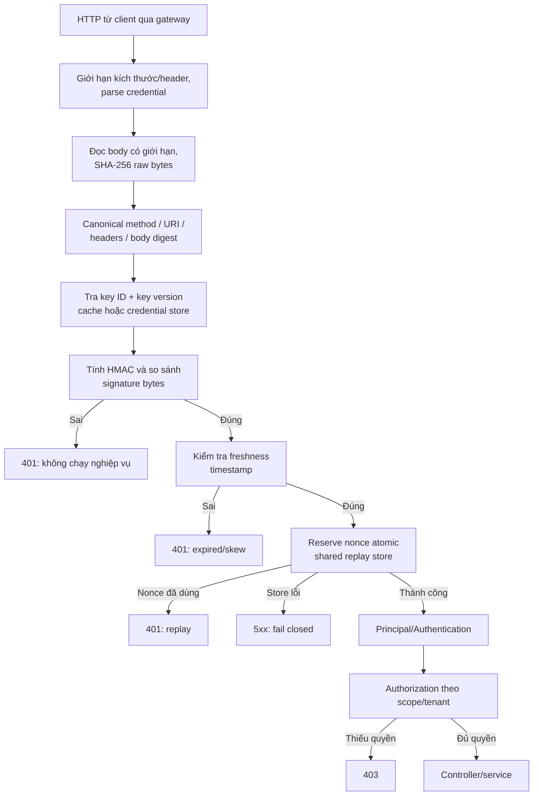

# Throughput verification: đo và tối ưu thông lượng xác minh HMAC request

## 1. Vì sao thông lượng xác minh HMAC là một bài toán hệ thống?

Trong module `SECURITY_AUTHENTICATION_HMAC_REQUEST_AUTHENTICATION`, HTTP client dùng **shared secret** tạo chữ ký HMAC trên **canonical request** đã được quy định: HTTP method, URI, những header được chọn và/hoặc hash của request body. Server tái tạo cùng biểu diễn, xác minh chữ ký, kiểm tra timestamp/nonce chống replay, áp dụng key rotation và xác lập principal. Sau đó Spring Security còn phải thực hiện **authorization**, một bước khác với authentication.

Khi lưu lượng thấp, chi phí `HmacSHA256` trên vài trăm byte có thể rất nhỏ. Khi có hàng nghìn request đồng thời, đường xác minh còn bị chi phối bởi việc đọc body, tính SHA-256, chuẩn hóa URI/header, tra key store, kiểm tra nonce atomically trong Redis hoặc database, áp lực bộ nhớ và giới hạn connection pool. Thậm chí một bản triển khai có phép tính HMAC nhanh vẫn có thể đạt throughput thấp hoặc độ trễ p99 rất cao.

**Throughput verification** là khả năng hệ thống hoàn tất **các quyết định xác thực request HMAC** trong một đơn vị thời gian dưới một workload và chính sách bảo mật xác định. Bài học không nhằm làm cho hệ thống “nhanh” bằng cách bỏ qua nonce, giảm độ mạnh chữ ký hay tin một key ID chưa được kiểm chứng.

Một số câu hỏi cần trả lời bằng đo lường:

- Một instance xác minh được bao nhiêu request/giây trước khi latency và error rate vượt ngưỡng?
- CPU tính HMAC là nút thắt hay thời gian đợi key store/nonce store?
- Body 1 KiB so với body 1 MiB làm thay đổi throughput như thế nào?
- Throughput khi key cache hit khác gì lúc cache miss hoặc trong key rotation?
- Request signature sai và request replay có mức tiêu thụ tài nguyên ra sao?
- Khi tải vượt năng lực, hệ thống có từ chối một cách có kiểm soát và **fail closed** không?
- Gateway rewrite URI/header/body có làm tăng `401` dù năng lực xử lý vẫn dồi dào không?

**Mục tiêu học tập:** định nghĩa metric đúng, xây benchmark và load test tái lập được, phân tích nút thắt, tối ưu có kiểm chứng và bảo toàn HMAC, timestamp, nonce, key rotation cùng authorization trong mọi thử nghiệm hiệu năng.

## 2. Định nghĩa throughput, latency, concurrency và capacity

Các đại lượng liên quan nhưng không đồng nghĩa:

| Đại lượng | Ý nghĩa | Cách diễn giải |
| --- | --- | --- |
| **Arrival rate** | Số request HTTP đến mỗi giây | Offered load do client/gateway tạo ra |
| **Verification attempt rate** | Số request thực sự đi vào bộ verifier mỗi giây | Không gồm request bị chặn sớm ở gateway |
| **Completed verification throughput** | Số quyết định xác thực đã hoàn tất mỗi giây | Gồm accepted, rejected và unavailable nếu có cách đếm rõ |
| **Accepted throughput** | Số request vượt xác thực HMAC và anti-replay mỗi giây | Chưa chứng minh authorization thành công |
| **Rejected throughput** | Số request bị từ chối vì sai credential, timestamp hoặc nonce | Không đồng nghĩa outage |
| **End-to-end successful throughput** | Số request hoàn thành nghiệp vụ đúng mỗi giây | Còn phụ thuộc authorization và business handler |
| **Latency p50/p95/p99** | Phân vị thời gian xử lý | Phải chỉ rõ đo verification stage hay toàn HTTP |
| **Concurrency** | Số request đang được xử lý đồng thời | Ảnh hưởng memory, queue và connection pool |
| **Saturation** | Điểm tài nguyên đạt giới hạn | CPU, pool, store, memory hoặc network |

Một request thiếu credential bị từ chối ngay ở header parser có thể được tính là một **authentication decision** hoàn tất, nhưng không phải một phép HMAC cryptographic computation. Vì vậy phải phân biệt:

```text
hmac_authentication_attempts_per_second
hmac_mac_computations_per_second
hmac_authentication_accepted_per_second
http_requests_completed_per_second
```

Đây là tên khái niệm để giải thích, không phải metric tự động do Spring Boot cung cấp. Nếu thiết kế meter mới, hãy đặt tên, đơn vị và phạm vi rõ ràng, thống nhất.

### 2.1. Throughput phải đi kèm độ trễ và lỗi

Giả sử hệ thống xử lý 3.000 request/giây trong khi p99 verification latency tăng từ vài chục mili giây lên vài giây và nonce store liên tục timeout. Không thể gọi đó là cải thiện hiệu năng chỉ nhờ thông lượng đầu ra cao hơn.

Một điểm tải được coi là chấp nhận được khi đáp ứng **đồng thời** mục tiêu throughput, độ trễ, tỷ lệ lỗi, resource headroom và mọi bất biến bảo mật. Tránh chỉ lấy “RPS lớn nhất mà load generator hiển thị” làm kết quả.

### 2.2. Little's Law để hiểu request đang in-flight

Ở trạng thái ổn định và dưới điều kiện áp dụng phù hợp:

```text
L = lambda × W
L      = số request trung bình đang in-flight
lambda = throughput trung bình (request/giây)
W      = thời gian ở trong hệ thống (giây)
```

Ví dụ **minh họa, không phải số đo**: 2.000 request/giây với thời gian lưu trong verification pipeline trung bình 0,04 giây tương ứng khoảng 80 request đang in-flight. Nếu mỗi request buffer 512 KiB, chỉ riêng **một bản sao body** của 80 request đã chiếm khoảng 40 MiB, chưa tính copy thêm, object, Netty buffers và GC.

Khi độ trễ tăng do nonce store, số request đồng thời có thể tăng dù arrival rate không đổi. Đây là lý do phải đo latency, queue và memory cùng nhau.

## 3. Mô hình đường xác minh và vị trí tiêu tốn tài nguyên

Pipeline điển hình cho request có ký body:



Thứ tự minh họa này không phải thứ tự bắt buộc duy nhất. Ví dụ có thể kiểm tra timestamp **cú pháp và giới hạn** sớm trước khi đọc body lớn để chống lạm dụng, miễn sao thông điệp công khai và security contract vẫn đúng. Tuy nhiên không được **reserve nonce trước khi biết chữ ký hợp lệ** nếu điều đó cho phép attacker chiếm nonce của client bằng request giả mạo.

| Bước | Loại chi phí chính | Nút thắt phổ biến |
| --- | --- | --- |
| Parse header/method/query | CPU, allocation | Header lớn, duplicate/ambiguous input, normalization |
| Đọc body | Network, memory, copy | Payload lớn, slow clients, buffered concurrent bodies |
| Hash body `SHA-256` | CPU và đọc byte | Body MB, nhiều bản copy |
| Canonicalization | CPU, allocation | Encode/decode nhiều lần, sort query/header |
| Key lookup | Cache, network I/O | Cache miss, DB/Vault latency, connection pool |
| HMAC computation | CPU | Key/algorithm initialization, crypto provider |
| Compare chữ ký | CPU rất nhỏ | Decoding/validation, so sánh không an toàn |
| Timestamp/freshness | CPU, clock access | Parse timestamp không giới hạn, clock skew |
| Nonce atomic reserve | Remote I/O và lưu trữ | Redis/database throughput, TTL, hot partition |
| Authorization | CPU/I/O tùy policy | Policy lookup, ownership/tenant check |
| Metrics/logging | Allocation, queue I/O | High-cardinality tags, synchronous appender |

Để tối ưu, **đầu tiên xác định bottleneck ở workload thực**; không thay `HmacSHA256` bằng thuật toán yếu hơn chỉ vì thấy một phép đo CPU cao.

## 4. Xây workload đại diện trước khi benchmark

Một throughput number chỉ có ý nghĩa trong điều kiện đã mô tả. Hãy định nghĩa một **workload matrix**:

| Trục thử nghiệm | Các trường hợp nên có |
| --- | --- |
| Body | Không body, 1 KiB, 16 KiB, 256 KiB, kích thước tối đa được phép |
| HTTP method | `GET` không body, `POST` có JSON/raw body |
| Credential | Key cache hit, cache miss, key version trong rotation overlap |
| Kết quả | Signature đúng, signature sai, timestamp quá hạn, replay, thiếu quyền |
| Nonce store | Nhanh, tăng latency, hạn mức connection, lỗi hoàn toàn |
| Gateway | Trực tiếp nội bộ, qua reverse proxy với rewrite/forwarded headers |
| Concurrency | Ít client, tải mục tiêu, tải cao hơn khả năng |
| Kết nối | Keep-alive, TLS, HTTP/1.1 hoặc HTTP/2 theo production |
| Runtime | Warm-up JIT, GC, cgroup CPU/memory giới hạn giống production |
| Scale | 1 instance, nhiều instance dùng chung nonce/key store |

Với body HMAC, **load generator phải thực sự ký đúng những byte đã gửi**. Không tạo chữ ký trên JSON object rồi gửi một bản serialize có whitespace khác. Nonce cần mới cho mỗi request hợp lệ; nếu cố tình dùng chung nonce trong bài test throughput “happy path”, nhiều request sẽ bị từ chối và kết quả **accepted throughput** trở nên vô nghĩa.

### 4.1. Tỷ lệ request thành công/thất bại

Chạy ít nhất hai nhóm:

- **Happy path:** request HMAC hợp lệ, timestamp trong cửa sổ, nonce mới, authority hợp lệ.
- **Mixed traffic:** tỷ lệ được định nghĩa trước giữa HMAC hợp lệ, signature mismatch, replay, timestamp sai và authz denied.

Đường thất bại có thể ngắn hơn đường thành công, vì signature sai có thể bị chặn **trước khi** ghi nonce. Do đó một hệ thống đạt 10.000 decision/s khi toàn request thiếu header **không chứng minh** nó xác minh được 10.000 request HMAC hợp lệ/giây.

Cần phân biệt lỗi dự kiến do fixture với lỗi ngoài dự kiến như `500`, timeout, body buffer overflow hoặc connection reset.

### 4.2. Tránh biến test thành công cụ gây thiệt hại

Chỉ bắn load vào môi trường được phép. Dùng credential test riêng, namespace nonce tách biệt, payload không chứa dữ liệu thật và endpoint không có side effect (hoặc service nghiệp vụ mock/test). Cần rate cap và lịch chạy đã được kiểm soát để benchmark không làm cạn key store, Redis hoặc quota của môi trường dùng chung.

## 5. Mô hình capacity: cái chậm nhất giới hạn throughput

Một hệ có nhiều stage nối tiếp thường bị giới hạn bởi stage hoặc tài nguyên có **năng lực bền vững thấp nhất**, không đơn thuần là tổng thời gian CPU của HMAC.

Một biểu thức trực giác:

```text
Sustainable throughput ≲ min(
    CPU-bound verification capacity,
    key lookup capacity,
    nonce reservation capacity,
    ingress/body processing capacity,
    network/connection capacity
)
```

Đây là mô hình định hướng; thực tế các stage có thể song song và chia sẻ tài nguyên, nên cần load test để xác nhận.

### 5.1. CPU budget

Nếu xác minh một request mất trung bình `0.4 ms` **CPU time** (ví dụ giả định) và ứng dụng có một lõi CPU dành riêng cho công việc ấy, giới hạn CPU thuần lý thuyết là khoảng `1 / 0.0004 = 2.500 verification/s` trước khi xét scheduling, GC và công việc khác. Con số này **không phải hiệu năng thực đo**; latency đợi I/O không thể thay trực tiếp vào phép tính CPU-bound.

### 5.2. Nonce store capacity

Mỗi request HMAC hợp lệ thường phải thực hiện ít nhất một thao tác atomic reserve nonce. Nếu kho chống replay bền vững chỉ xử lý được N reserve/s dưới latency mục tiêu, tăng số thread tính HMAC không thể làm accepted throughput vượt khả năng nonce store mà không đổi thiết kế.

Với traffic đa instance, một cache nonce cục bộ **không đủ** chống replay nếu cùng nonce có thể gửi vào pod khác. Đừng thay atomic check bằng `exists()` rồi `set()` để đạt RPS cao.

### 5.3. Body và memory pressure

Với request body 1 MiB và 1.000 request/giây, lượng **dữ liệu đầu vào** ở mức xấp xỉ 1 GiB/giây theo đơn vị nhị phân, trước khi tính overhead mạng/TLS và copy. Việc buffer toàn body, tạo hai hoặc ba bản sao và GC có thể giới hạn throughput trước cả crypto.

Trong WebFlux, việc gọi `collectList()`/`join()` không giới hạn và quên release `DataBuffer` có thể gây áp lực bộ nhớ; trong Servlet, `readAllBytes()` không giới hạn trên request Internet cũng gây rủi ro tương tự.

## 6. Benchmark vi mô bằng JMH: đo HMAC computation đúng cách

**JMH (Java Microbenchmark Harness)** thích hợp để đo chi phí thuật toán/JCA ở mức nhỏ. Nó không đo network, cache miss hay nonce store; đừng dùng JMH throughput thay cho HTTP RPS production.

Ví dụ Java 17 minh họa nhiều kích thước dữ liệu và tạo `Mac` per invocation. Vì đây là benchmark, dùng **test key** cố định không phải secret production:

```java
import java.security.GeneralSecurityException;
import java.util.Arrays;
import javax.crypto.Mac;
import javax.crypto.spec.SecretKeySpec;

import org.openjdk.jmh.annotations.*;
import org.openjdk.jmh.infra.Blackhole;

@State(Scope.Thread)
@BenchmarkMode(Mode.Throughput)
@OutputTimeUnit(java.util.concurrent.TimeUnit.SECONDS)
public class HmacComputationBenchmark {

    @Param({"64", "1024", "16384", "262144"})
    public int bytes;

    private byte[] message;
    private SecretKeySpec key;

    @Setup(Level.Trial)
    public void setup() {
        message = new byte[bytes];
        Arrays.fill(message, (byte) 0x41);

        byte[] testKey = new byte[32];
        Arrays.fill(testKey, (byte) 0x5A);
        key = new SecretKeySpec(testKey, "HmacSHA256");
    }

    @Benchmark
    public void newMacPerCall(Blackhole blackhole)
            throws GeneralSecurityException {

        Mac mac = Mac.getInstance("HmacSHA256");
        mac.init(key);
        blackhole.consume(mac.doFinal(message));
    }
}
```

Benchmark này đo **JCA provider lookup + Mac initialization + HMAC trên message**, không tính canonicalization, parsing hay body hashing. Kết quả phụ thuộc JDK, provider, CPU, độ dài input và cách chạy JMH.

Chạy JMH với warmup, measurement và fork đủ để ổn định; báo cáo version JDK, CPU, OS/cgroup limits và heap/GC. Ví dụ về một quy trình chạy, không phải lệnh đã được thực thi trong bài:

```text
1. Chạy trong môi trường benchmark riêng, không chia sẻ CPU với load test.
2. Warm-up đủ lâu cho JIT và caches ổn định.
3. Dùng nhiều forks và thử nhiều kích thước input.
4. Theo dõi allocation/GC cùng ops/s.
5. Thử từng JDK/provider tương ứng production.
6. Không so sánh hai run với số thread hoặc CPU limit khác nhau.
```

### 6.1. `Mac` không thread-safe

`javax.crypto.Mac` là đối tượng có state. **Không chia sẻ cùng một instance `Mac` giữa các thread** mà không đồng bộ. Một số tối ưu có thể dùng instance theo thread hoặc pool có kiểm soát, nhưng phải benchmark lợi ích, xử lý thay đổi key/version, tránh giữ secret lâu quá mức và làm sạch state.

Không được reuse `Mac` đang initialized với key A để verify signature của key B chỉ vì nó nhanh hơn. Nếu dùng `ThreadLocal`, phải xem xét lifecycle thread pool, key rotation và nguy cơ secret bị lưu trong memory lâu hơn mong muốn. Với nhiều credential, một `Mac` theo thread **chưa chắc** đem lại lợi ích đáng kể so với chi phí quản lý.

### 6.2. Benchmark từng thành phần khác nhau

Có thể mở rộng JMH để đo riêng:

- SHA-256 trên raw body `byte[]`.
- Canonicalization method/path/query/header trên dữ liệu có size xác định.
- Base64 decoding/validation chữ ký.
- HMAC trên canonical bytes, với và không có phần khởi tạo `Mac`.
- So sánh digest byte array.
- Allocation/GC từ ghép `String` hoặc chuyển charset.

Không lấy một benchmark chỉ tính `Mac.doFinal()` rồi công bố đó là “end-to-end verification throughput”: nó bỏ sót I/O, replay check và authorization.

## 7. Đo đường HTTP thật: k6/Gatling/JMeter hoặc bộ tải tương đương

Để đo năng lực thực tế, load generator cần gửi HTTP request có **chữ ký hợp lệ** qua đúng ingress path. Hãy phân biệt tải **open-loop** cố gắng giữ arrival rate với tải **closed-loop** cố định số người dùng đồng thời. Closed-loop có thể tự giảm arrival rate khi service chậm, che hiện tượng quá tải; open-loop giúp quan sát backlog/timeout nhưng cần cấu hình an toàn.

### 7.1. Ví dụ k6 cho signed JSON request

Đây là **ví dụ minh họa** sử dụng API `k6/http` và `k6/crypto`. Cần điều chỉnh canonical format đúng hợp đồng ký của ứng dụng và đảm bảo version k6 đang dùng hỗ trợ các API tương ứng.

```javascript
import http from "k6/http";
import crypto from "k6/crypto";
import { check } from "k6";

export const options = {
  scenarios: {
    valid_hmac: {
      executor: "constant-arrival-rate",
      rate: 100,
      timeUnit: "1s",
      duration: "5m",
      preAllocatedVUs: 100,
      maxVUs: 300,
    },
  },
};

const baseUrl = __ENV.API_BASE_URL;
const keyId = __ENV.HMAC_TEST_KEY_ID;
const secret = __ENV.HMAC_TEST_SECRET;

export default function () {
  const pathAndQuery = "/api/orders?region=vn";
  const method = "POST";
  const contentType = "application/json";

  // Chỉ dùng cho load test cách ly: không dùng Math.random()
  // làm nguồn nonce mật mã cho client production.
  const nonce = [
    "load", __VU, __ITER, Date.now(),
    Math.floor(Math.random() * 1e9),
  ].join("-");

  const timestamp = String(Math.floor(Date.now() / 1000));
  const body = JSON.stringify({ sku: "TEST-A", quantity: 1 });
  const bodyHash = crypto.sha256(body, "base64");

  // Định dạng chỉ là ví dụ: method, raw path/query,
  // selected header, body hash, timestamp, nonce.
  const canonical = [
    method,
    pathAndQuery,
    "content-type:" + contentType,
    bodyHash,
    timestamp,
    nonce,
  ].join("\n");

  const signature = crypto.hmac(
    "sha256", secret, canonical, "base64");

  const result = http.post(
    baseUrl + pathAndQuery,
    body,
    {
      headers: {
        "Content-Type": contentType,
        "X-Key-Id": keyId,
        "X-Request-Timestamp": timestamp,
        "X-Request-Nonce": nonce,
        "X-Signature": signature,
      },
      tags: { route: "orders_create" },
    }
  );

  check(result, { "signed request succeeds": r => r.status === 201 });
}
```

**Giới hạn mẫu:** Không chạy trực tiếp vào endpoint tạo giao dịch production; dùng endpoint test/no-op hoặc môi trường riêng. `API_BASE_URL`, `HMAC_TEST_KEY_ID` và `HMAC_TEST_SECRET` phải do hệ thống kiểm soát secret của môi trường thử nghiệm cấp, không commit vào code, không in ra console/log. K6 load-test nonce ở trên phục vụ phân biệt các iteration, **không phải sinh nonce cryptographically secure cho client production**. Nếu hợp đồng yêu cầu thêm signed headers, khác thứ tự, host, encoding hoặc path được gateway rewrite, phải cập nhật canonical string và test vectors.

Trường hợp muốn bảo vệ body raw, phải gửi **cùng chuỗi `body`** đã dùng tính SHA-256. Nếu thư viện HTTP tự biến đổi bytes, test phải kiểm tra wire payload. Một test signature sai cố ý phải thay **một thành phần đã ký sau khi tính signature** rồi mong đợi `401`.

### 7.2. Load generator cũng có giới hạn

Nếu bộ phát tải dùng CPU để tính HMAC và hash body, nó có thể là bottleneck trước server. Cần đo CPU, network, dropped iterations và error của generator, và khi cần phân phối tải qua nhiều generator độc lập.

Tránh kết luận rằng server chỉ làm được 100 RPS khi công cụ được cấu hình `rate: 100`. Phải tăng tải theo từng bậc và chứng minh generator **thực sự đạt offered load** mong muốn.

## 8. Phương pháp load test có thể tái lập

Một quy trình gợi ý:

1. **Baseline:** kiểm tra ký request bằng test vectors, xác thực thành công và replay bị chặn; không bắt đầu throughput test nếu correctness chưa đạt.
2. **Warm-up:** làm nóng JIT, connection pools, TLS sessions/caches, key cache theo kịch bản.
3. **Steady-state:** giữ arrival rate cố định đủ lâu để thu thập latency distribution, GC, CPU, nonce-store I/O.
4. **Step-load:** tăng lần lượt từng bậc; tìm điểm p95/p99 hoặc error rate vi phạm SLO.
5. **Stress/overload:** tăng vượt mục tiêu trong môi trường cách ly; xác nhận rate limiting, timeout và fail-closed.
6. **Soak:** chạy lâu để tìm memory leak, nonce TTL/keyspace growth, GC pressure và connection leak.
7. **Fault injection:** tăng latency hoặc tắt key/nonce store; xác nhận kết quả `5xx` đúng và không authentication bypass.
8. **Proxy test:** lặp kiểm thử qua gateway thật, bao gồm rewrite URI/signed headers/body encoding.
9. **Repeatability:** lặp nhiều lần, lưu cấu hình workload, image/version, CPU quota, JDK, key cache policy và time sync.

### 8.1. Mẫu bảng kết quả cần thu

| Bậc tải | Offered RPS | Completed decisions/s | Accepted/s | p95 verify | p99 verify | Error ngoài dự kiến | CPU/GC | Nonce p99 |
| --- | --- | --- | --- | --- | --- | --- | --- | --- |
| Baseline | Điền số đo | Điền số đo | Điền số đo | Điền | Điền | Điền | Điền | Điền |
| Target | Điền số đo | Điền số đo | Điền số đo | Điền | Điền | Điền | Điền | Điền |
| Stress | Điền số đo | Điền số đo | Điền số đo | Điền | Điền | Điền | Điền | Điền |

Không điền số giả như thể là benchmark đã chạy. Cần giữ số liệu riêng cho `401` được mong đợi do negative tests và `5xx` ngoài dự kiến. Test throughput phải có **validation của response và nghiệp vụ** để tránh việc server trả lỗi nhanh vẫn bị tính là thành công.

### 8.2. Công bố capacity theo SLO

Ví dụ cách diễn đạt có thể kiểm chứng:

```text
Sustainable accepted verification throughput tại workload W:
- p99 verification latency <= ngưỡng SLO đã thống nhất
- authn error ngoài dự kiến <= ngưỡng cho phép
- không bỏ qua nonce/timestamp/key-state checks
- CPU, GC, memory, DB/Redis có headroom
- duy trì ổn định trong khoảng đo quy định
```

Không gọi “throughput = 5.000 RPS” nếu 80% request trả `401` do test quên ký đúng hoặc dùng lại nonce.

## 9. Tối ưu CPU và allocation của verifier

Các tối ưu ít rủi ro thường đến từ việc bỏ thao tác thừa mà **không thay đổi biểu diễn canonical request**.

### 9.1. Giới hạn input trước khi xử lý sâu

- Giới hạn kích thước từng header và tổng headers; từ chối multiple/ambiguous signature headers theo hợp đồng.
- Giới hạn raw body và thời gian đọc, bao gồm request chunked không có `Content-Length`.
- Validate encoding chữ ký/`keyId`/timestamp và kiểu thuật toán hợp lệ trước khi phát sinh các phép toán nặng.
- Tránh parse JSON để dựng canonical request nếu hợp đồng ký raw bytes; thay đổi whitespace/thứ tự field sẽ sai chữ ký.
- Nếu body không nằm trong signed contract và endpoint không cần đọc body để xác thực, đừng buffer chỉ để “tính HMAC cho chắc”.

Lưu ý: xử lý rẻ sớm là tối ưu hợp lý, nhưng không để response hoặc timing công khai tiết lộ **key ID có tồn tại hay không**. Các trường hợp sai credential nên được phân loại công khai nhất quán theo security contract, có giới hạn rate và logging an toàn.

### 9.2. Reuse thông tin nhưng không reuse quyết định xác thực

Có thể cache metadata chuẩn hóa của **hợp đồng ký cố định** hoặc route policy, nhưng không được cache kết quả “request này có HMAC hợp lệ” rồi bỏ qua timestamp/nonce cho request tiếp theo.

Một request mới, dù body giống hệt, vẫn phải có signature/freshness/replay decision riêng. Thậm chí cùng signature có thể là dấu hiệu replay cần từ chối.

### 9.3. Giảm copy body

Nếu request ký body, tính SHA-256 trên byte representation đã được thỏa thuận và giữ đúng bytes đó cho controller. Trong Servlet, việc đọc body trước controller đòi hỏi request wrapper phát lại; trong WebFlux, `Flux<DataBuffer>` phải được quản lý reference counting và replay có giới hạn.

Không tạo bản copy nhiều lần chỉ vì mỗi filter muốn logging/hash/parse riêng. Tốt nhất có **một owner** xác định cho việc đọc và buffer request, giới hạn kích thước và không log raw body. Với payload lớn/streaming cần một thiết kế ký và digest streaming riêng.

### 9.4. JCA Mac object và thread safety

`Mac.getInstance("HmacSHA256")` và `init(key)` có chi phí tùy provider. Có thể so sánh hai cách:

- Tạo/khởi tạo `Mac` cho mỗi verification: đơn giản, dễ cô lập key/version và thread safety.
- Dùng object per-thread/per-key trong giới hạn kiểm soát: có thể giảm một số allocation nhưng làm khó rotation, secret lifecycle và concurrency.

**Không coi mô hình reuse luôn nhanh hơn** trước khi đo. Nếu object có trạng thái từ request trước hoặc đang dùng secret cũ, tối ưu có thể biến thành lỗi xác thực. Đặc biệt không dùng một singleton `Mac` chia sẻ giữa tất cả HTTP threads.

## 10. Key lookup, key cache và key rotation

Khi mỗi request phải tra key store qua mạng, key lookup có thể chiếm đa số độ trễ. Cache có thể giúp nhưng phải có **ràng buộc bảo mật**.

### 10.1. Một key cache có thể lưu gì?

- Metadata credential: client, tenant, key version, trạng thái và authority mapping.
- Key material chỉ ở vùng bộ nhớ có bảo vệ phù hợp, retention/TTL giới hạn, không log, không serialize ra cache không tin cậy.
- Cache key theo **credential identifier + version** có chuẩn hóa; tránh nhập nhằng giữa client/tenant.
- Miss/caching policy có giới hạn size và expiry; có cơ chế invalidate khi rotate/revoke.

**Không cache một key đã revoke tới vô hạn** để tăng throughput. SLO hiệu năng phải đi cùng yêu cầu thời gian thu hồi khóa. Nếu policy yêu cầu revoke tức thời, lựa chọn caching phải bảo đảm semantics đó; nếu chấp nhận một khoảng propagation xác định, phải ghi rõ và kiểm thử.

### 10.2. Warm/cold cache benchmark

Đo ít nhất:

| Kịch bản | Điều muốn biết |
| --- | --- |
| 100% cache hit, key ổn định | Năng lực verifier khi ít I/O lookup |
| Cache miss có kiểm soát | Độ trễ và throughput khi tra remote store |
| Nhiều key phân bố thực tế | Hit ratio có phản ánh traffic production? |
| Key rotation overlap | Lookup đúng version, không dùng key sai |
| Key revoke | Không chấp nhận credential đã revoke dù cache từng có |
| Key store outage | Có fail closed hoặc fallback an toàn đã thiết kế? |

Nếu muốn test worst-case key cache miss, không dùng hàng triệu key ID tùy ý làm label metric hoặc cấp quyền cho các ID giả. Dùng fixture có số credential xác định và đo cache pressure trong môi trường tách biệt.

### 10.3. Thundering herd

Khi nhiều request cùng truy cập một key vừa hết TTL, có thể xảy ra hàng loạt cache miss tới key store. Cân nhắc single-flight/coalescing lookup, jitter TTL, bounded in-flight lookups và cơ chế refresh có kiểm soát. Nhưng không cho request dùng key chưa được xác nhận còn hợp lệ trong quá trình revoke/rotation.

## 11. Nonce store thường là giới hạn thông lượng thực tế

Nonce chống replay không phải chi tiết tùy chọn. Nếu request ký hợp lệ và timestamp còn trong khoảng, verifier phải đảm bảo **nonce chỉ được chấp nhận một lần trong phạm vi credential/client phù hợp**.

Một phương án khi dùng Redis là atomic reserve:

```text
SET hmac:nonce:<credential-scope>:<nonce-key> "1" NX EX <ttl-seconds>

Trả thành công: nonce mới, có thể đi tiếp.
Trả không thành công vì key tồn tại: nonce đã dùng, từ chối replay.
Timeout/kết nối lỗi: không biết nonce đã được reserve hay chưa;
                    fail closed, không cho request đi tiếp.
```

Ở đây các placeholder biểu thị namespace đã được thiết kế; **không** ghép raw nonce/key ID chưa validate vào Redis key nếu làm lộ dữ liệu hoặc tạo input không kiểm soát. Có thể dùng hash/HMAC namespace nội bộ và có giới hạn chiều dài. TTL phải bao phủ đầy đủ cửa sổ chấp nhận timestamp cộng độ lệch liên quan theo policy; xác định rõ biên thời gian và clock skew.

### 11.1. Đo những gì ở nonce store?

- Attempts/s, successful reserves/s, duplicate conflicts/s.
- Remote round-trip latency p50/p95/p99 và queue time.
- Timeout, connection pool saturation, circuit breaker state.
- Keyspace size, memory, eviction, TTL behavior.
- Phân bố tải qua shard/partition và độ ổn định khi nhiều instance cùng ghi.

Phân biệt `nonce_already_used` với `nonce_store_unavailable`. Không phải mọi lỗi của thao tác Redis đều là replay; nếu store không có kết luận chắc chắn, phải trả `5xx` thích hợp và **fail closed**.

### 11.2. Không tối ưu bằng read-then-write

```java
// SAI dưới concurrency:
if (!nonceStore.exists(nonce)) {
    nonceStore.put(nonce, ttl);
    acceptRequest();
}
```

Hai request có thể cùng thấy nonce chưa tồn tại và đều được phép. Thay bằng primitive atomic hoặc transaction/unique constraint tương đương. Một local cache đơn thuần cũng không bảo đảm replay khi request tới hai replica.

### 11.3. Overload và timeout

Tăng số kết nối Redis không luôn giúp throughput: store cũng có CPU/network/keyspace giới hạn. Cần timeout, connection pool và concurrency giới hạn; khi không thể reserve nonce an toàn, request bị từ chối phục vụ thay vì được cho qua.

Trong bài kiểm thử, tăng latency nonce store một cách có kiểm soát và xác nhận rằng **accepted throughput giảm/độ trễ tăng** mà không xuất hiện case nonce replay được chấp nhận hai lần.

## 12. Spring Security Servlet / MVC: đo latency của verification stage

Trong Servlet, custom HMAC filter có thể được đặt trước authorization. Cần tách thời gian **verification stage** khỏi toàn bộ `chain.doFilter(...)`, bởi controller và DB nghiệp vụ có thể chậm hơn xác thực.

Ví dụ Micrometer timer cho verifier đồng bộ:

```java
public final class TimedHmacVerifier {

    private final HmacRequestVerifier delegate;
    private final MeterRegistry meterRegistry;
    private final Timer verificationTimer;

    public TimedHmacVerifier(
            HmacRequestVerifier delegate, MeterRegistry meterRegistry) {
        this.delegate = delegate;
        this.meterRegistry = meterRegistry;
        this.verificationTimer = Timer.builder("hmac.verification.duration")
                .description("HMAC verification stage duration")
                .publishPercentileHistogram()
                .register(meterRegistry);
    }

    public VerifiedHmacRequest verify(HttpServletRequest request)
            throws AuthenticationException, IOException {

        Timer.Sample sample = Timer.start(meterRegistry);
        try {
            return delegate.verify(request);
        } finally {
            // Chỉ bao thời gian verifier, không bao controller/downstream.
            sample.stop(verificationTimer);
        }
    }
}
```

`HmacRequestVerifier` và `VerifiedHmacRequest` là kiểu do ứng dụng định nghĩa. Import gồm `io.micrometer.core.instrument.Timer`/`MeterRegistry`, Servlet types, `IOException` và Spring Security `AuthenticationException`. Ví dụ giữ một timer không có label; production có thể bổ sung `outcome`/`route_class` từ enum cố định, tuyệt đối không thêm raw key ID, nonce, signature hoặc URI.

Timer này đo **wall-clock elapsed time** bên trong verifier, gồm thời gian đợi key/nonce store nếu delegate thực hiện. Nó không phải “CPU time tính HMAC”. Để biết bottleneck, cần thêm timer cho các stage và phân tích CPU/GC.

### 12.1. Tại sao không đặt timer quanh toàn filter?

Nếu timer bắt đầu trước xác thực nhưng chỉ dừng sau:

```java
chain.doFilter(requestForChain, response);
```

thì thời gian gồm authentication **và** authorization, MVC controller, DB, response generation; tên `hmac.verification.duration` trở nên sai. Có thể tạo một timer `http.server.requests` riêng cho end-to-end, nhưng phải ghi scope đúng.

### 12.2. Threads, blocking và resource pools

Spring MVC chạy trên Servlet worker threads (có thể có các mô hình thread khác tùy runtime). Remote key/nonce I/O blocking giữ worker bận khi chờ. Khi pool đầy, request xếp hàng hoặc bị từ chối; tăng pool vô hạn chỉ đổi bottleneck sang memory/store.

Đo thread busy/queue, key store pool, nonce store pool và latency. Dùng timeout có chủ đích, tránh để request giữ thread vô hạn. Nếu ứng dụng dùng virtual threads, vẫn phải quản lý giới hạn I/O, remote concurrency và memory; virtual threads **không tự tăng** năng lực nonce store.

## 13. Spring WebFlux: nonblocking throughput và backpressure

Trong Spring WebFlux, các thành phần thường gồm `SecurityWebFilterChain`, `AuthenticationWebFilter`, `ReactiveAuthenticationManager` và `ServerWebExchange`. Một HMAC verifier reactive nên trả `Mono`, không dùng `block()` trên Netty event loop.

### 13.1. Timer đúng vòng đời reactive

Ví dụ đo latency kể từ lúc subscribe đến lúc publisher hoàn thành, lỗi hoặc bị cancel:

```java
public Mono<VerifiedHmacClient> verifyTimed(HmacEvidence evidence) {
    return Mono.defer(() -> {
        Timer.Sample sample = Timer.start(meterRegistry);

        return verifier.verify(evidence)
                .doFinally(signal -> sample.stop(
                        verificationTimer));
    });
}
```

`verifier.verify(evidence)` trả `Mono<VerifiedHmacClient>`, còn `verificationTimer` được đăng ký trước với tag hữu hạn. `Mono.defer` tạo sample theo từng **subscription**, không phải tại thời điểm dựng publisher. Nếu có retry/resubscribe, bạn phải xác định metric đang đo mỗi attempt hay logical request và tránh ghi trùng không chủ ý.

Không gọi `subscribe()` chỉ để đo metric; framework sẽ subscribe chuỗi request. Không đưa raw `HmacEvidence` (có thể chứa signature, key ID và body) vào tag hoặc log.

### 13.2. Body là `Flux<DataBuffer>`

Nếu HMAC ký body, cần xử lý `Flux<DataBuffer>` theo hợp đồng:

- Đặt `maxByteCount` hoặc giới hạn tương đương, không buffer không giới hạn.
- Tính digest trên **bytes thực nhận được bảo vệ bởi hợp đồng**.
- Release pooled buffers theo API Spring WebFlux.
- Phát lại chính bytes đã xác minh cho downstream bằng `ServerHttpRequestDecorator`, hoặc chọn thiết kế streaming an toàn.
- Đo memory và GC khi concurrency lớn.

Không dùng `collectList().block()`, không chạy crypto remote-key lookup bằng synchronous driver trên event loop. Nếu bắt buộc có driver blocking, dùng `Schedulers.boundedElastic()` với timeout/giới hạn và coi đó là phương án chuyển tiếp; ưu tiên driver reactive thực sự.

### 13.3. Backpressure không thể sửa mọi overload

Reactor backpressure áp dụng cho các publisher tương thích, nhưng nó không tự động giới hạn số request HTTP mới từ Internet hoặc số nonce operations đang chờ. Phải kết hợp admission control, rate limiting, max in-flight, pool sizes và gateway limits.

Không cho client có signature sai tận dụng các buffer hoặc queue vô hạn để chiếm tài nguyên. Chính sách hạn mức phải xử lý cả request chưa được xác thực và request hợp lệ, không tự dựa vào raw key ID làm danh tính trước HMAC.

## 14. Theo dõi hiệu năng: metrics và labels an toàn

Để phân tích throughput, kết hợp một số metric:

| Metric/nhóm | Giá trị cần xem | Tránh làm |
| --- | --- | --- |
| `hmac.verification.duration` timer | p50/p95/p99, histogram | Gọi là CPU time khi bao network I/O |
| `hmac.authentication.outcomes` counter | `accepted`/`rejected`/`unavailable` | Đếm `401` do scheme khác thành HMAC |
| `hmac.stage.duration` timer | `body_hash`, `key_lookup`, `mac`, `nonce_reserve` | Thêm raw key ID/URI làm label |
| `hmac.nonce.reserve` counter | `new`, `duplicate`, `unavailable` | Nhầm outage với replay |
| `hmac.key.lookup` timer/counter | hit/miss/error, latency | Lộ ID/key version nhạy cảm |
| HTTP server request timer | route template/status, p95/p99 | Đánh đồng end-to-end với verification |
| Gateway metrics | rewrite errors, rejects, ingress traffic | Tự tin Forwarded headers chưa xác minh |
| JVM/runtime | CPU, GC, heap, thread/connection pool | Chỉ nhìn RPS mà bỏ qua saturation |

Các tên meter trừ metric tiêu chuẩn của framework là **gợi ý do ứng dụng tự tạo**, không phải tự động có trong Spring Boot.

### 14.1. PromQL throughput và latency

Nếu Micrometer exporter cung cấp counter như `hmac_authentication_outcomes_total`:

```promql
sum by (outcome) (
  rate(hmac_authentication_outcomes_total[5m])
)
```

Nếu bật histogram cho `hmac.verification.duration`, exporter có thể có bucket `hmac_verification_duration_seconds_bucket`:

```promql
histogram_quantile(
  0.99,
  sum by (le) (
    rate(hmac_verification_duration_seconds_bucket[5m])
  )
)
```

Đây là truy vấn **mẫu**. Tên thực tế, label và điều kiện xuất histogram phải được kiểm tra trên `/actuator/prometheus`; không mặc định có bucket nếu timer chưa bật histogram.

Để phân tích accepted throughput theo route có cardinality thấp:

```promql
sum by (route) (
  rate(hmac_authentication_outcomes_total{
    outcome="accepted"
  }[5m])
)
```

Metric `accepted` phản ánh request vượt **authentication**, chưa nói nó có quyền thực hiện nghiệp vụ. Đối chiếu với authorization outcome và HTTP completion để hiểu năng lực end-to-end.

### 14.2. Không biến metrics thành kho credential

Không dùng `keyId`, raw `X-Signature`, nonce, timestamp chính xác, IP, tenant không giới hạn hoặc raw path/query làm metric label. Khi cần theo dõi key rotation theo nhóm, dùng các giá trị hữu hạn như `key_class="current"` hoặc `"previous_allowed"` từ **key record đã xác minh**, không phải header client tự khai.

Log chi tiết nếu cần phải dùng request ID/trace ID và pseudonym từ verified key ID, không chứa shared secret/expected HMAC. Metrics endpoint cũng cần giới hạn quyền truy cập theo chính sách vận hành.

## 15. Trade-off tối ưu và an toàn bảo mật

Một số “tối ưu” có thể giúp benchmark trông tốt nhưng phá chính xác thực HMAC:

| Cách làm sai | Vì sao không được | Hướng đúng |
| --- | --- | --- |
| Tắt anti-replay khi Redis chậm | Chữ ký hợp lệ có thể dùng lại | Giới hạn tải, mở rộng store hoặc trả lỗi fail closed |
| Chỉ kiểm tra `X-Body-SHA256` do client cung cấp | Không bảo vệ raw body thực | Server tự hash bytes cần ký |
| Cache kết quả `signature valid` cho mọi retry | Bỏ qua timestamp/nonce | Xác minh freshness và reserve nonce mỗi request |
| Dùng `exists()` rồi `set()` thay atomic reserve | Race giữa request song song | Primitive atomic/unique constraint |
| Dùng key revoked từ cache cũ vô hạn | Tiếp tục chấp nhận credential đã thu hồi | TTL/invalidation theo revoke contract |
| Bỏ signature comparison để đo `2xx` | Accepted throughput giả | Kiểm thử đúng logic, đo bottleneck riêng |
| Dùng một `Mac` singleton cho mọi thread | Data race và sai kết quả | Instance riêng/khởi tạo đúng cho từng key |
| Cho request bị timeout key store đi tiếp | Fail open xác thực | Trả `503`/`5xx`, cảnh báo |
| Bỏ toàn bộ body limit | Exhaustion memory, GC, OOM | Giới hạn payload, chọn streaming strategy |
| Parse JSON rồi serialize lại để ký nhanh | Canonical bytes khác, chữ ký sai | Ký raw bytes/chuẩn canonical đã công bố |
| Chỉ test healthy traffic | Không biết khả năng chịu abuse | Mixed workload có negative paths và rate caps |
| Chỉ đo crypto microbenchmark | Che key/nonce store và gateway | JMH + HTTP load + fault injection |

**Nguyên tắc tối ưu:** phải giữ nguyên tập request được chấp nhận, tập request bị từ chối và các bất biến bảo mật. Nếu một thay đổi làm `replay_detected` giảm vì kiểm tra nonce bị bỏ qua, đó là bug bảo mật, không phải thành công hiệu năng.

## 16. Các tình huống đo dễ gây kết luận sai

### 16.1. Test toàn body rỗng

Nếu production chủ yếu là JSON 256 KiB nhưng benchmark chỉ ký request GET không body, số throughput có thể cao hơn nhiều vì bỏ chi phí đọc body/hash/memory. Báo cáo tách riêng từng kích thước.

### 16.2. Benchmark với secret/key cố định

Một key duy nhất làm cache hit gần 100% và không thử key rotation. Cần profile đa client với phân bố key gần thực tế, nhưng vẫn dùng credential test riêng và không đưa key ID vào metric labels.

### 16.3. Cache nonce cục bộ trên một instance

Benchmark chạy một replica có thể “đúng” trong thử nghiệm đơn lẻ, nhưng production nhiều pod dễ chấp nhận lại nonce ở node khác. Test load phải có multi-instance concurrency và nguồn nonce dùng chung atomic.

### 16.4. Key store hoặc Redis ở localhost

Độ trễ localhost không đại diện cho network hop, TLS, pool, availability zone, shard hoặc failover của môi trường thật. Kết quả có thể dùng làm baseline nội bộ, nhưng không phải capacity toàn hệ thống.

### 16.5. Kết quả “RPS cao” khi phần lớn request trả lỗi

Nếu request dùng nonce trùng, chữ ký sai hoặc gateway rewrite path sai, verifier có thể từ chối sớm. Theo dõi **accepted verification/s**, expected rejections/s và unexpected errors/s riêng biệt.

### 16.6. Client/load generator bị nghẽn

Một bộ phát tải không đạt tốc độ đặt ra có thể làm server nhìn như còn headroom. Quan sát CPU/network của generator, dropped iterations, số kết nối và thời gian ký HMAC phía client.

### 16.7. Benchmark kéo dài nhưng không quan sát GC và keyspace

Một lần chạy ngắn có thể không bộc lộ leak body buffers, growth nonce keyspace hoặc cache giữ key material quá lâu. Soak test phải có biểu đồ heap/GC, TTL distribution và memory store.

## 17. Kiểm thử tính đúng đắn cùng với performance

Performance test không được biến thành kiểm thử chỉ nhìn latency. Mỗi profile phải có test xác nhận các **security invariants**:

| Trường hợp | Kỳ vọng bảo mật | Quan sát hiệu năng |
| --- | --- | --- |
| HMAC hợp lệ, nonce mới, authority đúng | Authentication accepted, route được xử lý | Accepted throughput và p99 |
| Thiếu credential | `401`, không gọi controller | Fast rejection, không chiếm nonce |
| Signature sai | `401`, không reserve nonce mới cho attacker | CPU/canonicalization cost |
| Body thay một byte sau ký | `401`, không side effect | Body hash cost |
| Timestamp ngoài cửa sổ | Từ chối trước nghiệp vụ | Cost sớm/late tùy policy |
| Cùng nonce trên hai instance | Tối đa một request authenticated | Contention và nonce latency |
| Nonce store timeout | Fail closed, thường `503` | Queue, timeout, recovered throughput |
| Key store outage | Fail closed; không lộ secret | Cache/miss/timeout behavior |
| Rotation overlap | Chỉ key version được policy cho phép | Key cache hit/miss và p99 |
| Key revoked | Không accepted dù cache từng chứa key | Invalidation latency |
| HMAC đúng nhưng thiếu quyền | `403` sau authentication | Authz stage latency |
| Gateway rewrite path/query/header | Canonical theo đúng public/internal contract | HMAC error rate và ingress latency |
| Body vượt kích thước | `413` hoặc response theo contract | Memory/payload protection |
| Concurrent overload | Không fail open, timeout có kiểm soát | Headroom, backpressure, drop rates |
| WebFlux cancel | Release buffers, không chạy verify ngoài vòng đời không cần thiết | Memory/connection pressure |

Các test kiểm tra status, số lần controller/service được gọi, nonce store atomic result và trạng thái key; không chỉ kiểm tra “HMAC có chạy được” qua request success. Kiểm thử negative concurrency cần thiết vì bug race có thể chỉ xuất hiện khi tải cao.

### 17.1. Định nghĩa acceptance criteria khi tối ưu

Mỗi thay đổi performance nên đi cùng các phép kiểm tra:

```text
[ ] Exact canonical request test vectors vẫn PASS.
[ ] Signature comparison và thuật toán HMAC không bị nới lỏng.
[ ] Timestamp window và nonce atomic check còn nguyên.
[ ] Key revoke/rotation semantics còn nguyên.
[ ] Request body downstream trùng bytes đã xác minh.
[ ] Principal/authority/tenant mapping không đổi.
[ ] 401, 403, 413 và 5xx có ngữ nghĩa đúng.
[ ] Không log shared secret, signature hay raw body nhạy cảm.
[ ] p95/p99, accepted throughput và error rate có số đo.
[ ] CPU, heap/GC, connection pools và nonce store được quan sát.
```

Nếu throughput tốt hơn nhưng một ô bảo mật thất bại, thay đổi chưa đạt yêu cầu.

## 18. Bài thực hành: xác minh HMAC dưới tải

Hãy xây một API `POST /api/orders` sử dụng Spring Boot, Spring Security và HMAC-SHA256. Client ký method, canonical path/query, header `Content-Type`, `SHA-256` của raw JSON body, timestamp và nonce. Server dùng shared secret theo key ID/version, kiểm tra anti-replay atomic trong store dùng chung, rồi yêu cầu authority `orders:create`. Service chạy sau một gateway có rewrite public path.

### Nhiệm vụ triển khai

1. **Đặt hợp đồng ký và test vectors:** chỉ rõ raw URI, encoding, body bytes, signed headers, timestamp, nonce và cách chọn key version. Tạo positive/negative tests trước benchmark.
2. **Đo baseline crypto:** dùng JMH thử HMAC với input 64 B, 1 KiB, 16 KiB và 256 KiB; ghi JDK/provider, CPU, allocation và không suy ra end-to-end RPS.
3. **Đo đường HTTP:** gửi request ký đúng bằng load generator trong môi trường an toàn; tăng arrival rate theo bậc, body sizes và concurrency; thu accepted/s, p95/p99 và unexpected errors.
4. **Phân tách stage:** đo body hashing, canonicalization, key lookup, HMAC, nonce reserve và authorization bằng timers/counters có label hữu hạn.
5. **Tối ưu có kiểm chứng:** giới hạn body, giảm copy, chuẩn hóa cache key metadata/rotation, bảo vệ connection pools, timeout và concurrency; đo lại từng thay đổi.
6. **Thử tải lỗi:** signature mismatch, timestamp sai, replay, nonce store outage, key store outage; kiểm tra fail closed và không nhầm `503` với invalid signature.
7. **Thử nhiều instance:** hai request cùng nonce vào các replica khác nhau; xác nhận chỉ một request được accepted dưới tải đồng thời.
8. **Kiểm thử gateway:** public URI đã ký qua rewrite/forwarded headers phải cho kết quả giống contract, không tự thử nhiều canonical forms.
9. **Công bố capacity theo SLO:** mô tả accepted throughput bền vững, p99, tỷ lệ lỗi, resource headroom, phương pháp load, version/config và điều kiện thử.

### Câu hỏi tự đánh giá

- Nếu JMH tăng throughput HMAC thêm 30% nhưng HTTP accepted throughput không đổi, sẽ kiểm tra stage nào tiếp theo?
- Khi nonce store chậm, vì sao tăng số thread có thể làm p99 và memory xấu đi?
- Tại sao tổng `401`/giây không đủ để kết luận verifier chậm hoặc bị tấn công?
- Khi key rotation diễn ra, làm sao đo cache hit mà không chấp nhận key revoked?
- Nếu WebFlux xử lý cùng body bằng ba bản copy, load tăng ảnh hưởng gì đến heap và GC?
- Tại sao “bỏ reserve nonce để tăng RPS” là lỗi bảo mật nghiêm trọng?

**Tiêu chí hoàn thành:** Người học có thể báo cáo throughput của **những request HMAC thực sự được xác minh** dưới workload rõ ràng; tách crypto CPU khỏi key/nonce I/O, body và gateway overhead; đo p95/p99, error rate, resource saturation; chứng minh replay, key rotation, canonical request, fail-closed và authorization vẫn đúng khi tải cao. Mục tiêu cuối cùng là tối ưu năng lực xác minh **mà không đánh đổi tính toàn vẹn hay tính xác thực của HTTP request**.
