# Load test cho hệ thống xác thực HTTP request bằng HMAC

## 1. Mục tiêu bài học

Trong chương **Performance**, bài **Load test** hướng dẫn kiểm thử tải một hệ thống HTTP API sử dụng xác thực **HMAC với shared secret**. Mục tiêu không đơn thuần là tìm số request/giây cao nhất: cần chứng minh hệ thống **duy trì xác thực và chống replay đúng** khi tải tăng, không đánh đổi độ toàn vẹn request, quản lý khóa hoặc phân quyền để đạt hiệu năng tốt.

Bài thuộc mô-đun `SECURITY_AUTHENTICATION_HMAC_REQUEST_AUTHENTICATION`. Theo hợp đồng ký, client xây một **canonical request** có thể bao gồm phương thức HTTP, URI, các header và/hoặc body; tính HMAC bằng shared secret tương ứng. Server kiểm MAC, giới hạn timestamp, chống replay bằng nonce, áp dụng vòng đời key, xử lý các biến đổi ở proxy/gateway và tạo principal trước khi phân quyền. Vì vậy, một bài load test có ý nghĩa phải đưa **toàn bộ các bước này** vào đường thực thi, thay vì benchmark riêng `Mac.doFinal()` rồi suy ra năng lực API.

Sau khi học, người học có thể:

- Xác định phạm vi tải: signer, gateway/TLS, Spring Security, body hashing, credential lookup, kho chống replay và business handler.
- Phân biệt mô hình **open-loop** (arrival rate chủ động) và **closed-loop** (virtual users chờ phản hồi), tránh kết luận sai do coordinated omission.
- Thiết kế payload, timestamp, nonce, signature và idempotency key khác nhau cho từng request hợp lệ.
- Tạo kịch bản đo tải bằng công cụ như k6, xác lập baseline, ramp, peak, spike, soak và recovery.
- Đo p50/p95/p99, throughput, error rate, saturation, tail latency và tỷ lệ 401/403/413/429/5xx theo nguyên nhân.
- Load test các luồng âm tính: signature sai, timestamp expired/future, nonce replay, key rotation, multi-client/multi-tenant và lỗi replay store.
- Phân tích ảnh hưởng của TLS termination, reverse proxy rewrite, body buffering, CPU/GC và Redis/network đến năng lực xác thực.
- Xây báo cáo năng lực có số liệu tái lập, với tiêu chí **security correctness** và điều kiện dừng an toàn.

**Phạm vi:** các ví dụ k6, Java và Prometheus trong bài là mẫu triển khai dành cho môi trường thử nghiệm có quyền kiểm soát. Không chạy tải lớn lên hệ thống công khai, đối tác hoặc production khi chưa được cấp phép và chuẩn bị quota/rollback.

## 2. Định nghĩa “load test thành công” đối với HMAC

Một load test thông thường thường tập trung vào throughput, độ trễ và lỗi HTTP. Với HMAC cần thêm tiêu chí an toàn: **request được chấp nhận phải đúng chữ ký, đúng thời điểm, chưa phát lại và đủ quyền**.

Các kết quả cần phân biệt:

| Tình huống | Điều kiện HMAC/authorization | Kết quả đúng cần xác nhận |
| --- | --- | --- |
| Client ký hợp lệ, nonce mới, timestamp đúng, key đang hiệu lực, đủ quyền | Authentication và authorization cùng đạt | Request tới handler; HTTP thành công theo hợp đồng. |
| Chữ ký khác MAC kỳ vọng | Authentication thất bại | Thường `401`; không thực hiện side effect. |
| Timestamp quá cũ hoặc quá xa tương lai | Freshness thất bại | Authentication failure theo scheme HMAC, thường `401`. |
| Nonce đã được chấp nhận trước đó | Replay guard từ chối | Thường `401`; không xử lý lại nghiệp vụ. |
| Key bị revoke hoặc client/tenant không khớp | Credential không hợp lệ | `401` hoặc mã auth failure đã định; không cấp principal. |
| HMAC đúng nhưng thiếu authority | Authentication đạt, authorization từ chối | `403`; không gọi nghiệp vụ. |
| Body vượt giới hạn | Chặn tài nguyên trước hoặc trong body processing | Thường `413 Content Too Large`. |
| Bị rate limiter hạn chế | Giới hạn lưu lượng | Thường `429 Too Many Requests`, theo policy. |
| Redis replay store không thể bảo đảm atomic nonce check | Lỗi hạ tầng xác thực | **Fail closed**; có thể `503` theo hợp đồng, không cho đi tiếp. |

**Cảnh báo về số liệu:** Nếu dùng **cùng một signed request** để tạo 10.000 lần gọi, request đầu có thể được chấp nhận, 9.999 request sau bị replay guard chặn. Hệ thống có thể trả 401 rất nhanh, khiến kịch bản trông như chịu được RPS cao, nhưng thực chất **không đo năng lực xử lý request hợp lệ**.

Bài kiểm thử tải cần có hai nhóm rõ ràng:

- **Valid load:** phần lớn request phải dùng chữ ký đúng, nonce mới, timestamp mới, key hợp lệ và quyền phù hợp; đáp ứng tiêu chí nghiệp vụ.
- **Adversarial/negative load:** cố tình phát request sai để đo khả năng từ chối an toàn, hạn chế CPU/I/O và không tạo side effect. Kết quả HTTP 401/403 được **kỳ vọng**, không tự coi là lỗi môi trường.

Không gộp hai nhóm để tính một tỷ lệ thành công duy nhất. Nếu không, một thay đổi làm ngừng xác thực có thể khiến dashboard báo “throughput tốt” một cách nguy hiểm.

## 3. Vẽ đường đi của request trước khi đặt tải

Sơ đồ luồng ví dụ khi backend xác minh HMAC:

```mermaid
flowchart LR
    K["Load generator + HMAC signer"]
    G["TLS gateway / WAF / rate limiter"]
    S["Spring Security HMAC filter / WebFilter"]
    C["Credential lookup / key cache"]
    B["Canonical request + body digest"]
    M["HMAC compare"]
    N["Shared nonce store"]
    A["Authorization"]
    H["Handler + DB/service"]

    K --> G --> S --> C --> B --> M --> N --> A --> H
```



Nếu **gateway** là nơi xác minh HMAC, hãy di chuyển verifier/key lookup/nonce guard đến gateway trong sơ đồ và kiểm tra backend chỉ tin danh tính đã được chuyển qua trust boundary được bảo vệ. TLS termination một mình không đồng nghĩa gateway đã xác thực request. Khi có nhiều tầng verifier, metric phải tách từng vị trí để tránh đếm cùng request hai lần.

Đặt phạm vi đo rõ:

1. **Client-side end-to-end:** từ lúc gửi HTTP đến khi nhận response, bao gồm mạng, TLS, gateway, server và handler.
2. **Gateway duration:** thời gian xử lý tại ingress, WAF, upstream connect/retry và TLS re-encryption.
3. **Authentication duration:** từ đầu HMAC pipeline đến kết quả auth (bao gồm body read/hash, key lookup và nonce store nếu nằm trong pipeline).
4. **Các stage:** parse/canonicalize, key lookup, SHA-256 body, HMAC compare, atomic replay reservation.
5. **Business duration:** authorization, controller, DB/downstream; giúp không quy mọi p99 request cho HMAC.

Độ trễ tổng không nhất thiết là tổng số đo từng stage do pipeline có thể overlap, queue, retry hoặc bất đồng bộ. Sử dụng tracing và timer để biết **critical path**, không cộng bừa các metric thời gian đo trong khoảng chồng nhau.

## 4. Xác lập workload và tiêu chí chấp nhận

Một workload hợp lý phải có **mô hình traffic** đại diện cho những gì hệ thống thật tiếp nhận: tỷ trọng method/route, body size, key cache hit/miss, số client/tenant, concurrency, hợp đồng canonicalization và loại lỗi.

Ví dụ bảng giả định dùng để lập kế hoạch (không phải số đo production):

| Loại lưu lượng | Tỷ trọng minh họa | Đặc điểm |
| --- | ---: | --- |
| `POST /api/orders` hợp lệ | 55% | Body JSON 1–32 KiB, SHA-256 body, key cache hit, nonce mới, handler ghi dữ liệu test. |
| `GET /api/balance` hợp lệ | 25% | Body rỗng, response nhỏ, key lookup và nonce vẫn được kiểm. |
| `POST` body trung bình | 10% | Body 64 KiB–1 MiB, stress hashing/buffering và gateway limits. |
| Signature sai có chủ đích | 4% | Signature bị sửa hoặc body bị đổi sau khi ký; kỳ vọng từ chối. |
| Timestamp expired/future | 2% | Kỳ vọng từ chối trước nghiệp vụ theo policy. |
| Nonce replay | 2% | Gửi lại cùng signed request; kiểm atomic store và không có side effect. |
| Key không hợp lệ hoặc thiếu authority | 2% | Tách authentication failure và 403. |

Tỷ trọng chỉ có tác dụng khi data và hành vi **giống mục tiêu thử nghiệm**. Với endpoint thanh toán, load test nên chạy trong môi trường cô lập có dữ liệu giả, chính sách idempotency và cleanup. Một GET đọc cache có thể có throughput khác đáng kể POST ghi DB; không nên dùng nó để kết luận năng lực tải của mọi API.

### Thiết lập acceptance criteria trước khi chạy

Ví dụ mục tiêu thử nghiệm do nhóm vận hành tự chọn:

- Ở tải mục tiêu `R_target`, các request hợp lệ có p95 và p99 **dưới ngưỡng của SLO đã thỏa thuận**, đo tại client và server.
- Tỷ lệ lỗi không mong đợi (5xx, timeouts, responses sai) dưới error budget, sau khi loại riêng các 401/403 **được chủ đích tạo trong test âm tính**.
- Số `nonce_replay` trong valid load gần bằng 0; số replay cố tình gửi phải bị từ chối.
- Không có request chữ ký sai được chấp nhận; không có request thiếu authority tạo side effect.
- Replay store, key lookup và gateway không liên tục bão hòa; queue và memory không tăng không kiểm soát.
- Sau ramp-down, p99, queue depth và tài nguyên trở về mức baseline; không còn request treo hoặc buffer leak.

Không chép các ngưỡng p95/p99/RPS từ một bài hướng dẫn thành SLO mặc định. Tài nguyên, kích thước body, RTT và logic nghiệp vụ của từng hệ thống khác nhau.

## 5. Open-loop, closed-loop và bài toán phối hợp thời gian

### Closed-loop: virtual users chờ response

Một virtual user gửi request, **đợi response** rồi mới gửi request tiếp theo. Khi server chậm, VU cũng gửi chậm lại. Mô hình này phù hợp hành vi người dùng hoặc client có giới hạn số tác vụ đồng thời, nhưng có thể khiến tải **giảm đúng lúc server bị bão hòa**.

Giả sử 100 VU, mỗi người dùng tạo một request rồi chờ 1 giây, năng lực phát tải tối đa theo mô hình giản lược khoảng 100 request/giây. Khi response chậm thành 2 giây, load generator chỉ phát khoảng 50 request/giây, có thể che tình trạng server không đáp ứng được arrival rate mục tiêu.

### Open-loop: kiểm soát tốc độ request đến

Với **constant-arrival-rate** hoặc ramping-arrival-rate, bộ phát tải cố gắng khởi tạo request theo lịch độc lập với thời điểm response trước hoàn thành. Nó mô phỏng traffic đến từ bên ngoài ở tốc độ đặt trước và thường phù hợp để tìm điểm bão hòa của một API.

Đối với k6:

- `constant-vus` / `ramping-vus` thuộc họ concurrency-driven, hữu ích khi muốn mô phỏng số client liên tục.
- `constant-arrival-rate` / `ramping-arrival-rate` thuộc họ arrival-rate, hữu ích khi muốn kiểm định hệ thống tại RPS theo lịch.
- Nếu VU được cấp không đủ, k6 báo `dropped_iterations`. Khi đó workload thực phát không đạt RPS đã đặt; không thể kết luận server đã chịu được mục tiêu.

**Coordinated omission** là hiện tượng hệ thống đo bỏ sót hoặc che độ trễ xuất hiện trong các khoảng mà tác nhân tải tự chậm theo server. Arrival-rate model giảm nguy cơ này, nhưng vẫn phải kiểm `dropped_iterations`, tình trạng saturation của load generator và độ chính xác lịch gửi.

### Ước lượng concurrency bằng Little's Law

Trong hệ thống ổn định:

```text
concurrent_in_flight ≈ arrival_rate × mean_response_time
```

Ví dụ 500 request/giây với độ trễ trung bình 0,2 giây cho khoảng 100 request in-flight. Nếu độ trễ tăng lên 2 giây, số request in-flight có thể tiến tới 1.000 nếu không có giới hạn từ gateway/client; các request giữ body buffer khiến áp lực bộ nhớ tăng.

Công thức chỉ là mô hình ở trạng thái ổn định; khi server queueing, timeout hoặc từ chối tải, cần nhìn hàng đợi, response distribution và backlog thực.

## 6. Chuẩn bị môi trường đo tải an toàn

Một cuộc load test có thể gây gián đoạn tương tự spike traffic thật. Hãy làm rõ:

1. **Phạm vi được phép:** hostname, tenant test, thời gian chạy, tốc độ tối đa, người điều phối, kill switch và kênh liên lạc khi có sự cố.
2. **Môi trường cô lập:** ưu tiên staging/pre-production có cấu hình topology giống production; không gửi traffic vào đối tác hoặc vùng tài nguyên dùng chung không được phép.
3. **Credentials giả:** shared secret, key ID và tenant riêng cho test, được cấp qua secret manager/env của runner; không hard-code khóa production vào script hoặc kho mã.
4. **Dữ liệu giả và cleanup:** ID đơn hàng riêng cho mỗi request, idempotency key nếu business endpoint có side effect, khả năng rollback và giới hạn lượng dữ liệu phát sinh.
5. **Replay store:** Redis/database test cô lập với production, có cấu hình atomicity/TTL/HA như mục tiêu; không dùng một in-memory set rồi kết luận multi-node replay an toàn.
6. **Clock:** tất cả node dùng đồng hồ đồng bộ. Khi test timestamp expired/future có thể inject `Clock` trong môi trường chuyên dụng; không đổi giờ hệ điều hành production.
7. **TLS và gateway:** test bằng hostname/trust store đúng, xác thực certificate; không dùng `-k` hoặc tắt TLS verification để làm kết quả “xanh”.
8. **Quan sát:** CPU, memory/GC, event-loop/thread saturation, gateway latency, replay store RTT/errors, service timings và trạng thái load generator.
9. **Điều kiện dừng:** tỉ lệ 5xx/timeouts vượt ngưỡng, OOM/restart, replay store quá tải, tài nguyên dùng chung bị ảnh hưởng hoặc unexpected side effects.
10. **Giới hạn generator:** giám sát CPU, network, socket/FD, VU count, signer CPU và `dropped_iterations` để chắc chắn bottleneck không nằm tại máy phát tải.

Nếu cần kiểm maximum sustainable throughput, **tăng tải từng bước** và dừng trước khi ảnh hưởng hệ thống ngoài phạm vi test. Một phép thử trên staging có DB hoặc Redis nhỏ hơn production có thể cho kết quả thấp hơn production; điều quan trọng là ghi rõ sự khác biệt, không ngoại suy tuyến tính thiếu căn cứ.

## 7. Ký request độc lập: điều kiện bắt buộc của valid load

Load generator phải đóng vai client thật. Một request thành công phải được tạo bằng:

- **Body bytes xác định trước.** Không ký chuỗi A rồi dùng HTTP client serialize thành chuỗi B.
- **Timestamp mới** theo format đã công bố, ví dụ UTC `2026-11-28T03:00:00Z`; đặt tại thời điểm gần khi gửi để tránh hết cửa sổ do queueing.
- **Nonce mới và đủ uniqueness** trong namespace client/key, không tái sử dụng giữa VU, node phát tải và các lần chạy.
- **Key ID/secret tương ứng** với client/tenant test và trạng thái hiệu lực của key.
- **Canonical method/target/signed headers/body digest chính xác** theo cùng hợp đồng mà verifier áp dụng.
- **Idempotency key** riêng nếu nghiệp vụ cần phân biệt retry với giao dịch mới; nonce HMAC không tự cung cấp idempotency.

### Golden vector trước load test

Trước khi bắn tải, dùng một bộ test vector bất biến để xác nhận client signer và server verifier cùng tính MAC từ đúng bytes:

```text
protocol:       HMAC-V1 (ví dụ)
method:         POST
raw-target:     /api/load/orders?source=synthetic
content-type:   application/json
client-id:      load-client-a
key-id:         key-load-a
timestamp:      2026-11-28T03:00:00Z
nonce:          lab-run-0001-000001
body:           {"clientOrderId":"lab-1","amount":1000}
body-sha256:    hex(SHA256(UTF8(body)))
signature:      base64(HMAC_SHA256(secret, UTF8(canonical)))
```

Đây là **mô tả fixture**, không có MAC “đúng” cho tới khi ứng dụng cung cấp secret giả cụ thể và đặc tả canonical chính xác. Nên có golden vectors do signer **độc lập** tạo, bao gồm body UTF-8 đa byte, JSON khác whitespace, path/query percent-encoded và header đã ký với chữ hoa/thường. Nếu bộ sinh tải và server verifier dùng chung một canonicalizer đang lỗi, hai bên có thể cùng tính sai mà test vẫn đạt.

### Timestamp, queueing và giá trị nonce

Không sinh toàn bộ request đã ký **từ vài giờ trước**, sau đó mới đưa vào queue và bắn tải: request có thể bị `TIMESTAMP_EXPIRED` khi tới server. Cũng không dùng một nonce tĩnh cho toàn bộ suite. Trên nhiều load generator, phải có `RUN_ID` duy nhất cho lần chạy và định danh iteration/node để nonce không va chạm. Nếu contract bắt nonce là UUID, generator phải cấp UUID hợp lệ; ví dụ phía dưới chọn nonce ASCII opaque theo **hợp đồng test**, không giả định mọi API cho phép chuỗi bất kỳ.

Khi test lỗi replay, cần **cố tình gửi lại đúng timestamp, nonce, body, method, headers ký và chữ ký**. Ngược lại, khi đo throughput hợp lệ, **mỗi request** phải có nonce và MAC mới. Hai loại test không nên trộn dữ liệu hoặc reuse credential state không kiểm soát.

## 8. Ví dụ k6: constant arrival rate với request HMAC hợp lệ

Ví dụ sau là một **kịch bản tham khảo** dùng k6. Nó giả định endpoint test `POST /api/load/orders?source=synthetic`, contract ký `HMAC-V1` như ở phần này, chấp nhận nonce chuỗi ASCII tối đa 128 ký tự và dùng shared secret fixture dạng chuỗi UTF-8. API thật phải có credential/route/body/permission tương ứng; không sao chép và chạy mà thiếu mapping contract.

### 8.1. Canonical request của ví dụ

```text
HMAC-V1
POST
/api/load/orders?source=synthetic
content-type:application/json
x-client-id:load-client-a
x-key-id:key-load-a
x-timestamp:<UTC yyyy-MM-ddTHH:mm:ssZ>
x-nonce:<nonce unique>
body-sha256:<lowercase SHA-256 hex of raw UTF-8 body>
```

Tag là `Base64(HMAC_SHA256(testSecret, UTF8(canonicalRequest)))`. Trong ví dụ, hostname và scheme **không nằm trong hợp đồng ký**; nếu API của bạn ký `Host` hoặc scheme, hãy thêm chính xác cả hai vào contract và signer.

### 8.2. Script k6 tham khảo

```javascript
import http from "k6/http";
import crypto from "k6/crypto";
import exec from "k6/execution";
import { check } from "k6";

const TARGET = "/api/load/orders?source=synthetic";
const BASE_URL = __ENV.BASE_URL;
const TEST_SECRET = __ENV.TEST_HMAC_SECRET;
const RUN_ID = __ENV.RUN_ID;

// Thiếu dữ liệu test thì dừng, không tự sinh secret ngầm.
// Không in TEST_SECRET vào thông báo, log hay summary.
if (!BASE_URL || !TEST_SECRET || !RUN_ID) {
  throw new Error("Missing required test environment config");
}

export const options = {
  scenarios: {
    signed_valid: {
      executor: "constant-arrival-rate",
      rate: 20,
      timeUnit: "1s",
      duration: "2m",
      preAllocatedVUs: 40,
      maxVUs: 120,
    },
  },
  thresholds: {
    // Chỉ dùng cho workload dự kiến toàn bộ trả 201.
    http_req_failed: ["rate<0.01"],
    http_req_duration: ["p(95)<500", "p(99)<1000"],
    checks: ["rate>0.99"],
    dropped_iterations: ["count==0"],
  },
};

function utcSecondsNow() {
  return new Date().toISOString().replace(/\.\d{3}Z$/, "Z");
}

function sign(method, rawTarget, body, time, nonce) {
  const contentType = "application/json";
  const bodyHash = crypto.sha256(body, "hex");

  const canonical = [
    "HMAC-V1",
    method,
    rawTarget,
    "content-type:" + contentType,
    "x-client-id:load-client-a",
    "x-key-id:key-load-a",
    "x-timestamp:" + time,
    "x-nonce:" + nonce,
    "body-sha256:" + bodyHash,
  ].join("\n");

  // Secret ASCII/UTF-8 fixture theo hợp đồng của bài.
  const signature = crypto.hmac(
    "sha256", TEST_SECRET, canonical, "base64"
  );

  return {
    "Content-Type": contentType,
    "X-Client-Id": "load-client-a",
    "X-Key-Id": "key-load-a",
    "X-Timestamp": time,
    "X-Nonce": nonce,
    "X-Signature": signature,
  };
}

export default function () {
  // iterationInTest duy nhất trong một scenario của một test run.
  // RUN_ID phải mới cho từng run; tenant/kho replay test phải cô lập.
  const index = exec.scenario.iterationInTest;
  const nonce = RUN_ID + "-" + String(index);
  const orderId = RUN_ID + "-order-" + String(index);

  // Chính string này là byte UTF-8 sẽ được k6 gửi.
  const body = JSON.stringify({
    clientOrderId: orderId,
    amount: 1000,
  });

  const time = utcSecondsNow();
  const headers = sign("POST", TARGET, body, time, nonce);

  const response = http.post(
    BASE_URL + TARGET,
    body,
    { headers, tags: { test_route: "load_orders" } }
  );

  check(response, {
    "status is 201": (r) => r.status === 201,
  });
}
```

### Những điều phải hiệu chỉnh trước khi dùng

- `TEST_HMAC_SECRET` chỉ là khóa test; cấp vào process từ secret manager hoặc kênh cấu hình an toàn. Tránh lưu env dump, full request headers hoặc secret trong artifact CI. Hạn chế quyền truy cập máy chạy tải.
- `RUN_ID` phải **khác giữa các lần chạy** và đủ ngắn để không vượt giới hạn nonce. Khi phân phối nhiều process k6 độc lập, RUN_ID cũng cần phân biệt từng process/shard hoặc áp dụng ID toàn cục không trùng. `iterationInTest` được dùng cho uniqueness trong một scenario của một test run, không phải ID toàn thế giới.
- `BASE_URL` nên chỉ tới hostname HTTPS test đã được cấp phép; trust TLS certificate như client thật, không vô hiệu hóa verification.
- `body` là string JSON được ký và được gửi **nguyên văn**. Nếu script chuyển sang `bodyValue`/serializer khác hoặc HTTP client tự biến đổi nội dung, phải bảo đảm bytes thực tế vẫn khớp.
- `crypto.sha256`/`crypto.hmac` ở đây minh họa các API k6 crypto; kiểm phiên bản k6 đang dùng và kiểm golden vector trước đo tải. Đừng giải thích một `401` do signer sai là “server không chịu được tải”.
- Endpoint test được giả định trả `201` và lưu mỗi `clientOrderId` khác nhau; cần có quota/dọn dữ liệu để tránh DB tăng không kiểm soát. Nếu endpoint không trả 201, thay assertions theo contract thực.
- Các ngưỡng thời gian trong script **chỉ là số minh họa**, không phải SLO chuẩn. `http_req_duration` là thời gian request theo k6, không bao gồm toàn bộ thời gian chuẩn bị chữ ký trước HTTP call. Đo signer CPU riêng nếu cần.
- Khi dùng nhiều scenario valid/invalid trong một file, không dùng `http_req_failed` chung để đánh giá lỗi cho cả workload âm tính, vì 401/403 cố ý có thể bị tính là failed.

### 8.3. Tại sao nên đo riêng chi phí signer?

Trong một số test, máy tạo tải có thể tốn CPU cho JSON serialization, SHA-256 và HMAC. Khi signer không đủ mạnh, load generator không phát đạt arrival rate, dẫn đến kết luận sai về năng lực backend.

Nên đo CPU load generator, `dropped_iterations`, network throughput và thời gian sign. Có thể phân bổ signer vào nhiều máy/runner, nhưng phải giữ nonce unique xuyên các runner; nếu ký trước theo batch, bảo đảm timestamp không hết hạn trước khi gửi. Không loại bỏ việc ký từng request chỉ để đẩy RPS cao hơn nếu mục tiêu là đo valid HMAC API.

## 9. Chạy tải theo các pha và hiểu kết quả

Không bắt đầu bằng một spike rất lớn rồi lấy số p99 duy nhất làm “capacity”. Một quy trình có thể lặp lại gồm:

| Pha | Đặc điểm | Mục đích |
| --- | --- | --- |
| **Smoke / correctness** | Lưu lượng rất thấp, signed vector biết trước | Xác nhận TLS, signer, canonical bytes, credential, nonce, quyền và handler đúng. |
| **Warm-up** | Vừa đủ làm nóng JIT/connection pools/cache | Tách cold start khỏi steady-state; quan sát cache/key lookup. |
| **Baseline** | Tải thấp, giữ ổn định | Đo latency nền, CPU, memory, Redis RTT và expected status. |
| **Ramp-up** | Tăng arrival rate có kiểm soát | Tìm điểm p99 bắt đầu tăng và các tài nguyên bão hòa. |
| **Steady/target** | Giữ RPS mục tiêu đủ lâu | Xác định khả năng duy trì SLO và error budget. |
| **Peak / stress** | Vượt mục tiêu trong giới hạn an toàn | Xác định điểm bão hòa, chính sách 429/503 và recovery. |
| **Spike** | Tăng đột ngột rồi giảm | Kiểm autoscaling, connection pools, backpressure và queue draining. |
| **Soak** | Tải vừa hoặc cao trong thời gian dài | Tìm heap/direct memory leak, replay key accumulation, GC, pool exhaustion. |
| **Recovery** | Giảm về baseline và quan sát | Kiểm queue, p99, CPU, memory, Redis TTL và số request treo trở lại bình thường. |

Các pha có thể chạy trong cùng một bài test hoặc chia thành nhiều test riêng. Kịch bản lỗi hạ tầng (ví dụ mất replay store) nên chạy trong **môi trường kiểm soát và có chuẩn bị**, không tự gây outage trên môi trường có người dùng thật.

Đối với kết quả steady-state, xác định thời gian warm-up bị loại khỏi phép thống kê hoặc được báo riêng. Luôn ghi lại thời gian bắt đầu/kết thúc, thay đổi cấu hình giữa các run, phiên bản application/gateway và điều kiện môi trường.

## 10. Ma trận workload: hợp lệ và âm tính

Một bộ load test có chất lượng cần thể hiện các tình huống khác nhau mà không làm rối ý nghĩa metric.

| Workload | Cách tạo dữ liệu | Chỉ số cần assert |
| --- | --- | --- |
| **Valid HMAC** | Timestamp mới, nonce mới, signature và authority đúng | 2xx, business success, p95/p99, accepted RPS, nonce collisions bằng 0. |
| **Body tampering** | Ký body A rồi gửi body B | 401, không có side effect, metric `signature_mismatch` tăng. |
| **Header/URI mutation** | Ký target/header A rồi gửi B; route vẫn có handler | 401 nếu trường đó thuộc hợp đồng ký; không vào handler. |
| **Malformed signature** | Base64 sai hoặc tag length sai | 401; bị phân loại parse/format, không nhất thiết tăng compare mismatch. |
| **Expired/future timestamp** | Ký thật trên timestamp nằm ngoài cửa sổ | 401; không nhầm với test giữ signature cũ rồi sửa timestamp. |
| **Nonce replay** | Gửi lại cùng một signed request | Chỉ request đầu tiên được phép qua nonce guard; request sau bị chặn. |
| **Concurrent nonce race** | Gửi cùng nonce/signature gần đồng thời qua nhiều node | **Nhiều nhất một** request được chấp nhận trong cùng namespace/cửa sổ. |
| **Key rotation** | Dùng active, verify-only, revoked key theo fixture | Chấp nhận/từ chối đúng policy, không dùng key sai tenant. |
| **Cross-tenant key** | Claim tenant A nhưng dùng credential B | Không cấp principal A, không có side effect. |
| **Authorization denied** | HMAC đúng với client chỉ có quyền đọc | 403, tách khỏi authentication 401. |
| **Body quá lớn** | Gửi hơn body limit thực | 413, không OOM; đo memory và gateway/body limits. |
| **Rate limited** | Bắn vượt quota test đã quy định | 429/contract, không bị crash, không tạo side effect ngoài quota. |
| **Replay store unavailable** | Inject timeout/lỗi trên môi trường test | Fail closed, response hạ tầng đúng, không chấp nhận request. |
| **Client cancellation** | Hủy kết nối khi body chưa gửi đủ | Cleanup body buffer, không cấp authentication, không rò rỉ tài nguyên. |
| **Proxy rewrite** | Path/query/header/body qua gateway production-like | MAC pass/fail đúng hợp đồng ký, không bypass header forwarding. |

**Phân loại thất bại:** 401/403 ở workload âm tính có thể là *test passed*. Đối với valid load, 401/replay/403 là lỗi nghiêm trọng của fixture hoặc hệ thống. Báo cáo phải lưu expected outcome theo scenario, không cộng gộp đơn thuần phần trăm 2xx toàn bộ.

### Test concurrency chống replay phải thật sự đồng thời

Hai request cùng nonce gửi **nối tiếp** chỉ chứng minh store nhận ra replay sau khi ghi thành công; không kiểm chứng race. Cần tạo barrier/đồng bộ launch từ nhiều runner/node, gửi request gần đồng thời vào nhiều instance cùng dùng replay store, và assert nhiều nhất một request vượt guard. Nếu code dùng cặp `EXISTS` rồi `SET` không nguyên tử, hai verifier có thể cùng nhìn thấy “chưa tồn tại”.

Khi hai request đều có thể đã tới handler, hãy kiểm **side effect** (số record tạo, transaction được thực thi), không chỉ HTTP status. Rate limiter ở gateway có thể chặn một request trước khi verifier; để kết luận tính nguyên tử nonce cần đảm bảo cả hai request **thật sự tới cùng replay protection policy**.

## 11. Metric, tracing và định nghĩa kết quả

### Các nhóm số liệu quan trọng

| Lớp | Metrics | Cách diễn giải |
| --- | --- | --- |
| Load generator | Scheduled iterations, completed iterations, `dropped_iterations`, active VUs, CPU/network | Generator có phát được arrival rate đã đặt hay không? |
| Client HTTP | Success/failure theo scenario, p50/p95/p99, timeout, connection/TLS issues | Trải nghiệm nhìn từ bên ngoài. |
| Gateway | RPS, status split, WAF/rate-limit decisions, upstream time, TLS handshake, queues | Request có bị từ chối/chậm trước backend? |
| Authentication | `accepted/rejected/error` theo reason, total duration/stage timers | Bao nhiêu attempt qua verifier và thất bại ở đâu? |
| HMAC compare | `match/mismatch` count, thời gian SHA-256/HMAC | Có sai canonical/signature và CPU crypto có là bottleneck? |
| Credentials | Key cache hit/miss, key lookup latency, verify-only/revoked status | Key rotation/cache có ảnh hưởng p99? |
| Replay store | Atomic reserve success/duplicate/error, RTT p95/p99, Redis CPU/memory/key count/eviction | Chống replay còn đúng và store có bão hòa? |
| Runtime | CPU usage/throttling, JVM heap/direct memory, allocation, GC, thread/event-loop queues | Có bão hòa hay memory leak không? |
| Business | Handler latency, DB pool, transaction rate, idempotency conflicts | Bottleneck có nằm ngoài authentication? |

### Công thức quan trọng

Gọi `N_valid` là request HMAC hợp lệ đã được phát thực tế và `N_success` là request hợp lệ xử lý đúng:

```text
valid_success_ratio = N_success / N_valid

signature_mismatch_ratio =
    compare_mismatch / (compare_match + compare_mismatch)

replay_rejection_ratio =
    nonce_replay_rejected / nonce_guard_attempts
```

**Mẫu số phải cùng scope.** `compare_match + compare_mismatch` chỉ gồm những request thực sự đi tới bước so sánh MAC. Missing header, malformed signature, unknown key hoặc expired timestamp bị chặn sớm không nhất thiết nằm trong đó. `nonce_guard_attempts` chỉ gồm request thực sự tới bước reserve; đừng lấy tất cả request qua gateway làm mẫu số.

Một mô hình có thể hiển thị tách:

```text
offered_RPS      = iterations scheduled per second
started_RPS      = HTTP requests actually initiated
completed_RPS    = HTTP responses completed per second
accepted_RPS     = HMAC-authenticated requests accepted per second
business_RPS     = successful business actions per second
```

Trong steady-state, các tốc độ có thể gần nhau; khi queue/tail latency tăng, các giá trị có thể chênh nhau. Không dùng số `http_reqs` riêng lẻ làm kết luận capacity nếu `dropped_iterations` tăng hoặc load generator đã bão hòa.

## 12. Đo từng stage trong Micrometer và Prometheus

Ví dụ các meter ứng dụng:

```text
hmac_authentication_duration_seconds_bucket{route="load_orders",le="..."}
hmac_authentication_requests_total{route="load_orders",outcome="accepted"}
hmac_signature_verifications_total{route="load_orders",result="mismatch"}
hmac_replay_reservation_total{route="load_orders",result="duplicate"}
hmac_replay_store_errors_total{route="load_orders",reason="timeout"}
```

Tên trên là ví dụ cho Prometheus exporter; tên cuối cùng phụ thuộc cấu hình Micrometer và phiên bản registry. Timer muốn có `_bucket` phải được bật histogram phù hợp; không thể tính p99 từ riêng `sum/count`.

PromQL cho p99 authentication nếu histogram đã được bật:

```promql
histogram_quantile(
  0.99,
  sum by (le, route) (
    rate(hmac_authentication_duration_seconds_bucket[5m])
  )
)
```

Tỷ lệ MAC mismatch trong số compare:

```promql
sum by (route) (
  rate(hmac_signature_verifications_total{result="mismatch"}[5m])
)
/
clamp_min(
  sum by (route) (
    rate(hmac_signature_verifications_total[5m])
  ),
  0.001
)
```

Khi route có ít request, ratio không có nhiều ý nghĩa. Cần hiển thị cả volume/mẫu số và quy định điều kiện tối thiểu trước khi cảnh báo. Những nhãn được chấp nhận nên thuộc tập hữu hạn do server kiểm soát: route ID, stage, outcome, reason enum. **Không** dùng shared secret, key ID, raw nonce, signature, body digest, URI/query, tenant/client ID vô hạn hoặc request ID làm metric labels.

Log/correlation an toàn có thể có `request_id` do ingress tạo, route ID, outcome và reason enum. Không in full canonical string, secret, raw body, `X-Signature` hoặc request headers để debug load test.

## 13. Xác định bottleneck theo biểu hiện thực tế

Khi tải tăng, HMAC primitive có thể không phải nguyên nhân đầu tiên. Cần dùng stage timers, runtime metrics và môi trường kiểm soát để phân biệt:

| Biểu hiện | Nguyên nhân cần kiểm tra | Hướng xác minh |
| --- | --- | --- |
| CPU tăng theo body size, `body_digest` tăng | SHA-256 body, deserialize, copy buffer | Profile CPU và allocation; so input sizes. |
| CPU tăng ngay cả body 0 byte | Canonicalization, `Mac.getInstance/init`, regex/parse header, framework overhead | Microbenchmark JMH và CPU profiler. |
| Heap/GC tăng theo concurrency và body size | Buffer body lặp, object graph JSON, caches, quá nhiều in-flight | Đo allocation/GC, size limits và concurrency. |
| Direct memory tăng trên WebFlux | Pooled `DataBuffer` không release hoặc cache không giới hạn | Kiểm cancel/error paths và leak detection trong lab. |
| p99 cao nhưng CPU thấp | Redis/network/key store RTT, connection queue | Stage latency, pool metrics, network tracing. |
| 401 signature tăng sau gateway deploy | URI/query/header/body rewrite lệch hợp đồng | Golden vectors qua gateway với request giả. |
| 401 replay tăng trong **valid load** | Nonce trùng giữa VUs/runs, test retry reuse hoặc store namespace sai | Kiểm RUN_ID, nonce generator, số request accepted. |
| Key rejected tăng khi rotation | Cache stale/revocation, mismatched key ID/tenant | Kiểm fixture active/verify-only và cache invalidation. |
| 403 tăng | Authority mapping hoặc policy thay đổi | Tách authorization khỏi MAC và key lookup. |
| `dropped_iterations` tăng, server CPU chưa cao | Load generator thiếu VUs/CPU, signer nặng, network sender bottleneck | Scale generator theo quyền test và đo client resource. |
| 429 tăng | Rate limiter/quota áp dụng trước verifier | Xác định scope quota và phân biệt test rate-limit với valid capacity. |
| Timeout/503 khi Redis lỗi | Replay store bị bão hòa, pool timeout hoặc failure injection | Xác nhận fail-closed; không chấp nhận request. |

**Không bật mode “skip HMAC verify” rồi lấy kết quả đó làm năng lực của hệ thống bảo mật.** Có thể dùng một baseline endpoint không HMAC như phép đo overhead tương đối trong lab, nhưng phải đặt nhãn rõ và không so sánh thay thế valid authenticated throughput.

## 14. Spring MVC so với WebFlux khi bị tải

### Spring MVC / Servlet

- `OncePerRequestFilter` có thể xác minh HMAC trước `AuthorizationFilter`. Kiểm vị trí filter trong `SecurityFilterChain` và đảm bảo không auto-register thêm như một Servlet filter gây chạy hai lần.
- Body theo `ServletInputStream` thường bị tiêu thụ khi đọc. Với request ký body, verifier phải dùng wrapper phát lại có giới hạn nếu controller còn cần `@RequestBody`; `ContentCachingRequestWrapper` không tự biến input stream đã tiêu thụ thành replayable stream.
- Thread-per-request hoặc thread pool blocking có thể bão hòa khi replay store/credential lookup chậm. Theo dõi request threads, connection pool, queue và timeout.
- Benchmark qua `MockMvc` có thể kiểm correctness/security chain, nhưng không thay cho HTTP load test qua Servlet container và gateway thực.

### Spring WebFlux / Reactive

- Body là `Flux<DataBuffer>`. Khi verifier đọc body, cần cache/decorator có hạn mức và quản lý reference-counted pooled buffers; không giả định Flux có thể subscribe lại để đọc cùng dữ liệu.
- `ReactiveSecurityContextHolder` dùng Reactor Context, không sử dụng `SecurityContextHolder` ThreadLocal của Servlet để xác thực principal reactive.
- Gọi Redis hoặc credential DB **blocking** trên event loop có thể làm p99 tăng và kéo nhiều request xuống cùng lúc; dùng reactive driver hoặc bounded scheduler có chủ đích.
- Khi đo bằng reactive operator, `Timer.Sample` phải được stop khi stream complete/error/cancel, không chỉ lúc tạo `Mono`. Phải kiểm hành vi retry/resubscribe để không đếm metric hai lần.
- `WebTestClient.bindToApplicationContext(...)` hữu ích cho integration correctness, nhưng không đo TLS/gateway network path. Dùng client HTTP thực cho full load test.

**Không suy ra WebFlux luôn nhanh hơn MVC.** Hiệu năng phụ thuộc body size, số downstream blocking, Redis RTT, GC, event loop/thread pool và gateway. Thay stack chỉ nên được quyết định bởi kiến trúc và phép đo thực.

## 15. TLS termination, proxy và canonical request dưới tải

Một gateway có thể làm sai signature ngay cả khi TLS hoạt động bình thường:

- Strip prefix `/public`, reorder query, decode `%2F` hoặc chuyển `+` thành `%20`.
- Thay `Host`, scheme `https` thành `http` trên upstream, truyền `Forwarded`/`X-Forwarded-*`.
- Chuẩn hóa signed headers, thay `Content-Type`, gộp duplicate headers hoặc thay body encoding.
- Nén/giải nén, buffer, chuyển HTTP/2 ở client sang HTTP/1.1 ở upstream.
- Retry request có side effect sau upstream timeout, khiến nonce đã sử dụng bị gửi lại.

Load test phải xác định verifier dùng **public canonical target** hay target backend nhìn thấy. Nếu gateway xác minh trước rewrite, backend cần xác thực gateway và các identity assertions; không được tin một header “đã xác thực” do client tùy ý gửi.

### Test qua hai đường

1. **Direct backend (lab):** xác nhận verifier/canonicalizer chạy đúng với request-target ở backend và đo overhead không có gateway.
2. **Gateway end-to-end:** gửi đúng public URL bằng TLS/mTLS thật, qua cấu hình rewrite/forwarding đang dùng, giữ nguyên body bytes theo hợp đồng và kiểm chữ ký.

Nếu kết quả khác nhau, kiểm hợp đồng đường đi: direct backend và gateway có thể dùng URI khác; hãy dùng golden vectors được thiết kế cho từng điểm nhìn. **Không loại bớt signed URI/header/body** chỉ để làm tỉ lệ 401 giảm sau proxy.

Khi kiểm TLS, client phải xác minh certificate/hostname và gateway nên xác minh upstream certificate; không cho fallback từ HTTPS/mTLS sang HTTP plaintext để “cải thiện throughput” nếu risk policy yêu cầu mã hóa hop nội bộ.

## 16. Key rotation, multi-client và multi-tenant dưới tải

Trong hệ thống có nhiều shared secret, mục tiêu không chỉ là throughput mà còn là **không lẫn credential scope** khi đồng thời có nhiều tenant/client và một số key đang rotate.

| Scenario | Thiết kế fixture | Bất biến cần chứng minh |
| --- | --- | --- |
| Một client, một active key | Nhiều request hợp lệ có nonce khác nhau | Không có false rejection do concurrency hoặc cache. |
| Nhiều client/tenant | Secret và authority riêng từng tenant | Không rò principal/authority giữa các request song song. |
| Key rotation overlap | Key hiện hành và key verify-only hợp lệ trong cửa sổ | Kết quả xác minh đúng policy, cache không gây false 401. |
| Revoke key dưới tải | Dừng chấp nhận key theo SLA revocation đã thỏa thuận | Không giữ stale key vô hạn vì cache; không fail open. |
| Unknown key burst | Nhiều key ID không tồn tại được tạo trong lab | Giới hạn lookup/negative-cache và tránh DB/KMS quá tải. |
| Cross-tenant key claim | Client khai tenant A nhưng dùng key tenant B | Không được cấp principal A dù kết quả lookup sai phạm vi. |
| Authorization policy change | HMAC đúng, authority thay đổi theo fixture | Response 403 đúng, side effect không xuất hiện. |

**Credential caching** có thể cải thiện performance nhưng phải có bounded cache, TTL/invalidation và giới hạn staleness theo yêu cầu revoke. Một `Mac` object không nên được dùng chung giữa thread/request: JCA `Mac` có state, không mặc định thread-safe; tái dùng state quá lâu cũng có thể giữ key cũ sau rotation.

Khi mô phỏng multi-tenant, không dùng client/tenant/key ID thô làm Prometheus label vì cardinality và rủi ro lộ thông tin. Muốn khoanh sự cố một tenant cụ thể, dùng audit/tracing có quyền truy cập hạn chế thay vì tăng số time series vô hạn.

## 17. Nonce store, TTL và failure injection

Hệ thống anti-replay thường ghi nonce sau khi kiểm MAC/freshness, bằng thao tác nguyên tử kiểu:

```text
SET replay:<tenant>:<client>:<keyId>:<nonce> 1 NX PX <ttlMillis>
```

Đây là ví dụ syntax Redis; key scope và TTL do ứng dụng định nghĩa. Một thao tác kiểm tra riêng `EXISTS` rồi mới `SET` có race khi request đi tới nhiều node.

Các trường hợp cần đưa vào load test:

- **Healthy:** 100% nonce mới trong valid load, reserve thành công, TTL đúng.
- **Concurrent replay:** hai node dùng cùng nonce, tối đa một request được chấp nhận; phải đo downstream side effects.
- **Store latency injection:** RTT tăng; theo dõi p95/p99 authentication, concurrency và connection pool.
- **Timeout/unavailable:** verifier fail closed, không chuyển sang “allow request” hoặc cache local không đồng bộ.
- **Failover/reconnect:** đảm bảo atomicity và replay-state semantics khi chuyển node Redis/cluster.
- **Large TTL/key cardinality:** kiểm Redis memory, eviction policy, key count và cleanup.
- **Clock skew:** timestamp ở biên cửa sổ trên các node có clock khác nhau; quan sát false rejection và TTL.

Nếu cho phép timestamp **5 phút trong quá khứ và 30 giây trong tương lai**, TTL cố định đúng 5 phút từ lần nhận đầu có thể quá ngắn. Cần tính TTL tối thiểu bao phủ toàn bộ cửa sổ chấp nhận (và margin/clock skew theo policy) để nonce không bị quên trong khi request vẫn còn hợp lệ.

**Quan trọng:** Redis eviction vì thiếu bộ nhớ có thể phá tính đúng của chống replay nếu các nonce còn hiệu lực bị xóa. Capacity planning phải xét key count, TTL, memory overhead và eviction policy, không chỉ latency trung bình.

## 18. Một ví dụ kết luận kết quả test có trách nhiệm

Giả sử chạy môi trường staging với endpoint test và thu được:

| Chỉ số | Dữ liệu minh họa |
| --- | ---: |
| Offered rate | 300 request/giây |
| HTTP requests thật sự khởi tạo | 300 request/giây |
| Dropped iterations | 0 |
| Completed valid requests | 299 request/giây |
| Client p95 | 180 ms |
| Client p99 | 420 ms |
| 5xx | 0,2% |
| Unexpected 401 trong valid workload | 0 |
| Redis nonce reservation p99 | 35 ms |
| JVM CPU | 65% (trong tài nguyên được cấp) |
| Replay guard correctness | Đạt các case replay đồng thời trong môi trường test |

**Những số này hoàn toàn giả định**, không phải benchmark đo được của module. Báo cáo thực phải thêm thời lượng, percentile computation, sample count, body mix, topology, instance sizes, key-cache policy, retry policy, gateway configuration và điều kiện warm-up.

Từ bảng giả định **không thể** kết luận hệ thống “chịu tải 300 RPS cho mọi workload”. Chỉ có thể nói trong phạm vi môi trường và workload đã định, hệ thống **đạt hoặc không đạt** các tiêu chí chấp nhận đã công bố; không ngoại suy trực tiếp sang production.

### Mẫu báo cáo hoàn chỉnh

Một báo cáo load test nên có:

1. **Test ID và phạm vi:** phiên bản app/gateway, vùng triển khai, tên route, loại credential test, thời gian và người phê duyệt.
2. **Workload:** kịch bản, tỷ trọng valid/negative, body size, target arrival rate, concurrency, duration, key cache hit/miss.
3. **Security assertions:** 401/403 theo từng test, nonce atomicity, key rotation, multi-tenant isolation, replay store fail-closed.
4. **Performance results:** offered/started/completed RPS, p50/p95/p99, timeout/error split, CPU/memory/GC, gateway and Redis timings.
5. **Load generator health:** CPU, sockets, `dropped_iterations`, signer overhead và giới hạn VU.
6. **Bottleneck và bằng chứng:** stage timers, metrics, tracing/log an toàn và so sánh với baseline.
7. **Risk/limitation:** khác biệt giữa test và production, dữ liệu thiếu, đặc điểm gateway hoặc Redis chưa tái hiện.
8. **Kết luận:** SLO nào đạt, tải bền vững đã kiểm chứng, điểm bão hòa, điều kiện dừng, khuyến nghị tối ưu và test hồi quy.

**Không** đính kèm shared secret, full signature, raw canonical request, dữ liệu khách hàng hoặc dump body thật. Khi cần tái hiện lỗi, lưu test vectors giả và cấu hình đã làm sạch credential.

## 19. Sai lầm thường gặp và biện pháp khắc phục

| Sai lầm | Hậu quả | Cách làm đúng |
| --- | --- | --- |
| Load test bằng một signed request lặp lại | Hầu hết bị nonce replay từ chối; throughput giả cao. | Nonce, timestamp, MAC mới cho mỗi valid request. |
| Tạo sẵn chữ ký quá lâu trước khi gửi | Timestamp hết hạn lúc tới verifier. | Sign gần thời điểm gửi; theo dõi queue và clock skew. |
| Chỉ tăng số VU mà không kiểm arrival rate | Khi server chậm, traffic tự giảm và che overload. | Kết hợp open-loop arrival rate với bài test VU khi phù hợp. |
| Bỏ qua `dropped_iterations` | RPS thực thấp hơn target nhưng báo “đạt tải”. | Đo generator, cấp đủ VU/CPU, phân biệt offered vs started. |
| Tính mọi 401 là lỗi hệ thống | Negative tests kỳ vọng 401 bị tính sai. | Expected outcome theo scenario; báo cáo valid và negative riêng. |
| Không kiểm side effect | Request replay/tampered có thể vẫn tạo giao dịch dù status bị sửa. | Assert DB/service actions, idempotency và auth guard. |
| Tắt anti-replay để tăng hiệu năng | Làm mất bất biến bảo mật của API HMAC. | Tối ưu atomic store, RTT, pool và capacity; fail closed. |
| Dùng in-memory nonce store trong multi-node benchmark | Không phản ánh atomic shared replay protection. | Dùng store phân tán gần production với TTL và failover. |
| Chỉ benchmark `Mac.doFinal()` | Bỏ body buffer, Redis, credential lookup, TLS, business. | Kết hợp microbenchmark và full-path load test. |
| Dùng khóa production trong k6 script | Credential bị sao chép vào repo, CI và máy phát tải. | Test key riêng, secret manager, cleanup/rotation. |
| Tắt TLS verify hoặc bypass gateway | Kết quả không đại diện đường triển khai an toàn. | Test qua TLS/gateway đúng hostname và trust policy. |
| Load test endpoint ghi dữ liệu thật | Gây tổn thất/side effect ngoài phạm vi. | Fixture/test tenant, quota và rollback plan. |
| Nhầm 403 thành sai signature | Sai phân loại authentication/authorization. | Phân tích HTTP outcome cùng internal reason. |
| Dùng raw nonce/key/client ID làm metric label | Cardinality cao, có thể lộ dữ liệu và tốn observability. | Labels từ enum/route template hữu hạn. |
| Nâng body limit vô hạn để giảm 413 | Nguy cơ OOM, GC, direct memory exhaustion. | Giới hạn byte/concurrency, spool/streaming phù hợp. |
| Không đo recovery sau spike/soak | Không phát hiện queue, leak hay stale state. | Kiểm baseline sau ramp-down và tài nguyên cleanup. |

## 20. Checklist trước khi chốt một bài load test

- [ ] Có sự cho phép và phạm vi đích rõ ràng; không ảnh hưởng production/đối tác ngoài phạm vi.
- [ ] Đã kiểm golden test vectors và signer k6 tạo đúng canonical bytes với backend.
- [ ] Mỗi valid request dùng timestamp/nonce/signature mới; RUN_ID không trùng giữa các runner/run.
- [ ] Dữ liệu test không chứa secret thật; business side effects có quota, idempotency và cleanup.
- [ ] Test đi qua đúng TLS termination, gateway, Spring Security chain và replay store cần đánh giá.
- [ ] Đã tách valid workload khỏi negative workload; response đúng được assert theo từng scenario.
- [ ] Arrival rate, VU count, dropped iterations và sức khỏe load generator được ghi.
- [ ] Có p50/p95/p99, RPS theo loại, error status, CPU/heap/GC, key lookup, body digest và replay store RTT.
- [ ] Test đổi signed method/URI/header/body khiến HMAC sai; không có side effect.
- [ ] Timestamp expired/future, nonce replay và cross-tenant key được từ chối chính xác.
- [ ] Concurrent replay qua nhiều node được test với kho chung và atomicity, không chỉ tuần tự.
- [ ] Key rotation/revoke vẫn đúng khi tải lớn và cache đang hoạt động.
- [ ] Replay store timeout/eviction không làm fail open; có alert và error semantics phù hợp.
- [ ] Không log secret, signature, canonical string, raw body, nonce hoặc query chứa dữ liệu nhạy cảm.
- [ ] Có baseline, peak/stress, recovery và ít nhất một pha steady-state đủ dài cho mục đích đo.
- [ ] Báo cáo mô tả giới hạn của môi trường và không suy diễn kết quả vượt phạm vi workload.

## 21. Câu hỏi tự đánh giá

1. Vì sao việc gửi lại cùng một request đã ký 10.000 lần không đo được throughput của luồng HMAC hợp lệ?
2. Để bắn 500 RPS request hợp lệ, load generator cần tạo những giá trị mới nào trên mỗi request?
3. So sánh cách hoạt động của `constant-vus` và `constant-arrival-rate` khi server chậm.
4. `dropped_iterations` trong k6 nói lên điều gì, và vì sao nó quan trọng khi đánh giá năng lực chịu tải?
5. Vì sao cần đo cả offered/started/completed RPS thay vì chỉ tổng số HTTP responses?
6. Một request HMAC đúng nhưng thiếu authority trả 403. Tình huống này có được tính là signature mismatch không?
7. Nếu ký JSON trước, rồi serializer HTTP thay thứ tự field/whitespace, kết quả MAC có thể thay đổi thế nào?
8. Vì sao timestamp phải được tạo gần lúc gửi thay vì trước pha warm-up hàng giờ?
9. Hai request cùng nonce đến hai node đồng thời: cần kiểm thứ gì ngoài status HTTP?
10. Khi Redis replay store tạm mất kết nối, tải tăng cao có cho phép bỏ kiểm nonce để giữ availability không?
11. Vì sao cần test key rotation và revoke dưới tải, không chỉ trong unit test?
12. Khi có TLS gateway rewrite path/query/header, test trực tiếp backend bỏ sót lỗi nào?
13. Nếu p99 tăng nhưng CPU chỉ 30%, những dependency và tài nguyên nào cần kiểm tra trước?
14. Một generator hết CPU để tính HMAC có thể dẫn tới kết luận sai về backend thế nào?
15. Khi nào body buffering có thể trở thành nguyên nhân OOM mặc dù HMAC-SHA256 chạy nhanh?
16. Những yếu tố nào phải có trong báo cáo để một kết quả “300 RPS đạt SLO” có thể tái lập?
17. Tại sao phải phân biệt lỗi 401 được tạo chủ đích trong negative test với unexpected 401 trong valid load?
18. Một bài soak test cần quan sát những chỉ số nào để phát hiện replay key accumulation và direct-memory leak?
19. Vì sao bật debug log raw canonical string để chữa lỗi signature trong load test là rủi ro?
20. Điều kiện nào cho phép kết luận phiên bản mới có performance tốt hơn **mà vẫn giữ đúng bảo mật**?

**Ghi nhớ:** Load test cho HTTP request HMAC có giá trị khi đo **đường xử lý xác thực thật** bằng request ký đúng với **nonce/timestamp mới**, giữ nguyên yêu cầu chống replay, key lifecycle và phân quyền. Số RPS hoặc p99 không đủ nếu bỏ qua `dropped_iterations`, signer bottleneck, gateway, nonce store, body buffering và security assertions. Hãy định nghĩa workload cùng acceptance criteria trước khi đo, tăng tải có kiểm soát, kiểm điểm bão hòa và recovery, rồi chỉ chấp nhận tối ưu không làm thay đổi canonical contract hoặc tính đúng đắn bảo mật.
