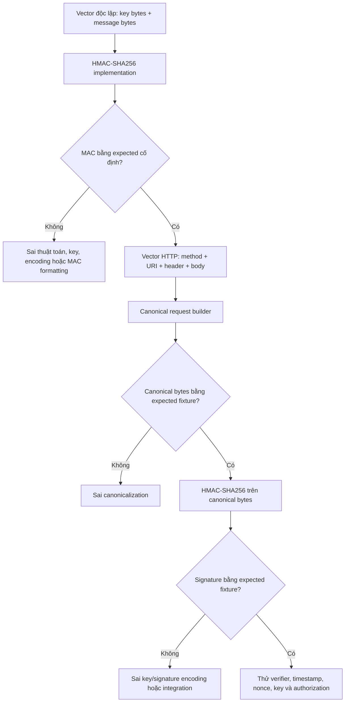

# Known signature test: kiểm thử HMAC bằng chữ ký kỳ vọng cố định

## 1. Bài toán và mục tiêu

Trong module `SECURITY_AUTHENTICATION_HMAC_REQUEST_AUTHENTICATION`, client gửi HTTP request có chữ ký **HMAC sử dụng shared secret**. Server xây **canonical request** theo một hợp đồng gồm phương thức HTTP, URI/query, header được ký và/hoặc digest của body, sau đó tự tính HMAC để kiểm tra chữ ký. Quy trình xác thực còn phải bảo vệ khỏi replay bằng timestamp/nonce, chấp nhận đúng phiên bản key khi rotation, xử lý thay đổi qua proxy/gateway và cuối cùng tách **authentication** khỏi **authorization**.

Lỗi khó phát hiện nhất thường không phải do thuật toán HMAC sai hoàn toàn, mà do client và server cùng tin rằng mình đang ký “cùng một request”, trong khi khác **một byte**: khoảng trắng, ký tự xuống dòng, percent encoding, thứ tự query, chữ hoa tên header hoặc raw body JSON. Một phép thử chỉ kiểm tra “client A ký rồi server A kiểm tra” có thể cho kết quả đúng ngay cả khi **cả hai cùng triển khai sai hợp đồng ký**.

**Known signature test** (cũng gọi là *known-answer test*, KAT) khắc phục nhược điểm này: với **key, dữ liệu đầu vào và thuật toán cố định**, bài test so sánh kết quả thực tế với **chữ ký kỳ vọng đã biết từ trước**, không được tính lại expected bằng chính hàm đang kiểm.

Bài thuộc chương **Testing HMAC**, tập trung vào **Known signature test**. Kết thúc bài, người học có thể:

1. Phân biệt test vector HMAC thuần với test vector canonical HTTP request.
2. Dùng kết quả HMAC-SHA256 đã công bố để kiểm tra việc sử dụng key/bytes/thuật toán.
3. Tạo một vector HTTP độc lập có method, URI, headers, body, SHA-256 digest, canonical bytes và expected HMAC cố định.
4. Viết unit test Java/JUnit 5, test từ chối khi **thay một byte**, test cross-language và kiểm thử sau proxy.
5. Tách lỗi signature với lỗi freshness, nonce replay, key rotation và authorization để test không phụ thuộc thời gian thực.
6. Tránh “test xanh giả” khi expected được tính bởi chính code under test, khi request body được serialize lại hoặc khi response 401/403 không được phân loại đúng.

> Tất cả key trong bài là **test key công khai, không dành cho production**. HMAC key và chữ ký thật của hệ thống không được ghi vào log, commit vào test fixtures hoặc đưa vào công cụ kiểm thử công khai.

## 2. Known-answer test phải cố định những gì?

### 2.1. Một vector là hợp đồng byte-level

Đối với HMAC, kết quả được xác định bởi:

\[
\operatorname{HMAC}_{SHA256}(K,M)
\]

trong đó `K` là **mảng byte của key** và `M` là **mảng byte của message**. HMAC-SHA256 tạo ra 32 byte (thường biểu diễn bằng 64 ký tự hex hoặc 44 ký tự Base64 có padding). Thay một byte của `K` hoặc `M` thường dẫn đến chữ ký khác hoàn toàn.

Một vector có giá trị cần nêu rõ:

| Thành phần | Ví dụ | Vì sao phải cố định |
| --- | --- | --- |
| Thuật toán | `HmacSHA256` | Tránh trộn SHA-256 digest với HMAC-SHA256 |
| Key | UTF-8 hoặc hex-encoded bytes | `"0b"` dạng text khác byte `0x0b` |
| Message/canonical request | Mảng UTF-8 có quy tắc newline chính xác | JSON tương đương về ý nghĩa vẫn có thể khác bytes |
| Output encoding | Hex chữ thường, không prefix `0x` | Tránh so chuỗi sai do biểu diễn |
| Expected MAC | Hằng số độc lập với code under test | Không cho phép lỗi hai phía cùng triệt tiêu |
| Phiên bản giao thức ký | `HMAC-V1` | Giúp detect thay đổi hợp đồng khi refactor |

Một bài kiểm tra đầy đủ đi qua hai lớp:



**Đừng nhầm:**

- `SHA256(body)` là digest thông thường của body; nó **không phải** chữ ký HMAC.
- `HMAC_SHA256(key, canonicalRequest)` mới là MAC xác thực message.
- Hex string `"6162"` là 4 byte ASCII khi dùng trực tiếp UTF-8, nhưng biểu diễn hex của 2 byte `0x61 0x62`.
- HMAC không tự ngăn replay: một chữ ký hợp lệ bị phát lại vẫn có thể xác minh khớp nếu thiếu timestamp/nonce check.

### 2.2. Tầng test nào cần expected độc lập?

| Tầng kiểm thử | Input | Oracle (kết quả chuẩn) | Phát hiện loại lỗi |
| --- | --- | --- | --- |
| Primitive HMAC | Key bytes + message bytes chuẩn | Known MAC từ bộ vector độc lập | Sai `Mac`, key bytes, output encoding |
| Canonical builder | Method/path/query/header/body đã định nghĩa | Canonical bytes cố định | Sai sort, normalize, whitespace, newline, digest |
| Request signer | Fixture HTTP + test key | Known signature cố định | Sai tích hợp canonical + HMAC |
| HMAC verifier | HTTP request có header ký | Chấp nhận/từ chối theo fixture | Mismatch, xử lý lỗi, constant-time comparison |
| Security pipeline | Signed HTTP request + policy test | HTTP status, principal, authority | Filter order, 401/403, request body, proxy |
| Replay/key lifecycle | Frozen clock, nonce store, key registry | Kết quả đã quy định theo trạng thái | Timestamp, nonce, rotation, revoked key |

Một unit test HMAC xanh **chưa** chứng minh servlet filter, reactive WebFilter, key rotation hoặc phân quyền đúng. Phải kiểm tra từng tầng rồi tích hợp các tầng với nhau.

## 3. Known HMAC-SHA256 vector độc lập: RFC 4231

Để kiểm HMAC primitive trước khi đưa HTTP vào, có thể dùng **test vectors HMAC-SHA-256 của RFC 4231**. Chúng đặc biệt hữu ích vì expected đã được công bố, không phụ thuộc vào hàm Java của dự án.

### 3.1. Test case 1: key là byte 0x0b lặp 20 lần

```text
Algorithm : HMAC-SHA-256
Key bytes : 0b0b0b0b0b0b0b0b0b0b0b0b0b0b0b0b0b0b0b0b
Data ASCII: Hi There
Data UTF-8: 4869205468657265
MAC hex   : b0344c61d8db38535ca8afceaf0bf12b881dc200c9833da726e9376c2e32cff7
```

Ở đây `0b` biểu diễn **một byte bằng hex**, không phải chuỗi ký tự `"0b"`. Data là 8 byte ASCII/UTF-8 của `Hi There`, không chứa newline cuối.

### 3.2. Test case 2: key và message ở dạng ASCII

```text
Algorithm : HMAC-SHA-256
Key ASCII : Jefe
Data ASCII: what do ya want for nothing?
MAC hex   : 5bdcc146bf60754e6a042426089575c75a003f089d2739839dec58b964ec3843
```

Hai vector trên được dùng để **cross-check thuật toán**. Nếu test case 1 sai mà test case 2 đúng, hãy kiểm việc parse hex key và encoding. Nếu cả hai sai, xem lại thuật toán, biến đầu vào hoặc output formatting.

### 3.3. JUnit 5 kiểm primitive không tự tạo expected

```java
import static org.junit.jupiter.api.Assertions.assertEquals;
import java.nio.charset.StandardCharsets;
import java.util.Arrays;
import java.util.HexFormat;
import javax.crypto.Mac;
import javax.crypto.spec.SecretKeySpec;
import org.junit.jupiter.api.Test;

class HmacSha256KnownAnswerTest {
    private static byte[] sign(byte[] key, byte[] data)
        throws Exception {
        Mac mac = Mac.getInstance("HmacSHA256");
        mac.init(new SecretKeySpec(key, "HmacSHA256"));
        return mac.doFinal(data);
    }

    @Test
    void rfc4231Case1() throws Exception {
        byte[] key = new byte[20];
        Arrays.fill(key, (byte) 0x0b);
        byte[] message =
            "Hi There".getBytes(StandardCharsets.UTF_8);

        String actual = HexFormat.of().formatHex(sign(key, message));
        assertEquals(
            "b0344c61d8db38535ca8afceaf0bf12b881dc200c9833da726e9376c2e32cff7",
            actual
        );
    }

    @Test
    void rfc4231Case2() throws Exception {
        byte[] key = "Jefe".getBytes(StandardCharsets.US_ASCII);
        byte[] message = "what do ya want for nothing?"
            .getBytes(StandardCharsets.US_ASCII);

        String actual = HexFormat.of().formatHex(sign(key, message));
        assertEquals(
            "5bdcc146bf60754e6a042426089575c75a003f089d2739839dec58b964ec3843",
            actual
        );
    }
}
```

Với Java 17+, `HexFormat` cho phép chuyển byte sang hex rõ ràng. Không dùng `new String(macBytes)` để lấy chữ ký; MAC là dữ liệu nhị phân có thể chứa byte không hợp lệ dưới charset được chọn.

## 4. Vector HTTP HMAC-V1: hợp đồng đầy đủ và có signature cố định

Sau khi primitive đã đúng, bước tiếp theo là kiểm **canonicalization**. Dưới đây là một vector **do bài học định nghĩa**, không phải canonical HTTP format bắt buộc của HTTP hay RFC 4231. Người triển khai có thể dùng hợp đồng khác nhưng phải cố định và version hóa trước khi test.

### 4.1. Bộ đầu vào không thay đổi

| Trường | Giá trị |
| --- | --- |
| Signature algorithm | HMAC-SHA256 |
| Body digest algorithm | SHA-256 |
| Key ID | `test-key-01` |
| Shared secret | UTF-8 text `test-only-hmac-shared-secret-v1` |
| Method | `POST` |
| Raw target | `/internal/orders?include=items&tenant=t1` |
| `Content-Type` | `application/json` |
| Timestamp | `2026-11-28T00:00:00Z` |
| Nonce | `nonce-test-0001` |
| Signature representation | Hex chữ thường, đúng 64 ký tự |
| Text encoding | UTF-8, không BOM |
| Delimiter giữa canonical fields | `LF`, một byte `0A` |
| Trailing newline của canonical request | **Không có** |

Body chính xác (không có whitespace thừa, không thêm `\n` sau dấu `}`):

```json
{"orderId":"ORD-1001","amount":100}
```

**Cực kỳ quan trọng:** Đây là JSON text chính xác 35 byte UTF-8 trong vector; không dùng pretty-print JSON, thêm khoảng trắng, tự đổi thứ tự hai field hoặc đổi `100` thành `100.0` rồi mong raw body digest vẫn bằng nhau. Khi biên tập tài liệu, code block có xuống dòng để hiển thị nhưng **body fixture không chứa newline ở cuối**.

Giá trị SHA-256 của **raw body bytes** trên:

```text
7a12265ea4b81c4f9080c7a907150a32ca93083163b6874ef81232160dcb9b4f
```

### 4.2. Định nghĩa canonical request HMAC-V1 của bài

Đúng thứ tự 8 dòng:

1. Chuỗi literal `HMAC-V1`.
2. HTTP method viết hoa `POST`.
3. **Raw path + raw query**, giữ nguyên dấu `?` và thứ tự/encoding query như fixture.
4. `content-type:application/json`.
5. `x-hmac-key-id:test-key-01`.
6. `x-hmac-nonce:nonce-test-0001`.
7. `x-hmac-timestamp:2026-11-28T00:00:00Z`.
8. SHA-256 body dạng lowercase hex như trên.

Các header ở dòng 4–7 có tên **lowercase**, sắp theo thứ tự đã chỉ định và **không có khoảng trắng trước/sau dấu hai chấm** trong canonical representation. `X-Hmac-Signature` không nằm trong phần được ký vì chính nó là kết quả MAC.

Canonical text chính xác:

```text
HMAC-V1
POST
/internal/orders?include=items&tenant=t1
content-type:application/json
x-hmac-key-id:test-key-01
x-hmac-nonce:nonce-test-0001
x-hmac-timestamp:2026-11-28T00:00:00Z
7a12265ea4b81c4f9080c7a907150a32ca93083163b6874ef81232160dcb9b4f
```

Khi ghép tám dòng bằng đúng **bảy ký tự LF**, không thêm newline cuối:

```text
CANONICAL_UTF8_BYTE_LENGTH = 241
SIGNATURE_HEX = 2cac17232b35ea94a2ccab57f954dc4ddbe816f9dc5fc11ea71f45edee56f21f
```

Chữ ký đó được tính bằng **HMAC-SHA256**, key là UTF-8 bytes của `test-only-hmac-shared-secret-v1`, message là **241 bytes** canonical request. Các giá trị digest và signature đã được tính độc lập với code Java ở những mục sau; expected phải được giữ thành hằng số trong test.

### 4.3. Wire HTTP fixture và giới hạn của cách hiển thị

Một request tương ứng:

```http
POST /internal/orders?include=items&tenant=t1 HTTP/1.1
Host: api.example.test
Content-Type: application/json
X-Hmac-Key-Id: test-key-01
X-Hmac-Timestamp: 2026-11-28T00:00:00Z
X-Hmac-Nonce: nonce-test-0001
X-Hmac-Signature: 2cac17232b35ea94a2ccab57f954dc4ddbe816f9dc5fc11ea71f45edee56f21f

{"orderId":"ORD-1001","amount":100}
```

Trong hợp đồng này **không ký `Host`**, nhưng server vẫn cần có chính sách trust/route/tenant riêng nếu host ảnh hưởng đến đích hoặc quyền truy cập. `X-Content-SHA256` không xuất hiện trên wire request mẫu vì digest được **tính từ raw body** và nằm trực tiếp ở dòng cuối canonical request; nếu giao thức thực dùng header chứa digest, phải quy định rõ việc ký/so sánh header đó.

Timestamp ở đây là dữ liệu test cố định, **không thể dùng làm request production** sau khi cửa sổ freshness đã hết. Khi kiểm qua HTTP verifier, phải inject một clock cố định phù hợp hoặc tạo một fixture khác có timestamp/signature mới đã được tính trước.

## 5. Test Java cho vector HTTP, tách canonical bytes và MAC

### 5.1. Một test fixture tự chứa

```java
import static org.junit.jupiter.api.Assertions.*;

import java.nio.charset.StandardCharsets;
import java.security.MessageDigest;
import java.util.HexFormat;
import javax.crypto.Mac;
import javax.crypto.spec.SecretKeySpec;
import org.junit.jupiter.api.Test;

class KnownHttpSignatureTest {
    static final String SECRET = "test-only-hmac-shared-secret-v1";
    static final String RAW_BODY =
        "{\"orderId\":\"ORD-1001\",\"amount\":100}";
    static final String BODY_SHA256_HEX =
        "7a12265ea4b81c4f9080c7a907150a32ca93083163b6874ef81232160dcb9b4f";
    static final String EXPECTED_HMAC_HEX =
        "2cac17232b35ea94a2ccab57f954dc4ddbe816f9dc5fc11ea71f45edee56f21f";

    static final String EXPECTED_CANONICAL = String.join("\n",
        "HMAC-V1",
        "POST",
        "/internal/orders?include=items&tenant=t1",
        "content-type:application/json",
        "x-hmac-key-id:test-key-01",
        "x-hmac-nonce:nonce-test-0001",
        "x-hmac-timestamp:2026-11-28T00:00:00Z",
        BODY_SHA256_HEX
    );

    static byte[] hmacSha256(byte[] key, byte[] message)
        throws Exception {
        Mac mac = Mac.getInstance("HmacSHA256");
        mac.init(new SecretKeySpec(key, "HmacSHA256"));
        return mac.doFinal(message);
    }

    @Test
    void bodyDigestMatchesIndependentFixture() throws Exception {
        byte[] rawBody = RAW_BODY.getBytes(StandardCharsets.UTF_8);
        byte[] digest = MessageDigest.getInstance("SHA-256")
            .digest(rawBody);

        assertEquals(BODY_SHA256_HEX,
            HexFormat.of().formatHex(digest));
    }

    @Test
    void canonicalBytesAndSignatureMatchKnownVector()
        throws Exception {
        // Ở production, dùng canonicalRequestBuilder để dựng chuỗi này.
        // Trong test, EXPECTED_CANONICAL là dữ liệu fixture bất biến.
        byte[] canonical =
            EXPECTED_CANONICAL.getBytes(StandardCharsets.UTF_8);

        assertEquals(241, canonical.length);
        assertEquals((byte) 'H', canonical[0]);
        assertEquals((byte) 'f', canonical[canonical.length - 1]);

        byte[] actual = hmacSha256(
            SECRET.getBytes(StandardCharsets.UTF_8),
            canonical
        );
        assertEquals(EXPECTED_HMAC_HEX,
            HexFormat.of().formatHex(actual));
    }
}
```

Đoạn code trên cho một **independent expected signature** nhưng muốn kiểm chính bộ dựng canonical trong dự án, hãy thay phần tạo `canonical` bằng output của **`canonicalRequestBuilder` thật**, sau đó:

```java
byte[] actualCanonical = canonicalRequestBuilder
    .build(method, rawPathAndQuery, signedHeaders, rawBody);

assertArrayEquals(
    EXPECTED_CANONICAL.getBytes(StandardCharsets.UTF_8),
    actualCanonical
);
assertEquals(
    EXPECTED_HMAC_HEX,
    HexFormat.of().formatHex(hmacSha256(
        SECRET.getBytes(StandardCharsets.UTF_8),
        actualCanonical
    ))
);
```

Đoạn này là **pseudocode tại ranh giới tích hợp**: `canonicalRequestBuilder`, `method`, `rawPathAndQuery`, `signedHeaders` là các API/test data do dự án định nghĩa; không phải API sẵn có của Spring Security. Mục tiêu là kiểm **bytes trước**, rồi mới kiểm signature; nếu chỉ so chữ ký cuối cùng, rất khó xác định lỗi nằm ở canonicalization hay MAC.

### 5.2. Không “tính expected” trong chính test

Sai:

```java
// Không có oracle độc lập: hai vế tính bằng cùng hàm.
byte[] actual = mySigner.sign(key, message);
byte[] expected = mySigner.sign(key, message);
assertArrayEquals(expected, actual);
```

Đoạn này luôn xanh nếu hàm trả cùng kết quả hai lần, kể cả khi **cùng sai** về newline, digest hoặc text encoding.

Đúng hơn:

```java
// Expected là dữ liệu chuẩn đã được kiểm tra trước đó.
assertEquals(
    "2cac17232b35ea94a2ccab57f954dc4ddbe816f9dc5fc11ea71f45edee56f21f",
    HexFormat.of().formatHex(mySigner.sign(testKey, canonicalBytes))
);
```

Với các phép test này, `testKey` và `canonicalBytes` phải lấy từ fixture đã công bố ở mục 4, không tạo giá trị expected bằng chính signer dưới test.

## 6. Negative tests: thay một byte phải bị từ chối

Known signature test mạnh nhất khi kết hợp **positive** và **negative cases**. Positive test chứng minh input hợp lệ cho ra expected; negative tests chứng minh verifier không chấp nhận request đã bị sửa.

| Thay đổi | Lý do expected phải khác/bị từ chối |
| --- | --- |
| `POST` → `PUT` | Method nằm trong canonical request |
| `/internal/orders` → `/internal/orders/` | Path khác bytes |
| Đổi thứ tự `include=items&tenant=t1` thành `tenant=t1&include=items` | Vector này ký **raw query theo thứ tự**, không tự sắp xếp |
| `include=items` → `include=Items` | Query thay đổi |
| Body `amount:100` → `amount:101` | Raw body digest khác |
| Thêm một space vào JSON | Raw body bytes khác dù JSON có thể tương đương |
| `Content-Type: application/json` → `application/json; charset=UTF-8` | Giá trị signed header khác trong hợp đồng này |
| Timestamp đổi một giây, signature giữ nguyên | Timestamp thuộc canonical |
| Nonce đổi một ký tự, signature giữ nguyên | Nonce thuộc canonical |
| Key ID đổi, signature giữ nguyên | Canonical/secret selection không còn khớp |
| Signature thiếu/ký tự hex sai/khác 64 ký tự | Sai định dạng hoặc MAC |
| Body digest client khai báo đúng nhưng body đổi | Verifier phải kiểm digest được tính từ body thực nhận |
| Header HMAC trùng với hai giá trị khác nhau | Request mơ hồ: phải từ chối theo single-value contract |

### 6.1. Ví dụ test verifier so sánh chữ ký cố định

Một helper ở **lớp test** để chứng minh tính chất MAC:

```java
import java.nio.charset.StandardCharsets;
import java.security.MessageDigest;
import java.util.HexFormat;
import static org.junit.jupiter.api.Assertions.*;

static boolean matchesExpected(
    byte[] testKey, byte[] canonicalBytes, String signatureHex
) throws Exception {
    // Giao thức minh họa chỉ chấp nhận lowercase hex đủ 64 ký tự.
    if (signatureHex == null ||
        !signatureHex.matches("[0-9a-f]{64}")) {
        return false;
    }
    byte[] supplied = HexFormat.of().parseHex(signatureHex);
    byte[] computed = hmacSha256(testKey, canonicalBytes);
    return MessageDigest.isEqual(computed, supplied);
}

@Test
void modifyingSignedMethodDoesNotMatchKnownSignature() throws Exception {
    byte[] key = SECRET.getBytes(StandardCharsets.UTF_8);
    byte[] original =
        EXPECTED_CANONICAL.getBytes(StandardCharsets.UTF_8);
    byte[] modified =
        EXPECTED_CANONICAL.replace("\nPOST\n", "\nPUT\n")
            .getBytes(StandardCharsets.UTF_8);

    assertTrue(matchesExpected(key, original, EXPECTED_HMAC_HEX));
    assertFalse(matchesExpected(key, modified, EXPECTED_HMAC_HEX));
}
```

Các method/constant trong ví dụ nằm trong cùng lớp fixture của mục 5; đoạn code trên là một **phần bổ sung** của lớp test đó. `MessageDigest.isEqual` giúp tránh so sánh byte-by-byte theo cách dừng ngay tại vị trí khác nhau trong mã ứng dụng. Điều này không thay thế kiểm timing của toàn bộ pipeline, parser hay thao tác truy key registry.

Ở test tích hợp, không chỉ gọi `matchesExpected`. Phải gửi HTTP request đã sửa tới **verifier thật**, xác minh request bị từ chối, controller không được chạy và không được dựng `Authentication`. Nếu test thay cả body và **tính lại chữ ký bằng đúng secret**, đó là một request mới hợp lệ và có thể được chấp nhận; bài test âm phải chủ đích **giữ signature cũ** hoặc dùng key sai.

### 6.2. Đừng đổi byte trong phần không được ký rồi kết luận verifier hỏng

Nếu giao thức không ký `X-Request-Id`, việc đổi giá trị header đó mà giữ nguyên signature **có thể vẫn cho MAC khớp** — đây không phải lỗi của HMAC. Cần xác định threat model: header nào ảnh hưởng danh tính, tenant, authorization, routing hoặc body semantics phải được ký hoặc được kiểm soát bằng ranh giới tin cậy khác.

Một negative test chỉ có ý nghĩa khi **trường bị thay nằm trong canonical request theo hợp đồng**, hoặc có một validation rule độc lập yêu cầu từ chối.

## 7. Cần tách chữ ký hợp lệ khỏi timestamp và nonce

Known-answer vector ở mục 4 chứa timestamp cố định `2026-11-28T00:00:00Z`. Nếu chạy integration test nhiều ngày sau, verifier production với cửa sổ freshness 5 phút sẽ trả 401 **dù chữ ký chính xác**.

### 7.1. Dùng frozen Clock

Giả sử hợp đồng cho phép timestamp lệch tối đa 300 giây so với đồng hồ server. Với Java:

```java
import java.time.Clock;
import java.time.Instant;
import java.time.ZoneOffset;

Clock frozenClock = Clock.fixed(
    Instant.parse("2026-11-28T00:00:30Z"),
    ZoneOffset.UTC
);
```

Khi inject clock này vào freshness validator, timestamp của vector cách giờ server 30 giây và **nằm trong window**. Khi test expiry:

- Clock ở `2026-11-28T00:00:30Z` → fresh.
- Clock ở `2026-11-28T00:05:01Z` → timestamp cũ hơn 300 giây, từ chối theo policy minh họa.
- Clock ở `2026-11-27T23:54:59Z` → timestamp nằm quá xa tương lai, từ chối nếu policy giới hạn cả hai chiều.

Đừng dùng `Instant.now()`/`Thread.sleep(...)` trong known-answer fixture: test sẽ phụ thuộc thời gian máy chạy CI, timezone hoặc clock skew của môi trường.

### 7.2. Nonce store phải mới cho mỗi test positive

Trong một lần chạy verifier:

1. Lần đầu dùng nonce `nonce-test-0001` với client/key scope hợp lệ → có thể xác thực.
2. Gửi lại **cùng** signed request → phải bị chặn replay theo hợp đồng.
3. Nếu muốn lặp một **positive** test độc lập, reset/isolate nonce store test hoặc tạo fixture có nonce khác và **expected signature tương ứng đã được tính độc lập**.

Không reset nonce store production chỉ để chạy smoke test. Với hệ thống nhiều instance, dùng một nonce store có thao tác **check-and-record nguyên tử** để hai request song song với cùng nonce không cùng được chấp nhận.

### 7.3. Bảo đảm nguyên nhân lỗi được phân loại đúng

| Tình huống | HMAC MAC comparison | Freshness/replay | Kết quả theo contract minh họa |
| --- | --- | --- | --- |
| Request vector đúng, Clock đúng, nonce chưa dùng | PASS | PASS | Authenticated |
| Request vector đúng, Clock quá xa | PASS | FAIL timestamp | 401 |
| Request vector đúng, nonce đã dùng | PASS | FAIL nonce | 401 |
| Body sửa, signature cũ | FAIL | Không được xem thành công | 401 |
| Key không được chấp nhận | Không cần tiếp tục | Không được xem thành công | 401 |
| Key registry/nonce store không truy cập được | Không thể kết luận tin cậy | Không hoàn tất | Fail closed; lỗi 5xx theo policy |
| HMAC đúng, client thiếu authority | PASS | PASS | 403 khi authorization từ chối |

Chữ ký HMAC hợp lệ không tự thay thế permission check. Authorities lấy từ registry/policy phía server, không lấy từ `X-Role` hay body do client tự khai báo.

## 8. Test key rotation mà không làm mất tính xác định

Với HMAC shared secret, client thường có `X-Hmac-Key-Id` để verifier chọn key version. Khi rotation:

- `STAGED`: key mới chưa được chấp nhận theo policy.
- `ACTIVE`: key đang được phép ký request.
- `RETIRING`: key cũ có thể được chấp nhận trong overlap được định nghĩa.
- `REVOKED`: key bị thu hồi, không được chấp nhận kể cả khi chữ ký khớp.

Một bộ known-answer tests tốt cần hai loại fixture:

**Fixture chữ ký:** Mỗi key version có secret bytes và expected MAC **cố định** cho cùng canonical request hoặc request version tương ứng. Expected MAC được duyệt theo dữ liệu chuẩn, không tính lại trong assertion.

**Fixture trạng thái:** Key registry giả lập cung cấp trạng thái/key owner/scope, thời điểm effective và revision tại mỗi ca kiểm thử. Thay đổi trạng thái **không làm thay đổi HMAC primitive**, mà thay đổi quyết định verifier **chấp nhận** MAC đó hay không.

| Test | MAC với test key | Key state | Kỳ vọng |
| --- | --- | --- | --- |
| Key cũ ACTIVE, MAC đúng | PASS | ACTIVE | Authenticated nếu freshness/replay đúng |
| Key mới STAGED, MAC đúng | PASS | STAGED | Từ chối xác thực |
| Key mới ACTIVE, MAC đúng | PASS | ACTIVE | Authenticated |
| Key cũ RETIRING, trước `acceptUntil` | PASS | RETIRING | Có thể được chấp nhận theo policy |
| Key cũ RETIRING, sau `acceptUntil` | PASS | RETIRING quá hạn | Từ chối xác thực |
| Key cũ REVOKED, MAC đúng | PASS | REVOKED | Từ chối xác thực |
| Key ID mới nhưng ký bằng secret cũ | FAIL với key được chọn | ACTIVE của key mới | Từ chối xác thực |
| Registry lỗi khi lấy key | Không thể kết luận | Unknown | Fail closed |

Không để verifier dùng secret cũ khi key ID trỏ tới key mới chỉ để “giúp client qua giai đoạn migration”. Nếu hệ thống cần key fallback, đó phải là **hợp đồng versioned rõ ràng**, giới hạn key candidate, thời gian chấp nhận và kiểm tra chống timing/key enumeration — không thử tất cả secret vô hạn đến khi MAC khớp.

## 9. Kiểm thử HTTP qua Spring MVC, WebFlux và gateway

### 9.1. Test từ signer đến verifier

Không nên dừng ở `Mac.doFinal(...)`. Với Spring MVC:

- Tạo HTTP request bằng `MockMvc` đi qua **SecurityFilterChain thật**.
- Gửi đúng method/path/query/header/body bytes đã dùng tạo fixture.
- Assert status, principal và việc controller được/không được gọi.
- Nếu filter đọc body để hash, kiểm controller `@RequestBody` vẫn nhận đúng body (request wrapper có giới hạn và replay đúng).
- Tránh dùng `@WithMockUser` để “chứng minh” HMAC: nó có thể bypass bước xác minh chữ ký.

Ví dụ code ở mức contract test:

```java
@Test
void knownSignatureIsAcceptedByHttpFilter() throws Exception {
    // Test app inject frozenClock và nonceStore sạch.
    mockMvc.perform(post("/internal/orders")
            .queryParam("include", "items")
            .queryParam("tenant", "t1")
            .contentType("application/json")
            .header("X-Hmac-Key-Id", "test-key-01")
            .header("X-Hmac-Timestamp", "2026-11-28T00:00:00Z")
            .header("X-Hmac-Nonce", "nonce-test-0001")
            .header("X-Hmac-Signature", EXPECTED_HMAC_HEX)
            .content(RAW_BODY.getBytes(StandardCharsets.UTF_8)))
        .andExpect(status().isCreated());
}
```

Đây là một fragment trong test class có `MockMvc`, `RAW_BODY`, `EXPECTED_HMAC_HEX`, endpoint giả trả `201 Created`, registry test có key/authority phù hợp. **Cần bảo đảm raw query mà mock request tạo ra đúng chính xác `/internal/orders?include=items&tenant=t1`**; API test framework và servlet container có thể canonicalize/query-encode khác nhau. Đừng kết luận HMAC sai chỉ vì framework build request khác fixture.

Với Spring WebFlux, dùng `WebTestClient` và một `SecurityWebFilterChain` thực để kiểm body reactive `Flux<DataBuffer>` được verifier đọc và cung cấp lại cho handler đúng bytes. Không gọi `block()` trong `WebFilter`, không tạo subscription riêng bằng `subscribe()` trước authentication, và không dùng `SecurityContextHolder` kiểu ThreadLocal thay cho `ReactiveSecurityContextHolder`.

### 9.2. Cross-language signer và server

Một giao thức HMAC triển khai bằng Java ở server có thể có client Python, Go, JavaScript hoặc Kotlin. Tất cả phải sinh **cùng chữ ký** với **cùng vector đầu vào**. Ví dụ quy trình:

1. Lưu fixture key, body bytes, method, raw target, signed headers, canonical bytes và expected hex trong bộ test đã review.
2. Mỗi SDK tự canonicalize và ký fixture, không import/khởi chạy implementation Java của server.
3. Tất cả SDK kiểm expected hex cố định `2cac...f21f`.
4. Server nhận những request SDK tạo ra, so canonical representation và kết quả HMAC.
5. Bổ sung Unicode, percent encoding, query trùng, header trùng và payload nhị phân để bắt những khác biệt giữa ngôn ngữ.

Một chữ ký đúng ở HTTP/1.1 nhưng sai qua HTTP/2 có thể do header casing/pseudo-header và cách proxy dựng `Host`. Bộ test cần đánh giá **hợp đồng canonicalization**, không kiểm các byte của wire header block vốn được HTTP intermediaries phép biến đổi.

### 9.3. Gateway/proxy có thể làm expected thay đổi thế nào?

| Tình huống | Rủi ro đối với known signature | Cách kiểm |
| --- | --- | --- |
| Gateway rewrite `/public/orders` → `/internal/orders` | Backend nhìn raw path khác client đã ký | Quy định ký external hay internal target; dùng trusted metadata hoặc verify ở edge |
| Proxy sắp lại query/percent encoding | Raw URI bytes khác | Kiểm query canonicalization version và input raw path/query |
| HTTP/2 lowercase header names | Tên field thay casing | Chuẩn hóa tên theo hợp đồng, không ký casing trên wire |
| Header `Content-Type` bị thêm `charset` | Signed header value đổi | Giữ giá trị hoặc normalize theo quy tắc được công bố |
| Duplicate security header bị gộp | Key ID/nonce/signature có thể bị hiểu khác | Edge reject ambiguity, backend reject nhiều giá trị không hợp đồng |
| Gateway decompress/serialize lại JSON | Raw body digest không còn khớp | Verify trước biến đổi hoặc đổi giao thức ký có chủ đích |
| Proxy tin `X-Forwarded-*` do client tự đặt | Canonical authority/tenant có thể bị giả mạo | Strip/rewrite tại trusted edge; backend chỉ tin proxy được kiểm soát |
| Một phần instance dùng key revision cũ | Signature đúng với key mới nhưng một node từ chối | Theo dõi key rotation và policy revision theo node |

Đừng sửa bài test bằng cách thay expected theo output backend “nhìn thấy” mỗi khi có gateway thay đổi. Trước tiên phải quyết định **representation nào thuộc hợp đồng ký**. Nếu cần đổi, tạo **vector mới có version mới**, ghi tài liệu migration và kiểm hồi quy cả vector cũ khi còn hỗ trợ.

## 10. Bộ negative vector tối thiểu nên có trong CI

Một test suite đủ mạnh không chỉ có hai case happy path. Tối thiểu:

| Nhóm | Test case | Kết quả mong đợi |
| --- | --- | --- |
| Primitive | RFC 4231 case 1, case 2 | Expected MAC khớp 100% |
| Canonical | Bộ 241 bytes HMAC-V1 | Bytes và digest đúng fixture |
| Positive HTTP | Method/URI/headers/body/signature khớp; clock frozen | Authenticated, authority theo registry |
| Method | POST → PUT, chữ ký cũ | Authentication reject |
| Path | Thêm slash hoặc thay encoding | Reject theo raw target contract |
| Query | Đảo thứ tự query, đổi `%20`/`+` | Theo hợp đồng, không âm thầm normalize khác fixture |
| Header | Thay Content-Type/nonce/timestamp | Reject nếu giữ signature cũ |
| Header ambiguity | Duplicate `X-Hmac-Key-Id`/`X-Hmac-Signature` | Reject trước khi chọn giá trị tùy tiện |
| Body | Thêm 1 whitespace, đổi thứ tự JSON fields | Reject nếu raw body ký |
| Body buffer | Filter đã đọc body nhưng controller cần `@RequestBody` | Controller vẫn thấy đủ byte khi authenticated |
| Signature | Sai 1 ký tự, missing, không phải hex, sai độ dài | Reject; không log signature/secret |
| Key | Missing/unknown/revoked/rotating | Accept/reject theo lifecycle policy |
| Time | Clock trước/sau cửa sổ | Reject; không dựa vào giờ thật của CI |
| Nonce | Gửi lại cùng nonce trên một instance | Chỉ lần đầu có thể thành công |
| Distributed replay | Hai request nonce giống nhau qua hai instance | Chỉ một lần được chấp nhận theo atomic store |
| Authorization | Chữ ký hợp lệ nhưng thiếu authority | 403, không phải lỗi HMAC |
| Gateway | Rewrite URI, header normalization, body transform | Kết quả phù hợp canonicalization contract |
| Logs/metrics | Key/secret/nonce/signature sentinels | Không lộ qua logs/metric labels |

Trong kiểm thử bảo mật, **không assert mỗi status code một cách đơn độc**. Ví dụ 401 có thể do HMAC signature sai, timestamp quá hạn, nonce replay hoặc key lookup outage bị map sai. Nên có reason code nội bộ **do server kiểm soát**, trace/test hook an toàn và assertion controller không chạy khi authn fail.

## 11. Những lỗi khiến known signature test cho kết quả “xanh giả”

### 11.1. Expected được tính bởi signer đang test

Khi actual và expected đến từ cùng hàm, test không có giá trị phát hiện lỗi chung. Dùng RFC vector độc lập hoặc MAC được tính bởi một implementation độc lập và review hằng số.

### 11.2. Chỉ assert MAC, không assert canonical bytes

Một developer có thể thay luật sort query hay normalize header, vô tình đổi message được ký. Nếu cả client và server cùng cập nhật code, test “ký rồi xác minh” vẫn xanh, còn client khác sẽ gãy. Dùng byte-for-byte canonical fixture và versioning.

### 11.3. Dùng default charset, Unicode normalization hoặc line ending của OS

`String.getBytes()` không chỉ rõ charset và việc nối bằng `System.lineSeparator()` dễ làm kết quả khác nhau giữa môi trường. Với HMAC-V1 của bài: **UTF-8**, separator **LF `0A`**, **không** trailing newline. Không tự áp dụng NFC/NFD Unicode nếu giao thức không quy định.

### 11.4. Parse JSON rồi serialize lại để băm body

Hai JSON có thể tương đương về dữ liệu nhưng khác raw bytes. Nếu hợp đồng ký raw bytes, verifier phải hash **request body thực nhận**; khi đọc trước controller phải bảo toàn bytes cho downstream, có giới hạn kích thước và release buffers hợp lệ.

### 11.5. Chỉ kiểm prefix hoặc ký tự của hex MAC

Không so sánh 8 ký tự đầu hoặc dùng equals trong một vòng lặp dừng sớm do tự viết. Parse chữ ký theo định dạng nghiêm ngặt, kiểm đúng 32 bytes, tính HMAC rồi so với `MessageDigest.isEqual` hoặc primitive constant-time phù hợp. Không trả expected signature trong lỗi/log.

### 11.6. Test từ chối vì timestamp hết hạn nhưng gán nhãn signature mismatch

Vector cố định chứa timestamp năm 2026; nếu chạy ở thời điểm khác, 401 có thể đến từ freshness. Freeze clock hoặc tách primitive test khỏi freshness integration; dùng nonce store độc lập từng positive test.

### 11.7. Chỉ test one-instance nonce

Replay store local có thể chặn lần hai trên cùng instance nhưng **không chặn request phát lại sang instance khác**. Test song song và phân tán phải xác minh check-and-record nguyên tử theo scope client/key.

### 11.8. Nhầm xác thực với phân quyền

HMAC signature đúng có thể cho Authentication thành công nhưng vẫn thiếu `ORDER_CREATE`. Test phải đòi **403 Forbidden**, không kết luận chữ ký sai. Authorities được cấp từ server registry/policy, không từ header role do client tự gửi.

### 11.9. Để test key dùng chung với môi trường thật

Hằng số `SECRET` trong fixture là **công khai**. Không dùng lại ở staging/production, không đẩy real key vào source code/test snapshot và không ghi secret vào CI logs/artifacts.

## 12. Tổ chức fixture và quy trình cập nhật vector

Để giảm trùng lặp giữa Java server và các SDK, một nhóm có thể quản lý fixture theo một schema chung. Ví dụ **dạng minh họa**, có thể lưu vào tài nguyên test của dự án ở một bước triển khai được phép:

```yaml
testCaseId: http-hmac-v1-001
algorithm: HmacSHA256
key:
  encoding: utf8
  value: test-only-hmac-shared-secret-v1
request:
  method: POST
  rawTarget: /internal/orders?include=items&tenant=t1
  contentType: application/json
  keyId: test-key-01
  nonce: nonce-test-0001
  timestamp: '2026-11-28T00:00:00Z'
  bodyUtf8: '{"orderId":"ORD-1001","amount":100}'
canonical:
  version: HMAC-V1
  byteLength: 241
  lineEnding: LF
  trailingNewline: false
expected:
  sha256BodyHex: 7a12265ea4b81c4f9080c7a907150a32ca93083163b6874ef81232160dcb9b4f
  hmacHex: 2cac17232b35ea94a2ccab57f954dc4ddbe816f9dc5fc11ea71f45edee56f21f
```

Hình thức YAML không thay thế việc lưu **canonical expected bytes**: loader phải dựng chúng đúng thứ tự dòng theo hợp đồng và assert byte length 241, hoặc fixture giữ thêm canonical byte sequence/base64 được review. Chỉ metadata YAML có thể không đủ để phân biệt whitespace/line ending khi công cụ format tệp tự sửa.

Quy trình thay đổi hợp đồng nên là:

1. Định nghĩa rõ vì sao cần thay đổi (ví dụ thêm signed header, đổi cách sắp xếp query).
2. Tăng `canonicalization_version` hoặc cơ chế negotiation tương đương; tránh đổi ngầm HMAC-V1 đang được client sử dụng.
3. Sinh expected canonical bytes và signature bằng **một nguồn độc lập**, review cùng test key cố định.
4. Chạy vectors trên client Java, JavaScript, Go và verifier server.
5. Kiểm thử proxy/gateway và cả request có body lớn/khác charset nếu API hỗ trợ.
6. Chạy các vectors phiên bản cũ trong thời hạn backwards compatibility; kiểm thời điểm ngừng chấp nhận theo policy.
7. Lưu lịch sử sửa fixture có review; không tự cập nhật expected dựa vào actual mới chỉ để làm CI xanh.

## 13. Checklist triển khai Known signature test

1. **Chọn expected độc lập:** Bắt đầu từ RFC 4231 HMAC-SHA256 vectors để kiểm JCA primitive.
2. **Cố định byte representation:** Chỉ rõ UTF-8, key bytes, LF, raw path/query, signed headers, body SHA-256 và không trailing newline.
3. **Assert canonical bytes trước MAC:** Lấy output của builder thật và so byte-for-byte với fixture đã review.
4. **Assert HMAC bằng literal cố định:** Với HMAC-V1 của bài, expected là `2cac17232b35ea94a2ccab57f954dc4ddbe816f9dc5fc11ea71f45edee56f21f`.
5. **Test mutation một byte:** Sửa method, URI, signed header, raw body, timestamp, nonce và signature; giữ nguyên chữ ký khi cần kiểm rejection.
6. **Freeze time và isolate nonce:** Dùng `Clock.fixed`, nonce store mới hoặc fixture nonce khác có expected MAC mới.
7. **Kiểm key lifecycle:** STAGED/ACTIVE/RETIRING/REVOKED và key ID mapping, không bypass rotation policy.
8. **Test filter chain thực:** Spring MVC `MockMvc` hoặc WebFlux `WebTestClient`, controller chỉ chạy sau xác thực; body vẫn đọc được.
9. **Kiểm 401/403 đúng nghĩa:** Authentication failure ≠ authorization denial.
10. **Kiểm client đa ngôn ngữ và gateway:** HTTP/1.1/HTTP/2, header normalization, query encoding, URI rewrite và body transformation.
11. **Giữ bí mật production:** Chỉ dùng test secret công khai, không log raw request có credential, giới hạn fixture và CI artifacts.
12. **Version hóa bộ vector:** Không đổi expected theo actual mà không review thay đổi hợp đồng ký.

**Điểm cần nhớ:** Một **known signature test** chỉ đáng tin khi **message bytes, key bytes và expected MAC** được cố định từ một nguồn độc lập. Hãy kiểm HMAC primitive bằng vector chuẩn, kiểm canonical HTTP bytes bằng fixture riêng, rồi kiểm verifier trong SecurityFilterChain cùng timestamp, nonce, key rotation và quyền truy cập. Khi đó, test có thể bắt những sai lệch chỉ một byte giữa client, server và proxy — loại sai lệch mà test “tự ký rồi tự xác minh” thường bỏ sót.
