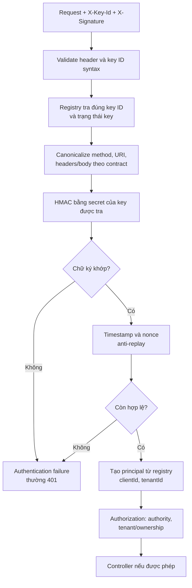

# Wrong key ID test trong xác thực HTTP request bằng HMAC

## 1. Vì sao phải kiểm thử key ID sai?

Trong module `SECURITY_AUTHENTICATION_HMAC_REQUEST_AUTHENTICATION`, client tạo chữ ký **HMAC** từ shared secret và **canonical request**. Hợp đồng ký có thể bao gồm method, URI/query, một số header và body hoặc body digest. Server tra key bằng mã định danh (key ID), tính lại HMAC, kiểm tra timestamp/nonce chống replay, xác định client/tenant và mới áp dụng chính sách phân quyền.

Key ID thường được gửi dưới dạng một header như `X-Key-Id`. Nó **không phải secret**, nhưng là dữ liệu do phía gọi khai báo. Một request mang `X-Key-Id: partner-a-v2` chưa chứng minh người gửi nắm secret của key đó. Nếu hệ thống gán danh tính theo key ID trước khi xác minh chữ ký, hoặc tự thử các key khác khi ID được khai sai, attacker có thể tạo ra các tình huống sai danh tính, sai quyền hoặc làm mờ quá trình thu hồi khóa.

Chương **Testing HMAC** yêu cầu bài **Wrong key ID test**: kiểm tra việc server phản ứng thế nào khi trường định vị khóa sai, không tồn tại, bị sửa sau ký hoặc không còn được phép sử dụng.

Sau bài học, bạn có thể:

- Phân biệt **key ID không tồn tại** với **key ID tồn tại nhưng signature ký bằng secret của key khác**.
- Tạo ca kiểm thử âm tính có kiểm soát: các yếu tố method, URI, body, timestamp và nonce đều đúng; chỉ key ID bị sai.
- Kiểm tra tính ràng buộc giữa key ID, secret, client ID và tenant ID sau xác thực.
- Khẳng định fail-closed: trả lỗi xác thực, không cấp `Authentication`, không gọi nghiệp vụ, không thử khóa ngoài hợp đồng.
- Viết unit test với JUnit, integration test Spring MVC (`MockMvc`), WebFlux (`WebTestClient`) và E2E qua gateway/proxy.
- Kiểm thử key rotation, revocation, duplicate key ID, retry và các rủi ro key enumeration.

## 2. Key ID có vai trò gì trong giao thức ký?

Ví dụ đăng ký ba khóa:

| Key ID | Client đã đăng ký | Tenant | Trạng thái | Secret (khái niệm) |
| --- | --- | --- | --- | --- |
| `reporting-v1` | `partner-reporting` | `tenant-a` | retiring, có thể còn hiệu lực trong overlap | `K_A1` |
| `reporting-v2` | `partner-reporting` | `tenant-a` | active | `K_A2` |
| `fulfillment-v1` | `partner-fulfillment` | `tenant-b` | active | `K_B1` |

Các giá trị `K_A1`, `K_A2`, `K_B1` ở bảng chỉ là ký hiệu, **không phải secret thật**.

Đường đi bình thường:



**Không có bước “nếu sai thì thử key ID khác cho đến khi khớp”.** Với hợp đồng yêu cầu key ID tường minh, mỗi request chỉ được xác minh bằng key version phù hợp với ID đã cung cấp và trạng thái được registry cho phép. Nếu server tự thử tất cả secret còn lưu, key ID mất ý nghĩa trong audit, key cũ có nguy cơ được chấp nhận ngoài policy và kết quả mapping client có thể mơ hồ.

Key ID cũng **khác client ID**. Trong giai đoạn rotation, `reporting-v1` và `reporting-v2` có thể cùng thuộc `partner-reporting`. Sau khi HMAC hợp lệ, danh tính phải lấy từ **registry tin cậy**, không lấy từ header `X-Client-Id` hoặc từ key ID tự suy diễn bằng cách cắt chuỗi.

## 3. Hợp đồng canonical request phải ràng buộc key ID

Để test có ý nghĩa, client và server cần cùng một hợp đồng ký ở mức **bytes**, không chỉ “cả hai cùng dùng HMAC-SHA-256”.

Giả sử API chọn canonical request gồm đúng sáu dòng UTF-8, phân cách bằng LF (byte `0A`), không có LF cuối:

```text
UPPERCASE_METHOD
RAW_PATH_AND_QUERY
KEY_ID
TIMESTAMP
NONCE
LOWERCASE_HEX_SHA256_RAW_BODY
```

Ví dụ một request được ký:

```http
POST /integrations/orders?source=partner HTTP/1.1
Host: api.example.test
X-Key-Id: reporting-v2
X-Timestamp: 2026-11-28T03:15:00Z
X-Nonce: test-nonce-001
X-Signature: <base64-hmac>
Content-Type: application/json

{"orderId":"O-17"}
```

Trong contract minh họa, key ID được chép vào **dòng thứ ba** của canonical bytes. `X-Signature` chứa MAC đầu ra, **không** tự đưa vào chuỗi ký. Nếu ứng dụng còn cần bảo vệ `Content-Type`, `Host`/authority hoặc một header nghiệp vụ khác, phải bổ sung theo **hợp đồng ký được version hóa**; không để client tự bỏ signed headers bắt buộc.

Khi client ký bằng key `reporting-v2`, phép tính đúng là:

```text
sigA = Base64(HMAC-SHA256(K_A2, UTF8(canonical(keyId="reporting-v2"))))
```

Sau đó attacker hoặc test đổi **chỉ header** thành `X-Key-Id: fulfillment-v1` mà giữ nguyên `sigA`. Backend phải tra `K_B1`, canonicalize với `fulfillment-v1` rồi tính:

```text
expectedB = HMAC-SHA256(K_B1, UTF8(canonical(keyId="fulfillment-v1")))
```

Hai MAC phải không khớp trong tình huống bình thường, nên request **không được xác thực**. Cũng vì key ID thuộc canonical bytes, việc sửa key ID mà không ký lại bị phát hiện ngay cả trong tình huống hai key version bị cấu hình trùng secret — dù việc dùng chung secret giữa client/tenant là cấu hình không nên có.

**Ghi chú:** một số giao thức HMAC khác ràng buộc key ID trong credential scope hoặc cấu trúc ký riêng, không nhất thiết là dòng thứ ba. Test phải bám **contract thật**, nhưng luôn phải xác định rõ request được ràng buộc với key nào.

## 4. Phân loại các ca “wrong key ID”

Không nên gộp mọi negative test thành một chuỗi header tùy ý. Các trường hợp có đường lỗi và mục tiêu khác nhau:

| Test case | Tình huống | Kỳ vọng chính |
| --- | --- | --- |
| ID không tồn tại | `X-Key-Id: unknown-123` | Không chọn secret; trả lỗi xác thực chung |
| ID hợp lệ, sai secret | Header trỏ B, chữ ký tạo bằng secret A | Signature mismatch; không cấp principal A hoặc B |
| ID bị sửa sau ký | Ký theo A rồi thay key ID thành B, giữ MAC | Bị từ chối; key ID được ràng buộc bởi contract |
| Thiếu ID | Không có `X-Key-Id` | Không fallback key mặc định |
| ID rỗng/sai cú pháp | Blank, quá dài, ký tự cấm | Reject theo policy trước lookup sâu |
| Header lặp | Hai `X-Key-Id` với giá trị khác nhau | Reject request mơ hồ |
| Key đã thu hồi | ID có trong registry nhưng `revoked` | Không dùng secret bị thu hồi để xác thực |
| Key chưa hiệu lực hoặc đã hết hạn | ID đúng nhưng ngoài validity window | Reject theo lifecycle policy |
| Key đúng thuộc client khác | Có chữ ký hợp lệ bằng B nhưng yêu cầu tài nguyên tenant A | Xác thực thành B rồi kiểm tra authorization A; không mạo nhận A |
| Key registry unavailable | Không thể xác nhận key đang hoạt động | **Fail closed** bằng lỗi hạ tầng, không fallback |
| Gateway làm mất/sửa ID | Proxy stripping/rewrite signed header | Từ chối hoặc xác minh theo trust boundary đã định nghĩa |

Một test có giá trị cần biết **vì sao** nó thất bại. Nếu request đồng thời dùng timestamp quá cũ, nonce đã sử dụng và chữ ký sai, status `401` không đủ chứng minh hệ thống kiểm tra key ID đúng.

## 5. Phân biệt HTTP 401, 403, 400 và 503

| Kết quả xử lý | HTTP thường dùng | Phạm vi lỗi |
| --- | --- | --- |
| Key ID không tồn tại, sai version, MAC sai, key revoked | `401 Unauthorized` | Không thể xác thực bằng credentials hợp lệ |
| Thiếu key ID hoặc signature trên endpoint bắt buộc HMAC | `401 Unauthorized` | Thiếu bằng chứng xác thực |
| Định dạng credential/header HMAC không hợp lệ | Thường `401` theo HMAC auth contract | Lỗi credentials, không tự suy ra lỗi business |
| HTTP message syntax không hợp lệ | `400 Bad Request` do parser/container | Lỗi cú pháp HTTP ở tầng thấp hơn |
| HMAC hợp lệ với key B nhưng client B thiếu authority | `403 Forbidden` | Đã xác thực, thiếu quyền |
| HMAC hợp lệ nhưng truy cập tài nguyên của tenant khác | `403` hoặc `404` theo policy | Authorization hoặc che giấu tài nguyên |
| Key registry hoặc nonce store mất kết nối | Lỗi server phù hợp, thường `503 Service Unavailable` | Không thể hoàn tất xác thực; fail closed |
| Vượt giới hạn request body | `413 Content Too Large` | Tài nguyên/size limit, không đồng nghĩa key ID sai |

Đối với HTTP `401`, server phải tuân thủ ngữ nghĩa authentication challenge: trường `WWW-Authenticate` cần tương thích với scheme đã công bố. Nếu API có scheme HMAC tự định nghĩa, phải mô tả cú pháp challenge của nó; không gửi challenge `Bearer` cho endpoint HMAC-only.

Không trả `200` rồi ghi `"wrong key"` trong body, không chuyển sang anonymous với quyền nghiệp vụ, cũng không biến lỗi kho key thành lỗi key ID không tồn tại nếu điều đó khiến team vận hành không phát hiện outage.

Phản hồi công khai nên nhất quán, ví dụ:

```http
HTTP/1.1 401 Unauthorized
Content-Type: application/problem+json
Cache-Control: no-store
WWW-Authenticate: HMAC realm="integrations"

{
  "type": "about:blank",
  "title": "Unauthorized",
  "status": 401,
  "code": "INVALID_REQUEST_AUTHENTICATION",
  "requestId": "req-test-42"
}
```

`HMAC` là tên scheme giả định của ứng dụng, cần tài liệu hóa. Không trả về các thông báo công khai riêng như “`key ID exists`” hay “`valid key, bad MAC`”. Reason code chi tiết nên ở **audit log nội bộ** sau khi đã hạn chế truy cập.

## 6. Test fixtures: tách đúng một biến để tránh false positive

Đặt hai client và các key **dùng riêng cho test**:

```text
Clock.fixed = 2026-11-28T03:15:00Z

Client A:
  clientId = partner-reporting
  tenantId = tenant-a
  keyId    = reporting-v2
  secret   = A-TEST-SECRET-DO-NOT-USE-IN-PRODUCTION
  status   = ACTIVE
  roles    = [ORDER_READ]

Client B:
  clientId = partner-fulfillment
  tenantId = tenant-b
  keyId    = fulfillment-v1
  secret   = B-TEST-SECRET-DO-NOT-USE-IN-PRODUCTION
  status   = ACTIVE
  roles    = [ORDER_READ, ORDER_CREATE]
```

Điều kiện của test `wrong key ID`:

1. **Positive control:** request ký bằng A, header A, timestamp đúng, nonce mới và body chính xác phải xác thực thành **client A**.
2. **Negative case:** tạo request tương tự nhưng header key ID B, **giữ nguyên signature do A đã ký**. Chỉ khác một biến so với positive control.
3. **Đồng hồ cố định:** injection `Clock` giúp test không vô tình thất bại vì thời gian thực trôi qua.
4. **Nonce độc lập giữa các test:** reset store hoặc dùng nonce mới cho mỗi ca. Nếu gửi positive trước rồi negative với cùng nonce vào cùng store, negative có thể bị chặn vì replay thay vì wrong key.
5. **Registry chứa cả A và B:** xác nhận test đang kiểm tra sai lựa chọn key, không phải đường lỗi do registry không chứa B.
6. **Đối chiếu đủ bằng chứng:** khẳng định `401`, principal không được thiết lập, controller không chạy và không có thay đổi nghiệp vụ.

Đối với test dùng cùng một request object để “tamper header”, phải lưu chữ ký lúc đầu và **không gọi signer lại** sau khi thay key ID. Nếu signer được gọi lại với key B, request có thể trở nên hợp lệ và test không còn là bài kiểm tra tampering.

## 7. Helper ký request độc lập với Spring Security

Một test signer nhỏ dùng JDK giúp tạo positive control và các ca tamper có chủ đích. Đoạn mã dưới đây mô phỏng chính xác hợp đồng sáu dòng ở phần 3, dùng bytes của body để tính SHA-256 rồi Base64 HMAC-SHA-256:

```java
import java.nio.charset.StandardCharsets;
import java.security.GeneralSecurityException;
import java.security.MessageDigest;
import java.util.Base64;
import java.util.HexFormat;
import javax.crypto.Mac;
import javax.crypto.spec.SecretKeySpec;

public final class HmacTestSigner {
    private HmacTestSigner() {}

    public static String sign(
            byte[] secret,
            String method,
            String rawPathAndQuery,
            String keyId,
            String timestamp,
            String nonce,
            byte[] body) throws GeneralSecurityException {

        byte[] bodyDigest = MessageDigest.getInstance("SHA-256")
                .digest(body);
        String bodyHashHex = HexFormat.of().formatHex(bodyDigest);

        String canonical = String.join("\n",
                method.toUpperCase(java.util.Locale.ROOT),
                rawPathAndQuery,
                keyId,
                timestamp,
                nonce,
                bodyHashHex);

        Mac mac = Mac.getInstance("HmacSHA256");
        mac.init(new SecretKeySpec(secret, "HmacSHA256"));
        byte[] signature = mac.doFinal(
                canonical.getBytes(StandardCharsets.UTF_8));
        return Base64.getEncoder().encodeToString(signature);
    }
}
```

Các `secret` trong ví dụ là test-only bytes, không phải shared secret production. `String.join` không thêm LF cuối. Với test không có body, dùng `new byte[0]` thay cho `null`, vì SHA-256 của body rỗng cũng là một digest có giá trị xác định.

**Hạn chế quan trọng:** signer và verifier không nên chỉ dùng chung một canonicalizer chưa kiểm chứng. Nếu cùng mắc một lỗi normalize URI, test integration có thể vẫn xanh. Hãy bổ sung **test vector độc lập** có canonical bytes/expected HMAC đã xác nhận để phát hiện lỗi đó.

Khi API có signed headers khác, hãy mở rộng cả signer, test vector và verifier theo contract thật, không copy signer sáu dòng này rồi xem như đã bảo vệ mọi field.

## 8. Verifier mẫu: tra đúng key, không fallback

Để minh họa test ở tầng unit, giả định registry có API trả key **đang được phép dùng**:

```java
import java.util.Optional;

public interface HmacKeyRegistry {
    // Phải kiểm tra trạng thái active/retiring allowed/revoked,
    // client/tenant mapping và version theo policy.
    Optional<UsableHmacKey> findUsable(String keyId);
}

public record UsableHmacKey(
        String clientId, String tenantId, byte[] secret) {
    public UsableHmacKey {
        secret = secret.clone();
    }
    @Override
    public byte[] secret() {
        return secret.clone();
    }
}

public record VerifiedHmacClient(String clientId, String tenantId) {}
```

Một verifier đơn giản tập trung **chỉ vào key lookup và MAC**, phần timestamp/nonce nằm ở tầng authentication provider phía sau:

```java
import java.security.GeneralSecurityException;
import java.security.MessageDigest;
import java.util.Base64;
import java.util.regex.Pattern;
import org.springframework.security.authentication.BadCredentialsException;

public final class HmacKeyIdVerifier {
    private static final Pattern KEY_ID =
            Pattern.compile("[A-Za-z0-9][A-Za-z0-9._-]{0,63}");
    private final HmacKeyRegistry registry;

    public HmacKeyIdVerifier(HmacKeyRegistry registry) {
        this.registry = registry;
    }

    public VerifiedHmacClient verify(
            String keyId, String signatureBase64,
            String method, String rawPathAndQuery,
            String timestamp, String nonce, byte[] body) {

        if (keyId == null || !KEY_ID.matcher(keyId).matches()
                || signatureBase64 == null) {
            throw new BadCredentialsException("Invalid HMAC credentials");
        }

        // Chính xác một lần lookup theo key ID từ request.
        UsableHmacKey key = registry.findUsable(keyId)
                .orElseThrow(() -> new BadCredentialsException(
                        "Invalid HMAC credentials"));

        final byte[] received;
        try {
            received = Base64.getDecoder().decode(signatureBase64);
        } catch (IllegalArgumentException ex) {
            throw new BadCredentialsException(
                    "Invalid HMAC credentials");
        }
        if (received.length != 32) {
            throw new BadCredentialsException("Invalid HMAC credentials");
        }

        try {
            // HmacTestSigner chỉ đại diện cách dựng canonical bytes;
            // trong production phải dùng canonicalizer/verifier riêng.
            String expectedBase64 = HmacTestSigner.sign(
                    key.secret(), method, rawPathAndQuery,
                    keyId, timestamp, nonce, body);
            byte[] expected = Base64.getDecoder().decode(expectedBase64);

            if (!MessageDigest.isEqual(expected, received)) {
                throw new BadCredentialsException(
                        "Invalid HMAC credentials");
            }
        } catch (GeneralSecurityException ex) {
            // Lỗi crypto provider khác với credential sai.
            throw new IllegalStateException(
                    "Unable to compute HMAC", ex);
        }
        return new VerifiedHmacClient(
                key.clientId(), key.tenantId());
    }
}
```

**Đây là verifier phục vụ minh họa test, không phải implementation production hoàn chỉnh.** Nó chưa parse HTTP header đa giá trị, chưa chặn replay, chưa kiểm tra timeout hoặc handle exception hạ tầng theo chính sách, và gọi `HmacTestSigner` để tránh lặp mã. Implementation thực tế phải dùng một canonicalizer được đặc tả độc lập và không để việc test dùng chung hàm che giấu bug.

Điều cần quan sát: verifier chỉ tra `registry.findUsable(keyId)`, tính MAC bằng secret của record trả về, rồi lấy `clientId/tenantId` từ record **sau khi chữ ký đã khớp**. Nếu không tìm thấy record hoặc MAC sai, không có đường code nào “thử tất cả keys”.

`MessageDigest.isEqual` là lựa chọn phù hợp hơn so chuỗi MAC thủ công vì hạn chế rò rỉ thời gian theo nội dung. Tuy nhiên, sự khác biệt thời gian giữa lookup tồn tại và lookup không tồn tại vẫn có thể tạo oracle ở cấp request; phần 12 bàn về biện pháp giảm thiểu.

## 9. Unit test: đúng ID thành công, sai ID bị từ chối

Một `Map` in-memory là đủ cho test thuần verifier. Test fixture này giả định Java 17+, JUnit 5 và AssertJ:

```java
import static org.assertj.core.api.Assertions.assertThat;
import static org.junit.jupiter.api.Assertions.assertThrows;
import java.nio.charset.StandardCharsets;
import java.util.Map;
import java.util.Optional;
import org.junit.jupiter.api.Test;
import org.springframework.security.authentication.BadCredentialsException;

class WrongKeyIdUnitTest {
    static final String A_ID = "reporting-v2";
    static final String B_ID = "fulfillment-v1";
    static final byte[] A_SECRET =
            "A-TEST-SECRET-DO-NOT-USE-IN-PRODUCTION"
                    .getBytes(StandardCharsets.UTF_8);
    static final byte[] B_SECRET =
            "B-TEST-SECRET-DO-NOT-USE-IN-PRODUCTION"
                    .getBytes(StandardCharsets.UTF_8);

    final HmacKeyRegistry registry = keyId -> Optional.ofNullable(
            Map.of(
                    A_ID, new UsableHmacKey(
                            "partner-reporting", "tenant-a", A_SECRET),
                    B_ID, new UsableHmacKey(
                            "partner-fulfillment", "tenant-b", B_SECRET))
                    .get(keyId));
    final HmacKeyIdVerifier verifier = new HmacKeyIdVerifier(registry);

    static final String METHOD = "POST";
    static final String TARGET = "/integrations/orders?source=partner";
    static final String TIMESTAMP = "2026-11-28T03:15:00Z";
    static final byte[] BODY =
            "{\"orderId\":\"O-17\"}".getBytes(StandardCharsets.UTF_8);

    @Test
    void correctKeyIdAuthenticatesExpectedClient() throws Exception {
        String nonce = "nonce-positive";
        String signature = HmacTestSigner.sign(
                A_SECRET, METHOD, TARGET, A_ID, TIMESTAMP, nonce, BODY);

        VerifiedHmacClient principal = verifier.verify(
                A_ID, signature, METHOD, TARGET, TIMESTAMP, nonce, BODY);

        assertThat(principal.clientId()).isEqualTo("partner-reporting");
        assertThat(principal.tenantId()).isEqualTo("tenant-a");
    }

    @Test
    void wrongButExistingKeyIdCannotAuthenticateAsEitherClient()
            throws Exception {
        String nonce = "nonce-wrong-existing-id";
        String signatureSignedByA = HmacTestSigner.sign(
                A_SECRET, METHOD, TARGET, A_ID, TIMESTAMP, nonce, BODY);

        // Chỉ sửa X-Key-Id: A -> B; KHÔNG tính lại chữ ký.
        assertThrows(BadCredentialsException.class, () -> verifier.verify(
                B_ID, signatureSignedByA,
                METHOD, TARGET, TIMESTAMP, nonce, BODY));
    }

    @Test
    void unknownKeyIdFailsInsteadOfFallingBackToKnownKey()
            throws Exception {
        String nonce = "nonce-unknown-id";
        String signatureSignedByA = HmacTestSigner.sign(
                A_SECRET, METHOD, TARGET, A_ID, TIMESTAMP, nonce, BODY);

        assertThrows(BadCredentialsException.class, () -> verifier.verify(
                "not-registered", signatureSignedByA,
                METHOD, TARGET, TIMESTAMP, nonce, BODY));
    }
}
```

Test này chỉ kiểm tra MAC và mapping key → client theo verifier mẫu; timestamp và nonce được coi là input canonical, **chưa được xác nhận freshness**. Chúng phải được kiểm tra thêm trong test provider/integration. Bộ ba test giúp phân biệt positive control, wrong ID có trong registry và unknown ID không tồn tại.

### 9.1. Một test khẳng định không fallback key

Với mock/spy `HmacKeyRegistry`, test được giao nên assert **lookup đúng một key**:

```java
// Pseudocode Mockito: registry có cả key A và B.
verify(registrySpy, times(1)).findUsable("fulfillment-v1");
verify(registrySpy, never()).findUsable("reporting-v2");
verifyNoMoreInteractions(registrySpy);
```

Đây là phần bổ sung cho `wrongButExistingKeyId...` khi thay registry in-memory bằng Mockito spy. Không dùng assertion này với chính instance `registry` thường nếu chưa biến nó thành spy. Tùy thiết kế cache, đếm lookup ở tầng key resolver đúng semantics; test cần bảo đảm không có đường fallback dù MAC không khớp.

## 10. Integration test Spring MVC bằng MockMvc

Unit test không chứng minh `X-Key-Id` được HTTP filter parse đúng, Spring Security chain chạy thật, controller không được gọi, hoặc lỗi được trả đúng HTTP status. Với Spring MVC, dùng:

```java
@SpringBootTest
@AutoConfigureMockMvc(addFilters = true)
class WrongKeyIdMvcTest {
    @Autowired MockMvc mockMvc;

    // Fixture: inject Clock.fixed(...) vào HMAC verifier;
    // registry chứa hai test keys A/B ACTIVE;
    // nonce store được reset hoặc namespace riêng từng test;
    // orderCommandService là spy để kiểm tra side effect.

    @Test
    void changingKeyIdAfterSigningReturns401AndDoesNotCreateOrder()
            throws Exception {
        byte[] body = "{\"orderId\":\"O-17\"}"
                .getBytes(StandardCharsets.UTF_8);
        String timestamp = "2026-11-28T03:15:00Z";
        String nonce = "mvc-wrong-key-001";
        String target = "/integrations/orders";

        String signature = HmacTestSigner.sign(
                A_SECRET, "POST", target, A_ID, timestamp, nonce, body);

        mockMvc.perform(post(target)
                .header("X-Key-Id", B_ID) // key ID bị sửa sau ký
                .header("X-Timestamp", timestamp)
                .header("X-Nonce", nonce)
                .header("X-Signature", signature)
                .contentType(MediaType.APPLICATION_JSON)
                .content(body))
            .andExpect(status().isUnauthorized());

        verify(orderCommandService, never()).createOrder(any());
    }
}
```

Đây là ví dụ **test fixture minh họa**: `A_ID`, `B_ID`, `A_SECRET`, `orderCommandService` là các field/helper phải khai báo trong test class thực tế; `createOrder(...)` đại diện API của service ứng dụng, không phải Spring API. Có thể thay spy bằng kiểm tra database/test-event queue không có side effect. Để test thực sự đi qua HMAC verifier, không dùng `addFilters = false` và không dùng `@WithMockUser` để gắn sẵn authentication.

**Điều kiện không được bỏ qua:** nếu timestamp thật của server khác `2026-11-28T03:15:00Z`, test có thể `401` chỉ vì hết hạn. Phải inject `Clock.fixed(Instant.parse("2026-11-28T03:15:00Z"), ZoneOffset.UTC)` hoặc dùng một timestamp được tạo theo injected clock. Nonce phải mới và store phải ở trạng thái được kiểm soát.

### 10.1. Thêm positive control trong cùng lớp integration

Để chứng minh `401` của negative case không phải do security chain bị cấu hình sai, thêm một test **header A + signature A** với nonce khác, đòi kết quả authorization phù hợp. Ví dụ, nếu `partner-reporting` chỉ có `ORDER_READ`, hãy dùng `GET` endpoint yêu cầu `ORDER_READ` cho positive control, **không** dùng `POST` cần `ORDER_CREATE` rồi mong `201`.

Một negative test key ID B trên `POST` có thể trả `401` đúng dù client A thiếu quyền POST; nhưng positive control chỉ có ý nghĩa nếu endpoint và authority cho phép request hợp lệ đi qua.

## 11. WebFlux: kiểm thử với WebTestClient

Spring WebFlux dùng `WebFilter`/`AuthenticationWebFilter`, `ReactiveAuthenticationManager` và Reactor `Context` thay cho Servlet `OncePerRequestFilter`. Test nên dùng `WebTestClient` và bảo đảm security chain thật được chạy.

Ví dụ:

```java
@SpringBootTest(webEnvironment = SpringBootTest.WebEnvironment.RANDOM_PORT)
@AutoConfigureWebTestClient
class WrongKeyIdWebFluxTest {
    @Autowired WebTestClient webTestClient;

    @Test
    void wrongExistingKeyIdIsRejected() throws Exception {
        byte[] body = "{\"orderId\":\"O-17\"}"
                .getBytes(StandardCharsets.UTF_8);
        String timestamp = "2026-11-28T03:15:00Z";
        String nonce = "webflux-wrong-key-001";
        String signature = HmacTestSigner.sign(
                A_SECRET, "POST", "/integrations/orders",
                A_ID, timestamp, nonce, body);

        webTestClient.post()
                .uri("/integrations/orders")
                .header("X-Key-Id", B_ID)
                .header("X-Timestamp", timestamp)
                .header("X-Nonce", nonce)
                .header("X-Signature", signature)
                .contentType(MediaType.APPLICATION_JSON)
                .bodyValue(body)
                .exchange()
                .expectStatus().isUnauthorized();
    }
}
```

Tương tự MVC, snippet dùng các hằng/fixtures test cần được khai báo trong lớp và `Clock` phải được cố định theo timestamp. Nếu stack HTTP/ngữ nghĩa body của test client chuyển đổi bytes so với cách signer tạo digest, test có thể fail do body mismatch; hãy xác nhận body gửi thật là **cùng mảng bytes** đã ký và không bị transform.

Trong reactive verifier, key registry và nonce store nên có API non-blocking hoặc được cô lập khỏi event-loop nếu bắt buộc dùng thư viện blocking. Không gọi `Mono.block()` hoặc `subscribe()` thủ công trong `WebFilter`. Sai key ID vẫn phải kết thúc publisher bằng authentication failure; không cho downstream chạy trong lúc verifier chưa hoàn tất.

Với `@WebFluxTest` dạng slice, cần import/cấu hình `SecurityWebFilterChain`, converter/manager và test registry phù hợp; một test không gắn chain HMAC không kiểm thử được logic yêu cầu.

## 12. Key enumeration và khác biệt thời gian lỗi

Nếu response cho key ID không tồn tại khác response cho signature sai, attacker có thể dò danh sách key ID đang hoạt động. Vì vậy nên sử dụng **cùng thông điệp lỗi công khai** cho các tình huống credentials không hợp lệ:

```json
{
  "code": "INVALID_REQUEST_AUTHENTICATION",
  "requestId": "req-61b"
}
```

Nhưng response body giống nhau **chưa đủ** để loại bỏ mọi side channel:

- Lookup ID không tồn tại có thể trả về ngay, còn ID tồn tại dẫn tới bước HMAC; thời gian phản hồi có thể khác.
- Một nhánh có thể phát sinh thêm header hoặc cookie, hoặc dùng status khác, tạo sự khác biệt có thể quan sát.
- Lỗi tra key có thể bị log verbatim vào response và vô tình tiết lộ trạng thái key.
- Rate limit có thể áp dụng khác nhau cho key ID có/không có thật.

Hướng giảm thiểu tùy threat model: giới hạn lưu lượng tại edge, kiểm soát số lần thử, thống nhất phản hồi `401` và headers, sanitize lỗi, quan sát chênh lệch độ trễ. Hệ thống có yêu cầu chống enumeration cao có thể cân nhắc làm công việc mật mã giả với một dummy key không gắn client khi ID không tồn tại để giảm chênh lệch rõ rệt, nhưng **không được** dùng dummy key để xác thực và không thể hứa timing hoàn toàn đồng nhất qua mạng.

Test nên so sánh response **status, cấu trúc JSON, mã công khai, header nhạy cảm** giữa `unknown key ID` và `known key ID + bad MAC`. Kiểm thử timing cần thực hiện với nhiều mẫu và phân tích thống kê, không viết assertion cứng kiểu “chênh dưới 1 ms” trên CI thường vì máy chạy có jitter.

## 13. Key rotation, revocation và wrong key ID test

Hai key version của cùng client có thể cùng hợp lệ trong giai đoạn overlap:

```text
reporting-v1 -> partner-reporting / tenant-a / RETIRING (allowed)
reporting-v2 -> partner-reporting / tenant-a / ACTIVE
```

Ma trận rotation nên bao gồm:

| Request | Khi overlap cho phép v1 | Sau khi revoke v1 |
| --- | --- | --- |
| ID v1, signature tính bằng secret v1 | Có thể xác thực nếu policy cho phép | `401` |
| ID v2, signature tính bằng secret v2 | Xác thực bình thường | Xác thực bình thường |
| ID v1, signature bằng secret v2 | `401` | `401` |
| ID v2, signature bằng secret v1 | `401` | `401` |
| ID không tồn tại, signature bằng bất kỳ secret | `401` | `401` |

Khi key bị revoke, verifier phải kiểm tra trạng thái hiện tại theo policy và cache invalidation. Một `Mac` object hay bản secret cache được khởi tạo trước đó **không được bypass** việc kiểm tra revocation. Với bài test, cố định thời gian và thay state của registry để xác nhận thời điểm chuyển hiệu lực.

Nếu v1 và v2 cùng ánh xạ tới một client, các request hợp lệ phải tạo cùng `clientId` và authorities hiện hành; không tạo một client mới chỉ vì key ID đổi. Đừng trả key version nào đã tồn tại trong error response ngoài vì làm lộ cấu trúc rotation.

### 13.1. Race giữa lookup và thu hồi

Trong hệ thống phân tán, request có thể bắt đầu trước lúc revoke nhưng kết thúc sau. Cần quy định **thời điểm hiệu lực** và giới hạn cache consistency: request nào được phép hoàn tất, revocation phải được phản ánh trong khoảng bao lâu và điều gì xảy ra khi registry tạm lỗi.

Test concurrency không nên giả định có linearizability toàn hệ thống nếu contract/registry chưa cam kết. Nhưng phải chứng minh: sau điểm revocation có hiệu lực theo thiết kế, request mới không thể xác thực bằng key cũ; khi registry unavailable phải fail closed thay vì sử dụng một key vô thời hạn.

## 14. Parser và duplicate `X-Key-Id`

HTTP header name so khớp không phân biệt chữ hoa/thường, nhưng **giá trị key ID** nên là định danh opaque với canonicalization được quy định rõ; thông thường so **đúng giá trị**, không tự lowercase, trim hoặc decode lại tùy tiện.

Các ca cần test:

| Header client gửi | Kỳ vọng theo policy chặt |
| --- | --- |
| Không có `X-Key-Id` | `401` |
| `X-Key-Id:` rỗng | `401` |
| `X-Key-Id: reporting-v2` | Tra đúng `reporting-v2` |
| `x-key-id: reporting-v2` | Cùng tên header HTTP, tra đúng giá trị |
| `X-Key-Id: REPORTING-V2` | Khác `reporting-v2` nếu ID case-sensitive |
| Hai header `X-Key-Id` khác giá trị | Reject, không chọn cái đầu/cuối tùy ý |
| Header gộp thành `reporting-v2, fulfillment-v1` | Reject nếu contract chỉ cho một ID |
| ID quá dài/không thuộc charset cho phép | Reject trước registry |
| ID có Unicode không được hợp đồng cho phép | Reject, không normalize ngầm |
| ID có CR/LF hoặc ký tự điều khiển | HTTP parser/validator phải reject; không ghi nguyên vào log |

Trong Servlet, `request.getHeader("X-Key-Id")` có thể chỉ trả một giá trị; khi contract yêu cầu chính xác **một** giá trị, dùng `getHeaders(...)` và kiểm tra số lượng/định dạng phù hợp. WebFlux có thể dùng `exchange.getRequest().getHeaders().get("X-Key-Id")` để kiểm tra danh sách. Cả hai đều phải xem xét cách gateway gộp/split headers trước khi tới backend.

Không thể trông cậy mã ứng dụng nhìn thấy mọi malformed HTTP header, vì gateway hoặc container có thể đã loại bỏ request trước khi filter chạy. Cần kiểm thử parser/edge theo đường mạng thật.

## 15. Kiểm thử gateway/proxy và signed key ID

Giả sử client ký:

```text
POST /public-api/orders?source=partner
X-Key-Id: reporting-v2
```

Gateway rewrite thành:

```text
POST /integrations/orders?source=partner
X-Key-Id: reporting-v2
```

Ngay cả khi key ID đúng, signature có thể thất bại nếu client ký **external request-target** còn backend canonicalize **internal request-target**. Vì thế test wrong key ID phải có **positive control qua cùng gateway** để chứng minh canonical contract end-to-end đã đúng.

Các biến thể cần thử:

- Gateway giữ nguyên `X-Key-Id` nhưng rewrite path/Host: HMAC phải xác minh theo hợp đồng ký đã xác định, không thử nhiều canonical variants ngầm.
- Gateway loại `X-Key-Id` khi HTTP/1.1 `Connection: X-Key-Id`: backend từ chối request thiếu evidence, không fallback.
- Gateway gộp duplicate headers hoặc thay casing tên header: parser phải xử lý tên đúng semantics và từ chối giá trị mơ hồ.
- HTTP/1.1 ↔ HTTP/2/HTTP/3: hop-by-hop headers thay đổi, nhưng key ID thuộc bằng chứng ứng dụng bắt buộc phải nhất quán hoặc request bị từ chối.
- Nếu gateway **tự xác minh HMAC** rồi chuyển danh tính nội bộ: backend chỉ được tin một assertion đã được gateway bảo vệ, không tin `X-Verified-Client` client tự điền.

**Không log** shared secret, raw signature, body nhạy cảm hay canonical request đầy đủ để debug. Dùng request ID/trace ID, route key, contract version và reason code nội bộ có kiểm soát.

## 16. Kiểm thử không bypass authentication/authorization

Một wrong-key-ID test chỉ assert `401` là cần thiết nhưng **chưa đủ**. Phải xác nhận:

1. HMAC verifier đã thực sự chạy, không phải request bị chặn bởi route mismatch hoặc một authentication scheme khác.
2. `Authentication` đã xác thực không được tạo và không đặt principal của A/B vào `SecurityContext`.
3. Business service, repository và message publisher không phát sinh side effect.
4. Nonce không bị claim khi MAC chưa khớp, nếu pipeline xác minh MAC trước khi claim nonce theo thiết kế.
5. Registry không tìm hoặc thử các key khác ngoài key ID được khai báo.
6. Audit event ghi `auth.failure` với `client_ref=unknown`, không dùng key ID chưa xác minh như danh tính.
7. Không rò secret, expected MAC, danh sách key hợp lệ hoặc lý do chi tiết ở response.
8. Một request **ký đúng** theo key B vẫn được xác thực thành B; nếu B thiếu quyền trên tenant A thì `403` hoặc `404` theo authorization policy, không “nâng” B thành A.

### 16.1. Tránh để wrong-key test bị che bởi nonce replay

Nếu test gửi request hợp lệ rồi thay key ID và dùng **cùng nonce**, tùy thiết kế scope nonce, lần sau có thể bị từ chối vì replay trước khi bạn chứng minh bug lựa chọn key. Sử dụng **nonce mới** cho negative test, hoặc assert riêng thứ tự các bước: MAC mismatch không được ghi nonce.

Nonce store phải hỗ trợ thao tác **insert-if-absent nguyên tử** với TTL bao phủ cửa sổ timestamp, đặc biệt khi server có nhiều instance. Test concurrency gửi cùng nonce với chữ ký đúng cần xác nhận nhiều nhất một request được chấp nhận; đây là bài test chống replay, **khác** test key ID sai.

### 16.2. Tách authentication với authorization

Hai trường hợp:

```text
Case A:
  Header key ID = fulfillment-v1
  Signature     = tính bằng reporting-v2
  Outcome       = 401 (không xác thực được)

Case B:
  Header key ID = fulfillment-v1
  Signature     = tính đúng bằng fulfillment-v1
  Principal     = partner-fulfillment / tenant-b
  Request       = đọc đơn hàng tenant-a
  Outcome       = 403 hoặc 404 (xác thực đúng, không có quyền)
```

Nếu test Case B lại mong `401`, bài test đang trộn xác thực với phân quyền và có thể che lấp bug: một client đúng chữ ký nhưng truy cập chéo tenant không phải do key ID sai.

## 17. Ma trận test tổng hợp và tiêu chí hoàn thành

| # | Case | Kỳ vọng | Điều cần assert thêm |
| --- | --- | --- | --- |
| 1 | Đúng key ID, đúng MAC | Auth success | Principal chính xác; nonce được claim |
| 2 | ID B có thật, MAC được ký bằng A | `401` | Không principal A/B, không side effect |
| 3 | ID không tồn tại, MAC ký bằng A | `401` | Không fallback, không lộ key list |
| 4 | Thiếu/blank key ID | `401` | Không chọn default key |
| 5 | ID quá dài/sai cú pháp | `401` theo contract | Không chạy tra registry tốn kém |
| 6 | Header `X-Key-Id` trùng/mâu thuẫn | Reject | Không tùy ý chọn một ID |
| 7 | Key A bị revoke | `401` | Không dùng secret cache cũ |
| 8 | Key đang trong overlap | Thành công nếu policy cho phép | Đúng clientId/tenantId hiện tại |
| 9 | ID v1, MAC ký bằng v2 | `401` | Không fallback sang version khác |
| 10 | Registry unavailable | Lỗi server/fail closed | Không chấp nhận request, có alert hạ tầng |
| 11 | Signature sai nhưng header tự khai client A | `401` | Audit không gắn A như verified client |
| 12 | B ký đúng nhưng gọi tài nguyên tenant A | `403/404` | Không lộ dữ liệu tenant A |
| 13 | MAC sai, timestamp và nonce hợp lệ | `401` | Đúng nhánh MAC/key, không bị lỗi freshness che |
| 14 | Nonce lặp với MAC đúng | `401` | Atomic anti-replay, không side effect lần hai |
| 15 | Key ID qua gateway/proxy | Đúng contract hoặc reject | Không tin header nội bộ client tự gửi |
| 16 | Response unknown ID vs known ID/bad MAC | Cùng lỗi công khai | Không key enumeration dễ dàng |

**Definition of done** cho bài Wrong key ID test: có positive control; có negative cho ID tồn tại và ID không tồn tại; timestamp/nonce/body được kiểm soát; xác minh security chain thật; bảo đảm không có principal/side effect; không fallback key; có test rotation và key revocation; có E2E proxy nếu hệ thống triển khai qua gateway.

## 18. Bài thực hành

Giả sử API gồm:

- `GET /integrations/orders/{id}` yêu cầu `ORDER_READ`.
- `POST /integrations/orders` yêu cầu `ORDER_CREATE`.
- `partner-reporting` thuộc `tenant-a`, có `ORDER_READ`, key `reporting-v2`.
- `partner-fulfillment` thuộc `tenant-b`, có `ORDER_READ` và `ORDER_CREATE`, key `fulfillment-v1`.

Hãy thực hiện:

1. Xác định canonical contract và test vector có key ID, timestamp, nonce và digest body.
2. Viết signer test độc lập theo contract, tạo positive control với `reporting-v2` và endpoint GET có quyền phù hợp.
3. Ký bằng A nhưng gửi `X-Key-Id: fulfillment-v1`, giữ nguyên mọi signed fields khác và dùng nonce mới. Khẳng định `401`.
4. Thử `X-Key-Id: unknown` cùng chữ ký A. Assert không có default/fallback key.
5. Viết các ca thiếu, duplicate, format sai, uppercase value, đã hết hạn/revoked và rotation overlap.
6. Với `MockMvc`/`WebTestClient`, bảo đảm filter chain thật được gắn; assert request không tạo side effect và audit không gắn verified client cho MAC sai.
7. Tạo case `fulfillment-v1` ký đúng nhưng truy cập order `tenant-a`, khẳng định từ chối authorization độc lập với HMAC.
8. Gửi positive/negative qua gateway thực để phân biệt lỗi key ID với canonical mismatch do rewrite URI/header.
9. Kiểm tra public error không phân biệt ID tồn tại/không tồn tại, nội bộ có request ID và reason code phù hợp để điều tra.

### Câu hỏi tự kiểm tra

**1. Vì sao không thể coi `X-Key-Id` là danh tính client đã xác thực?** Vì nó do client khai báo và có thể giả mạo. Chỉ sau khi MAC cùng policy key/freshness hợp lệ mới dùng registry xác lập principal.

**2. Nếu ký bằng key A rồi đổi header thành key B nhưng tính lại signature bằng key B thì còn là wrong-key-ID test không?** Không. Đó có thể là một request hoàn toàn hợp lệ của B; để test tamper phải **giữ MAC đã ký bằng A**.

**3. Vì sao cần positive control trước negative test?** Để xác nhận contract, test clock, nonce fixture, security chain và endpoint đã cấu hình đúng. Nếu tất cả request đều bị `401`, test sai key sẽ xanh giả.

**4. Có nên thử mọi key khi request gửi key ID sai?** Không nếu contract yêu cầu key ID tường minh. Phải dùng đúng key được tra và còn hiệu lực; không fallback hoặc dùng key đã revoke.

**5. Vì sao response unknown ID và known ID/bad signature nên giống nhau?** Để hạn chế kẻ tấn công dùng API dò key ID đang tồn tại. Nội bộ vẫn có reason code có kiểm soát.

**6. Vì sao key registry unavailable khác key ID không tồn tại?** Không thể xác minh trạng thái secret là lỗi hạ tầng; hệ thống phải fail closed và trả lỗi server phù hợp, không đoán một default key.

**7. HMAC theo key B hợp lệ nhưng truy cập tenant A trả `401` hay `403`?** Thông thường đã xác thực thành B, sau đó bị `403` hoặc `404` theo policy tài nguyên; không phải lỗi wrong key ID.

**8. Timestamp hết hạn có làm wrong-key-ID test đáng tin không?** Không. `401` có thể đến từ timestamp dù key lookup/MAC có bug; cần đồng hồ cố định và timestamp hợp lệ.

## 19. Ghi nhớ

**Wrong key ID test** phải chứng minh rằng key ID và secret **không thể bị tráo đổi** để tạo ra một client đã xác thực. Hãy kiểm tra cả ID không tồn tại, ID có thật nhưng chữ ký dùng secret khác, ID bị sửa sau ký và key không còn được phép dùng. Với hợp đồng có key ID bắt buộc, server phải tra **đúng key version** và không fallback sang những secret khác.

Một test tốt không chỉ kiểm tra `401`: nó kiểm soát timestamp/nonce, có positive control, chứng minh không cấp principal và không có side effect, kiểm tra key lifecycle, phân biệt `401` với `403`, không lộ danh sách key và có ca qua gateway/proxy. Xác thực HMAC đúng là điều kiện để tạo danh tính đáng tin; **authorization** và ràng buộc tenant vẫn là bước kiểm tra riêng sau đó.
