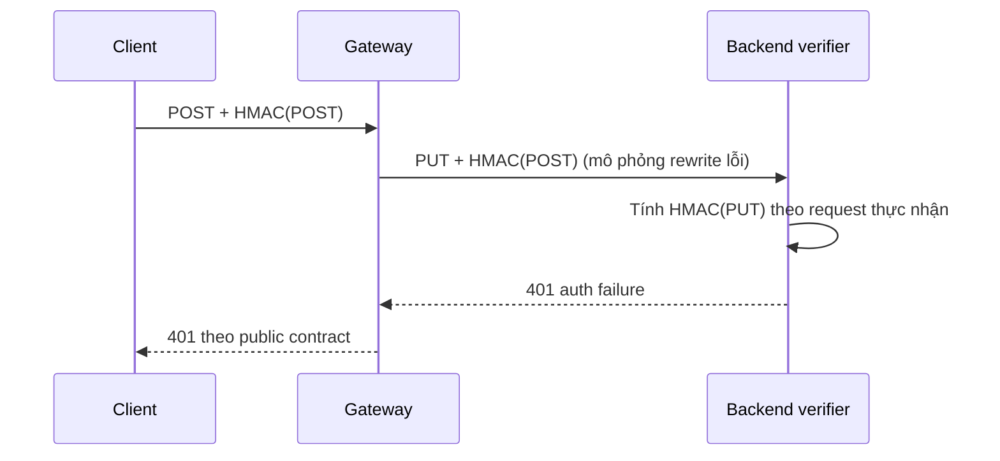
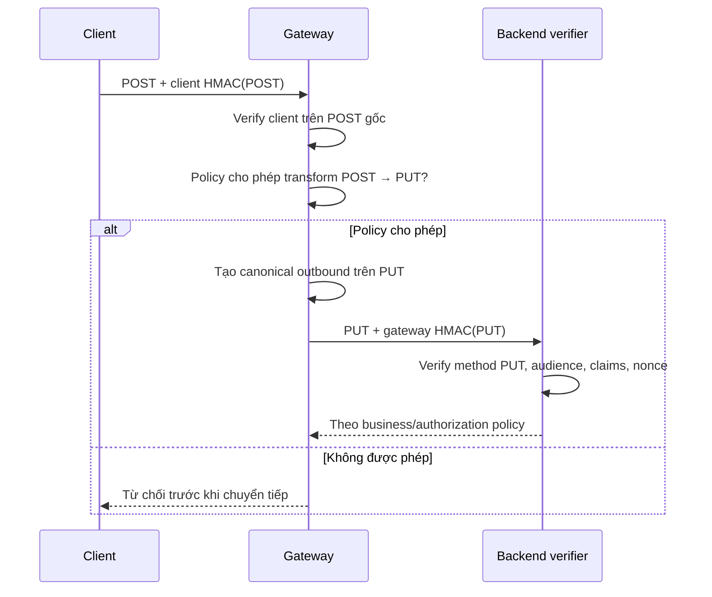

# Changed method test: kiểm thử chống thay đổi HTTP method sau khi ký HMAC

## 1. Mục tiêu bài học

Bài học **Changed method test** thuộc chương **Testing HMAC** của module **SECURITY_AUTHENTICATION_HMAC_REQUEST_AUTHENTICATION**. Module thiết kế xác thực HTTP request bằng **HMAC với shared secret** và một **canonical request** có hợp đồng rõ ràng về HTTP method, URI, header và/hoặc byte body. Người học còn phải kiểm tra timestamp/nonce để chống replay, quản lý key rotation, thử nghiệm qua proxy/gateway và phân biệt **authentication** với **authorization**.

Một lỗi triển khai rất nguy hiểm là **chữ ký được tính trên phương thức HTTP này nhưng server lại thực thi phương thức khác**. Chẳng hạn, client ký `GET /orders/42`, kẻ tấn công hoặc một tầng proxy thay request thành `DELETE /orders/42` và giữ nguyên signature. Nếu verifier không đưa method vào canonical request, hoặc xác minh method trước rewrite nhưng controller xử lý method sau rewrite, request có thể bị đổi ý nghĩa mà không làm chữ ký thất bại.

**Changed method test** là phép kiểm thử chứng minh rằng *đổi HTTP method sau khi ký, trong khi giữ nguyên bằng chứng HMAC*, sẽ bị từ chối theo hợp đồng xác thực, không tới handler nghiệp vụ và không tạo tác dụng phụ. Bài học đi từ test vector đơn vị tới tích hợp Spring MVC/WebFlux và end-to-end qua gateway/proxy.

Sau bài học, người học có thể:

1. Nêu được lý do method phải nằm trong canonical request khi ý nghĩa/đặc quyền của API phụ thuộc method.
2. Thiết kế positive test và **negative test có kiểm soát** cho thay `GET` ↔ `POST`, `POST` → `PUT`/`DELETE`/`PATCH`, `GET` ↔ `HEAD` và case-sensitive methods.
3. Phân biệt **sửa method nhưng giữ chữ ký** với **client được phép ký một request mới bằng method khác**.
4. Kiểm thử chính xác phương thức nhìn thấy tại verifier, gateway và controller; nhận diện method override, CORS preflight, route matching và các tầng proxy chuyển đổi request.
5. Kết hợp test với timestamp/nonce, key state, body digest và phân quyền mà không vô tình khiến test thất bại vì lý do khác.
6. Xây dựng assertion cho HTTP status, error body, security context, log và **không có side effect**.

## 2. Vì sao đổi method là thay đổi có ý nghĩa bảo mật?

HTTP method biểu thị cách client muốn tương tác với tài nguyên. Các method thường dùng gồm:

| Method | Ý nghĩa phổ biến | Nếu đổi method mà HMAC vẫn hợp lệ có thể dẫn tới |
|---|---|---|
| `GET` | Đọc trạng thái/biểu diễn tài nguyên | Biến truy vấn đọc thành thao tác ghi/xóa ở route có cùng path |
| `HEAD` | Giống GET về semantics nhưng response không có body | Khác behavior/handler, cache hoặc kiểm soát truy cập nếu cấu hình lệch |
| `POST` | Gửi dữ liệu để xử lý/tạo tài nguyên | Thay đổi hành động nghiệp vụ hoặc tạo giao dịch |
| `PUT` | Tạo/thay thế trạng thái của tài nguyên theo hợp đồng | Ghi đè tài nguyên thay vì chỉ lấy dữ liệu |
| `PATCH` | Thay đổi một phần tài nguyên | Cập nhật nội dung không được client ký |
| `DELETE` | Yêu cầu xóa tài nguyên | Xóa thay vì đọc hoặc tạo |
| `OPTIONS` | Mô tả khả năng giao tiếp/tiền kiểm CORS trong nhiều trường hợp | Lọt qua hoặc vướng chính sách preflight khác với request thật |

Đây là mô tả tổng quát về HTTP semantics, **không phải lời bảo đảm** rằng mọi API hiện thực đúng từng method. Điều cần bảo vệ là *ý nghĩa thật của request ở application*. Kẻ tấn công không phải lúc nào cũng đổi được method trên đường truyền HTTPS: khi TLS được cấu hình đúng, người ngoài không thể tự sửa bytes giữa hai endpoint TLS. Tuy nhiên, proxy terminate TLS, gateway có quyền rewrite, client/gateway có bug, HTTP method override hoặc nội bộ bị xâm nhập vẫn có thể làm method thực thi khác method đã ký.

### 2.1. Ví dụ tấn công giả định

Client sở hữu credential `partner-a-k3` ký:

```http
GET /api/orders/42 HTTP/1.1
Host: api.example.test
X-Key-Id: partner-a-k3
X-Timestamp: 1795800000
X-Nonce: n-unique-01
X-Signature: <HMAC của GET /api/orders/42>
```

Một tầng trung gian sửa thành:

```http
DELETE /api/orders/42 HTTP/1.1
Host: api.example.test
X-Key-Id: partner-a-k3
X-Timestamp: 1795800000
X-Nonce: n-unique-01
X-Signature: <chữ ký GET cũ>
```

Nếu canonical request bao gồm method chính xác, ví dụ `GET` so với `DELETE`, MAC phía server tính lại **khác** MAC từ client: phải từ chối.

Nếu hệ thống chỉ ký path + body mà **bỏ method**, hai request có thể có cùng canonical và chữ ký cũ vẫn pass. Đây là lỗi integrity của giao thức ký, không phải chỉ là cấu hình routing.

### 2.2. Những điều Changed method test *không* chứng minh

- Một test đổi `POST` thành `DELETE` và nhận `401` không tự chứng minh method được ký: có thể request fail do timestamp quá hạn, nonce trùng, route không tồn tại hoặc không có key.
- Một test được trả `405 Method Not Allowed` có thể chưa hề chạy verifier. Nó chứng minh route từ chối method, **không chứng minh chữ ký ràng buộc method**.
- Đổi method nhưng **ký lại hợp lệ** bằng key được cấp phép không phải tampering: đó là request khác, cần kiểm tra authentication, freshness và authorization như bình thường.
- Bài kiểm thử mức Java unit không chứng minh gateway hoặc framework sẽ truyền **đúng raw method** vào hàm canonical ở production.
- Không phải mọi route đều yêu cầu HMAC: `OPTIONS` preflight CORS hoặc health endpoint có thể được policy cho phép không ký; cần định nghĩa scope test.

## 3. Đặt HTTP method vào hợp đồng canonical

Để kiểm thử có ý nghĩa, hai bên phải thống nhất **byte representation** của method. Dưới đây là một hợp đồng **HMAC-V1 chỉ dùng cho ví dụ thực hành**, không phải chuẩn mặc định của Spring:

```text
HMAC-V1
<HTTP_METHOD>
<RAW_PATH>
<RAW_QUERY_OR_EMPTY>
<KEY_ID>
<TIMESTAMP_SECONDS>
<NONCE>
<HEX_SHA256_BODY_BYTES_LOWERCASE>
```

Quy ước:

1. Các dòng được nối bằng **LF** (`\n`), mã hóa **UTF-8**, **không có LF cuối**.
2. `HTTP_METHOD` lấy từ **method thực tế ở HTTP request** được verifier xử lý, ví dụ `POST`; không lấy từ header tự khai như `X-Original-Method`.
3. HTTP method token **phân biệt chữ hoa và chữ thường** theo HTTP semantics. Hợp đồng ví dụ chỉ cho phép đúng tập uppercase `GET`, `HEAD`, `POST`, `PUT`, `PATCH`, `DELETE`, `OPTIONS`. Không âm thầm dùng `toUpperCase()` để chấp nhận token khác; method extension cần chính sách phiên bản riêng.
4. `RAW_PATH` và `RAW_QUERY` là request-target được định nghĩa tại điểm verify. Giữ nguyên percent-encoding và thứ tự query theo contract; `/api/a%2Fb` khác `/api/a/b`. Bài này không giả định hai biểu diễn đó là tương đương.
5. `KEY_ID` dùng để tra shared secret, cũng nằm trong canonical để chống dùng lại cùng chữ ký với metadata key ID khác.
6. `TIMESTAMP_SECONDS` và `NONCE` được ký để bảo vệ freshness và chống replay. Việc MAC đúng **chưa đủ**: verifier còn phải kiểm tra thời gian và claim nonce nguyên tử.
7. `HEX_SHA256_BODY_BYTES_LOWERCASE` là SHA-256 trên **byte body nhận được tại điểm verify**; không parse JSON rồi serialize lại để tính hash.

Công thức:

```text
bodyHash  = lowercaseHex(SHA256(actualBodyBytes))
canonical = "HMAC-V1\n" + actualMethod + "\n" + rawPath + "\n"
            + rawQuery + "\n" + keyId + "\n" + timestamp + "\n"
            + nonce + "\n" + bodyHash
signature = Base64URL_noPadding(HMAC_SHA256(secret, UTF8(canonical)))
```

Dữ liệu mẫu với body rỗng:

```text
HMAC-V1
GET
/api/orders/42

partner-a-k3
1795800000
n-unique-01
e3b0c44298fc1c149afbf4c8996fb92427ae41e4649b934ca495991b7852b855
```

Dòng trống giữa path và key ID là **raw query rỗng**. Nếu thay dòng `GET` bằng `DELETE`, canonical đã khác và HMAC-SHA256 tính lại phải khác với xác suất cực cao; đây là cơ sở để viết test. Không cần công bố secret trong log hoặc báo lỗi để thực hiện so sánh.

> Để tránh nhầm lẫn: giá trị timestamp trong ví dụ là dữ liệu test cố định, **không phải timestamp hợp lệ ở mọi thời điểm thực thi**. Test thuần cryptographic có thể dùng thời gian cố định; integration test có timestamp validation phải dùng fake clock hoặc giá trị gần thời điểm test.

## 4. Thiết kế changed-method test không bị nhiễu

**Nguyên tắc cốt lõi:** giữa một positive test và negative test, **chỉ thay đổi đúng HTTP method**; những thành phần khác được giữ cố định. Khi sang integration test sử dụng anti-replay store, phải quản lý nonce có chủ đích vì request đã xác thực ở test trước có thể đã chiếm nonce.

### 4.1. Bộ test tối thiểu

| Ca | Request được ký | Method gửi tới verifier | Signature gửi | Kỳ vọng ở bước MAC |
|---|---|---|---|---|
| P1 — nguyên gốc | `POST` | `POST` | Chữ ký POST | Pass |
| N1 — thay method | `POST` | `PUT` | **Giữ nguyên chữ ký POST** | Fail |
| N2 — thay sang xóa | `GET` | `DELETE` | **Giữ nguyên chữ ký GET** | Fail |
| N3 — ngược chiều | `DELETE` | `GET` | Giữ nguyên chữ ký DELETE | Fail |
| N4 — HEAD vs GET | `GET` | `HEAD` | Giữ nguyên chữ ký GET | Fail |
| N5 — PATCH vs PUT | `PATCH` | `PUT` | Giữ nguyên chữ ký PATCH | Fail |
| P2 — ký request mới | `PUT` | `PUT` | Chữ ký PUT mới, timestamp/nonce hợp lệ | MAC pass; còn xét authorization |
| N6 — method không thuộc policy | `POST` | `post` hoặc extension chưa cho phép | Chữ ký POST | Reject, không normalize thành POST |
| N7 — thiếu ký method | Test fixture signer lỗi cố ý | `POST` rồi `DELETE` | Chữ ký theo contract lỗi | Test phải phát hiện thiếu ràng buộc method |

Để không tạo false positive:

- Trong test unit về MAC, **không bật** nonce replay store; chỉ kiểm tra canonicalization và MAC.
- Trong test tích hợp end-to-end, tạo **request ký hợp lệ mới** với nonce riêng cho từng ca độc lập. Riêng negative test “chỉ thay method” cần bắt đầu từ chữ ký mới **chưa được verifier sử dụng** hoặc reset replay store được cô lập để nó fail vì MAC, không phải fail do nonce đã tồn tại.
- Dùng credential active, secret đúng, body đúng, timestamp trong cửa sổ, route/HTTP method được phép đến bộ kiểm tra HMAC.
- Ghi **internal reason** của verifier trong test environment để xác minh fail vì `invalid_mac` hoặc `method_not_allowed_by_signing_contract`, nhưng public response vẫn là lỗi authentication chung.
- Chỉ chạy test trên môi trường test cô lập, không dùng request `DELETE` nhắm dữ liệu production. Dùng mock handler/counter side effect.

### 4.2. Hai trục kiểm thử khác nhau

Một request `DELETE /api/orders/42` có thể **hợp lệ về HMAC** nhưng bị từ chối do client không có quyền xóa. Nên kiểm tra hai trục:

| MAC theo method thực tế | Authorization cho method đó | Hành vi |
|---|---|---|
| Sai | Không xét tiếp | 401 hoặc auth failure theo contract, handler không chạy |
| Đúng | Thiếu quyền DELETE | 403 (hoặc 404 theo policy), không xóa |
| Đúng | Đủ quyền DELETE | Đi vào handler; nghiệp vụ áp dụng idempotency/điều kiện riêng |
| Đúng | Route không hỗ trợ DELETE | 405 theo routing policy, có thể xảy ra trước hoặc sau authentication tùy cấu hình |

Đừng viết test “đổi method phải luôn trả 401” khi route matcher hoặc security chain chỉ áp dụng cho một method nhất định. Muốn chứng minh binding method, phải **bắt được negative case tại chính verifier** (unit/contract test), sau đó kiểm tra policy thực tế ở integration layer.

## 5. Ví dụ Java 17+: bộ canonicalizer và MAC cho test

Ví dụ dưới đây minh họa **riêng phần ràng buộc HTTP method trong HMAC** bằng Java thuần. Nó không triển khai credential registry, kiểm tra timestamp, atomic nonce claim hoặc Spring Security. Những phần đó sẽ được kiểm thử tích hợp riêng sau.

```java
import java.nio.charset.StandardCharsets;
import java.security.GeneralSecurityException;
import java.security.MessageDigest;
import java.util.Base64;
import java.util.HexFormat;
import java.util.Objects;
import java.util.Set;

import javax.crypto.Mac;
import javax.crypto.spec.SecretKeySpec;

record SignedHttpInput(
        String method,
        String rawPath,
        String rawQuery,
        byte[] body) {}

record HmacMetadata(
        String keyId,
        String timestampSeconds,
        String nonce,
        String signature) {}

final class TestHmacV1 {
    private static final Set<String> METHODS =
            Set.of("GET", "HEAD", "POST", "PUT", "PATCH", "DELETE", "OPTIONS");

    private TestHmacV1() {}

    static String canonical(SignedHttpInput request, HmacMetadata meta) {
        Objects.requireNonNull(request);
        Objects.requireNonNull(meta);

        // Không tự upper/lowercase: method là token case-sensitive.
        if (!METHODS.contains(request.method())) {
            throw new IllegalArgumentException("Method is not allowed by HMAC-V1");
        }
        if (request.rawPath() == null
                || !request.rawPath().startsWith("/")
                || request.rawPath().indexOf('\r') >= 0
                || request.rawPath().indexOf('\n') >= 0) {
            throw new IllegalArgumentException("Invalid raw path");
        }
        String query = request.rawQuery() == null ? "" : request.rawQuery();
        if (query.indexOf('\r') >= 0 || query.indexOf('\n') >= 0) {
            throw new IllegalArgumentException("Invalid raw query");
        }
        requireToken(meta.keyId());
        requireToken(meta.timestampSeconds());
        requireToken(meta.nonce());
        Objects.requireNonNull(request.body(), "body");

        String digest;
        try {
            byte[] bodyHash = MessageDigest.getInstance("SHA-256")
                    .digest(request.body());
            digest = HexFormat.of().formatHex(bodyHash);
        } catch (GeneralSecurityException error) {
            throw new IllegalStateException(error);
        }

        return String.join("\n",
                "HMAC-V1",
                request.method(),
                request.rawPath(),
                query,
                meta.keyId(),
                meta.timestampSeconds(),
                meta.nonce(),
                digest);
    }

    static String sign(
            SignedHttpInput request, HmacMetadata metadata, byte[] secret) {
        Objects.requireNonNull(secret, "secret");
        if (secret.length < 32) {
            throw new IllegalArgumentException("Insufficient test key length");
        }
        try {
            Mac mac = Mac.getInstance("HmacSHA256");
            mac.init(new SecretKeySpec(secret, "HmacSHA256"));
            byte[] bytes = mac.doFinal(
                    canonical(request, metadata)
                            .getBytes(StandardCharsets.UTF_8));
            return Base64.getUrlEncoder()
                    .withoutPadding().encodeToString(bytes);
        } catch (GeneralSecurityException error) {
            throw new IllegalStateException(error);
        }
    }

    static boolean verify(
            SignedHttpInput received,
            HmacMetadata headers,
            byte[] secret) {

        // Chỉ minh họa verify MAC. Production còn timestamp, key active,
        // replay guard và error handling bảo mật.
        String expected = sign(received, headers, secret);
        try {
            byte[] actual = Base64.getUrlDecoder()
                    .decode(headers.signature());
            byte[] expectedBytes = Base64.getUrlDecoder()
                    .decode(expected);
            return actual.length == 32
                    && MessageDigest.isEqual(expectedBytes, actual);
        } catch (IllegalArgumentException invalidBase64) {
            return false;
        }
    }

    private static void requireToken(String token) {
        if (token == null || !token.matches("[A-Za-z0-9._-]{1,64}")) {
            throw new IllegalArgumentException("Invalid signed metadata");
        }
    }
}
```

**Giới hạn của mã minh họa:**

- Hợp đồng chấp nhận một tập method uppercase cụ thể; method extension do API cho phép phải được định nghĩa rõ thay vì mặc nhiên đổi case.
- `rawQuery == null` được biểu diễn là chuỗi rỗng theo contract test này. Nếu dự án phân biệt không có query với query rỗng, phải định nghĩa phiên bản canonical khác.
- `body` trong record là mảng mutable; trong production nên snapshot/copy immutable bytes ở đúng thời điểm ký/xác minh. Nếu bộ lọc/proxy thay body sau khi ký thì bảo đảm không còn đúng.
- Khóa secret trong ví dụ test phải được sinh ngẫu nhiên hoặc cung cấp từ fixture; production không hard-code key. HMAC-SHA256 là MAC có khóa, **không phải** hash SHA-256 thuần của dữ liệu và secret.
- `MessageDigest.isEqual` giúp so MAC bằng phép so sánh ít phụ thuộc nội dung hơn `String.equals`; vẫn cần parse có giới hạn và bảo vệ cả pipeline khỏi side-channel về key existence.
- Khi đưa `canonical(...)` vào server, mọi lỗi định dạng từ dữ liệu client phải ánh xạ thành response an toàn, không để lỗi unchecked vô tình thành `500` hoặc echo canonical/secret.

### 5.1. Unit test JUnit 5: giữ nguyên chữ ký khi đổi method

Các test sau dùng lại lớp `TestHmacV1` ở trên. Tất cả dữ liệu là fixture giả định; không cần kết nối server hay Redis.

```java
import static org.junit.jupiter.api.Assertions.*;

import java.nio.charset.StandardCharsets;
import java.util.Arrays;
import org.junit.jupiter.api.Test;

class ChangedMethodHmacTest {
    private static final byte[] SECRET =
            "0123456789abcdef0123456789abcdef"
                    .getBytes(StandardCharsets.UTF_8);

    private static SignedHttpInput request(String method) {
        return new SignedHttpInput(
                method,
                "/api/orders/42",
                "mode=standard",
                "{\"status\":\"ready\"}".getBytes(StandardCharsets.UTF_8));
    }

    private static HmacMetadata signedHeaders(
            SignedHttpInput signedRequest, String nonce) {

        HmacMetadata unsigned = new HmacMetadata(
                "partner-a-k3", "1795800000", nonce, "");
        String signature = TestHmacV1.sign(
                signedRequest, unsigned, SECRET);
        return new HmacMetadata(
                unsigned.keyId(),
                unsigned.timestampSeconds(),
                unsigned.nonce(),
                signature);
    }

    @Test
    void originalPostMustPassTheMacCheck() {
        SignedHttpInput post = request("POST");
        HmacMetadata proof = signedHeaders(post, "nonce-post-1");

        assertTrue(TestHmacV1.verify(post, proof, SECRET));
    }

    @Test
    void changingPostToPutWithoutResigningMustFail() {
        SignedHttpInput post = request("POST");
        HmacMetadata proof = signedHeaders(post, "nonce-post-2");

        // Chỉ method đổi: path, query, body, keyId, time, nonce,
        // signature và secret không thay đổi.
        SignedHttpInput tampered = request("PUT");

        assertFalse(TestHmacV1.verify(tampered, proof, SECRET));
        assertNotEquals(
                TestHmacV1.canonical(post, proof),
                TestHmacV1.canonical(tampered, proof));
    }

    @Test
    void changingGetToDeleteWithoutResigningMustFail() {
        SignedHttpInput get = request("GET");
        HmacMetadata proof = signedHeaders(get, "nonce-get-1");

        assertFalse(TestHmacV1.verify(
                request("DELETE"), proof, SECRET));
    }

    @Test
    void changingGetToHeadWithoutResigningMustFail() {
        SignedHttpInput get = request("GET");
        HmacMetadata proof = signedHeaders(get, "nonce-get-2");

        assertFalse(TestHmacV1.verify(request("HEAD"), proof, SECRET));
    }

    @Test
    void changingPatchToPutWithoutResigningMustFail() {
        SignedHttpInput patch = request("PATCH");
        HmacMetadata proof = signedHeaders(patch, "nonce-patch-1");

        assertFalse(TestHmacV1.verify(request("PUT"), proof, SECRET));
    }

    @Test
    void legitimatePutResignedAsNewRequestCanPassMacCheck() {
        SignedHttpInput put = request("PUT");
        HmacMetadata newProof = signedHeaders(put, "nonce-put-fresh");

        assertTrue(TestHmacV1.verify(put, newProof, SECRET));
        // Authentication success KHÔNG có nghĩa PUT được authorization.
    }

    @Test
    void lowerCasePostIsNotSilentlyNormalized() {
        HmacMetadata proof = signedHeaders(
                request("POST"), "nonce-case-1");

        assertThrows(IllegalArgumentException.class,
                () -> TestHmacV1.verify(
                        request("post"), proof, SECRET));
    }

    @Test
    void bodyAndQueryAreAlsoBoundByTheSameContract() {
        SignedHttpInput post = request("POST");
        HmacMetadata proof = signedHeaders(post, "nonce-other-fields");

        SignedHttpInput queryChanged =
                new SignedHttpInput("POST", "/api/orders/42",
                        "mode=other", post.body());
        SignedHttpInput bodyChanged =
                new SignedHttpInput("POST", "/api/orders/42",
                        "mode=standard",
                        "{\"status\":\"done\"}"
                                .getBytes(StandardCharsets.UTF_8));

        assertFalse(TestHmacV1.verify(queryChanged, proof, SECRET));
        assertFalse(TestHmacV1.verify(bodyChanged, proof, SECRET));
    }
}
```

Với test về body, giá trị JSON được tính hash trên **byte thật**; không cần parse JSON. Với test method, thay đổi duy nhất method bảo đảm nếu kết quả fail thì nguyên nhân có liên quan tới method binding thay vì body hay URI.

### 5.2. Mutation test: chứng minh test phát hiện lỗi thật

Một phép thử nâng cao là cố tình sửa hàm `canonical` trong **bản test tạm thời** để bỏ method:

```text
Canonical lỗi:
HMAC-V1
<RAW_PATH>
<RAW_QUERY>
<KEY_ID>
<TIMESTAMP>
<NONCE>
<BODY_HASH>
```

Nếu signer và verifier đều dùng phiên bản lỗi này, test `changingPostToPutWithoutResigningMustFail` sẽ không còn đáng tin hoặc sẽ thất bại assertion: **negative test đã bắt được regression**. Có thể dùng mutation-testing framework hoặc thay đổi test-only branch để kiểm tra. Không deploy phiên bản bỏ method.

Tương tự, có thể làm verifier nhầm `X-Original-Method` với actual HTTP method, hoặc ép tất cả method về `GET`, để xác nhận test bắt được. Một test suite tốt không chỉ pass trên mã đúng mà còn **fail trước các lỗi cố ý tương ứng với threat model**.

## 6. Test tích hợp HTTP: status, filter và handler side effect

Unit test ở trên xác minh primitive HMAC nhưng chưa đi qua HTTP parser, Spring Security filter, route matcher hay handler. Một integration test tối thiểu phải:

1. Tạo request có method nằm trong route được bảo vệ và có credential HMAC hợp lệ.
2. Với case negative, ký request như `POST` nhưng gửi HTTP request thực tế là `PUT` với cùng signature; chọn route/policy cho phép request đi đến **HMAC verifier** để nó có cơ hội từ chối.
3. Kiểm tra **đúng nguồn từ chối**: authentication failure do changed method, không phải 405 trước verifier hay 403 do quyền.
4. Xác nhận response công khai có semantics đúng, ví dụ `401 Unauthorized` và `WWW-Authenticate` phù hợp với scheme HMAC do API định nghĩa.
5. Xác nhận handler/controller không được gọi và không có cập nhật DB/event nghiệp vụ.
6. Đảm bảo nonce của test chưa từng được claim; sau khi verify MAC fail, không claim nonce để tránh denial-of-service qua “đốt nonce”.
7. Kiểm tra cả một positive test ký `PUT` **đúng method** rồi vẫn phân quyền riêng (ví dụ chưa có quyền update → 403).

### 6.1. MockMvc (Spring Security Servlet)

Giả sử có bean `HmacSigner` dành riêng cho test (ký theo hợp đồng thực tế), `MockMvc`, endpoint `/api/orders/42` được security chain áp HMAC cho cả POST/PUT và một spy service `orderService`. Pseudocode Java dưới đây là **khung test tích hợp**; `signForTest` và fixture phải được hiện thực theo cấu hình ứng dụng.

```java
// Pseudocode với JUnit 5 + Spring MockMvc:
// Mục tiêu: HTTP method THỰC GỬI là PUT; signature tính cho POST.
String rawPath = "/api/orders/42";
String body = "{\"status\":\"ready\"}";
String timestamp = Long.toString(clock.instant().getEpochSecond());
String nonce = freshNonce();

String signature = signer.signForTest(
        "POST", rawPath, "", body.getBytes(UTF_8),
        "partner-a-k3", timestamp, nonce);

mockMvc.perform(put(rawPath)
        .contentType("application/json")
        .content(body)
        .header("X-Key-Id", "partner-a-k3")
        .header("X-Timestamp", timestamp)
        .header("X-Nonce", nonce)
        .header("X-Signature", signature))
    .andExpect(status().isUnauthorized())
    .andExpect(header().exists("WWW-Authenticate"));

// orderService là spy/mock từ test context.
verify(orderService, never()).updateOrder(any(), any());
```

Điểm đáng kiểm tra là filter lấy method từ `HttpServletRequest.getMethod()` ở thời điểm verify; không lấy `X-HTTP-Method-Override` hoặc DTO nội bộ không gắn với request thực. Test cần giữ request body nguyên byte và tránh validator/business handler từ chối trước filter.

Trong Spring Security Servlet, vị trí custom filter so với `ExceptionTranslationFilter`/`AuthenticationFilter` quyết định cách `AuthenticationException` được chuyển thành 401. Nếu custom filter tự bắt lỗi, cần kiểm tra nó gọi entry point thống nhất **một lần**, không vô tình forward request khi MAC sai.

### 6.2. WebTestClient (Spring WebFlux)

Trong WebFlux, request cần xác thực là `ServerWebExchange.getRequest()`. Nếu có filter rewrite method, test phải đặt HMAC verifier vào **điểm đúng với hợp đồng ký** và đảm bảo Reactor Context không rò sang request khác.

Ví dụ dạng pseudocode:

```java
String timestamp = Long.toString(clock.instant().getEpochSecond());
String nonce = freshNonce();
String body = "{\"status\":\"ready\"}";
String signature = signer.signForTest(
        "POST", "/api/orders/42", "", body.getBytes(UTF_8),
        "partner-a-k3", timestamp, nonce);

webTestClient.put()
    .uri("/api/orders/42")
    .header("X-Key-Id", "partner-a-k3")
    .header("X-Timestamp", timestamp)
    .header("X-Nonce", nonce)
    .header("X-Signature", signature)
    .contentType(MediaType.APPLICATION_JSON)
    .bodyValue(body)
    .exchange()
    .expectStatus().isUnauthorized()
    .expectHeader().exists("WWW-Authenticate");
```

Với HMAC có body, filter có thể cần tiêu thụ body để tính SHA-256 rồi cấp lại bytes downstream qua request decorator. Đảm bảo kiểm thử cả **positive POST/PUT** có thể đọc body đúng, và changed-method negative không hề chạy handler. Không gọi `block()` hoặc `subscribe()` thủ công trong filter, không sử dụng cùng mutable `DataBuffer` cho nhiều subscription và không vô tình biến lỗi body lớn thành 401 thay vì 413.

### 6.3. Kiểm tra không có side effect

`401` là assertion cần nhưng **chưa đủ**. Nếu verifier chạy sau handler hoặc lỗi được ghi khi response đã commit, hệ thống có thể trả 401 dù nghiệp vụ đã thực thi.

Nên dùng spy/mock và DB fixture:

```text
GIVEN: order 42 có status=READY
WHEN:  ký POST /orders/42 nhưng gửi PUT /orders/42 với chữ ký POST
THEN:
  response = 401 theo contract, có challenge nếu là auth failure
  orderService.updateOrder(...) không được gọi
  DB/order 42 vẫn có status=READY
  không phát event "order_updated"
  không tạo principal AUTHENTICATED từ credential đó
  security event nội bộ reason=INVALID_MAC (không leak ra client)
```

Nếu hệ thống có queue bất đồng bộ, kiểm tra event recorder hoặc outbox test được cô lập. Nếu request có thể bị chặn tại proxy trước khi vào app, test cần quan sát handler ở cả hop và xác định chính xác điểm phát lỗi.

## 7. HTTP method override: nơi dễ tạo “ký POST, xử lý DELETE”

Một số ứng dụng hỗ trợ **method override** để client gửi POST nhưng yêu cầu xử lý logic như PUT/DELETE:

- Header `X-HTTP-Method-Override: DELETE` hoặc tên header tương tự theo cấu hình.
- Trường form `_method=DELETE`.
- Filter `HiddenHttpMethodFilter` hay cơ chế tương đương ở framework.
- Rewrite rule tại proxy/API gateway làm thay method trước khi chuyển tới backend.

Điều này không phải lúc nào cũng là lỗ hổng: có các hệ thống **cố tình** hỗ trợ override. Nhưng nếu verifier ký method gốc `POST` trong khi router/controller dùng method hiệu dụng `DELETE`, bảo vệ HMAC không còn ràng buộc đúng hành động thực thi.

### 7.1. Một test chống override

```http
POST /api/orders/42 HTTP/1.1
X-Key-Id: partner-a-k3
X-Timestamp: 1795800000
X-Nonce: n-unique-42
X-HTTP-Method-Override: DELETE
X-Signature: <chữ ký POST>
Content-Type: application/json

{"reason":"cancel"}
```

Test cần xác nhận **không bao giờ** có chuyện: HMAC trên `POST` pass, sau đó router lặng lẽ thực thi DELETE mà request/claim không ràng buộc hành động DELETE.

Các hướng giải quyết hợp lệ:

| Chính sách | Cách thiết kế | Test cần chứng minh |
|---|---|---|
| **Cấm method override** trên API HMAC | Loại bỏ/không kích hoạt filter override; từ chối hoặc bỏ qua override header theo policy | Header override không khiến handler khác được thực thi |
| **Ký method hiệu dụng** | Chuẩn hóa override **trước điểm xác minh**, ký/xác minh chính xác method hiệu dụng và áp dụng policy trên method đó | Chữ ký POST cũ không hợp lệ nếu method hiệu dụng DELETE |
| **Ký cả method gốc lẫn hiệu dụng** | Hợp đồng canonical riêng có hai field được định nghĩa và kiểm tra | Không thể thay override khi giữ MAC; hai phía đồng thuận |
| **Gateway verify rồi ký lại** | Gateway xác minh request gốc, quyết định override theo policy, sau đó ký outbound method cuối | Backend xác minh method cuối; không tin override header Internet |

Nếu API không cần method override, cách đơn giản và ít rủi ro nhất thường là **vô hiệu hóa nó** tại tất cả các hop liên quan. Chỉ xóa header `X-HTTP-Method-Override` có thể chưa đủ nếu framework còn hỗ trợ `_method` trong form hoặc query; cần kiểm tra cấu hình thực.

### 7.2. Những biến thể cần thử

- `X-HTTP-Method-Override: DELETE`, `X-Method-Override: DELETE` hoặc header custom thực sự được gateway/framework hỗ trợ.
- Header trùng/khác hoa-thường, giá trị chứa space/CRLF, giá trị không thuộc allowlist, nhiều giá trị.
- `_method=DELETE` trong `application/x-www-form-urlencoded` nếu ứng dụng bật filter.
- Override xảy ra **trước** hoặc **sau** Spring Security filter; assert method ở đúng mỗi bước.
- Header từ Internet bị proxy xóa/ghi đè khi gateway tự tạo metadata nội bộ.
- `POST` có body JSON và override thành method theo semantics khác; không để body parser thay byte body âm thầm.

Không dùng header `X-Original-Method` do client tự khai làm nguồn xác thực. Nếu lưu “original method” để audit, phải lấy từ request/parser hoặc proxy tin cậy, có chính sách chống giả mạo và nếu ảnh hưởng tới quyền thì ràng buộc qua MAC.

## 8. Reverse proxy và gateway: test ở từng ranh giới

Qua gateway, **method mà client ký** có thể khác **method mà backend xử lý** theo route rewriting. Phải lựa chọn rõ hai mô hình.

### 8.1. Mô hình A — backend xác minh trực tiếp chữ ký client

Gateway chuyển request đến backend và **không sửa trường đã ký**. Nếu method thuộc canonical, backend xây canonical từ method thực nhận. Negative test: proxy chủ động rewrite `POST` thành `PUT` nhưng giữ signature client POST → backend phải từ chối MAC.



Không tự khôi phục `POST` từ một `X-Original-Method` chưa được xác thực để làm MAC pass cho `PUT` đang được thực thi.

### 8.2. Mô hình B — gateway xác minh client, biến đổi và ký lại

Gateway có thể xác minh chữ ký client trên request **ingress**, áp dụng routing/transform được phép rồi ký một request **outbound** bằng khóa gateway–backend riêng:



Trong trường hợp này chữ ký gateway PUT **có thể hợp lệ** mà không đồng nghĩa client từng ký PUT. Gateway chịu trách nhiệm bảo đảm phép chuyển POST → PUT đúng hợp đồng ứng dụng, đã xác thực client và đã kiểm tra policy tương ứng. Backend phải phân quyền method/tài nguyên cuối cùng dựa trên identity/tenant được gateway xác nhận và những claim nằm trong MAC nội bộ.

Các test cần có:

1. Chữ ký client POST sai → gateway **không** được ký hộ outbound PUT.
2. POST được xác thực nhưng mapping POST→PUT không được phép → gateway từ chối.
3. POST hợp lệ và mapping được phép → gateway ký lại chính xác PUT; backend chấp nhận HMAC nội bộ nếu các policy còn lại pass.
4. Sau khi gateway ký PUT, proxy nội bộ khác đổi thành DELETE mà giữ signature PUT → backend từ chối.
5. Không forward các header `X-Verified-*`/`X-Gw-*` do client Internet tự khai; các claim phải được tạo từ credential đã xác minh và ký vào canonical hop nội bộ.
6. Gateway/backend giữ correlation ID để xác định **hop nào** từ chối; không chuyển nguyên challenge HMAC nội bộ dành cho gateway ra client nếu sai nghĩa.

### 8.3. Case-sensitive methods và HTTP parsing

Method trong HTTP semantics là token phân biệt hoa-thường. Nhiều HTTP framework định tuyến các method chuẩn bằng giá trị uppercase enum. Vì vậy:

- Một request mang token `post` có thể bị parser/router từ chối trước khi đến verifier.
- Không dùng “`post` tương đương `POST`” nếu contract không định nghĩa rõ việc normalize và bảo vệ toàn bộ hệ thống.
- Nếu API cho phép method extension, không ép về uppercase trừ khi hợp đồng chỉ rõ cả client/server và downstream đều dùng cùng quy ước.
- Tại điểm verify, lấy method mà **downstream thực sự xử lý**, hoặc ký/verify thêm trường gốc/hiệu dụng có bảo vệ; tránh một lớp dùng lowercase còn lớp khác uppercase.

Kiểm thử trực tiếp bằng client thực có thể cần dụng cụ HTTP mức thấp để gửi method token khác thường vì HTTP client SDK thường chỉ cho phép enum uppercase; không kết luận hệ thống an toàn chỉ vì công cụ test không tạo được request đó.

## 9. Phân biệt 401, 403, 405 và 400 trong test

Đổi method có thể khiến nhiều lớp từ chối trước khi HMAC verifier hoạt động. HTTP status phải phản ánh nguồn lỗi và **không nên dùng status làm bằng chứng duy nhất** cho tính đúng của canonicalization.

| Tình huống | Status thường phù hợp | Điều test phải chứng minh |
|---|---|---|
| Method bị đổi **sau ký**, request đến HMAC verifier, MAC không khớp | **401 Unauthorized** theo API HMAC | `invalid_mac` nội bộ, không tạo principal, handler không chạy |
| Method token không nằm trong hợp đồng ký được chấp nhận | 401 hoặc 400 theo contract, tùy điểm parse | Không tự normalize/không gọi handler |
| Method không được router/route hỗ trợ, bị từ chối trước verifier | **405 Method Not Allowed** | Không dùng kết quả này làm bằng chứng binding HMAC |
| HTTP request line có cú pháp không hợp lệ | **400 Bad Request** do parser | Request bị từ chối ở tầng HTTP |
| MAC đúng cho method mới, credential active, nhưng client thiếu quyền | **403 Forbidden** hoặc 404 theo policy | Authentication pass, authorization fail |
| Key đã revoke, timestamp hết hạn hoặc nonce replay | **401 Unauthorized** | Phân loại đúng là credential/freshness, không lẫn changed-method |
| Body quá kích thước an toàn | **413 Content Too Large** | Giới hạn payload, không gọi handler |
| Redis nonce store/credential store gặp sự cố | **503/5xx** | Fail-closed, không coi lỗi hạ tầng là MAC sai |

Một public 401 dành cho HMAC có thể dùng:

```http
HTTP/1.1 401 Unauthorized
WWW-Authenticate: HMAC realm="partner-api"
Content-Type: application/problem+json
Cache-Control: no-store

{
  "type": "about:blank",
  "title": "Unauthorized",
  "status": 401,
  "detail": "Authentication is required or invalid."
}
```

`HMAC` ở ví dụ là scheme riêng của API, không mặc định là một chuẩn được mọi SDK HTTP hỗ trợ. `WWW-Authenticate` của 401 phải là challenge áp dụng cho endpoint. Không công khai “Expected method was POST” nếu hệ thống không muốn lộ nội dung canonical hoặc các quyết định bảo mật nội bộ. Với auth failure khác nhau (key sai, MAC sai, timestamp lỗi, nonce replay), response công khai nên nhất quán, còn lý do chi tiết nằm ở log/test telemetry có phân quyền.

## 10. Timestamp và nonce: tránh false positive khi test changed method

Chống replay bằng nonce khiến một negative test dễ trở thành vô nghĩa nếu test đã gửi cùng proof một lần **thành công**. Ví dụ:

```text
T1: Gửi POST có chữ ký POST, nonce N1 → MAC pass, nonce N1 claimed
T2: Gửi PUT với chữ ký POST cũ, nonce N1 → request bị 401

Nếu T2 bị từ chối do nonce N1 đã dùng,
test KHÔNG chứng minh method nằm trong canonical.
```

Cách viết chuẩn:

1. Unit test signature dùng một fixture tĩnh, **không** gắn replay store.
2. Negative integration test tạo chữ ký POST với **nonce chưa từng được gửi**; đổi thành PUT **trước lần gửi đầu tiên**.
3. Dùng clock cố định cho signer và verifier trong test hoặc đồng bộ timestamp mới; tránh timestamp hết hạn khiến tất cả case nhận 401.
4. Kiểm tra verifier báo `invalid_mac` trước bước claim nonce; một request sai MAC không được “đốt” nonce còn mới.
5. Test replay riêng: gửi **cùng canonical request đã ký hợp lệ** hai lần → lần thứ hai bị từ chối vì nonce đã được claim.
6. Test key rotation riêng: key active pass, key revoked fail dù chữ ký đúng, không lẫn với changed-method.

Trong hệ thống nhiều instance, chống replay cần một store dùng chung với thao tác atomic, ví dụ Redis `SET nonce-key 1 NX EX ttl`. Một test riêng phải gửi cùng nonce hợp lệ đồng thời tới hai node và xác nhận tối đa một claim thành công. **Không dùng kết quả replay test để thay thế changed method test**.

### 10.1. Test quyền khi method mới được ký hợp lệ

Một tình huống độc lập:

```text
Client có scope orders:read nhưng không có orders:delete.
  GET /api/orders/42 ký GET đúng → Auth pass, GET có thể được phép.
  DELETE /api/orders/42 ký DELETE đúng + nonce mới → Auth pass,
                                                Authorization 403.
```

Nếu DELETE có MAC đúng, một `401` ở đây có thể chỉ ra filter/config bị lỗi hoặc credential không hợp lệ; nó không phải kết quả phân quyền mong muốn. Test phải xác nhận principal được tạo trước khi authorization kiểm tra scope/tenant/tài nguyên.

## 11. Test vector cho client SDK đa ngôn ngữ

Changed-method test hữu ích nhất khi signer và verifier được triển khai **độc lập** ở nhiều ngôn ngữ/SDK. Nếu cả hai cùng dùng một thư viện canonicalizer lỗi, chúng có thể cùng bỏ method mà vẫn pass mọi positive test.

### 11.1. Cấu trúc test vector

```json
{
  "contractVersion": "HMAC-V1",
  "keyId": "partner-a-k3",
  "secretEncoding": "base64url",
  "secret": "<TEST_ONLY_SECRET_BASE64URL>",
  "method": "POST",
  "rawPath": "/api/orders/42",
  "rawQuery": "mode=standard",
  "timestampSeconds": "1795800000",
  "nonce": "nonce-vector-01",
  "bodyEncoding": "utf8",
  "bodyText": "{\"status\":\"ready\"}",
  "expectedCanonical": "<CANONICAL_STRING_WITH_POST>",
  "expectedSignature": "<EXPECTED_TEST_SIGNATURE>",
  "mutations": [
    {
      "field": "method",
      "original": "POST",
      "changed": "PUT",
      "reuseOriginalSignature": true,
      "expectedMacResult": "FAIL"
    },
    {
      "field": "method",
      "original": "POST",
      "changed": "DELETE",
      "reuseOriginalSignature": true,
      "expectedMacResult": "FAIL"
    }
  ]
}
```

Đây là **schema minh họa có placeholder**, không phải bộ vector đã tính sẵn; để dùng CI cần điền secret test thật và expected canonical/signature do một implementation tham chiếu độc lập tạo, rồi review. Không lấy secret production làm test vector hoặc commit chúng vào repository.

Các vector nên có:

- Body rỗng, JSON UTF-8, bytes binary và payload có whitespace/newline.
- Raw query có thứ tự tham số khác nhau, percent-encoding và giá trị rỗng.
- Method các cặp `GET/HEAD`, `POST/PUT`, `PATCH/DELETE`.
- Header whitespace/casing và trường được ký nếu hợp đồng có signed headers.
- Chữ ký Base64URL sai/thiếu padding theo contract, MAC byte bị thay đổi.
- Cả **original positive** và **changed-method negative**; không chỉ so sánh hai chuỗi canonical bằng mắt.

### 11.2. Không hard-code “expected signature” tự sinh bằng chính code đang test

Nếu unit test gọi cùng một hàm lỗi để tạo `expectedSignature` và `actualSignature`, cả hai có thể cùng sai. Cần có vector được tính bằng implementation độc lập hoặc review tay theo hợp đồng cố định, sau đó dùng nó như nguồn kỳ vọng. Đối với changed-method negative, test cần xác minh lại từ **method thực tế** và giữ nguyên chữ ký từ vector gốc.

Một phương án mạnh là **property-based test**:

```text
For each allowed method M1:
  For each distinct allowed method M2:
    Given identical rawPath, rawQuery, body, keyId, timestamp, nonce:
      signature = Sign(M1, fields)
      Assert Verify(M1, fields, signature) = true
      Assert Verify(M2, fields, signature) = false
```

MAC collisions về lý thuyết không hoàn toàn bất khả thi nhưng với HMAC-SHA256 là không đáng kể trong số lượng test thực tế. Property-based test không thay thế kiểm thử HTTP method override và proxy ở production.

## 12. Checklist test end-to-end qua gateway/proxy

Trong hệ thống thực, có thể có CDN/WAF, load balancer, API gateway, Spring Security filter, HTTP router và controller. Đặt instrumentation ở từng hop để ghi **actual method** theo luồng tin cậy; không log secret hoặc signature.

| Test | Điều gì thay đổi? | Điểm quan sát | Kỳ vọng |
|---|---|---|---|
| Client ký GET, gửi GET | Không đổi | Gateway ingress | HMAC pass |
| Client ký GET, gửi DELETE | Method đổi trước ingress | Gateway ingress | MAC fail nếu route vào verifier |
| Client ký POST, proxy đổi PUT | Method đổi giữa ingress và backend, không ký lại | Backend verify | MAC fail |
| Gateway verify POST, policy cho phép đổi PUT và ký lại | Đổi method có kiểm soát | Gateway outbound/backend | MAC gateway hợp lệ trên PUT; authz riêng |
| Gateway ký PUT, proxy nội bộ đổi DELETE | Đổi method sau khi ký lại | Backend | MAC fail |
| `X-HTTP-Method-Override: DELETE` | Method hiệu dụng có thể khác method transport | Web filter/router | Không cho POST MAC bảo vệ DELETE ngoài policy |
| Method override trong form `_method` | Request bị filter biến thành method khác | Servlet filter order | Không bypass verifier |
| `GET` ↔ `HEAD` | Body response khác, route có thể auto-handle HEAD | HTTP router/verifier | Method vẫn được ký đúng |
| `OPTIONS` preflight CORS | Request có thể không có HMAC | CORS/security chain | Theo policy preflight, không lộ route được bảo vệ |
| `post` lowercase | Token method case-sensitive | HTTP parser/verifier | Không âm thầm normalize |
| Request retry ở gateway | Attempt mới có thể đổi method/nonce | Outbound signer | Mỗi attempt ký actual method, nonce mới |
| Key revoked trên keep-alive connection | Credential state đổi | Verifier | Request mới không được pass dù MAC đúng |
| Two clients on HTTP/2 connection | Đổi principal theo stream | Request context | Không reuse auth decision theo connection |

### 12.1. Bài test qua proxy cần đúng “điểm sửa” method

Nếu client tự gửi PUT trong khi signer ký POST, test chỉ chứng minh verifier nhìn thấy PUT. Để test **proxy rewrite**, phải:

1. Cho client thực sự gửi POST + chữ ký POST tới proxy.
2. Cấu hình proxy test đổi POST → PUT giữa hai điểm đo **mà không đổi signature**.
3. Xác nhận backend nhận PUT và chữ ký POST (đối chiếu digest/correlation ở môi trường test).
4. Xác nhận backend từ chối tại verify, handler không chạy.
5. Lặp lại với gateway có quyền ký lại để xác minh hành vi theo policy đã công bố.

Nên có correlation ID và **log nội bộ đã kiểm soát** gồm method thực tế, route template, contract version, hop và mã reason hữu hạn. Không cần log raw MAC, expected signature hoặc secret để chẩn đoán. Nếu muốn hiển thị raw request-target trong môi trường test, phải loại bỏ dữ liệu cá nhân và không bật tracing nhạy cảm đó ở production.

## 13. Những lỗi triển khai mà changed-method test cần phát hiện

### 13.1. Signer bỏ method khỏi canonical

```text
canonical = path + "\n" + query + "\n" + bodyHash
```

Khi đổi method nhưng giữ path/query/body, MAC không đổi. Test N1/N2 phải fail và chỉ rõ lý do: **method không được bảo vệ**.

### 13.2. Verifier hard-code method

```java
// SAI: verifier luôn tính MAC như GET bất kể HTTP request thực tế.
String canonical = canonicalize("GET", rawPath, rawQuery, body);
```

Một client có thể ký GET rồi gửi DELETE tới endpoint khác nếu các ràng buộc còn lại cho phép. Test phải dùng method từ request transport/hiệu dụng theo hợp đồng.

### 13.3. Chỉ dùng method lấy từ header chưa được ký

```java
// SAI: dữ liệu không tin cậy quyết định method dùng để verify.
String methodToVerify = request.getHeader("X-Original-Method");
```

Kẻ tấn công có thể gửi `DELETE` nhưng điền header là `GET`. Nếu ứng dụng thực thi DELETE mà verifier tính chữ ký GET, check không bảo vệ hành động cuối cùng.

### 13.4. Verify trước một filter âm thầm thay method

```text
HMAC filter ký trên POST → pass
HiddenHttpMethodFilter đổi thành DELETE
Controller thực thi DELETE
```

Khi ứng dụng cần override, phải có contract ký cả method hiệu dụng hoặc bảo đảm override được thực hiện **trước** điểm xác minh, và authorization xử lý method cuối. Không thể chỉ xem mỗi verify success là đủ.

### 13.5. Test luôn nhận 405 nên tưởng đã bảo vệ method

Route chỉ khai báo `POST /orders`. Test ký POST nhưng gửi PUT, server trả 405 mà HMAC filter không được gọi. Đổi method test **không đánh giá được MAC**. Dùng route test có cả POST/PUT hoặc mock HMAC verifier nhận method độc lập với routing, rồi tạo thêm routing test riêng.

### 13.6. Nonce từ positive test làm sai negative test

Một proof đã được gửi và nonce đã claim được gửi lại sau khi đổi method; server trả 401 vì replay. Khắc phục bằng nonce mới và chỉ gửi **mutated request** trong negative test; dùng internal reason/test spy xác định MAC thực sự thất bại.

### 13.7. Chỉ assert response status

Có trường hợp controller chạy trước rồi response bị thay 401 bởi gateway/filter lỗi. Test phải assert **handler not invoked**, dữ liệu không thay đổi và event nghiệp vụ không phát ra.

### 13.8. HTTP client tự thay method khi retry/redirect

Một số HTTP client xử lý redirect theo semantics riêng và có thể đổi POST thành GET với một số loại redirect; test phải xác nhận **request thực tế gửi đi được ký**. Nếu signer ký trước khi client tự redirect/rewrite, chữ ký có thể không khớp ở đích. Policy an toàn là signer gắn với mỗi outbound attempt/request-target cuối cùng; không tự forward signature sang origin khác khi redirect.

## 14. Ma trận acceptance test và bằng chứng

Một bộ test hoàn chỉnh nên có kết quả rõ ràng theo từng lớp:

| Lớp | Test bắt buộc | Bằng chứng pass |
|---|---|---|
| Canonicalizer | Thay mỗi method khác nhau, giữ các field còn lại | Chuỗi canonical khác nhau đúng dòng method |
| Crypto verifier | Giữ chữ ký M1, verify trên M2 | MAC fail; không có bypass |
| Positive signer | Ký M2 mới, verify trên M2 | MAC pass khi method hợp đồng cho phép |
| Credential | Key active/revoked, wrong key ID | Không pass với credential không active |
| Freshness | Timestamp, nonce riêng, replay | Không dùng replay failure thay chứng cứ method |
| Spring Security | Auth failure/entry point, request context | 401 chung; handler không chạy khi MAC sai |
| Authorization | Request method mới ký đúng nhưng thiếu quyền | 403/404 theo policy, không gộp auth failure |
| Proxy | Rewrite trước/sau điểm ký | Fail hoặc ký lại theo đúng mô hình tin cậy |
| Method override | Header/form/rewrite | Không thực thi method khác với method được bảo vệ |
| HTTP parser | Method case-sensitive, invalid method, HEAD/OPTIONS | Không âm thầm normalize/bypass |
| Observability | Reason nội bộ, request ID/hop | Không tiết lộ secret, MAC hay raw body |
| CI regression | Unit + integration + end-to-end + mutation | Phát hiện khi method bị xóa khỏi canonical |

### 14.1. Một tiêu chí pass có tính kiểm chứng

Ví dụ định nghĩa:

```text
Given:
  - Active HMAC credential thuộc client C
  - Fixed canonical contract HMAC-V1 bao gồm HTTP method
  - Raw path/query/body đúng, timestamp hợp lệ và nonce chưa dùng
  - Signature được ký cho POST

When:
  - HTTP verifier nhận cùng request nhưng actual method=PUT
  - Signature, keyId, timestamp, nonce, raw path/query/body không đổi

Then:
  - Verifier tính canonical với PUT và MAC mismatch
  - Request không trở thành authenticated principal
  - HTTP auth failure theo contract, thông thường 401
  - Handler/cập nhật DB/event nghiệp vụ không xảy ra
  - Không claim nonce cho request MAC sai
  - Internal reason đủ để xác nhận invalid_mac;
    response public không lộ expected MAC/method/secret
```

Cặp positive control:

```text
Given:
  - Cùng request target/body và credential active
  - Client ký PUT thật sự với timestamp/nonce hợp lệ mới

When:
  - Verifier nhận PUT + chữ ký PUT

Then:
  - MAC pass
  - Nonce claim thành công nếu chưa dùng
  - Principal được tạo từ registry đáng tin
  - Authorization cho thao tác PUT quyết định có thực thi hay không
```

Nếu thiếu positive control, negative test có thể pass ngay cả khi verifier luôn từ chối mọi request. Nếu thiếu negative control, positive test có thể pass dù verifier bỏ method. **Hai hướng kiểm thử phải đi cùng nhau**.

## 15. Bài thực hành

Hệ thống giả định gồm Spring Cloud Gateway và một backend Spring WebFlux. Client gọi `/api/orders/{id}` bằng HMAC-SHA256; canonical request bao gồm method, raw URI, key ID, timestamp, nonce và SHA-256 body. Gateway có hai mode test:

- **Pass-through:** backend trực tiếp xác minh HMAC client, gateway không thay các trường được ký.
- **Re-sign:** gateway xác minh HMAC client ở ingress, có thể rewrite route/method theo policy và ký lại outbound bằng secret riêng của gateway–backend.

Hãy thực hiện các bước sau:

1. **Tạo test vector độc lập** cho `POST /api/orders/42?mode=standard`, body JSON `{"status":"ready"}`, key test 32 byte và timestamp/nonce xác định. Ghi canonical và signature test kỳ vọng.
2. **Unit test changed method:** giữ nguyên mọi thành phần, chỉ đổi POST → PUT, POST → DELETE, GET → HEAD, PATCH → PUT; tất cả phải fail MAC. Test PUT ký lại mới phải pass MAC.
3. **Test framework:** dùng MockMvc/WebTestClient và một handler spy để xác minh changed-method auth failure không tạo principal/không sửa order; tránh nhận 405 trước khi verifier chạy.
4. **Test override:** gửi POST có `X-HTTP-Method-Override: DELETE` và `_method=DELETE` khi filter tương ứng được bật/tắt; xác nhận không có đường thực thi DELETE được bảo vệ chỉ bởi chữ ký POST.
5. **Test proxy:** trong pass-through, thay POST→PUT sau điểm client ký và đảm bảo backend từ chối. Trong re-sign mode, gateway chỉ ký lại PUT nếu chính sách transform cho phép; backend xác minh chữ ký PUT, audience và claim do gateway xác nhận.
6. **Test freshness:** đặt clock cố định; tạo nonce chưa được sử dụng cho negative test. Sau đó thử replay cùng request đúng chữ ký; xác nhận replay bị từ chối do nonce, tách biệt changed-method.
7. **Test authorization:** client chỉ có scope đọc, ký DELETE đúng bằng secret của mình với nonce mới; xác nhận authentication pass và authorization trả 403, không xóa dữ liệu.
8. **Test regression:** cố tình bỏ method khỏi canonicalizer test-only, chạy suite và xác minh test negative phát hiện.
9. **Test báo cáo:** ghi vào kết quả CI các assertion về actual method tại ingress/backend, authentication decision, HTTP status, handler invocation và checksum body; không bao giờ ghi secret/expected MAC production.

### Câu hỏi tự đánh giá

1. Vì sao chữ ký GET không được xác minh thành công khi HTTP request thực tế là DELETE?
2. Vì sao HTTP 405 không chứng minh method đã nằm trong canonical HMAC?
3. Nếu ký lại PUT bằng cùng secret và nonce đã dùng ở POST trước đó, điều kiện nào có thể khiến request vẫn bị 401?
4. Vì sao test đổi method cần một nonce chưa sử dụng thay vì gửi lại positive fixture đã qua verifier?
5. HTTP method token có phân biệt chữ hoa/chữ thường không, và tại sao tự uppercase trong verifier có thể gây sai hợp đồng?
6. `X-HTTP-Method-Override` khác actual method như thế nào, và cần test tại vị trí nào?
7. Khi gateway chủ động đổi POST thành PUT và ký lại, vì sao backend MAC pass không chứng minh client đã ký PUT?
8. Khi nào request mới ký DELETE đúng phải nhận 403 thay vì 401?
9. Vì sao unit test dùng chung signer/verifier có thể bỏ sót lỗi bỏ method?
10. Vì sao phải assert handler không chạy và DB không đổi thay vì chỉ assert status 401?

**Kết quả mong đợi:** người học có một bộ **Changed method test** độc lập, tái lập được và đủ mạnh để phát hiện mọi trường hợp “ký method A nhưng xử lý method B” ngoài hợp đồng. Bộ test chứng minh method được bảo vệ trong canonical HMAC, xác nhận verifier dùng actual/effective method đúng ranh giới, xử lý proxy/method override có kiểm soát, và không nhầm authentication failure với routing, replay hay authorization.
