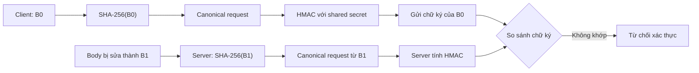

# Changed body test — Kiểm thử phát hiện thay đổi HTTP request body bằng HMAC

## 1. Mục tiêu và vị trí trong Testing HMAC

Trong cơ chế **HMAC request authentication**, client và server cùng nắm một shared secret. Client tạo chữ ký từ một **canonical request** được hai phía thỏa thuận, có thể bao gồm HTTP method, URI, một số header và nội dung request body. Server dựng lại đúng canonical request, tính HMAC và so sánh chữ ký để xác thực request và kiểm tra tính toàn vẹn của các thành phần đã ký.

**Changed body test** kiểm tra tình huống: client ký một body ban đầu, nhưng server nhận **body có byte khác** trong khi các thành phần đã ký còn lại và chữ ký được giữ nguyên. Nếu hợp đồng ký bao gồm body, việc xác minh phải thất bại.

Sau bài này, người học có thể:

- Tạo được một cặp ca thử: body ban đầu với chữ ký hợp lệ và body bị sửa nhưng vẫn dùng chữ ký cũ.
- Phân biệt thay đổi **byte** với thay đổi **ý nghĩa dữ liệu**, từ đó xác định kết quả đúng theo hợp đồng canonicalization.
- Viết unit test kiểm tra HMAC trên body thực nhận và integration test khẳng định request bị từ chối **trước khi có side effect**.
- Cô lập lỗi chữ ký khỏi timestamp, nonce, key rotation, proxy/gateway và các bước xác thực/phân quyền khác.

> HMAC chỉ bảo vệ những byte hoặc trường được đưa vào canonical request. Nếu đặc tả ký loại body ra ngoài, việc thay body không nhất thiết làm chữ ký sai; khi đó cần sửa hợp đồng ký hoặc mục tiêu kiểm thử, không thể lấy phép thử này để khẳng định HMAC bảo vệ body.

## 2. Hợp đồng ký minh họa: ký digest của body

Để có kết quả xác định, bài học sử dụng hợp đồng **minh họa**, không mặc định rằng mọi hệ thống HMAC đều giống nhau.

| Thành phần | Quy ước trong bài |
| --- | --- |
| Thuật toán | `HmacSHA256` với shared secret là mảng byte |
| Body được ký | Dãy byte body mà bộ xác minh dùng làm đầu vào, sau bước xử lý HTTP transfer framing; không parse rồi serialize JSON lại |
| Body digest | `SHA-256(bodyBytes)`, biểu diễn dưới dạng hex chữ thường |
| Canonical request | Năm dòng: `METHOD`, `PATH`, `TIMESTAMP`, `NONCE`, `BODY_SHA256_HEX` |
| Phân cách | Ký tự LF (`\n`) giữa các dòng, không có LF cuối |
| Chữ ký | `HMAC-SHA256(secret, UTF-8(canonicalRequest))` |
| Header minh họa | `X-Key-Id`, `X-Timestamp`, `X-Nonce`, `X-Signature` |
| Dạng truyền chữ ký | Hex chữ thường của toàn bộ 32 byte HMAC |

Ví dụ body ban đầu (`B0`):

```json
{"amount":100,"currency":"VND","destination":"A"}
```

Client dùng các thành phần sau để tạo chữ ký:

```text
METHOD          = POST
PATH            = /v1/payments
TIMESTAMP       = 1700000000
NONCE           = example-nonce-01
BODY_SHA256_HEX = lowercase-hex(SHA-256(UTF-8(B0)))

canonicalRequest =
POST\n/v1/payments\n1700000000\nexample-nonce-01\n<BODY_SHA256_HEX>
```

Giá trị timestamp trên chỉ để minh họa cấu trúc; **khi chạy HTTP integration test thực tế phải dùng timestamp hiện hành** nằm trong cửa sổ chấp nhận của server. Nếu API có query string, header `Content-Type`, hash dạng Base64 hoặc chuẩn canonical URI khác, hãy lấy **đúng hợp đồng của API** làm nguồn sự thật và cập nhật cả phía ký lẫn bộ kiểm thử.

Sơ đồ cho ca thay đổi body:



Giả sử một thành phần thay body thành (`B1`), nhưng vẫn chuyển tiếp chữ ký được tạo từ `B0`:

```json
{"amount":900,"currency":"VND","destination":"A"}
```

Khi `B0 != B1` theo từng byte, `SHA-256(B0)` khác `SHA-256(B1)` với xác suất áp đảo. Do đó HMAC dựa trên canonical request cũng thay đổi và chữ ký cũ không thể xác minh cho body mới. Đây là **kiểm tra tính toàn vẹn**, không phải quy tắc nghiệp vụ rằng số tiền 900 là không hợp lệ: nếu client hợp lệ chủ động ký `B1` bằng secret đúng, chữ ký cho `B1` vẫn phải được chấp nhận.

## 3. Thiết kế test sao cho không bị nhiễu

Một changed body test đúng phải kiểm soát cùng lúc dữ liệu ký, dữ liệu thực sự được gửi và các cơ chế bảo vệ phụ trợ.

1. Tạo `bodyOriginal` thành **byte array** cố định (ví dụ UTF-8), không chỉ giữ đối tượng Java/JSON chưa serialize.
2. Tạo method, path, timestamp, nonce và key ID hợp lệ; xác định chính xác canonical request từ `bodyOriginal` rồi tính `signatureOriginal`.
3. **Positive control:** gửi `bodyOriginal` với chữ ký tương ứng, kỳ vọng qua bước xác thực; endpoint có thể trả mã nghiệp vụ khác 2xx nếu payload không phù hợp, vì vậy nên chọn payload hợp lệ.
4. **Negative case:** tạo một request độc lập với timestamp còn hạn, **nonce chưa từng sử dụng**; ký lại `bodyOriginal` với nonce của request đó, sau đó **chỉ thay byte body được truyền** thành `bodyChanged`; giữ nguyên chữ ký và các trường đã ký của chính request âm tính.
5. Kỳ vọng server từ chối ở bước xác minh chữ ký (thường `401 Unauthorized` theo hợp đồng API). Khẳng định handler nghiệp vụ không được gọi, không ghi database, không phát message, không trừ tiền.
6. **Control bổ sung:** ký chính `bodyChanged` bằng key hợp lệ và nonce mới thì bước xác minh chữ ký phải thành công; việc này giúp phân biệt lỗi HMAC với validation của endpoint.

Không nên gửi request dương tính và âm tính **với cùng nonce** tới hệ thống đang bật anti-replay. Sau request dương tính, nonce đó có thể đã bị ghi nhận; request âm tính sẽ bị chặn do replay, khiến test báo “pass” dù bộ xác minh không hề kiểm tra body. Unit test trực tiếp hàm verify có thể dùng nonce cố định vì không đi qua replay store; integration test phải dùng nonce riêng cho từng request.

Cũng không được làm như sau:

```text
Sai: sửa body B0 -> B1 -> tính chữ ký cho B1 -> gửi B1 + chữ ký mới
```

Đó là một request được ký hợp lệ, không phải phép thử chống sửa đổi body. Cốt lõi của negative case là **ký `B0`, truyền `B1`, không ký lại `B1`**.

## 4. Unit test JUnit 5: ký body gốc, xác minh trên body bị sửa

Đoạn mã sau tự chứa phần canonicalization và HMAC cho hợp đồng minh họa ở trên. Cần Java 17+ (dùng `HexFormat`) và JUnit 5. Shared secret trong test là dữ liệu giả, tuyệt đối không dùng làm khóa production.

```java
import org.junit.jupiter.api.Test;

import javax.crypto.Mac;
import javax.crypto.spec.SecretKeySpec;
import java.nio.charset.StandardCharsets;
import java.security.GeneralSecurityException;
import java.security.MessageDigest;
import java.util.HexFormat;

import static org.junit.jupiter.api.Assertions.assertFalse;
import static org.junit.jupiter.api.Assertions.assertTrue;

class ChangedBodyTest {
    private static final byte[] TEST_KEY =
            "test-only-shared-secret-do-not-deploy"
                    .getBytes(StandardCharsets.UTF_8);

    private static final String METHOD = "POST";
    private static final String PATH = "/v1/payments";
    private static final String TIMESTAMP = "1700000000";
    private static final String NONCE = "unit-test-nonce";

    private static byte[] utf8(String value) {
        return value.getBytes(StandardCharsets.UTF_8);
    }

    private static byte[] sign(byte[] body) throws GeneralSecurityException {
        byte[] bodyDigest = MessageDigest.getInstance("SHA-256").digest(body);
        String canonical = METHOD + "\n"
                + PATH + "\n"
                + TIMESTAMP + "\n"
                + NONCE + "\n"
                + HexFormat.of().formatHex(bodyDigest);

        Mac mac = Mac.getInstance("HmacSHA256");
        mac.init(new SecretKeySpec(TEST_KEY, "HmacSHA256"));
        return mac.doFinal(utf8(canonical));
    }

    private static boolean verify(byte[] receivedBody, byte[] providedSignature)
            throws GeneralSecurityException {
        byte[] expected = sign(receivedBody);
        return MessageDigest.isEqual(expected, providedSignature);
    }

    @Test
    void originalBodyPassesButChangedAmountFails()
            throws GeneralSecurityException {
        byte[] original = utf8(
                "{\"amount\":100,\"currency\":\"VND\",\"destination\":\"A\"}");
        byte[] changed = utf8(
                "{\"amount\":900,\"currency\":\"VND\",\"destination\":\"A\"}");

        byte[] signatureOfOriginal = sign(original);

        assertTrue(verify(original, signatureOfOriginal));
        assertFalse(verify(changed, signatureOfOriginal));
    }

    @Test
    void evenFormattingChangesFailForRawByteSigning()
            throws GeneralSecurityException {
        byte[] original = utf8("{\"amount\":100,\"currency\":\"VND\"}");
        byte[] signatureOfOriginal = sign(original);

        byte[][] changedBodies = {
                utf8("{ \"amount\":100,\"currency\":\"VND\"}"),
                utf8("{\"currency\":\"VND\",\"amount\":100}"),
                utf8("{\"amount\":100,\"currency\":\"VND\",\"extra\":true}"),
                utf8("{\"amount\":100}")
        };

        for (byte[] changed : changedBodies) {
            assertFalse(verify(changed, signatureOfOriginal));
        }
    }

    @Test
    void legitimatelyResignedChangedBodyPasses()
            throws GeneralSecurityException {
        byte[] changed = utf8(
                "{\"amount\":900,\"currency\":\"VND\",\"destination\":\"A\"}");

        assertTrue(verify(changed, sign(changed)));
    }
}
```

**Giới hạn có chủ đích của unit test:** `sign()` và `verify()` dùng cùng một hàm tạo canonical request, nên test trên chứng minh tính chất toán học của hợp đồng minh họa, **chưa chứng minh** ứng dụng thực tế lấy body đúng byte, đọc body đúng thời điểm hay dùng key ID đúng cách. Cần thêm integration test qua đúng HTTP stack của dịch vụ.

Trong production, bộ xác minh còn phải giải mã chữ ký theo định dạng chặt chẽ, chọn đúng secret dựa trên key ID/tenant, kiểm tra timestamp và nonce, và so sánh HMAC theo thời gian ít phụ thuộc vào nội dung bằng `MessageDigest.isEqual` hoặc phép so sánh constant-time tương đương. Tuyệt đối không ghi shared secret, canonical request chứa dữ liệu nhạy cảm hoặc chữ ký đầy đủ vào log.

## 5. HTTP integration test: xác minh dữ liệu thực nhận

Một bộ test tích hợp nên kết nối qua cùng filter/interceptor/gateway thực tế mà request production đi qua. Không nên chỉ gọi service nghiệp vụ hay tự tin vào kết quả unit test ký.

Giả sử API `POST /v1/payments` sử dụng các header minh họa:

```http
POST /v1/payments HTTP/1.1
Content-Type: application/json; charset=utf-8
X-Key-Id: client-test
X-Timestamp: <thoi-gian-hien-tai>
X-Nonce: <nonce-moi>
X-Signature: <hex-hmac-duoc-tinh-tren-B0>

{"amount":900,"currency":"VND","destination":"A"}
```

Trong request trên, **body thực gửi là `B1`**, còn `X-Signature` phải được tính bằng `B0`. Các giá trị trong dấu ngoặc góc `<...>` là chỗ điền fixture, không phải byte gửi thật. Chữ ký phải được sinh trong mã test bằng khóa test ứng với `client-test`.

Có thể hiện thực bằng `MockMvc` (Spring MVC), `WebTestClient` (Spring WebFlux), hoặc HTTP client chạy qua gateway. Cách thiết kế assertion:

```text
given:
    B0 = bytes('{"amount":100,"currency":"VND","destination":"A"}')
    B1 = bytes('{"amount":900,"currency":"VND","destination":"A"}')
    ts = currentAcceptedTimestamp()
    nonce = freshNonce()
    signature = sign(method="POST", path="/v1/payments",
                     timestamp=ts, nonce=nonce, body=B0)

when:
    POST /v1/payments
    headers: keyId=client-test, timestamp=ts,
             nonce=nonce, signature=signature
    raw body: B1

then:
    authentication rejected according to API contract (typically 401)
    payment handler invocation count = 0
    payment/database event count = 0
    outbound message count = 0
```

Phải đảm bảo HTTP test client **không tự serialize lại body sau khi ký**. Khi dùng Spring client, hãy tự tạo `byte[]` từ fixture và gửi đúng byte theo phương thức có hỗ trợ byte body. Các phương thức kiểu `bodyValue(object)` có thể serialize, đổi khoảng trắng, thứ tự thuộc tính hoặc mã hóa; điều đó có thể vô tình tạo thêm thay đổi ngoài ý muốn. Với test qua proxy, nên ghi nhận digest body tại điểm nhận và điểm verify (chỉ trong môi trường test, không log body nhạy cảm) để chứng minh đã sửa đúng phần cần thử.

Nếu endpoint có anti-replay hoặc validation trả mã trước HMAC, cần quan sát **nguyên nhân từ chối** bằng test hook, metric có mã lý do hoặc mock của verifier, không dựa riêng vào status. Một `401` vì nonce trùng, timestamp hết hạn hoặc key ID không tồn tại không chứng minh rằng body đã được bảo vệ.

## 6. Ma trận các biến thể Changed body

Đối với hợp đồng ký **raw body bytes** ở mục 2, tạo chữ ký trên `B0` rồi thử thay đúng một yếu tố trong mỗi test. Các ca đều phải dùng header và nonce hợp lệ cho từng request.

| Ca thử | Chỉnh sửa sau khi đã ký `B0` | Kỳ vọng |
| --- | --- | --- |
| Control dương | Không chỉnh sửa body | Chữ ký hợp lệ |
| Sửa giá trị | `"amount":100` → `"amount":900` | Chữ ký không khớp |
| Thêm trường | Chèn `"admin":true` hoặc trường bất kỳ | Chữ ký không khớp |
| Xóa trường | Bỏ `"destination"` | Chữ ký không khớp |
| Thay whitespace | Thêm khoảng trắng/xuống dòng trong JSON | Chữ ký không khớp nếu ký raw bytes |
| Đổi thứ tự key JSON | Đảo `amount` và `currency` | Chữ ký không khớp nếu ký raw bytes |
| Thay Unicode bytes | Thay biểu diễn ký tự bằng chuỗi byte UTF-8 khác dù giao diện có thể nhìn giống | Chữ ký không khớp |
| Body rỗng | Ký body không rỗng rồi truyền mảng byte rỗng | Chữ ký không khớp |
| Thay đúng một byte | Đổi một byte trong payload nhị phân | Chữ ký không khớp |
| Control ký lại | Truyền `B1` với chữ ký **mới được tạo cho B1** | Chữ ký hợp lệ; xử lý nghiệp vụ là bước riêng |

**Lưu ý về JSON canonicalization:** Có hệ thống định nghĩa ký JSON đã chuẩn hóa, nơi khoảng trắng và thứ tự key không làm thay đổi canonical JSON. Khi đó hai payload khác byte nhưng cho **cùng canonical JSON** có thể được chấp nhận đúng thiết kế. Test phải tuân theo chuẩn canonicalization đã công bố; không tự giả định rằng mọi thay đổi khoảng trắng đều là tấn công phải từ chối. Trường hợp ký raw bytes ở đây thì những thay đổi đó đều làm HMAC không khớp.

**Lưu ý về header và URI:** Nếu thay `Content-Type`, path hoặc query mà các giá trị đó không thuộc canonical request thì HMAC không nhất thiết phát hiện. Việc bảo vệ các thành phần này cần được chỉ rõ trong hợp đồng ký; đây là tập test khác với changed body.

## 7. Lỗi thực tế có thể khiến test không đúng hoặc không phát hiện sửa body

### 7.1. Ký body đã parse, verify body lại được serialize

Client ký UTF-8 raw bytes nhưng server parse JSON thành object rồi serialize theo thứ tự và whitespace khác. Kết quả có thể là **từ chối sai request hợp lệ**: request nguyên bản bị từ chối dù không bị tấn công. Ngược lại, nếu server chuẩn hóa dữ liệu theo cách không được đặc tả, một số thay đổi byte có thể được chấp nhận ngoài dự kiến.

**Khắc phục:** định nghĩa rõ ký raw bytes hay canonical JSON; nếu ký raw bytes, digest phải lấy từ byte thực tế được xác minh, trước khi deserialize sang object; nếu ký canonical JSON, hai bên phải dùng cùng một chuẩn có định nghĩa chính xác số, Unicode, object key, null và kiểu dữ liệu.

### 7.2. Filter đọc sai thời điểm hoặc tiêu thụ body

Trong Spring MVC, body của `HttpServletRequest` thường là stream chỉ đọc một lần. Một wrapper chỉ cache nội dung **sau khi stream đã được đọc** có thể trả mảng rỗng nếu filter lấy cache quá sớm. Trong Spring WebFlux, body dựa trên `DataBuffer` cũng cần được đọc, giữ lại/chuyển tiếp và giải phóng buffer đúng cách.

**Khắc phục:** đảm bảo bộ xác minh tính digest từ đúng body đã được cung cấp cho ứng dụng, và luồng downstream nhận lại nguyên vẹn body hợp lệ. Test vừa phải bắt request thay body, vừa phải chứng minh request hợp lệ vẫn tới controller với đầy đủ byte.

### 7.3. Proxy/gateway, compression và transfer encoding

Proxy có thể giải nén, thay đổi content encoding hoặc chuẩn hóa payload. HTTP chunking/transfer framing cũng có thể khiến byte trên đường truyền khác byte ứng dụng đọc sau khi HTTP stack xử lý.

**Khắc phục:** quy định **điểm đo body bytes** trong hợp đồng ký (ví dụ entity body sau transfer decoding, trước JSON parsing), xử lý `Content-Encoding` nhất quán và test qua cùng tuyến gateway thực tế. Không suy luận thất bại HMAC chỉ từ việc packet capture khác byte.

### 7.4. Replay, timestamp và key lookup che mất lỗi thực

Nếu timestamp hết hạn, nonce đã dùng hoặc key ID sai, server có thể từ chối trước khi tính HMAC. Một negative test nhận `401` vì nguyên nhân này là **false pass** về mặt kiểm chứng body integrity.

**Khắc phục:** sử dụng timestamp đang hợp lệ, nonce mới, khóa test đang active và có chỉ báo trong test cho nhánh `SIGNATURE_MISMATCH` (chẳng hạn metric lý do từ chối không chứa bí mật hoặc spy verifier). Không dùng cùng nonce cho nhiều request được gửi qua replay store.

### 7.5. Chỉ kiểm tra HTTP status

Một bộ lọc xác thực có thể phát hiện chữ ký sai nhưng controller vẫn chạy trước khi phản hồi lỗi do vị trí filter sai, xử lý bất đồng bộ hoặc side effect đã phát sinh.

**Khắc phục:** ngoài mã lỗi, kiểm tra không có payment record, không gọi command handler, không publish event và không có mutation ngoài ý muốn. Đặc biệt quan trọng với endpoint chuyển tiền, thanh toán hoặc thay đổi quyền.

## 8. Tiêu chí hoàn thành và bài tập

Một Changed body test được xem là có giá trị khi:

- Có **positive control** xác thực thành công cho `B0`, bảo đảm khóa, timestamp, nonce và canonical request đúng.
- Có **negative request** thực sự gửi `B1` với chữ ký đã sinh từ `B0`, không ký lại sau khi thay body.
- Có bằng chứng bộ xác minh lấy digest từ body thực nhận và từ chối vì **signature mismatch** theo hợp đồng.
- Có assertion **không xảy ra side effect** khi request thất bại xác thực.
- Có control xác nhận `B1` được ký hợp lệ vẫn vượt qua bước HMAC, tách integrity khỏi business validation.
- Test giữ kết quả ổn định khi chạy với nonce store, proxy/gateway, encoding và cơ chế key rotation thực tế của môi trường.

**Bài tập thực hành:** Mở rộng JUnit test để kiểm tra một payload chứa ký tự tiếng Việt, một body rỗng và một payload nhị phân. Sau đó tạo integration test qua Spring Security filter hoặc WebFlux `WebFilter` của dịch vụ: chặn/chỉnh một byte trong body **sau bước ký**, xác nhận bộ xác minh trả lỗi chữ ký và kiểm tra không có lệnh nghiệp vụ được thực thi. Giải thích vì sao thay JSON whitespace có thể tạo kết quả khác nhau giữa thiết kế ký raw bytes và thiết kế ký canonical JSON.

**Ghi nhớ:** Changed body test chứng minh lời cam kết “các byte body nằm trong hợp đồng ký không thể bị thay mà chữ ký cũ vẫn hợp lệ”. Để bảo vệ một request hoàn chỉnh, thiết kế còn cần timestamp/nonce chống replay, quản lý shared secret và key rotation, canonical method/URI/header nhất quán qua proxy và phân quyền sau khi xác thực thành công.
