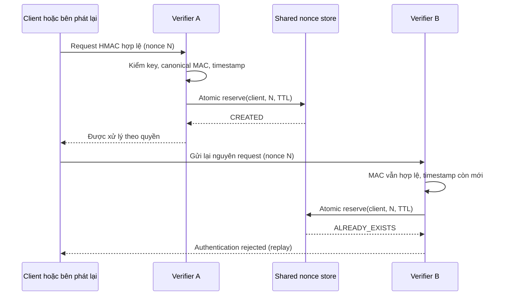
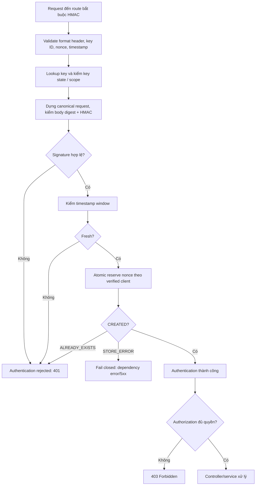

# Replay test: kiểm thử chống phát lại HTTP request ký HMAC

## 1. Bối cảnh và mục tiêu

Trong module `SECURITY_AUTHENTICATION_HMAC_REQUEST_AUTHENTICATION`, client và server dùng **shared secret** để xác thực HTTP request bằng HMAC trên một **canonical request** bao gồm HTTP method, URI/query, tập header và/hoặc body theo hợp đồng ký. Bên nhận tính lại HMAC để phát hiện nội dung được ký bị sửa. Bài học cũng yêu cầu bảo vệ chống replay bằng **timestamp/nonce**, quản lý key rotation, kiểm thử proxy/gateway và tách **authentication** khỏi **authorization**.

Chữ ký đúng **không có nghĩa request chỉ được gửi một lần**. Nếu một người quan sát hoặc một thành phần trung gian có được bản sao hợp lệ của một HTTP request, họ có thể gửi lại **nguyên vẹn** bản sao ấy. MAC vẫn khớp vì không byte nào của dữ liệu được ký thay đổi. Với endpoint ghi dữ liệu, cùng một lệnh có thể tạo hai đơn hàng, chuyển tiền hai lần hoặc kích hoạt thao tác quản trị ngoài ý muốn.

**Replay test** là tập kiểm thử chứng minh rằng verifier **từ chối một request đã được chấp nhận trước đó**, kể cả khi signature vẫn hợp lệ, kể cả khi các request tới **hai instance khác nhau cùng lúc**, và kể cả khi gateway/proxy tự động retry request. Replay test còn phải chứng minh trường hợp *request mới hợp lệ* vẫn được chấp nhận, tránh biến bộ lọc chống replay thành cơ chế từ chối tất cả request trùng nội dung nghiệp vụ.

Sau bài học, người học có thể:

1. Phân biệt **signature integrity**, **freshness window**, **nonce uniqueness**, **business idempotency** và **authorization**.
2. Viết test xác định với `Clock.fixed` để kiểm biên thời gian và những request quá hạn/tương lai.
3. Viết test nonce trùng, nonce khác, principal khác, body/method khác và signature được ký lại.
4. Chứng minh atomic check-and-record dưới tải đồng thời và khi request tới nhiều backend instance.
5. Kiểm TTL của nonce record, outage của nonce store và yêu cầu fail-closed.
6. Đánh giá replay trong giai đoạn key rotation và qua gateway/ingress.
7. Dùng `MockMvc`, `WebTestClient` và integration test thực tế mà không né SecurityFilterChain.

> Các ví dụ giả định HMAC-SHA256, header `X-Hmac-Key-Id`, `X-Hmac-Timestamp`, `X-Hmac-Nonce` và `X-Hmac-Signature`. Đây là **giao thức minh họa**, không phải format chung của mọi API HMAC. Chính sách cửa sổ thời gian, định dạng nonce, cách ký URI/header/body và HTTP error response phải được định nghĩa thống nhất trong hệ thống cụ thể.

## 2. Phân tích mối đe dọa: MAC hợp lệ vẫn có thể bị replay

Giả sử request đầu tiên:

```http
POST /internal/payments HTTP/1.1
Content-Type: application/json
X-Hmac-Key-Id: payments-key-03
X-Hmac-Timestamp: 2026-11-28T08:00:00Z
X-Hmac-Nonce: f069f071-504a-4e54-b926-f19ef2d0c858
X-Hmac-Signature: <signature-over-canonical-request>

{"paymentId":"PAY-1001","amount":500000}
```

Chữ ký bảo vệ những thành phần nằm trong hợp đồng ký. Nếu request được chấp nhận lúc 08:00:01, kẻ tấn công có thể gửi **đúng các header, signature và body đó** lúc 08:00:03. Phép tính `HMAC(key, canonicalRequest)` vẫn cho cùng kết quả; việc ký chỉ trả lời câu hỏi “nội dung có hợp lệ với secret này không?”, không trả lời “request có từng được sử dụng không?”.



**Hai điều kiện bổ sung nhau:**

- **Timestamp** giới hạn tuổi request. Một bản sao quá cũ hoặc quá xa tương lai phải bị từ chối ngay cả khi nonce chưa từng được thấy.
- **Nonce** là giá trị dùng một lần trong một phạm vi định danh xác định. Nếu timestamp vẫn trong cửa sổ, lần sử dụng lại nonce của cùng phạm vi phải bị chặn bằng thao tác nguyên tử.

Nếu chỉ kiểm timestamp, attacker có thể replay nhiều lần **trong cửa sổ hợp lệ**. Nếu chỉ kiểm nonce mà không có TTL/freshness, nonce store có thể phải giữ trạng thái mãi mãi, đồng thời client có thể gửi request rất cũ nếu bản ghi nonce bị mất.

## 3. Định nghĩa đúng thứ được kiểm

### 3.1. Nonce, idempotency key và request ID khác nhau

| Khái niệm | Do ai tạo? | Chức năng | Có thay thế replay protection không? |
| --- | --- | --- | --- |
| `X-Hmac-Nonce` | Client SDK theo giao thức ký | Chống sử dụng lại một request đã được ký | **Có vai trò chống replay**, nhưng cần store nguyên tử |
| `X-Hmac-Timestamp` | Client, được ký | Giới hạn thời gian hợp lệ | **Không**, nếu không có nonce |
| `Idempotency-Key` | Client hoặc lớp nghiệp vụ theo API contract | Giúp cùng một thao tác nghiệp vụ không thực hiện lại khi retry | **Không**, tự nó không chứng minh danh tính hoặc freshness |
| `X-Request-Id` | Gateway/server hoặc client theo tracing policy | Tương quan request/log | **Không** |
| HMAC signature | Client tính bằng secret | Kiểm tính toàn vẹn/tính xác thực các trường được ký | **Không**, cùng request cho cùng MAC |

Đặc biệt, **request được ký lại với nonce mới** có thể vượt qua replay guard dù nội dung nghiệp vụ giống hệt. Vì vậy một API thanh toán vẫn cần **business idempotency/transaction uniqueness** để ngăn chuyển tiền hai lần khi client chủ động gửi hai request mới hợp lệ.

### 3.2. Replay guard dùng nguồn danh tính nào?

Nonce phải được ràng buộc vào một **trusted scope**:

```text
trustedClientRef + nonce
```

`trustedClientRef` phải đến từ key registry **sau khi HMAC được xác minh**, không dùng trực tiếp `X-Client-Id`, `X-Tenant` hay `X-Hmac-Key-Id` do request chưa xác thực khai báo làm danh tính.

Có hai lựa chọn thường gặp:

- Scope **theo verified client**: nonce chỉ được dùng một lần cho cùng client, kể cả khi client sử dụng key version khác trong giai đoạn rotation. Điều này tránh dùng cùng nonce để replay ở hai key version trong cùng cửa sổ.
- Scope **theo verified key version**: nonce trùng giữa hai key khác nhau có thể được chấp nhận. Chỉ dùng nếu hợp đồng có lý do rõ, hiểu hạn chế bảo mật và đã thiết kế idempotency riêng.

Đừng dùng IP đơn thuần làm nonce scope: các client hợp lệ có thể chia sẻ một NAT, và IP có thể thay đổi qua gateway. Cũng không dùng **toàn bộ signature** làm nonce scope vì thay đổi một signed field sẽ tạo signature mới, cho phép bypass logic “một nonce chỉ dùng một lần”.

### 3.3. Nonce cần đủ ngẫu nhiên và được ký

Một nonce tốt nên khó dự đoán, ví dụ 128 bit ngẫu nhiên sinh từ CSPRNG và encode ở format xác định (UUID v4 hoặc token Base64URL). Để ngăn request biến nonce rồi giữ lại MAC:

1. Timestamp và nonce phải nằm trong **canonical request đã ký**.
2. Header nonce phải là **đơn trị**, giới hạn byte length/encoding, từ chối duplicate hoặc giá trị không đúng format.
3. Store key phải có namespace và escaping/encoding rõ; không ghép chuỗi tự do tạo collision.
4. Không đưa raw nonce/signature vào log, metric labels hoặc response lỗi.

Không coi việc nonce “trông có vẻ duy nhất” là bằng chứng replay protection. Test phải gửi lại **chính nonce đó**, kể cả dưới tải đồng thời và sau thay đổi route/body.

## 4. Định nghĩa hợp đồng freshness để test có oracle rõ ràng

Một chính sách minh họa:

```text
serverNow       = thời điểm từ Clock của verifier
signedAt        = timestamp từ canonical request đã xác minh
maxPast         = 5 phút
maxFuture       = 2 phút
replaySafety    = 30 giây

ACCEPT_FRESHNESS iff:
    signedAt >= serverNow - maxPast
AND signedAt <= serverNow + maxFuture
```

Việc cho phép timestamp đi trước serverNow một khoảng là một quyết định về **clock skew**, không phải khuyến khích client ký tương lai. Nếu không cần dung sai tương lai, đặt `maxFuture` nhỏ hơn. Timestamp cần có một format chính xác (ví dụ ISO-8601 UTC hoặc Unix milliseconds); không lẫn seconds với milliseconds và không parse phụ thuộc timezone địa phương.

### 4.1. Biên thời gian là một phần của hợp đồng

Giả sử:

```text
serverNow = 2026-11-28T08:00:00Z
maxPast = PT5M
maxFuture = PT2M
```

| `signedAt` | Kết luận | Vì sao |
| --- | --- | --- |
| `07:55:00Z` | Fresh nếu nonce chưa dùng | Đúng biên 5 phút trước |
| `07:54:59.999Z` | Từ chối | Cũ quá 5 phút |
| `08:00:00Z` | Fresh nếu nonce chưa dùng | Trùng giờ server |
| `08:02:00Z` | Fresh nếu nonce chưa dùng | Đúng biên tương lai 2 phút |
| `08:02:00.001Z` | Từ chối | Vượt giới hạn tương lai |
| Timestamp thiếu/sai format | Từ chối | Không có instant đáng tin để so |
| Timestamp không thuộc nội dung đã ký | **Thiết kế giao thức sai** | Attacker có thể sửa freshness field |

**Một test tốt phải kiểm cả dấu bằng** ở hai đầu cửa sổ. Nếu triển khai dùng `isBefore` và `isAfter`, ranh giới sẽ khác so với dùng so sánh `<=`/`>=` tùy cách viết.

### 4.2. Timestamp phải được so với Clock test, không dùng giờ thật

Không dùng `Thread.sleep` để thử “đợi 5 phút”; việc đó làm test chậm và không ổn định. Inject `java.time.Clock` vào freshness validator, dùng `Clock.fixed(...)` cho từng kịch bản và có thể dùng clock thay đổi được để test TTL.

Trong integration test, phải bảo đảm **Clock mà verifier thực sự sử dụng** là clock được inject. Một test chỉ tạo `Clock.fixed` ở phía test nhưng production verifier vẫn gọi `Instant.now()` sẽ tiếp tục flakey khi CI chạy vào ngày khác.

## 5. Replay nonce store: thao tác nào phải nguyên tử?

### 5.1. “Check rồi insert” không đủ

Đây là lỗi kinh điển:

```java
// SAI: hai request đồng thời có thể cùng thấy chưa tồn tại.
if (!nonceStore.exists(scope, nonce)) {
    nonceStore.save(scope, nonce);
    return ACCEPTED;
}
return REPLAY_DETECTED;
```

Hai thread hoặc hai instance có thể chạy `exists(...)` trước khi bất kỳ thread nào gọi `save(...)`. Kết quả: **cả hai cùng được chấp nhận**.

Yêu cầu đúng:

```text
tryReserve(trustedClientRef, nonce, expiration):
    atomically:
        IF record does not exist:
            INSERT record with expiry
            RETURN CREATED
        ELSE:
            RETURN ALREADY_EXISTS
```

Gọi **atomic check-and-record** (hoặc *reserve if absent*). Lần đầu được xử lý; các request khác cùng nonce/scope bị từ chối. TTL phải được gắn **cùng thao tác nguyên tử**; thao tác `SETNX` rồi `EXPIRE` tách rời có thể gây record không có TTL nếu tiến trình chết giữa hai bước.

### 5.2. TTL giữ nonce đủ lâu

Nếu một timestamp `t` được phép chấp nhận cho đến `t + maxPast`, record nonce không được hết hạn **trước** thời điểm những bản sao có timestamp ấy còn có thể được một verifier chấp nhận. Cách minh họa:

```text
nonceExpiresAt = signedAt + maxPast + safetyMargin
TTL_at_reserve = nonceExpiresAt - serverNow
```

Khi `signedAt` có thể cách hiện tại tối đa `maxFuture` về tương lai, TTL lúc reserve có thể cần dài tới khoảng:

```text
maxFuture + maxPast + safetyMargin
```

Ví dụ với cửa sổ 2 phút tương lai + 5 phút quá khứ + 30 giây an toàn, một request timestamp ở biên tương lai có thể cần record khoảng **7 phút 30 giây**. **TTL 5 phút cố định kể từ lần nhận đầu** chưa chắc đủ trong trường hợp này.

Sai số đồng hồ giữa nodes, store, replication/failover, delay và cơ chế expiration còn phải nằm trong threat model. Không lấy timestamp từ client làm **quyết định tuyệt đối** mà không validate freshness trước; nếu không attacker có thể yêu cầu TTL cực lớn hoặc âm.

### 5.3. Hạn mức và độ bền nonce state

Một nonce store phải chịu được tải request hợp lệ cũng như probing:

- Có TTL, giới hạn tài nguyên, theo dõi số lượng bản ghi và latency.
- Không **evict key đang còn hiệu lực** chỉ để giải phóng bộ nhớ nếu việc đó cho phép replay: nếu không thể giữ bảo đảm, hệ thống phải fail closed hoặc giảm nhận request theo policy.
- Phải chia sẻ cùng một miền nhất quán nguyên tử giữa tất cả verifier instance có quyền chấp nhận cùng scope.
- Khi Redis failover hoặc cross-region replication bất đồng bộ, thao tác từng primary có thể không tạo **đảm bảo exactly-once toàn cầu**. Test failover/mạng phân vùng và định nghĩa giới hạn bảo đảm; với yêu cầu mạnh, chọn primitive/kiến trúc có consistency tương ứng.
- Replay store không phải **cache Authentication**: không tái sử dụng `SecurityContext` hay authorities giữa các HTTP request.

## 6. Thứ tự xác minh và mã lỗi

Một verifier HMAC có thể chọn thứ tự kiểm tra format/timestamp/lookup nhằm tối ưu hiệu năng, nhưng **không được công nhận Authentication** khi thiếu bất cứ kiểm tra bắt buộc nào.

Quy trình khuyến nghị để tránh attacker đầu độc nonce store:



Vì nonce là dữ liệu **client tự gửi**, không reserve nonce trước khi MAC hợp lệ nếu điều đó cho phép một request giả mạo “chiếm” nonce của client thật rồi gây từ chối dịch vụ. Có thể kiểm **cú pháp timestamp** trước khi tính HMAC để fail fast, nhưng không được tin thời điểm từ header cho đến khi đã ràng buộc nó với signature.

Khi một request đã reserve nonce nhưng bị từ chối **ở authorization hoặc nghiệp vụ**, đừng tự động xóa reservation: bản sao của một request đã được xác thực vẫn là **replay** dù controller trả 403, 400, 409 hoặc 500. Nếu thiết kế cần cho phép retry nghiệp vụ, dùng idempotency contract mới, không xóa nonce để reuse credential.

| Kịch bản | Kết luận | Mã HTTP thường dùng trong API HMAC |
| --- | --- | --- |
| Thiếu/sai HMAC hoặc key không được chấp nhận | Authentication failed | **401** |
| Timestamp ngoài cửa sổ | Freshness failed | **401** |
| Nonce đã được reserve trước đó | Replay detected | **401** hoặc mã replay cụ thể theo contract |
| Nonce store không truy cập được | Không chứng minh được uniqueness | **503/5xx**, fail closed |
| MAC, freshness, nonce hợp lệ nhưng thiếu authority | Authentication success, authorization denied | **403** |
| Cùng request được xác thực nhưng body JSON sai | Authentication success, nghiệp vụ/validation failed | **400** nếu lỗi input |

HTTP status cụ thể là phần API contract, không phải mọi hệ thống HMAC đều giống nhau. Đừng dùng `403` để mô tả replay khi hệ thống đã chọn `401` cho thất bại xác thực; đừng biến lỗi store thành `INVALID_SIGNATURE` làm mất dấu hiệu sự cố hạ tầng.

## 7. Java: thiết kế ReplayGuard dễ kiểm thử

Một lớp replay guard nên nhận **danh tính đã xác minh, signed timestamp, nonce** và một interface store hỗ trợ reserve nguyên tử. Nó không tự lấy danh tính từ header chưa tin cậy. Ví dụ dùng Java 17+:

### 7.1. Hợp đồng và các loại lỗi

```java
import java.time.Instant;

// Chỉ xây object này sau khi key, signature và canonical request
// đã được HMAC verifier xác minh. Đây là contract lập trình,
// bản thân record không tự chứng minh nguồn dữ liệu đáng tin.
record VerifiedSignedRequest(
    String trustedClientRef,
    Instant signedAt,
    String nonce
) {}

interface ReplayNonceStore {
    // CREATED => true, ALREADY_EXISTS => false.
    // Store lỗi => ném exception, KHÔNG được trả true.
    boolean reserve(
        String trustedClientRef,
        String nonce,
        Instant expiresAt
    );
}

enum ReplayRejectReason {
    TIMESTAMP_OUT_OF_WINDOW,
    NONCE_REPLAY
}

final class ReplayRejectedException extends RuntimeException {
    private final ReplayRejectReason reason;

    ReplayRejectedException(ReplayRejectReason reason) {
        super("HMAC request is not fresh");
        this.reason = reason;
    }

    ReplayRejectReason reason() {
        return reason;
    }
}

final class ReplayStoreUnavailableException extends RuntimeException {
    ReplayStoreUnavailableException(Throwable cause) {
        super("HMAC replay protection is unavailable", cause);
    }
}
```

Đây là model cho test, không định nghĩa sẵn của Spring Security. `trustedClientRef` phải là định danh nội bộ đã ràng buộc với key hợp lệ; không dùng tên header do client tự chọn mà chưa xác minh.

### 7.2. Freshness và reserve nonce

```java
import java.time.Clock;
import java.time.Duration;
import java.time.Instant;
import java.util.Objects;

public final class ReplayGuard {
    private final ReplayNonceStore nonceStore;
    private final Clock clock;
    private final Duration maxPast;
    private final Duration maxFuture;
    private final Duration safetyMargin;

    ReplayGuard(
        ReplayNonceStore nonceStore,
        Clock clock,
        Duration maxPast,
        Duration maxFuture,
        Duration safetyMargin
    ) {
        this.nonceStore = Objects.requireNonNull(nonceStore);
        this.clock = Objects.requireNonNull(clock);
        this.maxPast = maxPast;
        this.maxFuture = maxFuture;
        this.safetyMargin = safetyMargin;
        // Production: validate durations >= 0, upper bounds hợp lý.
    }

    void verifyAndReserve(VerifiedSignedRequest verified) {
        Instant now = clock.instant();
        Instant signedAt = verified.signedAt();

        if (signedAt.isBefore(now.minus(maxPast)) ||
            signedAt.isAfter(now.plus(maxFuture))) {
            throw new ReplayRejectedException(
                ReplayRejectReason.TIMESTAMP_OUT_OF_WINDOW
            );
        }

        Instant expiresAt =
            signedAt.plus(maxPast).plus(safetyMargin);

        if (!expiresAt.isAfter(now)) {
            throw new ReplayRejectedException(
                ReplayRejectReason.TIMESTAMP_OUT_OF_WINDOW
            );
        }

        final boolean created;
        try {
            created = nonceStore.reserve(
                verified.trustedClientRef(),
                verified.nonce(),
                expiresAt
            );
        } catch (RuntimeException storeError) {
            throw new ReplayStoreUnavailableException(storeError);
        }

        if (!created) {
            throw new ReplayRejectedException(
                ReplayRejectReason.NONCE_REPLAY
            );
        }
    }
}
```

Trong code production cần validate `VerifiedSignedRequest` không có giá trị null, nonce đúng format/độ dài và durations không âm trước khi xử lý. Ở đây `ReplayGuard` **không chịu trách nhiệm tính HMAC**; verifier phải bảo đảm `signedAt` và `nonce` là các trường **được ký** và chỉ gọi guard sau MAC success.

Nên dùng clock injection cả tại store để kiểm TTL. `Instant` ở đây đã parse từ format canonical thống nhất, không dùng timezone địa phương hoặc timestamp do gateway tự sửa.

### 7.3. Store in-memory dành riêng cho unit test

Để kiểm đơn giản và mô phỏng tính nguyên tử trong **một JVM**, có thể dùng `ConcurrentHashMap.compute`:

```java
import java.time.Clock;
import java.time.Instant;
import java.util.concurrent.ConcurrentHashMap;
import java.util.concurrent.atomic.AtomicBoolean;

final class InMemoryReplayNonceStore implements ReplayNonceStore {
    private final ConcurrentHashMap<String, Instant> entries =
        new ConcurrentHashMap<>();
    private final Clock clock;

    InMemoryReplayNonceStore(Clock clock) {
        this.clock = clock;
    }

    @Override
    public boolean reserve(
        String trustedClientRef,
        String nonce,
        Instant expiresAt
    ) {
        // Length-prefix giúp không collision khi scope chứa dấu ':'.
        String scopedNonce =
            trustedClientRef.length() + ":" + trustedClientRef +
            ":" + nonce;
        AtomicBoolean created = new AtomicBoolean(false);

        entries.compute(scopedNonce, (key, previousExpiry) -> {
            if (previousExpiry == null ||
                !previousExpiry.isAfter(clock.instant())) {
                created.set(true);
                return expiresAt;
            }
            return previousExpiry;
        });
        return created.get();
    }
}
```

Store này chỉ để **unit test**: không có cleanup nền, không có giới hạn số entry và không chia sẻ trạng thái giữa các JVM. Nó **không** phải giải pháp chống replay production cho một cụm có nhiều instance. Trong test với key chưa hết hạn, `compute` bảo đảm chỉ một thread nhận `created=true` cho cùng scope/nonce.

## 8. Unit tests: Clock cố định, nonce trùng và các trường hợp biên

### 8.1. Bộ test JUnit 5 có thể chạy độc lập trong một JVM

```java
import static org.junit.jupiter.api.Assertions.*;

import java.time.Clock;
import java.time.Duration;
import java.time.Instant;
import java.time.ZoneOffset;
import org.junit.jupiter.api.BeforeEach;
import org.junit.jupiter.api.Test;

class ReplayGuardTest {
    private static final Instant NOW =
        Instant.parse("2026-11-28T08:00:00Z");

    private Clock fixedClock;
    private ReplayGuard guard;

    @BeforeEach
    void setUp() {
        fixedClock = Clock.fixed(NOW, ZoneOffset.UTC);
        var store = new InMemoryReplayNonceStore(fixedClock);
        guard = new ReplayGuard(
            store,
            fixedClock,
            Duration.ofMinutes(5),
            Duration.ofMinutes(2),
            Duration.ofSeconds(30)
        );
    }

    private VerifiedSignedRequest req(
        String client, String nonce, Instant signedAt
    ) {
        return new VerifiedSignedRequest(client, signedAt, nonce);
    }

    @Test
    void firstUseSucceedsSecondIdenticalUseIsReplay() {
        var request = req("trusted-client-a", "nonce-a", NOW);
        assertDoesNotThrow(() -> guard.verifyAndReserve(request));

        ReplayRejectedException error = assertThrows(
            ReplayRejectedException.class,
            () -> guard.verifyAndReserve(request)
        );
        assertEquals(ReplayRejectReason.NONCE_REPLAY, error.reason());
    }

    @Test
    void distinctNoncesFromSameClientAreAllowed() {
        assertDoesNotThrow(() -> guard.verifyAndReserve(
            req("trusted-client-a", "nonce-a", NOW)
        ));
        assertDoesNotThrow(() -> guard.verifyAndReserve(
            req("trusted-client-a", "nonce-b", NOW)
        ));
    }

    @Test
    void sameNonceCanBelongToDifferentVerifiedClients() {
        guard.verifyAndReserve(req("client-a", "nonce-1", NOW));
        assertDoesNotThrow(() -> guard.verifyAndReserve(
            req("client-b", "nonce-1", NOW)
        ));
    }

    @Test
    void exactPastAndFutureBoundariesAreAccepted() {
        assertDoesNotThrow(() -> guard.verifyAndReserve(
            req("client-a", "past-boundary",
                NOW.minus(Duration.ofMinutes(5)))
        ));
        assertDoesNotThrow(() -> guard.verifyAndReserve(
            req("client-a", "future-boundary",
                NOW.plus(Duration.ofMinutes(2)))
        ));
    }

    @Test
    void timestampBeyondEitherBoundaryIsRejected() {
        ReplayRejectedException old = assertThrows(
            ReplayRejectedException.class,
            () -> guard.verifyAndReserve(
                req("client-a", "old",
                    NOW.minus(Duration.ofMinutes(5))
                        .minusMillis(1))
            )
        );
        ReplayRejectedException future = assertThrows(
            ReplayRejectedException.class,
            () -> guard.verifyAndReserve(
                req("client-a", "future",
                    NOW.plus(Duration.ofMinutes(2))
                        .plusMillis(1))
            )
        );
        assertEquals(
            ReplayRejectReason.TIMESTAMP_OUT_OF_WINDOW, old.reason()
        );
        assertEquals(
            ReplayRejectReason.TIMESTAMP_OUT_OF_WINDOW, future.reason()
        );
    }
}
```

Những test này cô lập **freshness và nonce state**, nên không phải test HMAC signature. Điều kiện precondition quan trọng là `VerifiedSignedRequest` chỉ được tạo từ **request đã được MAC verifier xác minh**. Integration test tiếp theo phải kiểm precondition này thực sự được giữ.

### 8.2. Vì sao không kiểm “same nonce” với timestamp mới?

Khi gọi cùng scope và nonce nhưng đổi timestamp, chữ ký ban đầu sẽ sai nếu timestamp là signed field. Muốn test guard trực tiếp, có thể tạo hai `VerifiedSignedRequest` với timestamp khác nhau (giả định đã được ký hợp lệ riêng); muốn test HTTP thật, phải **tính chữ ký mới bằng test secret** cho timestamp mới rồi xác nhận nonce reuse vẫn bị từ chối.

Đừng chỉ replay **cùng chữ ký cũ** và kết luận nonce check hoạt động: verifier có thể từ chối vì timestamp, body, method hoặc canonicalization khác. Test phải phân biệt được reason code nội bộ `NONCE_REPLAY` với `SIGNATURE_INVALID` và `TIMESTAMP_OUT_OF_WINDOW`.

## 9. Concurrency test: chỉ một request giữ được nonce

Một replay guard dùng `ConcurrentHashMap` hoặc store phân tán phải bảo đảm **atomicity**, không chỉ “đa phần request tới sau bị chặn”.

### 9.1. Test race trong một JVM

Đoạn JUnit 5 sau dùng chung một `ReplayGuard` và `InMemoryReplayNonceStore` từ mục 7; các tác vụ xuất phát từ một latch:

```java
import static org.junit.jupiter.api.Assertions.assertEquals;

import java.time.Clock;
import java.time.Duration;
import java.time.Instant;
import java.time.ZoneOffset;
import java.util.ArrayList;
import java.util.List;
import java.util.concurrent.CountDownLatch;
import java.util.concurrent.Executors;
import java.util.concurrent.Future;
import java.util.concurrent.TimeUnit;
import org.junit.jupiter.api.Test;

class ReplayConcurrentTest {

    @Test
    void concurrentCallsWithSameNonceAllowExactlyOne() throws Exception {
        Instant now = Instant.parse("2026-11-28T08:00:00Z");
        Clock clock = Clock.fixed(now, ZoneOffset.UTC);
        ReplayNonceStore store = new InMemoryReplayNonceStore(clock);
        ReplayGuard guard = new ReplayGuard(
            store, clock,
            Duration.ofMinutes(5),
            Duration.ofMinutes(2),
            Duration.ofSeconds(30)
        );
        VerifiedSignedRequest req =
            new VerifiedSignedRequest("client-a", now, "one-nonce");

        var pool = Executors.newFixedThreadPool(16);
        var start = new CountDownLatch(1);
        List<Future<Boolean>> futures = new ArrayList<>();

        try {
            for (int i = 0; i < 16; i++) {
                futures.add(pool.submit(() -> {
                    start.await();
                    try {
                        guard.verifyAndReserve(req);
                        return true;
                    } catch (ReplayRejectedException replay) {
                        if (replay.reason() !=
                            ReplayRejectReason.NONCE_REPLAY) {
                            throw replay;
                        }
                        return false;
                    }
                }));
            }

            start.countDown();
            int accepted = 0;
            for (Future<Boolean> future : futures) {
                if (future.get(10, TimeUnit.SECONDS)) {
                    accepted++;
                }
            }
            assertEquals(1, accepted);
        } finally {
            pool.shutdownNow();
        }
    }
}
```

Tập test nên chạy lặp lại nhiều lần trong CI, với số thread/concurrency khác nhau. Tuy nhiên **test in-memory không chứng minh distributed replay protection**; mỗi JVM có map riêng thì cả hai có thể chấp nhận cùng nonce. Để phát hiện lỗi nhiều instance, cần test store chia sẻ thật.

### 9.2. Test quan hệ giữa nhiều client và nhiều key version

Với policy nonce scope theo **trusted client**:

| Client | Key version | Nonce | Kỳ vọng |
| --- | --- | --- | --- |
| A | v1 | N | Chấp nhận lần đầu |
| A | v1 | N | Từ chối replay |
| A | v2 (đang overlap) | N | Từ chối nếu cùng client scope |
| A | v2 | N2 | Có thể chấp nhận nếu key/state và chữ ký hợp lệ |
| B | v1 của B | N | Có thể chấp nhận vì là client khác |

Không nên tự chuyển scope thành `(keyId,nonce)` chỉ vì việc triển khai dễ hơn: nếu yêu cầu là “một nonce cho mỗi verified client”, key rotation không được mở lại quyền dùng nonce cũ.

## 10. Redis: integration test cho atomic reserve và TTL

Trong môi trường nhiều instance, một lựa chọn là Redis với **một lệnh SET có NX và TTL**:

```text
SET replay:<opaque-scope-and-nonce-digest> 1 NX PX <ttl-millis>
```

Ý nghĩa:

- Redis trả thành công khi record chưa tồn tại và được tạo **cùng TTL**.
- Redis trả không tạo khi nonce đã tồn tại.
- Timeout/kết nối lỗi là **STORE_ERROR**, không được đoán record chưa tồn tại rồi cho request đi tiếp.

### 10.1. Adapter Spring Data Redis minh họa

```java
import java.time.Clock;
import java.time.Duration;
import java.time.Instant;
import org.springframework.data.redis.core.StringRedisTemplate;

interface ReplayRedisKeyCodec {
    // Tạo opaque/deterministic Redis key từ verified scope + nonce,
    // ví dụ dùng HMAC riêng cho replay-store namespace.
    // Không dùng raw secret ký request làm khóa của codec.
    String encode(String trustedClientRef, String nonce);
}

public final class RedisReplayNonceStore implements ReplayNonceStore {
    private final StringRedisTemplate redis;
    private final ReplayRedisKeyCodec codec;
    private final Clock clock;

    RedisReplayNonceStore(
        StringRedisTemplate redis,
        ReplayRedisKeyCodec codec,
        Clock clock
    ) {
        this.redis = redis;
        this.codec = codec;
        this.clock = clock;
    }

    @Override
    public boolean reserve(
        String trustedClientRef,
        String nonce,
        Instant expiresAt
    ) {
        Duration ttl = Duration.between(clock.instant(), expiresAt);
        if (ttl.isZero() || ttl.isNegative()) {
            throw new IllegalStateException("Invalid nonce expiration");
        }

        String redisKey = "hmac:replay:v1:" +
            codec.encode(trustedClientRef, nonce);

        // Spring Data Redis setIfAbsent(key, value, timeout)
        // thực hiện reservation kèm expiry trong một thao tác.
        Boolean created = redis.opsForValue()
            .setIfAbsent(redisKey, "1", ttl);

        if (created == null) {
            throw new IllegalStateException("Redis reservation unavailable");
        }
        return created;
    }
}
```

Đây là **adapter minh họa**: `ReplayRedisKeyCodec` phải được hiện thực bảo đảm không collision trong namespace, có output hữu hạn và không lộ raw nonce/verified client reference nhạy cảm. Có thể dùng HMAC với **khóa nội bộ khác khóa ký HTTP**, bảo vệ riêng trong secret manager, để tạo opaque key ổn định. TTL của Redis và wall clock giữa verifier/Redis cần được kiểm thử theo chính sách skew.

Một key Redis có TTL không thay thế **guarantee về consistency**. Redis replication/failover bất đồng bộ có thể làm mất reservation vừa ghi; với yêu cầu nghiêm ngặt cần đánh giá cấu hình, acknowledgment/replication, failure modes, vùng nhất quán hoặc một store có tính chất phù hợp hơn.

### 10.2. Testcontainers và hai verifier instance

Trong integration test, khởi chạy Redis test riêng (ví dụ qua Testcontainers), tạo **hai `ReplayGuard` với hai `RedisReplayNonceStore` độc lập**, cùng trỏ tới Redis đó. Không dùng một singleton in-memory map được inject chung vì sẽ che lỗi phân tán.

Các assertion tối thiểu:

1. Guard A reserve `client-A/N`: thành công.
2. Guard B reserve `client-A/N` trước TTL: `NONCE_REPLAY`.
3. Guard A và B gửi cùng nonce **đồng thời**: chỉ một reserve thành công.
4. Guard B reserve `client-A/N2`: thành công nếu HMAC/freshness hợp lệ.
5. Guard B reserve `client-B/N`: thành công nếu dùng scope theo client.
6. Đọc TTL qua **API dành cho test**: record có TTL dương hợp lệ, không phải `-1` (không có expiration).
7. Redis ngắt kết nối trước reserve: mọi verifier phải fail closed, phát lỗi store, không tạo Authentication.
8. Khởi động lại guard hoặc instance app: nonce cũ còn tồn tại trong store phải vẫn bị từ chối trong thời gian bảo vệ.

Ví dụ skeleton của một test tích hợp, các fixture do dự án định nghĩa:

```java
@Test
void twoInstancesShareNonceReservation() {
    // redisStoreA và redisStoreB là hai adapter độc lập,
    // cùng kết nối đến một Redis Testcontainers instance.
    ReplayGuard first = guard(redisStoreA, frozenClock);
    ReplayGuard second = guard(redisStoreB, frozenClock);

    VerifiedSignedRequest request =
        verifiedRequest("client-a", "nonce-001", signedAt);

    assertDoesNotThrow(() -> first.verifyAndReserve(request));
    assertThrows(ReplayRejectedException.class,
        () -> second.verifyAndReserve(request));
}
```

Đây là **pseudocode trong test class** với `guard(...)`, `verifiedRequest(...)`, `redisStoreA/B`, `frozenClock` do test suite cung cấp. Một test quan trọng hơn phải chạy song song qua **hai cổng HTTP/instance backend thực** để kiểm cả đường đi gateway, load balancer và SecurityFilterChain.

### 10.3. Kiểm thử TTL không gây replay giả

Một test nên cố định clock và lựa chọn timestamp theo chính sách đã xác định:

- Sau reserve đầu tiên, trong suốt khoảng request vẫn fresh thì duplicate phải bị chặn.
- Khi request cũ đã quá `maxPast`, verifier phải từ chối vì **timestamp**, ngay cả nếu nonce record đã expire.
- Sau TTL, tạo **request mới với timestamp mới, nonce mới và chữ ký mới**: được phép nếu key/quyền còn hợp lệ.
- Không viết test “đợi TTL rồi dùng lại nguyên request được chấp nhận”, vì nếu timestamp vẫn fresh tại thời điểm nonce record mất thì có thể tạo lỗ hổng replay; một test như vậy phải **kỳ vọng từ chối**, không kỳ vọng chấp nhận.

Trong thực tế với Redis TTL chạy theo thời gian của server Redis, `Clock.fixed` ở verifier **không khiến TTL Redis tự trôi**. Để test expiry nhanh, dùng clock có thể điều khiển trong unit test store in-memory, còn integration test Redis nên dùng TTL ngắn trong cấu hình test có kiểm soát hoặc thao tác test-specific với timeout phù hợp; không dùng `Thread.sleep` kéo dài trong toàn bộ suite.

## 11. Tích hợp vào Spring Security: kiểm HTTP status và side effect

### 11.1. Servlet/Spring MVC

Một `OncePerRequestFilter` hoặc custom authentication filter nên:

1. Chỉ chạy trên các method/path bắt buộc HMAC, kể cả khi thiếu signature header.
2. Validate key ID, signed fields; xây canonical bytes **đúng raw request**.
3. Lookup key và kiểm state/rotation policy.
4. Xác minh HMAC và freshness/nonce bằng service được inject.
5. Chỉ sau khi tất cả PASS mới tạo `Authentication` và đặt `SecurityContext`.
6. Để `AuthorizationFilter`/service kiểm authority và tenant/resource.

Ví dụ skeleton kiểm tích hợp bằng `MockMvc`, với helper ký request bằng **test secret** và clock cố định:

```java
@Test
void sameSignedHttpRequestIsRejectedOnSecondSubmission()
    throws Exception {
    // signer tạo signature từ chính method, raw path/query,
    // signed headers và raw body bytes theo hợp đồng ứng dụng.
    SignedTestRequest signed = signer.sign(
        "POST", "/internal/orders",
        "{\"orderId\":\"ORD-123\"}",
        "2026-11-28T08:00:00Z", "nonce-http-001"
    );

    mockMvc.perform(signed.toMockMvcRequest())
        .andExpect(status().isCreated());

    mockMvc.perform(signed.toMockMvcRequest())
        .andExpect(status().isUnauthorized());

    assertEquals(1, orderRepository.countByOrderId("ORD-123"));
}
```

Đây là **mẫu contract test**, không phải API có sẵn của Spring: `SignedTestRequest`, `signer` và `toMockMvcRequest()` là helper fixture; `orderRepository` là repository test. Test cần nạp **SecurityFilterChain thật**, clock và nonce store test được inject, tạo **request mới từ cùng bytes** cho lần gửi thứ hai. Không dùng `@WithMockUser` để coi là đã kiểm HMAC: nó có thể bỏ qua verifier.

Hai assertion quan trọng:

- Request thứ hai phải bị chặn **trước controller/service**, không tạo business side effect lần hai.
- Test xác định reason nội bộ là **NONCE_REPLAY**, không phải signature mismatch hoặc timestamp expired do test setup sai.

Lưu ý: Khi body có trong chữ ký, filter đọc body để băm phải bọc request theo cách handler vẫn nhận được raw body; Servlet `InputStream` không tự phát lại sau khi verifier đọc hết. Body và canonical target phải khớp fixture.

### 11.2. Spring WebFlux

Với WebFlux, authentication chạy trong `SecurityWebFilterChain`; context được truyền bằng `ReactiveSecurityContextHolder`. Nonce store cũng cần API bất đồng bộ để không chặn event loop.

```java
// Ví dụ biểu đạt ý tưởng; các helper/bean do ứng dụng cung cấp.
return reactiveHmacVerifier.verify(exchange)
    .flatMap(verified -> reactiveReplayGuard
        .verifyAndReserve(verified)
        .thenReturn(verified))
    .flatMap(verified ->
        chain.filter(exchange)
            .contextWrite(
                ReactiveSecurityContextHolder.withAuthentication(
                    verified.authentication()
                )
            )
    );
```

Đoạn trên là pseudocode ở ranh giới tích hợp: `reactiveHmacVerifier` trả kết quả đã xác minh MAC, `reactiveReplayGuard.verifyAndReserve` trả `Mono<Void>` và `verified.authentication()` là principal đã xác thực. **Không gọi `block()` trên Netty event loop**, không tự `subscribe()` để reserve nonce trước rồi gọi chain khi chưa có kết luận. Nếu verifier cần đọc raw body, phải buffer có giới hạn hoặc thiết kế streaming, quản lý `DataBuffer` đúng vòng đời và truyền body cho handler sau khi xác thực.

Với `WebTestClient`, test:

- Gửi cùng một signed request hai lần; lần đầu được xử lý, lần sau bị từ chối.
- Hai subscription concurrent cùng nonce chỉ có một thành công trên shared store.
- Cancel request trong lúc nonce store chưa kết luận: tuyệt đối không để downstream handler chạy trước xác thực.
- Nếu reserve đã commit nhưng client disconnect, **không hoàn tác nonce** để “cho retry lại” trừ khi một giao thức rất cụ thể bảo đảm điều đó không mở replay; mặc định giữ reservation.
- Khi nonce store timeout, publisher phát error và security layer trả failure an toàn, không phát `Authentication`.

### 11.3. 401 và 403 cần test riêng

| Request | Authentication | Authorization | Kỳ vọng |
| --- | --- | --- | --- |
| Signature sai | FAIL | Không xét quyền | 401 |
| Signature đúng, nonce đã dùng | FAIL (replay) | Không xét quyền | 401 theo contract |
| Signature đúng, nonce mới, thiếu authority | PASS | FAIL | 403 |
| Signature đúng, nonce mới, đủ authority | PASS | PASS | Business response |

Một test chỉ thấy HTTP 403 không chứng minh nonce store hoạt động; đó có thể là CSRF, WAF, CORS hoặc AccessDeniedHandler. Phải quan sát test hook/reason code nội bộ và assert side effect.

## 12. Gateway, reverse proxy và retry tự động

### 12.1. Gateway retry có thể bị xem là replay hợp lệ

Giả sử gateway gửi request đã ký đến backend A nhưng mất kết nối sau khi A đã reserve nonce. Gateway retry **cùng request** sang backend B:

```text
T1: Gateway -> A: signed POST, nonce N
T2: A reserve N, xử lý nghiệp vụ
T3: Kết nối gateway ↔ A bị lỗi trước khi trả response
T4: Gateway -> B: retry nguyên POST, nonce N
T5: B thấy N đã dùng -> replay rejected
```

Đây là hành vi **đúng của replay protection**, nhưng client/gateway phải hiểu outcome không chắc chắn của request đầu tiên. Giải pháp **không phải** xóa nonce hoặc cho B xử lý lần hai. Thay vào đó:

- Không cấu hình retry mù quáng cho non-idempotent signed POST.
- Với API ghi dữ liệu, có idempotency key **được ràng buộc trong signed request**, record kết quả nghiệp vụ và trạng thái transaction.
- Khi retry nghiệp vụ có chủ đích, client có thể ký **request mới với nonce/timestamp mới**, trong khi idempotency layer trả lại kết quả tương ứng thay vì thực hiện lại thao tác.
- Phân biệt retry của transport, replay của request ký và duplicate logical business command trong telemetry.

### 12.2. Điểm kiểm nonce là một phần của kiến trúc gateway

Hai kiến trúc thông dụng:

**Backend verify:** Gateway chỉ forward các signed fields và raw target/body theo hợp đồng; backend thực hiện HMAC + nonce reservation. Tất cả backend instances chia sẻ miền replay store phù hợp.

**Gateway verify:** Gateway xác minh HMAC + nonce **trước khi** rewrite request, backend tin assertion nội bộ chỉ qua kênh xác thực gateway → backend (ví dụ mTLS, network policy, metadata đã được ký/đối chiếu) và không chấp nhận header `X-Verified-Client` do internet client tự gửi.

**Bẫy double reservation:** Nếu gateway và backend **cùng dùng một nonce namespace** để reserve cho **cùng một signed request**, gateway sẽ reserve thành công và backend sẽ coi request đó là replay. Nếu cần kiểm ở hai hop, hãy quy định **một điểm có thẩm quyền tiêu thụ nonce** hoặc **hai credential/signature/hop-specific namespaces** được thiết kế riêng. Không “bỏ qua replay error ở backend” một cách tùy tiện.

### 12.3. Proxy thay canonical representation

Proxy có thể:

- Rewrite `/public/orders` → `/internal/orders`.
- Đổi `Host`/`Forwarded`/`X-Forwarded-*`.
- Sắp xếp lại query, percent decode path hoặc thêm charset vào `Content-Type`.
- Gộp duplicate headers hoặc decompress/serialize lại body.

Những biến đổi này có thể làm **signature mismatch** ngay trước nonce check. Vì thế replay test đi qua proxy phải dùng hợp đồng rõ external/internal target và assert đúng reason. Không kết luận “đã chặn replay” nếu request thứ hai bị từ chối chỉ vì gateway đã làm hỏng chữ ký.

## 13. Key rotation, revoke và replay qua nhiều khóa

Hệ thống HMAC có thể chấp nhận song song old key (RETIRING) và new key (ACTIVE) trong một thời gian overlap có kiểm soát.

Những test cần có:

1. Request đã ký bằng old key với nonce N được chấp nhận trong overlap; cùng request bị replay phải bị từ chối.
2. Cùng **verified client**, nonce N nhưng request khác được ký hợp lệ bằng **new key**: nếu nonce scope theo client, vẫn bị từ chối.
3. Nonce N2 + new key hợp lệ: có thể chấp nhận sau khi kiểm signature, timestamp và key state.
4. Old key đã `REVOKED`: mọi request bằng old key đều bị từ chối **trước khi tạo Authentication**, kể cả MAC đúng và nonce chưa thấy.
5. Node cache old key ACTIVE sau revoke: phải phát hiện theo chính sách revocation freshness, không cho cache stale vượt hạn cho phép.
6. Store nonce bị reset khi rotation: test bảo đảm request old-key còn fresh **không** bỗng được chấp nhận lại do xóa replay state.
7. Khi hai key version cùng ký cho một business command, **idempotency** phải ngăn side effect trùng dù nonce khác.

Không thử tất cả shared secrets cho đến khi chữ ký khớp mà không có giới hạn/hợp đồng key selection rõ. Key ID phải được ký theo format của giao thức, map tới key version đang hiệu lực và gắn verified client identity đúng scope.

## 14. Ma trận replay test toàn diện

| Nhóm | Test case | Expected |
| --- | --- | --- |
| Signature | HMAC hợp lệ, timestamp mới, nonce mới | Authn PASS nếu key hợp lệ |
| Replay cơ bản | Gửi lại nguyên request đã chấp nhận | Reject `NONCE_REPLAY` |
| Nonce mới | Cùng method/body, nonce mới và signature mới | Có thể PASS; kiểm business idempotency riêng |
| Tampering | Đổi body/method/path nhưng giữ signature cũ | Reject `SIGNATURE_INVALID` |
| Timestamp cũ | Signed request quá `maxPast`, nonce mới | Reject `TIMESTAMP_OUT_OF_WINDOW` |
| Timestamp tương lai | Signed request vượt `maxFuture` | Reject `TIMESTAMP_OUT_OF_WINDOW` |
| Ranh giới thời gian | Chính xác `now - maxPast` và `now + maxFuture` | Theo inclusive policy đã định |
| Timestamp format | Sai ISO-8601/epoch đơn vị, missing header | Reject trước khi tạo Authentication |
| Header ambiguity | Duplicate nonce/timestamp/signature/key ID | Reject theo hợp đồng |
| Nonce format | Dài quá giới hạn, ký tự cấm, rỗng | Reject, không gọi store tùy tiện |
| Signature trước store | Request HMAC sai dùng nonce chưa có | Không “chiếm” nonce của request hợp lệ |
| Scope | Cùng nonce ở hai verified clients khác nhau | Độc lập nếu scope theo client |
| Rotation | Cùng verified client + nonce trên key v1/v2 | Reject nếu scope theo client |
| Concurrent threads | N request cùng nonce, cùng JVM | Chỉ 1 reserve thành công |
| Distributed nodes | N request cùng nonce qua nhiều app instances | Chỉ 1 được nhận theo store consistency |
| Redis TTL | Reservation có expiry nguyên tử | Không có record không TTL |
| TTL sớm | Record expire khi timestamp còn fresh | **Không được** mở cửa replay |
| Store outage | Timeout/circuit open/Redis unavailable | Fail closed, không tạo Authentication |
| Store failover | Primary crash/replication lag | Theo guarantee đã tuyên bố; tìm lost reservation |
| Client disconnect | Cancel sau reserve đã commit | Reservation không bị xóa tùy tiện |
| Side effect | Replay bị từ chối sau lần đầu thành công | Business action chỉ thực hiện một lần |
| Response lost | Gateway retry nguyên signed request | Reject replay; idempotency giải quyết outcome |
| Proxy rewrite | URI/header/body biến đổi | Không nhầm signature error với replay |
| Key revoked | Old key MAC đúng nhưng bị revoke | 401 do key policy; không tạo Authentication |
| Authorization | HMAC+nonce hợp lệ nhưng thiếu quyền | 403; replay lần sau vẫn bị từ chối |
| Logs/metrics | Raw nonce/signature/secret xuất hiện trong test input | Không lộ trong output observability |

### 14.1. Test kết hợp lỗi ưu tiên

Một request có thể **đồng thời** quá hạn và nonce đã dùng. Nếu verifier kiểm timestamp trước nonce, reason hợp lý là `TIMESTAMP_OUT_OF_WINDOW`; nếu kiểm nonce trước, có thể ghi `NONCE_REPLAY`. API cần cố định thứ tự/ưu tiên và không cung cấp quá nhiều chi tiết ra ngoài.

Test nên xác nhận **không bao giờ chấp nhận request**, nhưng không buộc một reason duy nhất khi chính sách cho phép nhiều thứ tự. Khi dự án đã công bố một thứ tự xác minh, dùng assertion reason đúng hợp đồng để tránh regression.

### 14.2. Test dưới tải thực

Không chỉ chạy 10 requests tuần tự. Thử burst concurrent, nhiều instance, nhiều vùng và trường hợp kho nonce bị chậm. Thu metric:

- `hmac_authentication_total{outcome,reason}` với nhãn hữu hạn.
- `hmac_replay_detected_total`.
- `nonce_reserve_duration_seconds` và `nonce_store_errors_total`.
- Tỷ lệ request xác thực bị từ chối do key/signature/timestamp/nonce.
- Business side effect counts/idempotency collision count.

Không dùng nonce, signature, raw client ID do request gửi, URL đầy đủ hay request ID làm **Prometheus label** có cardinality cao. Log có thể chứa **reason code và request ID đáng tin**, không ghi raw shared secret, raw nonce, raw body nhạy cảm hoặc expected signature.

## 15. Những lỗi thiết kế khiến replay test “xanh giả”

### 15.1. Chỉ kiểm signature hai lần

Nếu test gửi cùng request và cả hai lần MAC đều khớp, đó là tính chất bình thường của HMAC. Phải kiểm **quyết định của replay guard**, không chỉ `Mac.doFinal(...)`.

### 15.2. Lần hai thất bại vì timestamp hết hạn

Đặt timestamp cũ rồi gửi hai lần có thể tạo 401 ở cả hai, nhưng không chứng minh nonce uniqueness. Freeze clock trong cửa sổ hợp lệ, gửi lần đầu thành công rồi mới gửi lần hai.

### 15.3. Lần hai thất bại vì signature khác

Nếu test builder tạo body/query khác ở lần retry, chữ ký có thể sai trước nonce. Reuse cùng **signed fixture bytes**, cùng các signed fields và theo dõi reason `NONCE_REPLAY`.

### 15.4. Dùng map in-memory rồi tuyên bố đã chống replay phân tán

Test trong một JVM có thể xanh dù trên production có 10 instances mỗi node giữ map riêng. Cần cùng một atomic store/consistency domain và test qua các instance thực.

### 15.5. Kiểm exists rồi save thành hai lệnh

Test tuần tự có thể xanh nhưng race test sẽ thất bại. Dùng atomic reserve `SET ... NX PX`, database unique constraint/transaction hoặc primitive tương đương; kiểm race và lỗi store.

### 15.6. TTL bằng maxPast nhưng bỏ qua maxFuture

Một request timestamp tương lai gần biên có thể còn fresh lâu hơn TTL nếu TTL được tính sai. Kiểm đúng thời gian hiệu lực nonce bằng cả `maxPast` và `maxFuture`, đồng thời tính safety margin/clock skew.

### 15.7. Reserve nonce trước khi xác minh MAC

Attacker có thể gửi request signature sai nhưng dùng nonce mà client hợp lệ sẽ dùng, khiến replay guard từ chối client thật. Ưu tiên ràng buộc nonce vào MAC hợp lệ trước reservation; test rõ “invalid MAC không chiếm nonce”.

### 15.8. Xóa nonce sau 403, 400 hoặc 500

Kết quả nghiệp vụ không làm cho request ký đã được xác thực trở thành “chưa từng sử dụng”. Xóa reservation sau response lỗi có thể mở cửa cho replay thao tác đã tạo side effect một phần.

### 15.9. Cache nonce cũ bị evict sớm khi Redis quá tải

Một store bị cấu hình eviction policy để xóa nonce còn fresh có thể làm bảo đảm replay mất hiệu lực mà không có HTTP 5xx. Kiểm cache pressure, memory eviction, failover và capacity; không dùng eviction theo LRU làm giả định thay thế TTL bảo mật.

### 15.10. Bỏ qua key rotation và authority

Một key cũ còn được chấp nhận trong overlap không được reset toàn bộ nonce. Một request đã xác thực nhưng thiếu authority phải nhận 403, không bị gọi nhầm là replay. Test độc lập từng chính sách, sau đó kết hợp chúng.

## 16. Quy trình triển khai Replay test cho hệ thống thực

1. **Cố định hợp đồng HMAC:** method, raw URI/query, signed headers/body, timestamp/nonce, key ID, encoding và canonicalization version. Nonce/timestamp phải thuộc signature.
2. **Định nghĩa replay scope và cửa sổ:** verified client hoặc key version, `maxPast`, `maxFuture`, boundary inclusive và TTL với safety margin.
3. **Chọn atomic store:** `reserve-if-absent-with-expiry`, consistency domain giữa mọi verifier; lỗi store phải fail closed.
4. **Đặt thứ tự verifier:** key state và MAC phải xác minh trước khi tạo Authentication; freshness và nonce reservation được thực hiện trong pipeline được kiểm soát.
5. **Viết unit test xác định:** `Clock.fixed`, lần đầu/lần hai, nonce mới, scope khác, hai biên timestamp và timestamp sai.
6. **Viết concurrency test:** N threads cùng nonce; đúng một reserve thành công; test load và timeouts.
7. **Viết distributed integration test:** nhiều Spring Boot instances hoặc nhiều adapter cùng Redis/test store thật, kiểm failover và lost reservation theo guarantee.
8. **Viết HTTP tests:** `MockMvc`/`WebTestClient` qua SecurityFilterChain, assert 401/403, controller không chạy khi replay và side effect không nhân đôi.
9. **Kiểm proxy/gateway:** route rewrite, signed headers, body, retries, điểm verify và double reservation giữa edge/backend.
10. **Kiểm rotation/tenant:** nonce scope đúng qua key versions, revoke không được bypass, client tenant khác không va chạm giả.
11. **Kiểm audit/privacy:** metric reason và latency, không lộ secret/signature/nonce, không gắn input tùy ý vào metric labels.
12. **Gắn business idempotency:** bảo vệ thao tác ghi khi client gửi request mới hợp lệ với nonce mới nhưng cùng idempotency key.

**Điểm cần nhớ:** **Replay test** phải chứng minh **request ký hợp lệ chỉ được chấp nhận một lần trong phạm vi/cửa sổ đã định**, không phải chỉ chứng minh chữ ký HMAC đúng. Timestamp giới hạn thời gian; nonce store nguyên tử chống bản sao trong cửa sổ; key rotation và proxy phải không làm mất bảo đảm này. Khi kết hợp thêm authorization và business idempotency, hệ thống mới tránh được cả việc **phát lại credential** lẫn **thực thi lặp thao tác nghiệp vụ**.
