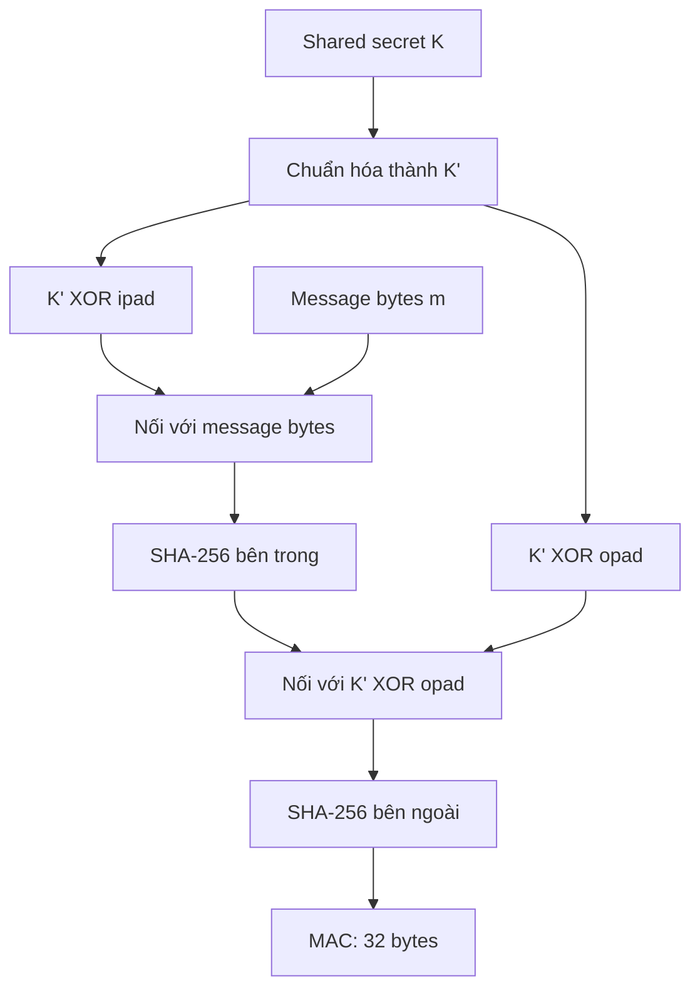
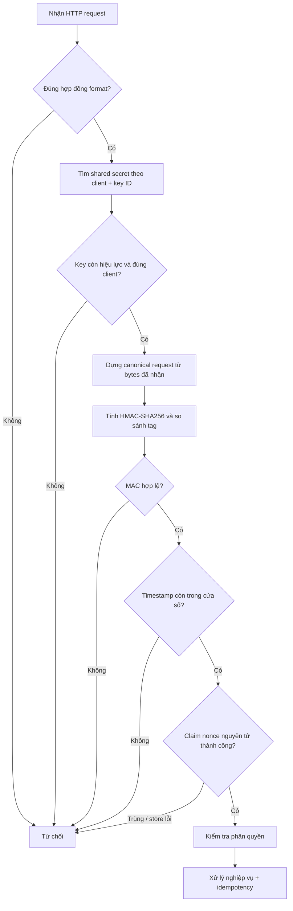

# HMAC là gì?

> **Chương:** HMAC  
> **Bối cảnh học tập:** Xây dựng xác thực HTTP request bằng HMAC với shared secret. Người học cần hiểu HMAC trước khi thiết kế canonical request, xác minh chữ ký, chống replay bằng timestamp/nonce, luân chuyển khóa và kiểm thử khi request đi qua proxy/gateway.

## 1. Bài toán: làm sao biết request có bị sửa hoặc bị giả mạo?

Giả sử dịch vụ nội bộ `order-service` gọi HTTP API tạo đơn hàng:

```http
POST /v1/orders?source=partner HTTP/1.1
Host: api.example.test
Content-Type: application/json
X-Client-Id: order-service
X-Key-Id: key-2026-11
X-Timestamp: <unix-timestamp>
X-Nonce: <random-nonce>
X-Signature: <hmac-signature>

{"orderId":"ORD-1024","quantity":2}
```

API nhận được request phải trả lời ít nhất hai câu hỏi:

1. Những dữ liệu quan trọng như HTTP method, URI, header và body có còn giống những gì bên gửi đã ký không?
2. Request có được ký bởi một bên biết **shared secret** được đăng ký cho `order-service` không?

Nếu chỉ nhận `X-Client-Id: order-service`, kẻ khác có thể tự gửi header với cùng giá trị. Nếu dùng SHA-256 công khai của body, kẻ tấn công sửa body rồi tính lại SHA-256. API cần một mã kiểm tra gắn với **bí mật mà bên ngoài không biết**.

Đó là vai trò của **HMAC (Hash-based Message Authentication Code)**: tạo mã xác thực thông điệp (MAC) từ dữ liệu cần bảo vệ và một secret key. Bên nhận biết cùng secret có thể tự tính lại mã để kiểm tra request.

**Mục tiêu sau bài học:** giải thích được HMAC hoạt động ở mức khái niệm và công thức; phân biệt HMAC với hash, mã hóa, chữ ký số; tạo và xác minh HMAC-SHA256 bằng Java; hiểu tại sao một hệ thống HTTP phải quy định chính xác dữ liệu nào được ký, đồng thời không nhầm xác thực HMAC với chống replay hoặc phân quyền.

## 2. HMAC là gì?

HMAC là một thuật toán tạo **message authentication code có khóa**, xây dựng từ một hàm băm mật mã như SHA-256.

Ký hiệu:

- `K`: khóa bí mật dùng chung giữa bên ký và bên xác minh.
- `m`: thông điệp, chính xác là **chuỗi bytes** được ký.
- `H`: hàm băm nền, ví dụ SHA-256.
- `HMAC(K, m)`: MAC/tag đầu ra.

Bên gửi tính:

```text
tag = HMAC_SHA256(shared_secret, message_bytes)
```

Bên nhận lấy chính `message_bytes` mà mình quan sát, dùng secret tương ứng tính lại `expected_tag` và so sánh với tag nhận được. Khi dùng khóa đủ mạnh, quản lý bí mật đúng và thuật toán an toàn, kẻ không biết secret không thể thực tế tạo tag hợp lệ cho một thông điệp bị thay đổi.

HMAC cung cấp hai thuộc tính quan trọng trong phạm vi những bytes được ký:

- **Tính toàn vẹn (integrity):** phát hiện thông điệp đã bị sửa kể từ khi bên biết khóa tạo tag.
- **Xác thực nguồn theo khóa (data-origin authentication):** bằng chứng thông điệp do một bên biết shared secret tạo ra, trong mô hình tin cậy giữa những bên giữ khóa.

HMAC **không cung cấp**:

- **Bí mật nội dung:** message vẫn đọc được nếu không được mã hóa/TLS bảo vệ.
- **Chống replay tự động:** gửi lại nguyên thông điệp với tag cũ có thể vẫn hợp lệ.
- **Phân quyền:** client có secret không mặc nhiên được phép thực hiện mọi nghiệp vụ.
- **Chống chối bỏ theo nghĩa chữ ký số:** cả bên gửi và bên xác minh cùng biết khóa, nên không thể dùng tag để chứng minh duy nhất một phía đã tạo ra.

Tên “chữ ký HMAC” hay `X-Signature` thường xuất hiện trong API. Đây là cách gọi thuận tiện cho **MAC đối xứng**, không phải chữ ký số dùng cặp khóa bất đối xứng.

## 3. HMAC hoạt động thế nào bên trong?

HMAC không đơn giản là `SHA256(secret + message)`. Chuẩn HMAC sử dụng hai lớp xử lý với những giá trị đệm cố định:

```text
HMAC(K, m) =
    H((K' XOR opad) || H((K' XOR ipad) || m))
```

Trong đó:

| Thành phần | Ý nghĩa |
| --- | --- |
| `H` | Hàm băm mật mã được chọn, ví dụ SHA-256 |
| `K'` | Khóa đã được xử lý để có chiều dài bằng block size của hàm băm |
| `ipad` | Byte `0x36` lặp đủ một block |
| `opad` | Byte `0x5c` lặp đủ một block |
| `XOR` | Phép XOR theo từng byte |
| `||` | Nối các dãy bytes |
| `m` | Bytes thông điệp gốc |

Với **HMAC-SHA256**, block size nội bộ là **64 bytes** (512 bit), còn tag đầu ra có **32 bytes** (256 bit). Khóa dài hơn block size được hash trước; khóa ngắn hơn được đệm bằng byte 0 đến đủ một block để tạo `K'`.

Hình dung các bước:



Thiết kế hai lớp giúp HMAC tránh các vấn đề của cách tự chế “secret ghép với message rồi hash”, bao gồm rủi ro từ cấu trúc của một số hàm hash khi dùng sai cách. Trong ứng dụng Java, **không nên tự cài công thức XOR/đệm khóa**: dùng triển khai `Mac.getInstance("HmacSHA256")` của JCA/JCE.

### 3.1 Chọn khóa và thuật toán

- Chọn **HMAC-SHA256** làm lựa chọn thông dụng hiện nay; thuật toán phải được hợp đồng giữa hai phía cố định, không cho client tùy chọn thuật toán yếu.
- Sinh secret bằng **CSPRNG** (nguồn ngẫu nhiên phù hợp cho mật mã), chẳng hạn 32 bytes ngẫu nhiên cho HMAC-SHA256. Không dùng mật khẩu dễ đoán, tên dịch vụ hay chuỗi cố định trong source code làm secret thật.
- Giữ secret trong secret manager/KMS hoặc kho cấu hình được bảo vệ; phân tách key theo client, môi trường và phạm vi sử dụng.
- Tag gốc là bytes nhị phân. Khi vận chuyển trong HTTP header thường mã hóa dưới dạng **Base64URL** hoặc hex; định dạng, padding và độ dài phải thống nhất. Base64 **không** phải mã hóa bảo mật.

Ví dụ, một tag HMAC-SHA256 đầy đủ dài 32 bytes sẽ có 64 ký tự nếu mã hóa hex, hoặc 43 ký tự nếu mã hóa Base64URL không padding. Không cắt ngắn tag tùy tiện; nếu giao thức có hỗ trợ tag rút gọn thì phải được thiết kế và đánh giá độ an toàn riêng.

## 4. Phân biệt HMAC với hash, mã hóa, chữ ký số và TLS

| Cơ chế | Dùng secret? | Giải quyết vấn đề gì? | Điều không tự đảm bảo |
| --- | --- | --- | --- |
| **SHA-256 thông thường** | Không | Tạo digest để nhận diện thay đổi bytes khi digest gốc đã đáng tin | Không xác thực ai tạo digest; attacker có thể tính lại |
| **HMAC-SHA256** | Có, một shared secret | Kiểm tra toàn vẹn và tính xác thực theo khóa | Không mã hóa dữ liệu, chống replay hay cấp quyền |
| **Chữ ký số** (ví dụ Ed25519) | Private key để ký, public key để xác minh | Xác minh bằng khóa công khai; người xác minh không cần giữ khóa ký | Không mã hóa nội dung, không tự chống replay |
| **Mã hóa đối xứng** | Có | Che giấu nội dung; khi dùng AEAD đúng còn xác thực ciphertext | Không tự định nghĩa quyền nghiệp vụ |
| **HTTPS/TLS** | Các khóa phiên và chứng chỉ trong giao thức | Bảo vệ luồng truyền, danh tính endpoint theo cấu hình TLS | Không tự chứng minh request đến từ một client ứng dụng cụ thể sau các hop tin cậy |

Đối với dịch vụ gọi nhau, **TLS và HMAC thường bổ sung cho nhau**. TLS bảo vệ kênh truyền từ điểm này đến điểm kia; HMAC giúp bên nhận kiểm tra các trường HTTP nằm trong hợp đồng ký. Dù có HMAC, vẫn phải sử dụng HTTPS và xác minh chứng chỉ/TLS đúng cách.

Về khóa: với HMAC, cả client và server đều có khả năng **ký** vì họ biết cùng secret. Với chữ ký số bất đối xứng, phía xác minh chỉ cần public key. Sự khác biệt này ảnh hưởng mạnh đến mô hình tin cậy và cách phân phối khóa.

## 5. HMAC gắn với HTTP request như thế nào?

HMAC chỉ nhận **một dãy bytes** làm đầu vào. HTTP request lại có method, path, query, headers và body, trong khi framework/gateway có thể biểu diễn chúng khác nhau. Vì vậy trước khi gọi HMAC, cần một **hợp đồng ký (signing contract)** xác định chính xác bytes của thông điệp.

Ví dụ hợp đồng `hmac-v1` cho API đặt hàng:

| Trường | Lý do ký |
| --- | --- |
| Phiên bản hợp đồng `hmac-v1` | Tránh nhầm lẫn khi thay đổi quy tắc ký |
| Audience `orders-api-prod` | Ràng buộc request với đúng dịch vụ/môi trường |
| Method `POST` | Ngăn đổi sang thao tác HTTP khác |
| Raw target `/v1/orders?source=partner` | Ngăn sửa đường dẫn hoặc query ảnh hưởng xử lý |
| `Content-Type` | Ràng buộc cách diễn giải body |
| `X-Client-Id` và `X-Key-Id` | Ràng buộc định danh client và key trong bản tin |
| `X-Timestamp` và `X-Nonce` | Cung cấp dữ liệu đã ký để chống replay ở lớp bổ sung |
| SHA-256 hex của **body bytes** | Phát hiện thay đổi body |

Một chuỗi canonical minh họa (mỗi dòng cách nhau bằng đúng byte LF `0x0A`, không có LF cuối):

```text
hmac-v1
orders-api-prod
POST
/v1/orders?source=partner
application/json
order-service
key-2026-11
<unix-seconds>
<random-nonce>
<sha256-hex-cua-body-bytes>
```

Client tính:

```text
raw_body_bytes = UTF8('{"orderId":"ORD-1024","quantity":2}')
body_hash      = lowercase_hex(SHA256(raw_body_bytes))
canonical      = UTF8(join_with_LF(fields_above))
signature      = BASE64URL_NO_PADDING(HMAC_SHA256(secret, canonical))
```

Đây là **một hợp đồng minh họa**, không phải chuẩn canonical request áp dụng được cho mọi API. Nếu API nhận các header khác như tenant, content encoding hoặc host ảnh hưởng đến nghiệp vụ/định tuyến, những giá trị đó phải được ký hoặc được ràng buộc đáng tin cậy bởi hạ tầng. Trường `X-Signature` không được tự đưa vào dữ liệu ký vì sẽ tạo phụ thuộc vòng.

### 5.1 Cùng nội dung nghiệp vụ nhưng khác bytes có thể tạo MAC khác

Hai body JSON:

```json
{"orderId":"ORD-1024","quantity":2}
```

và

```json
{ "quantity": 2, "orderId": "ORD-1024" }
```

có thể tương đương sau khi parse, nhưng **khác bytes**. Nếu hợp đồng ký hash raw body thì chúng có SHA-256 và HMAC khác nhau. Client và server phải hash đúng bytes đã thống nhất, không tùy tiện parse JSON rồi serialize lại trước khi xác minh.

Tương tự, `?a=1&b=2` khác `?b=2&a=1` khi ký raw target. URI có phần trăm hóa như `%2F`, dấu slash cuối, query lặp khóa hoặc khoảng trắng header là các trường hợp phải quy định cụ thể. Nếu hợp đồng yêu cầu chuẩn hóa, cần nêu rõ thuật toán, thứ tự, encoding và trường hợp phải từ chối.

### 5.2 Proxy/gateway có thể thay đổi request

Một reverse proxy có thể rewrite `/public/orders` thành `/v1/orders`, chuyển HTTP/2 sang HTTP/1.1, chuẩn hóa header hoặc giải nén body. Nếu client ký trước biến đổi nhưng verifier tính HMAC trên request sau biến đổi, chữ ký có thể sai dù không có tấn công.

Giải pháp là chọn rõ **điểm xác minh** và dạng request tại điểm đó, kiểm thử qua gateway thật; hoặc xác minh trước khi proxy thay đổi những bytes đã ký. Các header như `X-Original-URI` hoặc `X-Forwarded-*` chỉ được dùng làm nguồn tin khi gateway đã loại bỏ dữ liệu client tự khai và tái tạo từ nguồn đáng tin. Tránh nhận các header trùng, ký tự CR/LF hoặc request-target mơ hồ có thể khiến bên ký và bên xử lý hiểu khác nhau.

## 6. Thực hành Java 17: tạo và kiểm tra HMAC-SHA256

Java cung cấp `javax.crypto.Mac` và `SecretKeySpec`. Ví dụ sau có thể chạy bằng Java 17, không cần thư viện ngoài. Mã tạo secret ngẫu nhiên **chỉ để thử nghiệm tại chỗ**, xây chuỗi canonical theo hợp đồng ở trên, ký, kiểm tra, rồi mô phỏng sửa body.

```java
import java.nio.charset.StandardCharsets;
import java.security.GeneralSecurityException;
import java.security.MessageDigest;
import java.security.SecureRandom;
import java.time.Instant;
import java.util.Base64;
import java.util.HexFormat;

import javax.crypto.Mac;
import javax.crypto.spec.SecretKeySpec;

public final class HmacDemo {
    private static final String ALGORITHM = "HmacSHA256";
    private static final SecureRandom RANDOM = new SecureRandom();

    private HmacDemo() {}

    static byte[] hmacSha256(byte[] secret, byte[] message)
            throws GeneralSecurityException {
        Mac mac = Mac.getInstance(ALGORITHM);
        mac.init(new SecretKeySpec(secret, ALGORITHM));
        return mac.doFinal(message);
    }

    static String canonicalRequest(
            String method,
            String rawTarget,
            String contentType,
            String clientId,
            String keyId,
            String timestamp,
            String nonce,
            byte[] rawBody) throws GeneralSecurityException {

        // Demo: chặn ngắt dòng gây nhập nhằng cấu trúc chuỗi ký.
        for (String field : new String[] {
                method, rawTarget, contentType,
                clientId, keyId, timestamp, nonce }) {
            if (field == null || field.indexOf('\r') >= 0
                    || field.indexOf('\n') >= 0) {
                throw new IllegalArgumentException("Invalid signed field");
            }
        }

        String bodyHash = HexFormat.of().formatHex(
                MessageDigest.getInstance("SHA-256").digest(rawBody));

        return String.join("\n",
                "hmac-v1",
                "orders-api-prod",
                method,
                rawTarget,
                contentType,
                clientId,
                keyId,
                timestamp,
                nonce,
                bodyHash);
    }

    static String sign(byte[] secret, String canonical)
            throws GeneralSecurityException {
        byte[] tag = hmacSha256(secret,
                canonical.getBytes(StandardCharsets.UTF_8));
        return Base64.getUrlEncoder()
                .withoutPadding()
                .encodeToString(tag);
    }

    static boolean verify(
            byte[] secret,
            String canonical,
            String receivedSignature) throws GeneralSecurityException {

        if (receivedSignature == null) return false;

        byte[] received;
        try {
            received = Base64.getUrlDecoder().decode(receivedSignature);
        } catch (IllegalArgumentException e) {
            return false;
        }

        // HMAC-SHA256 đầy đủ phải dài chính xác 32 bytes.
        if (received.length != 32) return false;
        String normalized = Base64.getUrlEncoder()
                .withoutPadding().encodeToString(received);
        if (!normalized.equals(receivedSignature)) return false;

        byte[] expected = hmacSha256(secret,
                canonical.getBytes(StandardCharsets.UTF_8));
        return MessageDigest.isEqual(expected, received);
    }

    public static void main(String[] args)
            throws GeneralSecurityException {
        // Chỉ là key cho ví dụ. Production lấy secret từ kho bí mật.
        byte[] secret = new byte[32];
        RANDOM.nextBytes(secret);

        byte[] body = ("{\"orderId\":\"ORD-1024\","
                + "\"quantity\":2}")
                .getBytes(StandardCharsets.UTF_8);

        byte[] nonceBytes = new byte[16];
        RANDOM.nextBytes(nonceBytes);
        String nonce = Base64.getUrlEncoder().withoutPadding()
                .encodeToString(nonceBytes);
        String timestamp =
                Long.toString(Instant.now().getEpochSecond());

        String canonical = canonicalRequest(
                "POST", "/v1/orders?source=partner",
                "application/json", "order-service",
                "key-2026-11", timestamp, nonce, body);

        String signature = sign(secret, canonical);

        System.out.println("Original valid: "
                + verify(secret, canonical, signature));

        byte[] changedBody = ("{\"orderId\":\"ORD-1024\","
                + "\"quantity\":20}")
                .getBytes(StandardCharsets.UTF_8);
        String changedCanonical = canonicalRequest(
                "POST", "/v1/orders?source=partner",
                "application/json", "order-service",
                "key-2026-11", timestamp, nonce, changedBody);

        System.out.println("Modified body valid: "
                + verify(secret, changedCanonical, signature));
    }
}
```

Lưu thành `HmacDemo.java` rồi chạy:

```bash
javac HmacDemo.java
java HmacDemo
```

Kết quả mong đợi:

```text
Original valid: true
Modified body valid: false
```

Lý do: `signature` luôn được tạo cho canonical bytes gốc. Khi `quantity` đổi từ `2` sang `20`, body hash thay đổi, kéo theo expected HMAC thay đổi; giữ nguyên tag cũ sẽ không xác minh được.

**Giới hạn có chủ ý của demo:** Đây là lõi tính và so sánh MAC, chưa phải HTTP authentication filter hoàn chỉnh. Chưa có kiểm tra hạn timestamp, kho nonce, key resolver theo client/key ID, hạn kích thước body, kiểm tra header trùng, kiểm tra quyền hoặc xử lý gateway. Trong triển khai thật phải dùng **body bytes đã xác minh** cho bước parse/nghiệp vụ tiếp theo, tránh xác minh một bản rồi xử lý bản khác.

### 6.1 Tại sao dùng `MessageDigest.isEqual`?

So sánh tag bằng `String.equals` hoặc so sánh bytes tự viết có thể làm thời gian xử lý phụ thuộc vào vị trí byte sai. Dùng API so sánh bytes phù hợp cho mã xác thực như `MessageDigest.isEqual(expected, received)` để hạn chế rò rỉ thông tin do so sánh. Trước đó, định dạng đầu vào và chiều dài tag phải được kiểm tra; những kiểm tra về cú pháp không cần tiết lộ kết quả cụ thể ra bên ngoài.

Với đối tượng `Mac`, mỗi thao tác ký nên dùng instance riêng hoặc cơ chế quản lý vòng đời rõ ràng: không dùng chung một instance `Mac` mutable giữa các thread mà không đồng bộ.

## 7. Từ HMAC hợp lệ đến xác thực HTTP request an toàn

Một luồng server hợp lý có thể chia thành các bước:



### 7.1 Replay: HMAC không nhận ra request được gửi lại

Kẻ tấn công có thể phát lại **y nguyên** request hợp lệ; method, URI, body, timestamp và signature đều giống cũ. Khi đó HMAC vẫn đúng. Cần bổ sung:

- **Timestamp có ký:** giới hạn tuổi tối đa của request và độ lệch đồng hồ cho phép; ví dụ cửa sổ ±300 giây.
- **Nonce có ký:** mã ngẫu nhiên đủ mạnh, dùng một lần; store phải dùng thao tác claim nguyên tử, lưu đủ lâu và được chia sẻ giữa các instance.
- **Fail closed:** nếu replay store timeout hoặc không thể xác định nonce đã dùng, phải từ chối trước nghiệp vụ; không bỏ kiểm tra chỉ vì HMAC đã hợp lệ.

Nếu chấp nhận timestamp trong khoảng ±300 giây, TTL nonce phải bao phủ toàn bộ khoảng thời gian một request có thể còn hợp lệ. Chọn TTL chỉ 300 giây từ lần claim đầu tiên có thể quá ngắn; ví dụ TTL 660 giây thêm phần đệm cần được kiểm chứng theo độ lệch đồng hồ và hệ thống thực tế.

### 7.2 Key rotation và quản lý bí mật

Mỗi client nên có key ID để backend tìm đúng secret đã đăng ký. Khi rotation, có thể có khoảng chuyển tiếp chấp nhận key cũ và mới theo chính sách thời hạn rõ ràng; key bị thu hồi phải ngừng được chấp nhận. Cần ràng buộc client ID, key ID và audience với chuỗi ký, không thử tất cả secret hoặc cho client tự tuyên bố mình đã được phân quyền.

Không dùng chung shared secret của production với staging, không đưa secret vào frontend/web app công khai, không log secret hoặc raw nội dung nhạy cảm. Mất secret có thể cho phép giả mạo request **mới**, điều mà nonce store không ngăn được.

### 7.3 HMAC xác thực; hệ thống vẫn phải phân quyền

Giả sử `partner-A` có secret hợp lệ và tự ký một request đọc đơn hàng của `partner-B`. HMAC có thể đúng vì người gửi thực sự biết secret của `partner-A`. Server **vẫn phải từ chối** nếu `partner-A` không có quyền truy cập đơn hàng đó.

HMAC trả lời câu hỏi: “Request có được ký bằng một secret hợp lệ và nội dung đã ký có toàn vẹn không?”. Phân quyền trả lời: “Client này có được phép thực hiện hành động này trên tài nguyên này không?”. Với lệnh tạo giao dịch, nên có thêm idempotency key được ràng buộc vào dữ liệu ký để tránh tạo hai giao dịch khi client retry với nonce mới.

## 8. Những lỗi triển khai HMAC thường gặp

| Sai sót | Vì sao nguy hiểm | Cách phòng tránh |
| --- | --- | --- |
| Chỉ dùng `SHA256(body)` làm signature | Ai sửa body cũng tính lại được hash | Dùng HMAC với secret mạnh |
| Tự chế `SHA256(secret || message)` | Không có bảo đảm giao thức HMAC và có thể mắc lỗi thiết kế hash | Dùng `HmacSHA256` chuẩn của JCA/JCE |
| Chỉ ký body, bỏ method/query/header nghiệp vụ | Attacker có thể đổi các trường không ký | Xác định danh sách trường ký theo toàn bộ input có ảnh hưởng kết quả |
| Client và server serialize JSON khác nhau | Raw bytes không khớp, dù JSON tương đương | Ký đúng bytes đã thống nhất; không chuẩn hóa ngầm |
| Proxy rewrite URI trước bước verify | Server tính MAC trên biểu diễn khác client | Đặt vị trí verify và quy tắc canonicalization rõ; test qua gateway |
| Dùng secret yếu/chung mọi client | Dễ dò, lộ một key ảnh hưởng diện rộng | Sinh secret CSPRNG và tách theo client/môi trường |
| Dùng `String.equals` để so sánh MAC | Có nguy cơ rò rỉ thông tin do thời gian so sánh | Decode tag và dùng so sánh bytes phù hợp |
| Bỏ timestamp/nonce hoặc không ký chúng | Replay request hoặc sửa thông tin chống replay | Ký timestamp/nonce và sử dụng replay store nguyên tử |
| Replay store lỗi thì cho qua | Request cũ có thể được chấp nhận | Fail closed; giám sát lỗi store |
| Tag HMAC đúng là cho phép truy cập | Nhầm xác thực với phân quyền | Kiểm tra quyền theo client, resource và action |
| Dùng HMAC thay HTTPS | Nội dung và bí mật vận chuyển có thể bị quan sát/khai thác | Duy trì TLS được cấu hình đúng |
| Gắn key vào log hoặc source công khai | Lộ secret cho phép giả mạo request | Dùng secret manager, rotation và log an toàn |

## 9. Kiểm thử tối thiểu

Hãy tạo một request có tag HMAC hợp lệ, sau đó thay **đúng một** thành phần, giữ nguyên tag để kiểm chứng.

| Thử nghiệm | Kỳ vọng |
| --- | --- |
| Request gốc, key đúng, body đúng | HMAC hợp lệ |
| Đổi một byte trong body | HMAC sai |
| Đổi `POST` sang `PUT` khi method được ký | HMAC sai |
| Đổi `?source=partner` sang `?source=admin` khi query được ký | HMAC sai |
| Đổi `X-Timestamp` hoặc `X-Nonce` khi chúng được ký | HMAC sai |
| Đổi key ID sang key không thuộc client | Từ chối xác thực |
| Cùng request, tính lại bằng secret khác | HMAC sai |
| Gửi lại request cũ **nguyên vẹn** | HMAC có thể vẫn hợp lệ; lớp nonce phải chặn |
| Request có HMAC hợp lệ nhưng client thiếu quyền | Phân quyền phải chặn |
| Gửi qua gateway có rewrite path/encoding | Hoặc hai phía dùng cùng biểu diễn theo hợp đồng, hoặc từ chối nhất quán |

Với một request có MAC sai, hệ thống phải dừng trước nghiệp vụ. Khi phản hồi, không tiết lộ shared secret, nội dung MAC kỳ vọng hay thông tin nội bộ giúp dò khóa. Test nên bao gồm HTTP/1.1 và HTTP/2 qua đúng proxy/gateway đang dùng.

## 10. Câu hỏi tự kiểm tra

1. Tại sao gửi kèm `SHA256(body)` không đủ để xác thực bên gửi, còn HMAC có thể hỗ trợ?
2. HMAC-SHA256 tạo tag dài bao nhiêu bytes? Dùng Base64URL có làm tag “mạnh hơn” không?
3. Vì sao `HMAC(secret, JSON_bytes)` có thể khác khi chỉ đổi khoảng trắng trong JSON?
4. Nếu chỉ ký body mà không ký HTTP method và query, kẻ tấn công có thể làm gì?
5. Một request bị phát lại nguyên văn có thể vượt qua bước HMAC không? Cần thêm cơ chế nào?
6. Cả client lẫn server cùng biết shared secret có ý nghĩa gì đối với khả năng chứng minh “ai đã ký”?
7. Nếu `HMAC verify = true`, backend có được bỏ qua bước kiểm tra quyền của client không?
8. Nếu HMAC hợp lệ khi gọi service trực tiếp nhưng sai khi qua reverse proxy, nên xem xét những thành phần nào?

**Điều cần nhớ:** HMAC là **mã xác thực thông điệp có khóa**: cùng một shared secret và cùng một dãy bytes sinh ra cùng MAC. Để biến HMAC thành xác thực HTTP request đáng tin cậy, hai phía phải tuân thủ hợp đồng canonical request, bảo vệ khóa, so sánh MAC an toàn, kết hợp timestamp/nonce chống replay và luôn kiểm tra phân quyền độc lập.
