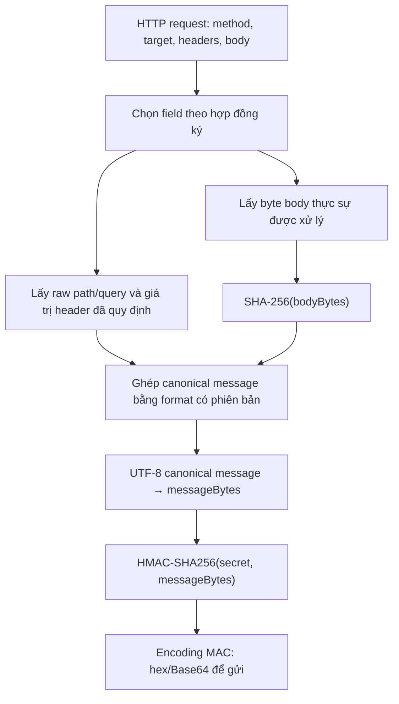

# Message input: HMAC thực sự ký những byte nào?

## 1. Message input là gì?

Trong HMAC, **message input** là **dãy byte** được đưa vào thuật toán cùng với khóa bí mật. Nếu chọn HMAC-SHA256:

```text
signatureBytes = HMAC-SHA256(secretKeyBytes, messageBytes)
```

Thuật toán không biết `messageBytes` là JSON, đường dẫn HTTP, một header hay một chuỗi nhiều dòng. Nó chỉ xử lý byte. Hai phía sử dụng **cùng khóa nhưng khác một byte đầu vào** gần như chắc chắn sẽ nhận hai MAC khác nhau. Ngược lại, nếu một thông tin quan trọng **không nằm trong message input**, HMAC không bảo vệ thông tin đó.

Bài này thuộc chương **HMAC** của module `SECURITY_AUTHENTICATION_HMAC_REQUEST_AUTHENTICATION`. Phạm vi module là thiết kế **xác thực HTTP request bằng HMAC với shared secret và canonical request**, có thể chứa method, URI, header và body theo hợp đồng ký; sau đó xác minh chữ ký, chống replay với timestamp/nonce, key rotation và kiểm thử qua proxy/gateway. Riêng bài **Message input** trả lời ba câu hỏi:

1. **Chọn dữ liệu gì để ký?** Những thành phần nào của HTTP request quyết định hành vi của server?
2. **Biến dữ liệu thành byte ra sao?** Client và server có dựng đúng cùng một thông điệp, cùng thứ tự và cùng encoding không?
3. **Đảm bảo dữ liệu được xử lý đúng dữ liệu đã ký bằng cách nào?** Có lớp HTTP, gateway hoặc framework nào làm thay đổi cách biểu diễn trước hoặc sau khi xác minh?

Ví dụ, nếu client tạo:

```text
message = UTF8("POST\n/v1/payments\n100000")
mac     = HMAC-SHA256(K, message)
```

thì chỉ method, path và chuỗi `100000` là đầu vào được bảo vệ. Cách ký này **chưa đủ** cho một request thanh toán thực tế: tài khoản nhận, đơn vị tiền tệ, query string, kiểu nội dung và nhiều thuộc tính nghiệp vụ khác đều có thể không được ràng buộc vào MAC.

## 2. Phân biệt message, key, digest và signature

| Thành phần | Vai trò | Có nằm trong message input không? |
| --- | --- | --- |
| **Secret key** | Khóa đối xứng bí mật dùng để tính HMAC. | **Không**: key là tham số độc lập của HMAC; không nối secret vào message. |
| **Message bytes** | Dữ liệu được xác thực, đã mã hóa theo hợp đồng ký. | **Chính là input** mà hai phía phải tái tạo giống hệt nhau. |
| **Body digest** | Giá trị `SHA-256(bodyBytes)`; rút gọn body thành chuỗi có độ dài cố định để đưa vào canonical message. | **Có, nếu hợp đồng quy định**; server phải tự tính digest từ byte body nhận được. |
| **HMAC output** | MAC 32 byte đối với HMAC-SHA256. | Không đưa MAC vào chính message đang ký; MAC được gửi để bên nhận đối chiếu. |
| **Signature encoding** | Ví dụ 64 ký tự hex viết thường hoặc Base64 của 32 byte MAC. | Là cách **truyền MAC**, không phải phương pháp tạo message input. |
| **Key ID** | Chỉ ra secret nào được dùng ở server. | **Nên được ký** để tránh sửa ngữ cảnh chọn khóa mà không bị phát hiện. |

Về cấu trúc, HMAC-SHA256 được định nghĩa từ SHA-256 bằng hai phép hash có khóa:

```text
HMAC(K, m) = H((K' XOR opad) || H((K' XOR ipad) || m))
```

`m` ở đây là **message input**; `K'` là khóa đã được xử lý theo kích thước block của SHA-256. Ứng dụng thường **không tự triển khai** công thức này mà gọi thư viện đã được kiểm thử, ví dụ Java `Mac.getInstance("HmacSHA256")`. Việc ứng dụng phải thiết kế cẩn thận chính là cách tạo `m`.

HMAC cung cấp **integrity và khả năng xác minh bên ký biết secret** với những thành phần đã được bao phủ. HMAC **không mã hóa nội dung**, **không tự chống replay** và **không thay thế phân quyền (authorization)**. HTTPS/TLS vẫn cần cho bảo mật đường truyền và xác minh server.

## 3. Từ HTTP request tới canonical message

Một HTTP request không tự cung cấp một dãy byte chung, ổn định cho mọi client/framework/proxy. Ví dụ HTTP/1.1 và HTTP/2 có biểu diễn framing và header khác nhau; gateway cũng có thể đổi path, query, nén, giải nén hoặc chuẩn hóa header. Vì vậy nên định nghĩa **canonical request**: biểu diễn có cấu trúc của những thành phần được ký.



**Hợp đồng ký** phải là một phần của giao thức giữa client và server, không được suy ra riêng từ cách framework xuất ra chuỗi `toString()`. Hai phía cần thống nhất:

- **Field được ký:** HTTP method, scheme/authority hoặc audience, path/query, những header ảnh hưởng ngữ nghĩa, body digest, timestamp, nonce, key ID.
- **Thứ tự và cấu trúc:** mỗi field xuất hiện ở vị trí nào; giá trị thiếu/empty khác nhau ra sao; có version và dấu phân tách rõ ràng.
- **Encoding:** chuỗi canonical thành byte theo UTF-8; digest và MAC được biểu diễn hex hay Base64; chữ hoa/thường có ý nghĩa không.
- **Canonicalization:** lấy raw path hay decoded path; sort query hay giữ thứ tự; xử lý percent-encoding, khoảng trắng/header trùng lặp thế nào.
- **Ranh giới xác minh:** byte body trước/sau giải nén; bên nào thực hiện ký/xác minh nếu có API gateway; request nào được ứng dụng thực thi.

### Lựa chọn các thành phần thông điệp

| HTTP component | Lý do thường cần ký | Ví dụ nếu bị bỏ qua |
| --- | --- | --- |
| Method | Thay đổi loại thao tác, chẳng hạn `GET` → `DELETE`. | Cùng URI nhưng hành động khác. |
| Path | Xác định API và tài nguyên. | `/accounts/A` → `/accounts/B`. |
| Query | Có thể thay đổi filter, mode, tiền tệ hoặc quyền nghiệp vụ. | `?currency=VND` → `?currency=USD`. |
| Authority/audience | Ràng buộc chữ ký với service/host/môi trường dự định. | Dùng chữ ký của staging ở production khi hai nơi chia sẻ secret. |
| Content-Type và header liên quan | Quy định cách diễn giải payload/tenant/ngữ cảnh. | Cùng byte nhưng handler diễn giải khác. |
| Body bytes hoặc digest | Bảo vệ payload gửi tới API. | Đổi `amount` hoặc `account`. |
| Timestamp + nonce | Ràng buộc metadata chống replay vào chữ ký. | Thay nonce/timestamp mà không cần ký lại. |
| Key ID và phiên bản ký | Ràng buộc ngữ cảnh chọn khóa và format. | Chuyển key ID/algorithm/version sang ngữ cảnh khác. |

Không nhất thiết ký **mọi** header HTTP. Một số header thay đổi hợp lệ qua proxy, ví dụ `Connection`, `Transfer-Encoding` hoặc `Content-Length`. Chỉ những field theo hợp đồng mới được bảo vệ bằng HMAC; field không ký cần được xem xét theo tác động bảo mật hoặc có biện pháp bảo vệ khác.

## 4. Hợp đồng ký minh họa: HMAC-REQUEST-V1

Xét một request thanh toán:

```http
POST /v1/payments?currency=VND&mode=instant HTTP/1.1
Host: api.example.test
Content-Type: application/json
X-Key-Id: merchant-key-2026-11
X-Timestamp: 2026-11-28T02:05:00Z
X-Nonce: 8pwG5Qj0S5hGQH2F8OZTKA
X-Signature: <64 ký tự hex viết thường>

{"account":"A123","amount":100000}
```

Đây là **hợp đồng minh họa tự định nghĩa**, không phải định dạng mặc định của HTTP hay mọi API. `X-Signature` chứa kết quả ký cuối cùng và **không** được đưa vào message input để tránh vòng phụ thuộc.

Giả sử phiên bản `HMAC-REQUEST-V1` quy định:

1. `POST` là method viết hoa; `/v1/payments?currency=VND&mode=instant` là **raw request target**: raw path ghép `?` và raw query theo thứ tự nhận được. Không decode/re-encode hoặc tự sắp xếp query.
2. `https://api.example.test` là **origin được phép** đã xác định bởi cấu hình client và routing đáng tin cậy ở server; nếu ký authority thì phải xác minh nó tương ứng đúng service đang xử lý request.
3. `Content-Type` chỉ được phép chính xác `application/json` và có **một** giá trị. `X-Key-Id`, `X-Timestamp`, `X-Nonce` cũng là các header đơn trị có cú pháp giới hạn.
4. `bodyBytes` là chính các byte payload sau khi tách HTTP transfer framing nhưng **trước khi parse JSON hoặc đổi nội dung**. SHA-256 được áp dụng trực tiếp trên byte này; ký digest dạng **64 ký tự hex thường**. Server tự hash body nhận được.
5. Mọi dòng canonical là UTF-8, nối bằng ký tự line feed `LF` (byte `0A`) và **không có `LF` cuối cùng**. Tên các header được ký viết chữ thường. Dùng prefix `HMAC-REQUEST-V1` để cố định phiên bản format.
6. Canonical fields được kiểm tra cú pháp để không thể chứa `CR`, `LF` hoặc ký tự điều khiển làm phá cấu trúc; reject các request mơ hồ như duplicate signed header. Khóa HMAC được tra theo key ID từ kho khóa tin cậy, không lấy secret từ request.

Với hợp đồng trên, message *trước khi mã hóa UTF-8* là:

```text
HMAC-REQUEST-V1
POST
https://api.example.test
/v1/payments?currency=VND&mode=instant
content-type:application/json
x-key-id:merchant-key-2026-11
x-timestamp:2026-11-28T02:05:00Z
x-nonce:8pwG5Qj0S5hGQH2F8OZTKA
<64 ký tự hex của SHA-256(bodyBytes)>
```

Dòng cuối là **placeholder mô tả digest**, không phải chuỗi chứa dấu `<`/`>` trong message thật. `signature = hex(HMAC-SHA256(secret, UTF8(canonical)))`.

### Không mơ hồ về delimiter

Một format dạng `method + path + body` không có độ dài hoặc dấu phân cách rõ ràng có thể cho hai bộ dữ liệu khác nhau nhưng **cùng chuỗi ghép**:

```text
("ab", "c")  → "abc"
("a", "bc")  → "abc"
```

Thêm `LF` giữa các field giải quyết ví dụ trên **chỉ khi** các field không được chứa `LF` hoặc hợp đồng có escaping/length-prefix chuẩn. Nếu để header value chứa newline, chuỗi ghép có thể lại mơ hồ. Ngoài ra, cần phân biệt trường **không tồn tại** với trường **tồn tại nhưng rỗng** nếu server xử lý hai trường hợp khác nhau.

Giải pháp thực tế là thiết kế schema chặt chẽ: số field cố định, thứ tự cố định, cú pháp field được giới hạn, parser từ chối giá trị mơ hồ. Các định dạng dựa trên length-prefix hoặc chuẩn ký HTTP có thể dùng khi cần mở rộng, nhưng hai phía vẫn phải thống nhất một phiên bản cụ thể.

## 5. Byte-level: thay đổi nhỏ có thể làm chữ ký khác

Một số cặp nhìn tương tự nhưng **khác input bytes**:

| Hai biểu diễn | Khác biệt cần lưu ý |
| --- | --- |
| `{"a":1}` so với `{ "a": 1 }` | Thêm space trong JSON; nếu ký raw body bytes, digest khác. |
| `{"a":1,"b":2}` so với `{"b":2,"a":1}` | Thứ tự key trong JSON khác; object về mặt ngữ nghĩa có thể tương đương nhưng byte khác. |
| `?a=1&b=2` so với `?b=2&a=1` | Query có thứ tự khác; một số server còn xử lý tham số trùng theo thứ tự. |
| `/files/a%2Fb` so với `/files/a%2fb` | Khác byte percent-encoding; một router có thể giải mã giống nhau. |
| `/café` (UTF-8) so với biểu diễn percent-encoded | Dùng raw target hay decoded path sẽ cho byte khác. |
| `Content-Type: application/json` so với `application/json; charset=utf-8` | Header khác giá trị, có thể làm cách parse khác. |
| Chuỗi kết thúc bằng `LF` so với không có `LF` cuối | Khác 1 byte `0A`, MAC khác. |
| UTF-8 so với UTF-16LE cho cùng một chuỗi | Khác bytes; cả client và server phải cố định UTF-8. |

Đối với Unicode, cùng một từ hiển thị trên giao diện có thể có nhiều dạng chuẩn hóa (ví dụ ký tự có dấu được mã hóa thành một code point hoặc base character + combining mark). Nếu **ký raw body**, hai dạng là hai thông điệp khác nhau. Không được để client chuẩn hóa một kiểu nhưng server chuẩn hóa kiểu khác. Nếu bài toán thực sự cần canonical JSON/Unicode, phải công bố **một canonicalization scheme được cả hai phía thực thi và kiểm thử**, rồi ký chính biểu diễn đó.

**Đừng hash body đã parse rồi serialize lại** trừ khi hợp đồng ký định nghĩa rất rõ quy tắc canonical JSON. Với raw body signing, server phải dùng byte nhận thực tế và đảm bảo handler nghiệp vụ xử lý chính byte đó (hoặc snapshot không bị thay đổi).

### Body rỗng và body không tồn tại

Hợp đồng cũng phải xử lý request không có payload. Với lựa chọn luôn ký digest của body:

```text
SHA-256(empty byte array)
= e3b0c44298fc1c149afbf4c8996fb92427ae41e4649b934ca495991b7852b855
```

Nếu ứng dụng phân biệt `no body` và `Content-Length: 0`, hợp đồng cần chỉ rõ khác biệt đó. Với hợp đồng ví dụ, hai trường hợp đều có `bodyBytes` dài 0, trừ khi HTTP adapter cố tình bổ sung thành phần khác được ký.

## 6. Ví dụ Java 17+: dựng message bytes, ký và kiểm tra

Đoạn code dưới đây minh họa **điểm tạo message input** độc lập với framework HTTP. Phía server phải lấy các tham số từ **request thực nhận**, không dùng canonical string do client gửi. Lớp HTTP adapter cần từ chối duplicate signed headers, CR/LF injection, path bất thường, body quá lớn và mọi phiên bản request không phù hợp hợp đồng trước khi gọi code này.

```java
import java.nio.charset.StandardCharsets;
import java.security.GeneralSecurityException;
import java.security.MessageDigest;
import java.util.HexFormat;
import javax.crypto.Mac;
import javax.crypto.spec.SecretKeySpec;

public final class HmacMessageInputDemo {
    private static final HexFormat HEX = HexFormat.of();

    // Các tham số phải là snapshot từ request, theo đúng contract.
    public static byte[] messageBytes(
            String method,
            String origin,
            String rawTarget,
            String contentType,
            String keyId,
            String timestamp,
            String nonce,
            byte[] bodyBytes) throws GeneralSecurityException {

        if (!"POST".equals(method)
                || !"https://api.example.test".equals(origin)
                || rawTarget == null || !rawTarget.startsWith("/")
                || !isVisibleAscii(rawTarget)
                || rawTarget.contains("#")
                || !"application/json".equals(contentType)
                || keyId == null || !keyId.matches("[A-Za-z0-9._-]{1,128}")
                || timestamp == null
                || !timestamp.matches("\\d{4}-\\d{2}-\\d{2}T\\d{2}:\\d{2}:\\d{2}Z")
                || nonce == null || !nonce.matches("[A-Za-z0-9_-]{16,128}")
                || bodyBytes == null) {
            throw new IllegalArgumentException("Invalid canonical request fields");
        }

        byte[] bodyDigest = MessageDigest.getInstance("SHA-256")
                .digest(bodyBytes);
        String canonical = String.join("\n",
                "HMAC-REQUEST-V1",
                method,
                origin,
                rawTarget,
                "content-type:" + contentType,
                "x-key-id:" + keyId,
                "x-timestamp:" + timestamp,
                "x-nonce:" + nonce,
                HEX.formatHex(bodyDigest));
        // Chuỗi canonical được encode UTF-8, không thêm LF ở cuối.
        return canonical.getBytes(StandardCharsets.UTF_8);
    }

    private static boolean isVisibleAscii(String text) {
        for (int i = 0; i < text.length(); i++) {
            char c = text.charAt(i);
            if (c < 0x21 || c > 0x7E) {
                return false; // Không cho space, CR, LF, control hoặc non-ASCII raw
            }
        }
        return true;
    }

    public static byte[] sign(byte[] secret, byte[] messageBytes)
            throws GeneralSecurityException {
        Mac hmac = Mac.getInstance("HmacSHA256");
        hmac.init(new SecretKeySpec(secret, "HmacSHA256"));
        return hmac.doFinal(messageBytes);
    }

    public static boolean verify(
            byte[] secret, byte[] messageBytes, String suppliedHex)
            throws GeneralSecurityException {
        if (suppliedHex == null || !suppliedHex.matches("[0-9a-f]{64}")) {
            return false;
        }
        byte[] expected = sign(secret, messageBytes);
        byte[] supplied = HEX.parseHex(suppliedHex);
        return MessageDigest.isEqual(expected, supplied);
    }

    public static void main(String[] args) throws Exception {
        // Khóa cố định CHỈ dùng làm dữ liệu demo, không dùng thật.
        byte[] demoSecret = HEX.parseHex(
                "000102030405060708090a0b0c0d0e0f"
              + "101112131415161718191a1b1c1d1e1f");
        byte[] originalBody = "{\"account\":\"A123\",\"amount\":100000}"
                .getBytes(StandardCharsets.UTF_8);

        byte[] originalMessage = messageBytes(
                "POST",
                "https://api.example.test",
                "/v1/payments?currency=VND&mode=instant",
                "application/json",
                "merchant-key-2026-11",
                "2026-11-28T02:05:00Z",
                "8pwG5Qj0S5hGQH2F8OZTKA",
                originalBody);
        String signature = HEX.formatHex(sign(demoSecret, originalMessage));

        System.out.println("Message bytes: " + originalMessage.length);
        System.out.println("Valid: " + verify(
                demoSecret, originalMessage, signature)); // true

        byte[] changedBody = "{\"account\":\"A123\",\"amount\":900000}"
                .getBytes(StandardCharsets.UTF_8);
        byte[] changedMessage = messageBytes(
                "POST",
                "https://api.example.test",
                "/v1/payments?currency=VND&mode=instant",
                "application/json",
                "merchant-key-2026-11",
                "2026-11-28T02:05:00Z",
                "8pwG5Qj0S5hGQH2F8OZTKA",
                changedBody);
        System.out.println("Changed body valid: " + verify(
                demoSecret, changedMessage, signature)); // false
    }
}
```

Code trên cố tình đơn giản để cô lập **message construction**. Trong hệ thống thực, phần kiểm tra HTTP cần chặt hơn: kiểm tra percent-encoding hợp lệ, route được phép, query/header trùng, canonical timestamp thực sự parse được, key ID đang hoạt động và kích thước/kiểu body. Giá trị `rawTarget` phải đến từ API của HTTP stack bảo toàn dạng được ký; ví dụ `URI.getRawPath()` và `URI.getRawQuery()` có thể hữu ích ở phía client, nhưng phải kiểm thử khi framework/proxy đã decode URL. Đồng thời body phải được giữ bất biến sau xác minh hoặc handler phải dùng chính byte snapshot đã kiểm tra.

Để kiểm tra riêng primitive HMAC-SHA256 (khác với kiểm tra format canonical), test vector **RFC 4231, case 1** dùng key gồm 20 byte `0x0b` và message ASCII `Hi There`:

```text
HMAC-SHA256 = b0344c61d8db38535ca8afceaf0bf12b881dc200c9833da726e9376c2e32cff7
```

Nếu thư viện tạo đúng HMAC cho test vector nhưng request thực vẫn có signature mismatch, nguyên nhân thường nằm ở **message bytes, contract hoặc đường đi HTTP**, không phải ở thuật toán HMAC.

## 7. Xác minh: bên nhận phải tính lại message input

Quy trình server đề xuất:

1. **Kiểm tra HTTP đầu vào:** giới hạn kích thước body, kiểm tra cú pháp method/target, từ chối header ký trùng hoặc có cách diễn giải không thống nhất. Không parse lại body rồi dùng bản serialize để hash.
2. **Xác định phạm vi service:** tra key ID trong kho credential tin cậy và kiểm tra key còn hiệu lực, audience/route được phép; khóa khác môi trường/tenant phải bị từ chối.
3. **Tự dựng canonical message:** lấy method, raw target, header đã được xác định và `SHA-256(bodyBytes)` **từ request server nhận**. Không lấy `messageBytes` hay `bodyHash` chưa xác minh từ client làm nguồn sự thật.
4. **Tính HMAC:** dùng secret tương ứng, so sánh MAC đúng định dạng và bằng hàm hạn chế timing leak như `MessageDigest.isEqual`. Nếu sai thì từ chối.
5. **Kiểm tra chống replay:** timestamp phải trong cửa sổ cho phép; nonce được ký và phải được ghi bằng thao tác **insert-if-absent nguyên tử** trong kho dùng chung sau khi signature hợp lệ.
6. **Authorization và xử lý:** xác minh chữ ký chỉ là xác thực; tiếp tục kiểm tra quyền cho action/resource, sau đó xử lý **đúng body và target đã xác minh**.

Ví dụ server có thể nhận nonce đã thấy khi client gửi lại một request hoàn toàn nguyên vẹn. **Message input và HMAC vẫn đúng**, nhưng **replay check phải từ chối**. Trường hợp request bị đánh cắp rồi chuyển tiếp trước request gốc, kho nonce thường chỉ biết chấp nhận bản đến đầu tiên; vì vậy còn cần bảo vệ kênh TLS và xác thực server để hạn chế tình huống relay.

Một hệ thống nhiều instance cần dùng nonce store chung với thao tác atomic; việc mỗi node chỉ giữ nonce trong bộ nhớ cục bộ sẽ cho phép replay trên node khác.

### Timestamp và nonce có được ký hay chỉ được kiểm tra?

**Phải làm cả hai.** Nếu nonce hoặc timestamp không nằm trong message input, kẻ tấn công có thể thay chúng mà không làm sai HMAC. Nếu có trong message input nhưng server **không kiểm tra** thời gian hoặc giá trị đã dùng, request nguyên vẹn vẫn có thể được phát lại. Có thể quy định thời gian lệch tối đa ±5 phút và nonce TTL đủ dài để phủ thời điểm request còn được nhận, nhưng giá trị cụ thể phụ thuộc yêu cầu hệ thống.

## 8. Proxy/gateway làm thay đổi message input thế nào?

Trong triển khai:

```text
Client
  ── TLS ──> API Gateway
               ├─ rewrite URL?
               ├─ normalize header?
               ├─ decompress payload?
               └─ forward ──> Backend verifier / handler
```

Server phải thống nhất **ranh giới ký**: canonical request được xác minh ở gateway hoặc backend, và đảm bảo dữ liệu đã ký tương ứng với dữ liệu ứng dụng thực thi. Những tình huống dễ sai:

- **Path/query rewrite:** client ký `/v1/files/a%2Fb`, proxy chuyển thành `/v1/files/a/b`; hoặc proxy sắp xếp query. MAC có thể khác dù ứng dụng nghĩ hai path tương đương.
- **Header normalization:** client ký `Content-Type` có khoảng trắng/parameter, nhưng gateway chuẩn hóa khác. Nếu ký nhiều header, cần có quy tắc trích xuất giá trị chính xác; tránh tin `X-Forwarded-Host` do client tự đặt.
- **Compression/encoding:** client ký body đã nén nhưng backend tính digest trên body giải nén, hoặc ngược lại. Hai phía phải thống nhất byte payload tại điểm ký và điểm xử lý.
- **HTTP/1.1 vs HTTP/2:** framing và biểu diễn method/path/header có thể khác, nhưng canonical message cần giống nhau theo contract đã quy định.
- **Authority mismatch:** client ký một hostname/tenant nhưng gateway định tuyến sang service khác. Server phải kiểm tra origin/audience đã ký **khớp route đáng tin cậy**, không chỉ so sánh chuỗi do caller cung cấp.

Không giải quyết lỗi bằng cách **bỏ body, URI hoặc header quan trọng khỏi message input**. Cần sửa hợp đồng và adapter để có cùng canonical bytes ở hai phía, hoặc chuyển điểm xác minh đến vị trí hợp lý rồi chuyển tiếp kết quả xác thực qua kênh bảo vệ và có phân quyền tin cậy.

## 9. Những kiểm thử cần có

Hãy tạo một **golden fixture** gồm HTTP request mẫu, byte body, toàn bộ canonical string, MAC dự kiến và key ID. Kiểm tra cùng fixture trên client, gateway và backend; kết hợp kiểm thử thay đổi **một field mỗi lần**:

| Trường hợp | Kết quả kỳ vọng |
| --- | --- |
| Cùng key, cùng byte canonical message, thuật toán HMAC-SHA256. | Tạo cùng MAC 32 byte; verify thành công. |
| Body đổi một byte, kể cả chỉ thêm space vào JSON. | Body digest và MAC thay đổi; chữ ký cũ thất bại. |
| Đổi method, path, query, thứ tự query hoặc authority đã ký. | Chữ ký cũ thất bại hoặc request bị từ chối trước khi verify. |
| `Content-Type`, key ID, timestamp hoặc nonce được ký bị sửa. | Chữ ký cũ thất bại. |
| Header không nằm trong hợp đồng ký bị thay đổi. | MAC **có thể vẫn hợp lệ**; cần rà soát header có ảnh hưởng nghiệp vụ/bảo mật không. |
| Input chứa CR/LF, signed header trùng hoặc raw target không hợp lệ. | Parser/adapter từ chối request mơ hồ. |
| Một phiên bản có `LF` cuối canonical message, một phiên bản không có. | MAC khác: phát hiện sai quy tắc ghép byte. |
| Client dùng hex, server nhầm sang Base64; hoặc uppercase hex không được phép. | Bị từ chối theo định dạng chữ ký; phải thống nhất encoding. |
| Client ký JSON trước khi serialize, server hash byte body thực nhận. | Có thể sai MAC; ký byte được gửi thực tế. |
| Gateway giải nén/chuyển mã hoặc rewrite URL trước verifier. | Fixture xuyên qua gateway giúp phát hiện byte ký và xử lý lệch nhau. |
| Timestamp hết hạn hoặc nonce bị gửi lại, dù MAC đúng. | Chống replay từ chối. |
| Key rotation: key ID cũ đã thu hồi hoặc scope không đúng. | Từ chối; không thử tất cả khóa một cách mù quáng. |
| MAC đúng nhưng client không có quyền thực hiện thao tác. | Authorization từ chối. |

Khi điều tra `401 Invalid signature`, nên log **phiên bản canonical, key ID, loại lỗi, request ID, digest/chiều dài body nếu chính sách dữ liệu cho phép**; tuyệt đối không log shared secret hoặc token nhạy cảm. Có thể so sánh bản canonical trong môi trường thử nghiệm được kiểm soát, nhưng tránh đưa body nhạy cảm lên log production.

### Bài tập áp dụng

Cho request có body JSON và một chữ ký hợp lệ. Hãy lần lượt:

1. Đổi `"amount":100000` thành `"amount":100001`, tính lại digest và kiểm tra chữ ký cũ.
2. Đảo thứ tự hai tham số query mà không ký lại.
3. Đưa body qua một middleware parse rồi serialize thêm khoảng trắng, sau đó so sánh byte đầu vào ở hai bên.
4. Gửi lại nguyên request hai lần trong cửa sổ timestamp để quan sát kết quả HMAC và nonce store riêng biệt.
5. Chuyển request qua proxy có path rewrite, ghi nhận chính xác field nào thay đổi trước khi vào verifier.

Mỗi bài cần ghi rõ: **input bytes**, canonical string, MAC, kết quả replay/authorization và nguyên nhân chấp nhận hoặc từ chối. Đừng chỉ nhìn mã HTTP cuối cùng.

## 10. Checklist thiết kế message input

- [ ] Hợp đồng ký quy định chính xác các field bảo vệ, phiên bản, thứ tự, encoding và dấu phân tách; tránh chuỗi ghép mơ hồ.
- [ ] Method, URI/path/query, service/audience, header ảnh hưởng ngữ nghĩa và body được ký hoặc được ràng buộc bởi cơ chế bảo mật tương đương.
- [ ] Khóa bí mật là tham số độc lập của HMAC; key ID được xác thực và key scope/rotation được kiểm soát.
- [ ] Body hash được tính trên chính byte mà server xử lý; xác định rõ trường hợp body rỗng, encoding, nén và normalize JSON.
- [ ] Server tự dựng message input từ request nhận được và so sánh chữ ký bằng hàm an toàn về thời gian; xử lý lỗi theo nguyên tắc fail closed.
- [ ] Timestamp/nonce là field đã ký và được kiểm tra chống replay bằng kho nonce chia sẻ, thao tác nguyên tử.
- [ ] Adapter/gateway từ chối header trùng, CR/LF injection, request-target không hợp lệ và metadata forwarding chưa đáng tin cậy.
- [ ] Golden fixtures và negative tests bao phủ URI, header, body, proxy rewrite, encoding, replay, key rotation và authorization.

**Điểm cần nhớ:** Độ an toàn của HMAC request authentication phụ thuộc mạnh vào việc **chọn đúng dữ liệu và chuyển chúng thành cùng một dãy byte ở client lẫn server**. HMAC không thể phát hiện thay đổi của thông tin bị bỏ ngoài message input, và một MAC chính xác cũng không chứng minh request còn mới hoặc caller có quyền. Canonical request, quy tắc HTTP end-to-end, chống replay và authorization phải phối hợp nhất quán.
