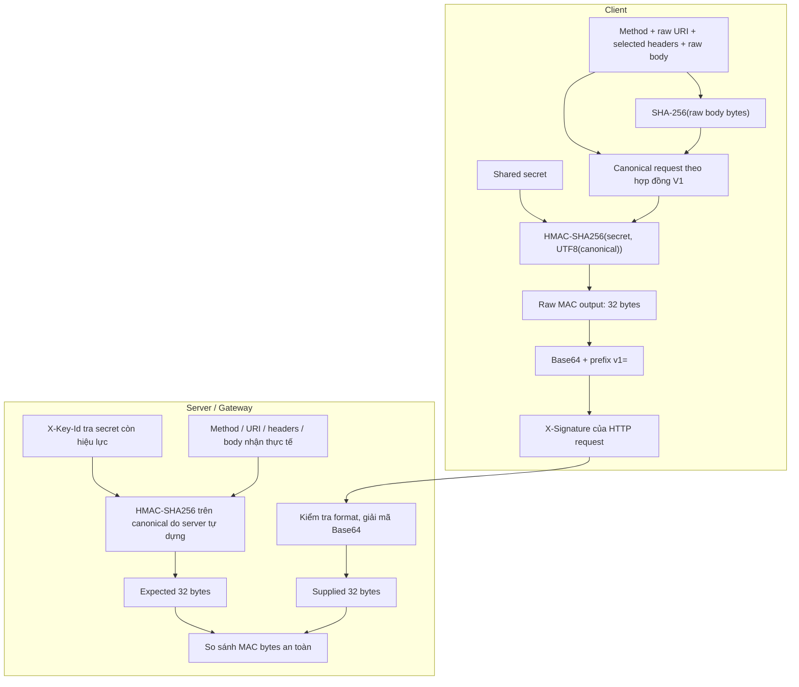

# MAC output: Kết quả HMAC, biểu diễn và xác minh chữ ký request

Trong chương **HMAC**, thuật ngữ **MAC output** chỉ **chuỗi byte kết quả** do thuật toán *Message Authentication Code* trả về sau khi xử lý một thông điệp bằng khóa bí mật. Với xác thực HTTP request bằng HMAC (*Hash-based Message Authentication Code*), thông điệp đầu vào thường là **canonical request** đã thống nhất giữa client và server; khóa là **shared secret** gắn với credential của client.

Ví dụ, với HMAC-SHA256, kết quả tính toán là **32 byte (256 bit)**. Client thường mã hóa 32 byte này thành Base64 hoặc hex để gửi trong header HTTP. Server không so sánh “ý nghĩa” của request hay tin sẵn vào chuỗi chữ ký được nhận: server phải dựng lại đúng dữ liệu ký, tính **MAC output kỳ vọng** bằng shared secret và so sánh các byte theo cách an toàn.

Bài học thuộc module `SECURITY_AUTHENTICATION_HMAC_REQUEST_AUTHENTICATION`: thiết kế HMAC request authentication có canonical request gồm method, URI, header hoặc body theo hợp đồng ký; xác minh chữ ký; chống replay bằng timestamp/nonce; key rotation; và kiểm thử qua proxy/gateway. Chủ đề trung tâm ở đây là **MAC output** và cách xử lý đúng kết quả này trong giao thức.

## 1. Mục tiêu học tập

Sau bài học, người học có thể:

1. Phân biệt dữ liệu đầu vào HMAC, shared secret, kết quả MAC dạng byte và cách mã hóa kết quả để truyền qua HTTP.
2. Giải thích vì sao HMAC-SHA256 trả 32 byte, còn Base64/hex chỉ thay đổi cách biểu diễn chứ không thay đổi MAC.
3. Tạo, mã hóa, giải mã và xác minh MAC output trong Java 17 bằng `Mac`, `SecretKeySpec`, `Base64` và `MessageDigest.isEqual`.
4. Nhận biết lỗi tích hợp liên quan đến độ dài tag, chuẩn Base64, ký sai byte, thuật toán không khớp, request qua proxy và cắt ngắn MAC không có hợp đồng rõ ràng.
5. Kết hợp xác minh MAC với timestamp, nonce, key rotation và phân quyền để bảo vệ API trong thực tế.

## 2. MAC output thực chất là gì?

Một hàm HMAC nhận hai đầu vào:

- **Secret key** `K`: chuỗi byte bí mật mà phía tạo và phía kiểm tra MAC cùng biết.
- **Message** `M`: chuỗi byte cần xác thực; trong API thường là UTF-8 bytes của canonical request, có thể chứa hash của body.

Kết quả:

\[
T = \operatorname{HMAC}_{K}(M)
\]

Trong đó `T` là **MAC output**, còn gọi là **authentication tag**. HMAC được cấu tạo từ một hàm băm mật mã; ví dụ HMAC-SHA256 sử dụng SHA-256. Theo cấu trúc HMAC:

\[
\operatorname{HMAC}_{K}(M) =
H\left((K' \oplus \mathrm{opad}) \parallel
H((K' \oplus \mathrm{ipad}) \parallel M)\right)
\]

Với `K'` là khóa đã được xử lý và đệm theo kích thước khối của hàm băm, `\oplus` là phép XOR, `\parallel` là ghép byte; `ipad` và `opad` là hai dãy đệm cố định. Đối với SHA-256, kích thước khối là **64 byte** và kích thước kết quả băm là **32 byte**, nên MAC output HMAC-SHA256 toàn phần cũng dài **32 byte**.

Trong ứng dụng Java, hãy sử dụng API chuẩn `javax.crypto.Mac`; không tự triển khai công thức HMAC. Tự ghép `SHA256(secret || message)` hay `SHA256(message || secret)` **không tương đương HMAC** và có thể tạo rủi ro bảo mật.

### Những đặc điểm cần hiểu chính xác

| Thuộc tính | Ý nghĩa thực tế |
| --- | --- |
| Phụ thuộc khóa | Cùng message nhưng dùng shared secret khác thường tạo MAC khác. Chỉ biết message và tag không đủ để suy ra secret mạnh. |
| Phụ thuộc message | Thay một byte ở phần dữ liệu **được ký** gần như chắc chắn tạo tag khác. Một byte **không được ký** có thể bị thay mà HMAC không phát hiện. |
| Tính xác định | Với **cùng chính xác byte khóa, byte message và thuật toán**, output luôn giống nhau. HMAC không tự thêm ngẫu nhiên. |
| Độ dài cố định | HMAC-SHA256 đầy đủ trả 32 byte, HMAC-SHA512 trả 64 byte, bất kể message dài bao nhiêu. |
| Không mã hóa | MAC output không che giấu body. Muốn bảo mật nội dung truyền tải vẫn cần HTTPS/TLS. |
| Khả năng xác thực | MAC hợp lệ hỗ trợ kết luận bên gửi có khả năng dùng secret phù hợp; không chứng minh danh tính người dùng cuối hoặc quyền đối với tài nguyên. |

**Điểm dễ nhầm:** HMAC là MAC đối xứng; server cũng có secret và có thể tạo tag như client. Vì vậy “signature” trong tên header thường là **chữ ký ở mức giao thức**, không đồng nghĩa với chữ ký số bất đối xứng hay bằng chứng không thể chối bỏ.

## 3. Từ 32 byte MAC output đến giá trị header

HTTP header mang dữ liệu văn bản, trong khi MAC output là dữ liệu nhị phân. Vì thế protocol phải quy định rõ cách biểu diễn **cùng 32 byte** thành chuỗi:

| Cách thể hiện HMAC-SHA256 đầy đủ | Kích thước | Nhận xét |
| --- | --- | --- |
| Raw bytes | 32 byte | Kết quả thật của `Mac.doFinal()`; không đặt trực tiếp vào header text. |
| Hex chữ thường | 64 ký tự ASCII | Dễ đối chiếu bằng mắt; gấp đôi số ký tự so với số byte. |
| Base64 chuẩn, có padding | 44 ký tự ASCII, cuối thường có một dấu `=` | Gọn hơn hex; hợp đồng phải nêu rõ có padding và bảng chữ cái Base64 chuẩn. |
| Base64URL, bỏ padding | 43 ký tự ASCII | Thuận tiện khi dùng URL-safe alphabet; **khác quy tắc mã hóa** so với Base64 chuẩn. |

Ví dụ minh họa một kết quả HMAC-SHA256 **thật** (test vector công khai RFC 4231, trường hợp 1):

```text
Algorithm : HmacSHA256
Key       : 20 bytes, mỗi byte là 0x0b
Message   : "Hi There" (ASCII, không có dấu nháy)
MAC (hex) : b0344c61d8db38535ca8afceaf0bf12b881dc200c9833da726e9376c2e32cff7
Length    : 32 bytes = 256 bits = 64 hex characters
```

Đây là vector để kiểm thử **phép tính HMAC**: khóa và thông điệp được công bố nên không được dùng làm credential thật. Nó chưa phải chữ ký HTTP request, vì chưa dựng canonical request hoặc gắn credential/audience/timestamp/nonce.

> **Quy tắc quan trọng:** Base64 không phải mã hóa bảo mật. Việc chuyển `raw MAC -> Base64 -> raw MAC` phải giữ nguyên **từng byte**. Không chuyển MAC output sang `new String(bytes, UTF_8)`: dữ liệu HMAC là nhị phân tùy ý, có thể chứa byte không tạo thành văn bản UTF-8 hợp lệ và bị thay thế khi giải mã.

### Chọn một định dạng wire duy nhất

Giả sử giao thức API `HMAC-SHA256-V1` quy định:

```http
X-Signature: v1=<BASE64_STANDARD_PADDED_OF_FULL_32_BYTE_HMAC>
```

Khi đó bộ xác minh phải kiểm tra đầy đủ:

1. Prefix phiên bản đúng chính xác `v1=`.
2. Phần còn lại là Base64 chuẩn có padding theo hợp đồng, không có khoảng trắng, xuống dòng hoặc ký tự ngoài bảng chữ cái.
3. Giải mã thành đúng **32 byte**; không mặc định chấp nhận tag chỉ có 16 byte hay chuỗi rỗng.
4. Nếu giao thức yêu cầu canonical Base64, mã hóa ngược bytes phải cho ra chính xác chuỗi input.
5. So sánh **bytes** với output do server tự tính bằng HMAC-SHA256, không so sánh biểu diễn viết hoa/viết thường theo cảm tính.

Hợp đồng có thể chọn hex hoặc Base64URL thay Base64 chuẩn, nhưng mọi client và verifier phải dùng cùng quy ước. Việc backend “thử Base64 rồi thử hex” tùy ý làm giao thức nhập nhằng, tăng bề mặt lỗi và gây khó kiểm thử liên ngôn ngữ.

## 4. MAC output nằm ở đâu trong HMAC HTTP request authentication?

Sơ đồ minh họa sự khác biệt giữa các bước **tính hash body**, **tính HMAC canonical request**, **mã hóa tag** và **xác minh tag**:



Hàm băm body và hàm HMAC phục vụ **hai mục đích khác nhau**:

- `SHA256(rawBody)` là **digest không dùng khóa**. Đưa digest vào canonical request giúp ràng buộc nội dung body mà không cần chèn toàn bộ body vào chuỗi ký.
- `HMAC-SHA256(secret, canonicalBytes)` là **MAC có khóa**. Kết quả 32 byte này mới là giá trị cần mã hóa vào header signature.

Không gửi `SHA256(body)` rồi gọi đó là “HMAC signature”: bất kỳ ai cũng tính được SHA-256 của body vì không có secret. Cũng không được tin `bodyDigest` do client tự gửi nếu server không tự tính từ raw body mà request thực sự mang theo.

### Ví dụ hợp đồng canonical request

Để làm rõ tác động đến MAC output, xét API đặt hàng với phiên bản hợp đồng minh họa sau (không phải chuẩn chung của tất cả API):

| Thành phần | Quy ước V1 |
| --- | --- |
| Thuật toán | `HmacSHA256`, output **đầy đủ 32 byte**, header signature dùng Base64 chuẩn có padding. |
| Khóa | `X-Key-Id` xác định đúng một secret còn hiệu lực, thuộc một client và audience. |
| Dòng đầu | `HMAC-SHA256-V1`, tiếp theo là audience cố định `orders-api-prod`. |
| Method | Ví dụ `POST`, giữ chữ hoa theo hợp đồng. |
| URI | Raw path và raw query theo thứ tự **thực gửi**, không chứa fragment. |
| Header | `content-type`, `x-key-id`, `x-timestamp`, `x-nonce` ở dạng chính xác được quy định. |
| Body | `sha256:` nối hex chữ thường của SHA-256 tính từ **raw bytes**, kể cả khi body rỗng. |
| Nối dòng | UTF-8; LF (`\n`) giữa các dòng; **không** có LF ở cuối. |

Request client gửi:

```http
POST /v1/orders?currency=VND&channel=partner HTTP/1.1
Host: api.example.test
Content-Type: application/json
X-Key-Id: partner-a-202611
X-Timestamp: 2026-11-28T02:00:00Z
X-Nonce: AFx3PZPdw2StlFvc4KcTmA
X-Signature: v1=<BASE64_OF_HMAC_OUTPUT>

{"sku":"BK-42","quantity":2}
```

Canonical request tương ứng:

```text
HMAC-SHA256-V1
orders-api-prod
POST
/v1/orders?currency=VND&channel=partner
content-type:application/json
x-key-id:partner-a-202611
x-timestamp:2026-11-28T02:00:00Z
x-nonce:AFx3PZPdw2StlFvc4KcTmA
sha256:<64_LOWERCASE_HEX_CHARS_FOR_RAW_BODY>
```

Các giá trị trong `<...>` là **placeholder** để nhấn mạnh dữ liệu cần tính, không phải chữ ký có hiệu lực. Client tính `SHA256(bodyBytes)`, thay dòng `sha256:...` bằng digest hex chính xác, rồi:

```text
canonicalBytes   = UTF8(canonicalRequest)
rawMacOutput     = HMAC_SHA256(secretBytes, canonicalBytes)  // 32 bytes
encodedMacOutput = Base64_STD_WITH_PADDING(rawMacOutput)     // 44 ASCII chars
X-Signature      = "v1=" + encodedMacOutput
```

Server đọc `X-Key-Id` để chọn secret, nhưng **chỉ gắn danh tính client sau khi xác minh thành công**. Server tính lại digest từ raw body và canonical request từ request nhận được, dùng secret được tra cứu để tạo `expectedMac` rồi so với tag client gửi.

### Vì sao cùng credential mà MAC output thay đổi?

Cùng shared secret vẫn tạo tag mới khi một thành phần của canonical request thay đổi:

- Đổi `POST` thành `PUT` làm canonical bytes khác.
- Đổi raw query `?a=1&b=2` thành `?b=2&a=1` làm tag khác theo hợp đồng raw-query.
- Thêm một khoảng trắng hoặc ký tự xuống dòng vào body JSON làm `SHA256(body)` khác, kéo theo tag khác.
- Đổi timestamp hoặc nonce đã ký làm tag khác, ngay cả khi method/URI/body giống hoàn toàn.
- Sử dụng khóa mới khi rotation cũng tạo tag khác ngay cả với canonical bytes giống hệt.

Ngược lại, **nếu không ký** một header hoặc tham số có ảnh hưởng đến routing/nghiệp vụ, thay giá trị đó có thể không làm tag thay đổi. Vì thế chất lượng bảo vệ phụ thuộc vào **hợp đồng dữ liệu ký**, không chỉ độ dài MAC output.

## 5. Java 17: tính MAC output, chuyển Base64 và xác minh

Ví dụ sau sử dụng **Java 17**. Nó chứa phần mật mã và kiểm tra định dạng tag; lớp HTTP adapter ngoài thực tế chịu trách nhiệm đọc raw method/URI/header/body, xác minh định dạng từng header và dựng canonical request **một cách đáng tin cậy**.

```java
import java.nio.charset.StandardCharsets;
import java.security.GeneralSecurityException;
import java.security.MessageDigest;
import java.util.Arrays;
import java.util.Base64;
import java.util.HexFormat;
import javax.crypto.Mac;
import javax.crypto.spec.SecretKeySpec;

public final class MacOutputDemo {
    private static final String ALGORITHM = "HmacSHA256";
    private static final String WIRE_PREFIX = "v1=";
    private static final int SHA256_MAC_BYTES = 32;

    private MacOutputDemo() {}

    // Tạo MAC output nhị phân. Shared secret và canonicalBytes phải được
    // lấy từ nguồn đáng tin cậy và dựng đúng hợp đồng ký.
    public static byte[] macOutput(byte[] secret, byte[] canonicalBytes)
            throws GeneralSecurityException {
        if (secret == null || secret.length == 0 || canonicalBytes == null) {
            throw new IllegalArgumentException("Missing HMAC input");
        }
        Mac mac = Mac.getInstance(ALGORITHM);
        mac.init(new SecretKeySpec(secret, ALGORITHM));
        return mac.doFinal(canonicalBytes);
    }

    // Mã hóa 32 byte HMAC-SHA256 theo giao thức V1.
    public static String encodeSignature(byte[] rawMac) {
        if (rawMac == null || rawMac.length != SHA256_MAC_BYTES) {
            throw new IllegalArgumentException("Invalid MAC length");
        }
        return WIRE_PREFIX + Base64.getEncoder().encodeToString(rawMac);
    }

    // Server tính MAC kỳ vọng bằng secret đã tra cứu theo keyId.
    // canonicalBytes phải được dựng LẠI từ HTTP request thực nhận.
    public static boolean verify(
            byte[] serverSecret,
            byte[] canonicalBytes,
            String suppliedHeader)
            throws GeneralSecurityException {
        if (serverSecret == null || serverSecret.length == 0
                || canonicalBytes == null || suppliedHeader == null
                || !suppliedHeader.startsWith(WIRE_PREFIX)) {
            return false;
        }

        String suppliedBase64 =
                suppliedHeader.substring(WIRE_PREFIX.length());
        byte[] suppliedMac;
        try {
            suppliedMac = Base64.getDecoder().decode(suppliedBase64);
        } catch (IllegalArgumentException ex) {
            return false;
        }

        // Từ chối tag thiếu byte và những dạng Base64 không canonical.
        if (suppliedMac.length != SHA256_MAC_BYTES
                || !Base64.getEncoder().encodeToString(suppliedMac)
                          .equals(suppliedBase64)) {
            return false;
        }

        byte[] expectedMac = macOutput(serverSecret, canonicalBytes);
        return MessageDigest.isEqual(expectedMac, suppliedMac);
    }

    // Vector kiểm tra HMAC-SHA256 từ RFC 4231, test case 1.
    // Khóa dưới đây chỉ là dữ liệu thử nghiệm công khai.
    public static void main(String[] args) throws Exception {
        byte[] testKey = new byte[20];
        Arrays.fill(testKey, (byte) 0x0b);
        byte[] testMessage = "Hi There".getBytes(StandardCharsets.US_ASCII);
        byte[] result = macOutput(testKey, testMessage);

        String expectedHex =
                "b0344c61d8db38535ca8afceaf0bf12b" +
                "881dc200c9833da726e9376c2e32cff7";
        String actualHex = HexFormat.of().formatHex(result);
        if (!expectedHex.equals(actualHex)) {
            throw new AssertionError("RFC 4231 HMAC test vector mismatch");
        }

        String wire = encodeSignature(result);
        if (!verify(testKey, testMessage, wire)) {
            throw new AssertionError("Expected valid signature");
        }

        byte[] alteredMessage = "Hi there"
                .getBytes(StandardCharsets.US_ASCII);
        if (verify(testKey, alteredMessage, wire)) {
            throw new AssertionError("Altered message was accepted");
        }

        System.out.println("MAC output (hex): " + actualHex);
        System.out.println("MAC output (Base64 wire): " + wire);
    }
}
```

Đoạn chương trình dùng test key **20 byte** vì đây là đầu vào chuẩn của vector RFC 4231, không phải gợi ý chính sách khóa production. Khi cấp credential cho hệ thống mới, nên sinh shared secret từ bộ sinh số ngẫu nhiên mật mã với độ dài đủ mạnh, ví dụ **32 byte ngẫu nhiên**, lưu bằng secret manager và không ghi secret ra log.

### Phân tích từng thao tác

**`Mac.getInstance("HmacSHA256")`:** chọn triển khai HMAC-SHA256 của nhà cung cấp mật mã Java. **`SecretKeySpec`** cung cấp khóa byte; **`doFinal(canonicalBytes)`** trả về raw MAC output 32 byte.

**`Base64.getEncoder()`:** chỉ làm công việc biểu diễn 32 byte thành chuỗi ASCII. Đây không phải thuật toán xác thực mới. Ở chiều nhận, dùng **`Base64.getDecoder()`** để đưa chuỗi về byte trước khi so sánh.

**Kiểm tra 32 byte và canonical Base64:** tránh vô tình chấp nhận chuỗi cắt ngắn, bỏ padding hoặc nhiều biểu diễn khác nhau trong giao thức quy định chính xác một dạng. Không dùng `trim()` để “sửa” header không hợp lệ; đầu vào phải đúng hợp đồng từ đầu.

**`MessageDigest.isEqual(expectedMac, suppliedMac)`:** là API Java phù hợp cho việc so sánh byte của mã xác thực, thay vì vòng lặp thoát sớm theo byte khác đầu tiên. Server vẫn phải giới hạn request thất bại, trả thông báo lỗi chung và tránh lộ secret qua log hoặc chẩn đoán.

**`byte[]` thay vì chuỗi Unicode:** canonical request được chuyển thành UTF-8 **một lần** theo hợp đồng; MAC output vẫn được xử lý dưới dạng bytes cho đến bước mã hóa Base64. Tuyệt đối không parse/serialize lại body JSON chỉ để tính chữ ký nếu hợp đồng quy định hash trên raw bytes.

Đây là **lõi mật mã** minh họa, chưa bao gồm tra cứu credential, kiểm tra key trạng thái ACTIVE, audience, timestamp, nonce hay phân quyền. Khi tích hợp production, các kiểm tra này là bắt buộc trong luồng xác thực.

## 6. Tại sao so sánh MAC output phải nghiêm ngặt?

Khi server nhận `X-Signature`, giá trị đó **không được tin cậy**. Một request hợp lệ cần thỏa đồng thời:

1. `keyId` trỏ tới khóa còn hiệu lực trong đúng API và môi trường; secret thực sự được lấy từ kho được bảo vệ.
2. Server tính chính xác canonical bytes theo cùng **phiên bản hợp đồng**, không tin canonical string do client gửi sẵn.
3. Thuật toán, kích thước tag, dạng mã hóa và prefix version đúng quy định, không tự hạ cấp phiên bản/thuật toán.
4. Tag giải mã từ header khớp với **toàn bộ** MAC output kỳ vọng ở mức byte, bằng so sánh an toàn.
5. Các điều kiện chống replay và chính sách client được kiểm tra trước khi gây tác dụng nghiệp vụ.

### Những lỗi so sánh cần tránh

| Cách làm sai | Vì sao nguy hiểm / gây lỗi | Cách làm đúng |
| --- | --- | --- |
| So sánh `new String(rawMac, UTF_8)` | Raw tag không phải văn bản UTF-8; có thể mất byte hoặc biến đổi dữ liệu. | Giữ raw bytes, chỉ encode/decode bằng Base64/hex đúng hợp đồng. |
| So chuỗi MAC theo cách tự viết, thoát sớm ở byte đầu tiên sai | Thời gian xử lý có thể tiết lộ vị trí byte sai trong tag. | Dùng API so sánh byte phù hợp như `MessageDigest.isEqual` sau kiểm tra định dạng/độ dài. |
| Chỉ so 4 hoặc 8 byte đầu vì “đủ khác nhau” | Giảm độ dài tag và mức kháng giả mạo rất mạnh. | Xác minh toàn bộ 32 byte; nếu cắt ngắn phải có hợp đồng và đánh giá bảo mật riêng. |
| Mặc định accept mọi thuật toán client ghi trong header | Có thể mở đường cho hạ cấp hoặc nhầm lẫn thuật toán. | Server chỉ cho phép danh sách phiên bản/thuật toán cấu hình rõ. |
| Tìm mọi secret trong kho cho đến khi có MAC khớp | Làm mờ danh tính, chi phí lớn, khó kiểm toán và thu hồi khóa. | Tra đúng secret theo `keyId`, kiểm tra audience và policy. |
| Tin digest body do client khai mà không hash body nhận được | Attacker có thể thay body thực thi ngoài dữ liệu được bảo vệ. | Tính digest từ **raw body thực nhận** ở phía xác minh. |
| Ghi toàn bộ tag/secret vào log để debug | Tăng rủi ro lộ credential và phát lại request còn hiệu lực. | Log mã lỗi, request ID, client ID/key ID đã được xác thực, timestamp phù hợp; giới hạn dữ liệu nhạy cảm. |

Một request có MAC output đúng nhưng thiếu quyền vẫn phải bị chặn: kiểm tra MAC là **authentication**; quyền thao tác tài nguyên là **authorization**. Đừng nhầm độ tin cậy của chữ ký với quyền của client.

## 7. MAC output có thể cắt ngắn không?

Trong một số giao thức, phần tag truyền đi có thể là **n byte đầu tiên của MAC đầy đủ** (*truncated MAC*). Đây là lựa chọn thiết kế giao thức, không phải thao tác tùy tiện của client. Ví dụ, một tag **128 bit (16 byte)** cho phép tối đa \(2^{128}\) giá trị tag khác nhau; khả năng giả mạo trong mô hình lý tưởng xấp xỉ tăng theo số lần thử so với không gian tag. Cắt tag xuống 32 bit sẽ khiến đoán trúng có xác suất đáng lo ngại khi số lần thử đủ lớn.

Để dùng truncation an toàn cần xác định và kiểm soát rõ:

- Thuật toán nền (ví dụ HMAC-SHA256), **số byte giữ lại**, cách cắt (thường lấy byte đầu), cách mã hóa và **phiên bản giao thức**.
- Chính sách bảo mật theo nguy cơ và số request có thể thử; thực tế thường chọn **tối thiểu 128 bit** khi cần cắt ngắn và có đánh giá phù hợp. Không tự suy diễn “Base64 ngắn hơn” đồng nghĩa tag đã cắt: độ dài chuỗi mã hóa không phải độ dài tag.
- Verifier tính **MAC đầy đủ**, cắt đúng số byte theo hợp đồng trước khi so sánh an toàn. Không được so sánh prefix của tag với độ dài tùy ý do người gửi cung cấp.
- Rate limiting, quản lý khóa và chống replay vẫn bắt buộc. Với API thanh toán/đơn hàng, giữ **đầy đủ 32 byte HMAC-SHA256** là lựa chọn rõ ràng, đơn giản và dễ kiểm thử.

**Ví dụ sai:** client gửi 6 byte đầu, server chỉ so 6 byte vì “còn phần nào thì so phần đó”. Kẻ tấn công có thể gửi tag rỗng hoặc rất ngắn và vượt qua kiểm tra sai triển khai. **Ví dụ đúng:** nếu hợp đồng yêu cầu 32 byte, verifier từ chối mọi tag giải mã không đúng 32 byte.

## 8. Vì sao MAC output đúng vẫn chưa đủ an toàn?

HMAC tạo ra tag xác định. Vì vậy một request đã ký có thể được gửi lại **nguyên vẹn** và cho cùng tag; nếu verifier chỉ kiểm tra MAC mà không kiểm tra freshness, replay có thể thành công.

### Timestamp và nonce

Trong hợp đồng ký, timestamp và nonce phải được **đưa vào canonical request**. Server:

1. Chỉ nhận timestamp trong cửa sổ định sẵn (ví dụ lệch tối đa ±5 phút); kiểm tra đồng hồ và định dạng.
2. Sau khi MAC hợp lệ, sử dụng kho nonce dùng chung giữa các instance để claim nguyên tử cặp `(keyId, nonce)`; nonce đã dùng phải bị từ chối.
3. Giữ nonce đến hết cửa sổ timestamp còn có thể hợp lệ. Với cửa sổ ±5 phút và timestamp ở tương lai 5 phút, thời hạn nonce cần tính đến tối đa 10 phút từ lần nhận sớm nhất, cộng biên an toàn.
4. Nếu kho nonce không sẵn sàng, chọn chính sách **fail closed** cho các endpoint cần chống replay, không âm thầm bỏ bước kiểm tra.

Nonce làm canonical bytes thay đổi, từ đó làm MAC output thay đổi cho request mới. Tuy nhiên, **nonce khác nhau và tag đúng không ngăn trùng lặp nghiệp vụ** do retry: endpoint tạo đơn hàng vẫn cần `Idempotency-Key` hoặc một cơ chế bảo đảm giao dịch không tạo hai đơn tương đương.

### Key rotation

Một client có thể có nhiều `keyId` trong thời gian chuyển đổi. Mỗi key ID ánh xạ tới secret riêng, dùng tính MAC output kỳ vọng cho **duy nhất credential đó**. Ví dụ:

| Key ID | Client principal sau xác thực | Trạng thái | Cách xác minh |
| --- | --- | --- | --- |
| `partner-a-202611` | `partner-a` | ACTIVE trong giai đoạn overlap | HMAC bằng secret A. |
| `partner-a-202702` | `partner-a` | ACTIVE mới | HMAC bằng secret B, khác A. |
| `partner-a-202608` | `partner-a` | REVOKED | Từ chối trước khi thực hiện nghiệp vụ. |

Không gửi secret trong request, không chọn key theo suy đoán và không thử hàng loạt key khi signature sai. Khi nghi rò rỉ secret, phải thu hồi đúng credential, phát hành khóa mới, xem xét audit và cập nhật trạng thái nhanh trên cache verifier. Đổi key ID nhưng **giữ nguyên secret bị lộ** không khắc phục sự cố.

### Authentication khác authorization

MAC hợp lệ chứng minh request được tạo bằng secret của credential tương ứng, trong giới hạn giả định secret vẫn bí mật. Server từ đó có thể gắn principal `clientId`, sau đó **kiểm tra riêng** scope, tenant, resource và chính sách nghiệp vụ. Ví dụ client có `orders:create` nhưng không có `orders:cancel` vẫn phải bị từ chối khi hủy đơn dù MAC hoàn toàn chính xác.

## 9. Kiểm thử end-to-end qua proxy/gateway

Trong môi trường thật, client thường đi qua CDN/WAF, reverse proxy, API gateway rồi mới đến backend. MAC output phụ thuộc vào **byte canonical**; những thay đổi nhỏ do các tầng trung gian có thể làm chữ ký client và server khác nhau:

| Biến đổi qua proxy | Tác động đến MAC output |
| --- | --- |
| Rewrite `/public/v1/orders` thành `/v1/orders` | Nếu client ký raw path trước rewrite, backend ký path sau rewrite sẽ tính MAC khác. |
| Decode `%2F` thành `/` hoặc chuẩn hóa `%2f` | Raw URI khác, canonical bytes khác. |
| Đảo thứ tự query `a=1&b=2` | Nếu hợp đồng ký raw query, MAC khác dù tham số có vẻ tương đương. |
| Thay `Content-Type`, gộp header trùng, sửa khoảng trắng | Giá trị header ký thay đổi hoặc trở nên nhập nhằng. |
| Giải nén body, parse rồi serialize JSON | SHA-256 của raw body khác; MAC cuối cùng cũng khác. |
| Thêm header client principal từ phía ngoài | Không thể tin header đó như danh tính nếu chưa được gateway xác minh và làm sạch. |

**Cách tổ chức thường dễ kiểm soát:** xác minh tại gateway **trước khi** rewrite, sau đó truyền principal đã xác thực đến backend qua kênh nội bộ bảo vệ. Nếu xác minh ở backend, phải định nghĩa cơ chế chuyển thông tin raw request đáng tin cậy và kiểm thử xuyên suốt. Không tin `X-Original-URI`, `X-Forwarded-*` hay các header “gốc” do client tự đặt.

Khi debug “signature mismatch”, đừng in secret hoặc MAC production đầy đủ vào log. Có thể dùng test vector cố định trên staging, so sánh **dữ liệu canonical không nhạy cảm đã được làm sạch**, độ dài byte, phiên bản thuật toán, audience, key ID, digest body và byte encoding để tìm điểm khác biệt.

## 10. Ma trận kiểm thử MAC output

| Tình huống | Kết quả mong đợi |
| --- | --- |
| RFC 4231 test case 1: key `0b` lặp 20 byte, message `Hi There` | HMAC-SHA256 hex khớp đúng vector 64 ký tự ở mục 3. |
| Cùng secret + cùng canonical bytes + HmacSHA256 | MAC output luôn giống hệt 32 byte. |
| Cùng canonical bytes, dùng secret khác | Tag không khớp với secret cũ. |
| Thay 1 byte body, method, URI, query hoặc header được ký | MAC kỳ vọng khác; chữ ký cũ bị từ chối. |
| Đổi thứ tự key JSON hoặc thêm ký tự newline ở body | Nếu hợp đồng hash raw bytes, digest và MAC thay đổi. |
| Dùng tag Base64 chuẩn đầy đủ 32 byte theo `v1=` | Parse được; tiếp tục xác minh MAC, timestamp, nonce. |
| Tag rỗng, Base64 hỏng, thiếu padding, Base64URL thay Base64 chuẩn | Từ chối theo hợp đồng V1, không tự sửa đầu vào. |
| Tag chỉ 16 byte trong hợp đồng yêu cầu 32 byte | Từ chối, không so sánh prefix. |
| Prefix version sai hoặc yêu cầu thuật toán ngoài danh sách server hỗ trợ | Từ chối, không tự hạ cấp. |
| Sai key ID, credential revoked, hết hạn, sai audience | Không xác thực thành công. |
| Gửi lại nguyên request đã ký và cùng nonce | Từ chối replay ngay cả khi MAC trùng. |
| Timestamp quá cũ/quá xa tương lai | Từ chối dù MAC đúng. |
| Hai request đồng thời với cùng key ID và nonce đến hai instance | Claim nonce nguyên tử: nhiều nhất một request được chấp nhận. |
| Client ký trước proxy, backend xác minh sau khi request bị rewrite | Integration test phát hiện mismatch; điều chỉnh điểm xác minh/hợp đồng. |
| MAC đúng nhưng client thiếu quyền hủy đơn | Xác thực có thể thành công, **phân quyền** từ chối. |

Nên duy trì **test vector liên ngôn ngữ** cho từng phiên bản ký, gồm: byte secret thử nghiệm, HTTP method, raw URI, header ký, raw body, SHA-256 body, canonical string UTF-8, **MAC output raw dạng hex**, và chuỗi signature header đã mã hóa. Dùng cùng vector cho Java và các SDK khác để phát hiện lỗi UTF-8, newline, query encoding, header và Base64.

## 11. Bài tập thực hành

### Bài tập 1 — Phân biệt các giá trị “32 byte”

Một ứng dụng gửi JSON body và ghi `X-Signature: v1=...`. Trong luồng xử lý xuất hiện hai mảng byte đều dài 32: `sha256(rawBody)` và `hmacSha256(secret, canonicalBytes)`.

**Yêu cầu:** Cho biết mảng nào được đặt trong `X-Signature`, mảng nào được đưa vào canonical request và vì sao hai giá trị không thể thay thế nhau.

**Gợi ý đáp án:** Digest SHA-256 của body không có khóa, nên chỉ phản ánh nội dung body; hợp đồng dùng digest đó làm một phần của message đem ký. HMAC output 32 byte được tính **có secret** trên canonical request mới là tag đưa vào `X-Signature`. Cả hai dài 32 byte không có nghĩa chúng cùng vai trò.

### Bài tập 2 — Độ dài Base64

Một client dùng HMAC-SHA256 đầy đủ nhưng gửi signature Base64URL không padding dài 43 ký tự; server yêu cầu Base64 chuẩn có padding.

**Yêu cầu:** Có nên cho server tự thêm `=` và chấp nhận không?

**Gợi ý đáp án:** Không nên tự thích nghi ngoài hợp đồng. Server yêu cầu Base64 chuẩn có padding nên từ chối dạng không đúng. Hai chuỗi có thể mã hóa cùng raw MAC, nhưng giao thức cần **một** quy tắc wire để xác minh và tương thích rõ ràng; nếu muốn hỗ trợ Base64URL, phải quy định phiên bản hoặc thỏa thuận cụ thể.

### Bài tập 3 — MAC đúng nhưng request vẫn thất bại

HMAC trên canonical bytes là đúng, song request vẫn bị từ chối với lý do `replay_detected`.

**Yêu cầu:** Giải thích tại sao MAC hợp lệ không đủ và client phải làm gì khi retry?

**Gợi ý đáp án:** HMAC xác thực dữ liệu và possession của secret nhưng tag cùng request có thể bị phát lại. Server dùng timestamp/nonce để chặn replay. Client cần tạo nonce/timestamp mới, tính HMAC mới; với thao tác có tác dụng nghiệp vụ như tạo đơn, dùng idempotency key phù hợp để tránh tạo trùng.

### Bài tập 4 — Kiểm tra code

Một developer thay `MessageDigest.isEqual(expected, supplied)` bằng phép kiểm tra sau:

```java
// SAI: nhận tag thiếu byte như một prefix hợp lệ.
boolean accepted = true;
for (int i = 0; i < supplied.length; i++) {
    if (expected[i] != supplied[i]) {
        accepted = false;
        break;
    }
}
```

**Yêu cầu:** Tìm hai vấn đề và nêu cách sửa.

**Gợi ý đáp án:** (1) Không kiểm tra `supplied.length == 32` nên tag rỗng hay ngắn có thể được chấp nhận; (2) vòng lặp dừng sớm theo byte sai, có nguy cơ lộ thông tin thời gian. Hãy bắt buộc đúng độ dài và so sánh raw MAC bytes bằng API phù hợp, đồng thời kiểm tra định dạng signature trước đó.

## 12. Tổng kết

**MAC output là chuỗi byte do HMAC tạo ra; với HMAC-SHA256 đầy đủ, đó là 32 byte.** Hex hoặc Base64 chỉ là cách đưa cùng tag lên đường truyền HTTP. Đúng 32 byte chưa đủ để coi request hợp lệ: verifier phải tìm đúng secret qua `keyId`, dựng cùng canonical request, xác minh đủ tag bằng so sánh an toàn, kiểm tra timestamp/nonce và áp dụng phân quyền riêng.

Khi thiết kế HMAC HTTP authentication, hãy kiểm thử cả **byte đầu vào, byte MAC output và cách mã hóa header**, đặc biệt ở ranh giới client–proxy–gateway–backend. Phần lớn lỗi “chữ ký sai” xuất phát từ hai bên ký **khác byte** hoặc diễn giải tag **khác hợp đồng**, ngay cả khi cùng sử dụng HMAC-SHA256.
