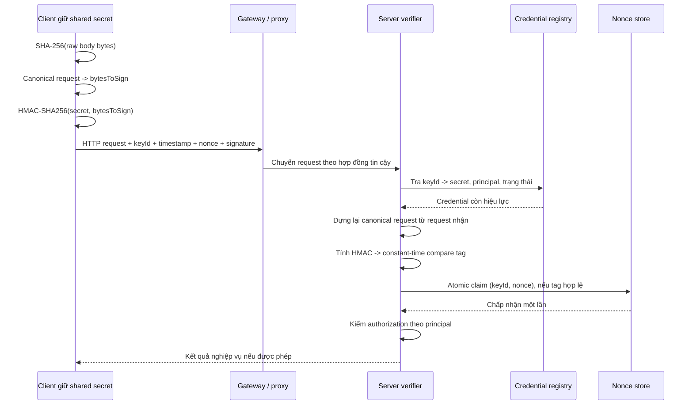

# HMAC và hash: từ kiểm tra tính toàn vẹn đến xác thực HTTP request

> **Chương:** HMAC  
> **Chủ đề:** HMAC và hash  
> **Phạm vi:** Giải thích sự khác nhau giữa hàm băm như SHA-256 và HMAC-SHA256, cách phối hợp **body hash**, **canonical request** và **shared secret** trong xác thực HTTP request. Ví dụ triển khai tập trung vào Java, chống replay bằng timestamp/nonce, luân chuyển khóa, kiểm thử qua proxy/gateway và ranh giới giữa xác thực với phân quyền.

## 1. Tại sao HMAC request authentication cần cả hash và HMAC?

Giả sử một client gửi lệnh tạo thanh toán qua HTTP. Server muốn biết liệu request mà nó nhận có đúng là request đã được một client sở hữu credential hợp lệ ký hay không, và nội dung được bảo vệ có bị sửa trên đường truyền không.

Một **hash** thông thường, chẳng hạn SHA-256, biến một chuỗi byte có độ dài bất kỳ thành một *digest* cố định. Nhưng bất cứ ai biết nội dung cũng có thể tính lại hash. Vì vậy, **đính kèm SHA-256 của body không đủ để xác thực client**.

**HMAC** (*Hash-based Message Authentication Code*) kết hợp một hàm băm mật mã với **khóa bí mật dùng chung**. Client và server sử dụng cùng secret để tạo/kiểm tra một mã xác thực cho chuỗi byte được ký. Người không có khả năng sử dụng secret không thể tạo HMAC hợp lệ cho nội dung mới một cách khả thi trong điều kiện thuật toán và triển khai an toàn.

Ví dụ:

```text
bodyBytes      = UTF8('{"amount":100000}')
bodyHash       = SHA256(bodyBytes)

canonicalReq   = canonicalize(method, URI, signedHeaders, bodyHash)
bytesToSign    = UTF8("HMAC-SHA256/v1\n" + canonicalReq)

signatureBytes = HMAC_SHA256(sharedSecretBytes, bytesToSign)
```

Ở đây có **hai phép tính khác nhau**:

1. `SHA256(bodyBytes)` tạo dấu vân tay cố định của payload, để đưa vào canonical request theo hợp đồng.
2. `HMAC_SHA256(secret, bytesToSign)` bảo vệ toàn bộ chuỗi ký, bao gồm dấu vân tay payload và các trường HTTP đã lựa chọn.

Điểm then chốt: **body hash chỉ có tính bảo vệ xác thực khi được ràng buộc bởi HMAC hoặc một cơ chế xác thực khác**. Một digest công khai đứng một mình có thể bị thay cùng với body.

## 2. Hash là gì?

**Hàm băm mật mã** nhận một chuỗi byte và trả về digest có độ dài cố định. Với SHA-256, digest dài **256 bit = 32 byte**, thường được biểu diễn bằng **64 ký tự hex**.

```text
SHA256(messageBytes) -> 32-byte digest
```

Các tính chất cần hiểu:

| Tính chất | Ý nghĩa thực hành |
| --- | --- |
| **Deterministic** | Cùng một chuỗi byte đầu vào luôn cho cùng digest. |
| **Đầu ra cố định** | SHA-256 trả 32 byte dù input dài hay ngắn. |
| **Preimage resistance** | Từ digest, việc tìm một input phù hợp được xem là khó về mặt tính toán khi sử dụng thuật toán an toàn. |
| **Second-preimage resistance** | Với input đã biết, khó tìm input khác cho cùng digest. |
| **Collision resistance** | Khó tìm hai input bất kỳ khác nhau có cùng digest; không có nghĩa là “không thể có va chạm”. |
| **Avalanche effect** | Thay đổi nhỏ ở byte đầu vào thường làm digest thay đổi mạnh. |
| **Không dùng khóa** | Mọi bên có body đều có thể tự tính lại SHA-256 của body. |

Ví dụ digest nổi tiếng của chuỗi ASCII `abc`:

```text
SHA-256("abc")
= ba7816bf8f01cfea414140de5dae2223
  b00361a396177a9cb410ff61f20015ad
```

Hai dòng chỉ là cách trình bày **một giá trị hex 64 ký tự**. Thêm một byte newline (`0A`) vào `abc` sẽ tạo digest khác.

### Hash *không* đảm bảo những gì?

- **Không xác thực người gửi:** attacker có thể sửa body và tính SHA-256 của body mới.
- **Không giữ bí mật:** digest không phải mã hóa; dữ liệu gốc vẫn đi trong HTTP request nếu không được bảo vệ bởi TLS.
- **Không chống replay:** cùng input có cùng hash; gửi lại body cũ vẫn cho cùng digest.
- **Không cung cấp định danh principal hay quyền truy cập:** hash không biết client, tenant hoặc endpoint được phép.

SHA-256 rất hữu ích để phát hiện sự khác biệt byte và xây dựng chuỗi ký gọn, nhưng không tự biến một request thành request đáng tin cậy.

## 3. HMAC là gì và khác hash ở điểm nào?

**HMAC** là mã xác thực thông điệp dựa trên hàm băm mật mã và khóa đối xứng. Với `HMAC-SHA256`, SHA-256 là hàm băm cơ sở, nhưng phép tính **không tương đương** `SHA256(secret + message)` hoặc `SHA256(message + secret)`.

Ở mức khái niệm, HMAC được định nghĩa bởi:

```text
HMAC(K, m) =
    H((K' XOR opad) || H((K' XOR ipad) || m))
```

Trong đó:

- `H` là hàm băm cơ sở, ví dụ SHA-256.
- `K` là shared secret dạng byte; `K'` là khóa được đưa về độ dài khối của hàm băm theo quy tắc HMAC.
- `ipad` và `opad` là hai lớp đệm cố định; `||` biểu thị phép nối byte.
- `m` là thông điệp cần xác thực, tức **signing input** trong HMAC request authentication.

Với SHA-256, kích thước **block** của hàm băm là 64 byte; kích thước **digest/tag** là 32 byte. Không nên tự lập trình phép ghép ipad/opad khi thư viện mật mã tiêu chuẩn đã cung cấp `HmacSHA256`.

| Đặc điểm | `SHA-256(message)` | `HMAC-SHA256(secret, message)` |
| --- | --- | --- |
| Loại thuật toán | Hash mật mã **không khóa** | MAC **có khóa đối xứng** |
| Đầu vào | Byte thông điệp | Byte khóa + byte thông điệp |
| Kết quả | Digest 32 byte | Authentication tag 32 byte |
| Ai có thể tính? | Bất cứ ai có message | Bên có khả năng sử dụng shared secret |
| Phát hiện sửa dữ liệu? | Có, khi digest tham chiếu được bảo vệ bằng một cơ chế tin cậy | Có, với các byte thực sự được ký và khóa chưa lộ |
| Chứng minh ai đang giữ credential? | Không | Có thể xác thực **quyền sử dụng secret** tương ứng với credential |
| Mã hóa và giữ bí mật nội dung? | Không | Không |
| Chống replay tự động? | Không | Không |
| Dùng ở HTTP request auth | Thường băm raw body để đưa vào canonical request | Ký canonical request/string-to-sign bằng shared secret |

**Lưu ý về thuật ngữ:** trong giao thức HTTP, giá trị HMAC thường được gọi là `signature` hoặc “chữ ký”. Tuy nhiên, HMAC **khác chữ ký số khóa công khai**. Vì cả client và server đều có thể tạo tag bằng cùng shared secret, HMAC không cung cấp tính *không thể chối bỏ* theo nghĩa mật mã như một hệ chữ ký bất đối xứng phù hợp.

## 4. Cần hash body khi nào? Cần HMAC khi nào?

Một HTTP request có thể có method, đường dẫn, query, headers và body. Có hai cách phổ biến để đưa body vào hợp đồng ký:

1. **Ký trực tiếp raw body bytes:** signing input chứa nguyên body. Hợp lý khi giao thức yêu cầu như vậy và cách ghép byte được định nghĩa chính xác.
2. **Ký digest của raw body bytes:** signing input chứa SHA-256 body thay vì đưa toàn bộ body vào chuỗi ký. Hữu ích vì trường body dù lớn vẫn được đại diện bằng một digest cố định.

Cả hai cách đều có thể an toàn nếu hợp đồng ký đầy đủ và byte đầu vào nhất quán. Không được coi body hash là “chữ ký” độc lập.

### Ví dụ trường hợp thay body

Client gửi:

```http
POST /v1/payments HTTP/1.1
Content-Type: application/json

{"amount":100000}
```

Với hợp đồng ký body digest:

```text
payloadHash = HEX_LOWERCASE(SHA256(rawBodyBytes))
canonicalRequest = ... + payloadHash
signature = Base64URL(HMAC_SHA256(secret, bytesToSign))
```

Nếu attacker đổi body thành `{"amount":900000}`:

- Body hash mới **khác** body hash cũ.
- Vì body hash nằm trong canonical request, signing input mới cũng khác.
- Server tính HMAC trên signing input mới; tag cũ **không khớp**.
- Attacker không có secret nên không thể tạo tag hợp lệ cho body mới một cách khả thi.

Ngược lại, nếu hợp đồng **không ký body hay body digest**, server có thể vẫn chấp nhận tag cũ sau khi body bị thay đổi. Đây là lỗi thiết kế hợp đồng ký, không phải lỗi của SHA-256 hoặc HMAC.

### Dữ liệu được băm là **byte**, không phải “JSON logic”

Hai chuỗi JSON có thể biểu diễn cùng đối tượng nhưng khác byte:

```json
{"a":1,"b":2}
```

```json
{"b":2,"a":1}
```

Tương tự, thêm khoảng trắng hoặc newline cuối body cũng làm thay đổi raw bytes. Khi quy định `SHA256(rawBodyBytes)`, **không parse rồi serialize lại JSON** trước khi băm, trừ khi cả hai phía đã thống nhất một đặc tả canonical JSON đầy đủ.

Nếu proxy/gateway giải nén body, thay encoding hay thay cách biểu diễn request, phải quy định rõ vị trí xác minh và **tập byte nào** được ký. Không đoán rằng body nhìn thấy ở client và body nhìn thấy tại service đích luôn giống nhau.

## 5. Ví dụ đầy đủ: từ HTTP request tới chữ ký HMAC

Một hợp đồng ký xác định **đúng thứ tự** các thành phần; không có định dạng canonical request duy nhất cho tất cả API. Ví dụ sau là **giao thức minh họa `HMAC-SHA256/v1`**, trong đó hai bên thỏa thuận:

1. Method dùng chữ hoa ASCII.
2. Canonical URI chứa path và query được chuẩn hóa theo quy tắc URI đã định nghĩa, gồm percent-encoding, thứ tự tham số, cách xử lý giá trị rỗng và từ chối key trùng không được hỗ trợ.
3. Bốn header bắt buộc `content-type`, `x-key-id`, `x-timestamp`, `x-nonce` được ký. Tên viết thường, thứ tự cố định, khoảng trắng trong value chuẩn hóa theo hợp đồng. Từ chối header trùng tên/mơ hồ.
4. Dòng cuối là hex chữ thường của `SHA256(rawBodyBytes)`, gồm cả trường hợp body rỗng.
5. Các dòng nối bằng LF (`\n`), dùng UTF-8, không thêm LF cuối ngoài chủ đích.
6. Chuỗi ký có tiền tố phiên bản `HMAC-SHA256/v1`. Tag HMAC-SHA256 gửi dạng Base64URL không padding.
7. Nếu host/authority quyết định route hoặc tenant thì phải ký authority theo quy tắc thống nhất qua gateway. Ví dụ dưới dùng một host cố định và xem authority đã được server cố định qua cấu hình; triển khai thực tế phải phân tích threat model trước khi quyết định.

**Request mẫu** (timestamp và nonce chỉ là ví dụ, không dùng lại trong request thực):

```http
POST /v1/payments?currency=VND&orderId=42 HTTP/1.1
Host: api.example.test
Content-Type: application/json
X-Key-Id: merchant-42-k2
X-Timestamp: 1795800000
X-Nonce: b20968fbad9a4f5a91af45e624c58716
X-Signature: v1=<BASE64URL_TAG>

{"amount":100000}
```

Đầu tiên, client băm **đúng 17 byte ASCII** của body `{"amount":100000}`, không có newline. Sau đó ghép canonical request:

```text
POST
/v1/payments
currency=VND&orderId=42
content-type:application/json
x-key-id:merchant-42-k2
x-nonce:b20968fbad9a4f5a91af45e624c58716
x-timestamp:1795800000
content-type;x-key-id;x-nonce;x-timestamp
<SHA256_HEX_CUA_BODY>
```

`<SHA256_HEX_CUA_BODY>` là **placeholder giải thích vị trí của digest**, không phải giá trị được đem đi ký. Khi chạy thật phải tính đủ **64 ký tự hex** từ đúng body bytes.

Tiếp theo:

```text
stringToSign = "HMAC-SHA256/v1\n" + canonicalRequest
signatureBytes = HMAC_SHA256(secretBytes, UTF8(stringToSign))
X-Signature = "v1=" + BASE64URL_WITHOUT_PADDING(signatureBytes)
```

Key ID không được dùng làm secret. Key ID chỉ giúp server chọn secret đúng. Thuật toán và version phải được **server cho phép qua credential policy**, thay vì tin hoàn toàn vào yêu cầu client tự khai.

### Luồng ký và xác minh



Sơ đồ lược bớt kiểm tra cú pháp, timestamp, thuật toán và thông báo lỗi. Timestamp phải trong **freshness window** trước khi chấp nhận; nonce chỉ được đánh dấu sau khi signature hợp lệ và claim phải atomic.

## 6. Java: tính SHA-256 và HMAC-SHA256 đúng cách

Java có sẵn `MessageDigest` cho hash và `javax.crypto.Mac` cho HMAC. Không tự ghép `secret + message` hoặc tự viết ipad/opad.

Đoạn mã dưới đây dùng **Java 17+**, nhận **raw body bytes**, một `stringToSign` đã được tạo theo hợp đồng ký và **shared secret dạng byte**. Mã chỉ minh họa phép băm/ký/xác minh; **chưa** bao gồm parser HTTP, canonicalization, lookup credential, freshness, nonce store hay phân quyền.

```java
import java.nio.charset.StandardCharsets;
import java.security.GeneralSecurityException;
import java.security.MessageDigest;
import java.util.Base64;
import java.util.HexFormat;
import java.util.Objects;
import javax.crypto.Mac;
import javax.crypto.spec.SecretKeySpec;

public final class HashAndHmac {
    private HashAndHmac() {}

    // Hash không khóa: đủ để đại diện raw body trong canonical request.
    public static String sha256Hex(byte[] rawBody) {
        Objects.requireNonNull(rawBody);
        try {
            byte[] digest = MessageDigest.getInstance("SHA-256")
                    .digest(rawBody);
            return HexFormat.of().formatHex(digest); // hex chữ thường
        } catch (GeneralSecurityException e) {
            throw new IllegalStateException("SHA-256 unavailable", e);
        }
    }

    // HMAC có khóa: trả về tag 32 byte với HmacSHA256.
    public static byte[] hmacSha256(byte[] secret, byte[] bytesToSign)
            throws GeneralSecurityException {
        Objects.requireNonNull(secret);
        Objects.requireNonNull(bytesToSign);
        Mac mac = Mac.getInstance("HmacSHA256");
        mac.init(new SecretKeySpec(secret, "HmacSHA256"));
        return mac.doFinal(bytesToSign);
    }

    public static String signHeader(byte[] secret, String stringToSign)
            throws GeneralSecurityException {
        byte[] tag = hmacSha256(
                secret,
                stringToSign.getBytes(StandardCharsets.UTF_8)
        );
        return "v1=" + Base64.getUrlEncoder()
                .withoutPadding()
                .encodeToString(tag);
    }

    public static boolean verifyHeader(byte[] secret, String stringToSign,
                                       String header)
            throws GeneralSecurityException {
        if (header == null || !header.startsWith("v1=")) {
            return false;
        }

        String encoded = header.substring(3);
        // 32 byte HMAC-SHA256 = 43 ký tự Base64URL không padding.
        if (!encoded.matches("[A-Za-z0-9_-]{43}")) {
            return false;
        }
        byte[] supplied;
        try {
            supplied = Base64.getUrlDecoder().decode(encoded);
        } catch (IllegalArgumentException invalid) {
            return false;
        }
        if (supplied.length != 32) {
            return false;
        }

        // Re-encode để chỉ chấp nhận một dạng biểu diễn Base64URL duy nhất.
        if (!Base64.getUrlEncoder().withoutPadding()
                .encodeToString(supplied).equals(encoded)) {
            return false;
        }

        byte[] expected = hmacSha256(
                secret,
                stringToSign.getBytes(StandardCharsets.UTF_8)
        );
        return MessageDigest.isEqual(expected, supplied);
    }
}
```

**Cách sử dụng ở client:** tính body hash bằng `sha256Hex(rawBody)`, dựng `stringToSign` theo hợp đồng ký, gọi `signHeader(secret, stringToSign)` rồi gửi request. **Ở server:** dùng key ID để lấy đúng secret từ kho đáng tin, dựng lại `stringToSign` từ request tại điểm xác minh, gọi `verifyHeader(...)`, sau đó mới cập nhật nonce store và gán authenticated principal.

Không dùng `String.equals` cho so sánh tag trong lớp xác thực; `MessageDigest.isEqual` so sánh các mảng byte theo cơ chế hạn chế rò rỉ timing. Việc kiểm tra chiều dài và định dạng trước có thể tiết lộ dữ liệu công khai như độ dài tag, nhưng không phải secret.

### 6.1. Hai ví dụ kiểm tra tính đúng

**Hash SHA-256:** với byte ASCII `abc`, `sha256Hex(...)` phải trả:

```text
ba7816bf8f01cfea414140de5dae2223b00361a396177a9cb410ff61f20015ad
```

**HMAC-SHA256:** test vector HMAC-SHA256 trong RFC 4231 (test case 1) dùng secret gồm **20 byte có giá trị 0x0b**, thông điệp ASCII `Hi There` và cho tag:

```text
b0344c61d8db38535ca8afceaf0bf12b881dc200c9833da726e9376c2e32cff7
```

Đây là test vector **công khai**, chỉ nên dùng để kiểm thử thuật toán, không dùng secret của test vector cho credential thực tế.

Có thể đối chiếu trực tiếp trong Java:

```java
byte[] key = new byte[20];
java.util.Arrays.fill(key, (byte) 0x0b);
byte[] message = "Hi There".getBytes(java.nio.charset.StandardCharsets.US_ASCII);

String actual = java.util.HexFormat.of().formatHex(
        HashAndHmac.hmacSha256(key, message)
);
String expected =
        "b0344c61d8db38535ca8afceaf0bf12b" +
        "881dc200c9833da726e9376c2e32cff7";

if (!expected.equals(actual)) {
    throw new AssertionError("HMAC-SHA256 test vector mismatch");
}
```

Phép so sánh `String.equals` ở **test vector công khai** là bình thường; khi xác minh chữ ký HTTP thực tế phải dùng so sánh byte phù hợp như trong `verifyHeader`.

## 7. Những lỗi phổ biến khi kết hợp hash và HMAC

| Lỗi | Vì sao nguy hiểm? | Cách làm đúng |
| --- | --- | --- |
| Gửi `SHA256(body)` và coi như xác thực client | Ai cũng có thể thay body rồi tính lại digest. | HMAC trên signing input chứa body digest và trường HTTP cần bảo vệ. |
| Tự tính `SHA256(secret || message)` | Không phải HMAC; dễ mắc lỗi giao thức và các dạng tấn công liên quan tới cấu trúc hash, chẳng hạn length extension với một số cách ghép. | Dùng `Mac.getInstance("HmacSHA256")`. |
| Băm chuỗi Java hoặc JSON object mà không quy định encoding | Client/server có thể biến cùng dữ liệu logic thành byte khác nhau. | Hash **raw body bytes** và quy định rõ UTF-8 cho chuỗi ký. |
| Ký chỉ body, bỏ qua method/path/query | Tag có thể bị dùng cho hành động/đối tượng khác nếu các trường đó không được ràng buộc. | Đưa tất cả trường ảnh hưởng an ninh và nghiệp vụ vào canonical request. |
| Thực hiện `HMAC(hash(body))` nhưng không ký timestamp/nonce/key ID | Bảo vệ body nhưng không ràng buộc độ mới hoặc credential metadata; vẫn dễ replay/nhầm ngữ cảnh. | Hợp đồng ký đầy đủ với metadata thiết yếu. |
| Nhầm secret đã mã hóa Base64 thành byte secret | Hai bên có thể tính HMAC từ byte khác nhau. | Thống nhất lưu secret dưới dạng byte và **decode** khi dùng nếu đã bàn giao ở dạng Base64. |
| Nhầm tag bytes với chuỗi hex/Base64 | So sánh khác định dạng hoặc double-encode gây lỗi xác minh. | Decode biểu diễn, kiểm độ dài, so sánh **byte tag**. |
| Dùng tag cũ để ký request đã đổi payload | Tag không còn khớp nếu payload được ký. | Mỗi lần đổi các trường đã ký phải tính chữ ký mới. |
| Tạo HMAC với khóa được client cung cấp trong request | Attacker tự chọn khóa nên tự xác minh được mình. | Server lấy khóa từ credential registry đáng tin theo key ID. |
| Dùng cùng một secret cho tất cả client | Lộ một khóa ảnh hưởng toàn hệ thống và không phân biệt client. | Credential riêng, phân tách môi trường và phạm vi. |
| Giả định HMAC tạo ra bí mật nội dung | Body và URI vẫn có thể bị đọc trên mạng nếu không có TLS. | Dùng HTTPS/TLS; hạn chế dữ liệu nhạy cảm trong URL/log. |
| Cho phép thuật toán `none` hoặc version tùy ý | Có thể tạo đường bỏ xác minh hoặc downgrade. | Chỉ hỗ trợ thuật toán/version do server và credential policy cho phép. |

### Vì sao không “hash secret rồi lưu” như mật khẩu?

Với xác thực mật khẩu, server có thể giữ *password hash* để đối chiếu bằng một cơ chế chuyên dụng mà không cần giữ plaintext password. Với HMAC request authentication, server phải **tính lại HMAC bằng đúng khóa**, hoặc nhờ một thành phần đáng tin có khả năng sử dụng khóa. Một chuỗi `SHA256(sharedSecret)` lưu trong database **không thay thế được shared secret** trừ khi bạn thiết kế một giao thức khác và cố ý dùng digest đó như khóa mới, khi ấy digest cũng trở thành **secret cần bảo vệ**.

Đừng đánh đồng HMAC-SHA256 với password hashing như Argon2id, bcrypt hay PBKDF2: mục tiêu, threat model và cách quản lý secret khác nhau.

## 8. Hash và HMAC không tự chống replay

HMAC trên request trả lời: “Có đúng ai đó có khả năng sử dụng shared secret đã tạo tag cho **dữ liệu đã ký** này không?” Nó **không** trả lời: “Request này đã từng chạy chưa?”

Kẻ tấn công có thể sao chép **toàn bộ** request hợp lệ, kèm tag đúng, rồi phát lại. Hash và HMAC không đổi vì input không đổi.

Để giảm replay:

1. Client tạo **timestamp** (theo đơn vị đã định nghĩa, ví dụ epoch seconds) và **nonce** đủ ngẫu nhiên, chẳng hạn 128 bit từ CSPRNG.
2. Hai trường này nằm trong **signed headers** hoặc string-to-sign, không thể bị đổi mà giữ nguyên HMAC.
3. Server kiểm timestamp trong cửa sổ chấp nhận, ví dụ `|serverNow - timestamp| <= 300` giây.
4. Sau khi tag hợp lệ, server **atomic claim** cặp `(keyId, nonce)` trong kho dùng chung; request có nonce đã dùng bị từ chối.
5. Nonce được giữ đủ lâu để request không còn có thể hợp lệ. Với cửa sổ đối xứng ±300 giây, TTL 300 giây tính từ lần nhận đầu tiên **có thể quá ngắn**, vì request mang timestamp tương lai có thể vẫn hợp lệ gần 600 giây.

Khi một hệ thống có nhiều server instance, không được làm “SELECT nonce chưa tồn tại” rồi “INSERT nonce” thành hai thao tác không nguyên tử. Có thể dùng cấu trúc nguyên tử như `SET key value NX EX ttl` trong Redis. Với API nhạy cảm, cần quy định **fail closed** nếu nonce store không sẵn sàng.

**Idempotency** giải quyết việc retry có thể tạo giao dịch hai lần; nó **không thay thế nonce chống replay**. Một retry hợp lệ có thể dùng nonce mới nhưng giữ cùng idempotency key được ký theo hợp đồng, để nghiệp vụ trả lại kết quả đã thực hiện.

## 9. Quản lý shared secret và key rotation

Độ an toàn của HMAC phụ thuộc nhiều vào **khóa**. Với HMAC-SHA256, secret **32 byte ngẫu nhiên** từ CSPRNG là lựa chọn thực hành tốt. Không dùng mật khẩu dễ đoán, `Random`, timestamp hoặc UUID dự đoán được để tạo credential.

### Vòng đời khóa

| Trạng thái | Ý nghĩa và hành động |
| --- | --- |
| **CREATED / PENDING** | Khóa được tạo/cấp qua kênh an toàn, chưa được chấp nhận để xác minh. |
| **ACTIVE** | Client dùng để ký request mới; server kiểm tra và có thể xác minh tag tương ứng. |
| **VERIFY_ONLY / OVERLAP** | Khóa cũ chỉ được chấp nhận tạm thời trong giai đoạn chuyển sang khóa mới. |
| **REVOKED** | Bị vô hiệu ngay; tag có đúng về mặt mật mã cũng bị từ chối. |
| **EXPIRED** | Quá thời hạn hiệu lực, không được dùng cho request mới. |

**Rotation từ k1 sang k2:**

- Tạo secret mới và **key ID mới**, cấp cho đúng client qua kênh bảo mật.
- Giữ k1 và k2 cùng có thể được xác minh trong cửa sổ chuyển tiếp có giới hạn nếu đây là thay khóa bình thường.
- Client bắt đầu ký request mới bằng k2; server chọn secret dựa trên key ID **được gắn với credential hợp lệ**.
- Hết thời gian chuyển tiếp thì revoke/expire k1; đảm bảo cache credential ở các instance được cập nhật.
- Khi nghi secret đã lộ, có thể cần **revoke ngay**, không mặc định kéo dài overlap.

HMAC không ngăn attacker **có secret bị đánh cắp** tạo chữ ký mới với timestamp và nonce hợp lệ. Vì vậy, phải bảo vệ khóa trong secret manager/vault, phân tách theo client và môi trường, giới hạn quyền sử dụng, tránh ghi secret vào log, mã nguồn, CI output và triển khai quy trình phát hiện/thu hồi.

**Lưu ý:** Vì client cũng cần khả năng ký, **không thể coi shared secret dài hạn là an toàn khi nhúng vào JavaScript trình duyệt hoặc ứng dụng di động do người dùng kiểm soát**. Với mô hình đó, cần cân nhắc kiến trúc khác để bảo vệ secret.

## 10. Proxy/gateway: băm và ký đúng dữ liệu nào?

Một reverse proxy hay gateway có thể thay `Host`, thêm path prefix, chuẩn hóa URI, sắp xếp query, xóa/thêm header hoặc chuyển đổi representation body. Điều này ảnh hưởng trực tiếp tới `bytesToSign`.

**Ví dụ lỗi dễ gặp:**

- Client ký `POST /public/v1/payments`, còn service đích nhìn thấy `POST /v1/payments` sau rewrite.
- Client hash raw compressed payload, nhưng gateway giải nén body trước khi server hash.
- Client ký query nguyên trạng, nhưng gateway decode `%2F` hoặc chuẩn hóa dấu `+`/`%20` khác đi.
- Verifier chỉ lấy giá trị đầu của query `role=user&role=admin`, nhưng backend thực thi giá trị cuối.

Các khác biệt này có thể gây **sai signature** hoặc nghiêm trọng hơn, khiến verifier và nghiệp vụ **hiểu khác nhau về dữ liệu đã được xác thực**.

### Hai mô hình điểm xác minh

| Mô hình | Ai giữ khả năng dùng secret? | Ranh giới phải kiểm soát |
| --- | --- | --- |
| **Gateway xác minh HMAC** | Gateway hoặc dịch vụ khóa được gateway tin cậy. | Gateway phải xóa header principal do client tự khai, tự xác lập danh tính sau xác minh và truyền qua kênh nội bộ được bảo vệ; backend không được bị bypass. |
| **Service đích xác minh HMAC** | Service đích hoặc dịch vụ khóa mà service dùng. | Proxy phải bảo toàn dữ liệu cần ký, hoặc truyền dữ liệu gốc qua cơ chế đáng tin cậy đã được định nghĩa rõ trong hợp đồng. |

Các header `X-Forwarded-Host`, `X-Forwarded-Proto` và tương tự **không tự đáng tin**. Nếu cần sử dụng, chỉ tin khi gateway đã xác minh đường vào, xóa giá trị client gửi và thiết lập lại theo chính sách. Không dùng dữ liệu attacker tự khai để “vá” signature mismatch.

## 11. Xác thực khác phân quyền

Sau khi server xác minh HMAC, timestamp và nonce, nó có thể xác định **principal** bằng bản ghi credential gắn với `keyId`. Ví dụ:

```text
X-Key-Id: merchant-42-k2
      |
      v
Credential registry: keyId -> secretRef, principal=merchant-42
      |
      v
HMAC, freshness, nonce hợp lệ
      |
      v
Authenticated principal: merchant-42
      |
      v
Authorization: có quyền thao tác orderId=42 hay không?
```

Một request có HMAC hợp lệ do `merchant-42` ký **vẫn phải bị từ chối** nếu nó truy cập đơn hàng chỉ thuộc `merchant-99`. HMAC xác thực quyền sử dụng credential; **authorization** xét quyền trên tài nguyên, hành động và tenant thực tế.

Không dùng `X-Key-Id` hoặc `merchantId` trong body tự khai làm bằng chứng phân quyền nếu credential chưa được xác thực và gắn với principal đáng tin. HTTP 401 thường dùng cho lỗi xác thực; HTTP 403 thường dùng khi đã xác thực nhưng không đủ quyền.

## 12. Thực hành kiểm thử HMAC và hash

Thử trên môi trường được phép, có hai client A/B với secret khác nhau, một verifier và đường qua proxy/gateway. Sử dụng một request hợp lệ làm trường hợp đối chứng.

| # | Tình huống kiểm thử | Kết quả kỳ vọng |
| --- | --- | --- |
| 1 | Tính SHA-256 ASCII `abc`. | Khớp digest chuẩn 64 ký tự hex trong mục 2. |
| 2 | Tính HMAC-SHA256 test vector RFC 4231. | Khớp tag công khai trong mục 6.1. |
| 3 | Đổi một byte body, giữ body hash và tag cũ. | Body digest tính lại khác, HMAC không khớp. |
| 4 | Thay body hash bằng digest của body mới nhưng giữ HMAC cũ. | HMAC không khớp vì signing input thay đổi. |
| 5 | Dùng `keyId` A nhưng ký bằng shared secret B. | Xác thực thất bại; không gán principal A. |
| 6 | Đổi method, path, canonical query hoặc signed header, giữ signature cũ. | HMAC không khớp. |
| 7 | Hai body JSON cùng ý nghĩa nhưng khác thứ tự field/whitespace. | Nếu ký raw bytes, digest và tag khác nhau. |
| 8 | Gửi request đúng signature nhưng timestamp hết hạn. | Từ chối vì freshness. |
| 9 | Phát lại nguyên request đã xử lý thành công, cùng nonce. | Từ chối replay, dù HMAC vẫn đúng. |
| 10 | Hai instance nhận đồng thời cùng nonce. | Chỉ một request được atomic claim nonce. |
| 11 | Ký với secret đã revoked. | Từ chối xác thực dù HMAC tính ra tag đúng. |
| 12 | Dùng key thử nghiệm ở môi trường production. | Từ chối do credential không thuộc môi trường. |
| 13 | Đi qua gateway đổi path/host/query hoặc body representation. | Contract xác minh có kết quả nhất quán; mismatch phải bị từ chối an toàn. |
| 14 | Gửi `X-Authenticated-Client` giả và cố đi tắt backend. | Gateway loại header giả; backend không tin nguồn chưa xác thực. |
| 15 | Client A ký hợp lệ nhưng gọi tài nguyên của B. | Xác thực có thể đạt; authorization từ chối. |
| 16 | Biểu diễn tag sai (hex thay Base64URL, padding không được phép, sai độ dài). | Verifier từ chối theo định dạng hợp đồng, không tự suy đoán. |

### Checklist trước khi kết luận “HMAC đã đúng”

- **Khóa:** secret được sinh bằng CSPRNG, mỗi client/môi trường có credential riêng, lookup bằng key ID tin cậy và có khả năng revoke/rotation.
- **Hash:** body digest thực sự tính trên đúng raw bytes được hợp đồng ký quy định.
- **Canonicalization:** cùng method, URI, query, headers, body digest, thứ tự, encoding và dấu xuống dòng ở hai phía.
- **HMAC:** dùng thuật toán MAC tiêu chuẩn, ký toàn bộ signing input, decode tag và so sánh byte đúng cách.
- **Replay:** timestamp + nonce được ký; kiểm freshness và claim nonce atomic với TTL đúng.
- **Gateway:** xác định rõ nơi xác minh, dữ liệu gốc và ranh giới danh tính nội bộ.
- **Authorization:** principal suy ra từ credential đã xác minh; quyền trên resource được kiểm tra riêng.

## 13. Câu hỏi tự kiểm tra

**Câu 1.** Vì sao `SHA256(body)` không đủ để xác thực client?

*Đáp án:* Vì SHA-256 không dùng secret; người sửa body có thể tính lại hash mới. Cần HMAC hoặc một cơ chế xác thực khác bảo vệ body hash và các trường request liên quan.

**Câu 2.** Trong `HMAC-SHA256`, SHA-256 có phải là “chữ ký” không?

*Đáp án:* Không. SHA-256 là hàm băm cơ sở; HMAC sử dụng nó cùng với khóa để tính **authentication tag**. Gửi SHA-256 digest đơn thuần không tương đương gửi HMAC tag.

**Câu 3.** Server có thể xác minh HMAC khi chỉ biết `SHA256(secret)` nhưng không biết secret thật không?

*Đáp án:* Không theo giao thức HMAC dựa trên secret thật. Bên xác minh cần chính khóa hoặc thành phần đáng tin có khả năng dùng khóa đó. Nếu cố tình thay khóa bằng digest của secret thì digest đó trở thành secret của giao thức khác và cần bảo vệ tương đương.

**Câu 4.** Hai JSON object tương đương nhưng byte serialization khác nhau có bắt buộc cùng body digest không?

*Đáp án:* Không. SHA-256 băm byte, không băm ý nghĩa JSON. Hợp đồng cần chỉ rõ ký raw bytes hoặc một phương pháp chuẩn hóa JSON thống nhất.

**Câu 5.** Vì sao HMAC đúng vẫn có thể bị replay?

*Đáp án:* Attacker có thể gửi lại nguyên request và tag đã từng hợp lệ. HMAC không ghi nhớ lịch sử; cần timestamp và nonce được ký, nonce store atomic.

**Câu 6.** Nếu client ký đúng request nhưng server chấp nhận request truy cập tenant khác, lỗi nằm ở đâu?

*Đáp án:* Nếu danh tính client đã xác thực đúng, lỗi chính nằm ở **authorization** hoặc ánh xạ principal/tenant; chữ ký HMAC không tự cấp mọi quyền.

**Câu 7.** Trường hợp nào cùng secret và cùng HMAC-SHA256 vẫn cho signature khác nhau?

*Đáp án:* Khi `bytesToSign` khác nhau vì URI/query/header/body digest, encoding, ký tự LF, chuẩn hóa hoặc biến đổi qua gateway; HMAC hoạt động trên chuỗi byte chính xác.

---

**Điều cần nhớ:** **Hash** giúp biểu diễn và phát hiện thay đổi của dữ liệu ở mức byte, nhưng không xác thực bên gửi. **HMAC** bổ sung shared secret để tạo tag xác thực cho một signing input đã thống nhất. Khi áp dụng cho HTTP request, tính an toàn phụ thuộc **hợp đồng ký đầy đủ**, **byte canonical giống nhau ở client và server**, **bảo vệ/rotation secret**, **timestamp–nonce chống replay**, **kiểm thử gateway/proxy** và **phân quyền riêng sau xác thực**.
