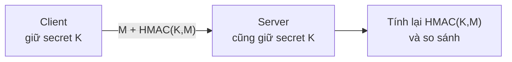
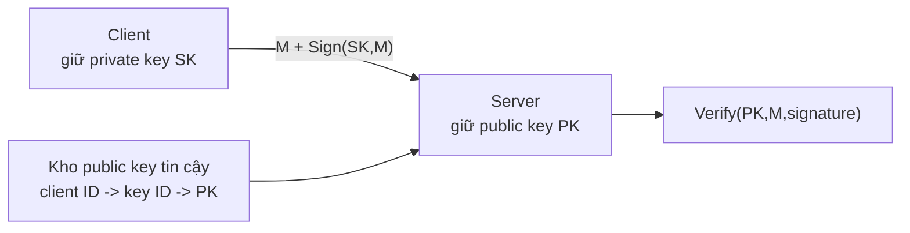
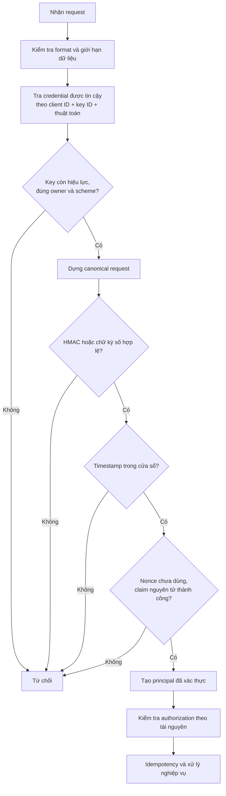

# HMAC và digital signature

## 1. Vì sao cần phân biệt hai khái niệm?

Trong module **SECURITY_AUTHENTICATION_HMAC_REQUEST_AUTHENTICATION**, client ký HTTP request bằng **HMAC với shared secret**. Server dựng lại canonical request từ method, URI, header và body theo hợp đồng ký, sau đó kiểm tra chữ ký để xác thực bên gọi. Từ “signature” xuất hiện trong tên header như `X-Signature` hoặc trong cách nói “ký HMAC”, nhưng về mật mã học, **HMAC là mã xác thực thông điệp (*Message Authentication Code*, MAC)**, khác với **digital signature (chữ ký số)**.

Sự khác biệt quan trọng nhất nằm ở **ai giữ khóa và ai có khả năng tạo bằng chứng xác thực**:

- **HMAC:** người tạo MAC và người xác minh MAC đều biết **cùng một secret đối xứng**. Bất kỳ bên nào giữ secret cũng có thể tạo MAC hợp lệ.
- **Digital signature:** người ký dùng **private key**, người xác minh dùng **public key** tương ứng. Người chỉ giữ public key có thể kiểm tra chữ ký nhưng không thể tạo chữ ký mới hợp lệ, với giả định thuật toán và khóa an toàn.

Cả hai giúp phát hiện thông điệp bị sửa và xác thực bên sở hữu **loại khóa tương ứng**. Cả hai **không mã hóa body**, không thay thế TLS, không tự chống replay và không tự cấp quyền nghiệp vụ.

Sau bài học, bạn có thể giải thích mô hình tin cậy của hai cơ chế, chọn phương án phù hợp cho API client–server, viết mã Java ký/xác minh cơ bản, thiết kế canonical request với timestamp/nonce, và đánh giá key rotation, proxy/gateway, xác thực so với phân quyền.

## 2. Hai công thức, hai mô hình khóa

### 2.1. HMAC: đối xứng

Cho thông điệp `M` và secret `K`:

```text
tag = HMAC-SHA256(K, M)

Người gửi:   có K -> tính tag
Người nhận:  có K -> tính lại expectedTag
Kết quả:     so sánh tag với expectedTag
```

HMAC xây dựng trên một hàm băm mật mã theo cấu trúc có khóa; HMAC-SHA256 dùng SHA-256 làm thành phần bên trong. **HMAC không đơn thuần là `SHA256(secret || message)`**: không tự chế một công thức băm nối chuỗi để thay thế HMAC.



Nếu client và server cùng giữ secret, server có thể **tự tạo tag** cho một thông điệp bất kỳ. Vì thế tag hợp lệ không thể là bằng chứng chống chối bỏ rằng **chỉ client** có thể đã tạo thông điệp. Khi secret lộ cho bên thứ ba, bên đó cũng có thể tạo request và tag mới, dù timestamp/nonce đều hợp lệ.

### 2.2. Digital signature: bất đối xứng

Với cặp khóa `(SK, PK)`:

```text
signature = Sign(privateKey = SK, message = M)

Người ký:        giữ bí mật SK, tạo signature
Người xác minh:  có PK được gắn đúng chủ thể
                  Verify(PK, M, signature) -> true/false
```



**Public key có thể được chia sẻ**, nhưng điều đó không có nghĩa server được tin bất kỳ public key nào caller tự gửi. Server phải biết key đó **đã được đăng ký cho client nào**, trạng thái còn hiệu lực hay không và phạm vi được cấp. Nếu request vừa gửi public key tùy ý vừa tự khai `X-Client-Id: admin`, chỉ việc Verify thành công **không chứng minh** caller là admin.

Ví dụ chữ ký số thường gặp: Ed25519, ECDSA và RSA-PSS. Trong ví dụ Java phía dưới dùng **Ed25519** vì JDK hiện đại hỗ trợ trực tiếp qua `java.security.Signature`. Các thuật toán có cách tạo khóa, tham số và encoding khác nhau; không thay thế lẫn nhau chỉ bằng cách đổi tên header.

### 2.3. So sánh trực diện

| Tiêu chí | HMAC-SHA256 | Digital signature (ví dụ Ed25519) |
| --- | --- | --- |
| Loại khóa | **Một shared secret** cho cả hai bên | **Private key** để ký, **public key** để kiểm tra |
| Ai có thể tạo tag/signature? | Bất cứ bên nào biết shared secret | Bên giữ private key tương ứng |
| Ai kiểm tra? | Bên biết secret | Bên có public key **được tin cậy và gắn đúng danh tính** |
| Phân phối khóa | Phải cấp phát và bảo vệ secret ở **client lẫn verifier** | Phải bảo vệ private key tại nơi ký; phân phối và xác thực ánh xạ public key tại verifier |
| Phạm vi lộ khóa tại verifier | Lộ secret có thể cho phép giả mạo request với credential đó | Lộ riêng public key không cho phép ký; lộ private key vẫn nguy hiểm |
| Tính toàn vẹn thông điệp | Có, đối với **dữ liệu được MAC bảo vệ** | Có, đối với **dữ liệu được ký** |
| Tính bí mật của body | **Không** | **Không** |
| Chống replay | **Không tự có** | **Không tự có** |
| Chứng cứ về người ký | Chỉ khẳng định bên tạo biết shared secret; verifier cũng có khả năng tạo | Cho bằng chứng kỹ thuật rằng private key tương ứng đã ký; danh tính và chống chối bỏ còn phụ thuộc quản trị khóa, chứng nhận, bảo vệ thiết bị và bằng chứng vận hành |
| Chi phí tính toán | Thường thấp, phù hợp request nội bộ tần suất cao | Chi phí ký/xác minh tùy thuật toán; cần benchmark theo tải thực tế |
| Quy mô verifier | Mỗi verifier giữ secret hoặc gọi dịch vụ xác minh tập trung | Có thể phân phối public key đến nhiều verifier mà không cấp private key |
| Thu hồi | Thu hồi phiên bản secret tại mọi verifier; cấp secret mới qua kênh bảo mật | Thu hồi ánh xạ public key/key ID; client tạo/cấp cặp khóa mới theo quy trình tin cậy |

**Đừng đánh đồng “digital signature” với “chữ ký trong HTTP header”.** `X-Signature: ...` có thể chứa HMAC hoặc chữ ký số; phải đọc **thuật toán, mô hình khóa, hợp đồng canonicalization và quy trình xác minh** mới biết cơ chế bảo mật thực sự.

## 3. Điều gì được bảo vệ trong HTTP request?

Trong API, việc ký nguyên văn một chuỗi bất kỳ có thể tạo lỗ hổng. Cần có **canonical request**: biểu diễn duy nhất, nhất quán của những thành phần ảnh hưởng đến hành vi bảo mật và nghiệp vụ.

Giả sử request:

```http
POST /v1/orders?dryRun=false HTTP/1.1
Host: api.example.test
Content-Type: application/json
X-Client-Id: merchant-42
X-Key-Id: key-2026-11
X-Auth-Alg: hmac-sha256
X-Timestamp: <unix-epoch-seconds>
X-Nonce: <unique-random-nonce>
X-Signature: <base64url-signature>

{"orderId":"ord-91","amount":250000}
```

**Ví dụ hợp đồng ký trong bài học** quy định:

1. Dòng 1: thuật toán định danh kiểu ký từ `X-Auth-Alg`, ví dụ `hmac-sha256` hoặc `ed25519`; không tự chọn thuật toán theo dữ liệu chưa được kiểm tra.
2. Dòng 2: HTTP method dạng chữ in hoa, ví dụ `POST`.
3. Dòng 3: raw URI path nhìn thấy tại điểm xác minh trước rewrite, ví dụ `/v1/orders`.
4. Dòng 4: raw query string tại cùng điểm, ví dụ `dryRun=false`; không có query thì dùng chuỗi rỗng. Hợp đồng này giữ nguyên thứ tự và percent encoding.
5. Các dòng tiếp: header được ký theo thứ tự cố định, tên lowercase, giá trị đã kiểm tra định dạng: `content-type`, `x-client-id`, `x-key-id`, `x-timestamp`, `x-nonce`.
6. Dòng cuối: SHA-256 ở dạng hex lowercase của **chính xác byte body** theo hợp đồng (sau HTTP transfer decoding, trước các middleware tự biến đổi nội dung).
7. Ghép dòng bằng LF (`\n`), không thêm LF cuối; mã hóa UTF-8 trước khi đưa vào HMAC hoặc thuật toán ký số.

```text
hmac-sha256
POST
/v1/orders
dryRun=false
content-type:application/json
x-client-id:merchant-42
x-key-id:key-2026-11
x-timestamp:<unix-epoch-seconds>
x-nonce:<unique-random-nonce>
<sha256-hex-of-raw-body-bytes>
```

Đổi sang cơ chế Ed25519 thì dòng đầu là `ed25519` và credential lookup lấy **public key** đã đăng ký. Chữ ký được tính trên cùng cấu trúc dữ liệu canonical, nhưng phải dùng đúng thuật toán được **gắn với key ID trong kho credential**. Không cho client tuyên bố một thuật toán bất kỳ rồi ép server xử lý khóa theo kiểu khác.

**Lưu ý:** trên đây là hợp đồng minh họa, không phải định dạng chuẩn dùng chung cho mọi API. Trước khi triển khai phải viết rõ quy tắc về header trùng/lặp, header thiếu, case, whitespace, query trùng tên, ký tự điều khiển, percent encoding, slash cuối, dấu chấm trong đường dẫn, body rỗng, multipart, charset và content-encoding. Với input không xác định, phương án an toàn thường là **từ chối** thay vì đoán cách canonicalize.

Một request bị sửa ở trường **không được ký** vẫn có thể vượt qua HMAC/chữ ký số. Ví dụ, nếu `dryRun=false` ảnh hưởng đến việc ghi đơn hàng nhưng query bị loại khỏi canonical request, attacker có thể chỉnh query mà signature không đổi. Cả HMAC và digital signature đều không thể bù cho **hợp đồng ký thiếu trường quan trọng**.

## 4. Điểm giống nhau quan trọng: phải chống replay riêng

Về bản chất, HMAC và chữ ký số xác nhận thông điệp khớp với khóa, nhưng không biết **thông điệp đã xuất hiện bao nhiêu lần**.

Ví dụ:

- Kẻ tấn công ghi lại một request đặt hàng hợp lệ với chữ ký.
- Một phút sau họ gửi lại **nguyên request**, không đổi method, URI, body hay chữ ký.
- HMAC hoặc Verify digital signature vẫn có thể thành công, vì mọi byte đã ký đều giữ nguyên.

Cần kết hợp:

- **Timestamp đã ký:** giới hạn thời gian hợp lệ, chẳng hạn server chỉ chấp nhận chênh lệch trong ±300 giây. Đồng hồ server phải đáng tin và có chính sách clock skew rõ ràng.
- **Nonce đã ký:** giá trị đủ khó đoán và không lặp đối với từng client. Sau khi chữ ký hợp lệ, server *claim nonce nguyên tử* trong kho chia sẻ, ví dụ Redis `SET key value NX EX ttl`; từ chối mọi lần claim sau. TTL phải bao phủ toàn bộ khoảng có thể chấp nhận request, kể cả skew.
- **Idempotency nghiệp vụ:** một `orderId` hoặc `Idempotency-Key` được xử lý theo hợp đồng idempotent. Nó bảo vệ tình huống retry hợp lệ hoặc race condition ở tầng nghiệp vụ; không thay thế timestamp/nonce ở tầng xác thực.



Không ghi nonce vào kho **trước khi kiểm tra chữ ký hợp lệ**: một caller không biết khóa có thể gửi request giả để chiếm nonce của client. Nếu kho nonce không hoạt động, endpoint nhạy cảm nên **fail-closed** thay vì bỏ qua replay check.

Timestamp + nonce ngăn người chỉ **sao chép request cũ**, nhưng không ngăn kẻ **đã lấy được secret HMAC hoặc private key** tạo request mới với timestamp/nonce hợp lệ. Trường hợp key bị lộ cần **thu hồi phiên bản key và phát hành credential mới**.

## 5. Java 17: ký và xác minh HMAC, Ed25519 trên cùng canonical bytes

Đoạn mã dưới đây minh họa các primitive mật mã bằng Java 17. Phần giao thức HTTP, validation raw URI/header, credential store, TTL nonce, authorization và key rotation phải được triển khai bổ sung trước khi dùng trong môi trường production.

```java
import java.nio.charset.StandardCharsets;
import java.security.GeneralSecurityException;
import java.security.KeyPair;
import java.security.KeyPairGenerator;
import java.security.MessageDigest;
import java.security.PrivateKey;
import java.security.PublicKey;
import java.security.SecureRandom;
import java.security.Signature;
import java.util.HexFormat;
import javax.crypto.Mac;
import javax.crypto.spec.SecretKeySpec;

public final class RequestCrypto {
    private RequestCrypto() {}

    public record SignableRequest(
        String algorithm,
        String method,
        String rawPath,
        String rawQuery,
        String contentType,
        String clientId,
        String keyId,
        String timestamp,
        String nonce,
        byte[] body
    ) {}

    // Chỉ dùng với request đã được validate và chuẩn hóa theo đúng hợp đồng.
    // rawQuery là chuỗi rỗng khi URL không chứa query string.
    public static byte[] canonicalBytes(SignableRequest r)
            throws GeneralSecurityException {
        String bodyHash = HexFormat.of().formatHex(
            MessageDigest.getInstance("SHA-256").digest(r.body())
        );
        String canonical = String.join("\n",
            r.algorithm(),
            r.method(),
            r.rawPath(),
            r.rawQuery(),
            "content-type:" + r.contentType(),
            "x-client-id:" + r.clientId(),
            "x-key-id:" + r.keyId(),
            "x-timestamp:" + r.timestamp(),
            "x-nonce:" + r.nonce(),
            bodyHash
        );
        return canonical.getBytes(StandardCharsets.UTF_8);
    }

    // 1. HMAC: người ký và người kiểm tra cùng biết secret.
    public static byte[] hmacSha256(byte[] sharedSecret, byte[] message)
            throws GeneralSecurityException {
        Mac mac = Mac.getInstance("HmacSHA256");
        mac.init(new SecretKeySpec(sharedSecret, "HmacSHA256"));
        return mac.doFinal(message);
    }

    public static boolean verifyHmac(
            byte[] sharedSecret, byte[] message, byte[] suppliedTag)
            throws GeneralSecurityException {
        if (suppliedTag == null || suppliedTag.length != 32) {
            return false;
        }
        byte[] expectedTag = hmacSha256(sharedSecret, message);
        return MessageDigest.isEqual(expectedTag, suppliedTag);
    }

    // 2. Digital signature: chỉ chủ private key có thể ký.
    public static byte[] signEd25519(PrivateKey privateKey, byte[] message)
            throws GeneralSecurityException {
        Signature signer = Signature.getInstance("Ed25519");
        signer.initSign(privateKey);
        signer.update(message);
        return signer.sign();
    }

    public static boolean verifyEd25519(
            PublicKey publicKey, byte[] message, byte[] signature)
            throws GeneralSecurityException {
        if (signature == null) return false;
        Signature verifier = Signature.getInstance("Ed25519");
        verifier.initVerify(publicKey);
        verifier.update(message);
        return verifier.verify(signature);
    }

    // Chỉ dùng tạo credential demo: cấp secret và private key cần kênh an toàn.
    public static void demo() throws GeneralSecurityException {
        byte[] secret = new byte[32]; // 256 bit, nguồn ngẫu nhiên an toàn
        new SecureRandom().nextBytes(secret);

        KeyPair pair = KeyPairGenerator.getInstance("Ed25519")
                .generateKeyPair();

        byte[] message = "POST\n/v1/orders\n...".getBytes(
                StandardCharsets.UTF_8);

        byte[] hmacTag = hmacSha256(secret, message);
        boolean hmacOk = verifyHmac(secret, message, hmacTag);

        byte[] digitalSignature = signEd25519(pair.getPrivate(), message);
        boolean signatureOk = verifyEd25519(
                pair.getPublic(), message, digitalSignature);

        if (!hmacOk || !signatureOk) {
            throw new IllegalStateException("Crypto demo failed");
        }
    }
}
```

Điểm cần chú ý khi đọc code:

- Hai cách ký nhận cùng `byte[] message`; đây phải là **canonical bytes** giống hệt giữa hai đầu. Không parse JSON rồi tự serialize lại trừ khi hợp đồng đã định nghĩa rõ cách chuẩn hóa JSON.
- HMAC server tính lại tag từ **shared secret** rồi dùng `MessageDigest.isEqual` để so sánh. Không dùng `String.equals` cho việc so sánh trực tiếp chữ ký HMAC khi có thể tránh rò thông tin thời gian.
- Ed25519 dùng `Signature.sign()` với private key và `Signature.verify()` với public key; server không cần private key để kiểm tra. Provider kiểm tra tính hợp lệ mật mã; hệ thống vẫn cần kiểm tra **client/key ID, public key được tin, trạng thái và quyền**.
- `demo()` chỉ kiểm tra primitive trên một thông điệp mẫu, không xác minh timestamp/nonce. Ứng dụng thật phải decode Base64url có kiểm soát, giới hạn kích thước/định dạng, kiểm tra thuật toán/key-type tương ứng và chống replay trước khi tạo principal.
- Secret HMAC nên sinh bằng CSPRNG và cấp riêng cho client/môi trường; private key phải giữ kín tại client, không gửi qua request. Public key cần được đăng ký tới server qua kênh được xác thực.

Một bước kiểm tra đơn giản bằng tay: tạo hai bản sao `message` khác nhau đúng **một byte**, rồi thử xác minh bằng tag/signature của bản đầu; cả hai cơ chế đều phải báo **không hợp lệ** khi nội dung đã ký thay đổi.

### 5.1. Header truyền chữ ký và lựa chọn thuật toán

Ví dụ khi chuyển byte chữ ký sang HTTP header:

```java
import java.util.Base64;

String encoded = Base64.getUrlEncoder()
        .withoutPadding()
        .encodeToString(signatureBytes);

byte[] decoded = Base64.getUrlDecoder().decode(encoded);
```

Quy tắc Base64url có padding hay không phải nhất quán; chữ ký và tag có độ dài khác nhau tùy thuật toán. Trong ứng dụng thật, kiểm tra độ dài tối đa, kiểu ký đã được đăng ký và định dạng Base64url chuẩn; không chấp nhận mọi thuật toán do client tự chọn.

**Tránh algorithm confusion:** với `(clientId, keyId)`, credential store phải xác định `algorithm = HMAC-SHA256` và `secret bytes` **hoặc** `algorithm = Ed25519` và `public key`. Khi nhận `X-Auth-Alg`, verifier so sánh với thuật toán của credential; chỉ sau đó mới chạy nhánh xác minh phù hợp. Header thuật toán nên được ràng buộc vào canonical request như ví dụ để ngăn thay đổi ngữ nghĩa của request đã ký.

## 6. Vai trò của từng khóa, client và server

### 6.1. HMAC cho API server-to-server

Mô hình triển khai điển hình:

```text
Client merchant-42                   API Gateway / Service
------------------                   ---------------------
clientId = merchant-42      --->     tra (clientId, keyId)
keyId = k1                           kiểm tra state / secret
shared secret K                      shared secret K
canonical request M         --->     tự dựng lại M
HMAC(K, M)                   --->     tính lại HMAC(K, M)
                                     kiểm tra timestamp + nonce
                                     tạo VerifiedPrincipal(merchant-42)
                                     authorization rồi xử lý
```

**Ưu điểm:** giao thức dễ hiểu, primitive nhanh, hai bên chỉ cần thống nhất secret và canonicalization. **Đánh đổi:** mọi verifier nắm secret cũng có khả năng tạo MAC. Nếu nhiều gateway, service hoặc hệ thống hỗ trợ cùng giữ secret, số vị trí cần bảo vệ tăng lên.

Giảm phạm vi ảnh hưởng bằng cách cấp secret **riêng cho mỗi client và môi trường**, tách purpose và scope khi cần, quản lý trong secret manager, hạn chế quyền đọc và không ghi secret vào log/CI/repository. Nếu chỉ có một gateway thực sự cần xác minh, không tùy tiện phân phối secret xuống toàn bộ microservice.

### 6.2. Digital signature khi có nhiều bên cần xác minh

Một client giữ private key; gateway và nhiều dịch vụ được phân phối public key tương ứng:

```text
Client merchant-42            Gateway           Audit verifier
------------------            -------           --------------
private key SK                 public key PK     public key PK
Sign(SK, M)                    Verify(PK, M)      Verify(PK, M)
                              key state         key state / provenance
```

Điều này hữu ích khi nhiều verifier cần **kiểm tra** thông điệp nhưng không cần **khả năng ký** bằng danh tính client. Tuy nhiên server cần phân phối public key đúng client, kiểm tra key ID, trạng thái thu hồi, môi trường, validity và chính sách thuật toán. Nếu private key ở client bị lộ, kẻ tấn công vẫn ký được; phải **thu hồi key ID** và đăng ký cặp khóa mới.

Chữ ký số có thể hỗ trợ kiểm toán mạnh hơn nhờ việc verifier không có private key, nhưng không tự động tạo bằng chứng pháp lý về con người ký. Việc xác thực chủ thể, bảo vệ private key, nhật ký, dấu thời gian đáng tin và quy trình cấp/thu hồi khóa quyết định ý nghĩa pháp lý và khả năng chống chối bỏ.

### 6.3. Xác thực không phải phân quyền

Dù dùng HMAC hay digital signature, sau khi xác minh thành công, server chỉ biết request gắn với **credential đã đăng ký**. Còn phải kiểm tra principal có scope và quyền với hành động/tài nguyên cụ thể:

```text
Cryptographic verification PASS
    -> authenticated principal: merchant-42
    -> scopes: orders:create
    -> endpoint: POST /v1/orders
    -> resource owner matches?  yes/no
    -> business limits allowed? yes/no
    -> execute only if authorization PASS
```

Client có `orders:read` ký đúng `POST /v1/orders` phải bị từ chối **403 Forbidden** do thiếu quyền. Một request thiếu bằng chứng xác thực, key không tồn tại/hết hiệu lực hoặc chữ ký sai thường bị từ chối xác thực (thường **401 Unauthorized**). Tránh để service tin `X-Client-Id` hoặc `X-Verified-Principal` do caller tự gắn vào request trước khi kiểm tra.

## 7. Key rotation và key compromise: điểm khác nhau về vận hành

| Tình huống | HMAC | Digital signature |
| --- | --- | --- |
| **Cấp mới** | Tạo secret ngẫu nhiên và cấp cho cả client + verifier qua kênh an toàn | Client tạo cặp khóa hoặc nhận private key qua quy trình an toàn; server đăng ký public key có liên kết danh tính đáng tin |
| **Rotation định kỳ** | Tạo secret mới với key ID mới; cho phép khóa cũ trong thời hạn chuyển đổi **được quy định** nếu không nghi lộ | Tạo key pair mới; đăng ký public key mới; có thể cho phép key cũ trong thời gian chuyển đổi được quy định |
| **Thu hồi khẩn cấp** | Secret bị lộ: **vô hiệu hóa key cũ tại mọi verifier**, không tiếp tục nhận chữ ký từ secret đó | Private key lộ: **vô hiệu hóa public-key record/key ID** ở mọi verifier; chữ ký bằng private key cũ phải bị từ chối |
| **Cache khóa** | Cache secret lẫn trạng thái revoked phải được cập nhật chính xác | Cache public key lẫn trạng thái revoked phải được cập nhật chính xác |
| **Mất quyền truy cập kho key** | Endpoint nhạy cảm nên fail-closed nếu không thể kiểm tra trạng thái khóa | Tương tự, không chấp nhận key đã mất trạng thái xác minh |
| **Dữ liệu cần giữ bí mật** | Shared secret ở client và verifier | Private key ở bên ký; public key không cần giữ bí mật nhưng ánh xạ ID/key phải toàn vẹn |

Hai sơ đồ key rotation nên có trạng thái rõ ràng, ví dụ `ISSUED → ACTIVE → DEPRECATED → RETIRED` cho rotation định kỳ, và đường `ACTIVE/DEPRECATED → REVOKED` ngay khi nghi lộ. **Không sử dụng grace period cho credential đã biết/được cho là bị lộ**. Việc chỉ thêm khóa mới nhưng vẫn chấp nhận khóa cũ có nghĩa attacker vẫn có thể xác thực.

Đối với HMAC, key ID giúp server chọn đúng secret nhưng **không phải secret**. Đối với chữ ký số, key ID giúp chọn đúng public key; không được “thử tất cả public key” rồi gán quyền dựa trên `X-Client-Id` tự khai. Đối với cả hai, phải ràng buộc `clientId + keyId + algorithm + scope + environment + state` trong credential store.

## 8. Gateway/proxy: chữ ký hợp lệ không đồng nghĩa các tầng hiểu giống nhau

Ứng dụng client có thể ký:

```text
POST /public/v1/orders?dryRun=false
```

nhưng gateway rewrite để backend nhận:

```text
POST /v1/orders?dryRun=false
```

Nếu client ký raw path bên ngoài còn backend dựng canonical từ path bên trong, **HMAC lẫn digital signature đều thất bại** dù khóa chính xác. Nguy hiểm hơn, nếu verifier và business handler hiểu hai cách khác nhau về URI/query/header thì có thể tạo chênh lệch **điều gì thực sự được ký**.

Các biện pháp cần thiết:

1. Quy định rõ **điểm xác minh** và dạng URI/body trước hoặc sau proxy transform. Cách phổ biến là xác minh tại ingress **trước khi rewrite**, rồi gửi principal đã xác thực đến backend.
2. Nếu backend xác minh, gateway phải truyền thông tin raw cần dùng qua cơ chế **nội bộ đáng tin**, bảo vệ khỏi giả mạo; không tin `X-Original-URI` hay `X-Forwarded-*` do client ngoài tự đặt.
3. Từ chối header ký bị lặp/khó hiểu, query parameter trùng nếu hợp đồng không cho phép, percent-encoding bất nhất, body bị parse/serialize lại tùy tiện và content-type khác nhau giữa hai bên.
4. Nếu gateway chuyển `X-Verified-Client` tới service, phải **xóa header cùng tên đến từ client ngoài** rồi gắn dữ liệu xác thực; backend chỉ chấp nhận từ gateway qua kênh có xác thực nguồn (ví dụ mTLS hoặc assertion nội bộ có chữ ký được xác minh).
5. Phân định **tầng nào sở hữu nonce store**. Không để gateway claim nonce xong rồi service lại claim cùng nonce như một request mới; phải truyền kết quả xác thực qua trust boundary hoặc thiết kế các lớp xác thực nội bộ tách biệt.

TLS bảo vệ **bí mật và toàn vẹn dữ liệu trên đường truyền** tới đầu kết thúc TLS. HMAC/chữ ký số bảo vệ các trường nằm trong canonical request. **Không cơ chế nào tự bảo vệ secret/private key đã bị in vào log, lộ trong source code hoặc bị lấy từ thiết bị client**.

## 9. Threat model: chọn cơ chế theo mục tiêu nào?

| Kẻ tấn công / sự cố | HMAC đúng + TLS + nonce | Digital signature đúng + TLS + nonce | Ghi chú |
| --- | --- | --- | --- |
| Bắt gói tin ngoài HTTPS | TLS giúp giấu HTTP payload; HMAC kiểm tra tính toàn vẹn của trường ký | TLS giúp giấu HTTP payload; signature kiểm tra tính toàn vẹn của trường ký | Nếu HTTP rõ thì cả hai **không mã hóa** body |
| Sửa body hoặc URI được ký mà không có khóa | Chữ ký HMAC cũ không còn hợp lệ | Chữ ký số cũ không còn hợp lệ | Chỉ đúng đối với dữ liệu thực sự được ký |
| Replay nguyên request đã ký | Nonce/timestamp cần chặn | Nonce/timestamp cần chặn | Primitive ký không tự ngăn replay |
| Bên thứ ba có shared secret HMAC | Có thể tạo MAC cho request mới | Không áp dụng nếu hệ thống dùng riêng chữ ký số | Thu hồi khóa HMAC bị lộ |
| Verifier bị lộ dữ liệu khóa | Nếu lộ shared secret, có thể giả mạo client | Nếu chỉ lộ public key thì không tạo được signature mới | Nếu verifier chứa private key không cần thiết, lợi ích phân tách khóa bị mất |
| Private key của client bị lộ | Không áp dụng với HMAC thuần túy | Attacker có thể tạo chữ ký số mới | Thu hồi public key ID tương ứng |
| Bên gọi có credential hợp lệ nhưng không có quyền | Cần authorization | Cần authorization | 401/403 theo kết quả authn/authz |
| Proxy rewrite khác hợp đồng ký | Verify thất bại hoặc hiểu sai nội dung ký | Verify thất bại hoặc hiểu sai nội dung ký | Kiểm thử raw URI, header, body qua từng hop |

Không có quy tắc “digital signature luôn tốt hơn HMAC” cho mọi trường hợp. Nếu API chỉ giao tiếp giữa một client và một verifier được quản trị chặt, HMAC có thể đáp ứng tốt với vận hành đơn giản. Nếu nhiều bên cần xác minh nhưng không được trao khả năng ký, mô hình private/public key thường phù hợp hơn. Quyết định phải xét **mô hình đe dọa, phân phối khóa, danh tính, vận hành và yêu cầu pháp lý**, không chỉ so tốc độ thuật toán.

## 10. Bài thực hành và ma trận kiểm thử

Thiết lập một HTTP API thử nghiệm nhận cả hai scheme **qua hai credential riêng biệt**, chẳng hạn `hmac-sha256` cho `merchant-42` và `ed25519` cho `merchant-73`. Không cho phép cùng key ID dùng lẫn hai scheme. Tạo dữ liệu test; tuyệt đối không dùng secret hoặc private key production.

Các bước thực hiện:

1. Sinh shared secret 32 byte an toàn cho HMAC và một cặp khóa Ed25519 cho chữ ký số. Lưu secret/private key ở vị trí an toàn, chỉ server giữ secret HMAC hoặc public key Ed25519 tương ứng.
2. Xây dựng **cùng một hợp đồng canonical request** và test case có method, path, query, signed headers, body hash, timestamp, nonce.
3. Tính MAC/chữ ký số theo credential; gửi request qua HTTPS/gateway; xác minh và gắn principal chỉ sau khi toàn bộ kiểm tra pass.
4. Thử từng thay đổi trong bảng; quan sát response, log và việc nonce được claim.
5. Kiểm tra authentication và authorization độc lập: HMAC/signature hợp lệ vẫn phải bị chặn nếu principal thiếu quyền.

| Test | Thao tác | Kết quả kỳ vọng |
| --- | --- | --- |
| 1. HMAC hợp lệ | Sign request bằng đúng shared secret và canonical bytes | Xác thực thành công nếu timestamp/nonce/key state hợp lệ |
| 2. Ed25519 hợp lệ | Sign bằng private key, verify với public key đúng | Xác thực thành công nếu timestamp/nonce/key state hợp lệ |
| 3. Sửa byte body | Giữ tag/signature cũ, đổi `amount` | Cả hai từ chối |
| 4. Sửa URI/query | Giữ tag/signature cũ, đổi `dryRun` hoặc path | Cả hai từ chối |
| 5. Replay | Gửi nguyên request hợp lệ hai lần, có thể qua nhiều instance | Lần sau bị từ chối do nonce |
| 6. Timestamp quá hạn | Ký đúng request nhưng timestamp ngoài cửa sổ | Bị từ chối do không còn mới |
| 7. Nonce đồng thời | Hai request cùng client/nonce tới hai instance | Tối đa một claim nonce thành công |
| 8. Sai secret HMAC | Ký với secret của client khác | Bị từ chối |
| 9. Sai public key | Verify Ed25519 với public key khác | Bị từ chối |
| 10. Algorithm confusion | Gửi `X-Auth-Alg: ed25519` cho key đăng ký HMAC hoặc ngược lại | Bị từ chối trước khi cấp principal |
| 11. Key đã revoked | Ký bằng secret/private key cũ sau khi thu hồi key ID | Bị từ chối ở mọi gateway/service |
| 12. Thiếu quyền | Client ký đúng nhưng thiếu scope tạo đơn | Xác thực pass; phân quyền trả `403` |
| 13. Gateway rewrite | Thay path/query/header giữa ingress và backend | Kết quả nhất quán với điểm ký/xác minh đã công bố |
| 14. Duplicate signed header | Gửi hai `X-Client-Id` hoặc hai `X-Key-Id` | Từ chối input mơ hồ |
| 15. Public key giả | Caller tự gửi public key chưa đăng ký cho `merchant-42` | Không được xác thực là `merchant-42` |
| 16. Secret/key trong log | Kiểm tra access log, trace, lỗi và CI output | Không xuất hiện shared secret hoặc private key |

### Câu hỏi tình huống có đáp án

**Tình huống A — Server có thể ký thay client không?**

Một API dùng HMAC-SHA256, client và server đều giữ key `K`. Khi điều tra tranh chấp, server xuất trình MAC hợp lệ và khẳng định “chỉ client có thể đã ký request”.

**Phân tích:** Kết luận không được hỗ trợ. Server cũng biết `K` nên có khả năng tạo MAC tương tự. HMAC xác thực rằng message do **một bên biết secret** tạo ra, không chứng minh độc quyền của client. Với digital signature, verifier chỉ có public key nên không thể ký thay chỉ từ public key; dù vậy khả năng quy trách nhiệm vẫn phụ thuộc quản lý private key và danh tính.

**Tình huống B — Đã có digital signature, bỏ nonce được không?**

Một webhook có chữ ký Ed25519 chuẩn, server xác minh public key đúng và nội dung không bị đổi. Người ngoài thu được bản sao webhook rồi gửi lại.

**Phân tích:** Ed25519 xác nhận chữ ký của **chính nội dung đó**, không xác nhận lần gửi. Phải dùng timestamp/nonce, event ID/idempotency hoặc quy tắc replay phù hợp; chỉ Verify thành công chưa đủ để xử lý nghiệp vụ thêm lần nữa.

**Tình huống C — Public key tự khai có đủ không?**

Caller tạo một key pair của riêng mình rồi gửi `X-Client-Id: finance-admin`, public key và chữ ký hợp lệ trên body. Backend verify đúng theo public key gửi kèm và cấp quyền admin.

**Phân tích:** Đây là lỗi **ràng buộc danh tính với khóa**. Caller luôn có thể tạo một cặp khóa và ký bằng private key tương ứng. Server phải tra public key đã đăng ký hoặc chứng nhận đáng tin gắn với `finance-admin`, kiểm tra key ID và trạng thái; không cấp principal chỉ theo public key tự khai.

**Tình huống D — HMAC secret bị lộ nhưng nonce store hoạt động tốt?**

Kẻ tấn công có shared secret của `merchant-42` và tạo request mới mỗi lần với timestamp hiện tại, nonce duy nhất và HMAC hợp lệ.

**Phân tích:** Nonce ngăn **lặp lại request cũ**; nó không chặn request giả mạo mới được ký bằng secret đã lộ. Cần thu hồi secret và phát hành key mới, đồng thời kiểm tra authorization, hạn mức và các giao dịch bất thường.

## 11. Checklist trước khi chọn HMAC hay digital signature

- [ ] Xác định ai ký, ai xác minh, ai cần giữ bí mật khóa và có bao nhiêu verifier.
- [ ] Phân biệt **MAC đối xứng** với **digital signature bất đối xứng**, không suy luận từ tên header `X-Signature`.
- [ ] Xác định mục tiêu: integrity, caller authentication, bí mật đường truyền, chống replay, authorization và bằng chứng kiểm toán.
- [ ] Thiết kế canonical request rõ ràng cho method, URI/query, selected headers và body bytes; kiểm thử các biến đổi do proxy/gateway.
- [ ] Ràng buộc client ID, key ID, thuật toán, môi trường, scope, key state vào credential store đáng tin cậy.
- [ ] Dùng TLS, timestamp và nonce đã ký; claim nonce nguyên tử sau bước kiểm tra chữ ký; dùng idempotency theo nghiệp vụ.
- [ ] HMAC secret được cấp và bảo vệ ở cả bên ký và verifier; Ed25519 private key chỉ ở nơi ký, public key được đăng ký và phân phối đúng chủ thể.
- [ ] Có quy trình rotation định kỳ, thu hồi khẩn cấp khi key lộ và đồng bộ trạng thái tới mọi verifier.
- [ ] Service chỉ tin principal đã xác thực; luôn kiểm tra authorization theo action/resource sau authn.
- [ ] Có test sửa method/URI/header/body, replay, stale cache, key revoked, algorithm confusion, proxy rewrite và log không lộ key.

**Điểm cốt lõi:** HMAC và digital signature đều cho cơ chế xác minh **một thông điệp được ràng buộc với khóa**, nhưng khác nhau ở khả năng ký: **HMAC dùng cùng secret để ký và kiểm tra; digital signature dùng private key để ký và public key để kiểm tra**. Trong xác thực HTTP request, lựa chọn nào cũng cần canonicalization nhất quán, timestamp/nonce chống replay, key rotation và phân quyền riêng sau xác thực.

